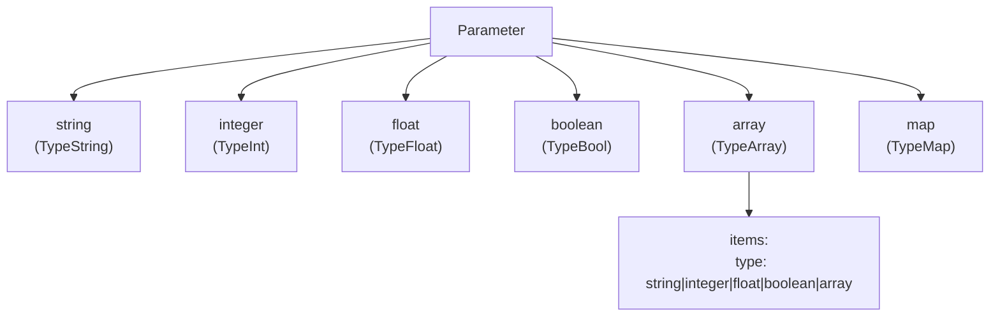
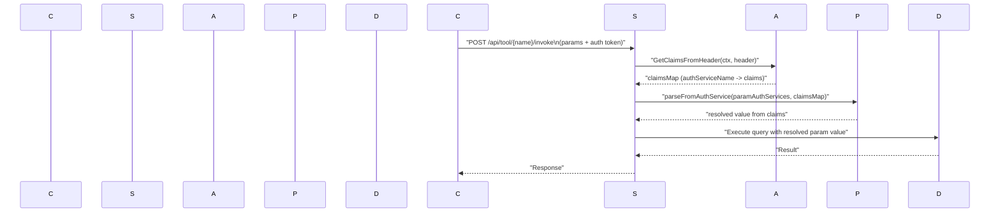
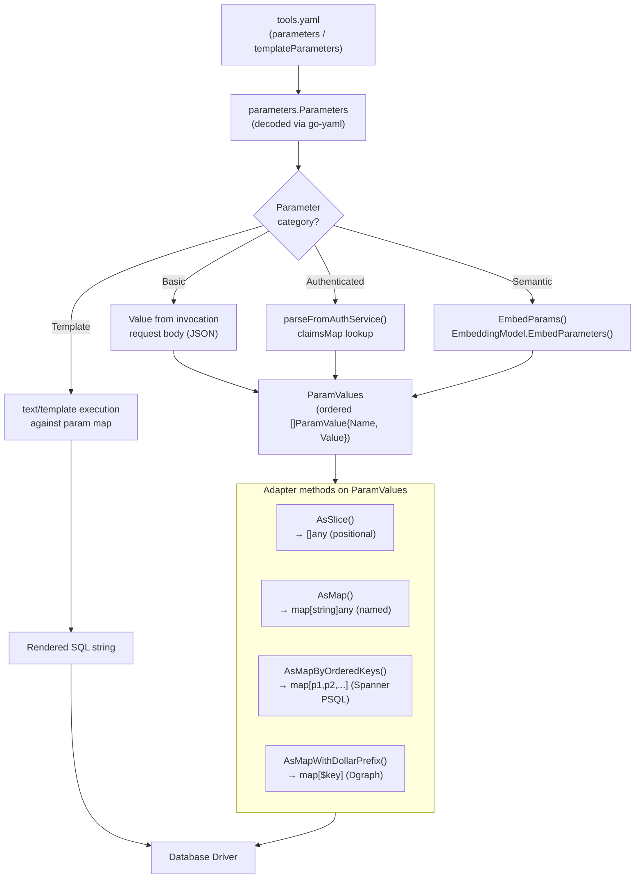
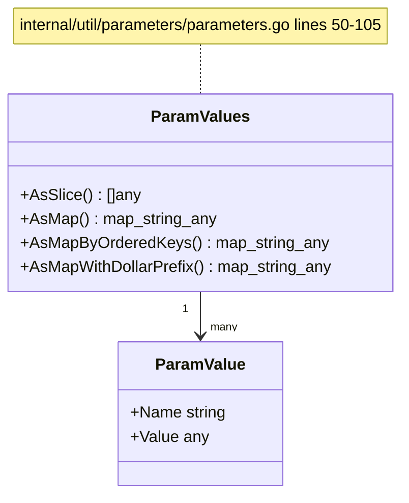

<!-- source: DeepWiki mcp.deepwiki.com · repo googleapis/genai-toolbox · page 6.6 Tool Parameters · fetched 2026-10-29 -->

# Tool Parameters

<details>
<summary>Relevant source files</summary>

The following files were used as context for generating this wiki page:

- [docs/en/documentation/configuration/authentication/_index.md](docs/en/documentation/configuration/authentication/_index.md)
- [docs/en/documentation/configuration/embedding-models/_index.md](docs/en/documentation/configuration/embedding-models/_index.md)
- [docs/en/documentation/configuration/embedding-models/gemini.md](docs/en/documentation/configuration/embedding-models/gemini.md)
- [docs/en/documentation/configuration/prompts/_index.md](docs/en/documentation/configuration/prompts/_index.md)
- [docs/en/documentation/configuration/sources/_index.md](docs/en/documentation/configuration/sources/_index.md)
- [internal/embeddingmodels/embeddingmodels.go](internal/embeddingmodels/embeddingmodels.go)
- [internal/embeddingmodels/gemini/gemini.go](internal/embeddingmodels/gemini/gemini.go)
- [internal/embeddingmodels/gemini/gemini_test.go](internal/embeddingmodels/gemini/gemini_test.go)
- [internal/server/api.go](internal/server/api.go)
- [internal/server/api_test.go](internal/server/api_test.go)
- [internal/sources/sources.go](internal/sources/sources.go)
- [internal/tools/looker/lookerconversationalanalytics/lookerconversationalanalytics.go](internal/tools/looker/lookerconversationalanalytics/lookerconversationalanalytics.go)
- [internal/tools/tools.go](internal/tools/tools.go)
- [internal/util/parameters/parameters.go](internal/util/parameters/parameters.go)
- [internal/util/parameters/parameters_test.go](internal/util/parameters/parameters_test.go)
- [internal/util/util.go](internal/util/util.go)

</details>


This page documents the parameter system used by tools in MCP Toolbox for Databases: how parameters are defined in `tools.yaml`, the available types, special categories (authenticated, template, semantic), and how they are resolved during tool invocation.

For information about how tools themselves are structured and registered, see **6.1 Tool Architecture**. For the format of the full `tools.yaml` file, see **3.1 Tools.yaml Format**. For how authentication services are configured and linked to parameters, see **7.1 Authentication Architecture**.

---

## Overview

Each tool exposes a named set of parameters that an AI agent or client fills in when invoking the tool. These parameters are declared in `tools.yaml` and are processed by the `internal/util/parameters` package at request time. The processing pipeline resolves values from the request body, from auth token claims, or directly from the server-side configuration, then converts them into a format suitable for the underlying data source.

---

## Parameter Categories

There are four distinct parameter categories, distinguished by where their values come from at runtime:

| Category | Source of value | YAML key |
|---|---|---|
| **Basic** | Supplied by the AI agent in the invocation request | `parameters` |
| **Authenticated** | Extracted from the caller's ID token claims | `parameters` (with `authServices`) |
| **Template** | Injected directly into the SQL/query string via Go template syntax | `templateParameters` |
| **Semantic** | Value derived from an embedding model applied to another parameter | `parameters` (with `valueFromParam` and `embeddedBy`) |

---

## Type System

The following scalar and composite types are defined as constants in [internal/util/parameters/parameters.go:33-40]():

| Constant | YAML value | Go runtime type |
|---|---|---|
| `TypeString` | `"string"` | `string` |
| `TypeInt` | `"integer"` | `int64` |
| `TypeFloat` | `"float"` | `float64` |
| `TypeBool` | `"boolean"` | `bool` |
| `TypeArray` | `"array"` | `[]any` |
| `TypeMap` | `"map"` | `map[string]any` |

**Type Hierarchy Diagram**



Sources: [internal/util/parameters/parameters.go:33-40]()

---

## Basic Parameter Fields

A parameter block declared under the `parameters` key of a tool supports the following fields:

| Field | Type | Required | Description |
|---|---|---|---|
| `name` | string | yes | Identifier used in SQL placeholders and template substitution |
| `type` | string | yes | One of the type constants above |
| `description` | string | yes | Natural language description sent to the AI agent as context |
| `required` | boolean | no (default `true`) | Whether the agent must supply this value |
| `default` | parameter type | no | Value used when the agent omits the parameter; also sets `required` to `false` |
| `items` | object | required when `type: array` | Describes the element type; may itself contain `type` and `items` |

**Example – basic parameters:**

```yaml
kind: tool
name: search_flights_by_number
type: postgres-sql
source: my-pg-instance
statement: |
  SELECT * FROM flights WHERE airline = $1 AND flight_number = $2 LIMIT 10
description: Look up a flight by airline code and number.
parameters:
  - name: airline
    type: string
    description: Two-letter airline code, e.g. "CY"
  - name: flight_number
    type: string
    description: 1 to 4-digit flight number
```

Sources: [internal/util/parameters/parameters_test.go:33-130](), [internal/tools/looker/lookerconversationalanalytics/lookerconversationalanalytics.go:160-173]()

---

## Authenticated Parameters

Authenticated parameters are not supplied by the agent. Their values are extracted from claims in the caller's ID token, provided via an `AuthService`.

### How it works

1. The tool declares `authRequired` listing one or more auth service names.
2. Each parameter that should be auth-populated declares an `authServices` list with `name` (the auth service) and `field` (the JWT claim name to extract).
3. During invocation, the server calls the `parseFromAuthService` function in [internal/util/parameters/parameters.go:107](), which iterates over the declared `ParamAuthService` entries and resolves the value from the `claimsMap`.

**Example – authenticated parameter:**

```yaml
kind: tool
name: get_user_orders
type: postgres-sql
source: my-pg-instance
authRequired:
  - my-google-auth-service
statement: SELECT * FROM orders WHERE user_id = $1
description: Fetch orders for the currently authenticated user.
parameters:
  - name: user_id
    type: string
    description: Authenticated user's ID (populated from token)
    authServices:
      - name: my-google-auth-service
        field: sub
```

**Authenticated Parameter Flow:**



Sources: [internal/util/parameters/parameters.go:107-130](), [internal/server/api.go:159-172]()

---

## Template Parameters

Template parameters allow values to be injected directly into the SQL statement string using Go's `text/template` syntax, rather than being passed as bound/positional parameters.

They are declared under the `templateParameters` key. This is suitable for dynamic identifiers such as table names, schema names, or column names — things that cannot be parameterised with SQL bind variables.

**Example – template parameter:**

```yaml
kind: tool
name: query_table
type: postgres-sql
source: my-pg-instance
statement: SELECT * FROM {{ .table_name }} LIMIT 10
description: Query a specific table.
templateParameters:
  - name: table_name
    type: string
    description: Name of the table to query
```

> ⚠️ Template parameters inject raw strings into SQL. Use with extreme care; they should only be used for identifiers that the agent cannot freely choose, or with validated allow-lists to prevent SQL injection.

The `text/template` package (imported in [internal/util/parameters/parameters.go:27]()) powers the substitution.

**String escaping for template parameters:**

To reduce injection risk when template parameters must include user-controlled content, the following escape modifiers are available (defined in [internal/util/parameters/parameters.go:42-48]()):

| Constant | YAML value | Effect |
|---|---|---|
| `escapeBackticks` | `"backticks"` | Escapes backtick characters |
| `escapeDoubleQuotes` | `"double-quotes"` | Escapes double-quote characters |
| `escapeSingleQuotes` | `"single-quotes"` | Escapes single-quote characters |
| `escapeSquareBrackets` | `"square-brackets"` | Escapes square-bracket characters |

Sources: [internal/util/parameters/parameters.go:27-48]()

---

## Semantic / Embedding Parameters

For tools that perform vector similarity search or vector ingestion, a parameter can have its value automatically generated from an embedding model applied to a different parameter's value.

### Hidden Parameter Duplication (`valueFromParam`)

The `valueFromParam` field allows a parameter to inherit its value from another parameter in the same tool. This is primarily used for **Vector Ingestion**, where you need the original text for a text column and the vector embedding for a vector column.

**Key Behaviors:**
1. **Hidden from Manifest**: Parameters with `valueFromParam` are excluded from the tool definition sent to the Agent [docs/en/documentation/configuration/embedding-models/_index.md:37-39]().
2. **Auto-Filled**: The Toolbox copies the value from the referenced parameter before processing embeddings [docs/en/documentation/configuration/embedding-models/_index.md:40-42]().

**Example – Vector Ingestion:**

```yaml
# Step 1: Define Model
kind: embeddingModel
name: gemini-model
type: gemini
model: gemini-embedding-001
apiKey: ${GOOGLE_API_KEY}

# Step 2: Use in Tool
kind: tool
name: insert_document
type: postgres-sql
source: my-pg-instance
statement: INSERT INTO docs (content, embedding) VALUES ($1, $2)
parameters:
  - name: content
    type: string
    description: The raw text content.
  - name: vector_string
    type: string
    valueFromParam: content # Inherit from 'content'
    embeddedBy: gemini-model # Convert to vector
```

The embedding logic is implemented in `EmbedParams` within [internal/util/parameters/parameters.go:172-236](), which uses the `EmbeddingModel` interface [internal/embeddingmodels/embeddingmodels.go]().

Sources: [docs/en/documentation/configuration/embedding-models/_index.md:23-42](), [internal/util/parameters/parameters.go:172-236](), [internal/embeddingmodels/gemini/gemini.go:142-172]()

---

## Parameter Processing Pipeline

The following diagram maps from YAML configuration through to the resolved values that are passed to the database driver.

**Parameter Resolution Pipeline**



Sources: [internal/util/parameters/parameters.go:50-105](), [internal/util/parameters/parameters.go:131-170](), [internal/util/parameters/parameters.go:172-236]()

---

## `ParamValues` and Adapter Methods

After all parameters are resolved, they are collected into a `ParamValues` value — an ordered slice of `ParamValue` structs defined at [internal/util/parameters/parameters.go:50-67]():

```go
type ParamValues []ParamValue

type ParamValue struct {
    Name  string
    Value any
}
```

Different database drivers require different calling conventions. The following methods on `ParamValues` satisfy those conventions:

| Method | Returns | Used by |
|---|---|---|
| `AsSlice()` | `[]any` | Positional bind drivers (PostgreSQL `$1,$2`, MySQL `?`) |
| `AsMap()` | `map[string]any` | Named bind drivers (Spanner named params, MongoDB) |
| `AsMapByOrderedKeys()` | `map[string]any` with keys `p1`, `p2`, … | Spanner PostgreSQL interface |
| `AsMapWithDollarPrefix()` | `map[string]any` with `$`-prefixed keys | DGraph GraphQL variables |

**Code Entity Map: ParamValues Methods**



Sources: [internal/util/parameters/parameters.go:50-105]()

---

## Full YAML Reference

The table below summarises every recognised field in a parameter block:

| Field | Applies to | Type | Required | Notes |
|---|---|---|---|---|
| `name` | all | string | yes | Must be unique within the tool |
| `type` | all | string | yes | `string`, `integer`, `float`, `boolean`, `array`, `map` |
| `description` | basic, template | string | yes | Sent to the agent as context |
| `required` | basic | boolean | no (default `true`) | Set to `false` or supply `default` to make optional |
| `default` | basic | param type | no | Implied `required: false` |
| `items` | array type | object | required for `array` | Element type definition |
| `authServices` | authenticated | list of `{name, field}` | yes for auth params | Auth service name + JWT claim field |
| `valueFromParam` | semantic | string | yes for semantic params | Name of the text param to duplicate |
| `embeddedBy` | semantic | string | yes for semantic params | Name of the `embeddingModel` to use |

Sources: [internal/util/parameters/parameters.go:33-48](), [internal/util/parameters/parameters_test.go:33-300](), [docs/en/documentation/configuration/embedding-models/_index.md:80-106]()

---

