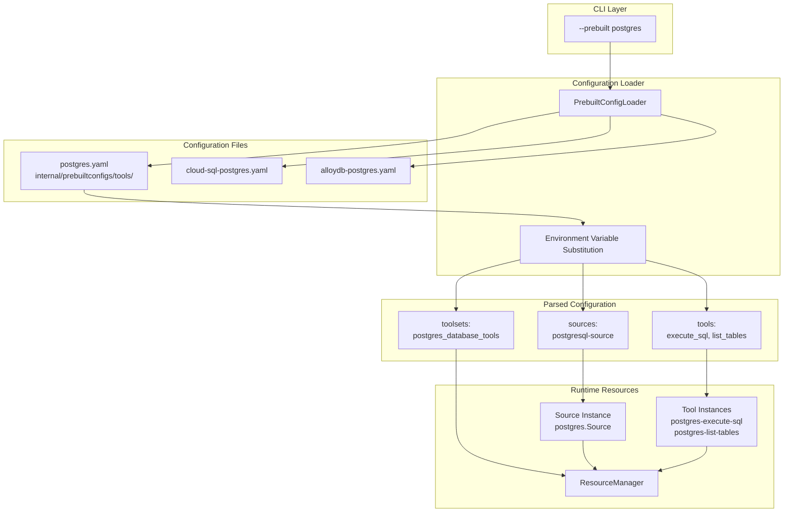
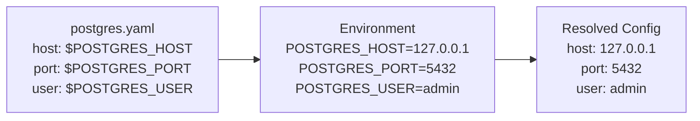
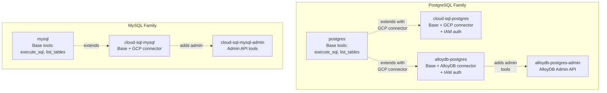
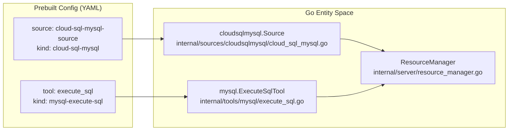

<!-- source: DeepWiki mcp.deepwiki.com · repo googleapis/genai-toolbox · page 6.7 Prebuilt Tools Reference · fetched 2026-10-29 -->

# Prebuilt Tools Reference

Relevant source files

The following files were used as context for generating this wiki page:

- [internal/prebuiltconfigs/tools/alloydb-postgres-admin.yaml](internal/prebuiltconfigs/tools/alloydb-postgres-admin.yaml)
- [internal/prebuiltconfigs/tools/alloydb-postgres.yaml](internal/prebuiltconfigs/tools/alloydb-postgres.yaml)
- [internal/prebuiltconfigs/tools/cloud-sql-mssql-admin.yaml](internal/prebuiltconfigs/tools/cloud-sql-mssql-admin.yaml)
- [internal/prebuiltconfigs/tools/cloud-sql-mysql-admin.yaml](internal/prebuiltconfigs/tools/cloud-sql-mysql-admin.yaml)
- [internal/prebuiltconfigs/tools/cloud-sql-mysql.yaml](internal/prebuiltconfigs/tools/cloud-sql-mysql.yaml)
- [internal/prebuiltconfigs/tools/cloud-sql-postgres-admin.yaml](internal/prebuiltconfigs/tools/cloud-sql-postgres-admin.yaml)
- [internal/prebuiltconfigs/tools/cloud-sql-postgres.yaml](internal/prebuiltconfigs/tools/cloud-sql-postgres.yaml)
- [internal/prebuiltconfigs/tools/mysql.yaml](internal/prebuiltconfigs/tools/mysql.yaml)
- [internal/prebuiltconfigs/tools/postgres.yaml](internal/prebuiltconfigs/tools/postgres.yaml)
- [internal/sources/cloudsqlmssql/cloud_sql_mssql.go](internal/sources/cloudsqlmssql/cloud_sql_mssql.go)
- [internal/sources/cloudsqlmssql/cloud_sql_mssql_test.go](internal/sources/cloudsqlmssql/cloud_sql_mssql_test.go)
- [internal/sources/cloudsqlmysql/cloud_sql_mysql.go](internal/sources/cloudsqlmysql/cloud_sql_mysql.go)
- [internal/sources/cloudsqlmysql/cloud_sql_mysql_test.go](internal/sources/cloudsqlmysql/cloud_sql_mysql_test.go)
- [internal/sources/mssql/mssql.go](internal/sources/mssql/mssql.go)
- [internal/sources/mssql/mssql_test.go](internal/sources/mssql/mssql_test.go)
- [internal/sources/mysql/mysql.go](internal/sources/mysql/mysql.go)
- [internal/sources/mysql/mysql_test.go](internal/sources/mysql/mysql_test.go)
- [tests/alloydb/alloydb_integration_test.go](tests/alloydb/alloydb_integration_test.go)
- [tests/alloydb/alloydb_mcp_test.go](tests/alloydb/alloydb_mcp_test.go)
- [tests/alloydb/alloydb_wait_for_operation_mcp_test.go](tests/alloydb/alloydb_wait_for_operation_mcp_test.go)
- [tests/alloydbainl/alloydb_ai_nl_mcp_test.go](tests/alloydbainl/alloydb_ai_nl_mcp_test.go)
- [tests/http/http_mcp_test.go](tests/http/http_mcp_test.go)
- [tests/mcp_tool.go](tests/mcp_tool.go)

## Purpose and Scope

This page provides a complete reference of all prebuilt tool configurations available in the Toolbox system. Prebuilt configurations are ready-to-use YAML files that bundle database sources, tools, and toolsets for specific database types and use cases. They can be activated using the `--prebuilt` CLI flag.

For information about custom tool definitions and the tool architecture, see [6.1 Tool Architecture](). For details on configuring custom sources and tools using `tools.yaml`, see [3.1 Tools.yaml Format](). For the CLI usage of the `--prebuilt` flag, see [3.2 Command Line Interface]().

## Prebuilt Configuration System

### Architecture

Prebuilt configurations are stored in `internal/prebuiltconfigs/tools/` as YAML files. When the `--prebuilt` flag is provided, the server loads the corresponding configuration file, performs environment variable substitution, and initializes sources, tools, and toolsets.

#### Prebuilt Configuration Data Flow

**Sources:** [internal/prebuiltconfigs/tools/postgres.yaml:1-24](), [internal/prebuiltconfigs/tools/cloud-sql-postgres.yaml:1-30](), [internal/prebuiltconfigs/tools/alloydb-postgres.yaml:1-31]()

### Environment Variable Substitution

All prebuilt configurations use environment variable substitution syntax `${VAR_NAME}` or `${VAR_NAME:default}`. The server replaces these placeholders at load time with actual environment variable values.

#### Configuration Resolution

**Sources:** [internal/prebuiltconfigs/tools/postgres.yaml:18-22](), [internal/prebuiltconfigs/tools/cloud-sql-postgres.yaml:18-24](), [internal/prebuiltconfigs/tools/alloydb-postgres.yaml:18-25]()

## Database Family Organization

Prebuilt configurations are organized into families based on database type, with multiple variants for different use cases:

| Family | Base Variant | GCP Managed | Admin Variant |
|--------|--------------|-------------|---------------|
| **PostgreSQL** | `postgres` | `cloud-sql-postgres`, `alloydb-postgres` | `*-admin` |
| **MySQL** | `mysql` | `cloud-sql-mysql` | `*-admin` |
| **SQL Server** | `mssql` | `cloud-sql-mssql` | `*-admin` |

#### Database Family Architecture

**Sources:** [internal/prebuiltconfigs/tools/postgres.yaml:1-24](), [internal/prebuiltconfigs/tools/alloydb-postgres.yaml:1-31](), [internal/prebuiltconfigs/tools/mysql.yaml:1-28](), [internal/prebuiltconfigs/tools/cloud-sql-mysql.yaml:1-30]()

## PostgreSQL Family

### postgres

Generic PostgreSQL database connectivity using standard PostgreSQL protocol.

| Property | Value |
|----------|-------|
| **Prebuilt Value** | `postgres` |
| **Source Kind** | `postgres` |
| **Configuration File** | `internal/prebuiltconfigs/tools/postgres.yaml` |

#### Environment Variables

| Variable | Required | Description | Default |
|----------|----------|-------------|---------|
| `POSTGRES_HOST` | Yes | Hostname or IP address | `localhost` |
| `POSTGRES_PORT` | Yes | Port number | `5432` |
| `POSTGRES_DATABASE` | Yes | Database name | - |
| `POSTGRES_USER` | Yes | Username | - |
| `POSTGRES_PASSWORD` | Yes | Password | - |
| `POSTGRES_QUERY_PARAMS` | No | Connection string parameters | empty |

**Sources:** [internal/prebuiltconfigs/tools/postgres.yaml:15-23]()

### cloud-sql-postgres

Cloud SQL for PostgreSQL with GCP connector and IAM authentication support.

| Property | Value |
|----------|-------|
| **Prebuilt Value** | `cloud-sql-postgres` |
| **Source Kind** | `cloud-sql-postgres` |
| **Configuration File** | `internal/prebuiltconfigs/tools/cloud-sql-postgres.yaml` |

#### Environment Variables

| Variable | Required | Description | Default |
|----------|----------|-------------|---------|
| `CLOUD_SQL_POSTGRES_PROJECT` | Yes | GCP project ID | - |
| `CLOUD_SQL_POSTGRES_REGION` | Yes | GCP region | - |
| `CLOUD_SQL_POSTGRES_INSTANCE` | Yes | Cloud SQL instance ID | - |
| `CLOUD_SQL_POSTGRES_DATABASE` | Yes | Database name | - |
| `CLOUD_SQL_POSTGRES_USER` | No | Database username | - |
| `CLOUD_SQL_POSTGRES_PASSWORD` | No | Database password | - |
| `CLOUD_SQL_POSTGRES_IP_TYPE` | No | IP type: `public` or `private` | `public` |

**Sources:** [internal/prebuiltconfigs/tools/cloud-sql-postgres.yaml:15-24]()

### alloydb-postgres

AlloyDB for PostgreSQL with AlloyDB connector and IAM authentication.

| Property | Value |
|----------|-------|
| **Prebuilt Value** | `alloydb-postgres` |
| **Source Kind** | `alloydb-postgres` |
| **Configuration File** | `internal/prebuiltconfigs/tools/alloydb-postgres.yaml` |

#### Environment Variables

| Variable | Required | Description | Default |
|----------|----------|-------------|---------|
| `ALLOYDB_POSTGRES_PROJECT` | Yes | GCP project ID | - |
| `ALLOYDB_POSTGRES_REGION` | Yes | GCP region | - |
| `ALLOYDB_POSTGRES_CLUSTER` | Yes | AlloyDB cluster ID | - |
| `ALLOYDB_POSTGRES_INSTANCE` | Yes | AlloyDB instance ID | - |
| `ALLOYDB_POSTGRES_DATABASE` | Yes | Database name | - |
| `ALLOYDB_POSTGRES_USER` | No | Database username | - |
| `ALLOYDB_POSTGRES_PASSWORD` | No | Database password | - |
| `ALLOYDB_POSTGRES_IP_TYPE` | No | IP type: `public` or `private` | `public` |

**Sources:** [internal/prebuiltconfigs/tools/alloydb-postgres.yaml:15-25]()

#### PostgreSQL Family Tools (Common)

| Tool Name | Tool Kind | Description |
|-----------|-----------|-------------|
| `execute_sql` | `postgres-execute-sql` | Execute a single SQL statement. |
| `list_tables` | `postgres-list-tables` | Lists detailed schema information for tables. |
| `list_active_queries` | `postgres-list-active-queries` | List currently running queries from `pg_stat_activity`. |
| `list_available_extensions` | `postgres-list-available-extensions` | Discover available extensions. |
| `list_installed_extensions` | `postgres-list-installed-extensions` | List installed extensions. |
| `long_running_transactions` | `postgres-long-running-transactions` | Identifies transactions exceeding time limits. |
| `list_locks` | `postgres-list-locks` | Identifies locks held by active processes. |
| `replication_stats` | `postgres-replication-stats` | Lists replica lag and sync states. |
| `get_query_plan` | `postgres-sql` | Generate EXPLAIN plan in JSON format. |

**Sources:** [internal/prebuiltconfigs/tools/postgres.yaml:24-154](), [internal/prebuiltconfigs/tools/alloydb-postgres.yaml:31-160]()

### alloydb-postgres-admin

AlloyDB Admin API tools for cluster and instance management.

| Property | Value |
|----------|-------|
| **Prebuilt Value** | `alloydb-postgres-admin` |
| **Source Kind** | `alloydb-admin` |
| **Configuration File** | `internal/prebuiltconfigs/tools/alloydb-postgres-admin.yaml` |

#### Tools

| Tool Name | Tool Kind | Description |
|-----------|-----------|-------------|
| `create_cluster` | `alloydb-create-cluster` | Create a new AlloyDB cluster. |
| `create_instance` | `alloydb-create-instance` | Create a new AlloyDB instance. |
| `list_clusters` | `alloydb-list-clusters` | List all clusters in a project. |
| `list_instances` | `alloydb-list-instances` | List all instances in a cluster. |
| `create_user` | `alloydb-create-user` | Create a database user. |
| `wait_for_operation` | `alloydb-wait-for-operation` | Wait for a long-running operation to complete. |

**Sources:** [internal/prebuiltconfigs/tools/alloydb-postgres-admin.yaml:15-67]()

## MySQL Family

### mysql

Generic MySQL database connectivity using standard MySQL protocol.

| Property | Value |
|----------|-------|
| **Prebuilt Value** | `mysql` |
| **Source Kind** | `mysql` |
| **Configuration File** | `internal/prebuiltconfigs/tools/mysql.yaml` |

#### Environment Variables

| Variable | Required | Description | Default |
|----------|----------|-------------|---------|
| `MYSQL_HOST` | Yes | Hostname or IP address | `localhost` |
| `MYSQL_PORT` | Yes | Port number | `3306` |
| `MYSQL_DATABASE` | Yes | Database name | - |
| `MYSQL_USER` | Yes | Username | - |
| `MYSQL_PASSWORD` | Yes | Password | - |
| `MYSQL_QUERY_PARAMS` | No | Raw DSN parameters | empty |

**Sources:** [internal/prebuiltconfigs/tools/mysql.yaml:15-28]()

### cloud-sql-mysql

Cloud SQL for MySQL with GCP connector.

| Property | Value |
|----------|-------|
| **Prebuilt Value** | `cloud-sql-mysql` |
| **Source Kind** | `cloud-sql-mysql` |
| **Configuration File** | `internal/prebuiltconfigs/tools/cloud-sql-mysql.yaml` |

#### Environment Variables

| Variable | Required | Description | Default |
|----------|----------|-------------|---------|
| `CLOUD_SQL_MYSQL_PROJECT` | Yes | GCP project ID | - |
| `CLOUD_SQL_MYSQL_REGION` | Yes | GCP region | - |
| `CLOUD_SQL_MYSQL_INSTANCE` | Yes | Cloud SQL instance ID | - |
| `CLOUD_SQL_MYSQL_DATABASE` | Yes | Database name | - |
| `CLOUD_SQL_MYSQL_USER` | No | Database username | - |
| `CLOUD_SQL_MYSQL_PASSWORD` | No | Database password | - |
| `CLOUD_SQL_MYSQL_IP_TYPE` | No | IP type: `PUBLIC` or `PRIVATE` | `PUBLIC` |

**Sources:** [internal/prebuiltconfigs/tools/cloud-sql-mysql.yaml:15-24]()

#### MySQL Family Tools (Common)

| Tool Name | Tool Kind | Description |
|-----------|-----------|-------------|
| `execute_sql` | `mysql-execute-sql` | Execute SQL statements. |
| `list_active_queries` | `mysql-list-active-queries` | Lists top N ongoing queries from processlist. |
| `get_query_plan` | `mysql-get-query-plan` | Analyze query execution plans. |
| `list_tables` | `mysql-list-tables` | Lists detailed schema information for tables. |
| `list_table_stats` | `mysql-list-table-stats` | Display table size and latency statistics. |
| `list_table_fragmentation` | `mysql-list-table-fragmentation` | Calculate free space relative to total data size. |

**Sources:** [internal/prebuiltconfigs/tools/mysql.yaml:29-57](), [internal/prebuiltconfigs/tools/cloud-sql-mysql.yaml:30-58]()

## Implementation Details

The prebuilt configurations are processed by the `ResourceManager` which initializes the specified `Source` and registers the `Tool` instances.

#### Prebuilt Tool Registration Mapping

**Sources:** [internal/sources/cloudsqlmysql/cloud_sql_mysql.go:33-62](), [internal/sources/mysql/mysql.go:32-61](), [internal/prebuiltconfigs/tools/cloud-sql-mysql.yaml:15-33]()

### Connection Initialization

Managed sources like `cloud-sql-mysql` utilize specialized initialization functions to handle GCP-specific connectivity requirements such as IAM authentication and the Cloud SQL Auth Proxy logic.

1.  `initCloudSQLMySQLConnectionPool` is called with parameters from the config [internal/sources/cloudsqlmysql/cloud_sql_mysql.go:69-69]().
2.  `getConnectionConfig` determines if IAM or password authentication should be used [internal/sources/cloudsqlmysql/cloud_sql_mysql.go:195-195]().
3.  `sources.GetCloudSQLOpts` provides the necessary dialer options [internal/sources/cloudsqlmysql/cloud_sql_mysql.go:205-205]().
4.  The driver is registered and the connection pool (`sql.DB`) is opened [internal/sources/cloudsqlmysql/cloud_sql_mysql.go:214-247]().

**Sources:** [internal/sources/cloudsqlmysql/cloud_sql_mysql.go:163-247](), [internal/sources/mysql/mysql.go:162-211]()

---

