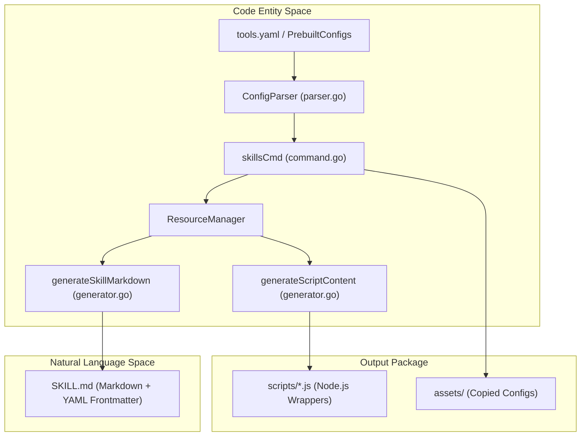
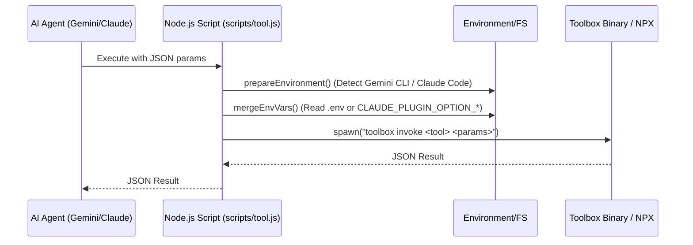

<!-- source: DeepWiki mcp.deepwiki.com · repo googleapis/genai-toolbox · page 6.8 Agent Skills Generation · fetched 2026-10-29 -->

# Agent Skills Generation

<details>
<summary>Relevant source files</summary>

The following files were used as context for generating this wiki page:

- [cmd/internal/invoke/command.go](cmd/internal/invoke/command.go)
- [cmd/internal/invoke/command_test.go](cmd/internal/invoke/command_test.go)
- [cmd/internal/options.go](cmd/internal/options.go)
- [cmd/internal/options_test.go](cmd/internal/options_test.go)
- [cmd/internal/skills/command.go](cmd/internal/skills/command.go)
- [cmd/internal/skills/command_test.go](cmd/internal/skills/command_test.go)
- [cmd/internal/skills/generator.go](cmd/internal/skills/generator.go)
- [cmd/internal/skills/generator_test.go](cmd/internal/skills/generator_test.go)
- [docs/en/documentation/configuration/skills/_index.md](docs/en/documentation/configuration/skills/_index.md)
- [docs/en/reference/cli.md](docs/en/reference/cli.md)

</details>


The `skills-generate` command converts MCP Toolbox toolsets into **Agent Skills** compliant packages. These packages follow the [Agent Skill specification](https://agentskills.io/specification), allowing database tools to be easily portable and installable in AI clients like the Gemini CLI or Claude Code.

## Overview

The generation process transforms YAML-based tool definitions into a structured directory containing a human-readable `SKILL.md` file, an `assets/` directory for the original configurations, and a `scripts/` directory containing Node.js wrappers that invoke the `toolbox` binary or use `npx`.

### Data Flow: Tool to Skill

The following diagram illustrates how the `skills-generate` command processes internal configurations into the final Skill package.

**Skill Generation Pipeline**

Sources: [cmd/internal/skills/command.go:74-111](), [cmd/internal/skills/generator.go:74-118](), [cmd/internal/skills/generator.go:190-229]()

---

## The `skills-generate` Command

The command is implemented in `cmd/internal/skills/command.go` and is accessible via the `toolbox skills-generate` subcommand.

### Syntax
```bash
toolbox skills-generate --name <name> --description <description> [flags]
```

### Key Flags
| Flag | Description | Default |
| :--- | :--- | :--- |
| `--name` | **Required.** Name of the skill (lowercase alphanumeric and hyphens). | N/A |
| `--description` | **Required.** Description of the skill's purpose. | N/A |
| `--toolset` | Name of the toolset to convert. If omitted, generates skills for all custom toolsets. | All tools |
| `--output-dir` | Directory where the skill package will be written. | `skills` |
| `--invocation-mode` | Method the Node scripts use to run toolbox: `binary` or `npx`. | `npx` |
| `--toolbox-version` | Version of `@toolbox-sdk/server` to use when mode is `npx`. | Current version |
| `--license-header` | Optional text to prepend to generated `.js` files. | "" |

Sources: [docs/en/reference/cli.md:58-78](), [cmd/internal/skills/command.go:61-71]()

---

## Skill Package Structure

When executed, the command creates a directory named after the `--name` flag (or `<name>-<toolset>` if generating multiple) with the following layout:

```text
my-skill/
├── SKILL.md            # Metadata and human-readable usage
├── assets/             # Copies of tools.yaml and related configs
└── scripts/            # Node.js execution scripts for each tool
    ├── tool-one.js
    └── tool-two.js
```
Sources: [docs/en/documentation/configuration/skills/_index.md:82-91](), [cmd/internal/skills/command.go:128-149]()

### SKILL.md Format
The `SKILL.md` file is generated using the `skillTemplate` in `generator.go`. It includes:
1.  **YAML Frontmatter**: Contains the `name` and `description` for the agent.
2.  **Usage Instructions**: Platform-specific execution examples (Bash and PowerShell).
3.  **Scripts Reference**: A generated list of all tools, their descriptions, and a table of parameters (Name, Type, Description, Required, Default).

Sources: [cmd/internal/skills/generator.go:27-56](), [cmd/internal/skills/generator.go:74-118]()

### Generated Node.js Scripts
Each tool in the toolset gets a dedicated script. These scripts serve as a bridge between the AI agent environment and the Toolbox CLI.

**Script Logic Flow**

Sources: [cmd/internal/skills/generator.go:120-165](), [cmd/internal/skills/generator.go:190-229]()

#### Invocation Modes
-   **npx**: The script uses `npx --yes @toolbox-sdk/server@<version>` to invoke the tool. This is the default as it doesn't require the `toolbox` binary to be pre-installed on the host.
-   **binary**: The script searches for a local `toolbox` binary in the skill root or in the system `PATH`.

Sources: [cmd/internal/skills/generator.go:192-229](), [cmd/internal/skills/command.go:67-68]()

---

## Parameter Processing

The `formatParameters` function in `generator.go` converts internal `ParameterManifest` structures into the Markdown tables found in `SKILL.md`.

-   **Environment Variables**: If a parameter has a default value that matches an environment variable provided during generation, the default is omitted from the documentation to encourage environment-based configuration.
-   **Optional Variables**: The generated Node scripts include an `OPTIONAL_VARS_TO_OMIT_IF_EMPTY` list. If these variables are found in the environment as empty strings, they are deleted before calling `toolbox invoke` to prevent parameter validation errors.

Sources: [cmd/internal/skills/generator.go:88-91](), [cmd/internal/skills/generator.go:131-135](), [cmd/internal/skills/generator_test.go:59-174]()

---

## Installation in Clients

### Gemini CLI
Once generated, a skill can be installed into the Gemini CLI:
```bash
gemini skills install ./skills/my-skill
```
The Gemini CLI sets `process.env.GEMINI_CLI === '1'`, which triggers the script to look for a `.env` file in the skill's parent directory to load credentials or connection strings.

### Claude Code
For Claude Code, the scripts detect `process.env.CLAUDECODE === '1'` and automatically map `CLAUDE_PLUGIN_OPTION_` prefixed environment variables to the tool's execution environment.

Sources: [docs/en/documentation/configuration/skills/_index.md:105-118](), [cmd/internal/skills/generator.go:138-165]()

---

