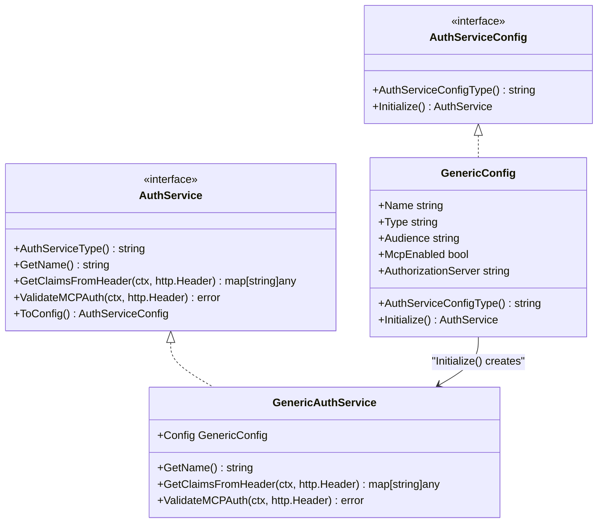
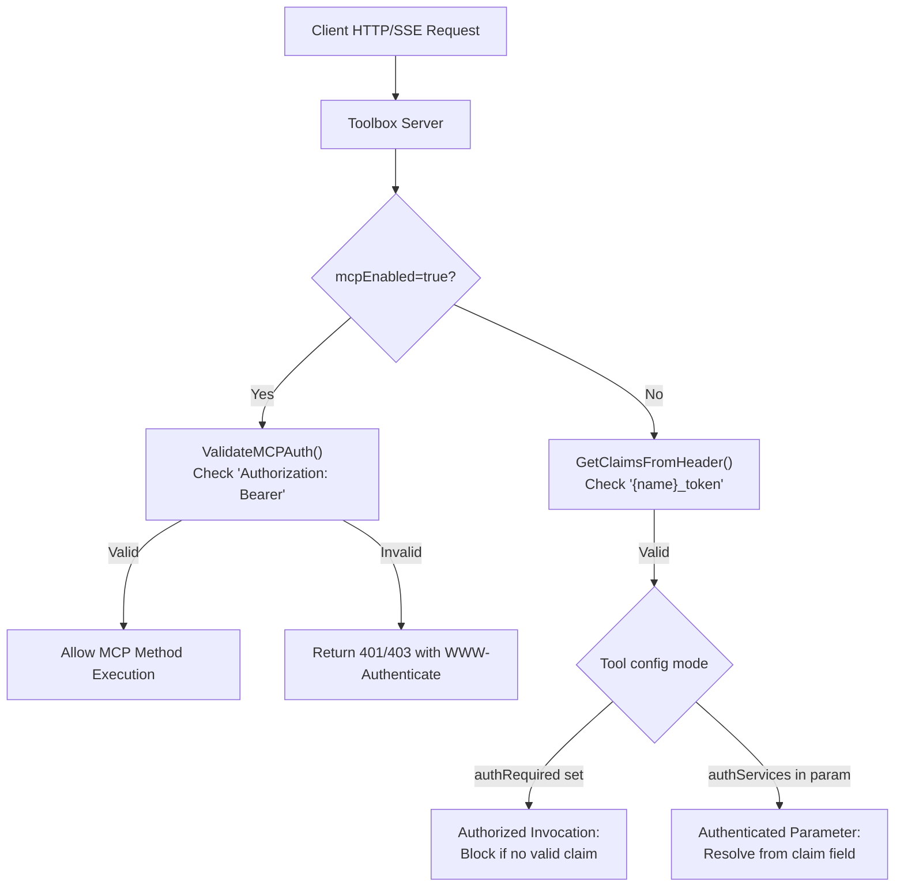

<!-- source: DeepWiki mcp.deepwiki.com · repo googleapis/genai-toolbox · page 7 Authentication and Authorization · fetched 2026-10-29 -->

# Authentication and Authorization

<details>
<summary>Relevant source files</summary>

The following files were used as context for generating this wiki page:

- [.hugo/go.mod](.hugo/go.mod)
- [.hugo/go.sum](.hugo/go.sum)
- [docs/en/documentation/configuration/authentication/generic.md](docs/en/documentation/configuration/authentication/generic.md)
- [internal/auth/generic/generic.go](internal/auth/generic/generic.go)
- [internal/auth/generic/generic_test.go](internal/auth/generic/generic_test.go)
- [tests/auth/auth_integration_test.go](tests/auth/auth_integration_test.go)

</details>


This page covers the authentication and authorization mechanisms available in MCP Toolbox for Databases, including how tools are protected with identity-based access control and how database connections authenticate to backend systems. The material is organized as follows:

- **This page**: Concepts overview and the `authServices` configuration system.
- [Authentication Architecture](#7.1): Internal auth model, `authRequired`, `Authorized()` check, and token flow.
- [IAM Authentication](#7.2): Application Default Credentials, service account impersonation, and Cloud SQL / AlloyDB / BigQuery IAM setup.
- [OAuth and Auth Services](#7.3): Configuring OAuth2 auth services, client-side token getters, and Google OAuth integration.

---

## Two Distinct Auth Concerns

Toolbox has two separate authentication surfaces that should not be confused:

| Concern | What it protects | Mechanism |
|---|---|---|
| **Tool invocation auth** | Whether a caller is allowed to invoke a tool | `authServices` + OIDC tokens passed by client SDKs |
| **Database/source auth** | How Toolbox authenticates to the backend data source | Passwords, IAM credentials (ADC), service account keys |
| **MCP Authorization** | Global access to the MCP server endpoints | `mcpEnabled: true` + standard `Authorization: Bearer` header |

The `authServices` system addresses **tool invocation auth** and **MCP Authorization**. Database-level authentication is specific to each source type and is documented in [Data Sources](#5) and [IAM Authentication](#7.2).

---

## AuthService System

### Core Interfaces

The foundation is defined in `internal/auth/auth.go`.

| Interface | Purpose |
|---|---|
| `AuthServiceConfig` | Defines how to configure and initialize an auth service. Methods: `AuthServiceConfigType()`, `Initialize()` |
| `AuthService` | Validates tokens from incoming requests. Methods: `AuthServiceType()`, `GetName()`, `GetClaimsFromHeader()`, `ValidateMCPAuth()`, `ToConfig()` |

**AuthService component map:**



Sources: [internal/auth/auth.go:22-34](), [internal/auth/generic/generic.go:40-77]()

### Available Auth Service Types

| `type` value | Package | Description |
|---|---|---|
| `google` | `internal/auth/google` | Validates Google OIDC ID tokens against a registered OAuth2 Client ID. |
| `generic` | `internal/auth/generic` | Supports any OIDC-compliant IDP with JWKS discovery and opaque token introspection. [internal/auth/generic/generic.go:34-34]() |

### Token Validation: `GetClaimsFromHeader`

The `GetClaimsFromHeader` method extracts tokens from custom headers. For the `generic` provider:
1. It looks for a header named `{auth_service_name}_token` [internal/auth/generic/generic.go:179-179]().
2. It validates the JWT signature using JWKS fetched from the `authorizationServer` [internal/auth/generic/generic.go:185-185]().
3. It verifies the `aud` (audience) claim matches the configuration [internal/auth/generic/generic.go:200-215]().

---

## Configuring Auth Services in `tools.yaml`

Auth services are declared using `kind: authServices`. The `generic` type allows for global MCP protection via `mcpEnabled`.

```yaml
kind: authServices
name: my-generic-auth
type: generic
audience: ${YOUR_OIDC_AUDIENCE}
authorizationServer: https://your-idp.example.com
mcpEnabled: true # Protects all MCP endpoints
scopesRequired:
  - read
  - write
```

Sources: [docs/en/documentation/configuration/authentication/generic.md:115-125](), [internal/auth/generic/generic.go:40-47]()

---

## Modes of Authorization

Toolbox supports three distinct ways to use authentication:

**Authorization flow overview:**



Sources: [internal/auth/generic/generic.go:230-241](), [docs/en/documentation/configuration/authentication/generic.md:85-94]()

### 1. MCP Authorization (`mcpEnabled: true`)
When enabled, Toolbox enforces global authentication for all MCP endpoints (e.g., `/mcp/sse`). It expects a standard `Authorization: Bearer <token>` header [internal/auth/generic/generic.go:231-241](). It supports both **JWT** and **Opaque** tokens via introspection [docs/en/documentation/configuration/authentication/generic.md:100-111]().

### 2. Authorized Invocation (`authRequired`)
A tool declares it requires authentication. Toolbox rejects invocations where the corresponding auth service cannot validate a token provided in the `{name}_token` header.

### 3. Authenticated Parameters
A tool parameter is resolved automatically from a validated token claim (e.g., `sub` or `email`) rather than from user input [docs/en/documentation/configuration/authentication/generic.md:74-83]().

---

## Client-Side Token Delivery

Client SDKs pass tokens via HTTP request headers. For `mcpEnabled` services, use the standard `Authorization` header. For tool-specific auth, use the `{name}_token` pattern.

**Python (toolbox-core):**
```python
auth_tool = await toolbox.load_tool(
    "secure_query",
    auth_token_getters={"my-generic-auth": get_auth_token}
)
```

Sources: [docs/en/documentation/configuration/authentication/generic.md:32-33](), [docs/en/documentation/configuration/authentication/generic.md:99-99]()

---

## Database-Level Authentication

Toolbox authenticates to backend data sources independently of the tool invocation auth. This is configured per-source and supports:

- **Password auth**: Direct connection strings.
- **IAM auth via ADC**: Used for Cloud SQL, AlloyDB, and BigQuery.
- **Service account impersonation**: For BigQuery and other services.

See [IAM Authentication](#7.2) for details on ADC and the `GetIAMPrincipalEmailFromADC` utility.

---

## Cloud Deployment Considerations

When deploying to Cloud Run or GKE, multiple layers apply:

| Layer | What | Mechanism |
|---|---|---|
| **Infrastructure** | Clients calling Cloud Run | Cloud Run Invoker IAM + `Authorization: Bearer` |
| **MCP Auth** | Global MCP access | `authServices` (`mcpEnabled: true`) + `Authorization: Bearer` |
| **Tool Auth** | Specific tool access | `authServices` + `{name}_token` headers |

*Note: If both Cloud Run IAM and MCP Auth are used, the `Authorization` header may conflict; ensure your architecture accounts for header propagation or use custom headers where necessary.*

---

