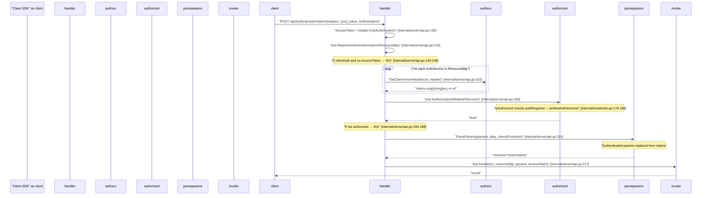
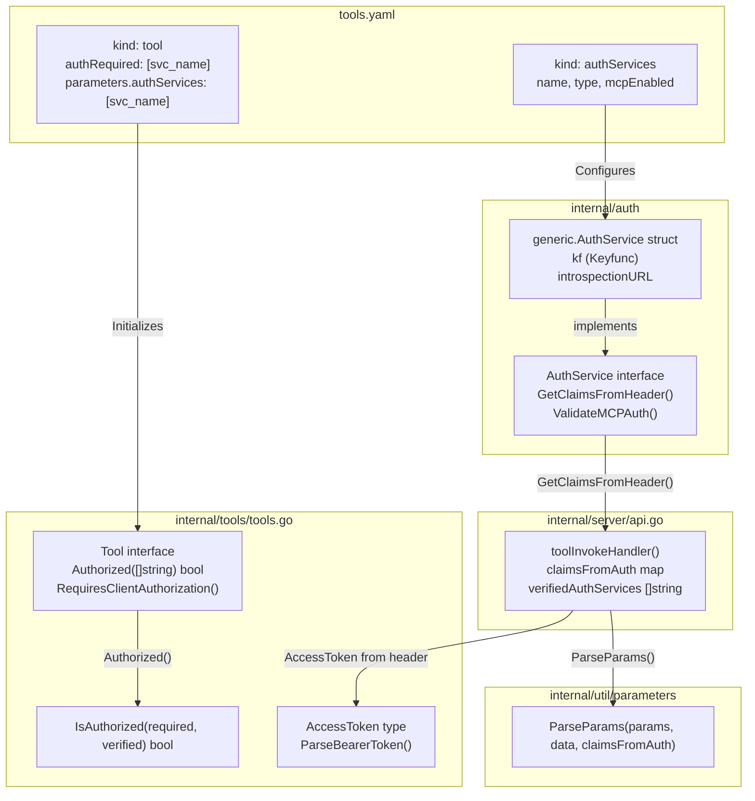

<!-- source: DeepWiki mcp.deepwiki.com · repo googleapis/genai-toolbox · page 7.1 Authentication Architecture · fetched 2026-10-29 -->

# Authentication Architecture

<details>
<summary>Relevant source files</summary>

The following files were used as context for generating this wiki page:

- [docs/en/documentation/configuration/authentication/generic.md](docs/en/documentation/configuration/authentication/generic.md)
- [internal/auth/generic/generic.go](internal/auth/generic/generic.go)
- [internal/auth/generic/generic_test.go](internal/auth/generic/generic_test.go)
- [internal/server/api.go](internal/server/api.go)
- [internal/server/api_test.go](internal/server/api_test.go)
- [internal/sources/sources.go](internal/sources/sources.go)
- [internal/tools/looker/lookerconversationalanalytics/lookerconversationalanalytics.go](internal/tools/looker/lookerconversationalanalytics/lookerconversationalanalytics.go)
- [internal/tools/tools.go](internal/tools/tools.go)
- [internal/util/util.go](internal/util/util.go)
- [tests/auth/auth_integration_test.go](tests/auth/auth_integration_test.go)

</details>


This page explains the server-side authentication and authorization model built into Toolbox: how `AuthService` resources are declared in `tools.yaml`, how tools use them to gate invocations or populate parameters, and how the server enforces those rules on every tool call.

---

## Overview

Toolbox has two distinct authentication mechanisms that operate independently during a tool invocation:

| Mechanism | Purpose | Header |
|---|---|---|
| **AuthService / OIDC** | Gate invocations and inject claims into parameters | Per-service custom header (e.g., `my-auth_token`) |
| **Client Authorization (Bearer token)** | Pass an end-user OAuth access token to the data source | `Authorization: Bearer <token>` |

These are not mutually exclusive. A single tool invocation can require both: an OIDC token to satisfy `authRequired`, and a Bearer access token for the underlying data source (e.g. BigQuery end-user queries or Looker conversational analytics).

Sources: [internal/server/api.go:139-171](), [docs/en/documentation/configuration/authentication/generic.md:24-37]()

---

## AuthService Configuration

`AuthService` resources are declared as top-level `kind: authServices` blocks in `tools.yaml`. Each has a name, a type (e.g., `generic` or `google`), and provider-specific fields.

```yaml
kind: authServices
name: my-generic-auth
type: generic
audience: ${YOUR_OIDC_AUDIENCE}
authorizationServer: https://your-idp.example.com
mcpEnabled: false
```

At startup, all declared auth services are loaded into the `ResourceManager`. The `AuthService` interface exposes methods used during invocation:

- `GetClaimsFromHeader(ctx, header)`: Extracts and validates a token from the HTTP request header, returning its claims as a `map[string]any`. For `generic` auth in "Toolbox Auth" mode, it expects a header named `<name>_token` [internal/auth/generic/generic.go:174-182]().
- `GetName()`: Returns the service's configured name [internal/auth/generic/generic.go:169-171]().
- `ValidateMCPAuth(ctx, header)`: Used when `mcpEnabled: true` to secure the entire MCP server via standard `Authorization: Bearer` headers [internal/auth/generic/generic.go:230-243]().

Sources: [internal/auth/generic/generic.go:40-47](), [internal/auth/generic/generic.go:149-172](), [docs/en/documentation/configuration/authentication/generic.md:50-60]()

---

## Tool Declaration of Auth Requirements

Tools declare their authentication needs in their YAML configuration:

1.  **`authRequired`**: A list of `AuthService` names. At least one must be verified for the invocation to proceed [internal/tools/tools.go:178-189]().
2.  **Authenticated Parameters**: Parameters can specify `authServices`. The parameter's value is extracted from a verified OIDC claim field rather than the request body [internal/server/api.go:201]().

These requirements are reflected in the `Manifest` and `McpManifest` structures:

```go
// internal/tools/tools.go:136-140
type Manifest struct {
	Description  string                         `json:"description"`
	Parameters   []parameters.ParameterManifest `json:"parameters"`
	AuthRequired []string                       `json:"authRequired"`
}
```

The `McpManifest` encodes these as `_meta` fields (`toolbox/authInvoke` and `toolbox/authParam`) so MCP clients can discover these requirements [internal/tools/tools.go:163-174]().

Sources: [internal/tools/tools.go:136-175](), [docs/en/documentation/configuration/authentication/generic.md:67-83]()

---

## Invocation Auth Flow

The following diagram maps the auth enforcement steps to specific functions in the codebase.

**Diagram: Tool invocation auth enforcement (HTTP API path)**



Sources: [internal/server/api.go:113-220](), [internal/tools/tools.go:178-189]()

---

## The `Authorized()` Check

The `Tool` interface requires an `Authorized([]string) bool` method. The `IsAuthorized` helper implements the logic for checking the verified service names against the tool's requirements:

```go
// internal/tools/tools.go:178-189
func IsAuthorized(authRequiredSources []string, verifiedAuthServices []string) bool {
	if len(authRequiredSources) == 0 {
		// no authorization requirement
		return true
	}
	for _, a := range authRequiredSources {
		if slices.Contains(verifiedAuthServices, a) {
			return true
		}
	}
	return false
}
```

Key semantics:
- **Empty `authRequired`**: The tool is public (within the scope of the server) and always authorized [internal/tools/tools.go:179-182]().
- **Non-empty `authRequired`**: At least one of the listed `AuthService` names must have successfully validated a token in the current request [internal/tools/tools.go:183-187]().

Sources: [internal/tools/tools.go:178-189]()

---

## Claims and Authenticated Parameters

When an `AuthService` successfully validates a token, it returns a claims map (e.g., `sub`, `email`, `groups`). These claims are collected in `claimsFromAuth` [internal/server/api.go:160-172]().

`ParseParams` uses these claims to resolve tool parameters that are linked to specific auth services and fields. This prevents the client from providing these values, ensuring they are derived from a trusted identity provider [internal/server/api.go:201]().

Sources: [internal/server/api.go:160-172](), [internal/server/api.go:201](), [docs/en/documentation/configuration/authentication/generic.md:74-80]()

---

## Client Authorization (Bearer Token / Access Token)

Some tools (like Looker or BigQuery with end-user credentials) require an OAuth access token to be passed directly to the underlying data source. This is separate from `AuthService` validation.

The `Tool` interface handles this via:
- `RequiresClientAuthorization(SourceProvider)`: Returns true if the tool needs a client-provided token [internal/tools/tools.go:122]().
- `AccessToken`: A type representing the raw header value, which can be parsed using `ParseBearerToken()` to extract the actual token string and validate the `Bearer` prefix [internal/tools/tools.go:108-114]().

```go
// internal/tools/tools.go:108-114
func (token AccessToken) ParseBearerToken() (string, error) {
	headerParts := strings.Split(string(token), " ")
	if len(headerParts) != 2 || strings.ToLower(headerParts[0]) != "bearer" {
		return "", util.NewClientServerError("authorization header must be in the format 'Bearer <token>'", http.StatusUnauthorized, nil)
	}
	return headerParts[1], nil
}
```

Sources: [internal/tools/tools.go:106-114](), [internal/server/api.go:139-156](), [internal/tools/looker/lookerconversationalanalytics/lookerconversationalanalytics.go:62-63]()

---

## Code Entity Map

**Diagram: Auth-related code entities and their relationships**



Sources: [internal/auth/generic/generic.go:149-157](), [internal/tools/tools.go:116-126](), [internal/server/api.go:113-220]()

---

## MCP Authorization Mode

When an `AuthService` is configured with `mcpEnabled: true`, it enforces authentication for the entire MCP server. In this mode:
1.  The server expects a standard `Authorization: Bearer <token>` header [internal/auth/generic/generic.go:231-241]().
2.  The token can be a **JWT** (validated via JWKS) or an **Opaque Token** (validated via an introspection endpoint) [internal/auth/generic/generic.go:243-245]().
3.  The service verifies required scopes, audience, and expiration [internal/auth/generic/generic.go:199-217]().
4.  If validation fails, the server returns a `401 Unauthorized` or `403 Forbidden` with a `WWW-Authenticate` header containing resource metadata [tests/auth/auth_integration_test.go:142-156]().

Sources: [internal/auth/generic/generic.go:230-245](), [docs/en/documentation/configuration/authentication/generic.md:85-112](), [tests/auth/auth_integration_test.go:132-168]()

---

