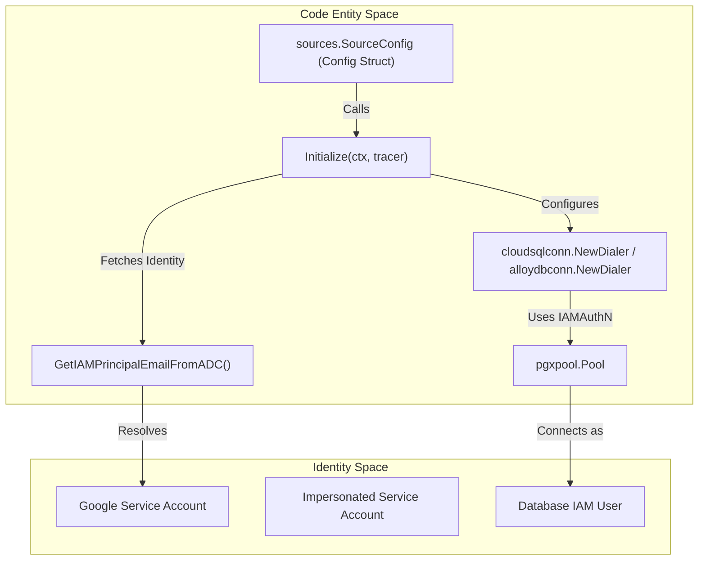
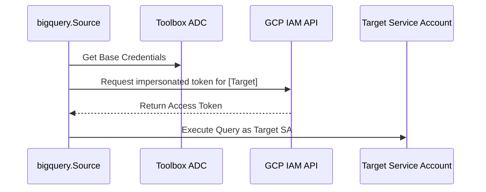

<!-- source: DeepWiki mcp.deepwiki.com · repo googleapis/genai-toolbox · page 7.2 IAM Authentication · fetched 2026-10-29 -->

# IAM Authentication

Relevant source files

The following files were used as context for generating this wiki page:

- [internal/prebuiltconfigs/tools/bigquery.yaml](internal/prebuiltconfigs/tools/bigquery.yaml)
- [internal/sources/alloydbpg/alloydb_pg.go](internal/sources/alloydbpg/alloydb_pg.go)
- [internal/sources/alloydbpg/alloydb_pg_test.go](internal/sources/alloydbpg/alloydb_pg_test.go)
- [internal/sources/bigquery/bigquery.go](internal/sources/bigquery/bigquery.go)
- [internal/sources/bigquery/bigquery_test.go](internal/sources/bigquery/bigquery_test.go)
- [internal/sources/cloudsqlpg/cloud_sql_pg.go](internal/sources/cloudsqlpg/cloud_sql_pg.go)
- [internal/sources/cloudsqlpg/cloud_sql_pg_test.go](internal/sources/cloudsqlpg/cloud_sql_pg_test.go)
- [internal/sources/ip_type.go](internal/sources/ip_type.go)
- [internal/sources/neo4j/neo4j_test.go](internal/sources/neo4j/neo4j_test.go)
- [internal/sources/postgres/postgres.go](internal/sources/postgres/postgres.go)
- [internal/sources/postgres/postgres_test.go](internal/sources/postgres/postgres_test.go)
- [internal/sources/spanner/spanner.go](internal/sources/spanner/spanner.go)
- [internal/sources/util.go](internal/sources/util.go)
- [internal/tools/bigquery/bigquerycommon/util.go](internal/tools/bigquery/bigquerycommon/util.go)
- [internal/tools/bigquery/bigqueryconversationalanalytics/bigqueryconversationalanalytics.go](internal/tools/bigquery/bigqueryconversationalanalytics/bigqueryconversationalanalytics.go)
- [internal/tools/bigquery/bigqueryconversationalanalytics/bigqueryconversationalanalytics_test.go](internal/tools/bigquery/bigqueryconversationalanalytics/bigqueryconversationalanalytics_test.go)
- [internal/tools/bigquery/bigqueryexecutesql/bigqueryexecutesql.go](internal/tools/bigquery/bigqueryexecutesql/bigqueryexecutesql.go)
- [internal/tools/bigquery/bigqueryforecast/bigqueryforecast.go](internal/tools/bigquery/bigqueryforecast/bigqueryforecast.go)
- [internal/tools/bigquery/bigquerygetdatasetinfo/bigquerygetdatasetinfo.go](internal/tools/bigquery/bigquerygetdatasetinfo/bigquerygetdatasetinfo.go)
- [internal/tools/bigquery/bigquerygettableinfo/bigquerygettableinfo.go](internal/tools/bigquery/bigquerygettableinfo/bigquerygettableinfo.go)
- [internal/tools/bigquery/bigquerylistdatasetids/bigquerylistdatasetids.go](internal/tools/bigquery/bigquerylistdatasetids/bigquerylistdatasetids.go)
- [internal/tools/bigquery/bigquerylisttableids/bigquerylisttableids.go](internal/tools/bigquery/bigquerylisttableids/bigquerylisttableids.go)
- [internal/tools/bigquery/bigquerysql/bigquerysql.go](internal/tools/bigquery/bigquerysql/bigquerysql.go)
- [tests/bigquery/bigquery_integration_test.go](tests/bigquery/bigquery_integration_test.go)

This page documents the implementation and configuration of IAM-based authentication for Google Cloud database sources, including Cloud SQL, AlloyDB, and BigQuery. It covers Application Default Credentials (ADC), service account impersonation, and the internal utilities used to manage IAM identities.

## Overview

The MCP Toolbox leverages Google Cloud IAM to provide secure, keyless authentication to managed database services. By using IAM, the Toolbox avoids the need for static passwords in `tools.yaml` and utilizes the identity of the environment (e.g., Cloud Run, GKE) or a specific service account.

## IAM Authentication Architecture

The following diagram illustrates how the Toolbox server transitions from a configuration entity to a live database connection using IAM credentials.

### Data Flow: Config to Authenticated Connection

Sources: [internal/sources/cloudsqlpg/cloud_sql_pg.go:66-90](), [internal/sources/alloydbpg/alloydb_pg.go:68-84](), [internal/sources/util.go:27-50]()

## Implementation Details

### Application Default Credentials (ADC)
The Toolbox uses the `golang.org/x/oauth2/google` package to find credentials. For PostgreSQL-based sources (Cloud SQL and AlloyDB), the server often needs to know the email address of the IAM principal to construct the connection string.

The utility function `GetIAMPrincipalEmailFromADC` is used to extract this identity:
*   **File:** `internal/sources/util.go`
*   **Function:** `GetIAMPrincipalEmailFromADC(ctx context.Context, cloudProvider string)` [internal/sources/util.go:27-50]()
*   **Behavior:** It calls `google.FindDefaultCredentials` and inspects the `JSON` field of the returned credentials to find the `client_email`. If unavailable (e.g., running on GCE metadata server), it falls back to metadata service lookups [internal/sources/util.go:37-45]().

### Cloud SQL and AlloyDB IAM Integration
For `cloud-sql-postgres` and `alloydb-postgres`, IAM authentication is enabled via the Google Cloud Go Connectors.

1.  **Connection Configuration:** The `getConnectionConfig` function determines if IAM should be used. If `user` and `password` are omitted in `tools.yaml`, it defaults to IAM [internal/sources/cloudsqlpg/cloud_sql_pg.go:138-169](), [internal/sources/alloydbpg/alloydb_pg.go:151-182]().
2.  **Dialer Setup:** The `alloydbconn.WithIAMAuthN()` or `cloudsqlconn.WithIAMAuthN()` option is passed to the dialer [internal/sources/alloydbpg/alloydb_pg.go:145-147](), [internal/sources/cloudsqlpg/cloud_sql_pg.go:192-195]().
3.  **DSN Construction:** The user in the DSN is set to the IAM email address, and the password field is left empty as the connector handles token injection [internal/sources/cloudsqlpg/cloud_sql_pg.go:167-168]().

### BigQuery Authentication Modes
BigQuery supports three distinct IAM-based authentication patterns defined in `internal/sources/bigquery/bigquery.go`:

| Mode | Configuration Field | Description |
| :--- | :--- | :--- |
| **Standard ADC** | Default | Uses the Toolbox server's environment identity [internal/sources/bigquery/bigquery.go:166-173](). |
| **Service Account Impersonation** | `impersonateServiceAccount` | The Toolbox server identity assumes the role of another service account [internal/sources/bigquery/bigquery.go:90](). |
| **Client OAuth** | `useClientOAuth` | The Toolbox ignores its own identity and uses the `Authorization` bearer token passed from the end-user/client [internal/sources/bigquery/bigquery.go:182-187](). |

Sources: [internal/sources/bigquery/bigquery.go:81-93](), [internal/sources/bigquery/bigquery.go:164-188]()

## BigQuery Service Account Impersonation

When `impersonateServiceAccount` is specified, the Toolbox uses the `google.golang.org/api/impersonate` package to generate short-lived credentials.

Sources: [internal/sources/bigquery/bigquery.go:166-170](), [tests/bigquery/bigquery_integration_test.go:62-74]()

## Database IAM User Setup

To use IAM authentication, the database must be configured to recognize the IAM principal.

### Cloud SQL / AlloyDB
The IAM principal (User or Service Account) must be added as a database user with the `cloud_iam_user` (for PostgreSQL) or similar role.
*   **PostgreSQL:** `CREATE USER "user@example.com" WITH LOGIN; GRANT cloud_iam_user TO "user@example.com";`

### BigQuery
The identity must have the `roles/bigquery.jobUser` role on the project and appropriate data access roles (e.g., `roles/bigquery.dataViewer`) on the datasets [internal/prebuiltconfigs/tools/bigquery.yaml:15-23]().

## Summary of Key Code Entities

| Entity | Path | Role |
| :--- | :--- | :--- |
| `GetIAMPrincipalEmailFromADC` | `internal/sources/util.go` | Extracts the email of the current GCP identity. |
| `Config.ImpersonateServiceAccount` | `internal/sources/bigquery/bigquery.go` | Configuration field for BigQuery SA impersonation. |
| `Config.UseClientOAuth` | `internal/sources/bigquery/bigquery.go` | Configuration field to delegate auth to the client. |
| `getConnectionConfig` | `internal/sources/cloudsqlpg/cloud_sql_pg.go` | Logic for toggling between password and IAM auth. |
| `initBigQueryConnection` | `tests/bigquery/bigquery_integration_test.go` | Reference implementation for BigQuery ADC client creation. |

Sources: [internal/sources/util.go:27-50](), [internal/sources/bigquery/bigquery.go:81-93](), [internal/sources/cloudsqlpg/cloud_sql_pg.go:138-169](), [tests/bigquery/bigquery_integration_test.go:62-74]()

---

