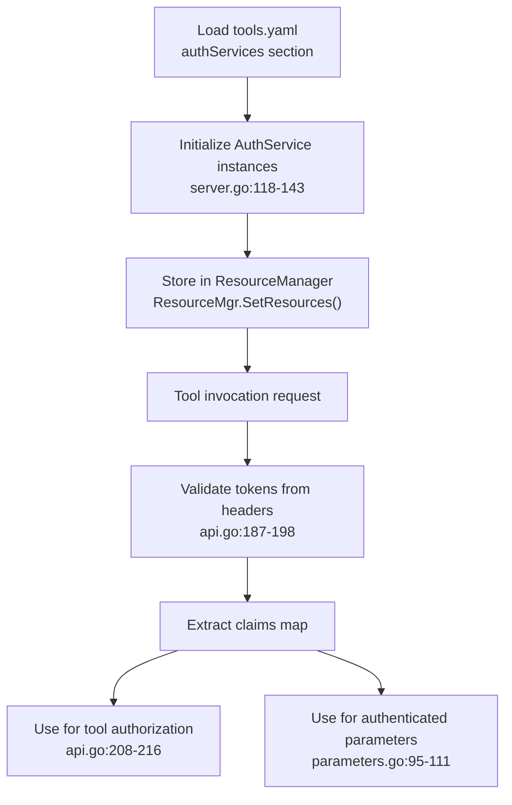
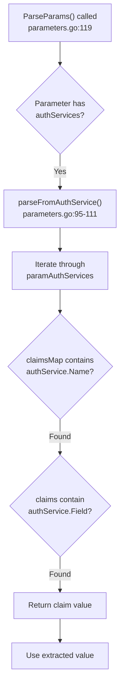
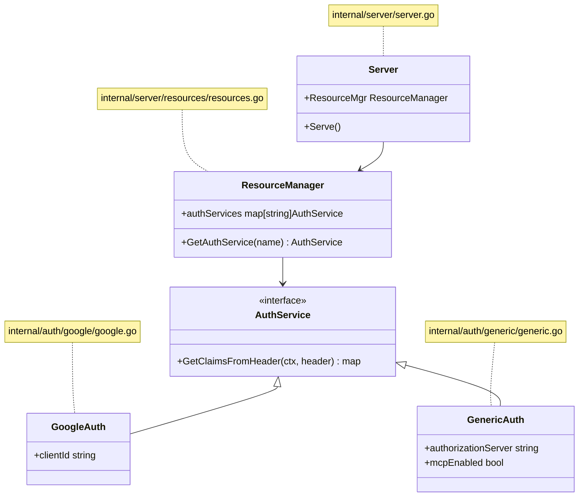

<!-- source: DeepWiki mcp.deepwiki.com · repo googleapis/genai-toolbox · page 7.3 OAuth and Auth Services · fetched 2026-10-29 -->

# OAuth and Auth Services

<details>
<summary>Relevant source files</summary>

The following files were used as context for generating this wiki page:

- [.ci/integration.cloudbuild.yaml](.ci/integration.cloudbuild.yaml)
- [.hugo/go.mod](.hugo/go.mod)
- [.hugo/go.sum](.hugo/go.sum)
- [cmd/internal/flags.go](cmd/internal/flags.go)
- [cmd/root.go](cmd/root.go)
- [cmd/root_test.go](cmd/root_test.go)
- [docs/en/documentation/configuration/authentication/generic.md](docs/en/documentation/configuration/authentication/generic.md)
- [docs/en/documentation/configuration/toolbox_mcp_auth.md](docs/en/documentation/configuration/toolbox_mcp_auth.md)
- [go.mod](go.mod)
- [go.sum](go.sum)
- [internal/auth/generic/generic.go](internal/auth/generic/generic.go)
- [internal/auth/generic/generic_test.go](internal/auth/generic/generic_test.go)
- [internal/prebuiltconfigs/prebuiltconfigs.go](internal/prebuiltconfigs/prebuiltconfigs.go)
- [internal/prebuiltconfigs/prebuiltconfigs_test.go](internal/prebuiltconfigs/prebuiltconfigs_test.go)
- [internal/server/config.go](internal/server/config.go)
- [internal/server/prm.go](internal/server/prm.go)
- [internal/server/server.go](internal/server/server.go)
- [internal/server/server_test.go](internal/server/server_test.go)
- [internal/telemetry/telemetry.go](internal/telemetry/telemetry.go)
- [tests/auth/auth_integration_test.go](tests/auth/auth_integration_test.go)

</details>


This page documents the AuthService system in Toolbox, which enables OAuth-based authentication and authorization. AuthServices validate user identity tokens, extract claims from tokens, and populate authenticated parameters automatically. This system supports tool-level authorization and user-scoped data access.

For information about IAM authentication for Google Cloud sources, see [IAM Authentication](#7.2). For general authentication architecture and flow, see [Authentication Architecture](#7.1).

---

## Overview

The AuthService system provides three core capabilities:

1.  **Token Validation**: Verify ID tokens (OIDC/OAuth) from request headers.
2.  **Claims Extraction**: Extract user information (email, user_id, etc.) from validated tokens.
3.  **Authenticated Parameters**: Auto-populate tool parameters from token claims without exposing sensitive data to clients.

AuthServices are configured in the `authServices` section of `tools.yaml` and managed by the `ResourceManager`.

Sources: [internal/server/config.go:190-198](), [internal/tools/parameters.go:95-111](), [internal/server/server.go:118-143]()

---

## AuthService Interface

The `AuthService` interface defines the contract for authentication providers. Each implementation validates tokens and extracts claims specific to its authentication provider (e.g., Google OAuth, generic OIDC).

### Core Methods

Defined in `internal/auth/auth.go`:
- **`GetName() string`**: Returns the unique name of the auth service as configured in `tools.yaml`.
- **`GetClaimsFromHeader(ctx context.Context, header http.Header) (map[string]any, error)`**: Validates the token from the request header and returns a map of claims.

### Registration and Lifecycle

AuthServices are initialized during server startup via `InitializeConfigs`.

#### Initialization Flow



Sources: [internal/server/server.go:118-143](), [internal/server/resources/resources.go:78-88](), [internal/server/api.go:186-198]()

---

## Google OAuth Integration

The primary AuthService implementation is Google OAuth, which validates Google ID tokens using a client ID.

### Configuration

```yaml
kind: authService
name: my-google-auth
google:
  clientId: "123456789-abcdefg.apps.googleusercontent.com"
```

| Field | Type | Required | Description |
| :--- | :--- | :--- | :--- |
| `kind` | string | true | Must be `authService` |
| `name` | string | true | Unique identifier for the service |
| `google.clientId` | string | true | OAuth 2.0 Client ID from Google Cloud Console |

Sources: [internal/server/config.go:190-198](), [internal/auth/google/google.go:25-35]()

---

## Generic OIDC Auth Service

The generic AuthService supports OpenID Connect (OIDC) providers. It features two modes: **Toolbox Auth** and **MCP Authorization**.

### Configuration

```yaml
kind: authService
name: my-oidc-auth
generic:
  authorizationServer: "https://accounts.google.com"
  audience: "my-app-audience"
  scopesRequired: ["openid", "email"]
  mcpEnabled: true
```

### Modes of Operation

1.  **Toolbox Auth (mcpEnabled: false)**: Validates tokens passed via custom HTTP headers (e.g., `my-oidc-auth_token`). This is standard for HTTP/SSE clients.
2.  **MCP Authorization (mcpEnabled: true)**: Integrates with the Model Context Protocol (MCP) Authorization layer. It uses the `authorizationServer` to perform token introspection or JWT validation on tokens provided by the MCP client.

### MCP Protected Resource Metadata (PRM)
When `mcpEnabled` is true, the Toolbox automatically generates a Protected Resource Metadata file (PRM) to advertise authorization requirements to MCP clients.

Sources: [internal/auth/generic/generic.go:35-55](), [internal/server/prm.go:35-65](), [internal/auth/generic/generic_test.go:97-104]()

---

## Token Validation and Claims Extraction

### Claims Map Structure

The server builds a `claimsFromAuth` map during the `POST /api/tool/{name}/invoke` flow:

```go
// internal/server/api.go:186-198
claimsFromAuth := make(map[string]map[string]any)
for name, authSvc := range s.ResourceMgr.GetAuthServiceMap() {
    claims, err := authSvc.GetClaimsFromHeader(r.Context(), r.Header)
    if err != nil {
        // handle error
    }
    if claims != nil {
        claimsFromAuth[name] = claims
    }
}
```

Sources: [internal/server/api.go:184-216](), [internal/tools/parameters.go:95-111]()

---

## Authenticated Parameters

Authenticated parameters source their values from validated tokens.

### Parameter Resolution Flow



Sources: [internal/tools/parameters.go:95-111](), [internal/tools/parameters.go:119-153]()

---

## Client Token Submission

Clients submit tokens via custom headers. The header name pattern is `{AuthServiceName}_token`.

### Header Examples

| Auth Service Name | Header Name |
| :--- | :--- |
| `my-google-auth` | `my-google-auth_token` |
| `corp-oidc` | `corp-oidc_token` |

### Code Entities Bridge



Sources: [internal/server/server.go:51-62](), [internal/server/resources/resources.go:37-47](), [internal/auth/google/google.go:37-41](), [internal/auth/generic/generic.go:57-64]()

---

