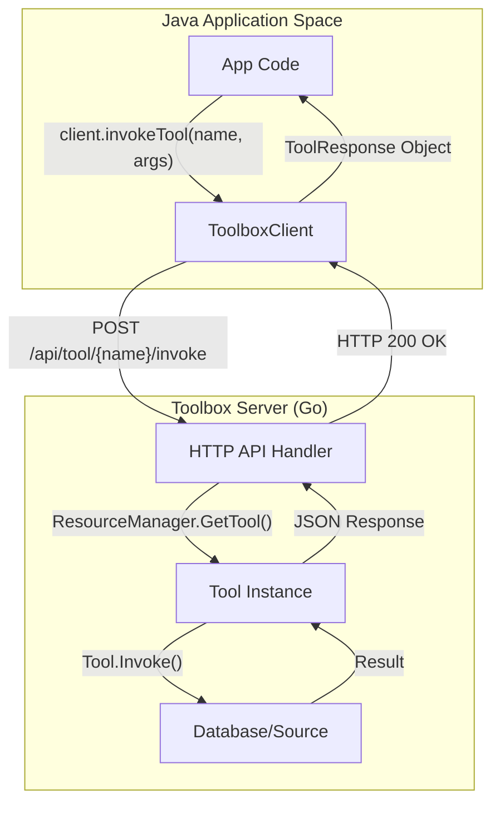
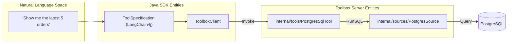

<!-- source: DeepWiki mcp.deepwiki.com · repo googleapis/genai-toolbox · page 8.5 Java SDK Integration · fetched 2026-10-29 -->

# Java SDK Integration

<details>
<summary>Relevant source files</summary>

The following files were used as context for generating this wiki page:

- [CHANGELOG.md](CHANGELOG.md)
- [README.md](README.md)
- [cmd/version.txt](cmd/version.txt)
- [docs/en/documentation/introduction/_index.md](docs/en/documentation/introduction/_index.md)
- [gemini-extension.json](gemini-extension.json)
- [server.json](server.json)

</details>


The Java SDK for MCP Toolbox provides a native way to integrate database-driven tools into Java-based AI applications. It abstracts the underlying Model Context Protocol (MCP) and HTTP communication, allowing developers to load toolsets and invoke tools using standard Java patterns.

## Installation

The Java SDK is distributed via Maven Central as `mcp-toolbox-sdk-java` [README.md:19-19]().

### Maven
Add the following dependency to your `pom.xml`:

```xml
<dependency>
    <groupId>com.google.cloud.mcp</groupId>
    <artifactId>mcp-toolbox-sdk-java</artifactId>
    <version>1.0.0</version>
</dependency>
```

### Gradle
Add the following to your `build.gradle`:

```gradle
implementation 'com.google.cloud.mcp:mcp-toolbox-sdk-java:1.0.0'
```

Sources: [README.md:19-19](), [cmd/version.txt:1-1]()

## ToolboxClient Setup

The `ToolboxClient` is the primary entry point for interacting with a running Toolbox server. It supports both standard HTTP/REST communication and MCP-based interactions.

### Initialization
To connect to a Toolbox server, you provide the server's endpoint (defaulting to `http://127.0.0.1:5000` [server.json:56-72]()).

```java
import com.google.cloud.mcp.toolbox.ToolboxClient;

ToolboxClient client = ToolboxClient.builder()
    .baseUrl("http://localhost:5000")
    .build();
```

### Data Flow: Client to Server
The Java SDK communicates with the Toolbox server's HTTP API [docs/en/documentation/introduction/_index.md:41-51]().

**Java SDK Request Flow**

Sources: [docs/en/documentation/introduction/_index.md:41-51](), [server.json:23-25]()

## Loading Tools and Toolsets

Toolbox organizes capabilities into **Tools** (individual operations) and **Toolsets** (logical groupings, often by database type) [README.md:113-124]().

### Loading a Toolset
Loading a toolset retrieves the definitions of all tools within that set, which can then be passed to an AI framework's tool-calling mechanism.

```java
import com.google.cloud.mcp.toolbox.models.Toolset;

// Load the prebuilt postgres toolset
Toolset postgresTools = client.loadToolset("postgres");
```

### Invoking a Tool Directly
While typically handled by an LLM, you can invoke tools programmatically:

```java
Map<String, Object> params = Map.of("query", "SELECT * FROM users LIMIT 5");
var response = client.invokeTool("postgres-sql", params);
System.out.println(response.getContent());
```

Sources: [README.md:97-103](), [README.md:113-124]()

## Integration with Java AI Frameworks

The Java SDK is designed to bridge the gap between enterprise databases and popular Java AI orchestration layers.

### Framework Compatibility Matrix

| Framework | Integration Method | Key Benefit |
| :--- | :--- | :--- |
| **LangChain4j** | Tool Specification conversion | Native use of `list_tables` and `execute_sql` in LangChain Agents. |
| **Spring AI** | Function Callback registration | Seamless integration with Spring Boot's AI starters. |
| **Vertex AI SDK** | Tool/Function declaration | Direct database access for Gemini models on Google Cloud. |

### Architecture: Natural Language to Database
This diagram illustrates how a natural language query is transformed into a database execution via the Java SDK and Toolbox server.

**NL to Code Entity Mapping**

Sources: [README.md:28-30](), [docs/en/documentation/introduction/_index.md:41-51]()

## Authentication in Java SDK

When using tools that require authentication (e.g., BigQuery or Cloud SQL with IAM), the Java SDK can pass authentication tokens to the Toolbox server [README.md:65-66]().

### Providing Auth Tokens
The client can be configured with an `AuthTokenGetter` to dynamically provide tokens for `AuthorizedInvocation` requests.

```java
ToolboxClient client = ToolboxClient.builder()
    .baseUrl("http://localhost:5000")
    .authTokenGetter(() -> "Bearer " + getMyServiceAccountToken())
    .build();
```

Sources: [README.md:65-66](), [CHANGELOG.md:17-17]()

---

