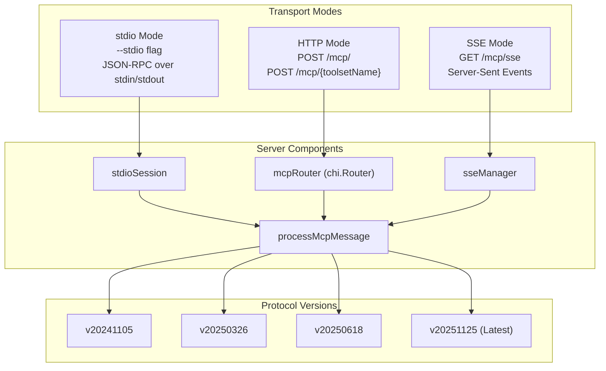
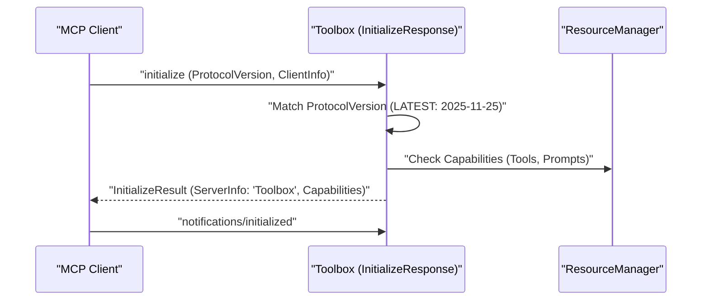
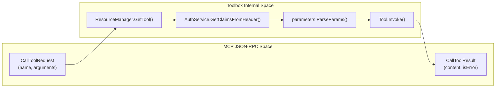

<!-- source: DeepWiki mcp.deepwiki.com · repo googleapis/genai-toolbox · page 8.6 MCP Protocol Integration · fetched 2026-10-29 -->

# MCP Protocol Integration

Relevant source files

The following files were used as context for generating this wiki page:

- [internal/server/mcp.go](internal/server/mcp.go)
- [internal/server/mcp/jsonrpc/jsonrpc.go](internal/server/mcp/jsonrpc/jsonrpc.go)
- [internal/server/mcp/mcp.go](internal/server/mcp/mcp.go)
- [internal/server/mcp/util/lifecycle.go](internal/server/mcp/util/lifecycle.go)
- [internal/server/mcp/v20241105/method.go](internal/server/mcp/v20241105/method.go)
- [internal/server/mcp/v20241105/types.go](internal/server/mcp/v20241105/types.go)
- [internal/server/mcp/v20250326/method.go](internal/server/mcp/v20250326/method.go)
- [internal/server/mcp/v20250326/types.go](internal/server/mcp/v20250326/types.go)
- [internal/server/mcp/v20250618/method.go](internal/server/mcp/v20250618/method.go)
- [internal/server/mcp/v20250618/types.go](internal/server/mcp/v20250618/types.go)
- [internal/server/mcp/v20251125/method.go](internal/server/mcp/v20251125/method.go)
- [internal/server/mcp_test.go](internal/server/mcp_test.go)
- [internal/telemetry/instrumentation.go](internal/telemetry/instrumentation.go)

Model Context Protocol (MCP) is an open standard that enables AI assistants to discover and invoke tools through a standardized JSON-RPC interface. Toolbox implements the MCP server specification, allowing direct integration with MCP-compatible clients such as Cursor, Claude Desktop, VS Code with Copilot, and Gemini CLI Extensions.

This page explains how Toolbox supports MCP through three transport modes (stdio, HTTP, and SSE), how sessions are managed, and how MCP clients discover and invoke database tools. For client SDK integration using REST APIs, see [Client SDK Overview](). For step-by-step IDE setup instructions, see [IDE Integration]().

## Overview of MCP Support

Toolbox implements the MCP server specification with support for multiple protocol versions (2024-11-05, 2025-03-26, 2025-06-18, and 2025-11-25) as defined in [internal/server/mcp/mcp.go:39-45](). The server routes requests to version-specific logic in the `ProcessMethod` function [internal/server/mcp/mcp.go:105-116]().

**MCP Protocol Architecture**

Sources: [internal/server/mcp/mcp.go:35-45](), [internal/server/mcp/mcp.go:105-116](), [internal/server/mcp.go:122-127]()

## Transport Modes

### stdio Mode
When started with the `--stdio` flag, Toolbox communicates via standard input/output. This is the primary mode for IDE integrations (Cursor, VS Code). The `stdioSession` struct [internal/server/mcp.go:122-127]() manages this lifecycle, using `readInputStream` [internal/server/mcp.go:192-238]() to process incoming JSON-RPC lines.

### HTTP Mode
Toolbox exposes MCP endpoints at `/mcp/` and `/mcp/{toolsetName}`. Clients send JSON-RPC 2.0 POST requests. This mode is used for standalone server deployments.

### SSE (Server-Sent Events) Mode
For protocol versions like `2024-11-05`, Toolbox supports SSE. The `sseManager` [internal/server/mcp.go:56-59]() handles persistent connections, session cleanup [internal/server/mcp.go:98-120](), and message queuing.

Sources: [internal/server/mcp.go:122-127](), [internal/server/mcp.go:192-238](), [internal/server/mcp.go:56-59]()

## Session and Capability Negotiation

All MCP connections begin with the `initialize` method. Toolbox performs capability negotiation in `InitializeResponse` [internal/server/mcp/mcp.go:50-91]().

**Initialization Sequence**

Toolbox advertises `ServerCapabilities` including support for `Tools` and `Prompts` [internal/server/mcp/util/lifecycle.go:90-93]().

Sources: [internal/server/mcp/mcp.go:50-91](), [internal/server/mcp/util/lifecycle.go:90-93](), [internal/server/mcp/mcp.go:37]()

## Tool Discovery and Invocation

### Tool Discovery (`tools/list`)
Clients discover tools via `tools/list`. The handler (e.g., `toolsListHandler` in [internal/server/mcp/v20250618/method.go:65-80]()) returns the `McpManifest` for all tools in the requested toolset.

### Tool Invocation (`tools/call`)
The `toolsCallHandler` [internal/server/mcp/v20250618/method.go:83-213]() manages the execution flow:

1.  **Lookup**: Retrieves the tool from the `ResourceManager` [internal/server/mcp/v20250618/method.go:110]().
2.  **Auth Extraction**: Gets the access token from the configured header [internal/server/mcp/v20250618/method.go:123-128]().
3.  **Authorization**: Checks if the tool call is authorized via `tool.Authorized()` [internal/server/mcp/v20250618/method.go:189-197]().
4.  **Parameter Parsing**: Uses `parameters.ParseParams` to validate arguments [internal/server/mcp/v20250618/method.go:200-204]().
5.  **Execution**: Calls `tool.Invoke()` and returns a `CallToolResult` [internal/server/mcp/v20250618/method.go:206-212]().

**Data Flow: MCP Request to Tool Execution**

Sources: [internal/server/mcp/v20250618/method.go:83-213](), [internal/server/mcp/v20250618/method.go:65-80]()

## Supported Protocol Methods

Toolbox implements the following MCP methods across all supported versions:

| Method | Function | Code Pointer |
| :--- | :--- | :--- |
| `ping` | Connection health check | [internal/server/mcp/v20250618/method.go:57-63]() |
| `tools/list` | List available database tools | [internal/server/mcp/v20250618/method.go:65-80]() |
| `tools/call` | Execute a specific tool | [internal/server/mcp/v20250618/method.go:83-213]() |
| `prompts/list` | List available prompts | [internal/server/mcp/v20250618/method.go:46-47]() |
| `prompts/get` | Retrieve a specific prompt | [internal/server/mcp/v20250618/method.go:48-49]() |

Sources: [internal/server/mcp/v20250618/method.go:39-53]()

## Observability and Tracing

Toolbox integrates OpenTelemetry into the MCP layer. 
- **Trace Propagation**: Extracts W3C Trace Context from the `_meta` field in JSON-RPC requests [internal/server/mcp.go:149-176]().
- **Metrics**: Tracks active MCP sessions (`McpActiveSessions`) and session duration (`McpSessionDuration`) [internal/server/mcp.go:202-223]().
- **Span Attributes**: Automatically adds `gen_ai.tool.name` and `gen_ai.operation.name` to spans during tool calls [internal/server/mcp/v20250618/method.go:103-108]().

Sources: [internal/server/mcp.go:149-176](), [internal/server/mcp.go:202-223](), [internal/server/mcp/v20250618/method.go:103-108]()

---

