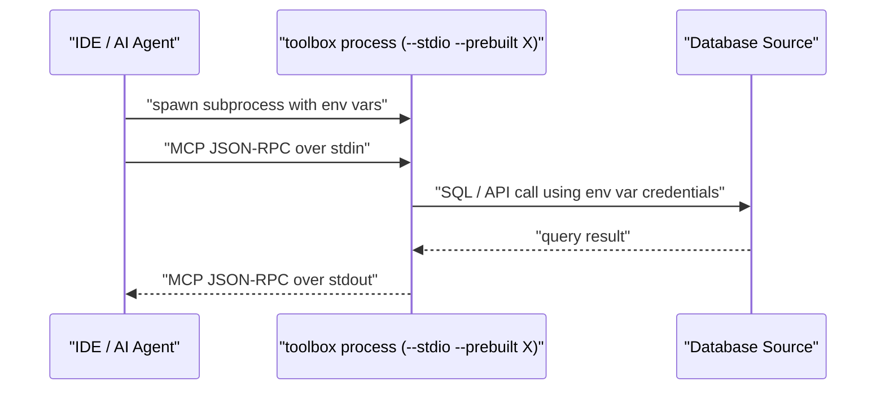
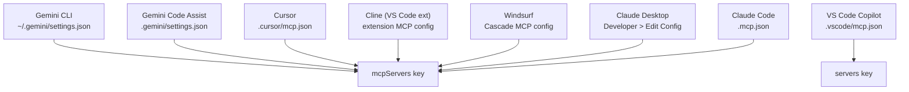
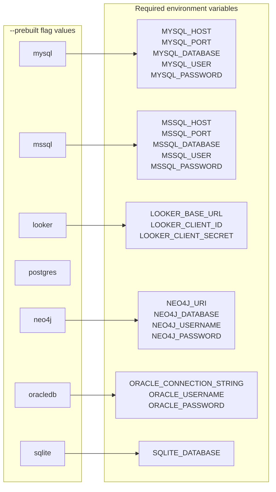
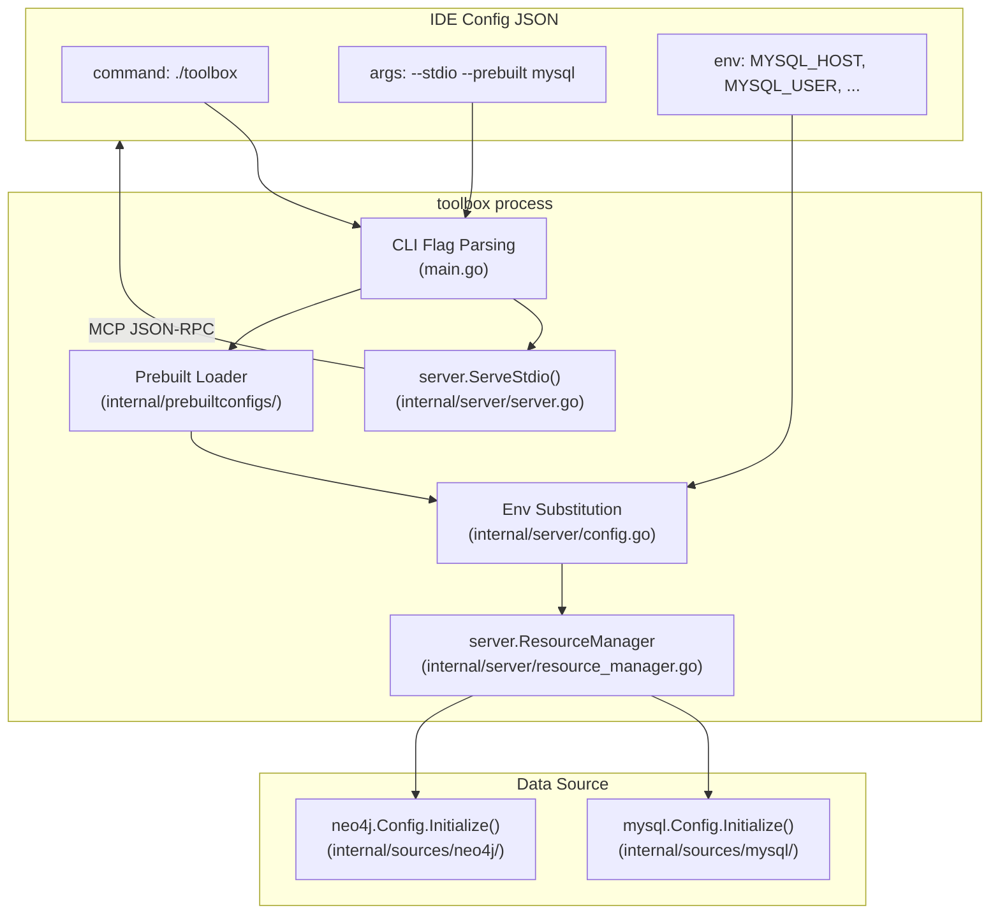

<!-- source: DeepWiki mcp.deepwiki.com · repo googleapis/genai-toolbox · page 8.7 IDE Integration · fetched 2026-10-29 -->

# IDE Integration

<details>
<summary>Relevant source files</summary>

The following files were used as context for generating this wiki page:

- [docs/en/documentation/connect-to/ides/looker_mcp.md](docs/en/documentation/connect-to/ides/looker_mcp.md)
- [docs/en/documentation/connect-to/ides/mssql_mcp.md](docs/en/documentation/connect-to/ides/mssql_mcp.md)
- [docs/en/documentation/connect-to/ides/mysql_mcp.md](docs/en/documentation/connect-to/ides/mysql_mcp.md)
- [docs/en/documentation/connect-to/ides/neo4j_mcp.md](docs/en/documentation/connect-to/ides/neo4j_mcp.md)
- [docs/en/documentation/connect-to/ides/oracle_mcp.md](docs/en/documentation/connect-to/ides/oracle_mcp.md)
- [docs/en/documentation/connect-to/ides/postgres_mcp.md](docs/en/documentation/connect-to/ides/postgres_mcp.md)
- [docs/en/documentation/connect-to/ides/sqlite_mcp.md](docs/en/documentation/connect-to/ides/sqlite_mcp.md)
- [docs/en/documentation/getting-started/colab_quickstart.ipynb](docs/en/documentation/getting-started/colab_quickstart.ipynb)
- [internal/sources/cloudsqladmin/cloud_sql_admin_test.go](internal/sources/cloudsqladmin/cloud_sql_admin_test.go)
- [internal/sources/firebird/firebird_test.go](internal/sources/firebird/firebird_test.go)
- [internal/sources/oceanbase/oceanbase_test.go](internal/sources/oceanbase/oceanbase_test.go)

</details>


This page documents how to configure MCP Toolbox as an MCP server within AI-assisted IDEs and code editors. It covers the transport mechanism (`--stdio`), the prebuilt configuration system (`--prebuilt`), IDE-specific configuration file formats, and the environment variables required for supported database sources including Looker, PostgreSQL, MySQL, MSSQL, AlloyDB, Firestore, Neo4j, Oracle, and SQLite.

For information about the MCP protocol itself and non-IDE MCP clients (such as MCP Inspector), see [MCP Protocol Integration](#8.6). For the `--prebuilt` flag and its available configurations, see [Prebuilt Configurations](#3.3).

---

## How It Works

All IDE integration uses the same mechanism: the IDE spawns Toolbox as a child process and communicates with it over `stdin`/`stdout` using the MCP protocol. This is controlled by the `--stdio` flag, which switches Toolbox from HTTP server mode into MCP stdio mode (handled by `ServeStdio` in `internal/server/server.go` [internal/server/server.go:1-50]()).

The `--prebuilt` flag loads a bundled tool configuration for a given source type, eliminating the need for a `tools.yaml` file. Database connection parameters are provided through environment variables that the IDE passes to the subprocess.

**Connection diagram: IDE to Database**



Sources: [docs/en/documentation/connect-to/ides/mysql_mcp.md:8-20](), [docs/en/documentation/connect-to/ides/looker_mcp.md:9-21](), [internal/server/server.go:1-50]()

---

## The `--stdio` and `--prebuilt` Flags

The two CLI flags used in every IDE integration:

| Flag | Description |
|---|---|
| `--stdio` | Run in MCP STDIO mode. No HTTP server is started; JSON-RPC messages are read from `stdin` and written to `stdout`. |
| `--prebuilt <name>` | Load a bundled source and tool configuration by name. Replaces the need for `--tools-file`. Multiple values are accepted (e.g., `looker,looker-dev`). |

A minimal invocation looks like:

```bash
./toolbox --stdio --prebuilt mysql
```

The `command` and `args` fields in the IDE config map directly to this invocation. Environment variables in the `env` block replace `${ENV_NAME}` substitutions inside the prebuilt YAML configurations.

Sources: [docs/en/documentation/connect-to/ides/mysql_mcp.md:91-99](), [docs/en/documentation/connect-to/ides/looker_mcp.md:173-178]()

---

## IDE Configuration File Formats

Each IDE reads an MCP server list from a JSON file. The structure is nearly identical across all supported IDEs, with one notable difference: VS Code Copilot uses `"servers"` as the top-level key instead of `"mcpServers"`.

**Config key mapping across IDEs**



Sources: [docs/en/documentation/connect-to/ides/mysql_mcp.md:193-218](), [docs/en/documentation/connect-to/ides/mssql_mcp.md:195-220](), [docs/en/documentation/connect-to/ides/looker_mcp.md:281-306]()

---

## IDE Configuration Locations

| IDE | Config File Path | Top-level Key |
|---|---|---|
| Gemini CLI | `~/.gemini/settings.json` | `mcpServers` |
| Gemini Code Assist | `.gemini/settings.json` (workspace) | `mcpServers` |
| Cursor | `.cursor/mcp.json` (project root) | `mcpServers` |
| VS Code Copilot | `.vscode/mcp.json` (project root) | `servers` |
| Cline | Extension MCP settings (UI) | `mcpServers` |
| Windsurf | Cascade MCP config (via hammer icon) | `mcpServers` |
| Claude Desktop | OS config file (Settings > Developer > Edit Config) | `mcpServers` |
| Claude Code | `.mcp.json` (project root) | `mcpServers` |

Sources: [docs/en/documentation/connect-to/ides/looker_mcp.md:134-335](), [docs/en/documentation/connect-to/ides/mysql_mcp.md:77-305](), [docs/en/documentation/connect-to/ides/sqlite_mcp.md:77-235]()

---

## Supported Prebuilt Sources

The following table maps `--prebuilt` names to their required environment variables.

### Prebuilt Source Reference



Sources: [docs/en/documentation/connect-to/ides/mysql_mcp.md:87-99](), [docs/en/documentation/connect-to/ides/neo4j_mcp.md:93-98](), [docs/en/documentation/connect-to/ides/oracle_mcp.md:95-101](), [docs/en/documentation/connect-to/ides/sqlite_mcp.md:92-94]()

---

## Per-Source Configuration Examples

### PostgreSQL
**`--prebuilt` name:** `postgres`
**Variables:** `POSTGRES_HOST`, `POSTGRES_PORT`, `POSTGRES_DATABASE`, `POSTGRES_USER`, `POSTGRES_PASSWORD`.
Sources: [docs/en/documentation/connect-to/ides/postgres_mcp.md:105-111]()

### Neo4j
**`--prebuilt` name:** `neo4j`
**Variables:** `NEO4J_URI`, `NEO4J_DATABASE`, `NEO4J_USERNAME`, `NEO4J_PASSWORD`.
Sources: [docs/en/documentation/connect-to/ides/neo4j_mcp.md:93-98]()

### Oracle
**`--prebuilt` name:** `oracledb`
**Variables:** `ORACLE_CONNECTION_STRING`, `ORACLE_USERNAME`, `ORACLE_PASSWORD`, `ORACLE_WALLET`, `ORACLE_USE_OCI`.
Sources: [docs/en/documentation/connect-to/ides/oracle_mcp.md:95-101]()

### SQLite
**`--prebuilt` name:** `sqlite`
**Variables:** `SQLITE_DATABASE` (path to `.db` file).
Sources: [docs/en/documentation/connect-to/ides/sqlite_mcp.md:92-94]()

### Looker
**`--prebuilt` name:** `looker` (or `looker,looker-dev` for authoring tools).
**Variables:** `LOOKER_BASE_URL`, `LOOKER_CLIENT_ID`, `LOOKER_CLIENT_SECRET`, `LOOKER_VERIFY_SSL`.
Sources: [docs/en/documentation/connect-to/ides/looker_mcp.md:160-165]()

---

## NPX Alternative (No Binary Download)

For environments where installing a binary is restricted, the `@toolbox-sdk/server` NPM package can be used. This is particularly useful for Antigravity or VS Code.

```json
{
  "mcpServers": {
    "looker": {
      "command": "npx",
      "args": ["-y", "@toolbox-sdk/server", "--prebuilt", "looker", "--stdio"],
      "env": {
        "LOOKER_BASE_URL": "https://looker.example.com",
        "LOOKER_CLIENT_ID": "your-client-id",
        "LOOKER_CLIENT_SECRET": "your-client-secret"
      }
    }
  }
}
```

Sources: [docs/en/documentation/connect-to/ides/looker_mcp.md:73-87]()

---

## Binary Installation

The `toolbox` binary must be installed before being referenced in IDE configs. Minimum version requirements vary by source (e.g., v0.15.0+ for Neo4j, v0.26.0+ for Oracle).

**Download by platform:**

| Platform | Command |
|---|---|
| `linux/amd64` | `curl -O https://storage.googleapis.com/mcp-toolbox-for-databases/v1.0.0/linux/amd64/toolbox` |
| `darwin/arm64` | `curl -O https://storage.googleapis.com/mcp-toolbox-for-databases/v1.0.0/darwin/arm64/toolbox` |
| `windows/amd64` | `curl -O https://storage.googleapis.com/mcp-toolbox-for-databases/v1.0.0/windows/amd64/toolbox.exe` |

After downloading, make the binary executable:

```bash
chmod +x toolbox
./toolbox --version
```

Sources: [docs/en/documentation/connect-to/ides/mysql_mcp.md:45-73](), [docs/en/documentation/connect-to/ides/oracle_mcp.md:48-76](), [docs/en/documentation/connect-to/ides/neo4j_mcp.md:46-74]()

---

## Architecture: Config to Code

The following diagram maps the IDE configuration structure to the server-side components that handle each field.



Sources: [internal/server/server.go:1-50](), [docs/en/documentation/connect-to/ides/mysql_mcp.md:87-99](), [docs/en/documentation/connect-to/ides/neo4j_mcp.md:113-128]()

---

