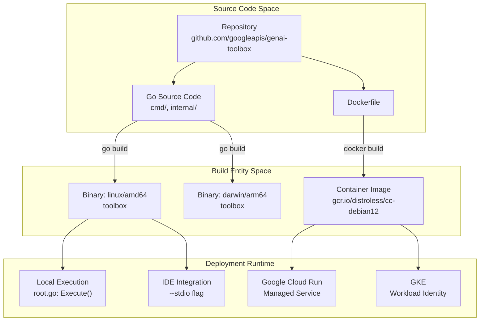
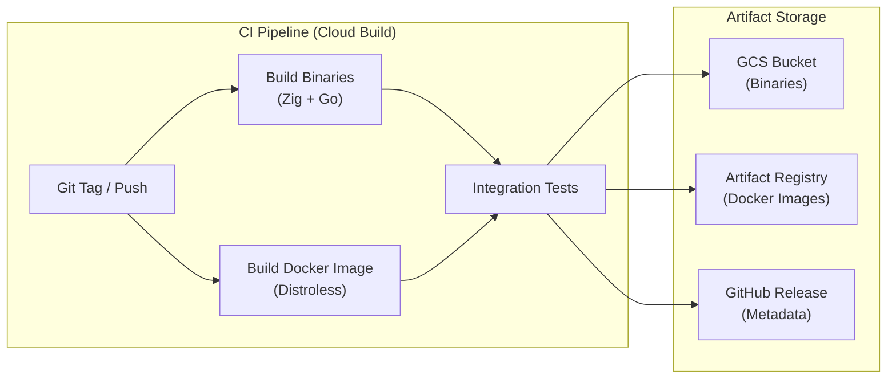

<!-- source: DeepWiki mcp.deepwiki.com · repo googleapis/genai-toolbox · page 9 Deployment and Operations · fetched 2026-10-29 -->

# Deployment and Operations

Relevant source files

The following files were used as context for generating this wiki page:

- [.ci/continuous.release.cloudbuild.yaml](.ci/continuous.release.cloudbuild.yaml)
- [.ci/generate_release_table.sh](.ci/generate_release_table.sh)
- [.ci/versioned.release.cloudbuild.yaml](.ci/versioned.release.cloudbuild.yaml)
- [.github/release-please.yml](.github/release-please.yml)
- [Dockerfile](Dockerfile)

This document covers the deployment options and operational considerations for running GenAI Toolbox in production environments. It includes instructions for building binaries and container images, deploying locally or to cloud platforms, and configuring telemetry and monitoring.

**Scope**: This page focuses on packaging, deployment, and runtime operations. For configuration details, see [Configuration](#3). For development and testing workflows, see [Development](#10). For building custom tools and sources, see [Extending the System](#10.4).

## Purpose

GenAI Toolbox supports multiple deployment models:
- **Binary Deployment**: Standalone executables for 4 platforms (Linux, macOS, Windows) using Zig for CGO cross-compilation [.ci/versioned.release.cloudbuild.yaml:52-171]().
- **Container Deployment**: Docker images for orchestrated environments using a distroless base [Dockerfile:47-51]().
- **Local Development**: Running from source with `go run`.
- **Cloud Platforms**: Google Cloud Run, Google Kubernetes Engine, and Vertex AI Agent Engine.

The server operates in three runtime modes:
- **HTTP Mode**: REST API server on configurable port (default 5000).
- **STDIO Mode**: MCP protocol over stdin/stdout for IDE integration.
- **UI Mode**: Web interface for configuration management via the `--ui` flag.

## Deployment Architecture

Toolbox bridges the gap between AI applications and databases by providing a standardized interface for tool execution.

**Sources**: [Dockerfile:1-56](), [.ci/versioned.release.cloudbuild.yaml:14-182]()

## Building and Packaging

### Building from Source

The build process uses Zig to handle CGO cross-compilation requirements, ensuring the Go binaries can link against necessary C libraries on different target OS/architectures [.ci/versioned.release.cloudbuild.yaml:52-64]().

**Cross-Platform Matrix** [.ci/generate_release_table.sh:11-20]():

| Platform | Architecture | Build Tool |
|----------|-------------|------------|
| Linux | AMD64 | Zig `x86_64-linux-gnu` |
| macOS | ARM64 | Zig `aarch64-macos` + SDK |
| macOS | AMD64 | Zig `x86_64-macos` + SDK |
| Windows | AMD64 | Zig `x86_64-windows-gnu` |

The `geminicli` build variant is also produced, which sets specific build metadata via `-ldflags` [.ci/versioned.release.cloudbuild.yaml:132-132]().

### Building Container Images

The [Dockerfile]() uses a multi-stage build. The final stage uses `gcr.io/distroless/cc-debian12:nonroot` to minimize the attack surface and image size [Dockerfile:47-51]().

**Sources**: [Dockerfile:14-56](), [.ci/versioned.release.cloudbuild.yaml:15-40]()

### Release Process

Releases are managed via **Release Please**, which automates versioning based on conventional commits [.github/release-please.yml:15-18](). Artifacts (binaries) are stored in Google Cloud Storage (GCS) buckets categorized by version and platform [.ci/versioned.release.cloudbuild.yaml:109-112]().

**Sources**: [.github/release-please.yml:1-52](), [.ci/generate_release_table.sh:38-44]()

## Local and Docker Deployment

For detailed instructions on running locally or with Docker, see [Local and Docker Deployment](#9.2).

Toolbox can be run locally using the prebuilt binary or via `docker-compose` to orchestrate the server alongside a database. When running in Docker, the server should typically bind to `0.0.0.0` to be reachable from the host.

**Sources**: [Dockerfile:55-55](), [server.json:1-10]()

## Cloud Deployment

For detailed instructions on Cloud Run, GKE, and Vertex AI, see [Cloud Deployment](#9.3).

- **Cloud Run**: Ideal for serverless deployment. Uses environment variables or secret volumes for `tools.yaml`.
- **GKE**: Supports Workload Identity for secure, keyless authentication to Google Cloud services.
- **Vertex AI**: Allows deploying agents directly to the Vertex AI Agent Engine.

**Sources**: [.ci/versioned.release.cloudbuild.yaml:104-112](), [Dockerfile:47-56]()

## Telemetry and Monitoring

For detailed instructions on OpenTelemetry and logging, see [Telemetry and Monitoring](#9.4).

Toolbox integrates with OpenTelemetry to provide visibility into server operations. It supports:
- **GCP Exporter**: Using `--telemetry-gcp` to send traces and metrics to Google Cloud Operations suite.
- **OTLP Exporter**: Using `--telemetry-otlp` to send data to any OTLP-compatible backend (e.g., Jaeger, Honeycomb).
- **Structured Logging**: Configurable log levels and formats (JSON/Standard) for better log aggregation.

## Build and Release Pipeline

**Sources**: [.ci/versioned.release.cloudbuild.yaml:14-182](), [.ci/continuous.release.cloudbuild.yaml:14-183]()

---

**Child Pages**:
- [Building and Packaging](#9.1) — Cross-platform builds, Zig CGO, and GCS storage.
- [Local and Docker Deployment](#9.2) — Running locally, Docker Compose, and UI flag.
- [Cloud Deployment](#9.3) — Cloud Run, GKE, and Workload Identity.
- [Telemetry and Monitoring](#9.4) — OpenTelemetry, GCP/OTLP exporters, and logging.

---

