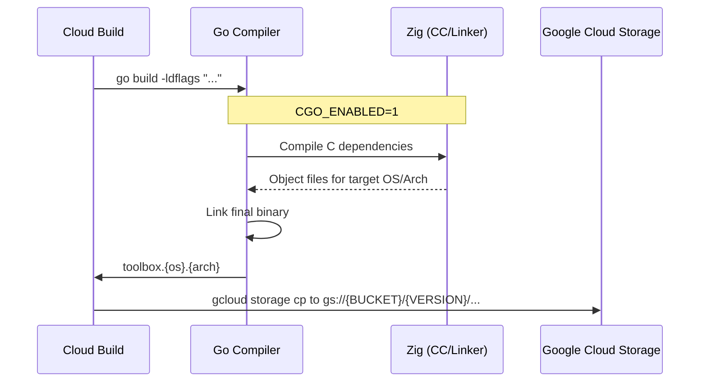

<!-- source: DeepWiki mcp.deepwiki.com · repo googleapis/genai-toolbox · page 9.1 Building and Packaging · fetched 2026-10-29 -->

# Building and Packaging

<details>
<summary>Relevant source files</summary>

The following files were used as context for generating this wiki page:

- [.ci/continuous.release.cloudbuild.yaml](.ci/continuous.release.cloudbuild.yaml)
- [.ci/generate_release_table.sh](.ci/generate_release_table.sh)
- [.ci/versioned.release.cloudbuild.yaml](.ci/versioned.release.cloudbuild.yaml)
- [Dockerfile](Dockerfile)

</details>


This page documents the build process for the Toolbox binary and Docker images, including cross-platform compilation for Linux, macOS, and Windows. The build system leverages Go's native toolchain combined with **Zig** for CGO cross-compilation, supporting both standard and `geminicli` build variants.

## Build System Overview

The Toolbox project uses a sophisticated build pipeline designed to produce statically-linked binaries for multiple architectures while maintaining CGO compatibility (required for certain database drivers). 

```mermaid
graph TD
    subgraph "Build Environment"
        "Go_1.x"["Go 1.x Compiler"]
        "Zig_0.15.2"["Zig 0.15.2 (Linker/CC)"]
        "MacOS_SDK"["macOS 14.5 SDK"]
    end

    subgraph "Build Variants"
        "Standard_Binary"["Standard Binary<br/>(buildType=binary)"]
        "GeminiCLI_Binary"["GeminiCLI Variant<br/>(buildType=geminicli.binary)"]
        "Docker_Image"["Multi-arch Docker Image<br/>(Distroless)"]
    end

    subgraph "Target Platforms"
        "Linux_AMD64"["Linux amd64"]
        "Linux_ARM64"["Linux arm64"]
        "Darwin_AMD64"["macOS amd64"]
        "Darwin_ARM64"["macOS arm64"]
        "Windows_AMD64"["Windows amd64"]
    end

    "Go_1.x" --> "Standard_Binary"
    "Zig_0.15.2" --> "Standard_Binary"
    "MacOS_SDK" --> "Standard_Binary"
    
    "Standard_Binary" --> "Linux_AMD64"
    "Standard_Binary" --> "Darwin_ARM64"
    "Standard_Binary" --> "Windows_AMD64"
    
    "Docker_Image" --> "Linux_AMD64"
    "Docker_Image" --> "Linux_ARM64"
```
**Sources:** `[.ci/versioned.release.cloudbuild.yaml:14-170]()`, `[Dockerfile:14-44]()`

## Cross-Platform Builds with Zig

To support CGO while cross-compiling (specifically for database drivers that may require C headers), the project uses **Zig** as a cross-compiler and linker. This avoids the need for complex toolchains like `osxcross`.

### Implementation Details
The build process follows these steps in the CI environment:
1. **Install Zig**: Downloads Zig `0.15.2` to provide a C compiler (`zig cc`) capable of targeting different GLIBC versions and architectures `[.ci/versioned.release.cloudbuild.yaml:52-63]()`.
2. **Install macOS SDK**: For Darwin builds, the macOS 14.5 SDK is extracted to provide necessary system frameworks `[.ci/versioned.release.cloudbuild.yaml:65-80]()`.
3. **CGO Configuration**: Environment variables are set to point `CC` and `CXX` to Zig with specific targets (e.g., `x86_64-linux-gnu` or `aarch64-macos`) `[.ci/versioned.release.cloudbuild.yaml:92-93]()`.

### Data Flow: Compilation to Artifact

**Sources:** `[.ci/versioned.release.cloudbuild.yaml:82-102]()`, `[.ci/versioned.release.cloudbuild.yaml:144-170]()`

## Build Variants

The project produces two distinct binary flavors by injecting metadata via Go `-ldflags`.

### 1. Standard Binary
The default build used for most deployments.
- **Build Type**: `binary`
- **LDFlags**: `-X github.com/googleapis/mcp-toolbox/cmd.buildType=binary`
- **Destination**: `gs://{BUCKET}/{VERSION}/{OS}/{ARCH}/toolbox`

### 2. GeminiCLI Variant
A specialized build intended for integration with the Gemini CLI.
- **Build Type**: `geminicli.binary`
- **LDFlags**: `-X github.com/googleapis/mcp-toolbox/cmd.buildType=geminicli.binary`
- **Destination**: `gs://{BUCKET}/geminicli/{VERSION}/{OS}/{ARCH}/toolbox`

**Sources:** `[.ci/versioned.release.cloudbuild.yaml:101]()`, `[.ci/versioned.release.cloudbuild.yaml:132]()`, `[.ci/versioned.release.cloudbuild.yaml:141]()`

## Docker Packaging

The Toolbox uses a multi-stage `Dockerfile` to produce a minimal, secure container image.

### Multi-Stage Process
1. **Build Stage**: Uses `golang:1` as the base. It installs Zig and performs the compilation for the target architecture (`TARGETARCH`) defined by Docker Buildx `[Dockerfile:14-44]()`.
2. **Final Stage**: Uses `gcr.io/distroless/cc-debian12:nonroot`. This provides the minimum necessary C libraries (for CGO) without a shell or package manager, reducing the attack surface `[Dockerfile:47-51]()`.

### Key Docker Entities
| Entity | Role | Source |
| :--- | :--- | :--- |
| `BUILD_TYPE` | Argument to set the internal binary flavor | `[Dockerfile:28]()` |
| `COMMIT_SHA` | Argument to embed the git hash for observability | `[Dockerfile:29]()` |
| `ZIG_TARGET` | Maps Docker `TARGETARCH` to Zig target triples | `[Dockerfile:33-38]()` |
| `ENTRYPOINT` | Set to `/toolbox` | `[Dockerfile:55]()` |

**Sources:** `[Dockerfile:1-56]()`

## Artifact Storage and Release Table

Artifacts are stored in Google Cloud Storage (GCS) buckets. A release table is dynamically generated to provide users with direct download links and SHA256 hashes.

### Release Table Generation
The script `.ci/generate_release_table.sh` automates the verification of uploaded artifacts:
1. It iterates through supported platform keys: `linux.amd64`, `darwin.arm64`, `darwin.amd64`, `windows.amd64` `[.ci/generate_release_table.sh:11]()`.
2. It constructs the GCS public URL based on the `${VERSION}` environment variable `[.ci/generate_release_table.sh:39-44]()`.
3. It downloads the binary and calculates the SHA256 hash using `shasum -a 256` `[.ci/generate_release_table.sh:46-49]()`.
4. It outputs a formatted Markdown table for use in release notes `[.ci/generate_release_table.sh:52-57]()`.

### Storage Path Convention
- **Versioned**: `gs://{BUCKET_NAME}/v{VERSION}/{OS}/{ARCH}/toolbox` `[.ci/versioned.release.cloudbuild.yaml:110]()`
- **Continuous**: `gs://{BUCKET_NAME}/{REF_NAME}/{OS}/{ARCH}/toolbox` `[.ci/continuous.release.cloudbuild.yaml:93]()`

**Sources:** `[.ci/generate_release_table.sh:1-59]()`, `[.ci/versioned.release.cloudbuild.yaml:103-112]()`

---

