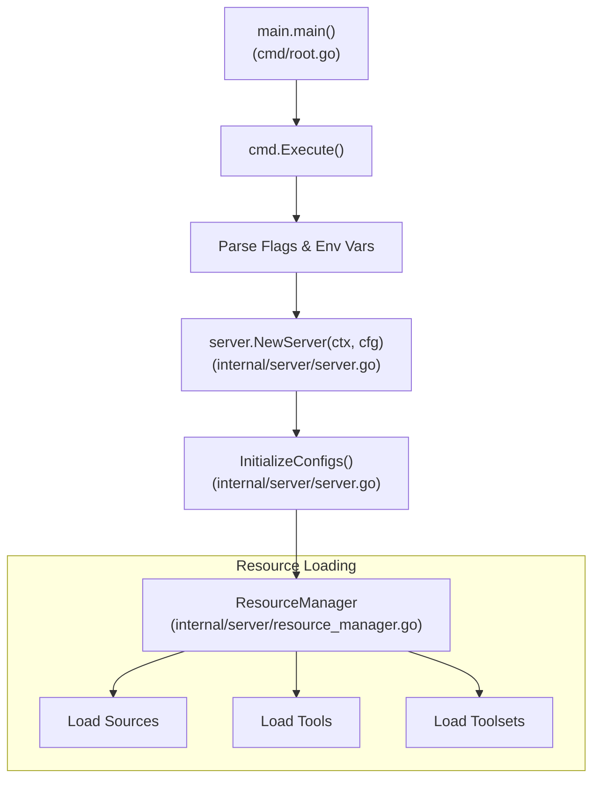
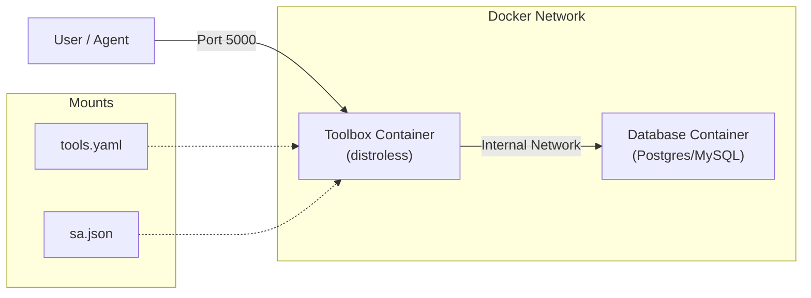
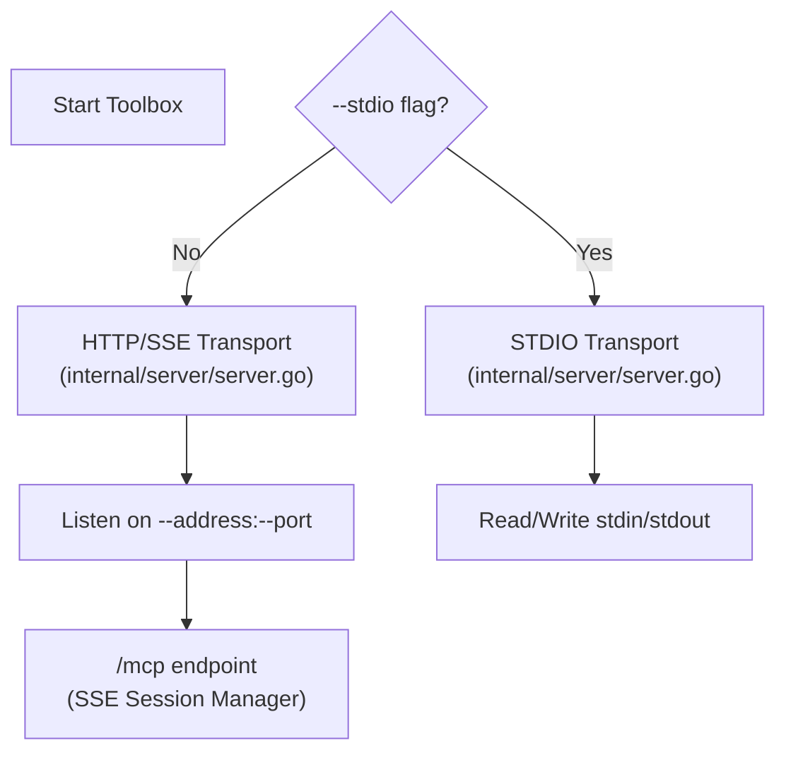

<!-- source: DeepWiki mcp.deepwiki.com · repo googleapis/genai-toolbox · page 9.2 Local and Docker Deployment · fetched 2026-10-29 -->

# Local and Docker Deployment

<details>
<summary>Relevant source files</summary>

The following files were used as context for generating this wiki page:

- [.github/release-please.yml](.github/release-please.yml)
- [CHANGELOG.md](CHANGELOG.md)
- [README.md](README.md)
- [cmd/version.txt](cmd/version.txt)
- [docs/en/documentation/introduction/_index.md](docs/en/documentation/introduction/_index.md)
- [gemini-extension.json](gemini-extension.json)
- [server.json](server.json)

</details>


This document covers deployment patterns for running the MCP Toolbox server in local development and Docker environments. It details configuration methods, the built-in UI, and the use of distroless container images. For cloud deployment options (Cloud Run, GKE), see [Cloud Deployment](#9.3).

## Local Binary Deployment

### Installation and Execution

The toolbox can be executed locally via prebuilt binaries, `npx`, or by running from source. The main entry point is [cmd/root.go:307-312](), which initializes the CLI and starts the server.

**Installation Methods:**
- **Homebrew:** `brew install mcp-toolbox` [docs/en/documentation/introduction/_index.md:177]()
- **NPX:** `npx @toolbox-sdk/server --prebuilt=postgres` [docs/en/documentation/introduction/_index.md:68-70]()
- **Binary:** Download from [releases](https://github.com/googleapis/mcp-toolbox/releases) for Linux, macOS, or Windows [docs/en/documentation/introduction/_index.md:102-160]()
- **Source:** `go run . --config tools.yaml` [docs/en/documentation/introduction/_index.md:188]()

### Command Line Interface (CLI)

The CLI supports various flags to control server behavior, networking, and configuration loading [server.json:26-161]().

| Flag | Type | Default | Description |
|------|------|---------|-------------|
| `--config` | string | "tools.yaml" | Single configuration file path [server.json:31]() |
| `--configs` | []string | [] | Multiple configuration files (merged) [server.json:37]() |
| `--config-folder`| string | "" | Directory containing YAML configs [server.json:43]() |
| `--prebuilt` | string | "" | Use prebuilt config (e.g., "postgres") [server.json:107]() |
| `--port` | int | 5000 | HTTP server port [server.json:71]() |
| `--address` | string | "127.0.0.1" | Bind address [server.json:57]() |
| `--stdio` | bool | false | Use MCP STDIO transport mode [server.json:113]() |
| `--ui` | bool | false | Launches the Toolbox UI web server [server.json:141]() |
| `--disable-reload`| bool | false | Disables dynamic config reloading [server.json:101]() |

**Toolbox Initialization Flow:**


Sources: [cmd/root.go:307-312](), [server.json:26-161](), [docs/en/documentation/introduction/_index.md:68-91]()

### Configuration Management

The server manages resources through the `ResourceManager`. It supports loading from multiple YAML files or directory folders [server.json:36-45]().

**Dynamic Reloading:** By default, the server watches configuration files for changes and reloads them without a restart. This can be disabled using the `--disable-reload` flag [server.json:98-102]().

### Environment Variables

Environment variables are used for database credentials and GCP authentication.

| Variable | Purpose |
|----------|---------|
| `GOOGLE_APPLICATION_CREDENTIALS` | Path to GCP service account JSON for IAM auth. |
| `POSTGRES_PASS` / `MYSQL_PASS` | Database passwords for standard auth. |
| `PORT` | Overrides the `--port` flag in certain environments. |

Sources: [docs/en/documentation/introduction/_index.md:75](), [server.json:52-72]()

## Docker Deployment

### Container Images

The MCP Toolbox is distributed as a container image hosted on Google Artifact Registry: `us-central1-docker.pkg.dev/database-toolbox/toolbox/toolbox:1.0.0` [server.json:21]().

**Distroless Base:** The production image uses a distroless base to minimize attack surface and image size. It contains only the compiled `toolbox` binary and necessary SSL root certificates.

### Running with Docker

To run the container locally, you must map ports and mount configuration files.

```bash
docker run -d \
  -p 5000:5000 \
  -v $(pwd)/tools.yaml:/app/tools.yaml \
  -e GOOGLE_APPLICATION_CREDENTIALS=/app/sa.json \
  -v $(pwd)/sa.json:/app/sa.json \
  us-central1-docker.pkg.dev/database-toolbox/toolbox/toolbox:1.0.0 \
  --config /app/tools.yaml \
  --address 0.0.0.0 \
  --port 5000
```

**Note:** In Docker, you must set `--address 0.0.0.0` to allow the host to reach the container's port [server.json:57]().

### Docker Compose

Docker Compose is recommended for orchestrating the Toolbox alongside a database.

**Docker Compose Architecture:**



**Example `docker-compose.yaml`:**
```yaml
services:
  toolbox:
    image: us-central1-docker.pkg.dev/database-toolbox/toolbox/toolbox:1.0.0
    ports:
      - "5000:5000"
    volumes:
      - ./tools.yaml:/app/tools.yaml
    environment:
      - POSTGRES_HOST=db
      - POSTGRES_USER=postgres
      - POSTGRES_PASS=password
    command: ["--config", "/app/tools.yaml", "--address", "0.0.0.0", "--ui"]

  db:
    image: postgres:15
    environment:
      POSTGRES_PASSWORD: password
```
Sources: [server.json:21-72](), [docs/en/documentation/introduction/_index.md:163-170]()

## Toolbox UI

The Toolbox includes a built-in web interface for exploring and testing tools. It is enabled via the `--ui` flag [server.json:138-142]().

**UI Capabilities:**
- **Resource Navigation:** View all registered `Sources`, `Tools`, and `Toolsets`.
- **Tool Invocation:** Execute tools directly from the browser with form-based parameter input.
- **Authentication:** Supports Google OAuth for tools requiring authenticated parameters.
- **MCP Inspection:** Provides a visual way to verify the MCP manifests that will be sent to clients.

The UI communicates with the server via the `/mcp` endpoint [CHANGELOG.md:43]().

## Operational Modes

### HTTP Mode vs. STDIO Mode

The Toolbox can operate as a persistent network service or a child process.

1.  **HTTP/SSE Mode (Default):** The server listens on a network port. Clients connect via HTTP/SSE. This is the standard for Docker and Cloud deployments [server.json:23-25]().
2.  **STDIO Mode:** Enabled with `--stdio`. The server communicates via standard input/output. This is primarily used when an IDE (like Claude Desktop or VS Code) launches the Toolbox as a local process [server.json:111-115]().

**Transport Selection Diagram:**


Sources: [server.json:111-115](), [server.json:22-25](), [docs/en/documentation/introduction/_index.md:58-73]()

### Telemetry

The server integrates OpenTelemetry for monitoring.
- **GCP:** `--telemetry-gcp` exports traces and metrics to Google Cloud Monitoring [server.json:118-122]().
- **OTLP:** `--telemetry-otlp` exports to any OTLP-compatible collector [server.json:125-128]().
- **Service Name:** Set via `--telemetry-service-name` (default: `toolbox`) [server.json:131-135]().

Sources: [server.json:118-135]()

---

