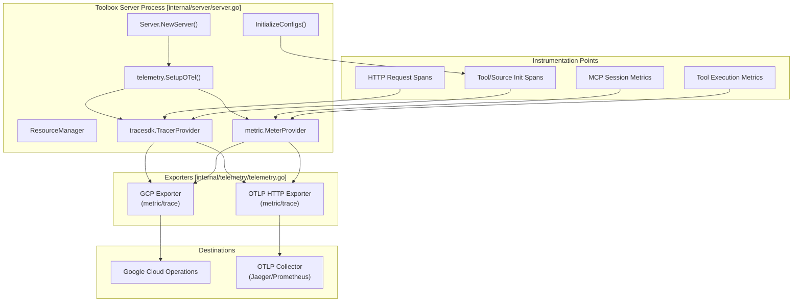
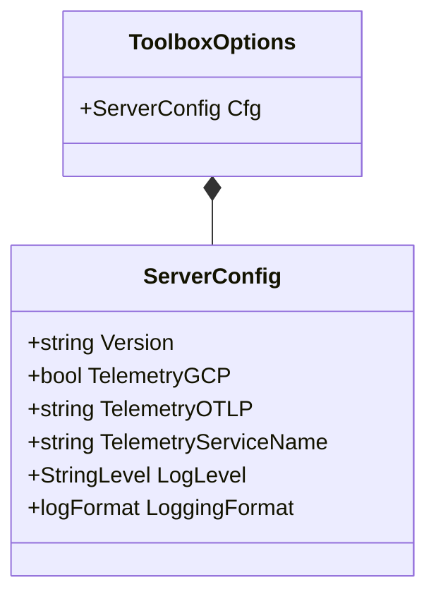

<!-- source: DeepWiki mcp.deepwiki.com · repo googleapis/genai-toolbox · page 9.4 Telemetry and Monitoring · fetched 2026-10-29 -->

# Telemetry and Monitoring

<details>
<summary>Relevant source files</summary>

The following files were used as context for generating this wiki page:

- [.ci/integration.cloudbuild.yaml](.ci/integration.cloudbuild.yaml)
- [.github/release-please.yml](.github/release-please.yml)
- [cmd/internal/flags.go](cmd/internal/flags.go)
- [cmd/root.go](cmd/root.go)
- [cmd/root_test.go](cmd/root_test.go)
- [docs/en/documentation/configuration/toolbox_mcp_auth.md](docs/en/documentation/configuration/toolbox_mcp_auth.md)
- [go.mod](go.mod)
- [go.sum](go.sum)
- [internal/prebuiltconfigs/prebuiltconfigs.go](internal/prebuiltconfigs/prebuiltconfigs.go)
- [internal/prebuiltconfigs/prebuiltconfigs_test.go](internal/prebuiltconfigs/prebuiltconfigs_test.go)
- [internal/server/config.go](internal/server/config.go)
- [internal/server/prm.go](internal/server/prm.go)
- [internal/server/server.go](internal/server/server.go)
- [internal/server/server_test.go](internal/server/server_test.go)
- [internal/telemetry/telemetry.go](internal/telemetry/telemetry.go)

</details>


This page documents the telemetry and monitoring capabilities of the Toolbox server, including OpenTelemetry integration, metrics collection, distributed tracing, and export configuration. Telemetry enables operators to observe server behavior, diagnose performance issues, and monitor tool execution patterns.

For information about configuring the server itself, see [3.2 Command Line Interface](). For database-specific monitoring tools (e.g., Cloud SQL observability tools), see [6.7 Prebuilt Tools Reference]().

---

## OpenTelemetry Architecture

Toolbox integrates with OpenTelemetry (OTel) to provide standardized observability across traces and metrics. The system supports two export mechanisms: direct export to Google Cloud Monitoring/Trace or export via the OpenTelemetry Protocol (OTLP) to any compatible collector.

### Telemetry Data Flow

The `telemetry.SetupOTel` function initializes the OpenTelemetry SDK, configuring providers for both tracing and metrics based on the provided `ServerConfig`.



**Sources:** [internal/telemetry/telemetry.go:36-85](), [internal/server/server.go:64-100](), [go.mod:20-21](), [go.mod:64-70]()

---

## Configuration

Telemetry is configured via CLI flags passed to the `toolbox` command. All telemetry is disabled by default unless an exporter flag is provided.

### CLI Flags

The following persistent flags control telemetry behavior across all subcommands:

| Flag | Type | Default | Description |
|------|------|---------|-------------|
| `--telemetry-gcp` | boolean | `false` | Enable direct export to Google Cloud Monitoring and Cloud Trace. |
| `--telemetry-otlp` | string | `""` | OTLP endpoint URL (e.g., `http://127.0.0.1:4318`) for exporting via HTTP. |
| `--telemetry-service-name` | string | `"toolbox"` | Sets the `service.name` resource attribute for identification. |
| `--log-level` | string | `"info"` | Minimum level logged: `DEBUG`, `INFO`, `WARN`, `ERROR`. |
| `--logging-format` | string | `"standard"` | Logging format: `standard` or `JSON`. |

**Sources:** [cmd/internal/flags.go:32-36](), [internal/server/config.go:61-66]()

### ServerConfig Structure

Telemetry configuration is encapsulated in the `ServerConfig` struct, which is populated during CLI flag parsing.



**Sources:** [internal/server/config.go:36-87](), [cmd/internal/toolbox_options.go:21-35]()

---

## Export Destinations

### Google Cloud Monitoring (GCP Exporter)

When `--telemetry-gcp` is enabled, Toolbox uses the Google Cloud Operations exporters to send data directly to Google Cloud.

*   **Traces:** Sent to Google Cloud Trace.
*   **Metrics:** Sent to Google Cloud Monitoring.

The exporter utilizes Application Default Credentials (ADC). The environment must have sufficient permissions (e.g., `roles/monitoring.metricWriter` and `roles/cloudtrace.agent`).

**Sources:** [internal/telemetry/telemetry.go:123-129](), [internal/telemetry/telemetry.go:149-155]()

### OpenTelemetry Protocol (OTLP) Exporter

When `--telemetry-otlp` is provided with an endpoint URL, Toolbox exports telemetry using OTLP over HTTP with protobuf payloads.

*   **Endpoint:** The URL of the OTLP collector (e.g., `http://my-collector:4318`).
*   **Traces:** Exported via `otlptracehttp`.
*   **Metrics:** Exported via `otlpmetrichttp`.

**Sources:** [internal/telemetry/telemetry.go:114-122](), [internal/telemetry/telemetry.go:140-148]()

---

## Metrics and Tracing Details

### Resource Attributes

The `newResource` function defines the identity of the process in the telemetry stream. It includes:
*   `service.name`: Set by `--telemetry-service-name` (default: `"toolbox"`). [internal/telemetry/telemetry.go:100]()
*   `service.version`: Set to the current Toolbox version. [internal/telemetry/telemetry.go:101]()
*   Standard attributes: OS, Container, and Host information. [internal/telemetry/telemetry.go:95-97]()

### Tracing Instrumentation

Toolbox creates spans for critical lifecycle events and operations:
*   **Configuration Reloading:** `toolbox/server/reload` spans track dynamic config updates. [cmd/root.go:169]()
*   **Resource Initialization:** Spans are created during `InitializeConfigs` for every source, auth service, embedding model, and tool. [internal/server/server.go:93-100](), [internal/server/server.go:121-127](), [internal/server/server.go:149-155](), [internal/server/server.go:177-183]()

### Metrics and Histograms

Toolbox configures custom histogram bucket boundaries for duration metrics to align with MCP semantic conventions.

**Bucket Boundaries:** `0.01, 0.02, 0.05, 0.1, 0.2, 0.5, 1, 2, 5, 10, 30, 60, 120, 300` (seconds). [internal/telemetry/telemetry.go:159]()

**Key Metrics Tracked:**
*   `mcp.operation.duration`: Duration of MCP protocol operations. [internal/telemetry/telemetry.go:163]()
*   `mcp.server.session.duration`: Total duration of an MCP session. [internal/telemetry/telemetry.go:164]()
*   `tool.execution.duration`: Time taken for a specific tool to execute. [internal/telemetry/telemetry.go:165]()

**Sources:** [internal/telemetry/telemetry.go:157-183]()

---

## Logging Configuration

Toolbox supports structured logging, which is essential for monitoring in containerized environments like GKE or Cloud Run.

### Log Levels
Controlled via `--log-level`. Supported values:
*   `debug`: Verbose output for development.
*   `info`: Default operational logs.
*   `warn`: Non-critical issues (e.g., validation failures during dynamic reload). [cmd/root.go:143]()
*   `error`: Critical failures.

### Log Formats
Controlled via `--logging-format`:
*   `standard`: Human-readable text format.
*   `json`: Structured JSON format for log aggregators.

**Sources:** [internal/server/config.go:92-139](), [cmd/internal/flags.go:32-33]()

---

## Testing Telemetry

The CLI's telemetry flag parsing is validated in `cmd/root_test.go` within `TestServerConfigFlags`. These tests ensure that flags correctly map to the internal `ServerConfig` state.

| Test Case | Flags Used | Expected Config Value |
|-----------|------------|-----------------------|
| GCP Telemetry | `--telemetry-gcp` | `TelemetryGCP: true` |
| OTLP Telemetry | `--telemetry-otlp http://127.0.0.1:4553` | `TelemetryOTLP: "http://127.0.0.1:4553"` |
| Service Name | `--telemetry-service-name toolbox-custom` | `TelemetryServiceName: "toolbox-custom"` |

**Sources:** [cmd/root_test.go:180-199]()

### Integration Testing and Coverage
The CI pipeline uses a specific configuration to track code coverage across internal packages while running integration tests.

```yaml
# From .ci/integration.cloudbuild.yaml
- id: "compile-test-binary"
  script: |
    go test -c -race -cover \
    -coverpkg=./internal/sources/...,./internal/tools/...
```

**Sources:** [.ci/integration.cloudbuild.yaml:38-50]()

---

