# Page: Overview

# Overview

<details>
<summary>Relevant source files</summary>

The following files were used as context for generating this wiki page:

- [.ci/integration.cloudbuild.yaml](.ci/integration.cloudbuild.yaml)
- [CHANGELOG.md](CHANGELOG.md)
- [README.md](README.md)
- [cmd/internal/flags.go](cmd/internal/flags.go)
- [cmd/root.go](cmd/root.go)
- [cmd/root_test.go](cmd/root_test.go)
- [cmd/version.txt](cmd/version.txt)
- [docs/en/documentation/configuration/toolbox_mcp_auth.md](docs/en/documentation/configuration/toolbox_mcp_auth.md)
- [docs/en/documentation/introduction/_index.md](docs/en/documentation/introduction/_index.md)
- [gemini-extension.json](gemini-extension.json)
- [go.mod](go.mod)
- [go.sum](go.sum)
- [internal/prebuiltconfigs/prebuiltconfigs.go](internal/prebuiltconfigs/prebuiltconfigs.go)
- [internal/prebuiltconfigs/prebuiltconfigs_test.go](internal/prebuiltconfigs/prebuiltconfigs_test.go)
- [internal/server/config.go](internal/server/config.go)
- [internal/server/prm.go](internal/server/prm.go)
- [internal/server/server.go](internal/server/server.go)
- [internal/server/server_test.go](internal/server/server_test.go)
- [internal/telemetry/telemetry.go](internal/telemetry/telemetry.go)
- [server.json](server.json)

</details>


MCP Toolbox for Databases is an open-source control plane that connects AI applications, IDEs, and agents directly to enterprise databases. It acts as a bridge between AI orchestration frameworks (such as LangChain, LlamaIndex, or Genkit) and database systems (such as PostgreSQL, BigQuery, MySQL, and Spanner), providing a unified interface for tool execution, connection pooling, authentication, and observability.

**Key Capabilities:**
- **Dual-Purpose Connectivity**: Functions as a ready-to-use MCP server for IDEs (Cursor, Claude Desktop) and a robust framework for production AI agents.
- **Connection Management**: Handles complex database connection pooling and lifecycle management across 60+ source types [go.mod:7-78]().
- **Integrated Auth**: Supports IAM, OAuth2, and OpenID Connect (OIDC) to ensure secure data access [internal/server/config.go:190-198]().
- **Observability**: Built-in OpenTelemetry integration for distributed tracing and metrics [internal/server/config.go:61-66]().
- **Hot Reloading**: Dynamically updates tool definitions from configuration files without server restarts [cmd/root.go:134-150]().

This is a high-level parent page. For technical deep-dives, see:
- **System Architecture**: [System Architecture](#1.1)
- **Core Concepts**: [Key Concepts](#1.2)

## Architecture Overview

The Toolbox sits between the "Natural Language Space" (LLMs and AI Clients) and the "Data Space" (Databases and Analytics Engines).

**System Component Map**

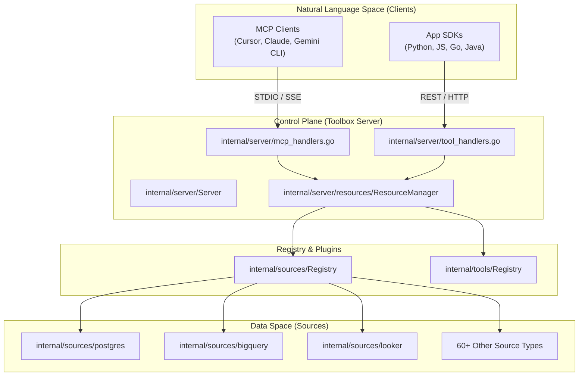

**Sources:**
- [internal/server/server.go:50-62]()
- [internal/server/config.go:36-87]()
- [README.md:22-31]()

## Key Components

The system is designed around a modular architecture where every database and operation type is a plugin registered at runtime.

### Server Entry Point
The CLI ([cmd/root.go]()) initializes the `server.Server` ([internal/server/server.go]()) based on flags like `--stdio` for local MCP use or `--address`/`--port` for remote HTTP access. It manages the lifecycle of the `ResourceManager`, which holds the active state of all tools and connections.

### Resource Management
The `ResourceManager` ([internal/server/resources/resources.go]()) is the central authority for:
- **Sources**: Database connection instances (e.g., `*sql.DB` or `*bigquery.Client`).
- **Tools**: Executable logic (e.g., a SQL template or an API call).
- **Toolsets**: Logical groupings of tools exposed to specific clients.
- **AuthServices**: Providers that validate identity (Google OAuth, OIDC).

### Configuration & Discovery
Toolbox uses a declarative approach. Users define resources in a `tools.yaml` file, which the server parses and initializes into live objects via `server.InitializeConfigs` [internal/server/server.go:64-73]().

**Bridge: Config to Code Entities**

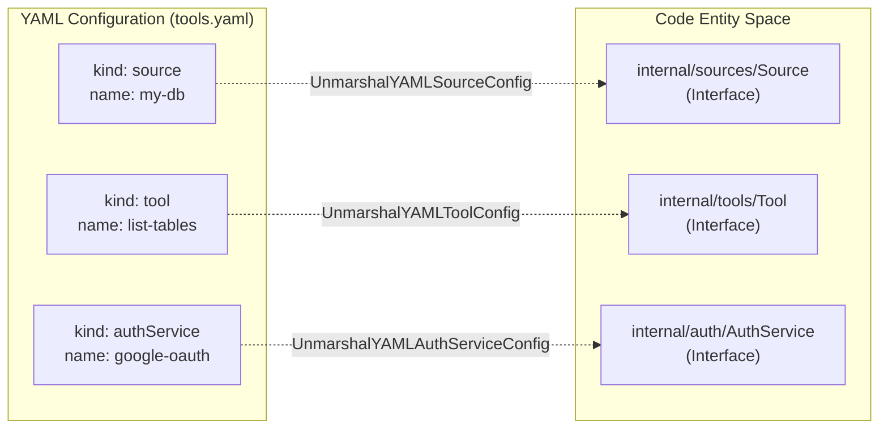

**Sources:**
- [internal/server/config.go:149-212]()
- [internal/server/server.go:89-210]()
- [cmd/root.go:96-131]()

## Operational Modes

| Mode | Trigger | Protocol | Use Case |
| :--- | :--- | :--- | :--- |
| **STDIO** | `--stdio` | MCP (JSON-RPC) | Local IDE integration (Cursor, Claude Desktop). |
| **Remote (SSE)** | `--address` | MCP over SSE | Cloud-hosted MCP server for remote agents. |
| **REST API** | (Default) | HTTP/JSON | Custom application integration via SDKs. |
| **Toolbox UI** | `--ui` | Web/HTML | Interactive playground for testing tool configurations. |

**Sources:**
- [internal/server/config.go:67-74]()
- [cmd/root.go:118-121]()
- [server.json:111-142]()

## Where it Sits in the AI Stack

Toolbox acts as the **Data Tooling Layer**. Instead of writing custom database connectors for every agent, developers configure Toolbox once and expose it as a standard set of MCP tools. This allows the same database tools to be shared between a developer's IDE (during build-time) and the production AI agent (during run-time).

**Sources:**
- [README.md:28-31]()
- [README.md:59-67]()

---

# Page: System Architecture

# System Architecture

<details>
<summary>Relevant source files</summary>

The following files were used as context for generating this wiki page:

- [.ci/integration.cloudbuild.yaml](.ci/integration.cloudbuild.yaml)
- [cmd/internal/flags.go](cmd/internal/flags.go)
- [cmd/root.go](cmd/root.go)
- [cmd/root_test.go](cmd/root_test.go)
- [docs/en/documentation/configuration/toolbox_mcp_auth.md](docs/en/documentation/configuration/toolbox_mcp_auth.md)
- [go.mod](go.mod)
- [go.sum](go.sum)
- [internal/prebuiltconfigs/prebuiltconfigs.go](internal/prebuiltconfigs/prebuiltconfigs.go)
- [internal/prebuiltconfigs/prebuiltconfigs_test.go](internal/prebuiltconfigs/prebuiltconfigs_test.go)
- [internal/server/api.go](internal/server/api.go)
- [internal/server/api_test.go](internal/server/api_test.go)
- [internal/server/config.go](internal/server/config.go)
- [internal/server/mcp.go](internal/server/mcp.go)
- [internal/server/mcp/jsonrpc/jsonrpc.go](internal/server/mcp/jsonrpc/jsonrpc.go)
- [internal/server/mcp/mcp.go](internal/server/mcp/mcp.go)
- [internal/server/mcp/util/lifecycle.go](internal/server/mcp/util/lifecycle.go)
- [internal/server/mcp/v20241105/method.go](internal/server/mcp/v20241105/method.go)
- [internal/server/mcp/v20241105/types.go](internal/server/mcp/v20241105/types.go)
- [internal/server/mcp/v20250326/method.go](internal/server/mcp/v20250326/method.go)
- [internal/server/mcp/v20250326/types.go](internal/server/mcp/v20250326/types.go)
- [internal/server/mcp/v20250618/method.go](internal/server/mcp/v20250618/method.go)
- [internal/server/mcp/v20250618/types.go](internal/server/mcp/v20250618/types.go)
- [internal/server/mcp/v20251125/method.go](internal/server/mcp/v20251125/method.go)
- [internal/server/mcp_test.go](internal/server/mcp_test.go)
- [internal/server/prm.go](internal/server/prm.go)
- [internal/server/server.go](internal/server/server.go)
- [internal/server/server_test.go](internal/server/server_test.go)
- [internal/sources/sources.go](internal/sources/sources.go)
- [internal/telemetry/instrumentation.go](internal/telemetry/instrumentation.go)
- [internal/telemetry/telemetry.go](internal/telemetry/telemetry.go)
- [internal/tools/looker/lookerconversationalanalytics/lookerconversationalanalytics.go](internal/tools/looker/lookerconversationalanalytics/lookerconversationalanalytics.go)
- [internal/tools/tools.go](internal/tools/tools.go)
- [internal/util/util.go](internal/util/util.go)

</details>


This page describes the high-level architecture of the GenAI Toolbox system, explaining how components are organized, initialized, and interact to provide database tools to AI applications.

## Purpose and Scope

The Toolbox server acts as a **control plane** between AI applications and databases, providing:
- Centralized tool management and distribution via the Model Context Protocol (MCP) or HTTP.
- Connection pooling and authentication handling for various database types.
- Protocol translation (HTTP API ↔ MCP JSON-RPC ↔ STDIO).
- Dynamic configuration reloading without server restarts.
- Telemetry and observability through OpenTelemetry.

The architecture supports extensibility through a plugin-based registry pattern for sources and tools, allowing new database types to be added by implementing standard interfaces.

## High-Level Architecture

```mermaid
graph TB
    subgraph "External Clients"
        IDE["IDEs (Cursor, Claude Desktop)<br/>MCP STDIO Transport"]
        HTTP_SDK["HTTP Clients / SSE<br/>Python/JS/Go SDKs"]
    end
    
    subgraph "CLI Entry Point"
        CLI["cmd/root.go<br/>NewCommand()<br/>Execute()"]
    end
    
    subgraph "Server Layer"
        Server["internal/server/server.go<br/>Server struct<br/>NewServer()"]
        Config["internal/server/config.go<br/>ServerConfig<br/>InitializeConfigs()"]
        Router["chi.Router<br/>HTTP /api endpoints"]
        MCPSession["internal/server/mcp.go<br/>stdioSession / sseSession"]
    end
    
    subgraph "Resource Management"
        ResourceMgr["resources.ResourceManager<br/>GetSource()<br/>GetTool()"]
        SourceMap["map[string]sources.Source"]
        ToolMap["map[string]tools.Tool"]
        AuthMap["map[string]auth.AuthService"]
    end
    
    subgraph "Plugin Registries"
        SourceRegistry["internal/sources/sources.go<br/>sourceRegistry map"]
        ToolRegistry["internal/tools/tools.go<br/>toolRegistry map"]
    end
    
    subgraph "Implementations"
        SourceImpls["internal/sources/*<br/>postgres, bigquery, etc.<br/>init() registration"]
        ToolImpls["internal/tools/*<br/>sql-tools, bigquery-tools, etc.<br/>init() registration"]
    end
    
    IDE -->|JSON-RPC| MCPSession
    HTTP_SDK -->|HTTP POST| Router
    HTTP_SDK -->|SSE| MCPSession
    
    CLI --> Config
    Config --> Server
    
    Server --> Router
    Server --> MCPSession
    
    Router --> ResourceMgr
    MCPSession --> ResourceMgr
    
    ResourceMgr --> SourceMap
    ResourceMgr --> ToolMap
    ResourceMgr --> AuthMap
    
    Config -->|Unmarshal| SourceRegistry
    Config -->|Unmarshal| ToolRegistry
    
    SourceRegistry -->|Initialize()| SourceMap
    ToolRegistry -->|Initialize()| ToolMap
    
    SourceImpls -.->|Register()| SourceRegistry
    ToolImpls -.->|Register()| ToolRegistry
```

**Sources:**
- [internal/server/server.go:51-62]()
- [internal/server/config.go:36-87]()
- [cmd/root.go:96-132]()
- [internal/server/mcp.go:178-185]()

## Server Initialization Flow

The server initialization follows a lifecycle from CLI invocation to the "ready" state, supporting both persistent HTTP/SSE and transient STDIO modes.

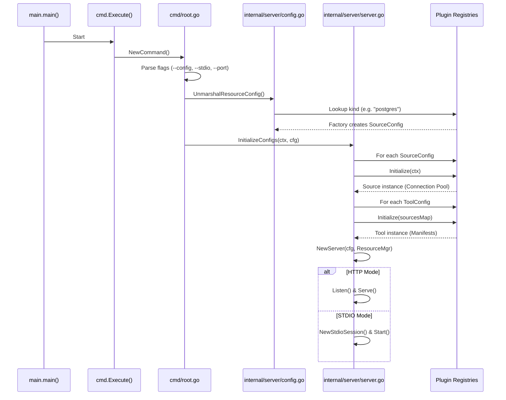

**Initialization Sequence:**

1.  **CLI Entry** ([cmd/root.go:85-93]()): The root command is executed, initializing `ToolboxOptions`.
2.  **Configuration Loading** ([internal/server/config.go:149-168]()): YAML documents are unmarshaled. The `kind` field in the YAML determines which registry factory is used to create the specific `SourceConfig` or `ToolConfig`.
3.  **Source Initialization** ([internal/server/server.go:90-110]()): For every configured source, the `Initialize` method is called. This typically sets up database drivers and connection pools (e.g., Cloud SQL connectors).
4.  **Tool Initialization** ([internal/server/server.go:174-194]()): Tools are initialized and linked to their required sources from the `sourcesMap`.
5.  **Server Start** ([internal/server/server.go:331-350]()): The server starts listening on the configured address/port or begins reading from `stdin` if `--stdio` is provided ([internal/server/mcp.go:192-238]()).

**Sources:**
- [cmd/root.go:85-132]()
- [internal/server/config.go:149-225]()
- [internal/server/server.go:64-213]()
- [internal/server/mcp.go:187-189]()

## Component Architecture

### Resource Manager

The `ResourceManager` acts as the central repository for all active entities in the system. It is responsible for the thread-safe storage and retrieval of sources, tools, toolsets, auth services, and prompts.

**Key Responsibilities:**
- **Storage**: Maintains maps of initialized resources ([internal/server/server.go:60]()).
- **Retrieval**: Provides `GetTool`, `GetSource`, and `GetToolset` methods used by both HTTP and MCP handlers ([internal/server/api.go:68-74](), [internal/server/api.go:94-100]()).
- **Dynamic Updates**: Supports atomic replacement of all resources during a configuration reload ([cmd/root.go:147]()).

### HTTP API Handler

The HTTP API provides a REST-like interface for tool discovery and invocation.

| Route | Method | Function | Description |
|---|---|---|---|
| `/api/toolset` | GET | `toolsetHandler` | List all tools in the default toolset ([internal/server/api.go:41]()). |
| `/api/toolset/{name}` | GET | `toolsetHandler` | List tools in a specific named toolset ([internal/server/api.go:42]()). |
| `/api/tool/{name}` | GET | `toolGetHandler` | Get metadata/manifest for a single tool ([internal/server/api.go:45]()). |
| `/api/tool/{name}/invoke` | POST | `toolInvokeHandler` | Execute a tool with provided parameters ([internal/server/api.go:46]()). |

**Sources:**
- [internal/server/api.go:34-49]()
- [internal/server/api.go:113-135]()

### MCP Protocol Handler

The Model Context Protocol (MCP) handler manages JSON-RPC communication over two transports:
1.  **STDIO**: Used for local integrations with IDEs like Cursor ([internal/server/mcp.go:178-185]()).
2.  **SSE (Server-Sent Events)**: Used for remote connections over HTTP ([internal/server/mcp.go:47-53]()).

**Message Processing Loop:**
- Messages are read from the transport (stdin or HTTP body).
- `processMcpMessage` identifies the JSON-RPC method (e.g., `tools/list`, `tools/call`) ([internal/server/mcp.go:251]()).
- For `tools/call`, the handler looks up the tool in the `ResourceMgr` and calls its `Invoke` method ([internal/server/api.go:129-135]()).

**Sources:**
- [internal/server/mcp.go:56-74]()
- [internal/server/mcp.go:192-238]()

## Data Flow: Client Request to Database Query

This diagram traces a tool invocation from an external AI client through the Toolbox layers to the final database execution.

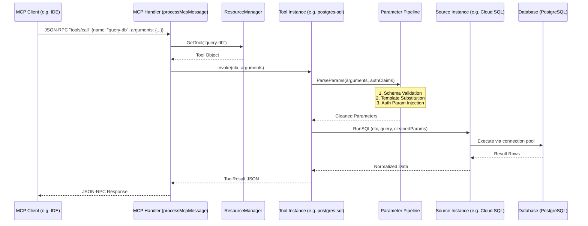

**Data Flow Details:**
1.  **Parameter Processing** ([internal/server/api.go:201-202]()): Incoming JSON data is parsed using `parameters.ParseParams`. This step handles type conversion, default values, and injecting "authenticated parameters" (like a user's email) into the tool's input.
2.  **Authorization** ([internal/server/api.go:183-189]()): Before execution, the tool's `Authorized()` check is performed against verified `AuthServices`.
3.  **Source Execution**: The tool uses the `Source` interface (e.g., `RunSQL`) to interact with the database. Sources manage the complexities of IAM authentication and driver-specific connection logic.

**Sources:**
- [internal/server/api.go:113-202]()
- [internal/server/mcp.go:251]()

## Dynamic Configuration Reloading

The Toolbox supports "Hot Reloading" of the `tools.yaml` file.

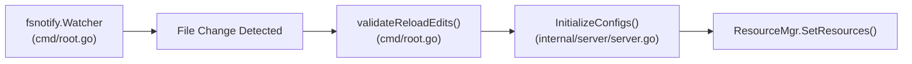

- **Watcher**: A background goroutine monitors files/folders for modifications ([cmd/root.go:201-224]()).
- **Validation**: Before applying changes, the server attempts to initialize the new configuration in a temporary space to ensure it's valid ([cmd/root.go:153-190]()).
- **Atomic Swap**: If valid, the `ResourceManager` is updated with the new maps of sources and tools, and the changes are immediately reflected in subsequent API/MCP calls ([cmd/root.go:147]()).

**Sources:**
- [cmd/root.go:134-150]()
- [cmd/root.go:153-190]()
- [cmd/root.go:193-224]()

## Telemetry and Observability

Instrumentation is baked into the server lifecycle using OpenTelemetry.

- **Tracing**: Spans are created for server startup, source initialization, tool initialization, and every tool invocation ([internal/server/server.go:93-99](), [internal/server/api.go:114-115]()).
- **Metrics**: The MCP handler tracks active sessions and session duration ([internal/server/mcp.go:202-222]()).
- **Context Propagation**: Trace context is extracted from MCP metadata (`_meta`) to allow distributed tracing from the AI client through the Toolbox ([internal/server/mcp.go:149-176]()).

**Sources:**
- [internal/server/server.go:93-105]()
- [internal/server/api.go:114-127]()
- [internal/server/mcp.go:149-176]()
- [internal/server/mcp.go:202-222]()

---

# Page: Key Concepts

# Key Concepts

<details>
<summary>Relevant source files</summary>

The following files were used as context for generating this wiki page:

- [.gemini/styleguide.md](.gemini/styleguide.md)
- [.gitignore](.gitignore)
- [AGENTS.md](AGENTS.md)
- [CHANGELOG.md](CHANGELOG.md)
- [CLAUDE.md](CLAUDE.md)
- [CONTRIBUTING.md](CONTRIBUTING.md)
- [DEVELOPER.md](DEVELOPER.md)
- [GEMINI.md](GEMINI.md)
- [LICENSE](LICENSE)
- [README.md](README.md)
- [cmd/version.txt](cmd/version.txt)
- [docs/en/documentation/introduction/_index.md](docs/en/documentation/introduction/_index.md)
- [gemini-extension.json](gemini-extension.json)
- [internal/prompts/custom/custom.go](internal/prompts/custom/custom.go)
- [internal/prompts/custom/custom_test.go](internal/prompts/custom/custom_test.go)
- [internal/prompts/prompts.go](internal/prompts/prompts.go)
- [internal/prompts/promptsets.go](internal/prompts/promptsets.go)
- [internal/prompts/promptsets_test.go](internal/prompts/promptsets_test.go)
- [internal/tools/toolsets.go](internal/tools/toolsets.go)
- [server.json](server.json)

</details>


This page defines the core concepts in MCP Toolbox for Databases and explains how they relate to each other. Understanding these concepts is essential for configuring and using Toolbox effectively.

For information about the overall system architecture and how these concepts fit into the larger system, see [System Architecture](#1.1).

## Overview of Core Concepts

Toolbox is built around several primary concepts that work together to enable database access for AI agents:

| Concept | Purpose | Configuration Key |
|---------|---------|-------------------|
| **Source** | Define database connections and connection pooling | `sources` |
| **Tool** | Define executable actions (e.g., SQL queries) | `tools` |
| **Toolset** | Group related tools for distribution | `toolsets` |
| **Prompt** | Define reusable natural language templates | `prompts` |
| **AuthService** | Provide authentication and authorization | `authServices` |
| **EmbeddingModel** | Define models for vector search and semantic analysis | `embeddingModels` |
| **ResourceManager** | Runtime registry managing all initialized resources | N/A |

These concepts are declaratively configured in `tools.yaml` files and managed at runtime by the `ResourceManager`.

Sources: [internal/server/config.go:29-60](), [internal/tools/toolsets.go:22-32](), [internal/prompts/prompts.go:21-28]()

## Configuration Structure

### Configuration File Format

All Toolbox resources are defined in YAML configuration files. The system supports a flat configuration format where different resource kinds are defined in top-level sections.

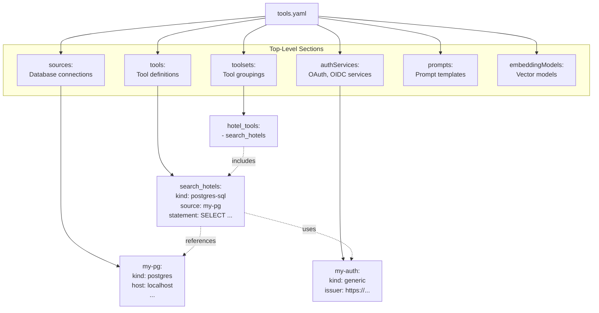

**Configuration File Structure**

Sources: [internal/server/config.go:114-243](), [README.md:124-140]()

### Configuration Loading and Parsing

The Toolbox server supports multiple configuration input methods. It performs environment variable substitution using the pattern `$${VAR}` or `$${VAR:default}` to prevent shell interpolation issues during deployment.

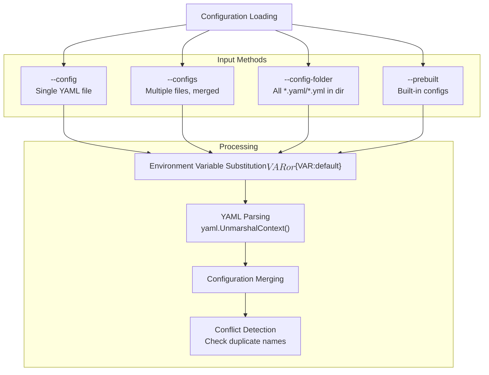

**Configuration Loading Pipeline**

Sources: [server.json:29-45](), [README.md:114-120]()

## Sources

**Sources** represent database connections. Each source defines how to connect to a specific database instance (e.g., host, port, credentials) and manages connection pooling for performance.

### Source Architecture

Sources are implemented by a `SourceConfig` (the YAML definition) and a `Source` (the runtime instance). New sources are registered via an `init()` function in their respective packages.

| Feature | Implementation |
|---------|----------------|
| **Interface** | `sources.Source` [internal/sources/sources.go:37-43]() |
| **Config Interface** | `sources.SourceConfig` [internal/sources/sources.go:27-35]() |
| **GCP Integration** | Utilities for Cloud SQL IAM and ADC [internal/sources/sources.go:132-150]() |

Sources: [DEVELOPER.md:181-191](), [internal/sources/sources.go:1-50]()

## Tools

**Tools** define executable actions, such as running SQL queries or making HTTP requests. Each tool has a `kind` (e.g., `postgres-sql`), a `source` it operates on, and `parameters`.

### Tool Naming Conventions

The codebase enforces specific naming conventions to ensure compatibility with LLMs and the MCP protocol:

*   **Tool Name:** `snake_case` (e.g., `list_tables`). Used by LLMs for invocation. Should NOT include product names. [DEVELOPER.md:95-115]()
*   **Tool Type:** `kebab-case` (e.g., `postgres-sql`). Used in configuration. MUST include the product name. [DEVELOPER.md:116-126]()

### Tool Interface and Implementation

Every tool must implement the `Tool` interface, which includes methods for manifest generation and invocation.

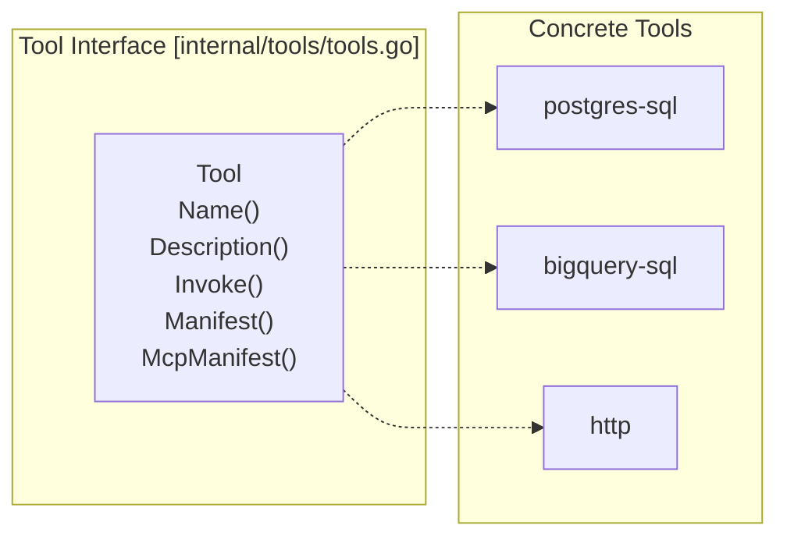

**Tool Interface Mapping**

Sources: [internal/tools/tools.go:50-70](), [DEVELOPER.md:143-162]()

## Toolsets

**Toolsets** are named groups of tools. They are the primary unit of distribution to clients, allowing an agent to load a suite of related capabilities (e.g., "inventory_tools") in one call.

*   **Initialization:** The `Initialize` function validates that all referenced tools exist in the global tool map. [internal/tools/toolsets.go:43-67]()
*   **Manifests:** Toolsets aggregate both standard and MCP manifests for all member tools. [internal/tools/toolsets.go:38-41]()

Sources: [internal/tools/toolsets.go:22-32](), [internal/tools/toolsets.go:43-67]()

## Prompts

**Prompts** (configured via `prompts` or `promptsets`) define reusable natural language templates that can be served to LLMs via the MCP protocol.

*   **PromptConfig:** Defines the prompt name and template. [internal/prompts/prompts.go:21-28]()
*   **Promptset:** Groups multiple prompts, similar to how toolsets group tools. [internal/prompts/promptsets.go:22-32]()

Sources: [internal/prompts/prompts.go:21-28](), [internal/prompts/promptsets.go:22-32]()

## AuthService and EmbeddingModel

### AuthService
`AuthServices` provide a way to handle authentication (e.g., Google OAuth, OIDC) and populate tool parameters from verified tokens.
*   **Generic AuthService:** Supports OIDC and opaque token validation for MCP authorization. [CHANGELOG.md:17-18](), [CHANGELOG.md:74-75]()

### EmbeddingModel
`EmbeddingModels` define configurations for vectorization, used by tools that support semantic search (e.g., `bigquery-sql` with semantic search). [CHANGELOG.md:19-20](), [CHANGELOG.md:36-37]()

## ResourceManager

The `ResourceManager` is the central runtime component that manages the lifecycle of all resources. It handles registration, initialization, and thread-safe retrieval.

*   **Role:** Acts as the "source of truth" for the server, holding maps of all active sources, tools, toolsets, and auth services.
*   **Dynamic Reloading:** When config files change, the `ResourceManager` orchestrates the hot-swapping of resource instances without restarting the server. [server.json:98-102]()

Sources: [internal/server/resource_manager.go:1-50]()

## Prebuilt Configurations

The Toolbox includes **prebuilt configs** for common databases. These are YAML files embedded into the binary at compile time.

*   **Usage:** Enabled via the `--prebuilt=<kind>` flag (e.g., `--prebuilt=postgres`). [server.json:105-108]()
*   **Purpose:** Provides instant access to standard tools like `list_tables` and `execute_sql` without requiring a custom `tools.yaml`. [README.md:97-103]()

Sources: [server.json:105-108](), [README.md:97-103]()

## MCP Protocol

The **Model Context Protocol (MCP)** is the primary communication standard used by the Toolbox.

*   **Transport Modes:** Supports both **Stdio** (for local IDE integration) and **HTTP/SSE** (for remote server deployment). [server.json:111-115](), [server.json:22-25]()
*   **Error Handling:** Toolbox distinguishes between **Agent Errors** (fixable by the LLM, like SQL syntax) and **Server Errors** (infrastructure failures). [DEVELOPER.md:130-140]()

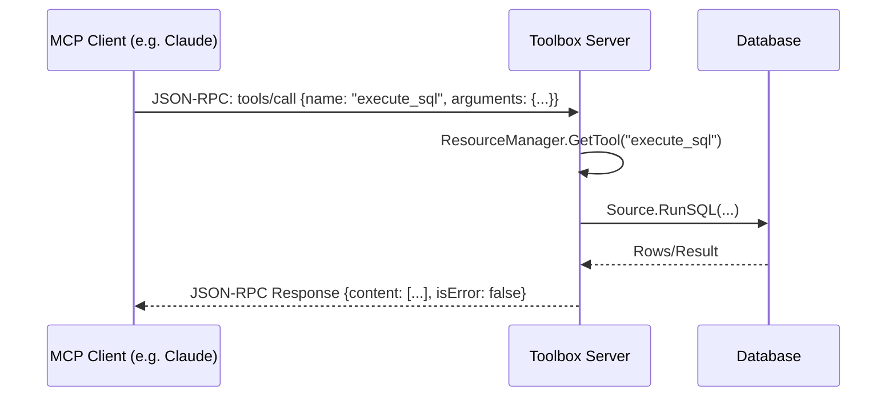

**MCP Tool Call Flow**

Sources: [server.json:1-25](), [DEVELOPER.md:130-140]()

---

# Page: Getting Started

# Getting Started

<details>
<summary>Relevant source files</summary>

The following files were used as context for generating this wiki page:

- [.hugo/assets/scss/_styles_project.scss](.hugo/assets/scss/_styles_project.scss)
- [.hugo/hugo.cloudflare.toml](.hugo/hugo.cloudflare.toml)
- [.hugo/hugo.toml](.hugo/hugo.toml)
- [.hugo/layouts/partials/td/render-heading.html](.hugo/layouts/partials/td/render-heading.html)
- [CHANGELOG.md](CHANGELOG.md)
- [CODE_OF_CONDUCT.md](CODE_OF_CONDUCT.md)
- [README.md](README.md)
- [cmd/version.txt](cmd/version.txt)
- [docs/en/_index.md](docs/en/_index.md)
- [docs/en/documentation/introduction/_index.md](docs/en/documentation/introduction/_index.md)
- [gemini-extension.json](gemini-extension.json)
- [logo.png](logo.png)
- [server.json](server.json)

</details>


This page provides an overview of how to install, configure, and run MCP Toolbox for Databases for the first time. It covers the essential workflow from installation to connecting your first client application.

For detailed installation procedures and platform-specific instructions, see [Installation and Setup](#2.1). For complete working examples in Python, JavaScript, and Go, see [Quick Start Examples](#2.2).

## Overview

MCP Toolbox for Databases operates as a server process that sits between AI applications and database systems. The typical workflow involves four stages:

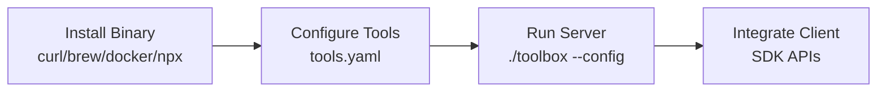

**Sources:** [README.md:106-120](), [docs/en/documentation/introduction/_index.md:52-97]()

## Installation Methods

The Toolbox server is distributed as a standalone binary for multiple platforms. Current stable version: `1.0.0` ([cmd/version.txt:1]()).

| Method | Use Case | Command |
|--------|----------|---------|
| Binary Download | Production, most flexible | `curl -L -o toolbox https://storage.googleapis.com/mcp-toolbox-for-databases/v1.0.0/linux/amd64/toolbox` |
| Homebrew | macOS/Linux development | `brew install mcp-toolbox` |
| Docker | Containerized deployment | `docker pull us-central1-docker.pkg.dev/database-toolbox/toolbox/toolbox:1.0.0` |
| NPX | Quick experimentation | `npx @toolbox-sdk/server --prebuilt=postgres` |
| Source | Development/customization | `go install github.com/googleapis/mcp-toolbox@v1.0.0` |

For detailed platform-specific instructions and environment setup, see [Installation and Setup](#2.1).

**Sources:** [docs/en/documentation/introduction/_index.md:105-185](), [server.json:17-21]()

## Configuration Workflow

Toolbox operates from YAML configuration files that define database connections (`sources`), operations (`tools`), and groupings (`toolsets`).

### Natural Language to Code Entity Mapping
The following diagram bridges how high-level configuration concepts map to internal code structures.

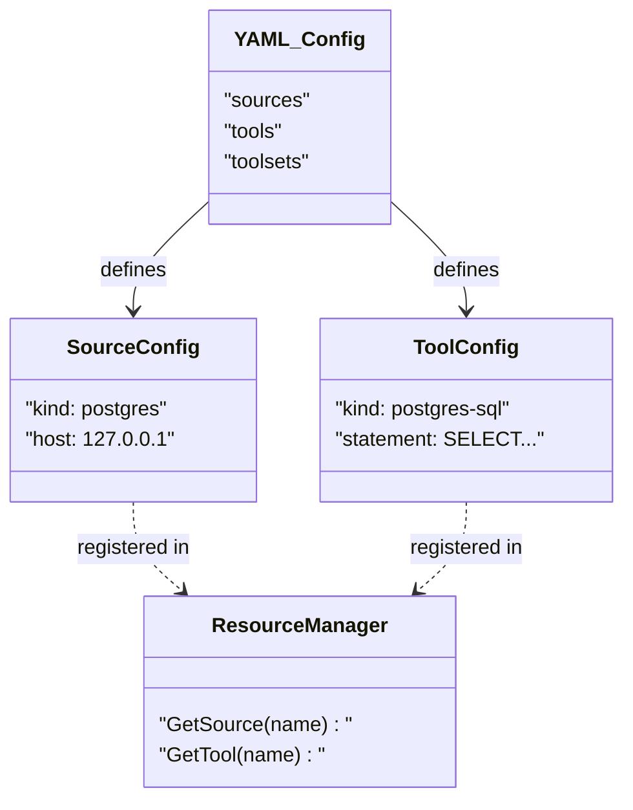

**Minimal Configuration Example:**

```yaml
sources:
  my-pg-source:
    kind: postgres
    host: 127.0.0.1
    port: 5432
    database: toolbox_db
    user: toolbox_user
    password: ${POSTGRES_PASSWORD}

tools:
  search-hotels:
    kind: postgres-sql
    source: my-pg-source
    description: Search for hotels.
    parameters:
      - name: name
        type: string
    statement: SELECT * FROM hotels WHERE name ILIKE '%' || $1 || '%';

toolsets:
  my-toolset:
    - search-hotels
```

For comprehensive configuration reference including authentication and advanced parameters, see [Configuration](#3).

**Sources:** [README.md:124-143](), [server.json:26-45]()

## Starting the Server

The `toolbox` binary supports two primary modes:

### HTTP Mode (Default)
Start the server to accept HTTP API requests or SSE for MCP:
```bash
./toolbox --config tools.yaml
```
Default endpoint: `http://127.0.0.1:5000/mcp` ([server.json:24-73]()).

### STDIO Mode (MCP Clients)
For MCP-compatible IDE integrations (Cursor, Claude Desktop, Gemini CLI):
```bash
./toolbox --config tools.yaml --stdio
```
This mode accepts JSON-RPC messages on stdin/stdout ([server.json:111-115]()).

### Prebuilt Configurations
Instead of a custom file, use `--prebuilt <name>` to load built-in tools for a specific database:
```bash
./toolbox --prebuilt postgres --stdio
```
Available prebuilt configs cover AlloyDB, BigQuery, Cloud SQL, Spanner, and more ([docs/en/documentation/introduction/_index.md:79-82]()).

**Sources:** [server.json:98-142](), [docs/en/documentation/introduction/_index.md:58-91]()

## Client Integration Patterns

Once the server is running, applications interact with tools via SDKs or direct MCP protocol calls.

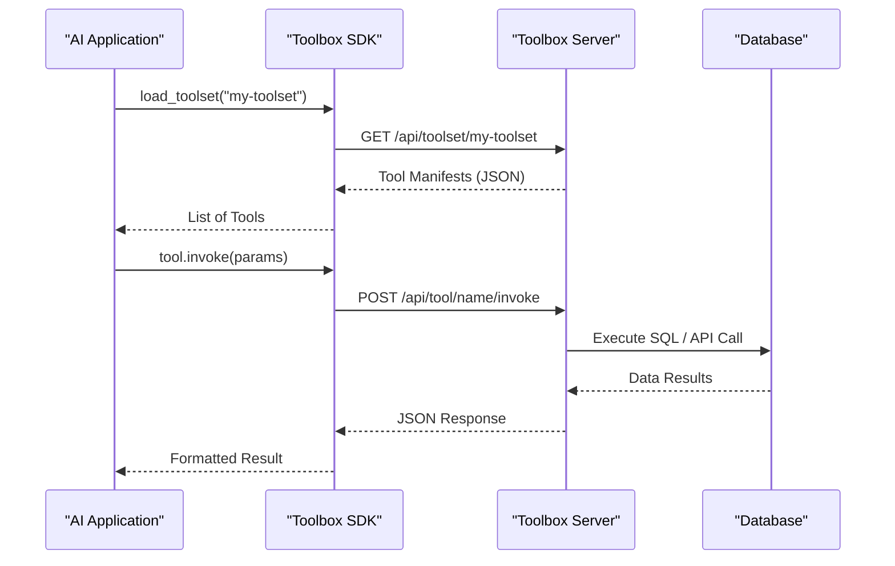

### SDK Availability
- **Python**: `toolbox-core`, `toolbox-langchain`, `toolbox-llamaindex` ([README.md:16]())
- **JavaScript/TypeScript**: `@toolbox-sdk/core`, `@toolbox-sdk/adk` ([README.md:17]())
- **Go**: `mcp-toolbox-sdk-go/core` ([README.md:18]())
- **Java**: `mcp-toolbox-sdk-java` ([README.md:19]())

For complete working examples with LangChain, LlamaIndex, and other frameworks, see [Quick Start Examples](#2.2).

**Sources:** [README.md:16-20](), [README.md:48-51]()

## Next Steps

- **[Installation and Setup](#2.1)**: Detailed installation for Binary, Docker, Homebrew, and NPX.
- **[Quick Start Examples](#2.2)**: Concrete code samples for Python, JS, and Go.
- **[Configuration](#3)**: Reference for `tools.yaml`, CLI flags, and Prebuilt configs.
- **[Data Sources](#5)**: Configuration guides for PostgreSQL, BigQuery, MySQL, and others.
- **[Client Integration](#8)**: Framework-specific integration guides and IDE setup.

**Sources:** [README.md:43-55](), [docs/en/documentation/introduction/_index.md:26-40]()

---

# Page: Installation and Setup

# Installation and Setup

<details>
<summary>Relevant source files</summary>

The following files were used as context for generating this wiki page:

- [.ci/continuous.release.cloudbuild.yaml](.ci/continuous.release.cloudbuild.yaml)
- [.ci/generate_release_table.sh](.ci/generate_release_table.sh)
- [.ci/versioned.release.cloudbuild.yaml](.ci/versioned.release.cloudbuild.yaml)
- [CHANGELOG.md](CHANGELOG.md)
- [Dockerfile](Dockerfile)
- [README.md](README.md)
- [cmd/version.txt](cmd/version.txt)
- [docs/en/documentation/introduction/_index.md](docs/en/documentation/introduction/_index.md)
- [gemini-extension.json](gemini-extension.json)
- [server.json](server.json)

</details>


## Purpose and Scope

This document covers the installation of the **MCP Toolbox for Databases** server binary and the initial environment setup required to run the server. It includes installation methods for multiple platforms, verification steps, and a minimal `tools.yaml` to confirm the server is working. For detailed configuration of sources, tools, and toolsets, see [Configuration](#3). For deploying Toolbox in production environments, see [Deployment and Operations](#9).

The project was recently renamed from `genai-toolbox` to `mcp-toolbox` to align with its core compatibility with the Model Context Protocol (MCP) [README.md:35-41]().

## Prerequisites

Before installing Toolbox, ensure the following prerequisites are met:

**For Binary/Container Installation:**
- Operating system: Linux (AMD64/ARM64), macOS (Apple Silicon or Intel), or Windows (AMD64).
- Network access to download binaries from `storage.googleapis.com/mcp-toolbox-for-databases/`.
- At least one database system accessible for Toolbox to connect to (PostgreSQL, MySQL, BigQuery, AlloyDB, Spanner, etc.) [README.md:99-101]().

**For Building from Source:**
- Go 1.21+ installed ([go.dev/doc/install](https://go.dev/doc/install)).
- Git for cloning the repository.
- CGO requirements: Building requires a C compiler (Zig is used in the project's own CI for cross-compilation) [Dockerfile:16-21]().

**For Container Installation:**
- Docker or a compatible container runtime.

Sources: [README.md:1-41](), [Dockerfile:14-21]()

## Installation Methods

Toolbox provides multiple installation methods. The current stable version is `1.0.0` [cmd/version.txt:1]().

### Installation Method Comparison

| Method | Use Case | Update Mechanism | Isolation |
|--------|----------|------------------|-----------|
| **Binary** | Direct execution, maximum control | Manual download | None |
| **Homebrew** | macOS/Linux package management | `brew upgrade` | System-level |
| **Container** | Containerized environments, cloud deployment | `docker pull` | Full containerization |
| **NPX** | Quick start, IDE integration, no install | Fetches latest on run | Node.js process |
| **From Source** | Development, custom builds | Git pull + `go build` | None |

Sources: [README.md:48-51](), [docs/en/documentation/introduction/_index.md:54-180]()

### Binary Installation

The Toolbox server is distributed as a standalone binary. Binaries are hosted at `https://storage.googleapis.com/mcp-toolbox-for-databases/v{VERSION}/{OS}/{ARCH}/toolbox`.

#### Installation Decision Flow

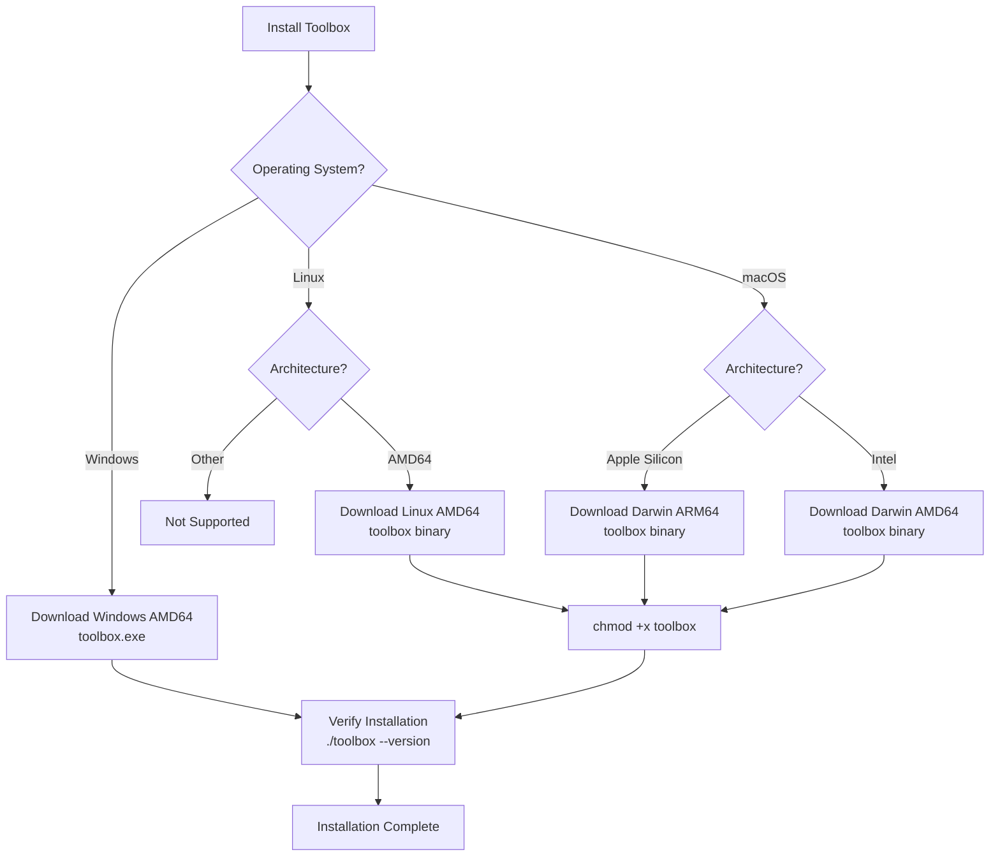

Sources: [docs/en/documentation/introduction/_index.md:105-162](), [.ci/generate_release_table.sh:11-44]()

#### Linux (AMD64)
```bash
export VERSION=1.0.0
curl -L -o toolbox https://storage.googleapis.com/mcp-toolbox-for-databases/v$VERSION/linux/amd64/toolbox
chmod +x toolbox
```

#### macOS (Apple Silicon)
```bash
export VERSION=1.0.0
curl -L -o toolbox https://storage.googleapis.com/mcp-toolbox-for-databases/v$VERSION/darwin/arm64/toolbox
chmod +x toolbox
```

#### Windows (PowerShell)
```powershell
$VERSION = "1.0.0"
curl.exe -o toolbox.exe "https://storage.googleapis.com/mcp-toolbox-for-databases/v$VERSION/windows/amd64/toolbox.exe"
```

Sources: [docs/en/documentation/introduction/_index.md:108-160](), [cmd/version.txt:1]()

### Homebrew Installation

For macOS and Linux users, Toolbox is available via Homebrew:

```bash
brew install mcp-toolbox
```

Sources: [docs/en/documentation/introduction/_index.md:173-180]()

### NPX (Quick Start)

Requires Node.js. This is the fastest way to run Toolbox for use with MCP clients like Claude Desktop or Gemini CLI:

```bash
# Run with prebuilt tools for PostgreSQL
npx @toolbox-sdk/server --prebuilt=postgres
```

Sources: [README.md:83-93](), [docs/en/documentation/introduction/_index.md:60-73]()

### Container Image Installation

Images are published to Google Artifact Registry.

#### Pull Container Image
```bash
export VERSION=1.0.0
docker pull us-central1-docker.pkg.dev/database-toolbox/toolbox/toolbox:$VERSION
```

#### Running the Container
The container uses a distroless base image (`gcr.io/distroless/cc-debian12:nonroot`) for security [Dockerfile:47-51]().

```bash
docker run -p 5000:5000 \
  -v $(pwd)/tools.yaml:/app/tools.yaml \
  us-central1-docker.pkg.dev/database-toolbox/toolbox/toolbox:$VERSION \
  --config "/app/tools.yaml"
```

Sources: [Dockerfile:47-56](), [server.json:21]()

### Building from Source

To build the latest features from the `main` branch:

```bash
git clone https://github.com/googleapis/mcp-toolbox.git
cd mcp-toolbox
go build -o toolbox .
```

The build process uses `ldflags` to embed the version and commit SHA [Dockerfile:43]().

Sources: [docs/en/documentation/introduction/_index.md:181-191](), [Dockerfile:42-44]()

## Installation Verification

Verify the installation by checking the version:

```bash
./toolbox --version
# Output: 1.0.0
```

Check available flags:
```bash
./toolbox --help
```

Sources: [cmd/version.txt:1](), [server.json:152-161]()

## Installation Architecture

The following diagram maps the installation artifacts to the internal server initialization logic.

### Installation to Code Entity Mapping

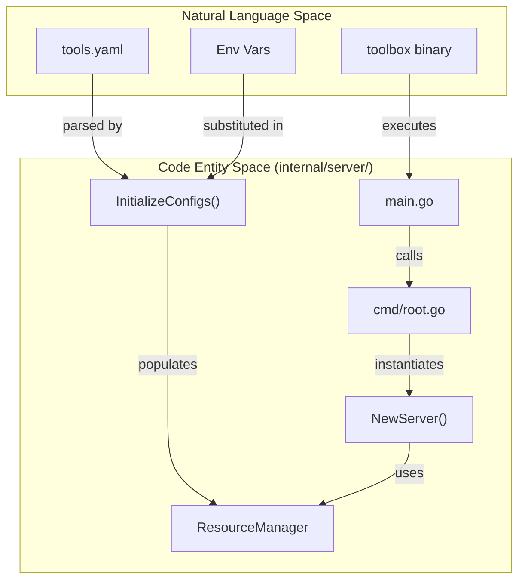

Sources: [server.json:26-45](), [Dockerfile:55](), [docs/en/documentation/introduction/_index.md:41-50]()

## Environment Configuration

Toolbox supports environment variable substitution using `${VAR_NAME}` syntax in configuration files. This is essential for managing secrets like database passwords.

### Example Environment Setup
```bash
export POSTGRES_PASSWORD="my-secret-password"
export GOOGLE_CLOUD_PROJECT="my-project-id"
```

Sources: [docs/en/documentation/introduction/_index.md:75-76](), [server.json:52-58]()

## First Run with minimal tools.yaml

To start the server, create a `tools.yaml` file. Toolbox uses a multi-document YAML format with a `kind` field to distinguish resources.

### Minimal tools.yaml
```yaml
kind: sources
name: my-db
type: postgres
host: localhost
port: 5432
database: test_db
user: postgres
password: ${POSTGRES_PASSWORD}
---
kind: tools
name: list-users
type: postgres-sql
source: my-db
description: List all users from the database.
statement: SELECT * FROM users;
```

### Starting the Server
```bash
./toolbox --config tools.yaml
```

The server will start an HTTP server on port 5000 by default [server.json:70](). To run as a local MCP server for IDEs, use the `--stdio` flag [server.json:111]().

Sources: [server.json:31-73](), [README.md:114-123]()

## Command Line Flags Reference

| Flag | Default | Description |
|---|---|---|
| `--config` | `tools.yaml` | Path to the tool configuration file [server.json:31](). |
| `--prebuilt` | - | Use a prebuilt config (e.g., `postgres`, `bigquery`) [server.json:106](). |
| `--stdio` | `false` | Run via MCP STDIO transport [server.json:111](). |
| `--port` | `5000` | Port for the HTTP/SSE server [server.json:70](). |
| `--ui` | `false` | Launch the built-in Toolbox UI [server.json:138](). |
| `--disable-reload`| `false` | Disable hot-reloading of config files [server.json:99](). |

Sources: [server.json:26-162]()

---

# Page: Configuration

# Configuration

<details>
<summary>Relevant source files</summary>

The following files were used as context for generating this wiki page:

- [.ci/integration.cloudbuild.yaml](.ci/integration.cloudbuild.yaml)
- [cmd/internal/config.go](cmd/internal/config.go)
- [cmd/internal/config_test.go](cmd/internal/config_test.go)
- [cmd/internal/flags.go](cmd/internal/flags.go)
- [cmd/internal/imports.go](cmd/internal/imports.go)
- [cmd/root.go](cmd/root.go)
- [cmd/root_test.go](cmd/root_test.go)
- [docs/en/documentation/configuration/toolbox_mcp_auth.md](docs/en/documentation/configuration/toolbox_mcp_auth.md)
- [docs/en/integrations/cloud-sql-pg/tools/vector-assist-apply-spec.md](docs/en/integrations/cloud-sql-pg/tools/vector-assist-apply-spec.md)
- [docs/en/integrations/cloud-sql-pg/tools/vector-assist-define-spec.md](docs/en/integrations/cloud-sql-pg/tools/vector-assist-define-spec.md)
- [docs/en/integrations/cloud-sql-pg/tools/vector-assist-generate-query.md](docs/en/integrations/cloud-sql-pg/tools/vector-assist-generate-query.md)
- [docs/en/integrations/cloud-sql-pg/tools/vector-assist-modify-spec.md](docs/en/integrations/cloud-sql-pg/tools/vector-assist-modify-spec.md)
- [go.mod](go.mod)
- [go.sum](go.sum)
- [internal/prebuiltconfigs/prebuiltconfigs.go](internal/prebuiltconfigs/prebuiltconfigs.go)
- [internal/prebuiltconfigs/prebuiltconfigs_test.go](internal/prebuiltconfigs/prebuiltconfigs_test.go)
- [internal/server/config.go](internal/server/config.go)
- [internal/server/prm.go](internal/server/prm.go)
- [internal/server/server.go](internal/server/server.go)
- [internal/server/server_test.go](internal/server/server_test.go)
- [internal/telemetry/telemetry.go](internal/telemetry/telemetry.go)
- [internal/tools/cloudsqlpg/vectorassistapplyspec/vectorassistapplyspec.go](internal/tools/cloudsqlpg/vectorassistapplyspec/vectorassistapplyspec.go)
- [internal/tools/cloudsqlpg/vectorassistapplyspec/vectorassistapplyspec_test.go](internal/tools/cloudsqlpg/vectorassistapplyspec/vectorassistapplyspec_test.go)
- [internal/tools/cloudsqlpg/vectorassistdefinespec/vectorassistdefinespec.go](internal/tools/cloudsqlpg/vectorassistdefinespec/vectorassistdefinespec.go)

</details>


This page provides a high-level overview of the Toolbox configuration system. Configuration defines the data sources, authentication services, embedding models, tools, toolsets, prompts, and promptsets available to client applications.

**Related Pages:**
- [Tools.yaml Format](#3.1) — Complete YAML schema, multi-document streams, and environment variable substitution syntax.
- [Command Line Interface](#3.2) — All CLI flags (`--address`, `--port`, `--config`, etc.) and subcommands.
- [Prebuilt Configurations](#3.3) — Using predefined database configurations via the `--prebuilt` flag.
- [Dynamic Configuration Reloading](#3.4) — How changes are hot-applied without server restart.
- [Toolbox UI](#3.5) — Navigating and testing configurations via the built-in web interface.
- [Pre- and Post-Processing](#3.6) — Intercepting and modifying tool interactions using orchestration hooks.

Sources: [cmd/root.go:96-132](), [internal/server/config.go:36-87]()

## Configuration Methods

The Toolbox server is primarily configured via YAML files. You can provide these files to the CLI using several mutually exclusive flags:

| Method | Flag | Use Case |
|--------|------|----------|
| **Single File** | `--config` (or `--tools-file`) | Standard setup with one YAML configuration. |
| **Multiple Files** | `--tools-files` | Merging several specific YAML files at runtime. |
| **Folder** | `--tools-folder` | Auto-loading all `.yaml` or `.yml` files from a directory. |
| **Prebuilt** | `--prebuilt` | Loading embedded configurations (e.g., `bigquery`, `postgres`). |

The CLI also supports global server settings via flags like `--address`, `--port`, and `--ui`.

Sources: [cmd/root.go:116-123](), [cmd/internal/flags.go:34-110]()

## Configuration Resource Model

Toolbox transforms declarative YAML into a set of runtime resources managed by the `ResourceManager`.

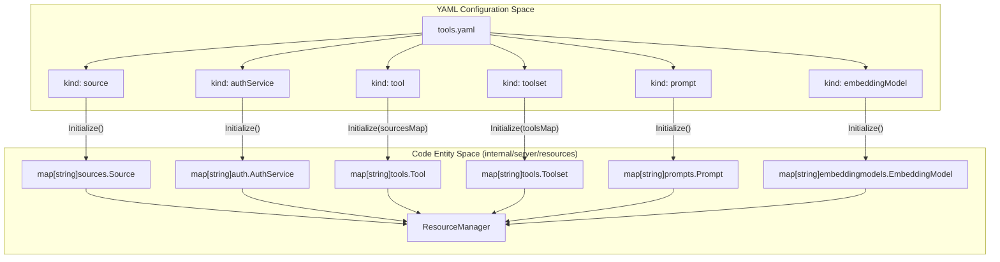

**Key Resource Types:**
- **Sources**: Database connection definitions (e.g., `cloud-sql-postgres`, `bigquery`).
- **AuthServices**: Identity providers for tool parameters (e.g., `google`, `oidc`).
- **Tools**: Executable units of logic, often referencing a `Source`.
- **Toolsets**: Logical groupings of tools for client consumption.
- **Prompts**: Predefined LLM instructions or templates.
- **EmbeddingModels**: Models used for parameter embedding or vector operations.

Sources: [internal/server/config.go:141-147](), [internal/server/resources/resource_manager.go:28-40](), [internal/server/server.go:64-73]()

## Initialization and Validation

When the server starts (or reloads), it executes a strict initialization pipeline to ensure the configuration is valid before accepting requests.

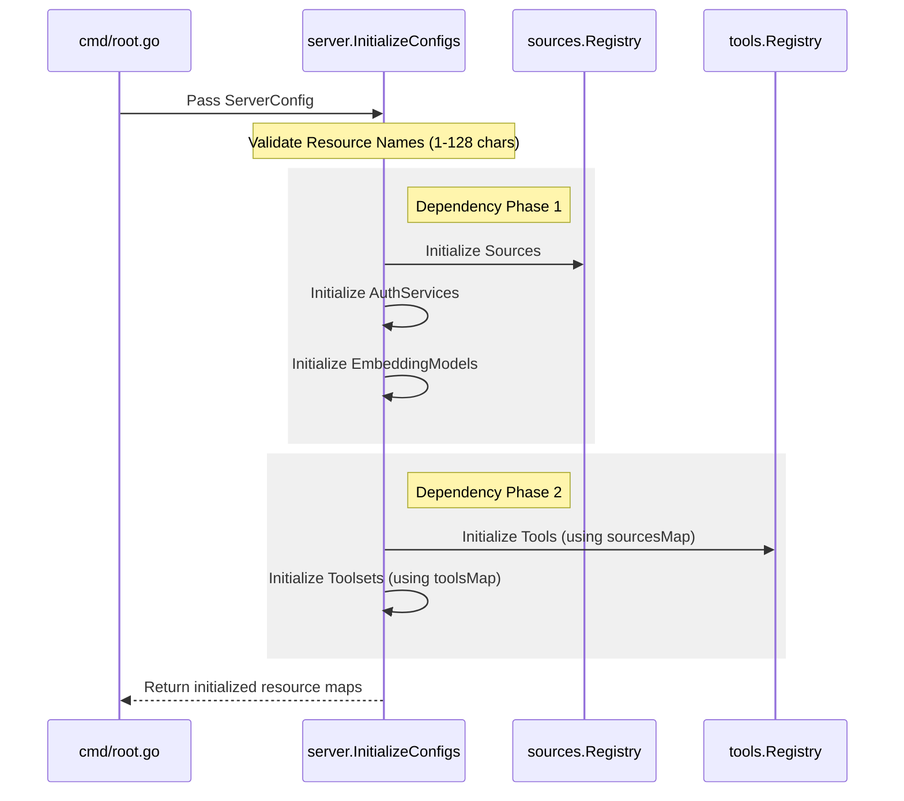

1. **Strict Decoding**: The system uses `yaml.NewDecoder` with strict settings to reject unknown fields in the configuration.
2. **Name Validation**: Resource names must be between 1 and 128 characters and follow alphanumeric/hyphen patterns.
3. **Dependency Resolution**: Tools are initialized after Sources to ensure that `tool.Initialize(sourcesMap)` can resolve its required data connection.
4. **Environment Substitution**: Variables in the format `${VAR}` or `${VAR:default}` are expanded before YAML parsing.

Sources: [internal/server/config.go:159-250](), [internal/server/server.go:89-215](), [cmd/internal/config.go:39-134]()

## Dynamic Reloading

Toolbox features a file watcher that monitors the configuration source. By default, changes to the YAML files are detected and the server re-initializes its `ResourceManager` without dropping active connections.

- **Watcher**: Uses `fsnotify` to detect file system events.
- **Polling**: For environments where file events are unreliable (like NFS), the `--poll-interval` flag can be used.
- **Validation**: Before applying a new config, the server runs `validateReloadEdits` to ensure the new configuration is valid. If validation fails, the server continues running with the previous known-good configuration.

Sources: [cmd/root.go:134-150](), [cmd/root.go:153-190](), [internal/server/server.go:60-61]()

## Prebuilt Configurations

To simplify setup, Toolbox includes embedded YAML configurations for popular databases. When using `--prebuilt <name>`, the server loads a verified configuration from its internal `prebuiltconfigs` package.

**Available Prebuilts include:**
- `alloydb-postgres`, `cloud-sql-postgres`, `postgres`
- `bigquery`, `bigquery-conversational-analytics`
- `mysql`, `cloud-sql-mysql`
- `mssql`, `cloud-sql-mssql`
- `spanner`, `looker`, `firestore`, `sqlite`

Sources: [internal/prebuiltconfigs/prebuiltconfigs.go:24-62](), [internal/prebuiltconfigs/prebuiltconfigs_test.go:24-62]()

---

# Page: Tools.yaml Format

# Tools.yaml Format

<details>
<summary>Relevant source files</summary>

The following files were used as context for generating this wiki page:

- [.ci/integration.cloudbuild.yaml](.ci/integration.cloudbuild.yaml)
- [.gemini/styleguide.md](.gemini/styleguide.md)
- [.gitignore](.gitignore)
- [AGENTS.md](AGENTS.md)
- [CLAUDE.md](CLAUDE.md)
- [CONTRIBUTING.md](CONTRIBUTING.md)
- [DEVELOPER.md](DEVELOPER.md)
- [GEMINI.md](GEMINI.md)
- [LICENSE](LICENSE)
- [cmd/internal/config.go](cmd/internal/config.go)
- [cmd/internal/config_test.go](cmd/internal/config_test.go)
- [cmd/internal/flags.go](cmd/internal/flags.go)
- [cmd/internal/imports.go](cmd/internal/imports.go)
- [cmd/root.go](cmd/root.go)
- [cmd/root_test.go](cmd/root_test.go)
- [docs/en/documentation/configuration/toolbox_mcp_auth.md](docs/en/documentation/configuration/toolbox_mcp_auth.md)
- [docs/en/integrations/cloud-sql-pg/tools/vector-assist-apply-spec.md](docs/en/integrations/cloud-sql-pg/tools/vector-assist-apply-spec.md)
- [docs/en/integrations/cloud-sql-pg/tools/vector-assist-define-spec.md](docs/en/integrations/cloud-sql-pg/tools/vector-assist-define-spec.md)
- [docs/en/integrations/cloud-sql-pg/tools/vector-assist-generate-query.md](docs/en/integrations/cloud-sql-pg/tools/vector-assist-generate-query.md)
- [docs/en/integrations/cloud-sql-pg/tools/vector-assist-modify-spec.md](docs/en/integrations/cloud-sql-pg/tools/vector-assist-modify-spec.md)
- [go.mod](go.mod)
- [go.sum](go.sum)
- [internal/prebuiltconfigs/prebuiltconfigs.go](internal/prebuiltconfigs/prebuiltconfigs.go)
- [internal/prebuiltconfigs/prebuiltconfigs_test.go](internal/prebuiltconfigs/prebuiltconfigs_test.go)
- [internal/server/config.go](internal/server/config.go)
- [internal/server/prm.go](internal/server/prm.go)
- [internal/server/server.go](internal/server/server.go)
- [internal/server/server_test.go](internal/server/server_test.go)
- [internal/telemetry/telemetry.go](internal/telemetry/telemetry.go)
- [internal/tools/cloudsqlpg/vectorassistapplyspec/vectorassistapplyspec.go](internal/tools/cloudsqlpg/vectorassistapplyspec/vectorassistapplyspec.go)
- [internal/tools/cloudsqlpg/vectorassistapplyspec/vectorassistapplyspec_test.go](internal/tools/cloudsqlpg/vectorassistapplyspec/vectorassistapplyspec_test.go)
- [internal/tools/cloudsqlpg/vectorassistdefinespec/vectorassistdefinespec.go](internal/tools/cloudsqlpg/vectorassistdefinespec/vectorassistdefinespec.go)

</details>


This document provides a detailed technical specification of the `tools.yaml` configuration file format used by MCP Toolbox for Databases. The `tools.yaml` file is the primary control plane for defining data sources, tools, toolsets, authentication services, and prompts that the Toolbox server exposes.

## Overall Structure and Kind Blocks

The `tools.yaml` format uses a Kubernetes-like `kind` and `name` structure. It supports multi-document YAML streams separated by `---`, allowing you to organize your configuration into logical blocks.

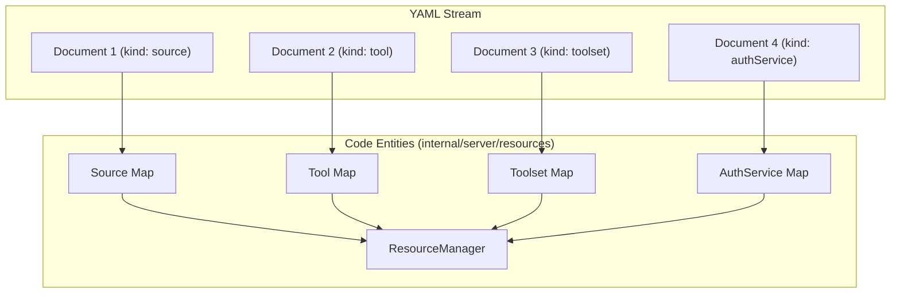

**Resource Mapping**

| Kind | Code Interface / Struct | Purpose |
| :--- | :--- | :--- |
| `source` | `sources.Source` [internal/server/config.go:181]() | Defines database connection parameters. |
| `tool` | `tools.Tool` [internal/server/config.go:199]() | Defines an executable action (e.g., SQL query). |
| `toolset` | `tools.Toolset` [internal/server/config.go:208]() | Groups tools for client-side loading. |
| `authService` | `auth.AuthService` [internal/server/config.go:190]() | Configures OAuth2 or OIDC providers. |
| `prompt` | `prompts.Prompt` [internal/server/config.go:217]() | Defines reusable LLM system prompts. |
| `embeddingModel` | `embeddingmodels.EmbeddingModel` [internal/server/config.go:226]() | Configures models for parameter embedding. |

Sources: [internal/server/config.go:149-236](), [internal/server/server.go:64-72]()

## Environment Variable Substitution

The configuration supports dynamic environment variable substitution to keep sensitive credentials out of version control. Substitution occurs at configuration load time.

*   **Syntax**: `${VAR_NAME}` or `${VAR_NAME:default_value}`.
*   **Implementation**: The `UnmarshalResourceConfig` function handles the raw YAML stream before initializing specific resource types [internal/server/config.go:149-160]().

```yaml
sources:
  my-db:
    kind: postgres
    host: ${DB_HOST:localhost}
    password: ${DB_PASSWORD}
```

## Field Semantics by Kind

### Source Configuration
Sources define how to connect to a database. Every source must have a `kind` that matches a registered source type (e.g., `postgres`, `mysql`, `bigquery`, `alloydb-postgres`).

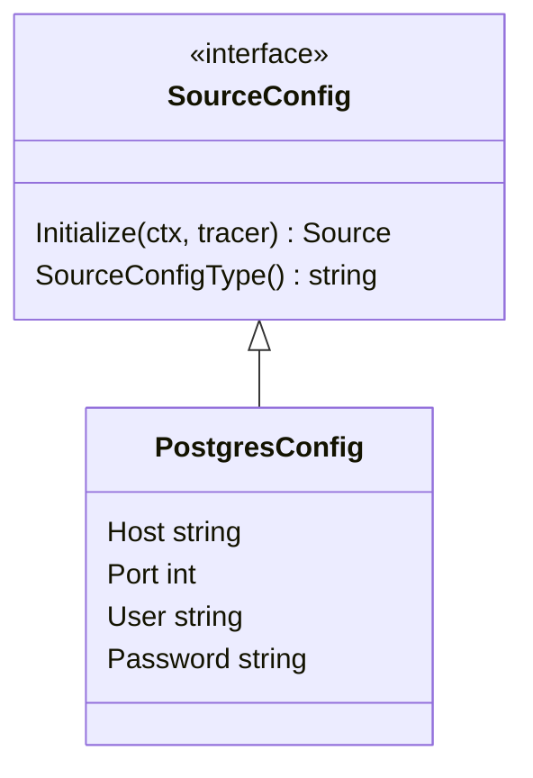

Sources: [internal/server/server.go:91-110](), [internal/server/config.go:182-189]()

### Tool Configuration
Tools reference a `source` and define the logic to be executed.
*   **`source`**: Must match the `name` of a defined `kind: source`.
*   **`parameters`**: Defines the input schema for the LLM.
*   **`statement`**: For SQL tools, the query to execute.

Sources: [internal/server/server.go:175-194](), [internal/server/config.go:199-207]()

### Toolset Configuration
Toolsets are simple lists of tool names.
*   **Default Behavior**: If no toolsets are defined, the server automatically creates a default toolset named `""` (empty string) containing all initialized tools [internal/server/server.go:202-209]().

Sources: [internal/server/server.go:211-232](), [internal/server/config.go:208-216]()

## Data Flow and Initialization

The initialization process follows a strict dependency order:
1.  **Sources & AuthServices**: Initialized first as they have no dependencies.
2.  **Tools**: Initialized next, as they require a valid `SourceMap` to bind to.
3.  **Toolsets**: Initialized last, grouping the bound tools.

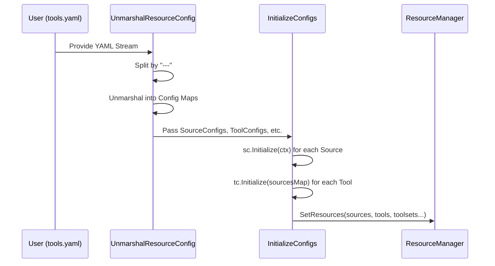

Sources: [internal/server/server.go:64-245](), [internal/server/config.go:149-168]()

## Multi-Document YAML and Dynamic Reloading

The Toolbox supports loading configuration from multiple sources simultaneously using the `--config` (or deprecated `--tools-file`) flag.

### Dynamic Reloading Implementation
When a watched file changes, the `handleDynamicReload` function is triggered:
1.  It calls `validateReloadEdits` to parse the new file [cmd/root.go:134-140]().
2.  It runs `server.InitializeConfigs` on the new data to ensure the new configuration is valid before applying it [cmd/root.go:182]().
3.  If valid, it calls `s.ResourceMgr.SetResources` to hot-swap the active tools and sources without restarting the server [cmd/root.go:147]().

Sources: [cmd/root.go:134-150](), [cmd/root.go:153-190](), [internal/server/resources/resources.go:73-81]()

## Prebuilt Configurations
Prebuilt tools (enabled via `--prebuilt`) are embedded YAML files that are merged with the user's `tools.yaml` at runtime.
*   **Conflict Resolution**: User-defined resources in `tools.yaml` take precedence over prebuilt configurations of the same name.
*   **Loading**: Prebuilt YAMLs are loaded via `loadPrebuiltToolYAMLs` [internal/prebuiltconfigs/prebuiltconfigs.go]().

Sources: [internal/prebuiltconfigs/prebuiltconfigs_test.go:76-80](), [internal/server/config.go:149-155]()

---

# Page: Command Line Interface

# Command Line Interface

<details>
<summary>Relevant source files</summary>

The following files were used as context for generating this wiki page:

- [.ci/integration.cloudbuild.yaml](.ci/integration.cloudbuild.yaml)
- [cmd/internal/flags.go](cmd/internal/flags.go)
- [cmd/internal/invoke/command.go](cmd/internal/invoke/command.go)
- [cmd/internal/invoke/command_test.go](cmd/internal/invoke/command_test.go)
- [cmd/internal/options.go](cmd/internal/options.go)
- [cmd/internal/options_test.go](cmd/internal/options_test.go)
- [cmd/internal/skills/command.go](cmd/internal/skills/command.go)
- [cmd/internal/skills/command_test.go](cmd/internal/skills/command_test.go)
- [cmd/internal/skills/generator.go](cmd/internal/skills/generator.go)
- [cmd/internal/skills/generator_test.go](cmd/internal/skills/generator_test.go)
- [cmd/root.go](cmd/root.go)
- [cmd/root_test.go](cmd/root_test.go)
- [docs/en/documentation/configuration/skills/_index.md](docs/en/documentation/configuration/skills/_index.md)
- [docs/en/documentation/configuration/toolbox_mcp_auth.md](docs/en/documentation/configuration/toolbox_mcp_auth.md)
- [docs/en/reference/cli.md](docs/en/reference/cli.md)
- [go.mod](go.mod)
- [go.sum](go.sum)
- [internal/prebuiltconfigs/prebuiltconfigs.go](internal/prebuiltconfigs/prebuiltconfigs.go)
- [internal/prebuiltconfigs/prebuiltconfigs_test.go](internal/prebuiltconfigs/prebuiltconfigs_test.go)
- [internal/server/config.go](internal/server/config.go)
- [internal/server/prm.go](internal/server/prm.go)
- [internal/server/server.go](internal/server/server.go)
- [internal/server/server_test.go](internal/server/server_test.go)
- [internal/telemetry/telemetry.go](internal/telemetry/telemetry.go)

</details>


The Command Line Interface (CLI) for the `mcp-toolbox` is the primary entry point for starting and configuring the server. It handles flag parsing, configuration loading, resource initialization, and operational modes such as HTTP or MCP Stdio.

## Overview

The CLI is implemented using the `spf13/cobra` library [cmd/root.go:47](). The entry point is the `Execute()` function [cmd/root.go:85-93](), which initializes `ToolboxOptions` and runs the root command. The CLI provides a primary `toolbox` command and several subcommands for specific tasks like tool invocation and skill generation.

Key responsibilities of the CLI include:
- Parsing command-line flags into the `ServerConfig` struct [internal/server/config.go:36-87]().
- Loading tool configurations from files, folders, or prebuilt definitions [cmd/root.go:118-119]().
- Initializing the `server.Server` instance [internal/server/server.go:51-62]().
- Managing the server lifecycle, including graceful shutdown [cmd/root.go:24-29]().
- Supporting dynamic configuration reloading via file watching [cmd/root.go:134-150]().

Sources: [cmd/root.go:85-132](), [internal/server/config.go:36-87]()

## Subcommands

The CLI follows a modular structure where specific functionalities are delegated to subcommands.

| Subcommand | Implementation Package | Purpose |
| :--- | :--- | :--- |
| `serve` | `cmd/internal/serve` | Starts the Toolbox server (default behavior) [cmd/root.go:128](). |
| `invoke` | `cmd/internal/invoke` | Directly executes a specific tool from the CLI [cmd/root.go:126](). |
| `skills-generate` | `cmd/internal/skills` | Generates Agent Skill packages from toolsets [cmd/root.go:127](). |
| `migrate` | `cmd/internal/migrate` | Handles configuration migrations [cmd/root.go:129](). |

### Tool Invocation (`invoke`)
The `invoke` subcommand allows users to test tools directly without an MCP client. It takes a tool name and optional JSON parameters [docs/en/reference/cli.md:37-55]().

### Skill Generation (`skills-generate`)
This command converts toolsets into Node.js-based "Agent Skills" [cmd/internal/skills/generator.go:74-118](). It generates a `SKILL.md` file and individual `.js` scripts for each tool, supporting both `binary` and `npx` invocation modes [docs/en/reference/cli.md:57-78]().

Sources: [cmd/root.go:125-132](), [docs/en/reference/cli.md:35-78]()

## Configuration Flags

The CLI uses flags to populate the `ServerConfig` used during initialization.

### Server & Connectivity
- `--address` (`-a`): The interface address to listen on (default: `127.0.0.1`) [docs/en/reference/cli.md:13]().
- `--port` (`-p`): The port for the HTTP/SSE server (default: `5000`) [docs/en/reference/cli.md:19]().
- `--stdio`: Switches the server to MCP Stdio mode, communicating via stdin/stdout [docs/en/reference/cli.md:21]().
- `--ui`: Enables the built-in web UI for tool exploration [docs/en/reference/cli.md:28]().

### Configuration Loading
The CLI supports three primary ways to load custom YAML configurations, which are mutually exclusive [docs/en/reference/cli.md:25-27]():
- `--config`: Path to a single configuration file.
- `--configs`: Comma-separated list of multiple configuration files to be merged.
- `--config-folder`: A directory containing `.yaml` or `.yml` files to be merged.

Additionally, the `--prebuilt` flag allows loading of bundled configurations for specific sources like `bigquery`, `postgres`, or `alloydb-postgres` [docs/en/reference/cli.md:20]().

### Dynamic Reloading
- `--disable-reload`: Disables the automatic reloading of configuration files when changes are detected [cmd/root.go:120]().
- `--poll-interval`: Sets the frequency (in seconds) for polling file changes, useful for network file systems where events might not trigger [cmd/root.go:121]().

### Telemetry & Logging
- `--log-level`: Sets the minimum log level (`DEBUG`, `INFO`, `WARN`, `ERROR`) [internal/server/config.go:126-134]().
- `--logging-format`: Choice between `standard` or `JSON` [internal/server/config.go:100-108]().
- `--telemetry-gcp`: Enables exporting traces/metrics to Google Cloud [docs/en/reference/cli.md:22]().
- `--telemetry-otlp`: Exports telemetry to an OTLP-compatible collector [docs/en/reference/cli.md:23]().

Sources: [docs/en/reference/cli.md:11-33](), [internal/server/config.go:89-139](), [cmd/root.go:115-122]()

## Data Flow: CLI to Server Initialization

The following diagram illustrates how the CLI command and flags are transformed into a running `Server` instance with initialized resources.

**CLI Initialization Sequence**

```mermaid
sequenceDiagram
    participant CLI as "cmd.NewCommand()"
    participant Opts as "internal.ToolboxOptions"
    participant SrvCfg as "server.ServerConfig"
    participant Init as "server.InitializeConfigs()"
    participant RM as "resources.ResourceManager"
    participant Srv as "server.Server"

    CLI->>Opts: Populate from Flags
    Opts->>SrvCfg: Map Options to Config
    SrvCfg->>Init: Pass Config & Context
    
    activate Init
    Note over Init: Init Sources, Auth, Tools
    Init->>RM: Register initialized entities
    deactivate Init
    
    Init->>Srv: server.NewServer(ctx, SrvCfg)
    Srv->>Srv: s.ResourceMgr = RM
    
    alt is Stdio
        Srv->>Srv: s.ServeStdio(ctx)
    else is HTTP
        Srv->>Srv: s.Listen()
        Srv->>Srv: s.Serve(ctx)
    end
```

Sources: [cmd/root.go:96-132](), [internal/server/server.go:64-73](), [internal/server/server.go:80-88]()

## Implementation Detail: Dynamic Reloading

When dynamic reloading is enabled, the CLI utilizes `fsnotify` to watch configuration files [cmd/root.go:32](). If a change is detected, the server does not restart; instead, it re-validates the new configuration and updates the `ResourceManager` in-place.

**Dynamic Reload Logic**

```mermaid
graph TD
    Watcher["fsnotify.Watcher"] -- "File Change Event" --> ReloadHandler["handleDynamicReload()"]
    ReloadHandler --> Validator["validateReloadEdits()"]
    
    subgraph "Validation Phase"
        Validator --> Parse["UnmarshalResourceConfig()"]
        Parse --> Init["server.InitializeConfigs()"]
    end
    
    Init -- "Success" --> UpdateRM["s.ResourceMgr.SetResources()"]
    Init -- "Failure" --> LogWarn["Logger.WarnContext()"]
    
    UpdateRM --> Final["Server continues with new tools"]
```

The `validateReloadEdits` function ensures that the new configuration is valid (e.g., database connections can be established, tool parameters are correct) before swapping the active resources [cmd/root.go:153-190]().

Sources: [cmd/root.go:134-150](), [cmd/root.go:153-190](), [internal/server/server_test.go:119-206]()

## Skill Generation Logic

The `skills-generate` command uses internal templates to produce executable packages. It maps `Tool` manifests to Node.js script parameters.

**Natural Language to Skill Package Mapping**

```mermaid
graph LR
    subgraph "Natural Language / Manifest Space"
        T_Desc["Tool Description"]
        P_Desc["Parameter Description"]
        P_Req["Required Flag"]
    end

    subgraph "Code Entity Space (generator.go)"
        TM["tools.Tool.Manifest()"]
        SM["generateSkillMarkdown()"]
        NST["nodeScriptTemplate"]
    end

    subgraph "Output Artifacts"
        SK_MD["SKILL.md"]
        JS_SCR["scripts/*.js"]
    end

    T_Desc --> TM
    P_Desc --> TM
    TM --> SM
    TM --> NST
    SM --> SK_MD
    NST --> JS_SCR
```

The `nodeScriptTemplate` [cmd/internal/skills/generator.go:120-240]() handles environment variable merging from various sources like `.env` files (for Gemini CLI) or `CLAUDE_PLUGIN_OPTION_` (for Claude Code).

Sources: [cmd/internal/skills/generator.go:74-118](), [cmd/internal/skills/generator.go:120-240]()

---

# Page: Prebuilt Configurations

# Prebuilt Configurations

<details>
<summary>Relevant source files</summary>

The following files were used as context for generating this wiki page:

- [internal/prebuiltconfigs/tools/alloydb-postgres.yaml](internal/prebuiltconfigs/tools/alloydb-postgres.yaml)
- [internal/prebuiltconfigs/tools/bigquery.yaml](internal/prebuiltconfigs/tools/bigquery.yaml)
- [internal/prebuiltconfigs/tools/cloud-sql-mssql.yaml](internal/prebuiltconfigs/tools/cloud-sql-mssql.yaml)
- [internal/prebuiltconfigs/tools/cloud-sql-mysql.yaml](internal/prebuiltconfigs/tools/cloud-sql-mysql.yaml)
- [internal/prebuiltconfigs/tools/cloud-sql-postgres.yaml](internal/prebuiltconfigs/tools/cloud-sql-postgres.yaml)
- [internal/prebuiltconfigs/tools/mssql.yaml](internal/prebuiltconfigs/tools/mssql.yaml)
- [internal/prebuiltconfigs/tools/mysql.yaml](internal/prebuiltconfigs/tools/mysql.yaml)
- [internal/prebuiltconfigs/tools/postgres.yaml](internal/prebuiltconfigs/tools/postgres.yaml)
- [internal/prebuiltconfigs/tools/spanner-postgres.yaml](internal/prebuiltconfigs/tools/spanner-postgres.yaml)
- [internal/prebuiltconfigs/tools/spanner.yaml](internal/prebuiltconfigs/tools/spanner.yaml)
- [internal/sources/bigquery/bigquery.go](internal/sources/bigquery/bigquery.go)
- [internal/sources/bigquery/bigquery_test.go](internal/sources/bigquery/bigquery_test.go)
- [internal/sources/cloudsqlmssql/cloud_sql_mssql.go](internal/sources/cloudsqlmssql/cloud_sql_mssql.go)
- [internal/sources/cloudsqlmssql/cloud_sql_mssql_test.go](internal/sources/cloudsqlmssql/cloud_sql_mssql_test.go)
- [internal/sources/cloudsqlmysql/cloud_sql_mysql.go](internal/sources/cloudsqlmysql/cloud_sql_mysql.go)
- [internal/sources/cloudsqlmysql/cloud_sql_mysql_test.go](internal/sources/cloudsqlmysql/cloud_sql_mysql_test.go)
- [internal/sources/mssql/mssql.go](internal/sources/mssql/mssql.go)
- [internal/sources/mssql/mssql_test.go](internal/sources/mssql/mssql_test.go)
- [internal/sources/mysql/mysql.go](internal/sources/mysql/mysql.go)
- [internal/sources/mysql/mysql_test.go](internal/sources/mysql/mysql_test.go)
- [internal/tools/bigquery/bigquerycommon/util.go](internal/tools/bigquery/bigquerycommon/util.go)
- [internal/tools/bigquery/bigqueryconversationalanalytics/bigqueryconversationalanalytics.go](internal/tools/bigquery/bigqueryconversationalanalytics/bigqueryconversationalanalytics.go)
- [internal/tools/bigquery/bigqueryconversationalanalytics/bigqueryconversationalanalytics_test.go](internal/tools/bigquery/bigqueryconversationalanalytics/bigqueryconversationalanalytics_test.go)
- [internal/tools/bigquery/bigqueryexecutesql/bigqueryexecutesql.go](internal/tools/bigquery/bigqueryexecutesql/bigqueryexecutesql.go)
- [internal/tools/bigquery/bigqueryforecast/bigqueryforecast.go](internal/tools/bigquery/bigqueryforecast/bigqueryforecast.go)
- [internal/tools/bigquery/bigquerygetdatasetinfo/bigquerygetdatasetinfo.go](internal/tools/bigquery/bigquerygetdatasetinfo/bigquerygetdatasetinfo.go)
- [internal/tools/bigquery/bigquerygettableinfo/bigquerygettableinfo.go](internal/tools/bigquery/bigquerygettableinfo/bigquerygettableinfo.go)
- [internal/tools/bigquery/bigquerylistdatasetids/bigquerylistdatasetids.go](internal/tools/bigquery/bigquerylistdatasetids/bigquerylistdatasetids.go)
- [internal/tools/bigquery/bigquerylisttableids/bigquerylisttableids.go](internal/tools/bigquery/bigquerylisttableids/bigquerylisttableids.go)
- [internal/tools/bigquery/bigquerysql/bigquerysql.go](internal/tools/bigquery/bigquerysql/bigquerysql.go)
- [tests/bigquery/bigquery_integration_test.go](tests/bigquery/bigquery_integration_test.go)

</details>


This page covers the prebuilt configuration system: how YAML tool and source configurations are embedded into the Toolbox binary at compile time, how to activate them with the `--prebuilt` CLI flag, the available configurations, and how they interact with user-supplied configuration files.

---

## What Prebuilt Configurations Are

A prebuilt configuration is a YAML file stored in `internal/prebuiltconfigs/tools/` that defines a complete source and tool bundle for a specific database or cloud service. These YAML files are compiled directly into the binary via Go's `//go:embed` directive. Activating a prebuilt config with `--prebuilt` is equivalent to providing a pre-written `tools.yaml` for that service, without needing to author any YAML yourself.

Configuration via environment variables is still required to supply connection credentials (e.g., `POSTGRES_USER`, `BIGQUERY_PROJECT`).

---

## Compile-Time Embedding and Load Flow

All YAML files in `internal/prebuiltconfigs/tools/` are embedded at compile time. The `prebuiltconfigs` package manages these embedded assets and provides them to the server during initialization.

**Figure 1: Prebuilt Config Data Flow**

```mermaid
flowchart TD
    CLI["CLI Flag: --prebuilt name"]
    Embed["//go:embed internal/prebuiltconfigs/tools/*.yaml"]
    Load["loadPrebuiltToolYAMLs()"]
    Map["map[string][]byte"]
    Parse["yaml.DecodeContext()"]
    SrvCfg["server.ServerConfig"]
    Init["server.InitializeConfigs()"]
    ResMgr["resources.ResourceManager"]

    CLI --> Load
    Embed --> Load
    Load --> Map
    Map --> Parse
    Parse --> SrvCfg
    SrvCfg --> Init
    Init --> ResMgr
```

Sources: [internal/prebuiltconfigs/prebuiltconfigs_test.go:23-59](), [internal/server/server.go:57-103]()

---

## The `--prebuilt` Flag

The `--prebuilt` flag accepts one or more prebuilt config names. These names correspond to the filenames in the `internal/prebuiltconfigs/tools/` directory (minus the `.yaml` extension).

| Syntax | Example |
|---|---|
| Single value | `--prebuilt postgres` |
| Repeated flag | `--prebuilt postgres --prebuilt bigquery` |
| Comma-separated | `--prebuilt postgres,bigquery` |

**Example: Starting with Cloud SQL Postgres**
```bash
CLOUD_SQL_POSTGRES_PROJECT=my-project \
CLOUD_SQL_POSTGRES_REGION=us-central1 \
CLOUD_SQL_POSTGRES_INSTANCE=my-instance \
CLOUD_SQL_POSTGRES_DATABASE=mydb \
toolbox --prebuilt cloud-sql-postgres
```

Sources: [internal/prebuiltconfigs/tools/cloud-sql-postgres.yaml:15-25](), [internal/prebuiltconfigs/tools/postgres.yaml:15-23]()

---

## Prebuilt Config YAML Format

Prebuilt YAML files use a **consolidated map format** rather than the multi-document stream format used in custom `tools.yaml` files. They organize resources under top-level `sources:`, `tools:`, and `toolsets:` keys.

**Figure 2: Prebuilt YAML Structure to Code Entity Mapping**

```mermaid
flowchart LR
    subgraph "YAML Structure (internal/prebuiltconfigs/tools/)"
        SRC_K["sources:\n  name:\n    kind: type"]
        TOOL_K["tools:\n  name:\n    kind: type\n    source: name"]
        SET_K["toolsets:\n  name:\n    - tool_name"]
    end

    subgraph "Code Entity Space"
        S_CONF["sources.SourceConfig\n(e.g. bigquery.Config)"]
        T_CONF["tools.ToolConfig\n(e.g. bigquerysql.Config)"]
        S_REG["sources.Register()"]
        T_REG["tools.Register()"]
    end

    SRC_K -- "kind maps to" --> S_REG
    TOOL_K -- "kind maps to" --> T_REG
    S_REG -- "instantiates" --> S_CONF
    T_REG -- "instantiates" --> T_CONF
```

Sources: [internal/prebuiltconfigs/tools/bigquery.yaml:15-64](), [internal/sources/bigquery/bigquery.go:67-71](), [internal/tools/bigquery/bigquerysql/bigquerysql.go:38-42]()

### Comparison of Formats

| Feature | Prebuilt YAML | Custom `tools.yaml` |
|---|---|---|
| **Structure** | Map-based (`sources:`, `tools:`) | Document stream (`---`) |
| **Type Identifier** | `kind:` | `type:` |
| **Resource Name** | Map Key | `name:` field |
| **Env Substitution** | `${VAR:default}` | `${VAR:default}` |

Sources: [internal/prebuiltconfigs/tools/postgres.yaml:15-30](), [internal/prebuiltconfigs/tools/mysql.yaml:15-33]()

---

## Available Prebuilt Configurations

The following table lists common prebuilt configurations and their primary environment variables.

| `--prebuilt` Value | Database / Service | Primary Environment Variables |
|---|---|---|
| `alloydb-postgres` | AlloyDB | `ALLOYDB_POSTGRES_PROJECT`, `ALLOYDB_POSTGRES_INSTANCE`, `ALLOYDB_POSTGRES_DATABASE` |
| `bigquery` | BigQuery | `BIGQUERY_PROJECT`, `BIGQUERY_LOCATION` |
| `cloud-sql-postgres`| Cloud SQL Postgres | `CLOUD_SQL_POSTGRES_PROJECT`, `CLOUD_SQL_POSTGRES_INSTANCE` |
| `cloud-sql-mysql` | Cloud SQL MySQL | `CLOUD_SQL_MYSQL_PROJECT`, `CLOUD_SQL_MYSQL_INSTANCE` |
| `postgres` | PostgreSQL | `POSTGRES_HOST`, `POSTGRES_PORT`, `POSTGRES_DATABASE` |
| `mysql` | MySQL | `MYSQL_HOST`, `MYSQL_PORT`, `MYSQL_DATABASE` |
| `spanner` | Cloud Spanner | `SPANNER_PROJECT`, `SPANNER_INSTANCE`, `SPANNER_DATABASE` |

Sources: [internal/prebuiltconfigs/tools/alloydb-postgres.yaml:16-25](), [internal/prebuiltconfigs/tools/bigquery.yaml:16-23](), [internal/prebuiltconfigs/tools/cloud-sql-mysql.yaml:16-24]()

---

## Conflict Detection and Custom Overrides

When using `--prebuilt`, the Toolbox server merges the embedded configurations with any custom configurations provided via `--tools-file`.

### Name Conflicts
Each prebuilt configuration defines specific names for its sources (e.g., `postgresql-source` in `postgres.yaml` or `bigquery-source` in `bigquery.yaml`). If a custom configuration defines a source or tool with the same name as one in a prebuilt config, the server will detect a conflict during the registration phase.

**Conflict Resolution Strategy:**
1. **Unique Naming**: Ensure custom tool/source names do not overlap with prebuilt names.
2. **Explicit Reference**: Custom tools can reference sources defined in prebuilt configs by using the prebuilt source name in their `source:` field.

### Tool Compatibility
Tools within prebuilt configs are often tied to specific source types via the `compatibleSource` interface. For example, BigQuery tools require a source that implements the BigQuery-specific methods defined in the `bigqueryexecutesql` package.

Sources: [internal/tools/bigquery/bigqueryexecutesql/bigqueryexecutesql.go:52-62](), [internal/tools/bigquery/bigquerysql/bigquerysql.go:53-59]()

---

## Dynamic Reloading and Prebuilt Configs

While custom YAML files can be monitored for changes (see [Dynamic Configuration Reloading](#3.4)), prebuilt configurations are **immutable** at runtime. Because they are embedded in the binary, changes to the underlying YAML files in the source code require a recompilation of the Toolbox.

If only `--prebuilt` flags are used (without `--tools-file`), the file watcher is typically disabled as there are no external files to monitor.

Sources: [internal/server/server.go:57-103]()

---

# Page: Dynamic Configuration Reloading

# Dynamic Configuration Reloading

<details>
<summary>Relevant source files</summary>

The following files were used as context for generating this wiki page:

- [.ci/integration.cloudbuild.yaml](.ci/integration.cloudbuild.yaml)
- [cmd/internal/flags.go](cmd/internal/flags.go)
- [cmd/root.go](cmd/root.go)
- [cmd/root_test.go](cmd/root_test.go)
- [docs/en/documentation/configuration/toolbox_mcp_auth.md](docs/en/documentation/configuration/toolbox_mcp_auth.md)
- [go.mod](go.mod)
- [go.sum](go.sum)
- [internal/prebuiltconfigs/prebuiltconfigs.go](internal/prebuiltconfigs/prebuiltconfigs.go)
- [internal/prebuiltconfigs/prebuiltconfigs_test.go](internal/prebuiltconfigs/prebuiltconfigs_test.go)
- [internal/server/config.go](internal/server/config.go)
- [internal/server/prm.go](internal/server/prm.go)
- [internal/server/server.go](internal/server/server.go)
- [internal/server/server_test.go](internal/server/server_test.go)
- [internal/telemetry/telemetry.go](internal/telemetry/telemetry.go)

</details>


This page covers how Toolbox watches configuration files for changes and applies them to a running server without requiring a restart. It explains the watcher implementation, the validation pipeline, the `--disable-reload` flag, and the `--poll-interval` option for NFS environments.

For information about the structure of the YAML configuration files themselves, see **3.1 Tools.yaml Format**. For CLI flags in general, see **3.2 Command Line Interface**. For how resources are managed in memory at runtime, see **4.4 Resource Manager**.

---

## Overview

By default, whenever a tools configuration file (or folder) changes on disk, Toolbox re-reads the file, validates the new configuration, and atomically swaps it into the running `ResourceManager`. No restart is required. If the new configuration contains errors, the server logs a warning and continues serving the old configuration unchanged.

The reload path is only active when:
- A custom configuration was loaded via `--config` (or the deprecated `--tools-file`), `--configs` (`--tools-files`), or `--config-folder` (`--tools-folder`).
- `--disable-reload` was **not** passed.

Prebuilt-only configurations (loaded via `--prebuilt` with no user file) do not trigger the watcher [cmd/root.go:497-503]().

---

## CLI Flags

| Flag | Type | Default | Description |
|---|---|---|---|
| `--disable-reload` | bool | `false` | Disables the file watcher. The server reads config once at startup. |
| `--poll-interval` | int | `0` | Polling frequency in seconds. Set to a positive integer to enable NFS-safe polling. `0` means polling is disabled. |

These flags map to fields on `ServerConfig` in [internal/server/config.go:69-86]().

---

## Architecture

### High-Level Flow

**Title: Dynamic Reload – Component Relationships**

```mermaid
flowchart TD
    run["run()"] -->|"starts goroutine if !DisableReload"| watchChanges["watchChanges()"]
    watchChanges -->|"fsnotify events"| debounce["debounce timer (100ms)"]
    watchChanges -->|"poll ticker (optional)"| debounce
    debounce -->|"fire"| loadFiles["LoadAndMergeConfigs()"]
    loadFiles --> validate["validateReloadEdits()"]
    validate -->|"success"| setRes["ResourceMgr.SetResources()"]
    validate -->|"error"| warn["log.WarnContext() – keep old config"]
    setRes -->|"atomically swaps"| rm["ResourceManager"]
```

Sources: [cmd/root.go:497-525](), [cmd/root.go:306-393](), [cmd/root.go:134-150]()

---

### Code Entity Map

**Title: Function-to-File Map for Dynamic Reload**

```mermaid
flowchart LR
    subgraph "cmd/root.go"
        run["run()"]
        watchChanges["watchChanges()"]
        resolveWatcherInputs["resolveWatcherInputs()"]
        handleDynamicReload["handleDynamicReload()"]
        validateReloadEdits["validateReloadEdits()"]
        checkModTime["checkModTime()"]
        scanWatchedFiles["scanWatchedFiles()"]
    end

    subgraph "internal/server/server.go"
        InitializeConfigs["InitializeConfigs()"]
    end

    subgraph "internal/server/resources/resource_manager.go"
        SetResources["ResourceManager.SetResources()"]
    end

    subgraph "cmd/internal/config.go"
        LoadAndMergeConfigs["LoadAndMergeConfigs()"]
    end

    run --> resolveWatcherInputs
    run --> watchChanges
    watchChanges --> LoadAndMergeConfigs
    watchChanges --> handleDynamicReload
    handleDynamicReload --> validateReloadEdits
    validateReloadEdits --> InitializeConfigs
    handleDynamicReload --> SetResources
    watchChanges --> checkModTime
    watchChanges --> scanWatchedFiles
```

Sources: [cmd/root.go:134-525](), [internal/server/server.go:64-73](), [internal/server/config.go:149-160]()

---

## Watcher Setup

### Determining What to Watch

`resolveWatcherInputs` ([cmd/root.go:397-422]()) converts the config input modes into maps for the watcher:

| Input mode | `watchedFiles` | `watchDirs` |
|---|---|---|
| `--config foo.yaml` | `{"foo.yaml": true}` | `{".": true}` (parent dir) |
| `--configs a.yaml,b.yaml` | `{"a.yaml": true, "b.yaml": true}` | parent dirs of each |
| `--config-folder ./conf/` | `{}` (empty) | `{"conf": true}` |

`fsnotify` watches directories because many editors write files by creating a temporary file and renaming it. Toolbox adds parent directories to the watcher and filters events against the `watchedFiles` map [cmd/root.go:410-422](). When `watchedFiles` is empty, the server is in **folder-watch mode**, where any `.yaml` or `.yml` file in the folder is relevant [cmd/root.go:271-273]().

Sources: [cmd/root.go:397-422](), [cmd/root.go:256-273]()

---

### Event Handling

Inside `watchChanges` ([cmd/root.go:242-395]()), a `select` loop handles file system events:

```mermaid
stateDiagram-v2
    [*] --> Idle
    Idle --> Idle : "unrelated fsnotify event"
    Idle --> Debouncing : "relevant Write/Create/Rename event"
    Idle --> Debouncing : "poll tick detects mtime change"
    Debouncing --> Debouncing : "another event within 100ms"
    Debouncing --> Reloading : "100ms debounce.C fires"
    Reloading --> Idle : "reload succeeded"
    Reloading --> Idle : "reload failed (warn, keep old config)"
    Idle --> [*] : "ctx.Done()"
```

Events that trigger a reload are `fsnotify.Write`, `fsnotify.Create`, and `fsnotify.Rename` [cmd/root.go:343-345](). A **debounce timer** of 100ms prevents redundant reloads during rapid filesystem operations [cmd/root.go:302-304]().

Sources: [cmd/root.go:306-393]()

---

## Polling Mode (NFS)

NFS and network-mounted filesystems often fail to deliver `inotify` events reliably. The `--poll-interval N` flag enables a supplementary polling path.

When `PollInterval > 0`:
1. A `time.Ticker` fires every `N` seconds [cmd/root.go:287-290]().
2. `scanWatchedFiles` ([cmd/root.go:208-239]()) walks watched paths and compares `os.Stat` modification times against a `lastSeen` map [cmd/root.go:193-199]().
3. If a file's `ModTime` has advanced, the debounce timer is reset [cmd/root.go:312-316]().
4. `lastSeen` is pre-populated at startup to avoid spurious reloads on the first tick [cmd/root.go:293-297]().

Sources: [cmd/root.go:208-239](), [cmd/root.go:284-333]()

---

## Reload Execution

When the debounce timer fires, the watcher:
1. Re-reads and merges all YAML documents from disk.
2. Calls `handleDynamicReload` ([cmd/root.go:134-150]()).

`handleDynamicReload` calls `validateReloadEdits` ([cmd/root.go:153-190]()), which:
1. Builds a temporary `ServerConfig` from the reloaded file.
2. Calls `server.InitializeConfigs` ([internal/server/server.go:64-210]()) to initialize sources, auth services, embedding models, tools, and toolsets.
3. Returns initialized resource maps or an error if validation fails.

If validation succeeds, `s.ResourceMgr.SetResources(...)` atomically replaces the live resource maps [cmd/root.go:147](). If it fails, a `WARN` log is emitted and the old configuration remains active [cmd/root.go:142-144]().

```mermaid
sequenceDiagram
    participant watcher as "watchChanges()"
    participant loader as "LoadAndMergeConfigs()"
    participant handler as "handleDynamicReload()"
    participant validator as "validateReloadEdits()"
    participant init as "InitializeConfigs()"
    participant rm as "ResourceManager.SetResources()"

    watcher->>loader: "re-read files from disk"
    loader-->>watcher: "ToolsFile"
    watcher->>handler: "ToolsFile, *Server"
    handler->>validator: "ToolsFile"
    validator->>init: "ServerConfig"
    init-->>validator: "maps or error"
    alt "error"
        validator-->>handler: "error"
        handler->>handler: "log.WarnContext()"
    else "success"
        validator-->>handler: "sourcesMap, toolsMap, ..."
        handler->>rm: "SetResources(...)"
    end
```

Sources: [cmd/root.go:134-190](), [internal/server/server.go:64-210]()

---

## Disabling Reload

Pass `--disable-reload` to skip watcher initialization entirely. This is useful for:
- Externally managed configs where partial-write windows must be avoided.
- Constrained environments with limited `inotify` file descriptors.
- Stability-critical production deployments.

The check occurs in `run()` ([cmd/root.go:500-503]()):
```go
if isCustomConfigured && !opts.Cfg.DisableReload {
    // ...
    go watchChanges(ctx, watchDirs, watchedFiles, s, opts.Cfg.PollInterval)
}
```

Sources: [cmd/root.go:500-503](), [internal/server/config.go:69-70]()

---

## Lifecycle and Shutdown

The watcher goroutine receives the server's `context.Context`. When the context is cancelled (via `SIGINT` or `SIGTERM`), the `<-ctx.Done()` case in `watchChanges` returns cleanly [cmd/root.go:306-309](). The `fsnotify.Watcher` is closed via `defer w.Close()` [cmd/root.go:254]().

Sources: [cmd/root.go:242-255](), [cmd/root.go:306-309]()

---

# Page: Toolbox UI

# Toolbox UI

<details>
<summary>Relevant source files</summary>

The following files were used as context for generating this wiki page:

- [CHANGELOG.md](CHANGELOG.md)
- [README.md](README.md)
- [UPGRADING.md](UPGRADING.md)
- [cmd/version.txt](cmd/version.txt)
- [docs/en/documentation/introduction/_index.md](docs/en/documentation/introduction/_index.md)
- [gemini-extension.json](gemini-extension.json)
- [internal/server/static/css/style.css](internal/server/static/css/style.css)
- [internal/server/static/index.html](internal/server/static/index.html)
- [internal/server/static/js/auth.js](internal/server/static/js/auth.js)
- [internal/server/static/js/loadTools.js](internal/server/static/js/loadTools.js)
- [internal/server/static/js/mainContent.js](internal/server/static/js/mainContent.js)
- [internal/server/static/js/navbar.js](internal/server/static/js/navbar.js)
- [internal/server/static/js/resize.js](internal/server/static/js/resize.js)
- [internal/server/static/js/runTool.js](internal/server/static/js/runTool.js)
- [internal/server/static/js/sanitize.js](internal/server/static/js/sanitize.js)
- [internal/server/static/js/toolDisplay.js](internal/server/static/js/toolDisplay.js)
- [internal/server/static/tools.html](internal/server/static/tools.html)
- [internal/server/static/toolsets.html](internal/server/static/toolsets.html)
- [server.json](server.json)

</details>


The Toolbox UI is a built-in web interface that allows developers to discover, configure, and test tools and toolsets without writing code or using an external MCP client. It provides a visual playground for executing tools, managing parameters, and handling authentication.

The UI is enabled by passing the `--ui` flag to the toolbox binary [server.json:138-142](). When active, the server hosts a static web application that communicates with the toolbox backend via the standard MCP HTTP endpoint [internal/server/static/js/loadTools.js:30-41]().

## Navigation and Architecture

The interface is divided into two primary views: **Tools** and **Toolsets**. Navigation is handled by a common sidebar component [internal/server/static/js/navbar.js]().

| View | Purpose | Implementation |
| :--- | :--- | :--- |
| **Tools View** | Displays all tools currently registered in the `ResourceManager`. | `tools.html` + `js/tools.js` |
| **Toolsets View** | Allows searching for specific toolsets by name and viewing their contained tools. | `toolsets.html` + `js/toolsets.js` |

### Data Flow: UI to Backend
The UI acts as a specialized MCP client. It uses the `fetch` API to send JSON-RPC 2.0 messages to the `/mcp` endpoint [internal/server/static/js/loadTools.js:31-42]().

```mermaid
sequenceDiagram
    participant Browser as "Toolbox UI (Browser)"
    participant Server as "Toolbox Server (Go)"
    participant RM as "ResourceManager"

    Note over Browser: User clicks Tool Name
    Browser->>Server: POST /mcp (method: "tools/list")
    Server->>RM: GetTools()
    RM-->>Server: []Tool
    Server-->>Browser: JSON-RPC Result (tools list)
    
    Note over Browser: User clicks "Run Tool"
    Browser->>Server: POST /mcp (method: "tools/call", params: {name, arguments})
    Server->>RM: InvokeTool(name, arguments)
    RM-->>Server: ToolResponse
    Server-->>Browser: JSON-RPC Result (content)
```
Sources: [internal/server/static/js/loadTools.js:27-42](), [internal/server/static/js/runTool.js:83-103](), [UPGRADING.md:28-32]()

## Tool Invocation and Parameters

When a tool is selected, the UI dynamically generates an input form based on the tool's `inputSchema` [internal/server/static/js/loadTools.js:144-147]().

### Parameter Handling
The UI maps JSON schema types to HTML input elements:
*   **string**: `<input type="text">` [internal/server/static/js/loadTools.js:150-152]()
*   **integer/number**: `<input type="number">` [internal/server/static/js/loadTools.js:155-157]()
*   **boolean**: `<input type="checkbox">` [internal/server/static/js/loadTools.js:158-160]()
*   **array**: `<textarea>` (expects JSON array format) [internal/server/static/js/loadTools.js:161-165]()

### Optional Parameters
The UI allows users to exclude optional parameters from the invocation. Each parameter has a checkbox; if unchecked, the parameter is omitted from the `arguments` object sent to the server [internal/server/static/js/runTool.js:36-43]().

### Header Management
Users can edit custom HTTP headers to be sent with the MCP request. This is useful for testing tools that require specific metadata or bypass tokens [internal/server/static/css/style.css:175-185]().

Sources: [internal/server/static/js/loadTools.js:143-174](), [internal/server/static/js/runTool.js:26-79]()

## Authentication and Google OAuth

The Toolbox UI integrates with Google Identity Services to support **Authenticated Parameters**—parameters that are automatically populated with a user's identity token.

### Implementation Details
1.  **Detection**: The UI checks the tool's `_meta` field for `toolbox/authParam` annotations [internal/server/static/js/loadTools.js:131-140]().
2.  **OAuth Flow**: If a tool requires authentication, the UI displays a "Sign in with Google" button [internal/server/static/tools.html:8-9]().
3.  **Token Injection**: Upon successful login, the resulting ID token is stored and automatically included in the `Authorization` header (or specified auth parameter) during the `tools/call` request [internal/server/static/js/auth.js]().

### UI Component Mapping
The following diagram bridges the visual UI components to the underlying logic and configuration.

```mermaid
graph TD
    subgraph "Browser Space"
        UI_FORM["Tool Form (renderToolInterface)"]
        UI_BTN["Run Button (handleRunTool)"]
        UI_AUTH["Google Sign-In (gsi/client)"]
    end

    subgraph "Code Entity Space"
        MCP_LIST["tools/list (loadTools.js)"]
        MCP_CALL["tools/call (runTool.js)"]
        AUTH_META["toolbox/authParam (_meta)"]
        INPUT_SCHEMA["inputSchema (ToolConfig)"]
    end

    UI_FORM -- "Parses" --> INPUT_SCHEMA
    UI_BTN -- "Invokes" --> MCP_CALL
    UI_AUTH -- "Populates" --> AUTH_META
    MCP_LIST -- "Populates" --> UI_FORM
```
Sources: [internal/server/static/js/loadTools.js:121-140](), [internal/server/static/js/runTool.js:26-50](), [internal/server/static/tools.html:22-30]()

## Usage Summary Table

| Feature | Action | Code Reference |
| :--- | :--- | :--- |
| **Enable UI** | Run with `--ui` flag | [server.json:138-142]() |
| **Search Toolsets** | Use search bar in "Toolsets" view | [internal/server/static/toolsets.html:16-21]() |
| **Execute Tool** | Fill parameters and click "Run Tool" | [internal/server/static/js/runTool.js:26-30]() |
| **Format Output** | Toggle "Prettify JSON" checkbox | [internal/server/static/js/runTool.js:184-187]() |
| **Resize Sidebar** | Drag the handle between nav and content | [internal/server/static/js/resize.js]() |

Sources: [internal/server/static/tools.html:13-20](), [internal/server/static/toolsets.html:14-25](), [internal/server/static/css/style.css:98-113]()

---

# Page: Pre- and Post-Processing

# Pre- and Post-Processing

<details>
<summary>Relevant source files</summary>

The following files were used as context for generating this wiki page:

- [.ci/sample_tests/pre_post_processing/go.integration.cloudbuild.yaml](.ci/sample_tests/pre_post_processing/go.integration.cloudbuild.yaml)
- [.ci/sample_tests/pre_post_processing/js.integration.cloudbuild.yaml](.ci/sample_tests/pre_post_processing/js.integration.cloudbuild.yaml)
- [.ci/sample_tests/pre_post_processing/py.integration.cloudbuild.yaml](.ci/sample_tests/pre_post_processing/py.integration.cloudbuild.yaml)
- [.ci/sample_tests/quickstart/go.integration.cloudbuild.yaml](.ci/sample_tests/quickstart/go.integration.cloudbuild.yaml)
- [.ci/sample_tests/quickstart/js.integration.cloudbuild.yaml](.ci/sample_tests/quickstart/js.integration.cloudbuild.yaml)
- [.ci/sample_tests/quickstart/py.integration.cloudbuild.yaml](.ci/sample_tests/quickstart/py.integration.cloudbuild.yaml)
- [.ci/sample_tests/run_tests.sh](.ci/sample_tests/run_tests.sh)
- [.ci/sample_tests/setup_hotels.sql](.ci/sample_tests/setup_hotels.sql)
- [.github/header-checker-lint.yml](.github/header-checker-lint.yml)
- [.hugo/layouts/shortcodes/include.html](.hugo/layouts/shortcodes/include.html)
- [.hugo/layouts/shortcodes/regionInclude.html](.hugo/layouts/shortcodes/regionInclude.html)

</details>


Pre- and post-processing allow developers to intercept and modify tool interactions between an orchestration framework and the MCP Toolbox server. These hooks are essential for implementing input sanitization, business logic validation, response enrichment, and output formatting before data reaches the LLM or the database.

While the Toolbox server handles the execution of tools against data sources, the client-side SDKs provide the mechanism to wrap these calls with custom logic.

## Interception Lifecycle

The interaction follows a structured flow where the client application can intervene at two primary points:
1.  **Pre-processing**: Occurs after the LLM has generated tool arguments but before the request is sent to the Toolbox server.
2.  **Post-processing**: Occurs after the Toolbox server has returned a result but before that result is fed back to the LLM.

### Tool Interaction Data Flow

The following diagram illustrates how pre- and post-processing hooks bridge the gap between the Natural Language Space (LLM) and the Code Entity Space (Toolbox Server).

**Diagram: Interceptor Data Flow**
```mermaid
sequenceDiagram
    participant LLM as "LLM (Natural Language Space)"
    participant App as "Client Application (SDK)"
    participant Pre as "Pre-processing Hook"
    participant Srv as "Toolbox Server (internal/server)"
    participant Post as "Post-processing Hook"

    LLM->>App: Tool Call (Name, Args)
    App->>Pre: Intercept Arguments
    Note over Pre: Input Sanitization &<br/>Validation
    Pre->>App: Validated Args
    App->>Srv: POST /api/tool/{name}/invoke
    Srv->>App: Raw Tool Result
    App->>Post: Intercept Result
    Note over Post: Enrichment &<br/>Formatting
    Post->>App: Processed Result
    App->>LLM: Tool Response
```
Sources: [.ci/sample_tests/run_tests.sh:65-85](), [.ci/sample_tests/pre_post_processing/go.integration.cloudbuild.yaml:48-54]()

## Implementation Patterns

Implementation varies by language SDK, but the core principle remains the same: wrapping the `invoke` or `call_tool` method.

### Pre-processing: Input Sanitization and Validation
Pre-processing is used to ensure that the LLM-generated parameters adhere to business constraints that cannot be expressed in a JSON schema.

*   **Sanitization**: Removing potentially harmful characters or SQL injection attempts (though Toolbox uses parameterized queries to mitigate this).
*   **Validation**: Checking if a requested `hotel_id` belongs to the authenticated user's organization.
*   **Defaulting**: Injecting environment-specific parameters that the LLM shouldn't manage.

### Post-processing: Response Enrichment and Formatting
Post-processing transforms raw database output into a format more suitable for LLM consumption or end-user display.

*   **Enrichment**: Adding metadata to a database row (e.g., calculating a "Total Price" from "Rate" and "Nights").
*   **Formatting**: Converting large JSON payloads into concise Markdown tables to save context window tokens.
*   **Filtering**: Removing sensitive columns (e.g., `password_hash`) that might have been returned by a broad SQL query.

## SDK Integration Examples

The Toolbox integration tests verify these patterns across different runtimes. The following diagram maps the test execution environment to the code entities responsible for processing.

**Diagram: Testing Interceptor Logic**
```mermaid
graph TD
    subgraph "Code Entity Space"
        TS[".ci/sample_tests/run_tests.sh"]
        PY["agent.py (Python SDK)"]
        JS["agent.js (JS SDK)"]
        GO["agent.go (Go SDK)"]
        Srv["/toolbox (Server Binary)"]
    end

    TS -->|Executes| PY
    TS -->|Executes| JS
    TS -->|Executes| GO
    TS -->|Spawns| Srv
    
    PY -.->|Intercepts| Srv
    JS -.->|Intercepts| Srv
    GO -.->|Intercepts| Srv
```
Sources: [.ci/sample_tests/run_tests.sh:93-170](), [.ci/sample_tests/pre_post_processing/py.integration.cloudbuild.yaml:48-54](), [.ci/sample_tests/pre_post_processing/js.integration.cloudbuild.yaml:48-54]()

### Cross-Language Support Table

The Toolbox supports pre- and post-processing across all major SDKs, as demonstrated in the integration test suites:

| Feature | Python | JavaScript | Go |
| :--- | :--- | :--- | :--- |
| **Test File Pattern** | `agent.py` | `agent.js` | `agent.go` |
| **Runtime Image** | `cloud-sdk:537.0.0` | `node:22` | `golang:1.25.7` |
| **Invocation Hook** | `load_toolset` callbacks | `@toolbox-sdk/core` wrappers | `tbadk` middleware |

Sources: [.ci/sample_tests/pre_post_processing/py.integration.cloudbuild.yaml:49-54](), [.ci/sample_tests/pre_post_processing/js.integration.cloudbuild.yaml:49-54](), [.ci/sample_tests/pre_post_processing/go.integration.cloudbuild.yaml:49-54]()

## Best Practices

### Security
1.  **Always Validate on the Client**: Do not rely solely on the LLM to provide valid IDs or constraints. Use pre-processing to verify that the `WHERE` clause parameters provided by the LLM are authorized for the current session.
2.  **Redact Post-Process**: If a tool returns more data than necessary (e.g., `SELECT *`), use post-processing to strip out PII before it is sent to the LLM provider's API.

### Observability
1.  **Log Interceptions**: When a pre-processor rejects a tool call, log the reason. This helps in debugging why an agent might be "stalling" or failing to perform an action.
2.  **Telemetry**: Use the built-in OpenTelemetry integration to track the latency added by custom processing hooks.

### Performance
1.  **Token Economy**: Use post-processing to summarize results. Instead of sending 100 rows of hotel data, send a summary: "Found 100 hotels in Basel; price range $150-$500."
2.  **Async Processing**: Ensure that hooks in JavaScript and Python are non-blocking to prevent bottlenecks in tool execution.

Sources: [.ci/sample_tests/run_tests.sh:172-178](), [.ci/sample_tests/setup_hotels.sql:15-28]()

---

# Page: Server Components

# Server Components

<details>
<summary>Relevant source files</summary>

The following files were used as context for generating this wiki page:

- [.ci/integration.cloudbuild.yaml](.ci/integration.cloudbuild.yaml)
- [cmd/internal/flags.go](cmd/internal/flags.go)
- [cmd/root.go](cmd/root.go)
- [cmd/root_test.go](cmd/root_test.go)
- [docs/en/documentation/configuration/toolbox_mcp_auth.md](docs/en/documentation/configuration/toolbox_mcp_auth.md)
- [go.mod](go.mod)
- [go.sum](go.sum)
- [internal/prebuiltconfigs/prebuiltconfigs.go](internal/prebuiltconfigs/prebuiltconfigs.go)
- [internal/prebuiltconfigs/prebuiltconfigs_test.go](internal/prebuiltconfigs/prebuiltconfigs_test.go)
- [internal/server/config.go](internal/server/config.go)
- [internal/server/mcp.go](internal/server/mcp.go)
- [internal/server/mcp/jsonrpc/jsonrpc.go](internal/server/mcp/jsonrpc/jsonrpc.go)
- [internal/server/mcp/mcp.go](internal/server/mcp/mcp.go)
- [internal/server/mcp/util/lifecycle.go](internal/server/mcp/util/lifecycle.go)
- [internal/server/mcp/v20241105/method.go](internal/server/mcp/v20241105/method.go)
- [internal/server/mcp/v20241105/types.go](internal/server/mcp/v20241105/types.go)
- [internal/server/mcp/v20250326/method.go](internal/server/mcp/v20250326/method.go)
- [internal/server/mcp/v20250326/types.go](internal/server/mcp/v20250326/types.go)
- [internal/server/mcp/v20250618/method.go](internal/server/mcp/v20250618/method.go)
- [internal/server/mcp/v20250618/types.go](internal/server/mcp/v20250618/types.go)
- [internal/server/mcp/v20251125/method.go](internal/server/mcp/v20251125/method.go)
- [internal/server/mcp_test.go](internal/server/mcp_test.go)
- [internal/server/prm.go](internal/server/prm.go)
- [internal/server/server.go](internal/server/server.go)
- [internal/server/server_test.go](internal/server/server_test.go)
- [internal/telemetry/instrumentation.go](internal/telemetry/instrumentation.go)
- [internal/telemetry/telemetry.go](internal/telemetry/telemetry.go)

</details>


This section covers the internal implementation of the Toolbox server: how it is constructed, how its components relate to each other, and what each subsystem is responsible for. It is the top-level reference for the Go packages under `internal/server/`.

For configuration file format, see [Tools.yaml Format](#3.1). For CLI flags that control server behavior, see [Command Line Interface](#3.2). For details on specific subsystems, see the child pages:
- [Server Initialization and Lifecycle](#4.1)
- [HTTP API](#4.2)
- [MCP Protocol Handler](#4.3)
- [Resource Manager](#4.4)

---

## Overview

The Toolbox server is a Go HTTP/MCP server that sits between AI client applications and data sources. The entry point is the `run` function in `cmd/root.go`, which constructs a `ServerConfig`, calls `server.NewServer()`, and then starts the server in either HTTP or stdio (MCP) mode.

**Server Components Architecture**

```mermaid
graph TD
    CLI["cmd/root.go\nrun()"] --> SC["server.ServerConfig"]
    SC --> NS["server.NewServer()"]
    NS --> IC["server.InitializeConfigs()"]
    IC --> RM["resources.ResourceManager"]
    IC --> SM["sourcesMap\nmap[string]sources.Source"]
    IC --> TM["toolsMap\nmap[string]tools.Tool"]
    IC --> AM["authServicesMap\nmap[string]auth.AuthService"]
    IC --> EM["embeddingModelsMap\nmap[string]embeddingmodels.EmbeddingModel"]
    IC --> PM["promptsMap\nmap[string]prompts.Prompt"]
    SM --> RM
    TM --> RM
    AM --> RM
    EM --> RM
    PM --> RM
    NS --> SRV["server.Server"]
    SRV --> CHI["chi.Router\n(root)"]
    SRV --> HTTPSRV["http.Server\n(srv)"]
    SRV --> SSEMGR["sseManager"]
    CHI --> APIR["apiRouter()\n/api/..."]
    CHI --> MCPR["mcpRouter()\n/mcp/..."]
    SRV --> RM
```

Sources: [internal/server/server.go:51-62](), [internal/server/config.go:36-87](), [cmd/root.go:424-525]()

---

## The `Server` Struct

The `Server` struct in [internal/server/server.go:51-62]() is the central object that holds all runtime state:

| Field | Type | Purpose |
|---|---|---|
| `version` | `string` | Server version string, embedded in API responses |
| `srv` | `*http.Server` | The underlying Go HTTP server |
| `listener` | `net.Listener` | The bound TCP listener |
| `root` | `chi.Router` | Root HTTP router (chi) |
| `logger` | `log.Logger` | Structured logger |
| `instrumentation` | `*telemetry.Instrumentation` | OTel tracer and metrics |
| `sseManager` | `*sseManager` | SSE session management for MCP over HTTP |
| `ResourceMgr` | `*resources.ResourceManager` | All initialized runtime resources |

The `ResourceMgr` field is the only exported field. It is the live store of sources, tools, toolsets, auth services, embedding models, and prompts, and is updated atomically during dynamic configuration reloads via `SetResources`.

Sources: [internal/server/server.go:51-62](), [cmd/root.go:147-147]()

---

## The `ServerConfig` Struct

`ServerConfig` in [internal/server/config.go:36-87]() is the input to `NewServer()`. It is populated from CLI flags in `cmd/root.go` and from YAML config parsing.

| Field | Type | Description |
|---|---|---|
| `Version` | `string` | Semantic version string |
| `Address` | `string` | Listen interface address (default `127.0.0.1`) |
| `Port` | `int` | Listen port (default `5000`) |
| `SourceConfigs` | `SourceConfigs` | Parsed source configurations |
| `AuthServiceConfigs` | `AuthServiceConfigs` | Parsed auth service configurations |
| `EmbeddingModelConfigs` | `EmbeddingModelConfigs` | Parsed embedding model configurations |
| `ToolConfigs` | `ToolConfigs` | Parsed tool configurations |
| `ToolsetConfigs` | `ToolsetConfigs` | Parsed toolset configurations |
| `PromptConfigs` | `PromptConfigs` | Parsed prompt configurations |
| `LoggingFormat` | `logFormat` | `"standard"` or `"json"` |
| `LogLevel` | `StringLevel` | `"debug"`, `"info"`, `"warn"`, `"error"` |
| `TelemetryGCP` | `bool` | Enable GCP OTel exporter |
| `TelemetryOTLP` | `string` | OTLP collector URL |
| `TelemetryServiceName` | `string` | OTel `service.name` attribute |
| `Stdio` | `bool` | Enable MCP stdio mode |
| `DisableReload` | `bool` | Disable dynamic config reload |
| `UI` | `bool` | Enable web UI endpoints |
| `AllowedOrigins` | `[]string` | CORS allowed origins (default `["*"]`) |
| `AllowedHosts` | `[]string` | Host-checking allowlist (default `["*"]`) |
| `UserAgentMetadata` | `[]string` | Extra metadata appended to User-Agent |
| `PollInterval` | `int` | Config file polling interval in seconds (0 = fsnotify only) |

The config type aliases in [internal/server/config.go:141-147]() map type strings to their config interfaces:

```go
type SourceConfigs map[string]sources.SourceConfig
type AuthServiceConfigs map[string]auth.AuthServiceConfig
type EmbeddingModelConfigs map[string]embeddingmodels.EmbeddingModelConfig
type ToolConfigs map[string]tools.ToolConfig
type ToolsetConfigs map[string]tools.ToolsetConfig
type PromptConfigs map[string]prompts.PromptConfig
```

Sources: [internal/server/config.go:36-147]()

---

## Initialization Sequence

`InitializeConfigs()` in [internal/server/server.go:64-73]() runs all resource initialization in dependency order: sources first, then auth services and embedding models, then tools (which reference sources), then toolsets (which reference tools), then prompts.

**Resource Initialization Flow**

```mermaid
sequenceDiagram
    participant CMD as "cmd/root.go run()"
    participant NS as "server.NewServer()"
    participant IC as "server.InitializeConfigs()"
    participant SR as "sources.SourceConfig.Initialize()"
    participant AR as "auth.AuthServiceConfig.Initialize()"
    participant ER as "embeddingmodels.EmbeddingModelConfig.Initialize()"
    participant TR as "tools.ToolConfig.Initialize(sourcesMap)"
    participant TSR as "tools.ToolsetConfig.Initialize(toolsMap)"
    participant PR as "prompts.PromptConfig.Initialize()"
    participant RM as "resources.ResourceManager"

    CMD->>NS: NewServer(ctx, cfg)
    NS->>IC: InitializeConfigs(ctx, cfg)
    IC->>SR: for each SourceConfig
    SR-->>IC: sources.Source
    IC->>AR: for each AuthServiceConfig
    AR-->>IC: auth.AuthService
    IC->>ER: for each EmbeddingModelConfig
    ER-->>IC: embeddingmodels.EmbeddingModel
    IC->>TR: for each ToolConfig
    TR-->>IC: tools.Tool
    IC->>TSR: for each ToolsetConfig + default
    TSR-->>IC: tools.Toolset
    IC->>PR: for each PromptConfig
    PR-->>IC: prompts.Prompt
    IC-->>NS: all maps
    NS->>RM: ResourceManager.SetResources(...)
    NS-->>CMD: *server.Server
```

Sources: [internal/server/server.go:64-290]()

A default toolset (keyed by the empty string `""`) is always created automatically from all initialized tools. See [internal/server/server.go:206-209]().

---

## Startup Modes

After `NewServer()`, the server runs in one of two modes determined by the `Stdio` field of `ServerConfig`:

**HTTP Mode** (default):
1. `s.Listen(ctx)` — binds the TCP listener at `Address:Port`.
2. `s.Serve(ctx)` — starts the HTTP server loop.

**stdio Mode** (`--stdio` flag):
1. `s.ServeStdio(ctx, in, out)` — processes MCP JSON-RPC messages directly over stdin/stdout, bypassing the HTTP stack.

```mermaid
flowchart LR
    START["cmd/root.go run()"] --> MODE{"cfg.Stdio?"}
    MODE -- "false (HTTP)" --> LISTEN["s.Listen(ctx)"]
    LISTEN --> SERVE["s.Serve(ctx)"]
    SERVE --> ROUTER["chi.Router\nwith middleware stack"]
    ROUTER --> API["/api/..."]
    ROUTER --> MCP["/mcp/..."]
    ROUTER --> ROOT["/  (health/version)"]
    MODE -- "true (stdio)" --> STDIO["s.ServeStdio(ctx, in, out)"]
    STDIO --> MCPPROTO["MCP JSON-RPC\nover stdin/stdout"]
```

Sources: [cmd/root.go:471-498](), [internal/server/server.go:51-62](), [internal/server/mcp.go:178-185]()

---

## Middleware Stack

In HTTP mode, the root chi router applies middleware before requests reach any handler. The middleware is set up during `NewServer()`:

| Middleware | Package | Purpose |
|---|---|---|
| `cors.Handler` | `github.com/go-chi/cors` | CORS policy using `AllowedOrigins` config |
| Host checking | (custom) | Validates `Host` header against `AllowedHosts` |
| `httplog.RequestLogger` | `github.com/go-chi/httplog/v3` | Structured HTTP request logging |
| `middleware.Recoverer` | `github.com/go-chi/chi/v5/middleware` | Panic recovery |
| `middleware.AllowContentType` | `github.com/go-chi/chi/v5/middleware` | Content-type enforcement (on /api subrouter) |
| `render.SetContentType` | `github.com/go-chi/render` | Sets response content-type JSON (on /api subrouter) |

Sources: [internal/server/server.go:31-35](), [go.mod:32-35]()

---

## Dynamic Configuration Reload

When `DisableReload` is false and a custom tools file is loaded, `cmd/root.go` starts a background goroutine running `watchChanges()`. This function uses `fsnotify` to watch the config file's parent directory (or a folder, if `--tools-folder` is used).

**Dynamic Reload Flow**

```mermaid
flowchart TD
    WC["watchChanges()\ncmd/root.go"] --> FSNOTIFY["fsnotify.Watcher\nwatches directory"]
    WC --> POLL["time.Ticker\nif PollInterval > 0"]
    FSNOTIFY -- "Write/Create/Rename event" --> DEBOUNCE["debounce timer\n100ms"]
    POLL -- "scanWatchedFiles()" --> DEBOUNCE
    DEBOUNCE --> LOAD["LoadAndMergeToolsFiles()\nor LoadAndMergeToolsFolder()"]
    LOAD --> VALIDATE["validateReloadEdits()\nserver.InitializeConfigs()"]
    VALIDATE -- "success" --> SETRES["s.ResourceMgr.SetResources(\n  sourcesMap, authServicesMap,\n  embeddingModelsMap, toolsMap,\n  toolsetsMap, promptsMap,\n  promptsetsMap\n)"]
    VALIDATE -- "error" --> WARN["log.Warn\nkeep old config"]
```

The reload is atomic at the `ResourceManager` level: if `InitializeConfigs()` fails on the new config, the existing resources remain in service and only a warning is logged.

Sources: [cmd/root.go:134-150](), [cmd/root.go:182-190](), [cmd/root.go:242-395]()

---

## Subsystem Summary

| Subsystem | Key Code Location | Responsibility |
|---|---|---|
| Server struct | [internal/server/server.go:51-62]() | Runtime state: HTTP server, router, logger, instrumentation, SSE manager, resource manager |
| ServerConfig | [internal/server/config.go:36-87]() | Input configuration from CLI and YAML |
| InitializeConfigs | [internal/server/server.go:64-290]() | Instantiates all resources in dependency order |
| HTTP API router | `internal/server/api.go` | REST endpoints under `/api/` |
| MCP handler | [internal/server/mcp.go:1-252]() | MCP JSON-RPC over SSE or stdio |
| ResourceManager | `internal/server/resources/` | Thread-safe store of runtime resources |
| Config watcher | [cmd/root.go:242-395]() | fsnotify + poll-based hot reload |
| Prebuilt configs | [internal/prebuiltconfigs/prebuiltconfigs.go:1-109]() | Embedded YAML configs for `--prebuilt` flag |

For complete documentation of each subsystem, see the child pages: [Server Initialization and Lifecycle](#4.1), [HTTP API](#4.2), [MCP Protocol Handler](#4.3), and [Resource Manager](#4.4).

---

# Page: Server Initialization and Lifecycle

# Server Initialization and Lifecycle

<details>
<summary>Relevant source files</summary>

The following files were used as context for generating this wiki page:

- [.ci/integration.cloudbuild.yaml](.ci/integration.cloudbuild.yaml)
- [cmd/internal/flags.go](cmd/internal/flags.go)
- [cmd/root.go](cmd/root.go)
- [cmd/root_test.go](cmd/root_test.go)
- [docs/en/documentation/configuration/toolbox_mcp_auth.md](docs/en/documentation/configuration/toolbox_mcp_auth.md)
- [go.mod](go.mod)
- [go.sum](go.sum)
- [internal/prebuiltconfigs/prebuiltconfigs.go](internal/prebuiltconfigs/prebuiltconfigs.go)
- [internal/prebuiltconfigs/prebuiltconfigs_test.go](internal/prebuiltconfigs/prebuiltconfigs_test.go)
- [internal/server/common_test.go](internal/server/common_test.go)
- [internal/server/config.go](internal/server/config.go)
- [internal/server/mocks.go](internal/server/mocks.go)
- [internal/server/prm.go](internal/server/prm.go)
- [internal/server/server.go](internal/server/server.go)
- [internal/server/server_test.go](internal/server/server_test.go)
- [internal/telemetry/telemetry.go](internal/telemetry/telemetry.go)
- [tests/mcp_types.go](tests/mcp_types.go)
- [tests/server.go](tests/server.go)

</details>


This page documents the complete server initialization process, from command invocation through configuration loading, resource initialization, startup, runtime operation, and graceful shutdown. It covers the `run()` function in [cmd/root.go:221-321](), the `InitializeConfigs()` and `NewServer()` functions in [internal/server/server.go:64-325](), and the configuration unmarshaling logic in [internal/server/config.go:149-300]().

For information about the HTTP API endpoints and request handling after initialization, see page 4.2. For details on the MCP protocol handler, see page 4.3. For configuration file format specifications, see page 3.1.

---

## Startup Overview

The server initialization follows a strict sequential process that transforms declarative YAML configurations into active, executable resources. The process is orchestrated by the `run()` function in [cmd/root.go:221-321]() and includes environment variable substitution, configuration validation, resource initialization with dependency resolution, and connection pool establishment.

**Startup Sequence Diagram**

```mermaid
flowchart TD
    Start["Execute() called"] --> ParseFlags["Parse CLI flags<br/>(cmd/root.go:85-132)"]
    ParseFlags --> ConfigSource{Configuration<br/>Source?}
    
    ConfigSource -->|"--config"| LoadSingle["loadAndMergeConfigs()<br/>single file"]
    ConfigSource -->|"--configs"| LoadMultiple["loadAndMergeConfigs()<br/>multiple files"]
    ConfigSource -->|"--config-folder"| LoadFolder["loadAndMergeConfigFolder()<br/>directory scan"]
    ConfigSource -->|"--prebuilt"| LoadPrebuilt["prebuiltconfigs.GetPrebuiltTool()<br/>embedded config"]
    
    LoadSingle --> ParseYAML["parseConfigFile()<br/>cmd/root.go:346-362"]
    LoadMultiple --> MergeFiles["mergeConfigFiles()<br/>cmd/root.go:364-430"]
    LoadFolder --> MergeFiles
    LoadPrebuilt --> ParseYAML
    
    MergeFiles --> ParseYAML
    ParseYAML --> EnvSubst["parseEnv()<br/>Environment variable<br/>substitution<br/>cmd/root.go:323-344"]
    
    EnvSubst --> Unmarshal["UnmarshalResourceConfig()<br/>internal/server/config.go:149"]
    Unmarshal --> SetupTelemetry["telemetry.SetupOTel()<br/>Initialize OpenTelemetry"]
    
    SetupTelemetry --> SetupLogger["log.NewStdLogger()<br/>Create logger instance"]
    SetupLogger --> InitConfigs["InitializeConfigs()<br/>server/server.go:64-250"]
    
    InitConfigs --> NewServer["NewServer()<br/>server/server.go:252-297"]
    NewServer --> Listen["server.Listen()<br/>server/server.go:299-327"]
    
    Listen --> CheckMode{Server Mode?}
    CheckMode -->|HTTP| HTTPServe["server.Serve()<br/>HTTP server on port"]
    CheckMode -->|STDIO| STDIOServe["server.ServeStdio()<br/>MCP STDIO transport"]
    
    HTTPServe --> WatchFiles{Dynamic<br/>Reload?}
    STDIOServe --> WatchFiles
    
    WatchFiles -->|Enabled| FileWatcher["fsnotify.NewWatcher()<br/>Watch config files<br/>cmd/root.go:723-801"]
    WatchFiles -->|Disabled| Running["Server Running"]
    FileWatcher --> Running
    
    Running --> Shutdown["Graceful Shutdown<br/>server.Shutdown()"]
```

**Sources:**
- [cmd/root.go:85-93]() - `Execute()` entry point.
- [cmd/root.go:221-321]() - `run()` main orchestration function.
- [cmd/root.go:346-362]() - `parseConfigFile()` YAML parsing with env vars.
- [cmd/root.go:323-344]() - `parseEnv()` environment variable substitution.
- [cmd/root.go:364-430]() - `mergeConfigFiles()` config merging logic.
- [internal/server/server.go:64-250]() - `InitializeConfigs()` resource initialization.
- [internal/server/server.go:252-297]() - `NewServer()` server construction.
- [internal/server/server.go:299-327]() - `Listen()` network listener setup.
- [internal/server/server.go:329-353]() - `Serve()` HTTP server startup.

---

## Configuration Loading

Configuration loading supports four distinct input methods: single file (`--config`), multiple files (`--configs`), directory of files (`--config-folder`), and prebuilt configurations (`--prebuilt`). All methods result in maps of resource configurations for sources, auth services, embedding models, tools, and toolsets.

### Environment Variable Substitution

The `parseEnv()` function in [cmd/root.go:323-344]() performs environment variable substitution before YAML parsing. It supports two syntaxes:

| Syntax | Behavior | Example |
|--------|----------|---------|
| `${VAR}` | Replace with environment variable value; error if not set | `${DATABASE_HOST}` |
| `${VAR:default}` | Replace with environment variable value or default | `${DATABASE_PORT:5432}` |

The substitution uses a regular expression `\$\{(\w+)(:(\w*))?\}` and processes the YAML string before unmarshaling.

### Configuration Merging

When multiple configuration files are provided (via `--configs` or `--config-folder`), the `mergeConfigFiles()` function in [cmd/root.go:364-430]() combines them with conflict detection. Each resource type (sources, authServices, tools, toolsets, etc.) must have globally unique names across all files. If a conflict is detected, the function returns an error listing all conflicting resource names and their file indices.

**Configuration Loading Flow**

```mermaid
sequenceDiagram
    participant CLI as CLI Flags Parser
    participant Loader as Config Loader
    participant Parser as parseConfigFile()
    participant EnvSub as parseEnv()
    participant Merger as mergeConfigFiles()
    participant YAML as UnmarshalResourceConfig()
    
    CLI->>Loader: --config, --configs,<br/>--config-folder, or --prebuilt
    
    alt Single File
        Loader->>Parser: os.ReadFile(filePath)
    else Multiple Files
        loop Each file
            Loader->>Parser: os.ReadFile(filePath[i])
            Parser-->>Merger: Config[i]
        end
        Merger->>Merger: Check for conflicts
        Merger-->>Loader: Merged Config
    else Folder
        Loader->>Loader: filepath.Glob(*.yaml, *.yml)
        loop Each file in folder
            Loader->>Parser: os.ReadFile(filePath[i])
            Parser-->>Merger: Config[i]
        end
        Merger->>Merger: Check for conflicts
        Merger-->>Loader: Merged Config
    else Prebuilt
        Loader->>Loader: prebuiltconfigs.GetPrebuiltTool(name)
        Loader->>Parser: Embedded YAML bytes
    end
    
    Parser->>EnvSub: Raw YAML string
    EnvSub->>EnvSub: Regex match ${VAR} or ${VAR:default}
    EnvSub->>EnvSub: os.LookupEnv(variableName)
    EnvSub-->>Parser: Substituted YAML string
    
    Parser->>YAML: []byte YAML content
    YAML->>YAML: Unmarshal documents with `---`
    YAML->>YAML: Unmarshal kind: source
    YAML->>YAML: Unmarshal kind: authService
    YAML->>YAML: Unmarshal kind: tool
    YAML->>YAML: Unmarshal kind: toolset
    
    YAML-->>Parser: Config struct
    Parser-->>Loader: Validated Config
```

**Sources:**
- [cmd/root.go:432-456]() - `loadAndMergeConfigs()` loads multiple files.
- [cmd/root.go:458-492]() - `loadAndMergeConfigFolder()` loads directory.
- [cmd/root.go:346-362]() - `parseConfigFile()` parses single YAML file.
- [cmd/root.go:323-344]() - `parseEnv()` environment variable substitution.
- [cmd/root.go:364-430]() - `mergeConfigFiles()` conflict detection and merging.
- [internal/server/config.go:149-300]() - `UnmarshalResourceConfig()` logic.

### Custom YAML Unmarshaling

Each resource type implements custom unmarshaling logic that uses a registry pattern to decode configurations based on their `kind` field:

1. **Sources** ([internal/server/config.go:181-189]()): Calls `UnmarshalYAMLSourceConfig()` which looks up the registered factory for the source type.
2. **AuthServices** ([internal/server/config.go:190-198]()): Calls `UnmarshalYAMLAuthServiceConfig()` for auth service kinds.
3. **Tools** ([internal/server/config.go:199-207]()): Calls `UnmarshalYAMLToolConfig()` which uses the tool registry.
4. **Toolsets** ([internal/server/config.go:208-216]()): Calls `UnmarshalYAMLToolsetConfig()` for toolset definitions.

---

## Resource Initialization

Resource initialization occurs in `InitializeConfigs()` in [internal/server/server.go:64-250]() and follows a strict dependency order. Each resource type is initialized completely before the next type begins, ensuring all dependencies are available.

**Initialization Dependency Order**

```mermaid
graph TD
    Start["InitializeConfigs() called<br/>server/server.go:64"] --> CtxSetup["Set user agent in context<br/>util.WithUserAgent()"]
    CtxSetup --> SourceLoop["Initialize Sources<br/>Lines 90-110"]
    
    SourceLoop --> S1["For each SourceConfig:"]
    S1 --> S2["sc.Initialize(ctx, tracer)"]
    S2 --> S3["Source-specific initialization:<br/>- connection setup<br/>- PingContext check"]
    S3 --> S4["Add to sourcesMap"]
    S4 --> S5{More sources?}
    S5 -->|Yes| S1
    S5 -->|No| LogSources["Log: 'Initialized N sources'<br/>Line 115"]
    
    LogSources --> AuthLoop["Initialize Auth Services<br/>Lines 118-138"]
    AuthLoop --> A1["For each AuthServiceConfig:"]
    A1 --> A2["sc.Initialize()"]
    A2 --> A3["Add to authServicesMap"]
    A3 --> A4{More auth services?}
    A4 -->|Yes| A1
    A4 -->|No| LogAuth["Log: 'Initialized N authServices'<br/>Line 143"]
    
    LogAuth --> ModelLoop["Initialize Embedding Models<br/>Lines 146-166"]
    ModelLoop --> M1["For each EmbeddingModelConfig:"]
    M1 --> M2["ec.Initialize(ctx)"]
    M2 --> M3["Add to embeddingModelsMap"]
    M3 --> M4{More models?}
    M4 -->|Yes| M1
    M4 -->|No| LogModels["Log: 'Initialized N embeddingModels'<br/>Line 171"]
    
    LogModels --> ToolLoop["Initialize Tools<br/>Lines 174-194"]
    ToolLoop --> T1["For each ToolConfig:"]
    T1 --> T2["tc.Initialize(sourcesMap)"]
    T2 --> T3["Validate source compatibility"]
    T3 --> T4["Add to toolsMap"]
    T4 --> T5{More tools?}
    T5 -->|Yes| T1
    T5 -->|No| LogTools["Log: 'Initialized N tools'<br/>Line 199"]
    
    LogTools --> ToolsetLoop["Initialize Toolsets<br/>Lines 211-230"]
    ToolsetLoop --> TS1["For each ToolsetConfig:"]
    TS1 --> TS2["tc.Initialize(version, toolsMap)"]
    TS2 --> TS3["Add to toolsetsMap"]
    TS3 --> TS4{More toolsets?}
    TS4 -->|Yes| TS1
    TS4 -->|No| LogToolsets["Log: 'Initialized N toolsets'<br/>Line 231"]
```

**Sources:**
- [internal/server/server.go:64-250]() - Complete `InitializeConfigs()` function.
- [internal/server/server.go:90-110]() - Source initialization loop.
- [internal/server/server.go:118-138]() - Auth service initialization loop.
- [internal/server/server.go:146-166]() - Embedding model initialization loop.
- [internal/server/server.go:174-194]() - Tool initialization loop.
- [internal/server/server.go:211-230]() - Toolset initialization loop.

---

## Server Construction and Startup

After resource initialization completes, `NewServer()` in [internal/server/server.go:252-297]() constructs the HTTP server infrastructure.

**Server Component Initialization**

```mermaid
graph LR
    NewServer["NewServer() called<br/>server.go:252"] --> CreateRouter["chi.NewRouter()<br/>Create HTTP router"]
    
    CreateRouter --> AddMiddleware["Add middleware:<br/>- Recoverer<br/>- Logging<br/>- Telemetry<br/>- CORS/Hosts<br/>Lines 268-292"]
    
    AddMiddleware --> CreateResourceMgr["NewResourceManager()<br/>internal/server/resources/resources.go"]
    
    CreateResourceMgr --> CreateServer["Create Server struct<br/>with router, logger,<br/>instrumentation, ResourceMgr"]
    
    CreateServer --> ReturnServer["Return *Server"]
```

**Sources:**
- [internal/server/server.go:252-297]() - `NewServer()` complete implementation.
- [internal/server/server.go:268-292]() - Middleware setup.
- [internal/server/resources/resources.go]() - `ResourceManager` implementation.

### Network Listener Setup

The `Listen()` method in [internal/server/server.go:299-327]() sets up the network listener:

1. **HTTP Mode** (`cfg.Stdio == false`): Creates `net.Listen("tcp", "address:port")` and wraps HTTP server with `httplog` middleware.
2. **STDIO Mode** (`cfg.Stdio == true`): Configures for MCP JSON-RPC communication over stdin/stdout, no network listener created.

### Server Serve Loop

The `Serve()` method in [internal/server/server.go:329-353]() starts the actual request handling:

- **HTTP Mode**: Calls `s.srv.Serve(s.listener)` which blocks until `Shutdown()` is called.
- **STDIO Mode**: Calls `s.ServeStdio(ctx)` which reads JSON-RPC messages from stdin and writes responses to stdout.

---

## Dynamic Configuration Reloading

When `--disable-reload` is not set, the server watches configuration files for changes using `fsnotify.NewWatcher()` in [cmd/root.go:723-801]().

**Dynamic Reload Mechanism**

```mermaid
sequenceDiagram
    participant FS as File System
    participant Watcher as fsnotify.Watcher
    participant Handler as handleDynamicReload()
    participant Validator as validateReloadEdits()
    participant ResourceMgr as ResourceManager
    
    FS->>Watcher: File change detected
    Watcher->>Handler: Trigger reload
    
    Handler->>Validator: Validate new configuration
    Validator->>Validator: InitializeConfigs()
    
    alt Validation succeeds
        Validator-->>Handler: New resource maps
        Handler->>ResourceMgr: SetResources(sources, auth, models, tools, toolsets...)
        ResourceMgr->>ResourceMgr: Atomic update under Lock
    else Validation fails
        Validator-->>Handler: Error
        Handler->>Handler: Log warning, keep old config
    end
```

**Sources:**
- [cmd/root.go:134-150]() - `handleDynamicReload()` reload handler.
- [cmd/root.go:153-190]() - `validateReloadEdits()` validation function.
- [cmd/root.go:723-801]() - File watcher goroutine setup.

---

## Graceful Shutdown

The server handles shutdown signals via context cancellation and explicit `Shutdown()` calls.

**Shutdown Sequence**

```mermaid
flowchart TD
    Signal["OS Signal Received<br/>SIGINT or SIGTERM"] --> CancelContext["context.Cancel() called"]
    
    CancelContext --> StopServer["server.Shutdown(ctx)<br/>server.go:355-380"]
    
    StopServer --> CheckMode{Server Mode?}
    
    CheckMode -->|HTTP| HTTPShutdown["srv.Shutdown(ctx)<br/>Grace period: 5 seconds"]
    CheckMode -->|STDIO| STDIOShutdown["Stop ServeStdio() loop"]
    
    HTTPShutdown --> CloseResources["Close resource connections"]
    STDIOShutdown --> CloseResources
    
    CloseResources --> ShutdownTelemetry["Shutdown telemetry pipeline"]
```

**Sources:**
- [internal/server/server.go:355-380]() - `Shutdown()` implementation.
- [cmd/root.go:548-556]() - Telemetry shutdown in `run()`.
- [internal/telemetry/telemetry.go:36-85]() - `SetupOTel()` and shutdown function.

The shutdown process includes a 5-second timeout in [internal/server/server.go:370]() to ensure the server exits even if requests hang.

---

# Page: HTTP API

# HTTP API

<details>
<summary>Relevant source files</summary>

The following files were used as context for generating this wiki page:

- [internal/server/api.go](internal/server/api.go)
- [internal/server/api_test.go](internal/server/api_test.go)
- [internal/server/common_test.go](internal/server/common_test.go)
- [internal/server/mocks.go](internal/server/mocks.go)
- [internal/sources/sources.go](internal/sources/sources.go)
- [internal/tools/looker/lookerconversationalanalytics/lookerconversationalanalytics.go](internal/tools/looker/lookerconversationalanalytics/lookerconversationalanalytics.go)
- [internal/tools/tools.go](internal/tools/tools.go)
- [internal/util/util.go](internal/util/util.go)
- [tests/mcp_types.go](tests/mcp_types.go)
- [tests/server.go](tests/server.go)

</details>


## Purpose and Scope

The HTTP API provides a RESTful interface for programmatic access to the Toolbox server. It enables client applications to discover available tools and toolsets, retrieve tool manifests, and invoke tools with parameters. This interface is designed for SDK integrations (Python, JavaScript, Go) and direct HTTP clients.

For MCP protocol-based integration (used by IDEs and AI assistants), see page 4.3. For server initialization and lifecycle management, see page 4.1.

## API Endpoints Overview

The Toolbox server exposes three primary HTTP endpoints under the `/api` prefix:

| Endpoint | Method | Purpose |
|----------|--------|---------|
| `/api/toolset` | GET | Retrieve the default toolset manifest (all tools) |
| `/api/toolset/{toolsetName}` | GET | Retrieve a specific toolset manifest |
| `/api/tool/{toolName}` | GET | Retrieve a single tool's manifest |
| `/api/tool/{toolName}/invoke` | POST | Invoke a tool with parameters |

All endpoints return JSON responses with `Content-Type: application/json`.

**API Router Initialization**

```mermaid
graph TB
    NewServer["NewServer()"]
    APIRouter["apiRouter(s *Server)"]
    
    NewServer --> APIRouter
    
    APIRouter --> MiddlewareAllowContentType["middleware.AllowContentType(application/json)"]
    APIRouter --> MiddlewareStripSlashes["middleware.StripSlashes"]
    APIRouter --> MiddlewareSetJSON["render.SetContentType(JSON)"]
    
    APIRouter --> ToolsetRoute["GET /api/toolset → toolsetHandler"]
    APIRouter --> ToolsetNameRoute["GET /api/toolset/{toolsetName} → toolsetHandler"]
    APIRouter --> ToolRoute["GET /api/tool/{toolName} → toolGetHandler"]
    APIRouter --> ToolInvokeRoute["POST /api/tool/{toolName}/invoke → toolInvokeHandler"]
```

Sources: [internal/server/api.go:34-50]()

## Toolset Discovery Endpoints

### GET /api/toolset and /api/toolset/{toolsetName}

These endpoints retrieve toolset manifests containing metadata about available tools. The default toolset (empty name `""`) includes all configured tools.

**Request**: No body required

**Response**: `tools.ToolsetManifest` structure containing:
- `serverVersion` (string): Version of the Toolbox server
- `toolsManifest` (map): Tool name to manifest mapping

**toolsetHandler Request Flow**

```mermaid
sequenceDiagram
    participant Client
    participant toolsetHandler
    participant "s.instrumentation.Tracer"
    participant "s.ResourceMgr"
    
    Client->>"toolsetHandler": "GET /api/toolset/{toolsetName}"
    "toolsetHandler"->>"s.instrumentation.Tracer": "Start(toolbox/server/toolset/get)"
    "toolsetHandler"->>"s.ResourceMgr": "GetToolset(toolsetName)"
    
    alt "Toolset exists"
        "s.ResourceMgr"->>"toolsetHandler": "Toolset{Manifest: ...}"
        "toolsetHandler"->>Client: "200 OK + ToolsetManifest JSON"
    else "Toolset not found"
        "s.ResourceMgr"->>"toolsetHandler": "false"
        "toolsetHandler"->>Client: "404 Not Found + errResponse"
    end
    
    "toolsetHandler"->>"s.instrumentation.Tracer": "span.End()"
```

Sources: [internal/server/api.go:53-76]()

**Example Response**:
```json
{
  "serverVersion": "0.1.0",
  "toolsManifest": {
    "postgres-query": {
      "description": "Execute SQL query on PostgreSQL",
      "parameters": [...],
      "authRequired": []
    }
  }
}
```

Sources: [internal/server/api_test.go:29-124]()

## Tool Discovery Endpoint

### GET /api/tool/{toolName}

Retrieves the manifest for a single tool. This provides detailed parameter schemas and descriptions for tool invocation.

**Path Parameters**:
- `toolName` (string): Name of the tool to retrieve

**Response**: `tools.ToolsetManifest` containing only the requested tool

**toolGetHandler Request Flow**

```mermaid
sequenceDiagram
    participant Client
    participant toolGetHandler
    participant "s.ResourceMgr"
    participant "tools.Tool"
    
    Client->>"toolGetHandler": "GET /api/tool/{toolName}"
    "toolGetHandler"->>"s.ResourceMgr": "GetTool(toolName)"
    
    alt "Tool exists"
        "s.ResourceMgr"->>"toolGetHandler": "tools.Tool interface"
        "toolGetHandler"->>"tools.Tool": "Manifest()"
        "tools.Tool"->>"toolGetHandler": "tools.Manifest"
        "toolGetHandler"->>Client: "200 OK + ToolsetManifest{ServerVersion, ToolsManifest}"
    else "Tool not found"
        "s.ResourceMgr"->>"toolGetHandler": "false"
        "toolGetHandler"->>Client: "404 Not Found + errResponse"
    end
```

Sources: [internal/server/api.go:79-110]()

## Tool Invocation Endpoint

### POST /api/tool/{toolName}/invoke

Executes a tool with provided parameters. This endpoint implements multi-layer authentication and authorization.

**Path Parameters**:
- `toolName` (string): Name of the tool to invoke

**Request Headers**:
- `Authorization` (optional): Bearer token for client authorization (required if tool uses `useClientOAuth`)
- Custom auth headers (optional): Service-specific authentication headers

**Request Body**: JSON object containing tool parameters
```json
{
  "param1": "value1",
  "param2": 123
}
```

**Response**: JSON object containing the tool's execution result
```json
{
  "result": "{...tool output...}"
}
```

### Tool Invocation Pipeline

The tool invocation process follows a multi-stage pipeline with authentication, parameter processing, and execution:

```mermaid
graph TB
    subgraph "Stage1_Request"
        Request["POST /api/tool/{toolName}/invoke"]
        ExtractToolName["chi.URLParam(r, toolName)"]
        ExtractToken["tools.AccessToken(r.Header.Get(Authorization))"]
    end
    
    subgraph "Stage2_Authorization"
        CheckClientAuth["tool.RequiresClientAuthorization(s.ResourceMgr)"]
        ValidateToken["accessToken != empty"]
        ExtractClaims["aS.GetClaimsFromHeader(ctx, r.Header)"]
        CheckToolAuth["tool.Authorized(verifiedAuthServices)"]
    end
    
    subgraph "Stage3_Parameters"
        DecodeJSON["util.DecodeJSON(body, &data)"]
        ParseParams["parameters.ParseParams(tool.GetParameters(), data, claimsFromAuth)"]
        EmbedParams["tool.EmbedParams(ctx, params, models)"]
    end
    
    subgraph "Stage4_Execution"
        Invoke["tool.Invoke(ctx, s.ResourceMgr, params, accessToken)"]
    end
    
    subgraph "Stage5_Response"
        MarshalResult["json.Marshal(result)"]
        SendResponse["200 OK + resultResponse{Result}"]
    end
    
    Request --> ExtractToolName
    ExtractToolName --> ExtractToken
    ExtractToken --> CheckClientAuth
    
    CheckClientAuth -->|"Required + Missing"| Return401["401 Unauthorized"]
    CheckClientAuth -->|"Not Required"| ExtractClaims
    CheckClientAuth -->|"Required + Present"| ValidateToken
    ValidateToken --> ExtractClaims
    
    ExtractClaims --> CheckToolAuth
    CheckToolAuth -->|"Not Authorized"| Return401_2["401 Unauthorized"]
    CheckToolAuth -->|"Authorized"| DecodeJSON
    
    DecodeJSON -->|"Invalid"| Return400["400 Bad Request"]
    DecodeJSON -->|"Valid"| ParseParams
    
    ParseParams -->|"Invalid"| Return400_2["400 Bad Request"]
    ParseParams -->|"Valid"| EmbedParams
    
    EmbedParams -->|"Error"| Return400_3["400 Bad Request"]
    EmbedParams -->|"Success"| Invoke
    
    Invoke -->|"Error"| ReturnErr["400/401/403/500"]
    Invoke -->|"Success"| MarshalResult
    
    MarshalResult --> SendResponse
```

Sources: [internal/server/api.go:113-300]()

### Authentication and Authorization Flow

Tool invocation implements a two-tier authorization model:

**Two-Tier Authorization in toolInvokeHandler**

```mermaid
graph TB
    subgraph "Tier1_ClientAuthorization"
        ClientAuthCheck["tool.RequiresClientAuthorization(s.ResourceMgr)"]
        CheckHeader["accessToken == empty?"]
        
        ClientAuthCheck -->|"true"| CheckHeader
        CheckHeader -->|"empty"| Error401["401: access token missing from header"]
        CheckHeader -->|"present"| Tier2["proceed to Tier 2"]
        ClientAuthCheck -->|"false"| Tier2
    end
    
    subgraph "Tier2_ToolAuthorization"
        IterateAuthServices["for aS := range s.ResourceMgr.GetAuthServiceMap()"]
        GetClaims["aS.GetClaimsFromHeader(ctx, r.Header)"]
        BuildClaimsMap["claimsFromAuth[aS.GetName()] = claims"]
        CheckAuthRequired["tool.Authorized(verifiedAuthServices)"]
        
        IterateAuthServices --> GetClaims
        GetClaims -->|"claims found"| BuildClaimsMap
        GetClaims -->|"no claims"| IterateAuthServices
        BuildClaimsMap --> IterateAuthServices
        IterateAuthServices -->|"done"| CheckAuthRequired
        CheckAuthRequired -->|"false"| Error401_2["401: not authorized"]
        CheckAuthRequired -->|"true"| Proceed["proceed to parameter parsing"]
    end
    
    Tier2 --> IterateAuthServices
```

Sources: [internal/server/api.go:142-191]()

**Client Authorization** (Line 142-156):
- Checks if tool requires client credentials via `RequiresClientAuthorization()`
- Validates presence of `Authorization` header when required
- Used primarily for BigQuery end-user credentials (OAuth2)
- Returns 401 if required but missing

**Tool Authorization** (Line 159-191):
- Extracts claims from auth service headers (e.g., Google OAuth ID tokens) via `aS.GetClaimsFromHeader(ctx, r.Header)`
- Builds `claimsFromAuth` map: `authServiceName -> claims`
- Verifies tool's `authRequired` list against available auth services via `tool.Authorized(verifiedAuthServices)`
- Returns 401 if tool requires auth but no valid claims found

Sources: [internal/server/api.go:142-191]()

### Parameter Processing

After authorization, parameters are parsed and enhanced:

**Parameter Processing in toolInvokeHandler**

```mermaid
sequenceDiagram
    participant toolInvokeHandler
    participant "tools.Tool"
    participant "parameters pkg"
    participant "embeddingmodels.EmbeddingModel"
    
    "toolInvokeHandler"->>"toolInvokeHandler": "util.DecodeJSON(body, &data) — uses json.Number"
    
    "toolInvokeHandler"->>"parameters pkg": "parameters.ParseParams(tool.GetParameters(), data, claimsFromAuth)"
    "parameters pkg"->>"parameters pkg": "Validate types, check required fields"
    "parameters pkg"->>"parameters pkg": "Apply defaults, check allowedValues"
    "parameters pkg"->>"parameters pkg": "Inject authenticated params from claims"
    "parameters pkg"-->>"toolInvokeHandler": "ParamValues"
    
    "toolInvokeHandler"->>"tools.Tool": "EmbedParams(ctx, params, models)"
    "tools.Tool"->>"parameters pkg": "parameters.EmbedParams()"
    
    loop "for each embedding param"
        "parameters pkg"->>"embeddingmodels.EmbeddingModel": "EmbedText(param.value)"
        "embeddingmodels.EmbeddingModel"-->>"parameters pkg": "[]float64"
    end
    
    "parameters pkg"-->>"toolInvokeHandler": "Enhanced ParamValues"
```

Sources: [internal/server/api.go:193-256](), [internal/util/util.go:35-42]()

1. **JSON Decoding** (Line 193-199): Uses `util.DecodeJSON()` which preserves numeric types as `json.Number` via `d.UseNumber()` to avoid float64 conversion loss [internal/util/util.go:35-42]().
2. **Parameter Parsing** (Line 201-246): 
   - Calls `parameters.ParseParams` with tool parameters, request data, and extracted auth claims.
   - Validates parameter types and constraints.
   - Injects authenticated parameters from `claimsFromAuth` (e.g., `user_id` from ID token).
   - Returns 401 if an authentication error is encountered during parsing.
3. **Parameter Embedding** (Line 249-256): 
   - Calls `tool.EmbedParams()` to process parameters marked for embedding.
   - Converts text to vector embeddings using configured models.
   - Enhances parameters before invocation.

Sources: [internal/server/api.go:193-256](), [internal/util/util.go:35-42]()

### Tool Execution and Error Handling

After parameter processing, the tool is invoked with the `ResourceManager`, parameters, and access token:

**tool.Invoke() Error Classification**

```mermaid
graph TB
    InvokeTool["tool.Invoke(ctx, s.ResourceMgr, params, accessToken)"]
    
    CheckError{"err != nil?"}
    Check401["err contains 'Error 401'?"]
    Check403["err contains 'Error 403'?"]
    IsClientAuth{"clientAuth == true?"}
    
    PropagateAuthErr["render 401/403 — client lacks permissions"]
    InternalErr["render 500 — ADC/config issue"]
    GeneralErr["render 400 — general invocation error"]
    
    MarshalResult["json.Marshal(result)"]
    Return200["200 OK + resultResponse{Result: string}"]
    
    InvokeTool --> CheckError
    CheckError -->|"yes"| Check401
    CheckError -->|"no"| MarshalResult
    
    Check401 -->|"yes"| IsClientAuth
    Check401 -->|"no"| Check403
    
    Check403 -->|"yes"| IsClientAuth
    Check403 -->|"no"| GeneralErr
    
    IsClientAuth -->|"true"| PropagateAuthErr
    IsClientAuth -->|"false"| InternalErr
    
    MarshalResult --> Return200
```

Sources: [internal/server/api.go:257-300]()

**Error Handling Logic** (Line 259-289):
- Propagates upstream API errors (401/403) when using client OAuth.
- Converts unexpected auth errors to 500 when using Application Default Credentials (ADC).
- Returns 400 for general invocation errors.
- Logs errors at appropriate levels (Debug for expected, Error for unexpected).

**Success Response** (Line 291-300):
- Marshals result to JSON.
- Returns 200 with `resultResponse` containing the stringified result.

Sources: [internal/server/api.go:257-300]()

## HTTP Response Types

### Success Response

The `resultResponse` struct is returned on successful tool invocation:

| JSON field | Type | Description |
|------------|------|-------------|
| `result` | string | JSON-encoded output from the tool invocation |

Sources: [internal/server/api.go:302-307]()

### Error Response

The `errResponse` struct is returned on any failure. It implements `chi`'s `render.Renderer` interface:

| JSON field | Type | Description |
|------------|------|-------------|
| `status` | string | HTTP status text (e.g., `"Bad Request"`) |
| `error` | string | Detailed error message |

The HTTP status code is set in the response header (not the JSON body). The `StatusCode` field is tagged `json:"-"` and is used internally by `render.Render` to set the header.

Sources: [internal/server/api.go:314-327]()

## Middleware and Router Configuration

The API router (`apiRouter`) applies three middleware layers before routing to handlers:

**API Router Middleware Stack**

```mermaid
graph LR
    Request["HTTP Request to /api/*"]
    
    MW1["middleware.AllowContentType(application/json)"]
    MW2["middleware.StripSlashes"]
    MW3["render.SetContentType(render.ContentTypeJSON)"]
    
    Handler["toolsetHandler / toolGetHandler / toolInvokeHandler"]
    
    Request --> MW1
    MW1 --> MW2
    MW2 --> MW3
    MW3 --> Handler
```

| Middleware | Package | Effect |
|------------|---------|--------|
| `AllowContentType("application/json")` | `github.com/go-chi/chi/v5/middleware` | Rejects requests whose `Content-Type` is not `application/json` |
| `StripSlashes` | `github.com/go-chi/chi/v5/middleware` | Strips trailing slashes from request paths before routing |
| `SetContentType(render.ContentTypeJSON)` | `github.com/go-chi/render` | Sets `Content-Type: application/json` on all responses |

Sources: [internal/server/api.go:37-39]()

## Integration with Resource Manager

The HTTP API handlers interact with the `ResourceManager` to access tools and toolsets:

**ResourceManager API Integration**

```mermaid
classDiagram
    class Server {
        +ResourceMgr *ResourceManager
        +instrumentation *Instrumentation
        +logger Logger
    }
    
    class ResourceManager {
        +GetTool(name) (Tool, bool)
        +GetToolset(name) (Toolset, bool)
        +GetAuthServiceMap() map[string]AuthService
        +GetEmbeddingModelMap() map[string]EmbeddingModel
    }
    
    class toolsetHandler {
        +s *Server
    }
    
    class toolGetHandler {
        +s *Server
    }
    
    class toolInvokeHandler {
        +s *Server
    }
    
    Server --> ResourceManager
    toolsetHandler --> Server
    toolGetHandler --> Server
    toolInvokeHandler --> Server
    
    toolsetHandler ..> ResourceManager : GetToolset()
    toolGetHandler ..> ResourceManager : GetTool()
    toolInvokeHandler ..> ResourceManager : GetTool()
    toolInvokeHandler ..> ResourceManager : GetAuthServiceMap()
    toolInvokeHandler ..> ResourceManager : GetEmbeddingModelMap()
```

Sources: [internal/server/api.go:34-50](), [internal/server/common_test.go:153-161]()

**Handler Dependencies**:
- All handlers receive `*Server` instance containing `ResourceMgr`.
- `toolsetHandler`: Uses `GetToolset()` for toolset lookup [internal/server/api.go:68]().
- `toolGetHandler`: Uses `GetTool()` for single tool manifest [internal/server/api.go:94]().
- `toolInvokeHandler`: Uses `GetTool()` [internal/server/api.go:129](), `GetAuthServiceMap()` [internal/server/api.go:161](), and `GetEmbeddingModelMap()` [internal/server/api.go:250]() for complete invocation pipeline.

Sources: [internal/server/api.go:34-161](), [internal/server/common_test.go:153-161]()

## Telemetry and Observability

Each API handler emits OpenTelemetry spans:

| Handler | Span Name | Key Attributes |
|---------|-----------|----------------|
| `toolsetHandler` | `toolbox/server/toolset/get` | `toolset.name` |
| `toolGetHandler` | `toolbox/server/tool/get` | `tool_name` |
| `toolInvokeHandler` | `toolbox/server/tool/invoke` | `tool_name` |

**Span Lifecycle**:
1. Start span at handler entry with tool/toolset name attribute.
2. Execute handler logic.
3. Set span error status if operation fails via `span.SetStatus(codes.Error, err.Error())`.
4. End span in deferred function via `span.End()`.

Sources: [internal/server/api.go:54-66](), [internal/server/api.go:80-92](), [internal/server/api.go:114-127]()

## Example Usage

### Retrieve Default Toolset

```bash
curl http://127.0.0.1:5000/api/toolset
```

### Retrieve Specific Tool

```bash
curl http://127.0.0.1:5000/api/tool/postgres-query
```

### Invoke Tool

```bash
curl -X POST http://127.0.0.1:5000/api/tool/postgres-query/invoke \
  -H "Content-Type: application/json" \
  -d '{"query": "SELECT * FROM users LIMIT 10"}'
```

### Invoke Tool with Client Authorization

```bash
curl -X POST http://127.0.0.1:5000/api/tool/bigquery-sql/invoke \
  -H "Content-Type: application/json" \
  -H "Authorization: Bearer ya29.a0AfH6S..." \
  -d '{"query": "SELECT COUNT(*) FROM dataset.table"}'
```

Sources: [internal/server/api_test.go:89-297]()

---

# Page: MCP Protocol Handler

# MCP Protocol Handler

<details>
<summary>Relevant source files</summary>

The following files were used as context for generating this wiki page:

- [.ci/integration.cloudbuild.yaml](.ci/integration.cloudbuild.yaml)
- [cmd/internal/flags.go](cmd/internal/flags.go)
- [cmd/root.go](cmd/root.go)
- [cmd/root_test.go](cmd/root_test.go)
- [docs/en/documentation/configuration/toolbox_mcp_auth.md](docs/en/documentation/configuration/toolbox_mcp_auth.md)
- [go.mod](go.mod)
- [go.sum](go.sum)
- [internal/prebuiltconfigs/prebuiltconfigs.go](internal/prebuiltconfigs/prebuiltconfigs.go)
- [internal/prebuiltconfigs/prebuiltconfigs_test.go](internal/prebuiltconfigs/prebuiltconfigs_test.go)
- [internal/server/config.go](internal/server/config.go)
- [internal/server/mcp.go](internal/server/mcp.go)
- [internal/server/mcp/jsonrpc/jsonrpc.go](internal/server/mcp/jsonrpc/jsonrpc.go)
- [internal/server/mcp/mcp.go](internal/server/mcp/mcp.go)
- [internal/server/mcp/util/lifecycle.go](internal/server/mcp/util/lifecycle.go)
- [internal/server/mcp/v20241105/method.go](internal/server/mcp/v20241105/method.go)
- [internal/server/mcp/v20241105/types.go](internal/server/mcp/v20241105/types.go)
- [internal/server/mcp/v20250326/method.go](internal/server/mcp/v20250326/method.go)
- [internal/server/mcp/v20250326/types.go](internal/server/mcp/v20250326/types.go)
- [internal/server/mcp/v20250618/method.go](internal/server/mcp/v20250618/method.go)
- [internal/server/mcp/v20250618/types.go](internal/server/mcp/v20250618/types.go)
- [internal/server/mcp/v20251125/method.go](internal/server/mcp/v20251125/method.go)
- [internal/server/mcp_test.go](internal/server/mcp_test.go)
- [internal/server/prm.go](internal/server/prm.go)
- [internal/server/server.go](internal/server/server.go)
- [internal/server/server_test.go](internal/server/server_test.go)
- [internal/telemetry/instrumentation.go](internal/telemetry/instrumentation.go)
- [internal/telemetry/telemetry.go](internal/telemetry/telemetry.go)

</details>


## Purpose and Scope

The MCP Protocol Handler implements the Model Context Protocol (MCP) server functionality in Toolbox, enabling AI assistants and IDEs to discover and invoke tools via a standardized protocol. This document covers protocol version negotiation, transport mechanisms (stdio, HTTP, SSE), message routing, and request processing.

For information about the HTTP API endpoints that serve SDK clients, see [HTTP API](#4.2). For the overall server architecture and initialization, see [Server Initialization and Lifecycle](#4.1). For details on tool invocation and resource management, see [Resource Manager](#4.4).

## Supported Protocol Versions

Toolbox implements four versions of the MCP specification, maintaining backward compatibility while supporting newer protocol features:

| Protocol Version | Constant | Primary Features |
|-----------------|----------|------------------|
| 2024-11-05 | `protocolVersion20241105` | SSE transport, basic tool/prompt operations |
| 2025-03-26 | `protocolVersion20250326` | Streamable HTTP, session headers |
| 2025-06-18 | `protocolVersion20250618` | Enhanced error handling |
| 2025-11-25 | `protocolVersion20251125` | Latest features (default) |

The system negotiates protocol versions during initialization, defaulting to the latest version when the client supports it.

Sources: [internal/server/mcp_test.go:37-40](), [internal/server/mcp.go:37-38]()

```mermaid
graph TB
    Client["MCP Client<br/>(IDE/Assistant)"]
    
    subgraph "Protocol Version Selection"
        InitReq["initialize Request<br/>protocolVersion field"]
        VerCheck{"Version<br/>supported?"}
        LatestVer["Use Latest:<br/>2025-11-25"]
        NegVer["Negotiate:<br/>highest common"]
    end
    
    subgraph "Version Handlers"
        v20241105["v20241105.ProcessMethod"]
        v20250326["v20250326.ProcessMethod"]
        v20250618["v20250618.ProcessMethod"]
        v20251125["v20251125.ProcessMethod"]
    end
    
    Client --> InitReq
    InitReq --> VerCheck
    VerCheck -->|"Client supports latest"| LatestVer
    VerCheck -->|"Client older version"| NegVer
    
    LatestVer --> v20251125
    NegVer --> v20241105
    NegVer --> v20250326
    NegVer --> v20250618
    
    v20241105 --> Response["JSON-RPC Response"]
    v20250326 --> Response
    v20250618 --> Response
    v20251125 --> Response
    Response --> Client
```

**Diagram: Protocol version negotiation flow**

Sources: [internal/server/mcp.go:251-270](), [internal/server/mcp_test.go:37-40]()

## Transport Mechanisms

The MCP Protocol Handler supports three transport mechanisms for client connectivity, each optimized for different use cases.

### stdio Transport

stdio transport enables direct process-to-process communication where the MCP client launches Toolbox as a subprocess and communicates through standard input/output streams.

```mermaid
sequenceDiagram
    participant Client as MCP Client Process
    participant Toolbox as toolbox --stdio
    participant Session as stdioSession
    participant Handler as processMcpMessage
    
    Client->>Toolbox: Start subprocess
    Toolbox->>Session: NewStdioSession(stdin, stdout)
    
    loop Message Loop
        Session->>Session: readLine from stdin
        Session->>Handler: Process JSON-RPC message
        Handler->>Handler: Route to method handler
        Handler-->>Session: JSON-RPC response
        Session->>Client: Write to stdout
    end
    
    Client->>Toolbox: Close stdin (EOF)
    Session-->>Toolbox: Exit gracefully
```

**Diagram: stdio transport message flow**

The `stdioSession` struct manages bidirectional communication through buffered readers and writers:

```mermaid
classDiagram
    class stdioSession {
        +string protocol
        +*Server server
        +*bufio.Reader reader
        +io.Writer writer
        +Start(ctx) error
        -readInputStream(ctx) error
        -readLine(ctx) string, error
        -write(ctx, response) error
    }
    
    class Server {
        +logger Logger
        +ResourceManager
    }
    
    stdioSession --> Server : uses
    stdioSession --> "1" bufio.Reader : reads from stdin
    stdioSession --> "1" io.Writer : writes to stdout
```

**Diagram: stdio session structure**

Sources: [internal/server/mcp.go:122-185]()

> **Note:** When running with `--stdio`, Toolbox suppresses standard log output to avoid polluting the JSON-RPC stream. This behavior is triggered by the `Stdio` flag in `ServerConfig`.

Sources: [internal/server/config.go:67-68]()

### HTTP Transport

HTTP transport supports streamable HTTP connections where clients send POST requests to the `/mcp` endpoint. Version negotiation occurs via the `MCP-Protocol-Version` header or `Mcp-Session-Id` header.

```mermaid
graph LR
    Client["MCP Client"]
    
    subgraph "HTTP Request Headers"
        VerHeader["MCP-Protocol-Version:<br/>2025-11-25"]
        SessHeader["Mcp-Session-Id:<br/>(for v2025-03-26)"]
        SessParam["?sessionId=...<br/>(for v2024-11-05)"]
    end
    
    subgraph "Handler Selection"
        httpHandler["httpHandler()"]
        CheckHeader{"Check<br/>Headers"}
        v618Plus["v2025-06-18+<br/>via MCP-Protocol-Version"]
        v326["v2025-03-26<br/>via Mcp-Session-Id"]
        v241105["v2024-11-05<br/>via ?sessionId"]
    end
    
    Client --> VerHeader
    Client --> SessHeader
    Client --> SessParam
    
    VerHeader --> httpHandler
    SessHeader --> httpHandler
    SessParam --> httpHandler
    
    httpHandler --> CheckHeader
    CheckHeader --> v618Plus
    CheckHeader --> v326
    CheckHeader --> v241105
```

**Diagram: HTTP transport protocol version detection**

Sources: [internal/server/mcp.go:336-377]()

### SSE Sessions

Server-Sent Events (SSE) transport provides a long-lived connection for bidirectional communication. The client first establishes an SSE connection to receive the message endpoint URL, then sends POST requests to that endpoint.

The `sseManager` maintains a registry of active SSE sessions with automatic cleanup:

```mermaid
graph TB
    subgraph "SSE Session Lifecycle"
        Client["MCP Client"]
        SSEEndpoint["GET /mcp/sse"]
        Session["sseSession"]
        EventQueue["eventQueue chan"]
        Cleanup["cleanupRoutine()"]
    end
    
    subgraph "sseManager"
        Registry["map[string]*sseSession"]
        AddSession["add(id, session)"]
        GetSession["get(id)"]
        RemoveSession["remove(id)"]
    end
    
    Client -->|"GET /mcp/sse"| SSEEndpoint
    SSEEndpoint -->|"Creates"| Session
    Session -->|"Registers"| AddSession
    AddSession --> Registry
    
    Session --> EventQueue
    EventQueue -->|"event: message"| Client
    
    Cleanup -->|"Timeout 10min"| RemoveSession
    RemoveSession --> Registry
    
    Client -->|"POST ?sessionId=..."| GetSession
    GetSession --> Registry
```

**Diagram: SSE session management**

The `sseSession` struct manages event queuing and client disconnection:

| Field | Type | Purpose |
|-------|------|---------|
| `writer` | `http.ResponseWriter` | HTTP response writer for sending events |
| `flusher` | `http.Flusher` | Flushes buffered data to client |
| `done` | `chan struct{}` | Signals session termination |
| `eventQueue` | `chan string` | Queues events for delivery |
| `lastActive` | `time.Time` | Tracks activity for cleanup |

Sources: [internal/server/mcp.go:47-120]()

## Message Processing Pipeline

All MCP messages flow through the `processMcpMessage` function, which handles JSON-RPC parsing, protocol version routing, and error handling.

```mermaid
graph TB
    Input["Raw JSON-RPC Message"]
    
    subgraph "Parse Phase"
        Unmarshal["json.Unmarshal"]
        ValidateID{"id field<br/>present?"}
        Request["JSON-RPC Request"]
        Notification["JSON-RPC Notification"]
    end
    
    subgraph "Route Phase"
        CheckMethod{"Method?"}
        Initialize["initialize"]
        InitHandler["mcp.InitializeResponse()"]
        OtherMethods["tools/list, tools/call,<br/>prompts/list, prompts/get, ping"]
        VersionRoute["Route to version handler"]
    end
    
    subgraph "Version Handlers"
        v241105Handler["v20241105.ProcessMethod()"]
        v250326Handler["v20250326.ProcessMethod()"]
        v250618Handler["v20250618.ProcessMethod()"]
        v251125Handler["v20251125.ProcessMethod()"]
    end
    
    Input --> Unmarshal
    Unmarshal --> ValidateID
    ValidateID -->|"Has id"| Request
    ValidateID -->|"No id"| Notification
    
    Request --> CheckMethod
    Notification --> CheckMethod
    
    CheckMethod --> Initialize
    CheckMethod --> OtherMethods
    
    Initialize --> InitHandler
    OtherMethods --> VersionRoute
    
    VersionRoute --> v241105Handler
    VersionRoute --> v250326Handler
    VersionRoute --> v250618Handler
    VersionRoute --> v251125Handler
    
    InitHandler --> Response["JSON-RPC Response"]
    v241105Handler --> Response
    v250326Handler --> Response
    v250618Handler --> Response
    v251125Handler --> Response
```

**Diagram: Message processing pipeline from raw bytes to response**

Sources: [internal/server/mcp.go:432-522]()

## Protocol Initialization

The initialization sequence establishes protocol version, server capabilities, and client information.

```mermaid
sequenceDiagram
    participant Client
    participant processMcpMessage
    participant InitHandler as mcp.InitializeResponse
    participant VersionCheck as Version Negotiation
    
    Client->>processMcpMessage: initialize request
    Note over Client,processMcpMessage: protocolVersion: "2025-11-25"<br/>clientInfo: {name, version}
    
    processMcpMessage->>InitHandler: Forward request body
    InitHandler->>VersionCheck: Check protocolVersion
    
    alt Version supported
        VersionCheck-->>InitHandler: Use requested version
    else Version not supported
        VersionCheck-->>InitHandler: Use latest common version
    end
    
    InitHandler-->>processMcpMessage: InitializeResult
    Note over InitHandler,processMcpMessage: protocolVersion: "2025-11-25"<br/>capabilities: {tools, prompts}<br/>serverInfo: {name: "Toolbox", version}
    
    processMcpMessage-->>Client: JSON-RPC Response
```

**Diagram: MCP initialization handshake**

The `InitializeResponse` function returns an `InitializeResult` containing the negotiated `protocolVersion`, `capabilities` advertising `tools` and `prompts` support, and `serverInfo`.

Sources: [internal/server/mcp/mcp.go:50-78]()

## Method Handlers

Each protocol version implements the same set of method handlers with version-specific types.

### Method Routing

```mermaid
graph TB
    ProcessMethod["ProcessMethod(method, body)"]
    
    subgraph "Method Switch"
        Ping["PING"]
        ToolsList["TOOLS_LIST"]
        ToolsCall["TOOLS_CALL"]
        PromptsList["PROMPTS_LIST"]
        PromptsGet["PROMPTS_GET"]
    end
    
    subgraph "Handlers"
        PingH["pingHandler()"]
        ToolsListH["toolsListHandler()"]
        ToolsCallH["toolsCallHandler()"]
        PromptsListH["promptsListHandler()"]
        PromptsGetH["promptsGetHandler()"]
    end
    
    ProcessMethod --> Ping
    ProcessMethod --> ToolsList
    ProcessMethod --> ToolsCall
    ProcessMethod --> PromptsList
    ProcessMethod --> PromptsGet
    
    Ping --> PingH
    ToolsList --> ToolsListH
    ToolsCall --> ToolsCallH
    PromptsList --> PromptsListH
    PromptsGet --> PromptsGetH
```

**Diagram: Method routing in version-specific handlers**

Sources: [internal/server/mcp/v20251125/method.go:34-50](), [internal/server/mcp/v20250618/method.go:34-50]()

### tools/call Handler

The `toolsCallHandler` executes tool invocations by delegating to the Tool's `Invoke` method:

```mermaid
sequenceDiagram
    participant Handler as toolsCallHandler
    participant ToolLookup as resourceMgr.GetTool
    participant Tool as tool.Invoke
    participant Result as JSON Marshal
    
    Handler->>Handler: Parse ToolsCallRequest
    Handler->>ToolLookup: GetTool(toolName)
    ToolLookup-->>Handler: Tool instance
    
    Handler->>Tool: Invoke(ctx, resourceMgr, params, accessToken)
    Tool-->>Handler: Tool result
    
    Handler->>Result: Marshal result as content
    Handler-->>Handler: Return JSON-RPC Response
```

**Diagram: tools/call execution flow**

The handler extracts the access token from the `Authorization` request header for client OAuth scenarios.

Sources: [internal/server/mcp/v20251125/method.go:111-195](), [internal/server/mcp/v20250618/method.go:111-195]()

## Trace Context Propagation

The MCP handler supports W3C Trace Context propagation, allowing distributed tracing from MCP clients. The `traceContextCarrier` type implements `propagation.TextMapCarrier` and extracts trace context from the `_meta` field of incoming MCP request `params`.

The `extractTraceContext` function reads `params._meta.traceparent` and `params._meta.tracestate` from the raw JSON body.

```mermaid
sequenceDiagram
    participant "MCP Client" as client
    participant "extractTraceContext" as extract
    participant "otel.GetTextMapPropagator()" as propagator
    participant "processMcpMessage" as handler

    client->>"extractTraceContext": "JSON body with params._meta.traceparent"
    "extractTraceContext"->>"otel.GetTextMapPropagator()": "Extract(ctx, traceContextCarrier)"
    "otel.GetTextMapPropagator()">>"extractTraceContext": "ctx with parent span"
    "extractTraceContext">>"processMcpMessage": "enriched ctx"
```

**Diagram: W3C Trace Context extraction from MCP `_meta` field**

Sources: [internal/server/mcp.go:130-176]()

## Error Handling

The MCP Protocol Handler uses JSON-RPC 2.0 error codes for standardized error reporting:

| Error Code | Constant | Description |
|-----------|----------|-------------|
| -32700 | `PARSE_ERROR` | Invalid JSON in request |
| -32600 | `INVALID_REQUEST` | Malformed JSON-RPC structure |
| -32601 | `METHOD_NOT_FOUND` | Unknown method or tool |
| -32602 | `INVALID_PARAMS` | Parameter validation failed |
| -32603 | `INTERNAL_ERROR` | Server-side execution error |

Sources: [internal/server/mcp/jsonrpc/jsonrpc.go:20-26](), [internal/server/mcp.go:405-410]()

## Session Management

### SSE Session Cleanup

The `sseManager` runs a background cleanup routine that removes inactive sessions after 10 minutes:

```mermaid
stateDiagram-v2
    [*] --> Active: Client connects via /mcp/sse
    Active --> Active: Update lastActive on each message
    Active --> Timeout: No activity for 10 minutes
    Timeout --> [*]: Session removed from registry
```

**Diagram: SSE session state transitions**

Sources: [internal/server/mcp.go:98-120]()

### stdio Session Lifecycle

stdio sessions persist for the lifetime of the subprocess, terminating when stdin receives EOF:

```mermaid
stateDiagram-v2
    [*] --> Reading: Start(ctx)
    Reading --> Processing: Line read from stdin
    Processing --> Writing: Generate response
    Writing --> Reading: Response written to stdout
    Reading --> [*]: EOF or ctx.Done()
```

**Diagram: stdio session state machine**

Sources: [internal/server/mcp.go:192-240]()

## Router Configuration

The MCP router is mounted at `/mcp` with optional toolset-specific endpoints:

```mermaid
graph TB
    Root["/mcp"]
    
    subgraph "Routes"
        BaseSSE["GET /mcp/sse"]
        BasePost["POST /mcp"]
        ToolsetSSE["GET /mcp/:toolsetName/sse"]
        ToolsetPost["POST /mcp/:toolsetName"]
    end
    
    subgraph "Handlers"
        SSEHandler["sseHandler()"]
        HTTPHandler["httpHandler()"]
    end
    
    Root --> BaseSSE
    Root --> BasePost
    Root --> ToolsetSSE
    Root --> ToolsetPost
    
    BaseSSE --> SSEHandler
    ToolsetSSE --> SSEHandler
    BasePost --> HTTPHandler
    ToolsetPost --> HTTPHandler
```

**Diagram: MCP router endpoint structure**

The toolset name parameter filters available tools to a specific toolset defined in the configuration.

Sources: [internal/server/mcp.go:219-239]()

---

# Page: Resource Manager

# Resource Manager

<details>
<summary>Relevant source files</summary>

The following files were used as context for generating this wiki page:

- [.ci/integration.cloudbuild.yaml](.ci/integration.cloudbuild.yaml)
- [cmd/internal/flags.go](cmd/internal/flags.go)
- [cmd/root.go](cmd/root.go)
- [cmd/root_test.go](cmd/root_test.go)
- [docs/en/documentation/configuration/toolbox_mcp_auth.md](docs/en/documentation/configuration/toolbox_mcp_auth.md)
- [go.mod](go.mod)
- [go.sum](go.sum)
- [internal/prebuiltconfigs/prebuiltconfigs.go](internal/prebuiltconfigs/prebuiltconfigs.go)
- [internal/prebuiltconfigs/prebuiltconfigs_test.go](internal/prebuiltconfigs/prebuiltconfigs_test.go)
- [internal/server/api.go](internal/server/api.go)
- [internal/server/api_test.go](internal/server/api_test.go)
- [internal/server/config.go](internal/server/config.go)
- [internal/server/prm.go](internal/server/prm.go)
- [internal/server/server.go](internal/server/server.go)
- [internal/server/server_test.go](internal/server/server_test.go)
- [internal/sources/sources.go](internal/sources/sources.go)
- [internal/telemetry/telemetry.go](internal/telemetry/telemetry.go)
- [internal/tools/looker/lookerconversationalanalytics/lookerconversationalanalytics.go](internal/tools/looker/lookerconversationalanalytics/lookerconversationalanalytics.go)
- [internal/tools/tools.go](internal/tools/tools.go)
- [internal/util/util.go](internal/util/util.go)

</details>


## Purpose and Scope

The Resource Manager is the central runtime registry inside the Toolbox server. It holds the fully initialized, runtime-ready instances of every resource type—sources, tools, toolsets, auth services, embedding models, and prompts—and provides thread-safe read access to them for the HTTP API and MCP handler. It is also the target of atomic updates during dynamic configuration reloading.

This page covers:
- What the `ResourceManager` holds and how it is structured.
- How `InitializeConfigs` builds resources from parsed YAML config.
- How `ResourceManager` is used by request handlers.
- How `SetResources` enables hot reload without a server restart.

For the YAML configuration format that produces the input config structs, see [3.1](). For how dynamic config reloading triggers `SetResources`, see [3.4](). For how the HTTP API and MCP handler consume the `ResourceManager`, see [4.2]() and [4.3]().

---

## Location in the Server

The `ResourceManager` is defined in the `internal/server/resources` package and is embedded in the `Server` struct as an exported field named `ResourceMgr` [internal/server/server.go:60]().

```
internal/server/resources/   ← ResourceManager definition
internal/server/server.go    ← Server struct, InitializeConfigs
internal/server/api.go       ← API handlers calling ResourceMgr methods
cmd/root.go                  ← SetResources called on hot reload
```

The `Server` struct holds a pointer so that both the HTTP/MCP handlers and the file-watcher goroutine can reference the same instance [internal/server/server.go:51-62]().

Sources: [internal/server/server.go:51-62]()

---

## Resource Types Managed

The `ResourceManager` stores one map per resource kind. Each map is keyed by the resource's string name as declared in `tools.yaml` [internal/server/server.go:64-72]().

| Map key type | Value type | Source of value |
|---|---|---|
| `string` | `sources.Source` | `SourceConfig.Initialize(ctx, tracer)` [internal/server/server.go:100]() |
| `string` | `auth.AuthService` | `AuthServiceConfig.Initialize()` [internal/server/server.go:128]() |
| `string` | `embeddingmodels.EmbeddingModel` | `EmbeddingModelConfig.Initialize(ctx)` [internal/server/server.go:156]() |
| `string` | `tools.Tool` | `ToolConfig.Initialize(sourcesMap)` [internal/server/server.go:184]() |
| `string` | `tools.Toolset` | `ToolsetConfig.Initialize(version, toolsMap)` [internal/server/server.go:225]() |
| `string` | `prompts.Prompt` | `PromptConfig.Initialize()` [internal/server/server.go:244]() |
| `string` | `prompts.Promptset` | `PromptsetConfig.Initialize(promptsMap)` [internal/server/server.go:270]() |

The config-layer types (`SourceConfigs`, `ToolConfigs`, etc.) are defined in `internal/server/config.go` [internal/server/config.go:141-147]() and their concrete implementations live in the source and tool sub-packages. The `ResourceManager` only holds the post-initialization runtime objects.

Sources: [internal/server/config.go:141-147](), [internal/server/server.go:64-72]()

---

## `InitializeConfigs`: Building Resources from Config

`InitializeConfigs` is the function that converts parsed `ServerConfig` data into the runtime maps that the `ResourceManager` holds. It is called once at startup (inside `NewServer`) and once per reload cycle (inside `validateReloadEdits` [cmd/root.go:182]()).

**Initialization diagram — config types to runtime types**

```mermaid
flowchart TD
    subgraph "Parsed Config (ServerConfig)"
        SC["SourceConfigs [internal/server/config.go:141]\n(map[string]sources.SourceConfig)"]
        AC["AuthServiceConfigs [internal/server/config.go:142]\n(map[string]auth.AuthServiceConfig)"]
        EC["EmbeddingModelConfigs [internal/server/config.go:143]\n(map[string]embeddingmodels.EmbeddingModelConfig)"]
        TC["ToolConfigs [internal/server/config.go:144]\n(map[string]tools.ToolConfig)"]
        TSC["ToolsetConfigs [internal/server/config.go:145]\n(map[string]tools.ToolsetConfig)"]
        PC["PromptConfigs [internal/server/config.go:146]\n(map[string]prompts.PromptConfig)"]
    end

    subgraph "Runtime Maps (passed to ResourceManager)"
        SM["sourcesMap\n(map[string]sources.Source)"]
        AM["authServicesMap\n(map[string]auth.AuthService)"]
        EM["embeddingModelsMap\n(map[string]embeddingmodels.EmbeddingModel)"]
        TM["toolsMap\n(map[string]tools.Tool)"]
        TSM["toolsetsMap\n(map[string]tools.Toolset)"]
        PM["promptsMap\n(map[string]prompts.Prompt)"]
    end

    SC -->|"sc.Initialize(ctx, tracer)"| SM
    AC -->|"sc.Initialize()"| AM
    EC -->|"ec.Initialize(ctx)"| EM
    TC -->|"tc.Initialize(sourcesMap)"| TM
    TSC -->|"tc.Initialize(version, toolsMap)"| TSM
    PC -->|"pc.Initialize()"| PM
    SM -.->|"dependency"| TM
    TM -.->|"dependency"| TSM
```

Sources: [internal/server/server.go:64-280]()

### Initialization Order and Dependencies

The order in `InitializeConfigs` is deterministic and dependency-driven:

1.  **Sources** — initialized first, with no dependencies on other resource types. Each `SourceConfig.Initialize(childCtx, instrumentation.Tracer)` returns a live `Source` [internal/server/server.go:100]().
2.  **Auth services** — independent of sources. Each `AuthServiceConfig.Initialize()` returns an `AuthService` [internal/server/server.go:128]().
3.  **Embedding models** — independent of sources. Each `EmbeddingModelConfig.Initialize(ctx)` returns an `EmbeddingModel` [internal/server/server.go:156]().
4.  **Tools** — depend on sources. `ToolConfig.Initialize(sourcesMap)` receives the already-initialized source map so a tool can reference its backing source by name [internal/server/server.go:184]().
5.  **Toolsets** — depend on tools. A default toolset (keyed by the empty string `""`) containing all tool names is always injected before processing user-defined toolsets [internal/server/server.go:209](). `ToolsetConfig.Initialize(cfg.Version, toolsMap)` validates that every declared tool name exists in `toolsMap` [internal/server/server.go:225]().
6.  **Prompts** — independent of all other types. `PromptConfig.Initialize()` returns a `Prompt` [internal/server/server.go:244]().
7.  **Promptsets** — depend on prompts [internal/server/server.go:270]().

Sources: [internal/server/server.go:89-280]()

---

## `ResourceManager` API

The `ResourceManager` (defined in `internal/server/resources`) exposes the following public interface used across the codebase:

| Method | Called by | Purpose |
|---|---|---|
| `GetToolset(name string)` | `api.go` toolset handler [internal/server/api.go:68]() | Fetch a named toolset for the API response. |
| `GetTool(name string)` | `api.go` handlers [internal/server/api.go:94](), [internal/server/api.go:129]() | Fetch a named tool for manifest retrieval or invocation. |
| `GetAuthServiceMap()` | `api.go` invocation handler [internal/server/api.go:161]() | Iterate auth services to extract claims from request headers. |
| `SetResources(...)` | `cmd/root.go` hot-reload path [cmd/root.go:147]() | Atomically swap all resource maps. |

The `SetResources` signature takes all seven maps simultaneously, allowing the swap to be treated as a single atomic unit. This prevents a window where new tools reference old (or missing) sources.

Sources: [internal/server/api.go:68](), [internal/server/api.go:129](), [internal/server/api.go:161](), [cmd/root.go:147]()

---

## How Request Handlers Use the `ResourceManager`

**Request-to-resource lookup flow**

```mermaid
sequenceDiagram
    participant "HTTP Client" as C
    participant "apiRouter (api.go)" as R
    participant "ResourceMgr [internal/server/resources]" as RM
    participant "Tool [internal/tools/tools.go]" as T
    participant "AuthService [internal/auth/auth.go]" as A

    C->>R: "POST /api/tool/{toolName}/invoke"
    R->>RM: "GetTool(toolName)" [internal/server/api.go:129]
    RM-->>R: "(Tool, true)"
    R->>RM: "GetAuthServiceMap()" [internal/server/api.go:161]
    RM-->>R: "map[string]AuthService"
    loop "for each AuthService"
        R->>A: "GetClaimsFromHeader(ctx, header)" [internal/server/api.go:162]
        A-->>R: "claims"
    end
    R->>T: "RequiresClientAuthorization(ResourceMgr)" [internal/server/api.go:142]
    T-->>R: "(bool, err)"
    R->>T: "Invoke(ctx, params, claimsFromAuth, accessToken)" [internal/server/api.go:214]
    T-->>R: "result"
    R-->>C: "200 OK + JSON result"
```

Sources: [internal/server/api.go:113-214]()

The `toolInvokeHandler` passes the `ResourceMgr` itself to `tool.RequiresClientAuthorization(s.ResourceMgr)` [internal/server/api.go:142], because certain tool types need to resolve references to their auth service configuration at invocation time.

---

## Hot Reload and `SetResources`

When the file watcher detects a change to `tools.yaml` [cmd/root.go:134](), `validateReloadEdits` is called to parse and fully initialize the new configuration into fresh runtime maps [cmd/root.go:140](). If initialization succeeds, `SetResources` is called on the existing `ResourceManager` [cmd/root.go:147]().

**Hot reload flow**

```mermaid
flowchart LR
    FW["handleDynamicReload()\ncmd/root.go:134"]
    VR["validateReloadEdits()\ncmd/root.go:153"]
    IC["InitializeConfigs()\ninternal/server/server.go:64"]
    RM["ResourceMgr.SetResources()\ncmd/root.go:147"]
    SR["server.ResourceMgr\ninternal/server/server.go:60"]

    FW -->|"calls"| VR
    VR -->|"builds ServerConfig"| IC
    IC -->|"returns 7 runtime maps"| VR
    VR -->|"returns maps"| FW
    FW -->|"s.ResourceMgr.SetResources(...)"| RM
    RM -->|"swaps maps"| SR
```

Sources: [cmd/root.go:134-150](), [cmd/root.go:153-190]()

If `validateReloadEdits` fails (e.g., a new source cannot initialize), `SetResources` is **not** called and the server continues operating with the previous resource set. A warning is logged [cmd/root.go:143]().

---

## Config Parsing: `UnmarshalResourceConfig`

Before `InitializeConfigs` is called, `UnmarshalResourceConfig` in `internal/server/config.go` parses the raw YAML bytes into typed config structs [internal/server/config.go:149](). It decodes multi-document YAML streams (documents separated by `---`) and dispatches each document based on the `kind` field [internal/server/config.go:180]().

```mermaid
flowchart TD
    RAW["raw []byte (YAML)"]
    UD["UnmarshalResourceConfig()\ninternal/server/config.go:149"]
    K{{"kind field [internal/server/config.go:171]"}}
    S["UnmarshalYAMLSourceConfig()"]
    A["UnmarshalYAMLAuthServiceConfig()"]
    E["UnmarshalYAMLEmbeddingModelConfig()"]
    T["UnmarshalYAMLToolConfig()"]
    TS["UnmarshalYAMLToolsetConfig()"]
    P["UnmarshalYAMLPromptConfig()"]
    OUT["SourceConfigs, AuthServiceConfigs,\nEmbeddingModelConfigs, ToolConfigs,\nToolsetConfigs, PromptConfigs"]

    RAW --> UD
    UD --> K
    K -->|"source"| S [internal/server/config.go:181]
    K -->|"authService"| A [internal/server/config.go:190]
    K -->|"tool"| T [internal/server/config.go:199]
    K -->|"toolset"| TS [internal/server/config.go:208]
    K -->|"prompt"| P [internal/server/config.go:217]
    K -->|"embeddingModel"| E [internal/server/config.go:226]
    S & A & E & T & TS & P --> OUT
```

Sources: [internal/server/config.go:149-233]()

---

## Summary: Lifecycle of a Resource

```mermaid
flowchart LR
    subgraph "Parse Phase"
        YAML["tools.yaml\nbytes"]
        CFG["*Config structs\ninternal/server/config.go"]
    end
    subgraph "Initialize Phase"
        RT["Runtime objects\ninternal/server/server.go:64"]
    end
    subgraph "Serve Phase"
        RM["ResourceManager\ninternal/server/resources"]
        H["HTTP / MCP Handlers"]
    end
    subgraph "Reload Phase"
        NRT["New runtime objects"]
        SR["SetResources() [cmd/root.go:147]"]
    end

    YAML -->|"UnmarshalResourceConfig"| CFG
    CFG -->|"InitializeConfigs"| RT
    RT -->|"NewServer → ResourceMgr"| RM
    RM -->|"GetTool / GetToolset"| H
    YAML -->|"file change → validateReloadEdits"| NRT
    NRT -->|"s.ResourceMgr.SetResources"| SR
    SR -->|"atomic swap"| RM
```

Sources: [internal/server/server.go:64-280](), [cmd/root.go:134-190](), [internal/server/api.go:34-110]()

---

# Page: Data Sources

# Data Sources

<details>
<summary>Relevant source files</summary>

The following files were used as context for generating this wiki page:

- [internal/prebuiltconfigs/tools/cloud-sql-mysql.yaml](internal/prebuiltconfigs/tools/cloud-sql-mysql.yaml)
- [internal/prebuiltconfigs/tools/mysql.yaml](internal/prebuiltconfigs/tools/mysql.yaml)
- [internal/sources/alloydbpg/alloydb_pg.go](internal/sources/alloydbpg/alloydb_pg.go)
- [internal/sources/alloydbpg/alloydb_pg_test.go](internal/sources/alloydbpg/alloydb_pg_test.go)
- [internal/sources/cloudsqlmssql/cloud_sql_mssql.go](internal/sources/cloudsqlmssql/cloud_sql_mssql.go)
- [internal/sources/cloudsqlmssql/cloud_sql_mssql_test.go](internal/sources/cloudsqlmssql/cloud_sql_mssql_test.go)
- [internal/sources/cloudsqlmysql/cloud_sql_mysql.go](internal/sources/cloudsqlmysql/cloud_sql_mysql.go)
- [internal/sources/cloudsqlmysql/cloud_sql_mysql_test.go](internal/sources/cloudsqlmysql/cloud_sql_mysql_test.go)
- [internal/sources/cloudsqlpg/cloud_sql_pg.go](internal/sources/cloudsqlpg/cloud_sql_pg.go)
- [internal/sources/cloudsqlpg/cloud_sql_pg_test.go](internal/sources/cloudsqlpg/cloud_sql_pg_test.go)
- [internal/sources/ip_type.go](internal/sources/ip_type.go)
- [internal/sources/mssql/mssql.go](internal/sources/mssql/mssql.go)
- [internal/sources/mssql/mssql_test.go](internal/sources/mssql/mssql_test.go)
- [internal/sources/mysql/mysql.go](internal/sources/mysql/mysql.go)
- [internal/sources/mysql/mysql_test.go](internal/sources/mysql/mysql_test.go)
- [internal/sources/neo4j/neo4j_test.go](internal/sources/neo4j/neo4j_test.go)
- [internal/sources/postgres/postgres.go](internal/sources/postgres/postgres.go)
- [internal/sources/postgres/postgres_test.go](internal/sources/postgres/postgres_test.go)
- [internal/sources/spanner/spanner.go](internal/sources/spanner/spanner.go)
- [internal/sources/util.go](internal/sources/util.go)

</details>


This section covers how data sources are defined and configured in MCP Toolbox for Databases. A source represents a database connection that tools can query. This page provides an overview of how sources work, lists all supported source types, and links to detailed documentation for each category.

For information about the internal interfaces and registration system, see [Source Architecture](#5.1). For information about how tools reference sources, see [Tools](#6).

---

## What Is a Source?

A **source** is a named, configured database connection managed by the Toolbox server. Each source corresponds to one connection pool or client. Sources are declared in `tools.yaml` under `kind: sources` blocks and are referenced by name from tool definitions.

At startup, the `ResourceManager` reads all source configurations, calls `Initialize()` on each, and keeps the resulting live connection pools available for tool invocations.

Sources: [docs/en/resources/sources/_index.md:1-35]()

---

## Common Configuration Pattern

All sources share the same YAML declaration shape:

```yaml
kind: sources
name: <source-name>
type: <source-type>
# ... type-specific fields
```

The `type` field determines which registered source implementation handles the configuration. Environment variable substitution is available for secrets:

```yaml
kind: sources
name: my-pg-source
type: postgres
host: 127.0.0.1
port: 5432
database: my_db
user: ${DB_USER}
password: ${DB_PASSWORD}
```

Sources: [docs/en/resources/sources/_index.md:19-29]()

---

## Source Type Registry

Every source type is registered at process startup via an `init()` function in its package. The registration maps the string type identifier to a constructor function.

**Source Registration Flow**

```mermaid
flowchart TD
    A["process start"] --> B["init() in each source package"]
    B --> C["sources.Register(SourceType, newConfig)"]
    C --> D["sourceRegistry map[string]newConfigFunc"]
    D --> E["server.UnmarshalResourceConfig"]
    E --> F["looks up type in registry"]
    F --> G["calls newConfig to decode YAML"]
    G --> H["returns SourceConfig"]
    H --> I["ResourceManager calls Initialize()"]
    I --> J["live Source with connection pool"]
```

Sources: [internal/sources/postgres/postgres.go:37-41](), [internal/sources/alloydbpg/alloydb_pg.go:37-41](), [internal/sources/mysql/mysql.go:38-42](), [internal/sources/spanner/spanner.go:36-40](), [internal/sources/cloudsqlmysql/cloud_sql_mysql.go:38-42]()

---

## Source Interface Hierarchy

**SourceConfig and Source Interfaces in Code**

```mermaid
classDiagram
    class SourceConfig {
        <<interface>>
        +SourceConfigType() string
        +Initialize(ctx, tracer) Source
    }
    class Source {
        <<interface>>
        +SourceType() string
        +ToConfig() SourceConfig
    }
    class postgresConfig["postgres.Config"] {
        +Name string
        +Host string
        +Port string
        +User string
        +Password string
        +Database string
        +QueryParams map
        +QueryExecMode string
    }
    class postgresSource["postgres.Source"] {
        +Config
        +Pool pgxpool.Pool
        +PostgresPool() pgxpool.Pool
        +RunSQL(ctx, stmt, params) any
    }
    class alloydbpgConfig["alloydbpg.Config"] {
        +Project string
        +Region string
        +Cluster string
        +Instance string
        +IPType IPType
    }
    class mysqlConfig["mysql.Config"] {
        +Host string
        +Port string
        +QueryTimeout string
        +QueryParams map
    }
    class spannerConfig["spanner.Config"] {
        +Project string
        +Instance string
        +Dialect Dialect
        +Database string
    }
    SourceConfig <|.. postgresConfig
    SourceConfig <|.. alloydbpgConfig
    SourceConfig <|.. mysqlConfig
    SourceConfig <|.. spannerConfig
    Source <|.. postgresSource
    postgresConfig --> postgresSource : "Initialize()"
```

Sources: [internal/sources/postgres/postgres.go:51-61](), [internal/sources/alloydbpg/alloydb_pg.go:51-62](), [internal/sources/mysql/mysql.go:51-61](), [internal/sources/spanner/spanner.go:50-57]()

---

## Supported Source Types

The table below lists all source type identifiers recognized by the server, grouped by category, and indicates where each is documented in detail.

### Google Cloud — Managed Sources

| Source Type | Go Package | Description | Detail Page |
|---|---|---|---|
| `alloydb-postgres` | `internal/sources/alloydbpg` | AlloyDB for PostgreSQL via AlloyDB Go Connector | [PostgreSQL-Compatible Sources](#5.2) |
| `cloud-sql-postgres` | `internal/sources/cloudsqlpg` | Cloud SQL for PostgreSQL via Cloud SQL Go Connector | [PostgreSQL-Compatible Sources](#5.2) |
| `cloud-sql-mysql` | `internal/sources/cloudsqlmysql` | Cloud SQL for MySQL via Cloud SQL Go Connector | [MySQL and SQL Server Sources](#5.3) |
| `cloud-sql-mssql` | `internal/sources/cloudsqlmssql` | Cloud SQL for SQL Server via Cloud SQL Go Connector | [MySQL and SQL Server Sources](#5.3) |
| `bigquery` | `internal/sources/bigquery` | Google BigQuery analytics warehouse | [BigQuery and Analytics Sources](#5.4) |
| `spanner` | `internal/sources/spanner` | Cloud Spanner distributed database | [Other Database Sources](#5.5) |
| `bigtable` | `internal/sources/bigtable` | Cloud Bigtable wide-column store | [Other Database Sources](#5.5) |
| `firestore` | `internal/sources/firestore` | Firestore document database | [Other Database Sources](#5.5) |
| `cloud-sql-admin` | `internal/sources/cloudsqladmin` | Cloud SQL Admin API for instance management | [Cloud SQL Admin Source](#5.6) |
| `cloud-monitoring` | `internal/sources/cloudmonitoring` | Cloud Monitoring for metrics and timeseries | [Google Cloud Service Sources](#5.7) |

### Self-Managed Relational Sources

| Source Type | Go Package | Description | Detail Page |
|---|---|---|---|
| `postgres` | `internal/sources/postgres` | Standard PostgreSQL via pgxpool | [PostgreSQL-Compatible Sources](#5.2) |
| `mysql` | `internal/sources/mysql` | Standard MySQL via go-sql-driver/mysql | [MySQL and SQL Server Sources](#5.3) |
| `mssql` | `internal/sources/mssql` | Microsoft SQL Server via go-mssqldb | [MySQL and SQL Server Sources](#5.3) |
| `sqlite` | `internal/sources/sqlite` | SQLite embedded database | [Other Database Sources](#5.5) |
| `oracle` | `internal/sources/oracle` | Oracle Database | [Other Database Sources](#5.5) |
| `cockroachdb` | `internal/sources/cockroachdb` | CockroachDB (PostgreSQL-compatible) | [Other Database Sources](#5.5) |
| `firebird` | `internal/sources/firebird` | Firebird RDBMS | [Other Database Sources](#5.5) |

### Analytical and Warehouse Sources

| Source Type | Go Package | Description | Detail Page |
|---|---|---|---|
| `trino` | `internal/sources/trino` | Trino distributed query engine | [Other Database Sources](#5.5) |
| `duckdb` | `internal/sources/duckdb` | DuckDB in-process analytical database | [Other Database Sources](#5.5) |
| `clickhouse` | `internal/sources/clickhouse` | ClickHouse column-oriented database | [Other Database Sources](#5.5) |

### NoSQL and Graph Sources

| Source Type | Go Package | Description | Detail Page |
|---|---|---|---|
| `neo4j` | `internal/sources/neo4j` | Neo4j graph database | [Other Database Sources](#5.5) |
| `mongodb` | `internal/sources/mongodb` | MongoDB document database | [Other Database Sources](#5.5) |
| `dgraph` | `internal/sources/dgraph` | DGraph distributed graph database | [Other Database Sources](#5.5) |

### Key-Value and Cache Sources

| Source Type | Go Package | Description | Detail Page |
|---|---|---|---|
| `valkey` | `internal/sources/valkey` | Valkey in-memory key-value store | [Other Database Sources](#5.5) |
| `redis` | `internal/sources/redis` | Redis in-memory data store | [Other Database Sources](#5.5) |
| `couchbase` | `internal/sources/couchbase` | Couchbase multi-model NoSQL | [Other Database Sources](#5.5) |

---

## The `ipType` Field

Cloud-managed sources (`alloydb-postgres`, `cloud-sql-postgres`, `cloud-sql-mysql`, `cloud-sql-mssql`) accept an `ipType` field that controls which network endpoint the Cloud SQL or AlloyDB Go Connector uses to dial.

| Value | Meaning |
|---|---|
| `public` | Use the instance's public IP (default) |
| `private` | Use the instance's private (VPC) IP |
| `psc` | Use Private Service Connect endpoint |

The `IPType` type is defined in [internal/sources/ip_type.go:23-44](). Its `UnmarshalYAML` method validates the value at parse time and returns an error for any value that is not `public`, `private`, or `psc` (case-insensitive).

```yaml
kind: sources
name: my-private-pg
type: cloud-sql-postgres
project: my-project
region: us-central1
instance: my-instance
ipType: private     # one of: public, private, psc
database: my_db
user: ${DB_USER}
password: ${DB_PASSWORD}
```

Sources: [internal/sources/ip_type.go:23-44](), [internal/sources/alloydbpg/alloydb_pg.go:44](), [internal/sources/cloudsqlpg/cloud_sql_pg.go:43](), [internal/sources/cloudsqlmysql/cloud_sql_mysql.go:45]()

---

## Authentication Modes

Sources support two authentication modes: password-based and IAM-based. The mode is determined automatically at initialization by examining whether `user` and `password` are provided.

**Authentication Decision Logic (PostgreSQL and MySQL sources)**

```mermaid
flowchart TD
    A["Config.Initialize()"] --> B{"user AND password\nboth provided?"}
    B -- "yes" --> C["password auth\nuseIAM = false\nDSN includes password"]
    B -- "no" --> D{"user empty?"}
    D -- "yes, and no password" --> E["GetIAMPrincipalEmailFromADC()\nfetches email from ADC token"]
    D -- "user set, no password" --> F["use user as IAM principal email"]
    E --> G["IAM auth\nuseIAM = true\nDSN omits password"]
    F --> G
    D -- "password set, no user" --> H["error: password without username"]
```

The `GetIAMPrincipalEmailFromADC` function in [internal/sources/util.go:51-111]() fetches the email from the Application Default Credentials token info endpoint. It formats the username differently based on database type:

- **PostgreSQL**: strips the `.gserviceaccount.com` suffix from service account emails.
- **MySQL**: takes only the local part before `@`.

The `GetCloudSQLOpts` function in [internal/sources/util.go:31-48]() assembles `cloudsqlconn.Option` values for IP type and IAM auth, used by both Cloud SQL Postgres and Cloud SQL MySQL sources.

Sources: [internal/sources/util.go:31-111](), [internal/sources/alloydbpg/alloydb_pg.go:151-182](), [internal/sources/cloudsqlpg/cloud_sql_pg.go:138-169](), [internal/sources/cloudsqlmysql/cloud_sql_mysql.go:163-187]()

---

## Connection Pooling

Most SQL sources use a managed connection pool rather than a single connection. The pool type depends on the driver:

| Source family | Pool type | Library |
|---|---|---|
| `postgres`, `cloud-sql-postgres`, `alloydb-postgres` | `pgxpool.Pool` | `jackc/pgx/v5/pgxpool` |
| `mysql`, `cloud-sql-mysql` | `sql.DB` | `database/sql` + `go-sql-driver/mysql` |
| `mssql`, `cloud-sql-mssql` | `sql.DB` | `database/sql` + `microsoft/go-mssqldb` |
| `spanner` | `spanner.Client` | `cloud.google.com/go/spanner` |

Each source's `Initialize()` method creates the pool and immediately calls `Ping` (or `PingContext`) to verify connectivity before returning.

Sources: [internal/sources/postgres/postgres.go:67-83](), [internal/sources/alloydbpg/alloydb_pg.go:68-84](), [internal/sources/mysql/mysql.go:67-83](), [internal/sources/spanner/spanner.go:63-74](), [internal/sources/cloudsqlmysql/cloud_sql_mysql.go:68-84]()

---

## Source Initialization Sequence

**Lifecycle from YAML to Ready Source**

```mermaid
sequenceDiagram
    participant Y as "tools.yaml"
    participant S as "server.UnmarshalResourceConfig"
    participant R as "sources registry"
    participant C as "SourceConfig.Initialize()"
    participant P as "connection pool / client"
    participant M as "ResourceManager"

    Y->>S: "YAML bytes"
    S->>R: "lookup type string"
    R-->>S: "newConfig func"
    S->>S: "decode YAML into Config struct"
    S-->>M: "SourceConfig"
    M->>C: "Initialize(ctx, tracer)"
    C->>P: "create pool / dial"
    P-->>C: "pool"
    C->>P: "Ping()"
    P-->>C: "ok"
    C-->>M: "Source"
    M->>M: "store in sources map"
```

Sources: [internal/sources/postgres/postgres.go:67-83](), [internal/sources/alloydbpg/alloydb_pg.go:68-84](), [internal/sources/cloudsqlpg/cloud_sql_pg.go:66-82](), [internal/sources/cloudsqlmysql/cloud_sql_mysql.go:68-84]()

---

## Child Pages

The following sub-pages document each source group in detail, including all configuration fields, authentication options, and available prebuilt tools:

- [Source Architecture](#5.1): `SourceConfig`/`Source` interfaces, registry internals, `RunSQL` conventions, and utility functions.
- [PostgreSQL-Compatible Sources](#5.2): `postgres`, `alloydb-postgres`, `cloud-sql-postgres`.
- [MySQL and SQL Server Sources](#5.3): `mysql`, `cloud-sql-mysql`, `mssql`, `cloud-sql-mssql`.
- [BigQuery and Analytics Sources](#5.4): `bigquery` with write modes, dataset restrictions, and session management.
- [Other Database Sources](#5.5): MongoDB, Neo4j, SQLite, Bigtable, Spanner, Oracle, Trino, DuckDB, Firebird, Firestore, ClickHouse, CockroachDB, Valkey, Redis, Couchbase, DGraph.
- [Cloud SQL Admin Source](#5.6): `cloud-sql-admin` for instance-level admin operations.
- [Google Cloud Service Sources](#5.7): Dataplex, Cloud Healthcare, Cloud Monitoring, Cloud Logging, and others.

---

# Page: Source Architecture

# Source Architecture

<details>
<summary>Relevant source files</summary>

The following files were used as context for generating this wiki page:

- [.gemini/styleguide.md](.gemini/styleguide.md)
- [.gitignore](.gitignore)
- [AGENTS.md](AGENTS.md)
- [CLAUDE.md](CLAUDE.md)
- [CONTRIBUTING.md](CONTRIBUTING.md)
- [DEVELOPER.md](DEVELOPER.md)
- [GEMINI.md](GEMINI.md)
- [LICENSE](LICENSE)
- [internal/sources/alloydbpg/alloydb_pg.go](internal/sources/alloydbpg/alloydb_pg.go)
- [internal/sources/alloydbpg/alloydb_pg_test.go](internal/sources/alloydbpg/alloydb_pg_test.go)
- [internal/sources/cloudsqlpg/cloud_sql_pg.go](internal/sources/cloudsqlpg/cloud_sql_pg.go)
- [internal/sources/cloudsqlpg/cloud_sql_pg_test.go](internal/sources/cloudsqlpg/cloud_sql_pg_test.go)
- [internal/sources/ip_type.go](internal/sources/ip_type.go)
- [internal/sources/neo4j/neo4j_test.go](internal/sources/neo4j/neo4j_test.go)
- [internal/sources/postgres/postgres.go](internal/sources/postgres/postgres.go)
- [internal/sources/postgres/postgres_test.go](internal/sources/postgres/postgres_test.go)
- [internal/sources/spanner/spanner.go](internal/sources/spanner/spanner.go)
- [internal/sources/util.go](internal/sources/util.go)

</details>


## Purpose and Scope

This document explains the internal architecture of the Source abstraction layer in the Toolbox system. Sources provide database connectivity to Tools through a unified interface that handles connection pooling, authentication, and lifecycle management.

For information about configuring individual source types, see [5.2](), [5.3](), [5.4](), [5.5](), and [5.6](). For information about how Tools use Sources, see [6.1]().

---

## The Source Interface

Sources in Toolbox follow a two-interface pattern that separates configuration from runtime representation:

**Source Interface Hierarchy**
```mermaid
classDiagram
    class SourceConfig {
        <<interface>>
        +SourceConfigType() string
        +Initialize(ctx, tracer) Source
    }
    
    class Source {
        <<interface>>
        +SourceType() string
        +ToConfig() SourceConfig
        +RunSQL(ctx, statement, params) any
    }
    
    class Config_AlloyDBPg {
        +Name string
        +Project string
        +Region string
        +Cluster string
        +Instance string
        +IPType IPType
        +Database string
        +SourceConfigType() string
        +Initialize(ctx, tracer) Source
    }
    
    class Source_AlloyDBPg {
        +Config Config_AlloyDBPg
        +Pool *pgxpool.Pool
        +SourceType() string
        +PostgresPool() *pgxpool.Pool
        +RunSQL(ctx, statement, params) any
    }
    
    class Config_Postgres {
        +Name string
        +Host string
        +Port string
        +User string
        +Password string
        +SourceConfigType() string
        +Initialize(ctx, tracer) Source
    }
    
    class Source_Postgres {
        +Config Config_Postgres
        +Pool *pgxpool.Pool
        +SourceType() string
        +PostgresPool() *pgxpool.Pool
        +RunSQL(ctx, statement, params) any
    }
    
    SourceConfig <|.. Config_AlloyDBPg
    SourceConfig <|.. Config_Postgres
    Source <|.. Source_AlloyDBPg
    Source <|.. Source_Postgres
    
    Config_AlloyDBPg --> Source_AlloyDBPg : creates
    Config_Postgres --> Source_Postgres : creates
```

**Two-Phase Pattern**

1.  **Configuration Phase**: `SourceConfig` instances are created during YAML parsing and validation. They contain user-provided parameters but no active connections [internal/sources/alloydbpg/alloydb_pg.go:51-62]().
2.  **Initialization Phase**: When the server starts, each `SourceConfig.Initialize()` is called to establish connections and create a `Source` instance [internal/sources/alloydbpg/alloydb_pg.go:68-84]().

This separation allows validation to occur without establishing connections and enables configuration reloading without disrupting active connections until validation passes.

**Sources:**
- [internal/sources/alloydbpg/alloydb_pg.go:34-104]()
- [internal/sources/postgres/postgres.go:34-129]()

---

## Source Registration and Discovery

Sources use an init-time registration pattern that allows new source types to be added without modifying central dispatch code.

**Registration Sequence**
```mermaid
sequenceDiagram
    participant Main as main.main()
    participant SourceInit as internal/sources/*/init()
    participant Registry as internal/sources.Register()
    participant Parser as internal/server.UnmarshalResourceConfig()
    
    Main->>SourceInit: Load packages
    SourceInit->>Registry: Register("alloydb-postgres", newConfig)
    SourceInit->>Registry: Register("postgres", newConfig)
    SourceInit->>Registry: Register("spanner", newConfig)
    Note over Registry: Registry maps SourceType -> constructor
    
    Main->>Parser: Parse tools.yaml
    Parser->>Registry: DecodeConfig(ctx, "postgres", name, decoder)
    Registry->>SourceInit: newConfig(ctx, name, decoder)
    SourceInit-->>Parser: postgres.Config{}
    Parser-->>Main: SourceConfigs{"my-pg": postgres.Config{}}
```

**Registration Mechanism**

Each source package contains an `init()` function that registers its constructor:

[internal/sources/alloydbpg/alloydb_pg.go:37-41]()
```go
func init() {
	if !sources.Register(SourceType, newConfig) {
		panic(fmt.Sprintf("source type %q already registered", SourceType))
	}
}
```

The `newConfig` function serves as the constructor, often setting default values like `IPType: "public"` [internal/sources/alloydbpg/alloydb_pg.go:43-49]().

**Sources:**
- [internal/sources/alloydbpg/alloydb_pg.go:37-49]()
- [internal/sources/postgres/postgres.go:37-49]()
- [internal/sources/spanner/spanner.go:36-48]()

---

## Configuration Parsing and Validation

Configuration parsing transforms YAML into type-safe `SourceConfig` instances through custom unmarshaling and validation.

**Validation Logic**

Each source type validates its required fields during unmarshaling using struct tags. For example, `alloydb-postgres` requires `project`, `region`, `cluster`, `instance`, and `database` [internal/sources/alloydbpg/alloydb_pg.go:51-62]().

Tests verify that missing required fields or invalid values (like an incorrect `ipType`) trigger immediate parsing errors [internal/sources/alloydbpg/alloydb_pg_test.go:179-192]().

**Sources:**
- [internal/sources/alloydbpg/alloydb_pg.go:51-62]()
- [internal/sources/alloydbpg/alloydb_pg_test.go:138-206]()
- [internal/sources/postgres/postgres_test.go:133-195]()

---

## Source Initialization Flow

The initialization flow transforms validated `SourceConfig` instances into active `Source` instances with live database connections.

**Initialization Sequence**
```mermaid
sequenceDiagram
    participant Config as internal/sources/postgres.Config
    participant InitSpan as internal/sources.InitConnectionSpan()
    participant Pool as internal/sources/postgres.initPostgresConnectionPool()
    participant Health as pool.Ping(ctx)
    
    Config->>InitSpan: InitConnectionSpan(ctx, tracer, "postgres", name)
    Note over InitSpan: Creates OTel span
    
    Config->>Pool: Create pool with DSN
    Note over Pool: Uses pgxpool.NewWithConfig()
    
    Pool->>Health: Ping database
    Health-->>Config: Success
    
    Config->>Config: Create Source struct
```

**Initialization Implementation - AlloyDB Example**

[internal/sources/alloydbpg/alloydb_pg.go:68-84]()
```go
func (r Config) Initialize(ctx context.Context, tracer trace.Tracer) (sources.Source, error) {
	pool, err := initAlloyDBPgConnectionPool(ctx, tracer, r.Name, r.Project, r.Region, r.Cluster, r.Instance, r.IPType.String(), r.User, r.Password, r.Database)
	if err != nil {
		return nil, fmt.Errorf("unable to create pool: %w", err)
	}

	err = pool.Ping(ctx)
	if err != nil {
		return nil, fmt.Errorf("unable to connect successfully: %w", err)
	}

	s := &Source{
		Config: r,
		Pool:   pool,
	}
	return s, nil
}
```

**Sources:**
- [internal/sources/alloydbpg/alloydb_pg.go:68-84]()
- [internal/sources/postgres/postgres.go:67-83]()

---

## Dual-Mode Architecture: GCP vs Generic Sources

Toolbox sources implement two distinct connection patterns: one optimized for Google Cloud managed services and one for generic database instances.

**Connectivity Architecture**
```mermaid
graph TB
    subgraph GCP_Sources["GCP Managed Sources (AlloyDB/Cloud SQL)"]
        GCP_Config["SourceConfig"]
        GCP_Connector["Cloud Connector<br/>(alloydbconn / cloudsqlconn)"]
        GCP_Auth["IAM Authentication<br/>(GetIAMPrincipalEmailFromADC)"]
        GCP_Network["IPType Logic<br/>(public / private / psc)"]
        
        GCP_Config --> GCP_Connector
        GCP_Connector --> GCP_Auth
        GCP_Connector --> GCP_Network
    end
    
    subgraph Generic_Sources["Generic Sources (Postgres/MySQL)"]
        Gen_Config["SourceConfig"]
        Gen_Driver["Standard Driver<br/>(pgx / mysql)"]
        Gen_Auth["User/Password Auth"]
        Gen_Network["Host/Port Networking"]
        
        Gen_Config --> Gen_Driver
        Gen_Driver --> Gen_Auth
        Gen_Driver --> Gen_Network
    end
    
    style GCP_Sources fill:#f9f9f9,stroke:#333
    style Generic_Sources fill:#f9f9f9,stroke:#333
```

### GCP IAM Authentication

GCP sources use `GetIAMPrincipalEmailFromADC` to automatically fetch the service account or user email from Application Default Credentials if no password is provided [internal/sources/alloydbpg/alloydb_pg.go:167-177]().

### IPType and Cloud SQL Options

GCP sources support three networking modes via the `IPType` abstraction: `public`, `private`, and `psc` [internal/sources/ip_type.go:37-43](). The utility `GetCloudSQLOpts` maps these strings to internal connector options [internal/sources/cloudsqlpg/cloud_sql_pg.go:192-195]().

**Sources:**
- [internal/sources/alloydbpg/alloydb_pg.go:132-182]()
- [internal/sources/cloudsqlpg/cloud_sql_pg.go:138-213]()
- [internal/sources/ip_type.go:23-44]()

---

## RunSQL Conventions

Sources provide a `RunSQL` method to execute queries. This method typically returns a slice of `orderedmap.Row` to maintain column order for LLM consumption.

**Postgres Implementation**
[internal/sources/postgres/postgres.go:104-129]()
```go
func (s *Source) RunSQL(ctx context.Context, statement string, params []any) (any, error) {
	results, err := s.PostgresPool().Query(ctx, statement, params...)
	if err != nil {
		return nil, fmt.Errorf("unable to execute query: %w", err)
	}
	defer results.Close()

	fields := results.FieldDescriptions()
	var out []any
	for results.Next() {
		values, err := results.Values()
		// ... mapping to orderedmap.Row ...
		row := orderedmap.Row{}
		for i, f := range fields {
			row.Add(f.Name, values[i])
		}
		out = append(out, row)
	}
	return out, nil
}
```

**Spanner Implementation**
Spanner's `RunSQL` distinguishes between read-only and read-write transactions [internal/sources/spanner/spanner.go:140-170]().

**Sources:**
- [internal/sources/postgres/postgres.go:104-129]()
- [internal/sources/spanner/spanner.go:140-170]()

---

## Common Utility Functions

| Function | Purpose | Location |
| :--- | :--- | :--- |
| `GetIAMPrincipalEmailFromADC` | Fetches email from Google credentials for IAM DB auth. | [internal/sources/alloydbpg/alloydb_pg.go:172]() |
| `GetCloudSQLOpts` | Configures Cloud SQL dialer with IP type and IAM settings. | [internal/sources/cloudsqlpg/cloud_sql_pg.go:192]() |
| `InitConnectionSpan` | Creates an OpenTelemetry span for source initialization. | [internal/sources/alloydbpg/alloydb_pg.go:186]() |
| `ConvertParamMapToRawQuery` | Converts a map of strings to a URL query string for DSNs. | [internal/sources/postgres/postgres.go:174-180]() |

**Sources:**
- [internal/sources/alloydbpg/alloydb_pg.go:151-182]()
- [internal/sources/cloudsqlpg/cloud_sql_pg.go:171-213]()
- [internal/sources/postgres/postgres.go:174-180]()

---

# Page: PostgreSQL-Compatible Sources

# PostgreSQL-Compatible Sources

<details>
<summary>Relevant source files</summary>

The following files were used as context for generating this wiki page:

- [internal/prebuiltconfigs/tools/alloydb-postgres.yaml](internal/prebuiltconfigs/tools/alloydb-postgres.yaml)
- [internal/prebuiltconfigs/tools/cloud-sql-postgres.yaml](internal/prebuiltconfigs/tools/cloud-sql-postgres.yaml)
- [internal/prebuiltconfigs/tools/postgres.yaml](internal/prebuiltconfigs/tools/postgres.yaml)
- [internal/sources/alloydbpg/alloydb_pg.go](internal/sources/alloydbpg/alloydb_pg.go)
- [internal/sources/alloydbpg/alloydb_pg_test.go](internal/sources/alloydbpg/alloydb_pg_test.go)
- [internal/sources/cloudsqlpg/cloud_sql_pg.go](internal/sources/cloudsqlpg/cloud_sql_pg.go)
- [internal/sources/cloudsqlpg/cloud_sql_pg_test.go](internal/sources/cloudsqlpg/cloud_sql_pg_test.go)
- [internal/sources/ip_type.go](internal/sources/ip_type.go)
- [internal/sources/neo4j/neo4j_test.go](internal/sources/neo4j/neo4j_test.go)
- [internal/sources/postgres/postgres.go](internal/sources/postgres/postgres.go)
- [internal/sources/postgres/postgres_test.go](internal/sources/postgres/postgres_test.go)
- [internal/sources/spanner/spanner.go](internal/sources/spanner/spanner.go)
- [internal/sources/util.go](internal/sources/util.go)

</details>


This page documents the three PostgreSQL-compatible source types supported by Toolbox: `postgres`, `cloud-sql-postgres`, and `alloydb-postgres`. These sources share a common tool ecosystem while using different connection mechanisms suited to their deployment environments.

For information about the general `SourceConfig` and `Source` interfaces and registration patterns, see page 5.1. For MySQL and SQL Server sources, see page 5.3. For BigQuery, see page 5.4. For other databases including Spanner, see page 5.5.

## Source Types Overview

Toolbox supports three PostgreSQL-compatible source types, each optimized for a different deployment scenario:

| Source Kind | Use Case | Connection Mechanism | IAM Auth | mTLS | IP Type Options |
|-------------|----------|---------------------|----------|------|----------------|
| `postgres` | Self-hosted or any direct-access PostgreSQL | Direct `pgx` connection | No | Optional via `queryParams` | N/A |
| `cloud-sql-postgres` | Google Cloud SQL for PostgreSQL | Cloud SQL Go Connector (`cloudsqlconn`) | Yes | Yes (automatic) | `public`, `private`, `psc` |
| `alloydb-postgres` | Google AlloyDB for PostgreSQL | AlloyDB Go Connector (`alloydbconn`) | Yes | Yes (automatic) | `public`, `private`, `psc` |

Sources: [internal/sources/postgres/postgres.go:32-32](), [internal/sources/cloudsqlpg/cloud_sql_pg.go:31-31](), [internal/sources/alloydbpg/alloydb_pg.go:32-32]()

## PostgreSQL-Compatible Source Architecture

The following diagram shows how PostgreSQL tools connect to each source type through a shared interface. Tools discover their compatible source via `PostgresPool() *pgxpool.Pool`.

**Source and Connection Hierarchy**

```mermaid
graph TB
    subgraph Tools["PostgreSQL Tools (tool kind prefix: postgres-)"]
        ExecuteSQL["postgres-execute-sql"]
        SQL["postgres-sql"]
        ListTables["postgres-list-tables"]
        ListQueries["postgres-list-active-queries"]
        Others["...and more prebuilt tools"]
    end

    subgraph Interface["compatibleSource interface\nPostgresPool() *pgxpool.Pool"]
        PGInterface["PostgresPool()"]
    end

    subgraph Implementations["Source Implementations (internal/sources/)"]
        GenericPG["postgres.Source\n(sources/postgres/postgres.go)"]
        CloudSQLPG["cloudsqlpg.Source\n(sources/cloudsqlpg/cloud_sql_pg.go)"]
        AlloyDBPG["alloydbpg.Source\n(sources/alloydbpg/alloydb_pg.go)"]
    end

    subgraph Connectors["Connection Mechanisms"]
        DirectPGX["pgxpool.Pool\ndirect TCP/TLS"]
        CloudSQLConn["cloudsqlconn.NewDialer\nIAM + mTLS via Cloud SQL Go Connector"]
        AlloyDBConn["alloydbconn.NewDialer\nIAM + mTLS via AlloyDB Go Connector"]
    end

    subgraph Databases["Target Databases"]
        PGDB["PostgreSQL\nhost:port"]
        CloudSQLDB["Cloud SQL for PostgreSQL\nproject:region:instance"]
        AlloyDBDB["AlloyDB for PostgreSQL\nprojects/.../clusters/.../instances/..."]
    end

    ExecuteSQL --> PGInterface
    SQL --> PGInterface
    ListTables --> PGInterface
    ListQueries --> PGInterface
    Others --> PGInterface

    PGInterface --> GenericPG
    PGInterface --> CloudSQLPG
    PGInterface --> AlloyDBPG

    GenericPG --> DirectPGX
    CloudSQLPG --> CloudSQLConn
    AlloyDBPG --> AlloyDBConn

    DirectPGX --> PGDB
    CloudSQLConn --> CloudSQLDB
    AlloyDBConn --> AlloyDBDB
```

Sources: [internal/sources/postgres/postgres.go:100-102](), [internal/sources/cloudsqlpg/cloud_sql_pg.go:107-109](), [internal/sources/alloydbpg/alloydb_pg.go:101-103]()

## Generic PostgreSQL Source

The `postgres` source provides direct connectivity to any PostgreSQL-compatible database using the `pgx` driver. It is suitable for self-hosted PostgreSQL instances, PostgreSQL-compatible databases, or environments where direct TCP connection is available.

### Configuration Structure

```yaml
sources:
    my-pg-source:
        kind: postgres
        host: 127.0.0.1
        port: 5432
        database: my_db
        user: ${USER_NAME}
        password: ${PASSWORD}
        queryParams:
            sslmode: require
            connect_timeout: "10"
```

### Configuration Fields

| Field | Type | Required | Description |
|-------|------|----------|-------------|
| `kind` | string | Yes | Must be `"postgres"` |
| `host` | string | Yes | IP address or hostname (e.g., `"127.0.0.1"`) |
| `port` | string | Yes | Port number (e.g., `"5432"`) |
| `database` | string | Yes | Database name to connect to |
| `user` | string | Yes | PostgreSQL username |
| `password` | string | Yes | PostgreSQL password |
| `queryParams` | map[string]string | No | Raw key/value pairs appended to the connection string (e.g., `sslmode`, `sslrootcert`) |
| `queryExecMode` | string | No | pgx query execution mode. One of: `cache_statement` (default), `cache_describe`, `describe_exec`, `exec`, `simple_protocol`. |

Sources: [internal/sources/postgres/postgres.go:51-61](), [internal/prebuiltconfigs/tools/postgres.yaml:15-23]()

### Authentication

The `postgres` source supports standard username/password authentication. IAM authentication is not available for this source type. Standard connection parameters are handled by `initPostgresConnectionPool` [internal/sources/postgres/postgres.go:131-172]().

## Cloud SQL for PostgreSQL Source

The `cloud-sql-postgres` source uses the [Cloud SQL Go Connector](https://github.com/GoogleCloudPlatform/cloud-sql-go-connector) to establish secure, encrypted connections to Cloud SQL for PostgreSQL instances. The connector handles automatic IAM authentication, mTLS encryption, and connection pooling.

### Configuration Structure

```yaml
sources:
    cloudsql-pg-source:
        kind: cloud-sql-postgres
        project: my-project-id
        region: us-central1
        instance: my-instance
        database: my_db
        user: ${USER_NAME}          # Optional for IAM auth
        password: ${PASSWORD}        # Optional for IAM auth
        ipType: public              # or private, psc
```

### Configuration Fields

| Field | Type | Required | Description |
|-------|------|----------|-------------|
| `kind` | string | Yes | Must be `"cloud-sql-postgres"` |
| `project` | string | Yes | GCP project ID (e.g., `"my-project-id"`) |
| `region` | string | Yes | GCP region (e.g., `"us-central1"`) |
| `instance` | string | Yes | Cloud SQL instance name |
| `database` | string | Yes | Database name |
| `user` | string | No | PostgreSQL user or IAM email. If omitted, Toolbox fetches the ADC email automatically |
| `password` | string | No | Password for user/password auth. If omitted, attempts IAM authentication |
| `ipType` | string | No | IP connectivity type: `"public"`, `"private"`, or `"psc"`. Default: `"public"` |

Sources: [internal/sources/cloudsqlpg/cloud_sql_pg.go:50-60](), [internal/prebuiltconfigs/tools/cloud-sql-postgres.yaml:15-24]()

### IAM Requirements

The Cloud SQL Go Connector (`cloudsqlconn`) requires the following IAM role assigned to the service account used by ADC:
- `roles/cloudsql.client`

Toolbox utilizes `GetCloudSQLOpts` to configure the dialer with IAM authentication enabled via `cloudsqlconn.WithIAMAuthN()` [internal/sources/util.go:44-46]().

## AlloyDB for PostgreSQL Source

The `alloydb-postgres` source uses the [AlloyDB Go Connector](https://github.com/GoogleCloudPlatform/alloydb-go-connector) to connect to AlloyDB for PostgreSQL instances. Like Cloud SQL, it provides automatic IAM authentication and mTLS encryption.

### Configuration Structure

```yaml
sources:
    alloydb-pg-source:
        kind: alloydb-postgres
        project: my-project-id
        region: us-central1
        cluster: my-cluster
        instance: my-instance
        database: my_db
        user: ${USER_NAME}          # Optional for IAM auth
        password: ${PASSWORD}        # Optional for IAM auth
        ipType: public              # or private, psc
```

### Configuration Fields

| Field | Type | Required | Description |
|-------|------|----------|-------------|
| `kind` | string | Yes | Must be `"alloydb-postgres"` |
| `project` | string | Yes | GCP project ID |
| `region` | string | Yes | GCP region (e.g., `"us-central1"`) |
| `cluster` | string | Yes | AlloyDB cluster name |
| `instance` | string | Yes | AlloyDB instance name within cluster |
| `database` | string | Yes | Database name |
| `user` | string | No | PostgreSQL user or IAM email. If omitted, Toolbox fetches the ADC email automatically |
| `password` | string | No | Password for user/password auth. If omitted, attempts IAM authentication |
| `ipType` | string | No | IP connectivity type: `"public"`, `"private"`, or `"psc"`. Default: `"public"` |

Sources: [internal/sources/alloydbpg/alloydb_pg.go:51-62](), [internal/prebuiltconfigs/tools/alloydb-postgres.yaml:15-25]()

## Authentication Decision Flow

For `cloud-sql-postgres` and `alloydb-postgres`, the authentication mode is determined by which of `user` and `password` are present in the config. The logic is implemented in the `getConnectionConfig` function in each source package.

**Authentication mode selection for GCP PostgreSQL sources**

```mermaid
graph TD
    Start["getConnectionConfig(ctx, user, pass, dbname)"]
    Start --> CheckBoth{"user != '' AND pass != ''?"}

    CheckBoth -->|"Yes"| StdDSN["Standard Auth\ndsn = 'user=X password=Y dbname=Z'\nuseIAM = false"]
    CheckBoth -->|"No"| CheckUserEmpty{"user == ''?"}

    CheckUserEmpty -->|"Yes, but pass != ''"| ErrPassWithoutUser["Error: password provided without username"]
    CheckUserEmpty -->|"Yes, pass also empty"| FetchADC["GetIAMPrincipalEmailFromADC(ctx, 'postgres')\nsources/util.go"]

    FetchADC --> ADCEmail["Strips .gserviceaccount.com suffix\nfor service accounts"]
    ADCEmail --> IAMDSNB["IAM Auth DSN\ndsn = 'user=ADC_EMAIL dbname=Z'\nuseIAM = true"]

    CheckUserEmpty -->|"No, pass is empty"| IADSNB2["IAM Auth DSN\ndsn = 'user=X dbname=Z'\nuseIAM = true"]

    StdDSN --> SetupDialer["GetCloudSQLOpts / AlloyDB getOpts\nwith useIAM=false"]
    IAMDSNB --> SetupDialerIAM["GetCloudSQLOpts / AlloyDB getOpts\nwith useIAM=true\nWithIAMAuthN() option added"]
    IADSNB2 --> SetupDialerIAM

    SetupDialer --> Pool["pgxpool.NewWithConfig(ctx, config)"]
    SetupDialerIAM --> Pool
    Pool --> Ping["pool.Ping(ctx)"]
    Ping --> Ready["Source Ready"]
```

Sources: [internal/sources/cloudsqlpg/cloud_sql_pg.go:138-169](), [internal/sources/alloydbpg/alloydb_pg.go:151-182](), [internal/sources/util.go:51-111]()

## Connection Initialization Implementation

### AlloyDB Connection Initialization

The AlloyDB source initialization demonstrates the typical flow for GCP PostgreSQL sources:

[internal/sources/alloydbpg/alloydb_pg.go:184-222]()

Key steps:
1. **Configuration parsing**: `getConnectionConfig()` determines authentication method (user/password vs IAM) and constructs DSN [internal/sources/alloydbpg/alloydb_pg.go:151-182]().
2. **Option setup**: `getOpts()` configures IP type (public/private/psc) and IAM authentication [internal/sources/alloydbpg/alloydb_pg.go:132-149]().
3. **Dialer creation**: `alloydbconn.NewDialer()` creates the connector with proper options [internal/sources/alloydbpg/alloydb_pg.go:207-210]().
4. **Custom DialFunc**: Connection pool configured with custom dial function using the connector [internal/sources/alloydbpg/alloydb_pg.go:214-216]().
5. **Connection validation**: `pool.Ping(ctx)` ensures connectivity before returning [internal/sources/alloydbpg/alloydb_pg.go:74-77]().

Sources: [internal/sources/alloydbpg/alloydb_pg.go:68-84](), [internal/sources/util.go:31-48]()

## IP Type Configuration

GCP PostgreSQL sources support three IP connectivity types via the `ipType` field, implemented via the `IPType` custom type [internal/sources/ip_type.go:23-23]().

| IP Type | Description | Use Case |
|---------|-------------|----------|
| `public` | Connect via external public IP over internet | Development, external access |
| `private` | Connect via internal VPC private IP | Production, VPC-based architecture |
| `psc` | Connect via Private Service Connect endpoint | Advanced private connectivity |

The `IPType` struct provides:
- Default value of `"public"` when unspecified [internal/sources/ip_type.go:25-30]().
- Validation against allowed values during YAML unmarshaling [internal/sources/ip_type.go:37-42]().

Sources: [internal/sources/ip_type.go:15-44](), [internal/sources/util.go:31-48]()

## Available PostgreSQL Tools

All three PostgreSQL-compatible sources share the same tool ecosystem. Prebuilt configurations define a standard set of tools for these sources.

### Built-in Tool Kinds

| Tool Kind | Description |
|-----------|-------------|
| `postgres-execute-sql` | Execute parameterized SQL statements [internal/prebuiltconfigs/tools/postgres.yaml:26-28]() |
| `postgres-list-tables` | List detailed schema information [internal/prebuiltconfigs/tools/postgres.yaml:29-32]() |
| `postgres-list-active-queries` | List currently running queries from `pg_stat_activity` [internal/prebuiltconfigs/tools/postgres.yaml:33-36]() |
| `postgres-list-available-extensions` | Discover extensions available for installation [internal/prebuiltconfigs/tools/postgres.yaml:37-40]() |
| `postgres-list-installed-extensions` | List currently installed extensions [internal/prebuiltconfigs/tools/postgres.yaml:41-44]() |
| `postgres-long-running-transactions` | Identifies database transactions exceeding a time limit [internal/prebuiltconfigs/tools/postgres.yaml:45-48]() |
| `postgres-list-locks` | Identifies all locks held by active processes [internal/prebuiltconfigs/tools/postgres.yaml:49-52]() |
| `postgres-replication-stats` | Lists replica sync and lag statistics [internal/prebuiltconfigs/tools/postgres.yaml:53-56]() |

### SQL-based Prebuilt Tools

Prebuilt configs also define tools using the `postgres-sql` kind to execute specific diagnostic queries:

| Prebuilt Tool | Description |
|---------------|-------------|
| `list_autovacuum_configurations` | List autovacuum settings from `pg_settings` [internal/prebuiltconfigs/tools/postgres.yaml:57-65]() |
| `list_memory_configurations` | List memory-related configurations [internal/prebuiltconfigs/tools/postgres.yaml:66-86]() |
| `list_top_bloated_tables` | List tables by approximate bloat signal [internal/prebuiltconfigs/tools/postgres.yaml:87-110]() |
| `list_replication_slots` | List details and size of outstanding WAL for replication slots [internal/prebuiltconfigs/tools/postgres.yaml:111-128]() |
| `list_invalid_indexes` | List unusable indexes taking up disk space [internal/prebuiltconfigs/tools/postgres.yaml:129-145]() |
| `get_query_plan` | Generate an EXPLAIN plan in JSON format [internal/prebuiltconfigs/tools/postgres.yaml:146-153]() |

Sources: [internal/prebuiltconfigs/tools/postgres.yaml:24-153](), [internal/prebuiltconfigs/tools/cloud-sql-postgres.yaml:30-155](), [internal/prebuiltconfigs/tools/alloydb-postgres.yaml:31-156]()

## Managed Connection Pooling

All three PostgreSQL-compatible sources use `pgxpool.Pool` for client-side connection pooling. The pool is initialized during the `Initialize` phase of the source lifecycle [internal/sources/postgres/postgres.go:67-71]().

For Cloud SQL and AlloyDB, the `DialFunc` of the pool is overridden to use the Google Cloud connectors [internal/sources/cloudsqlpg/cloud_sql_pg.go:203-205](), [internal/sources/alloydbpg/alloydb_pg.go:214-216](). This ensures that even within a connection pool, every new connection is established securely via the connector's dialer.

Sources: [internal/sources/postgres/postgres.go:131-172](), [internal/sources/cloudsqlpg/cloud_sql_pg.go:171-213](), [internal/sources/alloydbpg/alloydb_pg.go:184-222]()

---

# Page: MySQL and SQL Server Sources

# MySQL and SQL Server Sources

<details>
<summary>Relevant source files</summary>

The following files were used as context for generating this wiki page:

- [internal/prebuiltconfigs/tools/cloud-sql-mssql.yaml](internal/prebuiltconfigs/tools/cloud-sql-mssql.yaml)
- [internal/prebuiltconfigs/tools/cloud-sql-mysql.yaml](internal/prebuiltconfigs/tools/cloud-sql-mysql.yaml)
- [internal/prebuiltconfigs/tools/mssql.yaml](internal/prebuiltconfigs/tools/mssql.yaml)
- [internal/prebuiltconfigs/tools/mysql.yaml](internal/prebuiltconfigs/tools/mysql.yaml)
- [internal/prebuiltconfigs/tools/spanner-postgres.yaml](internal/prebuiltconfigs/tools/spanner-postgres.yaml)
- [internal/prebuiltconfigs/tools/spanner.yaml](internal/prebuiltconfigs/tools/spanner.yaml)
- [internal/sources/cloudsqlmssql/cloud_sql_mssql.go](internal/sources/cloudsqlmssql/cloud_sql_mssql.go)
- [internal/sources/cloudsqlmssql/cloud_sql_mssql_test.go](internal/sources/cloudsqlmssql/cloud_sql_mssql_test.go)
- [internal/sources/cloudsqlmysql/cloud_sql_mysql.go](internal/sources/cloudsqlmysql/cloud_sql_mysql.go)
- [internal/sources/cloudsqlmysql/cloud_sql_mysql_test.go](internal/sources/cloudsqlmysql/cloud_sql_mysql_test.go)
- [internal/sources/mssql/mssql.go](internal/sources/mssql/mssql.go)
- [internal/sources/mssql/mssql_test.go](internal/sources/mssql/mssql_test.go)
- [internal/sources/mysql/mysql.go](internal/sources/mysql/mysql.go)
- [internal/sources/mysql/mysql_test.go](internal/sources/mysql/mysql_test.go)

</details>


This page documents the four source types that connect to MySQL and SQL Server databases: `mysql`, `cloud-sql-mysql`, `mssql`, and `cloud-sql-mssql`. It covers their configuration fields, authentication mechanisms, connection pooling, and available prebuilt tools.

For the general source interface and registry that these types plug into, see [Source Architecture](#5.1). For PostgreSQL-based sources, see [PostgreSQL-Compatible Sources](#5.2). For BigQuery and other analytics sources, see [BigQuery and Analytics Sources](#5.4).

---

## Source Type Overview

| Source type | Package | Database | Cloud-managed |
|---|---|---|---|
| `mysql` | `internal/sources/mysql` | MySQL (self-hosted) | No |
| `cloud-sql-mysql` | `internal/sources/cloudsqlmysql` | Cloud SQL for MySQL | Yes (Google Cloud) |
| `mssql` | `internal/sources/mssql` | SQL Server (self-hosted) | No |
| `cloud-sql-mssql` | `internal/sources/cloudsqlmssql` | Cloud SQL for SQL Server | Yes (Google Cloud) |

Each type registers itself via its `init()` function into the global source registry.

Sources: [internal/sources/mysql/mysql.go:32-42](), [internal/sources/cloudsqlmysql/cloud_sql_mysql.go:33-42](), [internal/sources/mssql/mssql.go:31-40](), [internal/sources/cloudsqlmssql/cloud_sql_mssql.go:32-41]()

---

**Diagram: Source Type Hierarchy and Interface Implementation**

```mermaid
classDiagram
    class SourceConfig {
        <<interface>>
        +SourceConfigType() string
        +Initialize(ctx, tracer) Source
    }
    class Source {
        <<interface>>
        +SourceType() string
        +ToConfig() SourceConfig
        +RunSQL(ctx, statement, params) any
    }
    class mysqlConfig["mysql.Config"] {
        +Host string
        +Port string
        +User string
        +Password string
        +Database string
        +QueryTimeout string
        +QueryParams map
    }
    class mysqlSource["mysql.Source"] {
        +Pool sql.DB
        +MySQLPool() sql.DB
        +RunSQL()
    }
    class cloudsqlmysqlConfig["cloudsqlmysql.Config"] {
        +Project string
        +Region string
        +Instance string
        +IPType IPType
        +User string
        +Password string
        +Database string
    }
    class cloudsqlmysqlSource["cloudsqlmysql.Source"] {
        +Pool sql.DB
        +MySQLPool() sql.DB
        +RunSQL()
    }
    class mssqlConfig["mssql.Config"] {
        +Host string
        +Port string
        +User string
        +Password string
        +Database string
        +Encrypt string
    }
    class mssqlSource["mssql.Source"] {
        +Db sql.DB
        +MSSQLDB() sql.DB
        +RunSQL()
    }
    class cloudsqlmssqlConfig["cloudsqlmssql.Config"] {
        +Project string
        +Region string
        +Instance string
        +IPType IPType
        +User string
        +Password string
        +Database string
    }
    class cloudsqlmssqlSource["cloudsqlmssql.Source"] {
        +Db sql.DB
        +MSSQLDB() sql.DB
        +RunSQL()
    }
    SourceConfig <|.. mysqlConfig
    SourceConfig <|.. cloudsqlmysqlConfig
    SourceConfig <|.. mssqlConfig
    SourceConfig <|.. cloudsqlmssqlConfig
    Source <|.. mysqlSource
    Source <|.. cloudsqlmysqlSource
    Source <|.. mssqlSource
    Source <|.. cloudsqlmssqlSource
    mysqlConfig --> mysqlSource : "Initialize()"
    cloudsqlmysqlConfig --> cloudsqlmysqlSource : "Initialize()"
    mssqlConfig --> mssqlSource : "Initialize()"
    cloudsqlmssqlConfig --> cloudsqlmssqlSource : "Initialize()"
```

Sources: [internal/sources/mysql/mysql.go:51-61](), [internal/sources/cloudsqlmysql/cloud_sql_mysql.go:52-62](), [internal/sources/mssql/mssql.go:50-60](), [internal/sources/cloudsqlmssql/cloud_sql_mssql.go:51-62]()

---

## MySQL Source (`mysql`)

The `mysql` source connects to a self-hosted or network-accessible MySQL server using the `go-sql-driver/mysql` driver.

### Configuration Fields

| Field | Type | Required | Default | Description |
|---|---|---|---|---|
| `kind` | string | true | — | Must be `"mysql"` |
| `host` | string | true | — | IP address or hostname |
| `port` | string | true | — | TCP port (default `3306`) |
| `database` | string | true | — | Database name |
| `user` | string | false | — | MySQL username |
| `password` | string | false | — | MySQL password |
| `queryTimeout` | string | false | none | Max query duration (e.g. `"30s"`) |
| `queryParams` | map[string]string | false | nil | Additional DSN parameters |

Sources: [internal/sources/mysql/mysql.go:51-61](), [internal/prebuiltconfigs/tools/mysql.yaml:16-28]()

### `queryTimeout` and `queryParams`

`queryTimeout` is parsed as a Go `time.Duration` string. If provided, it is translated to the `ReadTimeout` field on the MySQL driver config.

[internal/sources/mysql/mysql.go:180-186]()

`queryParams` is a `map[string]string` appended to the DSN. The `parseTime=true` parameter is always added automatically.

[internal/sources/mysql/mysql.go:189-196]()

---

## Cloud SQL for MySQL Source (`cloud-sql-mysql`)

The `cloud-sql-mysql` source connects to Google Cloud SQL for MySQL instances using the Cloud SQL Go Connector.

### Configuration Fields

| Field | Type | Required | Default | Description |
|---|---|---|---|---|
| `kind` | string | true | — | Must be `"cloud-sql-mysql"` |
| `project` | string | true | — | GCP project ID |
| `region` | string | true | — | GCP region |
| `instance` | string | true | — | Cloud SQL instance name |
| `database` | string | true | — | Database name |
| `user` | string | false | (ADC email) | MySQL username; if omitted, IAM auth is used |
| `password` | string | false | (IAM auth) | MySQL password; if omitted, IAM auth is used |
| `ipType` | string | false | `"public"` | IP connectivity type |

Sources: [internal/sources/cloudsqlmysql/cloud_sql_mysql.go:52-62]()

### Authentication

**Diagram: cloud-sql-mysql Authentication Decision Flow**

```mermaid
flowchart TD
    A["getConnectionConfig(user, pass)"] --> B{"user != '' AND pass != ''?"}
    B -->|Yes| C["Password auth\nuseIAM = false\nReturn user, pass"]
    B -->|No| D{"user == '' AND pass != ''?"}
    D -->|Yes| E["Error: password without username"]
    D -->|No| F{"user == ''?"}
    F -->|Yes| G["GetIAMPrincipalEmailFromADC(ctx, 'mysql')"]
    F -->|No| H["Use user as IAM email"]
    G --> I["IAM auth\nuseIAM = true\nReturn email, ''"]
    H --> I
    C --> J["Register cloudsql-mysql-{name} driver\nOpen sql.DB"]
    I --> J
```

Sources: [internal/sources/cloudsqlmysql/cloud_sql_mysql.go:163-187]()

---

## SQL Server Source (`mssql`)

The `mssql` source connects to a self-hosted or network-accessible SQL Server instance using the `github.com/microsoft/go-mssqldb` driver.

### Configuration Fields

| Field | Type | Required | Default | Description |
|---|---|---|---|---|
| `kind` | string | true | — | Must be `"mssql"` |
| `host` | string | true | — | IP address or hostname |
| `port` | string | true | — | TCP port (default `1433`) |
| `database` | string | true | — | Database name |
| `user` | string | true | — | SQL Server username |
| `password` | string | true | — | SQL Server password |
| `encrypt` | string | false | — | Encryption level (e.g. `"strict"`) |

Sources: [internal/sources/mssql/mssql.go:51-60](), [internal/prebuiltconfigs/tools/mssql.yaml:16-22]()

---

## Cloud SQL for SQL Server Source (`cloud-sql-mssql`)

The `cloud-sql-mssql` source connects to Google Cloud SQL for SQL Server instances using the Cloud SQL Go Connector.

### Configuration Fields

| Field | Type | Required | Default | Description |
|---|---|---|---|---|
| `kind` | string | true | — | Must be `"cloud-sql-mssql"` |
| `project` | string | true | — | GCP project ID |
| `region` | string | true | — | GCP region |
| `instance` | string | true | — | Cloud SQL instance name |
| `database` | string | true | — | Database name |
| `user` | string | true | — | SQL Server username |
| `password` | string | true | — | SQL Server password |
| `ipType` | string | true | `"public"` | IP connectivity type |

Sources: [internal/sources/cloudsqlmssql/cloud_sql_mssql.go:51-62]()

### Authentication

Unlike `cloud-sql-mysql`, `cloud-sql-mssql` requires both `user` and `password` for database-level access. The Cloud SQL connector handles the secure tunnel, but standard SQL Server logins are used.

[internal/sources/cloudsqlmssql/cloud_sql_mssql.go:162-172]()

---

## Available Prebuilt Tools

The following tool kinds are available and compatible with the sources described above.

### MySQL Prebuilt Tools
Compatible with `mysql` and `cloud-sql-mysql`.

| Tool Kind | Description |
|---|---|
| `mysql-execute-sql` | Execute arbitrary SQL queries. |
| `mysql-list-active-queries` | Lists ongoing queries and transaction details. |
| `mysql-get-query-plan` | Provides `EXPLAIN` information for performance analysis. |
| `mysql-list-tables` | Lists detailed schema information for user tables. |
| `mysql-list-table-stats` | Displays size and latency statistics. |
| `mysql-list-tables-missing-unique-indexes` | Finds tables lacking primary or unique keys. |
| `mysql-list-table-fragmentation` | Lists fragmentation percentage per table. |

Sources: [internal/prebuiltconfigs/tools/mysql.yaml:30-57](), [internal/prebuiltconfigs/tools/cloud-sql-mysql.yaml:30-58]()

### SQL Server Prebuilt Tools
Compatible with `mssql` and `cloud-sql-mssql`.

| Tool Kind | Description |
|---|---|
| `mssql-execute-sql` | Execute arbitrary SQL queries. |
| `mssql-list-tables` | Lists detailed schema information for user tables. |

Sources: [internal/prebuiltconfigs/tools/mssql.yaml:24-31](), [internal/prebuiltconfigs/tools/cloud-sql-mssql.yaml:31-38]()

---

## Authentication Summary

**Diagram: Authentication Method by Source Type**

```mermaid
flowchart LR
    subgraph SelfHosted["Self-Hosted"]
        mysql["mysql\n(go-sql-driver/mysql)"]
        mssql["mssql\n(go-mssqldb)"]
    end
    subgraph CloudManaged["Cloud SQL (via cloudsqlconn)"]
        csqlmysql["cloud-sql-mysql"]
        csqlmssql["cloud-sql-mssql"]
    end

    mysql -->|"Password only"| mysqldb["MySQL DB"]
    mssql -->|"Password only"| mssqldb["SQL Server DB"]
    csqlmysql -->|"Password auth"| cloudsqlmysql["Cloud SQL MySQL"]
    csqlmysql -->|"IAM auth (ADC)"| cloudsqlmysql
    csqlmssql -->|"Password auth"| cloudsqlmssql["Cloud SQL SQL Server"]
```

Sources: [internal/sources/cloudsqlmysql/cloud_sql_mysql.go:163-187](), [internal/sources/cloudsqlmssql/cloud_sql_mssql.go:152-197](), [internal/sources/mysql/mysql.go:162-211](), [internal/sources/mssql/mssql.go:150-187]()

---

# Page: BigQuery and Analytics Sources

# BigQuery and Analytics Sources

<details>
<summary>Relevant source files</summary>

The following files were used as context for generating this wiki page:

- [internal/prebuiltconfigs/tools/bigquery.yaml](internal/prebuiltconfigs/tools/bigquery.yaml)
- [internal/sources/bigquery/bigquery.go](internal/sources/bigquery/bigquery.go)
- [internal/sources/bigquery/bigquery_test.go](internal/sources/bigquery/bigquery_test.go)
- [internal/tools/bigquery/bigquerycommon/util.go](internal/tools/bigquery/bigquerycommon/util.go)
- [internal/tools/bigquery/bigqueryconversationalanalytics/bigqueryconversationalanalytics.go](internal/tools/bigquery/bigqueryconversationalanalytics/bigqueryconversationalanalytics.go)
- [internal/tools/bigquery/bigqueryconversationalanalytics/bigqueryconversationalanalytics_test.go](internal/tools/bigquery/bigqueryconversationalanalytics/bigqueryconversationalanalytics_test.go)
- [internal/tools/bigquery/bigqueryexecutesql/bigqueryexecutesql.go](internal/tools/bigquery/bigqueryexecutesql/bigqueryexecutesql.go)
- [internal/tools/bigquery/bigqueryforecast/bigqueryforecast.go](internal/tools/bigquery/bigqueryforecast/bigqueryforecast.go)
- [internal/tools/bigquery/bigquerygetdatasetinfo/bigquerygetdatasetinfo.go](internal/tools/bigquery/bigquerygetdatasetinfo/bigquerygetdatasetinfo.go)
- [internal/tools/bigquery/bigquerygettableinfo/bigquerygettableinfo.go](internal/tools/bigquery/bigquerygettableinfo/bigquerygettableinfo.go)
- [internal/tools/bigquery/bigquerylistdatasetids/bigquerylistdatasetids.go](internal/tools/bigquery/bigquerylistdatasetids/bigquerylistdatasetids.go)
- [internal/tools/bigquery/bigquerylisttableids/bigquerylisttableids.go](internal/tools/bigquery/bigquerylisttableids/bigquerylisttableids.go)
- [internal/tools/bigquery/bigquerysql/bigquerysql.go](internal/tools/bigquery/bigquerysql/bigquerysql.go)
- [tests/bigquery/bigquery_integration_test.go](tests/bigquery/bigquery_integration_test.go)

</details>


This page documents the `bigquery` source type: its configuration fields, authentication modes, write mode controls, dataset restrictions, session management, and the client infrastructure it provides to BigQuery tools. For documentation on the tools that use this source (e.g. `bigquery-sql`, `bigquery-execute-sql`, `bigquery-forecast`), see [BigQuery Tools](#6.3). For the general source registration and interface model, see [Source Architecture](#5.1).

---

## Overview

The `bigquery` source type connects Toolbox to Google Cloud BigQuery. Unlike connection-pool-based relational sources, it wraps the BigQuery Go client library and REST API directly. A single source instance can serve multiple tools with different authorization strategies, write permissions, and dataset scopes.

The source is implemented in `internal/sources/bigquery/bigquery.go` and registered at startup via `init()` [internal/sources/bigquery/bigquery.go:67-71]().

```go
const SourceType string = "bigquery"
```
Sources: [internal/sources/bigquery/bigquery.go:44-44](), [internal/sources/bigquery/bigquery.go:67-71]()

---

## Source Struct Hierarchy

The following diagram shows the major code entities involved in the `bigquery` source, from config to runtime state.

**BigQuery Source Code Entities**

```mermaid
graph TD
    yaml["tools.yaml\nbigquery block"] -->|"newConfig()"| Config["Config struct\nbigquery.go:81"]
    Config -->|"Initialize()"| Source["Source struct\nbigquery.go:278"]
    Source --> bqClient["Client\n*bigqueryapi.Client"]
    Source --> restService["RestService\n*bigqueryrestapi.Service"]
    Source --> tokenSource["TokenSource\noauth2.TokenSource"]
    Source --> session["Session\n*Session struct\nbigquery.go:297"]
    Source --> clientCreator["ClientCreator\nBigqueryClientCreator func"]
    Source --> allowedDatasets["AllowedDatasets\nmap[string]struct{}"]
    Source --> sessionProvider["SessionProvider\nBigQuerySessionProvider func"]
    Source --> dataplexClient["makeDataplexCatalogClient\nfunc lazy init"]
    Source --> caches["bqClientCache\nbqRestCache\ndataplexCache\n*sources.Cache"]
```

Sources: [internal/sources/bigquery/bigquery.go:81-93](), [internal/sources/bigquery/bigquery.go:278-295](), [internal/sources/bigquery/bigquery.go:297-303]()

---

## Configuration Fields

The `Config` struct defines all fields parsed from `tools.yaml` [internal/sources/bigquery/bigquery.go:81-93]().

| Field | Type | Required | Default | Description |
|---|---|---|---|---|
| `type` | string | yes | — | Must be `"bigquery"` |
| `project` | string | yes | — | GCP project ID for billing and default resource resolution |
| `location` | string | no | `"US"` | Location for query jobs (e.g. `"US"`, `"asia-northeast1"`) |
| `writeMode` | string | no | `"allowed"` | One of `allowed`, `blocked`, `protected`. See [Write Modes](#write-modes) below |
| `allowedDatasets` | `[]string` | no | none | Restricts tool access to a specific set of datasets |
| `useClientOAuth` | string/bool | no | `false` | Forward client's OAuth token. Can be `"true"`, `"false"`, or a custom header name. |
| `impersonateServiceAccount` | string | no | none | Service account email to impersonate |
| `scopes` | `[]string` | no | default BigQuery scopes | OAuth 2.0 scopes for credentials |
| `maxQueryResultRows` | int | no | `50` | Maximum rows returned per query |

Both `allowedDatasets` and `scopes` use the `StringOrStringSlice` custom type which accepts either a YAML sequence or a comma-separated string [internal/sources/bigquery/bigquery.go:97-120]().

Dataset entries in `allowedDatasets` accept two formats [internal/sources/bigquery/bigquery.go:192-211]():
- `"my_dataset"` — uses the source's `project`.
- `"other_project.my_dataset"` — explicit project qualification.

Existence of each listed dataset is verified at startup by calling `dataset.Metadata()` [internal/sources/bigquery/bigquery.go:200-211]().

---

## Authentication

Two authentication strategies are available, selected via `useClientOAuth`.

**Authentication Flow**

```mermaid
flowchart TD
    A["Source Initialize()"] --> B{"useClientOAuth?"}
    B -->|"false"| C{"impersonateServiceAccount set?"}
    C -->|"yes"| D["impersonate.CredentialsTokenSource()\nbigquery.go:688"]
    C -->|"no"| E["google.FindDefaultCredentials()\nbigquery.go:704"]
    D --> F["bigqueryapi.NewClient()\nbigqueryrestapi.NewService()"]
    E --> F
    B -->|"true"| G["newBigQueryClientCreator()\nbigquery.go:774"]
    G --> H["setupClientCaching()\nbigquery.go:224"]
    H --> I["ClientCreator func stored on Source"]
    I --> J["Per-invocation: initBigQueryConnectionWithOAuthToken()\nbigquery.go:732"]
```

Sources: [internal/sources/bigquery/bigquery.go:126-222](), [internal/sources/bigquery/bigquery.go:659-730](), [internal/sources/bigquery/bigquery.go:732-789]()

### Application Default Credentials (ADC)

The default mode. `initBigQueryConnection()` calls `google.FindDefaultCredentials()` and constructs both a high-level `bigqueryapi.Client` and a low-level `bigqueryrestapi.Service` [internal/sources/bigquery/bigquery.go:659-730]().

If `impersonateServiceAccount` is set, `impersonate.CredentialsTokenSource()` is used to obtain credentials before client creation [internal/sources/bigquery/bigquery.go:688-700]().

### Client OAuth (`useClientOAuth: true`)

When enabled, Toolbox does not create a shared client at startup. Instead, a `BigqueryClientCreator` function is stored on the `Source`. At tool invocation time, `RetrieveClientAndService()` parses the bearer token from the configured header (defaulting to `Authorization`) and calls this function [internal/sources/bigquery/bigquery.go:534-550]().

Clients are cached in `bqClientCache` and `bqRestCache` (keyed by token string) using `sources.Cache` to avoid redundant client creation [internal/sources/bigquery/bigquery.go:224-274]().

**Constraints:**
- `writeMode: protected` cannot be used with `useClientOAuth` [internal/sources/bigquery/bigquery.go:136-141]().
- `useClientOAuth` cannot be used with `impersonateServiceAccount` [internal/sources/bigquery/bigquery.go:144-146]().

---

## Write Modes

The `writeMode` field controls permitted SQL operations [internal/sources/bigquery/bigquery.go:49-56]():

| Mode | Constant | Effect |
|---|---|---|
| `allowed` | `WriteModeAllowed` | All queries permitted. Default. |
| `blocked` | `WriteModeBlocked` | Only `SELECT` statements allowed in `bigquery-execute-sql`. |
| `protected` | `WriteModeProtected` | Enables a shared BigQuery session. Writes are restricted to the session's temporary dataset. |

The `bigquery-execute-sql` tool uses a dry run to detect the statement type before enforcing the mode [internal/tools/bigquery/bigqueryexecutesql/bigqueryexecutesql.go:196-208]().

**Write Mode Enforcement in `bigquery-execute-sql`**

```mermaid
flowchart TD
    A["bigquery-execute-sql Invoke()"] --> B["RetrieveClientAndService()"]
    B --> C{"writeMode == protected?"}
    C -->|"yes"| D["BigQuerySession()(ctx)\nget or create session"]
    D --> E["connProps = session_id"]
    C -->|"no"| F["connProps = nil"]
    E --> G["DryRunQuery()\nbigquerycommon/util.go:29"]
    F --> G
    G --> H["statementType from dry run"]
    H --> I{"writeMode?"}
    I -->|"blocked"| J{"statementType == SELECT?"}
    J -->|"no"| K["Return agent error"]
    J -->|"yes"| N
    I -->|"protected"| L{"dest dataset == session.DatasetID?"}
    L -->|"no"| M["Return agent error"]
    L -->|"yes"| N
    I -->|"allowed"| N
    N["allowedDatasets check\n(if configured)"] --> O["RunSQL()"]
```

Sources: [internal/tools/bigquery/bigqueryexecutesql/bigqueryexecutesql.go:156-287]()

---

## Dataset Restrictions

Setting `allowedDatasets` restricts which BigQuery datasets tools can access.

1. `bigquery-list-dataset-ids` returns the pre-configured list directly [internal/tools/bigquery/bigquerylistdatasetids/bigquerylistdatasetids.go:134-136]().
2. `bigquery-get-dataset-info`, `bigquery-list-table-ids`, and `bigquery-get-table-info` call `IsDatasetAllowed()` before proceeding [internal/tools/bigquery/bigquerygetdatasetinfo/bigquerygetdatasetinfo.go:151-153]().
3. `bigquery-execute-sql` validates every table reference in the dry run result. Dataset-level DDL and `CALL` are blocked entirely [internal/tools/bigquery/bigqueryexecutesql/bigqueryexecutesql.go:210-262]().
4. `bigquery-forecast` validates the `history_data` parameter using a dry run or table ID parsing [internal/tools/bigquery/bigqueryforecast/bigqueryforecast.go:185-237]().

`IsDatasetAllowed()` checks against the `AllowedDatasets` map on `Source` using canonical `"project.dataset"` keys [internal/sources/bigquery/bigquery.go:477-486]().

---

## Session Management (`writeMode: protected`)

In `protected` mode, all tools sharing the source operate within a single BigQuery session, enabling temporary table usage.

The `Session` struct tracks state [internal/sources/bigquery/bigquery.go:297-303]():
- `ID`: BigQuery session ID.
- `DatasetID`: Anonymous dataset for temp tables.
- `CreationTime` / `LastUsed`: Used for lifecycle management.

`newBigQuerySessionProvider()` returns a closure that validates existing sessions with a dry-run `SELECT 1` or creates new ones using `CreateSession: true` [internal/sources/bigquery/bigquery.go:330-416]().

---

## Query Execution and Result Handling

All SQL execution routes through `Source.RunSQL()` [internal/sources/bigquery/bigquery.go:552-606]().

- **Row Limit**: Results are iterated up to `MaxQueryResultRows` (default 50) [internal/sources/bigquery/bigquery.go:131-134]().
- **Normalization**: `NormalizeValue()` converts BigQuery types like `*big.Rat` (NUMERIC) and `*big.Float` (FLOAT64) to JSON-compatible types [internal/sources/bigquery/bigquery.go:612-657]().
- **Output**: Results use `orderedmap.Row` to preserve column order in JSON.

---

## Prebuilt Configuration

The prebuilt `bigquery` configuration is defined in `internal/prebuiltconfigs/tools/bigquery.yaml` [internal/prebuiltconfigs/tools/bigquery.yaml:15-77]().

**Key Toolsets**:
- `data`: Includes `execute_sql`, `list_dataset_ids`, `list_table_ids`, `get_dataset_info`, `get_table_info`, `search_catalog`.
- `analytics`: Includes `analyze_contribution`, `ask_data_insights` (Conversational Analytics), `forecast`, `search_catalog`.

**Environment Variables**:
- `BIGQUERY_PROJECT`: Required.
- `BIGQUERY_LOCATION`: Optional.
- `BIGQUERY_USE_CLIENT_OAUTH`: Defaults to `false`.
- `BIGQUERY_MAX_QUERY_RESULT_ROWS`: Defaults to `50`.

Sources: [internal/prebuiltconfigs/tools/bigquery.yaml:15-77](), [internal/sources/bigquery/bigquery.go:81-93]()

---

# Page: Other Database Sources

# Other Database Sources

<details>
<summary>Relevant source files</summary>

The following files were used as context for generating this wiki page:

- [.hugo/package-lock.json](.hugo/package-lock.json)
- [internal/prebuiltconfigs/tools/mindsdb.yaml](internal/prebuiltconfigs/tools/mindsdb.yaml)
- [internal/sources/bigtable/bigtable.go](internal/sources/bigtable/bigtable.go)
- [internal/sources/bigtable/bigtable_test.go](internal/sources/bigtable/bigtable_test.go)
- [internal/sources/cassandra/cassandra.go](internal/sources/cassandra/cassandra.go)
- [internal/sources/clickhouse/clickhouse.go](internal/sources/clickhouse/clickhouse.go)
- [internal/sources/couchbase/couchbase.go](internal/sources/couchbase/couchbase.go)
- [internal/sources/couchbase/couchbase_test.go](internal/sources/couchbase/couchbase_test.go)
- [internal/sources/dgraph/dgraph.go](internal/sources/dgraph/dgraph.go)
- [internal/sources/dgraph/dgraph_test.go](internal/sources/dgraph/dgraph_test.go)
- [internal/sources/elasticsearch/elasticsearch.go](internal/sources/elasticsearch/elasticsearch.go)
- [internal/sources/elasticsearch/elasticsearch_test.go](internal/sources/elasticsearch/elasticsearch_test.go)
- [internal/sources/firebird/firebird.go](internal/sources/firebird/firebird.go)
- [internal/sources/mindsdb/mindsdb.go](internal/sources/mindsdb/mindsdb.go)
- [internal/sources/mindsdb/mindsdb_test.go](internal/sources/mindsdb/mindsdb_test.go)
- [internal/sources/redis/redis.go](internal/sources/redis/redis.go)
- [internal/sources/redis/redis_test.go](internal/sources/redis/redis_test.go)
- [internal/sources/valkey/valkey_test.go](internal/sources/valkey/valkey_test.go)
- [internal/tools/bigtable/bigtable.go](internal/tools/bigtable/bigtable.go)
- [internal/tools/bigtable/bigtable_test.go](internal/tools/bigtable/bigtable_test.go)
- [internal/tools/cassandra/cassandracql/cassandracql.go](internal/tools/cassandra/cassandracql/cassandracql.go)
- [internal/tools/clickhouse/clickhouseexecutesql/clickhouseexecutesql.go](internal/tools/clickhouse/clickhouseexecutesql/clickhouseexecutesql.go)
- [internal/tools/clickhouse/clickhouselistdatabases/clickhouselistdatabases.go](internal/tools/clickhouse/clickhouselistdatabases/clickhouselistdatabases.go)
- [internal/tools/clickhouse/clickhouselisttables/clickhouselisttables.go](internal/tools/clickhouse/clickhouselisttables/clickhouselisttables.go)
- [internal/tools/clickhouse/clickhousesql/clickhousesql.go](internal/tools/clickhouse/clickhousesql/clickhousesql.go)
- [internal/tools/clickhouse/clickhousesql/clickhousesql_test.go](internal/tools/clickhouse/clickhousesql/clickhousesql_test.go)
- [internal/tools/dgraph/dgraph.go](internal/tools/dgraph/dgraph.go)
- [internal/tools/dgraph/dgraph_test.go](internal/tools/dgraph/dgraph_test.go)
- [internal/tools/elasticsearch/elasticsearchesql/elasticsearchesql_test.go](internal/tools/elasticsearch/elasticsearchesql/elasticsearchesql_test.go)
- [internal/tools/firebird/firebirdexecutesql/firebirdexecutesql.go](internal/tools/firebird/firebirdexecutesql/firebirdexecutesql.go)
- [internal/tools/firebird/firebirdsql/firebirdsql.go](internal/tools/firebird/firebirdsql/firebirdsql.go)
- [internal/tools/valkey/valkey_test.go](internal/tools/valkey/valkey_test.go)
- [tests/cassandra/cassandra_integration_test.go](tests/cassandra/cassandra_integration_test.go)

</details>


This page documents the specialized database sources supported by the GenAI Toolbox that fall outside the traditional relational (PostgreSQL, MySQL, SQL Server) or BigQuery categories. These include NoSQL databases (MongoDB, Firestore, Bigtable), Graph databases (Neo4j, DGraph), Search engines (Elasticsearch), Key-Value stores (Redis, Valkey), and specialized SQL engines (SQLite, Spanner, ClickHouse, CockroachDB, DuckDB, Trino, Firebird, Oracle).

## Overview

The toolbox uses a modular architecture where each database type implements the `sources.Source` interface and registers itself via `sources.Register` [internal/sources/redis/redis.go:34-37](). This allows the `ResourceManager` to dynamically initialize connections based on the `kind` field in `tools.yaml`.

**Diagram: Extended Database Source Architecture**

```mermaid
graph TB
    subgraph "SourceRegistry"["Source Registry System"]
        Register["sources.Register()"]
    end
    
    subgraph "NoSQLStack"["NoSQL & Search Sources"]
        BigtableSrc["Bigtable Source"]
        FirestoreSrc["Firestore Source"]
        ElasticSrc["Elasticsearch Source"]
        MongoSrc["MongoDB Source"]
    end
    
    subgraph "GraphStack"["Graph Sources"]
        Neo4jSrc["Neo4j Source"]
        DGraphSrc["DGraph Source"]
    end
    
    subgraph "KVStack"["Key-Value Sources"]
        RedisSrc["Redis Source"]
        ValkeySrc["Valkey Source"]
    end
    
    subgraph "SpecializedSQL"["Specialized SQL"]
        SpannerSrc["Spanner Source"]
        ClickHouseSrc["ClickHouse Source"]
        SQLiteSrc["SQLite Source"]
        DuckDBSrc["DuckDB Source"]
    end

    Register --> BigtableSrc
    Register --> Neo4jSrc
    Register --> RedisSrc
    Register --> ClickHouseSrc
```
Sources: [internal/sources/bigtable/bigtable.go:35-39](), [internal/sources/redis/redis.go:33-37](), [internal/sources/elasticsearch/elasticsearch.go:38-42]()

---

## Google Cloud Bigtable

Bigtable is a sparsely populated table that can scale to billions of rows and thousands of columns. The toolbox provides a `bigtable` source and a `bigtable-sql` tool for executing PartiQL-like SQL statements.

### Configuration
```yaml
sources:
  my-bigtable:
    kind: bigtable
    project: "my-gcp-project"
    instance: "my-instance"
```

### Implementation Details
The Bigtable source initializes a `*bigtable.Client` using `bigtable.NewClient` [internal/sources/bigtable/bigtable.go:192-192](). It implements `RunSQL` by preparing statements and binding parameters mapped from the tool's `parameters` [internal/sources/bigtable/bigtable.go:131-150]().

Sources: [internal/sources/bigtable/bigtable.go:49-54](), [internal/tools/bigtable/bigtable.go:31-31]()

---

## Redis and Valkey

The toolbox supports Redis and its open-source alternative, Valkey. Both sources support standalone and cluster modes, along with TLS and GCP IAM authentication.

### Configuration (Redis)
```yaml
sources:
  cache-db:
    kind: redis
    address: ["localhost:6379"]
    password: "secure-password"
    database: 0
    clusterEnabled: false
    tls:
      enabled: true
      insecureSkipVerify: false
```

### Data Flow
The `RunCommand` function executes a batch of commands. It converts `map[any]any` results (common in Redis) into `map[string]any` to ensure they are JSON-marshallable for the AI application [internal/sources/redis/redis.go:172-200]().

Sources: [internal/sources/redis/redis.go:47-62](), [internal/sources/redis/redis.go:110-131]()

---

## Elasticsearch

The `elasticsearch` source allows AI agents to perform complex search and analytics using ESQL (Elasticsearch Query Language).

### Configuration
```yaml
sources:
  search-engine:
    kind: elasticsearch
    addresses: ["https://my-es-cluster:9200"]
    username: "elastic"
    password: "password"
    # Or use apikey: "..."
```

### Tooling
The source uses `esapi.EsqlQueryRequest` to execute queries [internal/sources/elasticsearch/elasticsearch.go:178-183](). Results are automatically transformed from the ESQL columnar format into a list of maps for easier consumption by LLMs [internal/sources/elasticsearch/elasticsearch.go:212-230]().

Sources: [internal/sources/elasticsearch/elasticsearch.go:52-59](), [internal/sources/elasticsearch/elasticsearch.go:165-209]()

---

## DGraph (Graph Database)

DGraph is a native GraphQL database with a graph backend. The toolbox supports the DQL (DGraph Query Language).

### Configuration Example
```yaml
tools:
  - name: query_users
    kind: tool
    type: dgraph-dql
    source: my-dgraph
    isQuery: true
    statement: |
      query { q(func: eq(email, "user@example.com")) { email } }
```

### Implementation
The `dgraph-dql` tool invokes the source's `RunSQL` method, which handles both queries and mutations [internal/tools/dgraph/dgraph.go:98-107](). It supports configurable timeouts for long-running graph traversals [internal/tools/dgraph/dgraph.go:53-60]().

Sources: [internal/tools/dgraph/dgraph.go:31-31](), [internal/tools/dgraph/dgraph_test.go:38-61]()

---

## ClickHouse

ClickHouse is a fast open-source column-oriented database management system for online analytical processing (OLAP).

### Available Tools
1. **`clickhouse-sql`**: Execute a predefined SQL statement [internal/tools/clickhouse/clickhousesql/clickhousesql.go:30-30]().
2. **`clickhouse-execute-sql`**: Execute arbitrary SQL provided as a parameter [internal/tools/clickhouse/clickhouseexecutesql/clickhouseexecutesql.go:31-31]().
3. **`clickhouse-list-tables`**: Metadata tool to discover schema [internal/tools/clickhouse/clickhouselisttables/clickhouselisttables.go:30-30]().

### Metadata Discovery
The `clickhouse-list-tables` tool executes `SHOW TABLES FROM <database>` and enriches the result set with the database name for context [internal/tools/clickhouse/clickhouselisttables/clickhouselisttables.go:111-132]().

Sources: [internal/tools/clickhouse/clickhouselisttables/clickhouselisttables.go:51-59](), [internal/tools/clickhouse/clickhousesql/clickhousesql.go:50-60]()

---

## Firebird

Firebird is a relational database offering many ANSI SQL standard features.

### Configuration
```yaml
sources:
  legacy-db:
    kind: firebird
    host: "localhost"
    port: "3050"
    user: "sysdba"
    password: "masterkey"
    database: "/path/to/db.fdb"
```

### Connection Management
The source initializes a connection pool using `sql.Open("firebirdsql", ...)` [internal/sources/firebird/firebird.go:153-156](). It configures `MaxOpenConns` (default 5) and `MaxIdleConns` (default 2) to prevent deadlocks in the Firebird engine [internal/sources/firebird/firebird.go:159-164]().

Sources: [internal/sources/firebird/firebird.go:48-56](), [internal/tools/firebird/firebirdexecutesql/firebirdexecutesql.go:31-31]()

---

## MindsDB

MindsDB allows you to query AI models and external data as if they were tables.

### Implementation
The MindsDB source leverages the MySQL protocol. It uses `mysqlcommon.ConvertToType` to handle data type mapping between MindsDB's MySQL-compatible output and Go types [internal/sources/mindsdb/mindsdb.go:145-148]().

Sources: [internal/sources/mindsdb/mindsdb.go:49-58](), [internal/sources/mindsdb/mindsdb.go:105-158]()

---

## Cassandra

Cassandra is a distributed NoSQL database. The toolbox supports CQL (Cassandra Query Language).

### Implementation
The source uses the `gocql` driver [internal/sources/cassandra/cassandra.go:21-21](). It supports SSL/TLS via `CAPath`, `CertPath`, and `KeyPath` fields [internal/sources/cassandra/cassandra.go:52-54](). Results are scanned into a slice of maps using `iter.MapScan(row)` [internal/sources/cassandra/cassandra.go:105-112]().

Sources: [internal/sources/cassandra/cassandra.go:44-56](), [internal/sources/cassandra/cassandra.go:97-117]()

---

## Configuration Reference Summary

| Source Kind | Key Fields | Authentication |
| :--- | :--- | :--- |
| `bigtable` | `project`, `instance` | GCP ADC / IAM |
| `redis` / `valkey` | `address` (list), `clusterEnabled` | Password or GCP IAM |
| `elasticsearch` | `addresses` (list) | Username/Password or API Key |
| `firebird` | `host`, `port`, `database` | Username/Password |
| `cassandra` | `hosts` (list), `keyspace` | Username/Password + SSL |
| `mindsdb` | `host`, `port`, `user` | Password (optional) |
| `clickhouse` | `host`, `port`, `database` | Username/Password |

**Diagram: Tool to Source Compatibility**

```mermaid
graph LR
    subgraph "Tool Entities"
        BTSQL["bigtable-sql"]
        ESSQL["elasticsearch-sql"]
        DQL["dgraph-dql"]
        CHSQL["clickhouse-sql"]
    end

    subgraph "Source Entities"
        BT_SRC["bigtable.Source"]
        ES_SRC["elasticsearch.Source"]
        DG_SRC["dgraph.Source"]
        CH_SRC["clickhouse.Source"]
    end

    BTSQL -->|GetCompatibleSource| BT_SRC
    ESSQL -->|GetCompatibleSource| ES_SRC
    DQL -->|GetCompatibleSource| DG_SRC
    CHSQL -->|GetCompatibleSource| CH_SRC
```
Sources: [internal/tools/bigtable/bigtable.go:104-104](), [internal/tools/dgraph/dgraph.go:99-99](), [internal/tools/clickhouse/clickhousesql/clickhousesql.go:96-96]()

---

# Page: Cloud SQL Admin Source

# Cloud SQL Admin Source

<details>
<summary>Relevant source files</summary>

The following files were used as context for generating this wiki page:

- [internal/sources/cloudsqladmin/cloud_sql_admin.go](internal/sources/cloudsqladmin/cloud_sql_admin.go)
- [internal/sources/cloudsqladmin/cloud_sql_admin_test.go](internal/sources/cloudsqladmin/cloud_sql_admin_test.go)
- [internal/sources/firebird/firebird_test.go](internal/sources/firebird/firebird_test.go)
- [internal/sources/oceanbase/oceanbase_test.go](internal/sources/oceanbase/oceanbase_test.go)
- [internal/tools/cloudsql/cloudsqlcreatedatabase/cloudsqlcreatedatabase.go](internal/tools/cloudsql/cloudsqlcreatedatabase/cloudsqlcreatedatabase.go)
- [internal/tools/cloudsql/cloudsqlcreateusers/cloudsqlcreateusers.go](internal/tools/cloudsql/cloudsqlcreateusers/cloudsqlcreateusers.go)
- [internal/tools/cloudsql/cloudsqlgetinstances/cloudsqlgetinstances.go](internal/tools/cloudsql/cloudsqlgetinstances/cloudsqlgetinstances.go)
- [internal/tools/cloudsql/cloudsqllistdatabases/cloudsqllistdatabases.go](internal/tools/cloudsql/cloudsqllistdatabases/cloudsqllistdatabases.go)
- [internal/tools/cloudsql/cloudsqllistinstances/cloudsqllistinstances.go](internal/tools/cloudsql/cloudsqllistinstances/cloudsqllistinstances.go)
- [internal/tools/cloudsql/cloudsqlwaitforoperation/cloudsqlwaitforoperation.go](internal/tools/cloudsql/cloudsqlwaitforoperation/cloudsqlwaitforoperation.go)
- [internal/tools/cloudsqlmssql/cloudsqlmssqlcreateinstance/cloudsqlmssqlcreateinstance.go](internal/tools/cloudsqlmssql/cloudsqlmssqlcreateinstance/cloudsqlmssqlcreateinstance.go)
- [internal/tools/cloudsqlmysql/cloudsqlmysqlcreateinstance/cloudsqlmysqlcreateinstance.go](internal/tools/cloudsqlmysql/cloudsqlmysqlcreateinstance/cloudsqlmysqlcreateinstance.go)
- [internal/tools/cloudsqlpg/cloudsqlpgcreateinstances/cloudsqlpgcreateinstances.go](internal/tools/cloudsqlpg/cloudsqlpgcreateinstances/cloudsqlpgcreateinstances.go)
- [tests/cloudsql/cloud_sql_create_users_test.go](tests/cloudsql/cloud_sql_create_users_test.go)
- [tests/cloudsql/cloud_sql_get_instances_test.go](tests/cloudsql/cloud_sql_get_instances_test.go)
- [tests/cloudsql/cloudsql_list_instances_test.go](tests/cloudsql/cloudsql_list_instances_test.go)
- [tests/cloudsql/cloudsql_wait_for_operation_test.go](tests/cloudsql/cloudsql_wait_for_operation_test.go)

</details>


The Cloud SQL Admin Source provides administrative operations for Google Cloud SQL instances through the Cloud SQL Admin API. Unlike data query sources (documented in [PostgreSQL-Compatible Sources](#5.2), [MySQL and SQL Server Sources](#5.3)), this source manages Cloud SQL infrastructure including instance creation, database management, user provisioning, and backup/restore operations.

## Overview

The `cloud-sql-admin` source type implements the Cloud SQL Admin API client for managing Cloud SQL resources across PostgreSQL, MySQL, and SQL Server database types. It operates at the control plane level rather than the data plane, enabling tools to create and configure Cloud SQL infrastructure programmatically.

```mermaid
graph TB
    subgraph "Cloud SQL Admin Source"
        Config["Config [internal/sources/cloudsqladmin/cloud_sql_admin.go]<br/>Name, Type, DefaultProject<br/>UseClientOAuth"]
        Source["Source [internal/sources/cloudsqladmin/cloud_sql_admin.go]<br/>Service: *sqladmin.Service<br/>BaseURL: googleapis.com"]
    end
    
    subgraph "Operations [internal/sources/cloudsqladmin/cloud_sql_admin.go]"
        InstanceOps["Instance Operations<br/>CreateInstance()<br/>GetInstance()<br/>ListInstance()<br/>CloneInstance()"]
        DatabaseOps["Database Operations<br/>CreateDatabase()<br/>ListDatabase()"]
        UserOps["User Operations<br/>CreateUsers()"]
        BackupOps["Backup Operations<br/>InsertBackupRun()<br/>RestoreBackup()"]
        OpOps["Operation Tracking<br/>GetWaitForOperations()"]
    end
    
    subgraph "Google Cloud"
        SQLAdminAPI["Cloud SQL Admin API<br/>sqladmin.googleapis.com"]
        IAM["IAM Authentication<br/>ADC or Client OAuth"]
    end
    
    Config --> Source
    Source --> InstanceOps
    Source --> DatabaseOps
    Source --> UserOps
    Source --> BackupOps
    Source --> OpOps
    
    InstanceOps --> SQLAdminAPI
    DatabaseOps --> SQLAdminAPI
    UserOps --> SQLAdminAPI
    BackupOps --> SQLAdminAPI
    OpOps --> SQLAdminAPI
    
    Source --> IAM
    IAM --> SQLAdminAPI
```

**Cloud SQL Admin Source Architecture**

Sources: [internal/sources/cloudsqladmin/cloud_sql_admin.go:1-140]()

## Configuration

### Source Configuration Schema

The `cloud-sql-admin` source accepts the following configuration fields in `tools.yaml`:

| Field | Type | Required | Description |
|-------|------|----------|-------------|
| `name` | string | Yes | Unique identifier for the source instance |
| `type` | string | Yes | Must be `"cloud-sql-admin"` |
| `defaultProject` | string | No | Default GCP project ID for operations |
| `useClientOAuth` | bool | No | Enable client OAuth forwarding (default: false) |

### Configuration Example

```yaml
sources:
  cloud-sql-admin-source:
    type: cloud-sql-admin
    defaultProject: my-project-id
    useClientOAuth: false
```

Sources: [internal/sources/cloudsqladmin/cloud_sql_admin.go:62-67]()

## Source Implementation

### Registration and Initialization

The source self-registers during package initialization using the registry pattern:

```mermaid
graph LR
    init["init() [internal/sources/cloudsqladmin/cloud_sql_admin.go:48]"] --> Register["sources.Register<br/>'cloud-sql-admin', newConfig"]
    Register --> Registry["Global Source Registry"]
    
    ServerInit["Server Initialization"] --> Lookup["Registry Lookup"]
    Lookup --> newConfig["newConfig() [internal/sources/cloudsqladmin/cloud_sql_admin.go:54]"]
    newConfig --> Decode["YAML Decode to Config"]
    Decode --> Initialize["Config.Initialize() [internal/sources/cloudsqladmin/cloud_sql_admin.go:74]"]
    Initialize --> CreateService["sqladmin.NewService() [internal/sources/cloudsqladmin/cloud_sql_admin.go:96]"]
    CreateService --> SourceInstance["Source Instance [internal/sources/cloudsqladmin/cloud_sql_admin.go:101-106]"]
```

**Source Registration and Initialization Flow**

The initialization sequence:

1. **Registration**: `init()` calls `sources.Register()` with type `"cloud-sql-admin"` and factory function [internal/sources/cloudsqladmin/cloud_sql_admin.go:48-52]().
2. **Configuration Decoding**: `newConfig()` decodes YAML into `Config` struct [internal/sources/cloudsqladmin/cloud_sql_admin.go:54-60]().
3. **Service Creation**: `Initialize()` creates `sqladmin.Service` client using either ADC or Client OAuth [internal/sources/cloudsqladmin/cloud_sql_admin.go:74-107]().

Sources: [internal/sources/cloudsqladmin/cloud_sql_admin.go:48-107]()

### Source Struct

The `Source` struct embeds configuration and maintains API client state:

```mermaid
classDiagram
    class Config {
        +string Name
        +string Type
        +string DefaultProject
        +bool UseClientOAuth
        +Initialize(ctx, tracer) Source
        +SourceConfigType() string
    }
    
    class Source {
        +Config Config
        +string BaseURL
        +sqladmin.Service Service
        +SourceType() string
        +ToConfig() SourceConfig
        +GetDefaultProject() string
        +GetService(ctx, accessToken) Service
        +UseClientAuthorization() bool
    }
    
    Config --|> SourceConfig
    Source --|> SourceInterface
    Source *-- Config
```

**Config and Source Type Relationships**

Key fields:
- `Service`: `*sqladmin.Service` - persistent API client for ADC mode [internal/sources/cloudsqladmin/cloud_sql_admin.go:114]().
- `BaseURL`: hardcoded to `"https://sqladmin.googleapis.com"` [internal/sources/cloudsqladmin/cloud_sql_admin.go:103]().
- `Config`: embedded configuration struct [internal/sources/cloudsqladmin/cloud_sql_admin.go:112]().

Sources: [internal/sources/cloudsqladmin/cloud_sql_admin.go:62-67](), [internal/sources/cloudsqladmin/cloud_sql_admin.go:111-127]()

## Authentication Modes

The source supports two authentication patterns determined by the `UseClientOAuth` configuration field:

### Application Default Credentials (ADC)

When `UseClientOAuth` is `false` (default), the source uses ADC with the scope `sqladmin.SqlserviceAdminScope` [internal/sources/cloudsqladmin/cloud_sql_admin.go:86-94]().

### Client OAuth Mode

When `UseClientOAuth` is `true`, the source forwards the client's OAuth access token for each operation. The `GetService()` method creates a new service client per-request using the provided access token [internal/sources/cloudsqladmin/cloud_sql_admin.go:129-140]().

Sources: [internal/sources/cloudsqladmin/cloud_sql_admin.go:80-94](), [internal/sources/cloudsqladmin/cloud_sql_admin.go:129-144]()

## Operations

The source exposes methods that tools can invoke to perform administrative operations:

### Instance Operations

| Method | Parameters | Return Type | Description |
|--------|------------|-------------|-------------|
| `GetInstance` | projectId, instanceId, accessToken | any, error | Retrieves instance details [internal/sources/cloudsqladmin/cloud_sql_admin.go:222-233](). |
| `ListInstance` | project, accessToken | any, error | Lists instances in project [internal/sources/cloudsqladmin/cloud_sql_admin.go:267-295](). |
| `CloneInstance` | project, sourceInstanceName, destinationInstanceName, pointInTime, preferredZone, preferredSecondaryZone, accessToken | any, error | Clones existing instance [internal/sources/cloudsqladmin/cloud_sql_admin.go:146-173](). |

### Database and User Operations

| Method | Parameters | Return Type | Description |
|--------|------------|-------------|-------------|
| `CreateDatabase` | name, project, instance, accessToken | any, error | Creates database in instance [internal/sources/cloudsqladmin/cloud_sql_admin.go:175-192](). |
| `ListDatabase` | project, instance, accessToken | any, error | Lists databases [internal/sources/cloudsqladmin/cloud_sql_admin.go:235-265](). |
| `CreateUsers` | project, instance, name, password, iamUser, accessToken | any, error | Creates database user (IAM or built-in) [internal/sources/cloudsqladmin/cloud_sql_admin.go:194-220](). |

The `CreateUsers` method supports both IAM users (`"CLOUD_IAM_USER"`) and built-in users (`"BUILT_IN"`) [internal/sources/cloudsqladmin/cloud_sql_admin.go:194-220]().

Sources: [internal/sources/cloudsqladmin/cloud_sql_admin.go:175-265]()

## Prebuilt Admin Tools

The Toolbox provides several prebuilt tools that leverage the `cloud-sql-admin` source.

### User Management: `cloud-sql-create-users`

This tool allows creating both built-in and IAM users. IAM is the recommended way to manage users for security [internal/tools/cloudsql/cloudsqlcreateusers/cloudsqlcreateusers.go:100]().

- **Tool Type**: `cloud-sql-create-users` [internal/tools/cloudsql/cloudsqlcreateusers/cloudsqlcreateusers.go:30]()
- **Parameters**: `project`, `instance`, `name`, `password` (required for non-IAM), `iamUser` (boolean) [internal/tools/cloudsql/cloudsqlcreateusers/cloudsqlcreateusers.go:89-95]().
- **Implementation**: Invokes `source.CreateUsers()` [internal/tools/cloudsql/cloudsqlcreateusers/cloudsqlcreateusers.go:153]().

Sources: [internal/tools/cloudsql/cloudsqlcreateusers/cloudsqlcreateusers.go:1-158]()

### Operation Tracking: `cloud-sql-wait-for-operation`

Polls the Cloud SQL Operations API until a long-running operation (like instance creation) is complete [internal/tools/cloudsql/cloudsqlwaitforoperation/cloudsqlwaitforoperation.go:149]().

- **Tool Type**: `cloud-sql-wait-for-operation` [internal/tools/cloudsql/cloudsqlwaitforoperation/cloudsqlwaitforoperation.go:32]()
- **Polling Logic**: Implements retry logic with configurable delay and multiplier [internal/tools/cloudsql/cloudsqlwaitforoperation/cloudsqlwaitforoperation.go:154-195]().
- **Post-Operation Guidance**: Once an instance is created, it provides a formatted message with environment variables for connecting to the new data plane [internal/tools/cloudsql/cloudsqlwaitforoperation/cloudsqlwaitforoperation.go:34-73]().

Sources: [internal/tools/cloudsql/cloudsqlwaitforoperation/cloudsqlwaitforoperation.go:1-209]()

### Inventory Tools

| Tool Type | Source Method | Description |
|-----------|---------------|-------------|
| `cloud-sql-get-instance` | `GetInstance` | Retrieves a specific instance's details [internal/tools/cloudsql/cloudsqlgetinstances/cloudsqlgetinstances.go:30](). |
| `cloud-sql-list-instances` | `ListInstance` | Lists all instances in a project [internal/tools/cloudsql/cloudsqllistinstances/cloudsqllistinstances.go:30](). |
| `cloud-sql-list-databases` | `ListDatabase` | Lists all databases for an instance [internal/tools/cloudsql/cloudsqllistdatabases/cloudsqllistdatabases.go:30](). |

Sources: [internal/tools/cloudsql/cloudsqlgetinstances/cloudsqlgetinstances.go:1-145](), [internal/tools/cloudsql/cloudsqllistinstances/cloudsqllistinstances.go:1-139](), [internal/tools/cloudsql/cloudsqllistdatabases/cloudsqllistdatabases.go:1-144]()

## Implementation Mapping

```mermaid
graph TD
    subgraph "Natural Language Space"
        UserReq["'Create a user for my SQL instance'"]
        WaitReq["'Wait for the database to be ready'"]
    end

    subgraph "Code Entity Space: Tools"
        CreateUserTool["cloudsqlcreateusers.Tool [internal/tools/cloudsql/cloudsqlcreateusers/cloudsqlcreateusers.go]"]
        WaitTool["cloudsqlwaitforoperation.Tool [internal/tools/cloudsql/cloudsqlwaitforoperation/cloudsqlwaitforoperation.go]"]
    end

    subgraph "Code Entity Space: Sources"
        AdminSource["cloudsqladmin.Source [internal/sources/cloudsqladmin/cloud_sql_admin.go]"]
    end

    UserReq --> CreateUserTool
    WaitReq --> WaitTool

    CreateUserTool -- "Invoke()" --> AdminSource
    WaitTool -- "Invoke()" --> AdminSource

    AdminSource -- "CreateUsers()" --> SQLAPI["GCP SQL Admin API"]
    AdminSource -- "GetWaitForOperations()" --> SQLAPI
```

**Mapping User Intent to Code Entities**

Sources: [internal/sources/cloudsqladmin/cloud_sql_admin.go:1-509](), [internal/tools/cloudsql/cloudsqlcreateusers/cloudsqlcreateusers.go:1-158](), [internal/tools/cloudsql/cloudsqlwaitforoperation/cloudsqlwaitforoperation.go:1-209]()

---

# Page: Google Cloud Service Sources

# Google Cloud Service Sources

<details>
<summary>Relevant source files</summary>

The following files were used as context for generating this wiki page:

- [MCP-TOOLBOX-EXTENSION.md](MCP-TOOLBOX-EXTENSION.md)
- [docs/KNOWLEDGE_CATALOG_README.md](docs/KNOWLEDGE_CATALOG_README.md)
- [docs/en/documentation/connect-to/gemini-cli/_index.md](docs/en/documentation/connect-to/gemini-cli/_index.md)
- [docs/en/integrations/bigquery/tools/bigquery-search-catalog.md](docs/en/integrations/bigquery/tools/bigquery-search-catalog.md)
- [docs/en/integrations/knowledge-catalog/_index.md](docs/en/integrations/knowledge-catalog/_index.md)
- [docs/en/integrations/knowledge-catalog/prebuilt-configs/_index.md](docs/en/integrations/knowledge-catalog/prebuilt-configs/_index.md)
- [docs/en/integrations/knowledge-catalog/prebuilt-configs/dataplex.md](docs/en/integrations/knowledge-catalog/prebuilt-configs/dataplex.md)
- [internal/prebuiltconfigs/tools/dataplex.yaml](internal/prebuiltconfigs/tools/dataplex.yaml)
- [internal/prebuiltconfigs/tools/serverless-spark.yaml](internal/prebuiltconfigs/tools/serverless-spark.yaml)
- [internal/sources/cloudgda/cloud_gda.go](internal/sources/cloudgda/cloud_gda.go)
- [internal/sources/cloudgda/cloud_gda_test.go](internal/sources/cloudgda/cloud_gda_test.go)
- [internal/sources/dataplex/dataplex.go](internal/sources/dataplex/dataplex.go)
- [internal/sources/serverlessspark/serverlessspark.go](internal/sources/serverlessspark/serverlessspark.go)
- [internal/sources/serverlessspark/url.go](internal/sources/serverlessspark/url.go)
- [internal/sources/serverlessspark/url_test.go](internal/sources/serverlessspark/url_test.go)
- [internal/testutils/testutils.go](internal/testutils/testutils.go)
- [internal/tools/cloudgda/cloudgda.go](internal/tools/cloudgda/cloudgda.go)
- [internal/tools/cloudgda/cloudgda_test.go](internal/tools/cloudgda/cloudgda_test.go)
- [internal/tools/dataplex/dataplexlookupcontext/dataplexlookupcontext.go](internal/tools/dataplex/dataplexlookupcontext/dataplexlookupcontext.go)
- [internal/tools/dataplex/dataplexlookupcontext/dataplexlookupcontext_test.go](internal/tools/dataplex/dataplexlookupcontext/dataplexlookupcontext_test.go)
- [internal/tools/dataplex/dataplexlookupentry/dataplexlookupentry.go](internal/tools/dataplex/dataplexlookupentry/dataplexlookupentry.go)
- [internal/tools/dataplex/dataplexlookupentry/dataplexlookupentry_test.go](internal/tools/dataplex/dataplexlookupentry/dataplexlookupentry_test.go)
- [internal/tools/dataplex/dataplexsearchaspecttypes/dataplexsearchaspecttypes.go](internal/tools/dataplex/dataplexsearchaspecttypes/dataplexsearchaspecttypes.go)
- [internal/tools/dataplex/dataplexsearchaspecttypes/dataplexsearchaspecttypes_test.go](internal/tools/dataplex/dataplexsearchaspecttypes/dataplexsearchaspecttypes_test.go)
- [internal/tools/dataplex/dataplexsearchentries/dataplexsearchentries.go](internal/tools/dataplex/dataplexsearchentries/dataplexsearchentries.go)
- [internal/tools/serverlessspark/serverlesssparkcancelbatch/serverlesssparkcancelbatch.go](internal/tools/serverlessspark/serverlesssparkcancelbatch/serverlesssparkcancelbatch.go)
- [internal/tools/serverlessspark/serverlesssparklistbatches/serverlesssparklistbatches.go](internal/tools/serverlessspark/serverlesssparklistbatches/serverlesssparklistbatches.go)
- [tests/alloydbainl/alloydb_ai_nl_integration_test.go](tests/alloydbainl/alloydb_ai_nl_integration_test.go)
- [tests/auth.go](tests/auth.go)
- [tests/cloudgda/cloud_gda_integration_test.go](tests/cloudgda/cloud_gda_integration_test.go)
- [tests/cloudhealthcare/cloud_healthcare_integration_test.go](tests/cloudhealthcare/cloud_healthcare_integration_test.go)
- [tests/cloudloggingadmin/cloud_logging_admin_integration_test.go](tests/cloudloggingadmin/cloud_logging_admin_integration_test.go)
- [tests/dataplex/dataplex_integration_test.go](tests/dataplex/dataplex_integration_test.go)
- [tests/dataproc/dataproc_integration_test.go](tests/dataproc/dataproc_integration_test.go)
- [tests/serverlessspark/serverless_spark_integration_test.go](tests/serverlessspark/serverless_spark_integration_test.go)

</details>


The MCP Toolbox provides specialized source types for integrating with various Google Cloud managed services beyond standard relational databases. These sources enable AI applications to interact with data catalogs, analytics engines, healthcare APIs, and infrastructure monitoring tools using the Model Context Protocol (MCP).

## System Architecture

Google Cloud service sources follow a consistent implementation pattern where a `Source` struct wraps a specific Google Cloud API client (e.g., `CatalogClient` for Dataplex or `BatchControllerClient` for Serverless Spark).

### Data Flow: Natural Language to Cloud API

The following diagram illustrates how a natural language request is translated into a Google Cloud service call.

**Cloud Service Tool Execution Flow**
```mermaid
graph TD
    subgraph "Natural Language Space"
        User["User Prompt"]
        LLM["Large Language Model"]
    end

    subgraph "MCP Toolbox (Code Entity Space)"
        Server["internal/server/mcp.Handler"]
        RM["internal/server.ResourceManager"]
        Tool["internal/tools/dataplex.Tool"]
        Source["internal/sources/dataplex.Source"]
    end

    subgraph "Google Cloud Platform"
        API["Cloud API (e.g., Dataplex Catalog)"]
    end

    User -->|Prompt| LLM
    LLM -->|tools/call| Server
    Server -->|Invoke| Tool
    Tool -->|GetCompatibleSource| RM
    Tool -->|SearchEntries| Source
    Source -->|gRPC/HTTP| API
```
Sources: [internal/tools/dataplex/dataplexsearchentries/dataplexsearchentries.go:106-133](), [internal/sources/dataplex/dataplex.go:223-231]()

## Dataplex (Knowledge Catalog)

The `dataplex` source type allows AI agents to discover and understand data assets across a Google Cloud organization by interacting with the Dataplex Catalog API.

### Configuration
The source requires a project ID and uses Application Default Credentials (ADC) for authentication.

```yaml
sources:
  my-catalog:
    type: "dataplex"
    project: "my-gcp-project"
```
Sources: [internal/sources/dataplex/dataplex.go:53-58]()

### Available Tools
The Dataplex source supports several prebuilt tools for metadata discovery:
*   `dataplex-search-entries`: Searches for data assets (tables, datasets, views) using Dataplex search syntax [internal/tools/dataplex/dataplexsearchentries/dataplexsearchentries.go:31]().
*   `dataplex-lookup-entry`: Retrieves specific metadata for a single data asset [internal/prebuiltconfigs/tools/dataplex.yaml:26]().
*   `dataplex-search-aspect-types`: Finds relevant aspect types (metadata schemas) [internal/tools/dataplex/dataplexsearchaspecttypes/dataplexsearchaspecttypes.go:32]().
*   `dataplex-lookup-context`: Retrieves rich metadata and relationships for multiple assets [internal/tools/dataplex/dataplexlookupcontext/dataplexlookupcontext.go:32]().

## Cloud Gemini Data Analytics (GDA)

The `cloud-gemini-data-analytics` source type provides a natural language interface to database queries using Google's Gemini-powered analytics engine.

### Configuration
```yaml
sources:
  gda-source:
    type: "cloud-gemini-data-analytics"
    projectId: "my-gcp-project"
```
Sources: [tests/cloudgda/cloud_gda_integration_test.go:82-85]()

### Implementation
The source initializes a `DataChatClient` from the `cloud.google.com/go/geminidataanalytics/apiv1beta` package [tests/cloudgda/cloud_gda_integration_test.go:32-33](). It supports the `cloud-gemini-data-analytics-query` tool, which takes a natural language string and returns both a generated SQL query and a natural language answer [tests/cloudgda/cloud_gda_integration_test.go:67-77]().

## Serverless Spark (Dataproc)

The `serverless-spark` source type enables management of Spark batches and interactive sessions without managing infrastructure.

### Configuration
```yaml
sources:
  spark-source:
    type: "serverless-spark"
    project: "my-project"
    location: "us-central1"
```
Sources: [internal/sources/serverlessspark/serverlessspark.go:56-61]()

### Key Functions and Clients
The `serverless-spark` source initializes multiple controllers to handle different Spark lifecycles:
*   `BatchControllerClient`: For managing Spark batch jobs [internal/sources/serverlessspark/serverlessspark.go:73]().
*   `SessionControllerClient`: For interactive Spark sessions [internal/sources/serverlessspark/serverlessspark.go:85]().
*   `OperationsClient`: For tracking long-running operations [internal/sources/serverlessspark/serverlessspark.go:81]().

**Serverless Spark Entity Mapping**
```mermaid
classDiagram
    class Source {
        +Config Config
        +BatchControllerClient BatchClient
        +SessionControllerClient SessionClient
        +CreateBatch(ctx, batch)
        +ListBatches(ctx, ps, pt, filter)
    }
    class Tool {
        +Invoke(ctx, resourceMgr, params)
    }
    Source --|> Tool : "Provides Logic"
    Source : internal/sources/serverlessspark/serverlessspark.go
    Tool : internal/tools/serverlessspark/serverlesssparklistbatches/serverlesssparklistbatches.go
```
Sources: [internal/sources/serverlessspark/serverlessspark.go:102-108](), [internal/tools/serverlessspark/serverlesssparklistbatches/serverlesssparklistbatches.go:15-29]()

## Cloud Healthcare

The `cloud-healthcare` source provides tools for interacting with FHIR and DICOM data stores.

### Available Tools
*   **FHIR**: `cloud-healthcare-get-fhir-resource`, `cloud-healthcare-fhir-patient-search`, and `cloud-healthcare-get-fhir-store-metrics` [tests/cloudhealthcare/cloud_healthcare_integration_test.go:51-54]().
*   **DICOM**: `cloud-healthcare-search-dicom-studies` and `cloud-healthcare-retrieve-rendered-dicom-instance` [tests/cloudhealthcare/cloud_healthcare_integration_test.go:58-61]().

## Cloud Logging and Monitoring

These sources provide administrative and observability capabilities for GCP infrastructure.

### Cloud Logging Admin
The `cloud-logging-admin` source type uses the `logadmin.Client` [tests/cloudloggingadmin/cloud_logging_admin_integration_test.go:58-69]() to provide tools for:
*   `cloud-logging-admin-list-log-names`: Lists available logs in a project [tests/cloudloggingadmin/cloud_logging_admin_integration_test.go:183-187]().
*   `cloud-logging-admin-query-logs`: Executes queries against log entries [tests/cloudloggingadmin/cloud_logging_admin_integration_test.go:193-197]().

### Cloud Monitoring
Provides integration with Cloud Monitoring (formerly Stackdriver) for retrieving metrics and dashboard information.

## Authentication and Security

All Google Cloud service sources rely on the `internal/util.UserAgentFromContext` to identify requests [internal/sources/dataplex/dataplex.go:117-120](). Authentication is typically handled via:
1.  **Application Default Credentials (ADC)**: The default for server-to-service communication [internal/sources/dataplex/dataplex.go:112-115]().
2.  **OAuth Services**: Sources can be configured with `authRequired` blocks to enforce user-level authorization via OIDC/Google OAuth [tests/serverlessspark/serverless_spark_integration_test.go:82-87]().

Sources: [internal/sources/dataplex/dataplex.go:112-126](), [tests/serverlessspark/serverless_spark_integration_test.go:82-87]()

---

# Page: Tools

# Tools

<details>
<summary>Relevant source files</summary>

The following files were used as context for generating this wiki page:

- [.gemini/styleguide.md](.gemini/styleguide.md)
- [.gitignore](.gitignore)
- [AGENTS.md](AGENTS.md)
- [CLAUDE.md](CLAUDE.md)
- [CONTRIBUTING.md](CONTRIBUTING.md)
- [DEVELOPER.md](DEVELOPER.md)
- [GEMINI.md](GEMINI.md)
- [LICENSE](LICENSE)
- [internal/server/api.go](internal/server/api.go)
- [internal/server/api_test.go](internal/server/api_test.go)
- [internal/sources/sources.go](internal/sources/sources.go)
- [internal/tools/looker/lookerconversationalanalytics/lookerconversationalanalytics.go](internal/tools/looker/lookerconversationalanalytics/lookerconversationalanalytics.go)
- [internal/tools/tools.go](internal/tools/tools.go)
- [internal/util/util.go](internal/util/util.go)

</details>


Tools define the actions that AI agents can take within the genai-toolbox system, such as executing SQL queries, running natural language queries, or making HTTP requests. This page covers the tool architecture, parameter system, built-in tool types, and the plugin registration mechanism.

For information about configuring tools in `tools.yaml`, see [Configuration](#3). For details about data sources that tools operate on, see [Data Sources](#5).

## Core Tool Architecture

The tool system is built around a plugin architecture where all tools implement the `Tool` interface and are registered through a factory pattern. Tools are configured in the `tools.yaml` file and initialized at server startup.

### Tool Interface and Lifecycle

The `Tool` interface defines the standard contract for all executable actions in the toolbox. This includes methods for invocation, parameter embedding, and generating manifests for both internal SDKs and the Model Context Protocol (MCP).

```mermaid
graph TB
    subgraph "Code Entity: internal/tools/tools.go"
        TI["Tool Interface"]
        TI --> invoke["Invoke(ctx, SourceProvider, ParamValues, AccessToken)"]
        TI --> embed["EmbedParams(ctx, ParamValues, map[string]EmbeddingModel)"]
        TI --> manifest["Manifest() Manifest"]
        TI --> mcpManifest["McpManifest() McpManifest"]
        TI --> authorized["Authorized([]string) bool"]
        TI --> requiresAuth["RequiresClientAuthorization(SourceProvider) (bool, error)"]
    end
    
    subgraph "Implementation Patterns"
        SQL["SQL Tools (postgres-sql, mysql-sql, etc.)"]
        BQ["BigQuery Tools (bigquery-sql, bigquery-forecast, etc.)"]
        LOOKER["Looker Tools (looker-query, looker-conversational-analytics, etc.)"]
        UTIL["Utility Tools (http-request, alloydb-wait-for-operation)"]
    end
    
    TI -.-> SQL
    TI -.-> BQ
    TI -.-> LOOKER
    TI -.-> UTIL
    
    subgraph "Registration: internal/tools/tools.go"
        TR["Register(resourceType, ToolConfigFactory)"]
        TM["toolRegistry (map[string]ToolConfigFactory)"]
        TR --> TM
    end
```

**Sources:** [internal/tools/tools.go:116-126](), [internal/tools/tools.go:36-50](), [DEVELOPER.md:83-93]()

### Tool Configuration and Initialization

Tools follow a two-phase initialization pattern. First, a `ToolConfig` is created from YAML configuration using a `ToolConfigFactory`. Then, the `Initialize` method is called to produce the functional `Tool` instance, linking it to its required data sources.

```mermaid
graph LR
    subgraph "Configuration Phase"
        YAML["tools.yaml"]
        TC["ToolConfig Interface"]
        YAML --> TC
    end
    
    subgraph "Initialization Phase"  
        TC --> INIT["ToolConfig.Initialize(map[string]sources.Source)"]
        SOURCES["Source Registry"]
        INIT --> SOURCES
        INIT --> TOOL["Tool Instance"]
    end
    
    subgraph "Runtime Phase"
        TOOL --> RM["ResourceManager"]
        RM --> API["internal/server/api.go"]
        API --> INVOKE["toolInvokeHandler()"]
        INVOKE --> TOOL_INVOKE["Tool.Invoke()"]
    end
```

**Sources:** [internal/tools/tools.go:66-69](), [internal/tools/tools.go:54-64](), [internal/server/api.go:113-220]()

## Tool Parameter System

The parameter system provides type-safe input validation and supports both regular parameters and authenticated parameters that are auto-populated from user claims.

### Parameter Types and Parsing

The system supports several primitive and complex types, defined in the `parameters` package.

| Parameter Type | Implementation | Description |
|-----------------|----------------|-------------|
| `string` | `NewStringParameter` | Standard text input. Supports template parameters for SQL. |
| `integer` | `NewIntParameter` | Numeric integer input. |
| `float` | `NewFloatParameter` | Floating point numeric input. |
| `boolean` | `NewBooleanParameter` | True/False flags. |
| `array` | `NewArrayParameter` | List of values (can be nested). |
| `map` | `NewMapParameter` | Key-value pairs (can be nested). |

**Sources:** [internal/tools/tools.go:28-28](), [internal/tools/looker/lookerconversationalanalytics/lookerconversationalanalytics.go:160-173]()

### Error Handling during Invocation

Toolbox distinguishes between errors the agent can fix (e.g., SQL syntax) and errors that require developer intervention (e.g., database down).

*   **Agent Error (`AgentError`)**: Input/Execution logic errors. The LLM sees `isError: true` and can attempt to self-correct.
*   **Server Error (`ClientServerError`)**: Infrastructure failures. Results in a JSON-RPC Error or HTTP 500.

**Sources:** [DEVELOPER.md:128-140](), [DEVELOPER.md:155-162]()

## Child Pages Overview

### [Tool Architecture](#6.1)
Deep dive into the `ToolConfig` and `Tool` interfaces, the global tool registry, and the `compatibleSource` pattern used to ensure tools are paired with the correct database types. Covers `Manifest` and `McpManifest` structures and `ToolAnnotations` (e.g., `ReadOnlyHint`).

### [SQL Tools](#6.2)
Documentation for standard SQL execution tools across PostgreSQL, MySQL, MSSQL, and Spanner. Includes prebuilt observability tools like `list-tables` and `get-query-plan`.

### [BigQuery Tools](#6.3)
Details on the extensive BigQuery toolset, including standard SQL execution, forecasting, conversational analytics, and catalog search.

### [Looker Tools](#6.4)
Covers Looker-specific tools for running queries, managing models/explores, and LookML testing. Includes the `looker-conversational-analytics` tool for natural language data interaction.

### [HTTP and Utility Tools](#6.5)
Documentation for the generic `http-request` tool and specific utility operations like `alloydb-wait-for-operation`.

### [Tool Parameters](#6.6)
In-depth guide to the parameter system, including dynamic template parameters for SQL and authenticated parameters populated from ID tokens.

### [Prebuilt Tools Reference](#6.7)
A comprehensive list of all prebuilt tool configurations available via the `--prebuilt` CLI flag for various database engines.

### [Agent Skills Generation](#6.8)
Details on the `skills-generate` command, which converts toolsets into Agent Skills compliant packages for use with the Gemini CLI.

**Sources:** [internal/tools/tools.go:72-104](), [internal/tools/looker/lookerconversationalanalytics/lookerconversationalanalytics.go:37-48](), [DEVELOPER.md:83-116]()

---

# Page: Tool Architecture

# Tool Architecture

<details>
<summary>Relevant source files</summary>

The following files were used as context for generating this wiki page:

- [.gemini/styleguide.md](.gemini/styleguide.md)
- [.gitignore](.gitignore)
- [AGENTS.md](AGENTS.md)
- [CLAUDE.md](CLAUDE.md)
- [CONTRIBUTING.md](CONTRIBUTING.md)
- [DEVELOPER.md](DEVELOPER.md)
- [GEMINI.md](GEMINI.md)
- [LICENSE](LICENSE)
- [internal/server/api.go](internal/server/api.go)
- [internal/server/api_test.go](internal/server/api_test.go)
- [internal/sources/sources.go](internal/sources/sources.go)
- [internal/tools/looker/lookerconversationalanalytics/lookerconversationalanalytics.go](internal/tools/looker/lookerconversationalanalytics/lookerconversationalanalytics.go)
- [internal/tools/tools.go](internal/tools/tools.go)
- [internal/util/util.go](internal/util/util.go)

</details>


## Purpose and Scope

This document describes the architecture of the Tool system in MCP Toolbox, which enables extensible database operations through a plugin-based design. It covers the `Tool` and `ToolConfig` interfaces, the registration pattern, initialization lifecycle, parameter handling, manifest structures (`Manifest` and `McpManifest`), and the `compatibleSource` interface pattern.

For information about configuring tools in YAML files, see [Tools.yaml Format](#3.1). For details on specific tool implementations, see [SQL Tools](#6.2) and [BigQuery Tools](#6.3).

---

## Core Interfaces

The tool system is built around two primary interfaces that separate static configuration from runtime behavior.

### Tool Interface

The `Tool` interface defines the runtime behavior of a tool. It provides methods for invocation, parameter embedding, manifest generation, and authorization checks.

```go
type Tool interface {
	Invoke(context.Context, SourceProvider, parameters.ParamValues, AccessToken) (any, util.ToolboxError)
	EmbedParams(context.Context, parameters.ParamValues, map[string]embeddingmodels.EmbeddingModel) (parameters.ParamValues, error)
	Manifest() Manifest
	McpManifest() McpManifest
	Authorized([]string) bool
	RequiresClientAuthorization(SourceProvider) (bool, error)
	ToConfig() ToolConfig
	GetAuthTokenHeaderName(SourceProvider) (string, error)
	GetParameters() parameters.Parameters
}
```

Sources: [internal/tools/tools.go:116-126]()

### ToolConfig Interface

The `ToolConfig` interface represents a tool's configuration and is responsible for creating `Tool` instances during initialization.

```go
type ToolConfig interface {
	ToolConfigType() string
	Initialize(map[string]sources.Source) (Tool, error)
}
```

Sources: [internal/tools/tools.go:66-69]()

---

## Tool Registry and Registration Pattern

The system uses a registry pattern to enable extensibility. Individual tool packages register themselves using `init()` functions, associating a "type" string (e.g., `postgres-sql`) with a factory function.

### Registry Implementation

**Title: Tool Registration and Decoding Flow**

```mermaid
graph TB
    subgraph "Tool Package (e.g. lookerconversationalanalytics.go)"
        Init["init()"]
        Factory["newConfig Factory"]
    end
    
    subgraph "Registry (internal/tools/tools.go)"
        ToolRegistry["toolRegistry map[string]ToolConfigFactory"]
        Register["Register(resourceType, factory)"]
        DecodeConfig["DecodeConfig(ctx, resourceType, name, decoder)"]
    end

    subgraph "Server Startup"
        YAML["tools.yaml"]
        SrvDecode["DecodeConfig Call"]
    end

    Init --> Register
    Register --> ToolRegistry
    SrvDecode --> DecodeConfig
    DecodeConfig --> ToolRegistry
    ToolRegistry --> Factory
    Factory --> ToolCfg["ToolConfig Instance"]
```

Sources: [internal/tools/tools.go:31-64](), [internal/tools/looker/lookerconversationalanalytics/lookerconversationalanalytics.go:44-56]()

### Registration Function

Tools register themselves by calling `Register()` with their type string and a `ToolConfigFactory`:

```go
type ToolConfigFactory func(ctx context.Context, name string, decoder *yaml.Decoder) (ToolConfig, error)

func Register(resourceType string, factory ToolConfigFactory) bool {
	if _, exists := toolRegistry[resourceType]; exists {
		return false
	}
	toolRegistry[resourceType] = factory
	return true
}
```

Sources: [internal/tools/tools.go:31-50]()

---

## Initialization and the compatibleSource Pattern

When the server starts, it calls `Initialize()` on each `ToolConfig`. A key pattern used during initialization is the `compatibleSource` interface. This allows tools to define exactly what capabilities they require from a source without depending on concrete source implementations.

### compatibleSource Interface Pattern

Instead of a tool depending on a `PostgresSource` struct, it defines a local interface. This prevents import cycles and allows the same tool to work with any source providing the required methods.

**Title: Tool to Source Compatibility via Interface**

```mermaid
classDiagram
    class ToolConfig {
        +Initialize(srcs map[string]Source) Tool
    }
    class Tool {
        +Invoke()
    }
    class compatibleSource {
        <<interface>>
        +GoogleCloudProject() string
        +GoogleCloudLocation() string
        +LookerApiSettings() *rtl.ApiSettings
    }
    class LookerSource {
        +GoogleCloudProject() string
        +LookerApiSettings() *rtl.ApiSettings
    }
    
    ToolConfig ..> compatibleSource : Type asserts source to
    LookerSource ..|> compatibleSource : Implements
    ToolConfig --> Tool : Creates
```

Sources: [internal/tools/looker/lookerconversationalanalytics/lookerconversationalanalytics.go:58-65](), [internal/tools/looker/lookerconversationalanalytics/lookerconversationalanalytics.go:151-154]()

### Initialization Logic

During `Initialize`, the tool:
1. Retrieves the raw source from the provided map.
2. Performs a type assertion to its local `compatibleSource` interface.
3. Configures its internal parameters and generates manifests.

Sources: [internal/tools/looker/lookerconversationalanalytics/lookerconversationalanalytics.go:143-201]()

---

## Manifest Structures

Tools generate two distinct manifest types to support both internal SDKs and the Model Context Protocol.

### Manifest (Internal/SDK)

The `Manifest` struct is the representation sent to Client SDKs (Python, JS, Go). It includes descriptions, parameter manifests, and required authentication services.

```go
type Manifest struct {
	Description  string                         `json:"description"`
	Parameters   []parameters.ParameterManifest `json:"parameters"`
	AuthRequired []string                       `json:"authRequired"`
}
```

Sources: [internal/tools/tools.go:136-140]()

### McpManifest (MCP Protocol)

The `McpManifest` follows the [Model Context Protocol specification](https://modelcontextprotocol.io). It uses a JSON Schema (`InputSchema`) to define parameters.

```go
type McpManifest struct {
	Name        string           `json:"name"`
	Description string           `json:"description,omitempty"`
	Annotations *ToolAnnotations `json:"annotations,omitempty"`
	InputSchema parameters.McpToolsSchema `json:"inputSchema,omitempty"`
	Metadata    map[string]any            `json:"_meta,omitempty"`
}
```

Sources: [internal/tools/tools.go:143-152]()

### ToolAnnotations

Annotations provide hints to LLMs about the tool's behavior, such as whether it is read-only or destructive.

```go
type ToolAnnotations struct {
	DestructiveHint *bool `json:"destructiveHint,omitempty" yaml:"destructiveHint,omitempty"`
	IdempotentHint  *bool `json:"idempotentHint,omitempty" yaml:"idempotentHint,omitempty"`
	OpenWorldHint   *bool `json:"openWorldHint,omitempty" yaml:"openWorldHint,omitempty"`
	ReadOnlyHint    *bool `json:"readOnlyHint,omitempty" yaml:"readOnlyHint,omitempty"`
}
```

Helper functions like `NewReadOnlyAnnotations()` and `NewDestructiveAnnotations()` are provided to standardize these hints.

Sources: [internal/tools/tools.go:72-95]()

---

## Data Flow: Invocation

When a tool is invoked via the `toolInvokeHandler` in the HTTP API, the following data flow occurs:

1. **Authorization Check**: The handler calls `tool.Authorized()` using verified auth services from the request headers. [internal/server/api.go:183-189]()
2. **Parameter Parsing**: `parameters.ParseParams()` is called to validate input against the tool's defined parameters and inject claims from auth services. [internal/server/api.go:201-202]()
3. **Tool Execution**: The handler calls `tool.Invoke()`, passing the `SourceProvider` (to look up the database connection), parsed parameters, and any client access tokens. [internal/server/api.go:257]()
4. **Error Mapping**: Errors are categorized as `AgentError` (LLM-fixable) or `ClientServerError` (infrastructure failure) to guide LLM behavior. [DEVELOPER.md:132-139]()

### Invocation Data Flow Diagram

**Title: Tool Invocation Data Flow**

```mermaid
sequenceDiagram
    participant Client
    participant API as toolInvokeHandler
    participant Tool as Tool Implementation
    participant Source as Database Source

    Client->>API: POST /api/tool/{name}/invoke (JSON params + Auth Headers)
    API->>API: tool.Authorized(verifiedAuthServices)
    API->>API: parameters.ParseParams(tool.GetParameters(), data, claims)
    API->>Tool: Invoke(ctx, sourceProvider, params, token)
    Tool->>Source: GetSource(sourceName)
    Tool->>Source: RunSQL / Execute (params)
    Source-->>Tool: Query Results
    Tool-->>API: Result Object
    API-->>Client: 200 OK (JSON Result)
```

Sources: [internal/server/api.go:113-264](), [internal/tools/tools.go:117]()

---

## Summary of Key Components

| Component | File Path | Role |
|-----------|-----------|------|
| `Tool` | [internal/tools/tools.go]() | Runtime interface for tool execution and metadata. |
| `ToolConfig` | [internal/tools/tools.go]() | Configuration interface for tool instantiation. |
| `toolRegistry` | [internal/tools/tools.go]() | Global map of tool types to factory functions. |
| `Manifest` | [internal/tools/tools.go]() | Data structure for Client SDK tool discovery. |
| `McpManifest` | [internal/tools/tools.go]() | Data structure for MCP protocol tool discovery. |
| `ToolboxError` | [internal/util/errors.go]() | Error wrapper distinguishing Agent vs. Server errors. |

Sources: [internal/tools/tools.go](), [DEVELOPER.md:132-140]()

---

# Page: SQL Tools

# SQL Tools

<details>
<summary>Relevant source files</summary>

The following files were used as context for generating this wiki page:

- [internal/sources/dialect.go](internal/sources/dialect.go)
- [internal/sources/spanner/spanner_test.go](internal/sources/spanner/spanner_test.go)
- [internal/tools/couchbase/couchbase.go](internal/tools/couchbase/couchbase.go)
- [internal/tools/couchbase/couchbase_test.go](internal/tools/couchbase/couchbase_test.go)
- [internal/tools/mssql/mssqlexecutesql/mssqlexecutesql.go](internal/tools/mssql/mssqlexecutesql/mssqlexecutesql.go)
- [internal/tools/mssql/mssqllisttables/mssqllisttables.go](internal/tools/mssql/mssqllisttables/mssqllisttables.go)
- [internal/tools/mssql/mssqllisttables/mssqllisttables_test.go](internal/tools/mssql/mssqllisttables/mssqllisttables_test.go)
- [internal/tools/mssql/mssqlsql/mssqlsql.go](internal/tools/mssql/mssqlsql/mssqlsql.go)
- [internal/tools/mysql/mysqlcommon/mysqlcommon.go](internal/tools/mysql/mysqlcommon/mysqlcommon.go)
- [internal/tools/mysql/mysqlexecutesql/mysqlexecutesql.go](internal/tools/mysql/mysqlexecutesql/mysqlexecutesql.go)
- [internal/tools/mysql/mysqllistactivequeries/mysqllistactivequeries.go](internal/tools/mysql/mysqllistactivequeries/mysqllistactivequeries.go)
- [internal/tools/mysql/mysqllisttablefragmentation/mysqllisttablefragmentation.go](internal/tools/mysql/mysqllisttablefragmentation/mysqllisttablefragmentation.go)
- [internal/tools/mysql/mysqllisttables/mysqllisttables.go](internal/tools/mysql/mysqllisttables/mysqllisttables.go)
- [internal/tools/mysql/mysqllisttables/mysqllisttables_test.go](internal/tools/mysql/mysqllisttables/mysqllisttables_test.go)
- [internal/tools/mysql/mysqllisttablesmissinguniqueindexes/mysqllisttablesmissinguniqueindexes.go](internal/tools/mysql/mysqllisttablesmissinguniqueindexes/mysqllisttablesmissinguniqueindexes.go)
- [internal/tools/mysql/mysqlsql/mysqlsql.go](internal/tools/mysql/mysqlsql/mysqlsql.go)
- [internal/tools/postgres/postgresdatabaseoverview/postgresdatabaseoverview.go](internal/tools/postgres/postgresdatabaseoverview/postgresdatabaseoverview.go)
- [internal/tools/postgres/postgresexecutesql/postgresexecutesql.go](internal/tools/postgres/postgresexecutesql/postgresexecutesql.go)
- [internal/tools/postgres/postgreslistindexes/postgreslistindexes.go](internal/tools/postgres/postgreslistindexes/postgreslistindexes.go)
- [internal/tools/postgres/postgreslistschemas/postgreslistschemas.go](internal/tools/postgres/postgreslistschemas/postgreslistschemas.go)
- [internal/tools/postgres/postgreslistsequences/postgreslistsequences.go](internal/tools/postgres/postgreslistsequences/postgreslistsequences.go)
- [internal/tools/postgres/postgreslisttables/postgreslisttables.go](internal/tools/postgres/postgreslisttables/postgreslisttables.go)
- [internal/tools/postgres/postgreslisttriggers/postgreslisttriggers.go](internal/tools/postgres/postgreslisttriggers/postgreslisttriggers.go)
- [internal/tools/postgres/postgreslistviews/postgreslistviews.go](internal/tools/postgres/postgreslistviews/postgreslistviews.go)
- [internal/tools/postgres/postgressql/postgressql.go](internal/tools/postgres/postgressql/postgressql.go)
- [internal/tools/spanner/spannerexecutesql/spannerexecutesql.go](internal/tools/spanner/spannerexecutesql/spannerexecutesql.go)
- [internal/tools/spanner/spannerlisttables/spannerlisttables.go](internal/tools/spanner/spannerlisttables/spannerlisttables.go)
- [internal/tools/spanner/spannerlisttables/spannerlisttables_test.go](internal/tools/spanner/spannerlisttables/spannerlisttables_test.go)
- [internal/tools/sqlite/sqliteexecutesql/sqliteexecutesql.go](internal/tools/sqlite/sqliteexecutesql/sqliteexecutesql.go)
- [internal/tools/sqlite/sqliteexecutesql/sqliteexecutesql_test.go](internal/tools/sqlite/sqliteexecutesql/sqliteexecutesql_test.go)
- [internal/tools/sqlite/sqlitesql/sqlitesql_test.go](internal/tools/sqlite/sqlitesql/sqlitesql_test.go)
- [internal/tools/tidb/tidbexecutesql/tidbexecutesql.go](internal/tools/tidb/tidbexecutesql/tidbexecutesql.go)
- [internal/util/orderedmap/orderedmap.go](internal/util/orderedmap/orderedmap.go)
- [internal/util/orderedmap/orderedmap_test.go](internal/util/orderedmap/orderedmap_test.go)
- [tests/mariadb/mariadb_integration_test.go](tests/mariadb/mariadb_integration_test.go)

</details>


This page documents the standard SQL tool types available in MCP Toolbox for Databases — covering `postgres-sql`, `postgres-execute-sql`, `mysql-sql`, `mysql-execute-sql`, `mssql-sql`, `mssql-execute-sql`, `spanner-sql`, `spanner-execute-sql`, `sqlite-execute-sql`, `tidb-execute-sql`, and the prebuilt observability tools built on top of them (such as `postgres-list-tables`, `mysql-list-tables`, and `spanner-list-tables`).

For the tool architecture shared by all tool types (interfaces, registry, `Manifest`, `McpManifest`), see [Tool Architecture](#6.1). For BigQuery-specific tools, see [BigQuery Tools](#6.3). For how parameters are declared and resolved, see [Tool Parameters](#6.6). For a full listing of prebuilt toolsets by database, see [Prebuilt Tools Reference](#6.7).

---

## Overview of SQL Tool Families

Each SQL tool type is tied to a specific database family via the `compatibleSource` pattern: a tool can only be invoked against a source that implements the required interface methods. This allows the same tool kind to work across multiple source types (e.g., `postgres-sql` works with `postgres`, `alloydb-postgres`, and `cloud-sql-postgres`).

**Tool-to-source compatibility:**

| Tool kind prefix | Compatible source types | Implementation File |
|---|---|---|
| `postgres-*` | `postgres`, `alloydb-postgres`, `cloud-sql-postgres` | [internal/tools/postgres/postgresexecutesql/postgresexecutesql.go:31-31]() |
| `mysql-*` | `mysql`, `cloud-sql-mysql` | [internal/tools/mysql/mysqlexecutesql/mysqlexecutesql.go:31-31]() |
| `mssql-*` | `mssql`, `cloud-sql-mssql` | [internal/tools/mssql/mssqlexecutesql/mssqlexecutesql.go:31-31]() |
| `spanner-*` | `spanner` | [internal/tools/spanner/spannerexecutesql/spannerexecutesql.go:32-32]() |
| `sqlite-*` | `sqlite` | [internal/tools/sqlite/sqliteexecutesql/sqliteexecutesql.go:31-31]() |
| `tidb-*` | `tidb` | [internal/tools/tidb/tidbexecutesql/tidbexecutesql.go:31-31]() |

**Two categories of SQL tools exist:**

1. **Generic query tools** (`-sql`, `-execute-sql`): You supply a `statement` in `tools.yaml` (for `-sql`) or the LLM provides the `sql` string at runtime (for `-execute-sql`).
2. **Prebuilt observability tools** (`-list-tables`, `-list-active-queries`, etc.): The SQL is hardcoded in the tool implementation. You only supply the `source` field.

Sources: [internal/tools/postgres/postgresexecutesql/postgresexecutesql.go:47-50](), [internal/tools/mysql/mysqlexecutesql/mysqlexecutesql.go:47-50](), [internal/tools/mssql/mssqlexecutesql/mssqlexecutesql.go:47-50](), [internal/tools/spanner/spannerexecutesql/spannerexecutesql.go:47-51]()

---

## Generic Query Tools

These tools allow for the definition or runtime execution of arbitrary SQL statements.

### `postgres-sql` / `postgres-execute-sql`

Implemented in [internal/tools/postgres/postgresexecutesql/postgresexecutesql.go]().

`postgres-sql` uses a static `statement` field, while `postgres-execute-sql` accepts a dynamic `sql` parameter from the caller. The `compatibleSource` interface requires:

```go
type compatibleSource interface {
    PostgresPool() *pgxpool.Pool
    RunSQL(context.Context, string, []any) (any, error)
}
```
[internal/tools/postgres/postgresexecutesql/postgresexecutesql.go:47-50]()

**Config fields for `postgres-execute-sql`:**

| Field | Type | Required | Description |
|---|---|---|---|
| `source` | string | yes | Name of the source defined in `sources:` block |
| `description` | string | yes | Description exposed to LLM |
| `authRequired` | list | no | Auth service names required to invoke this tool |

Sources: [internal/tools/postgres/postgresexecutesql/postgresexecutesql.go:52-59]()

---

### `mysql-sql` / `mysql-execute-sql`

Implemented in [internal/tools/mysql/mysqlexecutesql/mysqlexecutesql.go]().

The `compatibleSource` interface requires:

```go
type compatibleSource interface {
    MySQLPool() *sql.DB
    RunSQL(context.Context, string, []any) (any, error)
}
```
[internal/tools/mysql/mysqlexecutesql/mysqlexecutesql.go:47-50]()

MySQL parameters are passed positionally as a `[]any` slice via the `RunSQL` method.

Sources: [internal/tools/mysql/mysqlexecutesql/mysqlexecutesql.go:113-113]()

---

### `mssql-sql` / `mssql-execute-sql`

Implemented in [internal/tools/mssql/mssqlexecutesql/mssqlexecutesql.go]().

The `compatibleSource` interface requires:

```go
type compatibleSource interface {
    MSSQLDB() *sql.DB
    RunSQL(context.Context, string, []any) (any, error)
}
```
[internal/tools/mssql/mssqlexecutesql/mssqlexecutesql.go:47-50]()

Sources: [internal/tools/mssql/mssqlexecutesql/mssqlexecutesql.go:113-113]()

---

### `spanner-sql` / `spanner-execute-sql`

Implemented in [internal/tools/spanner/spannerexecutesql/spannerexecutesql.go]().

Spanner tools have a unique `readOnly` field in their configuration. Setting `readOnly: true` ensures the query is executed in a read-only transaction.

**The `compatibleSource` interface for Spanner:**
```go
type compatibleSource interface {
    SpannerClient() *spanner.Client
    DatabaseDialect() string
    RunSQL(context.Context, bool, string, map[string]any) (any, error)
}
```
[internal/tools/spanner/spannerexecutesql/spannerexecutesql.go:47-51]()

**Additional `spanner-execute-sql` config field:**

| Field | Type | Required | Default | Description |
|---|---|---|---|---|
| `readOnly` | bool | no | `false` | When `true`, executes in a read-only Spanner transaction |

Sources: [internal/tools/spanner/spannerexecutesql/spannerexecutesql.go:53-61]()

---

## Tool Invocation Flow

**Tool invocation data flow diagram:**

This diagram illustrates the bridge between the high-level `Tool.Invoke` call and the specific database driver implementations via the `compatibleSource` interface.

```mermaid
flowchart TD
    A["Client Request (MCP/HTTP)"] --> B["Tool.Invoke(ctx, resourceMgr, params, ...)"]
    B --> C["tools.GetCompatibleSource[compatibleSource]"]
    C --> D["Extract 'sql' string from ParamValues"]
    D --> E["source.RunSQL(ctx, sqlStr, args)"]
    
    subgraph "Source Implementations"
        E --> F["postgres.Source.RunSQL"]
        E --> G["mysql.Source.RunSQL"]
        E --> H["spanner.Source.RunSQL"]
        E --> I["sqlite.Source.RunSQL"]
    end

    F --> J["Response Object"]
    G --> J
    H --> J
    I --> J
    J --> K["Return to Client"]
```

Sources: [internal/tools/postgres/postgresexecutesql/postgresexecutesql.go:92-114](), [internal/tools/mysql/mysqlexecutesql/mysqlexecutesql.go:95-118](), [internal/tools/spanner/spannerexecutesql/spannerexecutesql.go:97-120](), [internal/tools/sqlite/sqliteexecutesql/sqliteexecutesql.go:94-119]()

---

## Prebuilt Observability Tools

Toolbox includes prebuilt tools that use hardcoded, complex SQL queries to provide database introspection and observability.

### `postgres-list-tables`
Returns detailed schema information including columns, constraints, indexes, and triggers as a JSON object. It supports an `output_format` parameter which can be `simple` (names only) or `detailed`.

Sources: [internal/tools/postgres/postgreslisttables/postgreslisttables.go:33-109]()

### `mysql-list-tables`
Similar to the Postgres variant, it queries the `INFORMATION_SCHEMA` to build a comprehensive JSON representation of table structures, including `TABLE_COMMENT`, column types, and foreign key relationships.

Sources: [internal/tools/mysql/mysqllisttables/mysqllisttables.go:33-126]()

### `spanner-list-tables`
Supports both `googlesql` and `postgresql` dialects of Spanner. It dynamically selects the SQL statement based on the `source.DatabaseDialect()` return value.

Sources: [internal/tools/spanner/spannerlisttables/spannerlisttables.go:112-122](), [internal/tools/spanner/spannerlisttables/spannerlisttables.go:150-165]()

**Dialect selection logic:**
```mermaid
flowchart LR
    A["Spanner.Invoke"] --> B["source.DatabaseDialect()"]
    B -- "postgresql" --> C["Use postgresqlStatement"]
    B -- "googlesql" --> D["Use googleSQLStatement"]
    C --> E["source.RunSQL"]
    D --> E
```

Sources: [internal/tools/spanner/spannerlisttables/spannerlisttables.go:124-172]()

---

## Config Struct Anatomy

The following diagram maps the YAML configuration fields to the Go internal structures used during initialization.

```mermaid
classDiagram
    class Config {
        +Name string
        +Type string
        +Source string
        +Description string
        +AuthRequired []string
        +Annotations *ToolAnnotations
    }
    
    class SpannerConfig {
        +ReadOnly bool
    }

    class Tool {
        +Config Config
        +Parameters Parameters
        +Manifest Manifest
        +McpManifest McpManifest
    }

    Config <|-- SpannerConfig : extends (Spanner specific)
    Tool *-- Config : contains
```

Sources: [internal/tools/postgres/postgresexecutesql/postgresexecutesql.go:52-59](), [internal/tools/mysql/mysqlexecutesql/mysqlexecutesql.go:52-59](), [internal/tools/spanner/spannerexecutesql/spannerexecutesql.go:53-61](), [internal/tools/sqlite/sqliteexecutesql/sqliteexecutesql.go:52-59]()

---

## Other SQL Dialects

### `sqlite-execute-sql`
Supports local SQLite databases. The `compatibleSource` requires `SQLiteDB() *sql.DB`.

Sources: [internal/tools/sqlite/sqliteexecutesql/sqliteexecutesql.go:47-50]()

### `tidb-execute-sql`
Supports TiDB clusters. The `compatibleSource` requires `TiDBPool() *sql.DB`.

Sources: [internal/tools/tidb/tidbexecutesql/tidbexecutesql.go:47-50]()

### `couchbase-sql`
Supports N1QL (SQL for Couchbase). Unlike standard relational tools, it interacts with a `CouchbaseScope`.

Sources: [internal/tools/couchbase/couchbase.go:47-50]()

---

## Registering Tool Kinds

Each tool kind is registered in the global tool registry via its package-level `init()` function.

- `postgres-execute-sql` → [internal/tools/postgres/postgresexecutesql/postgresexecutesql.go:33-37]()
- `mysql-execute-sql` → [internal/tools/mysql/mysqlexecutesql/mysqlexecutesql.go:33-37]()
- `mssql-execute-sql` → [internal/tools/mssql/mssqlexecutesql/mssqlexecutesql.go:33-37]()
- `spanner-execute-sql` → [internal/tools/spanner/spannerexecutesql/spannerexecutesql.go:33-37]()
- `sqlite-execute-sql` → [internal/tools/sqlite/sqliteexecutesql/sqliteexecutesql.go:33-37]()
- `tidb-execute-sql` → [internal/tools/tidb/tidbexecutesql/tidbexecutesql.go:33-37]()

Each `init()` calls `tools.Register(resourceType, newConfig)`, storing the tool's config factory under its `resourceType` string constant.

Sources: [internal/tools/postgres/postgresexecutesql/postgresexecutesql.go:31-37](), [internal/tools/mysql/mysqlexecutesql/mysqlexecutesql.go:31-37]()

---

# Page: BigQuery Tools

# BigQuery Tools

<details>
<summary>Relevant source files</summary>

The following files were used as context for generating this wiki page:

- [internal/prebuiltconfigs/tools/bigquery.yaml](internal/prebuiltconfigs/tools/bigquery.yaml)
- [internal/sources/bigquery/bigquery.go](internal/sources/bigquery/bigquery.go)
- [internal/sources/bigquery/bigquery_test.go](internal/sources/bigquery/bigquery_test.go)
- [internal/tools/bigquery/bigqueryanalyzecontribution/bigqueryanalyzecontribution.go](internal/tools/bigquery/bigqueryanalyzecontribution/bigqueryanalyzecontribution.go)
- [internal/tools/bigquery/bigquerycommon/util.go](internal/tools/bigquery/bigquerycommon/util.go)
- [internal/tools/bigquery/bigqueryconversationalanalytics/bigqueryconversationalanalytics.go](internal/tools/bigquery/bigqueryconversationalanalytics/bigqueryconversationalanalytics.go)
- [internal/tools/bigquery/bigqueryconversationalanalytics/bigqueryconversationalanalytics_test.go](internal/tools/bigquery/bigqueryconversationalanalytics/bigqueryconversationalanalytics_test.go)
- [internal/tools/bigquery/bigqueryexecutesql/bigqueryexecutesql.go](internal/tools/bigquery/bigqueryexecutesql/bigqueryexecutesql.go)
- [internal/tools/bigquery/bigqueryforecast/bigqueryforecast.go](internal/tools/bigquery/bigqueryforecast/bigqueryforecast.go)
- [internal/tools/bigquery/bigquerygetdatasetinfo/bigquerygetdatasetinfo.go](internal/tools/bigquery/bigquerygetdatasetinfo/bigquerygetdatasetinfo.go)
- [internal/tools/bigquery/bigquerygettableinfo/bigquerygettableinfo.go](internal/tools/bigquery/bigquerygettableinfo/bigquerygettableinfo.go)
- [internal/tools/bigquery/bigquerylistdatasetids/bigquerylistdatasetids.go](internal/tools/bigquery/bigquerylistdatasetids/bigquerylistdatasetids.go)
- [internal/tools/bigquery/bigquerylisttableids/bigquerylisttableids.go](internal/tools/bigquery/bigquerylisttableids/bigquerylisttableids.go)
- [internal/tools/bigquery/bigquerysql/bigquerysql.go](internal/tools/bigquery/bigquerysql/bigquerysql.go)
- [tests/bigquery/bigquery_integration_test.go](tests/bigquery/bigquery_integration_test.go)

</details>


## Purpose and Scope

This document covers the BigQuery-specific tool implementations in the Toolbox system. These tools provide specialized capabilities for interacting with Google Cloud BigQuery, including SQL execution, ML-powered analytics, time series forecasting, and metadata management.

For information about configuring BigQuery sources, see [BigQuery and Analytics Sources](5.4). For general tool architecture concepts, see [Tool Architecture](6.1). For SQL tools across other database types, see [SQL Tools](6.2).

---

## Tool Categories

BigQuery tools are organized into three functional categories:

| Category | Tool Kinds | Purpose |
|----------|-----------|---------|
| **Query Execution** | `bigquery-execute-sql`, `bigquery-sql` | Execute SQL queries with parameterization and validation |
| **ML/AI Analytics** | `bigquery-forecast`, `bigquery-analyze-contribution`, `bigquery-conversational-analytics` | Leverage BigQuery ML for forecasting, contribution analysis, and natural language queries |
| **Metadata & Catalog** | `bigquery-list-dataset-ids`, `bigquery-get-dataset-info`, `bigquery-list-table-ids`, `bigquery-get-table-info`, `bigquery-search-catalog` | Discover and inspect BigQuery resources |

Sources:
- [internal/prebuiltconfigs/tools/bigquery.yaml:24-76]()
- [internal/tools/bigquery/bigqueryexecutesql/bigqueryexecutesql.go:36-36]()
- [internal/tools/bigquery/bigquerysql/bigquerysql.go:37-37]()

---

## BigQuery Tool Architecture

```mermaid
graph TB
    subgraph "Tool Registration"
        ExecuteSqlReg["bigquery-execute-sql<br/>kind registration"]
        SqlReg["bigquery-sql<br/>kind registration"]
        ForecastReg["bigquery-forecast<br/>kind registration"]
        AnalyzeReg["bigquery-analyze-contribution<br/>kind registration"]
    end
    
    subgraph "Tool Config Types"
        ExecuteSqlConfig["bigqueryexecutesql.Config"]
        SqlConfig["bigquerysql.Config"]
        ForecastConfig["bigqueryforecast.Config"]
        AnalyzeConfig["bigqueryanalyzecontribution.Config"]
    end
    
    subgraph "Tool Implementation"
        ExecuteSqlTool["bigqueryexecutesql.Tool"]
        SqlTool["bigquerysql.Tool"]
        ForecastTool["bigqueryforecast.Tool"]
        AnalyzeTool["bigqueryanalyzecontribution.Tool"]
    end
    
    subgraph "Source Requirements"
        CompatibleSource["compatibleSource interface"]
        BQSource["bigqueryds.Source"]
        
        CompatibleSource --> BQClient["BigQueryClient() *bigqueryapi.Client"]
        CompatibleSource --> BQSession["BigQuerySession() BigQuerySessionProvider"]
        CompatibleSource --> WriteMode["BigQueryWriteMode() string"]
        CompatibleSource --> UseClientAuth["UseClientAuthorization() bool"]
        CompatibleSource --> IsDatasetAllowed["IsDatasetAllowed(projectID, datasetID) bool"]
        CompatibleSource --> RunSQL["RunSQL(...)"]
    end
    
    subgraph "Execution Components"
        QueryExec["Query Execution"]
        DryRun["Dry Run Validation"]
        SessionMgmt["Session Management"]
        ParamBinding["Parameter Binding"]
    end
    
    ExecuteSqlReg --> ExecuteSqlConfig
    SqlReg --> SqlConfig
    ForecastReg --> ForecastConfig
    AnalyzeReg --> AnalyzeConfig
    
    ExecuteSqlConfig --> ExecuteSqlTool
    SqlConfig --> SqlTool
    ForecastConfig --> ForecastTool
    AnalyzeConfig --> AnalyzeTool
    
    ExecuteSqlTool --> CompatibleSource
    SqlTool --> CompatibleSource
    ForecastTool --> CompatibleSource
    AnalyzeTool --> CompatibleSource
    
    BQSource -.implements.- CompatibleSource
    
    ExecuteSqlTool --> QueryExec
    ExecuteSqlTool --> DryRun
    ExecuteSqlTool --> SessionMgmt
    
    SqlTool --> QueryExec
    SqlTool --> ParamBinding
    
    ForecastTool --> QueryExec
    
    AnalyzeTool --> QueryExec
    AnalyzeTool --> SessionMgmt
```

**BigQuery Tool Architecture**: This diagram illustrates how BigQuery tools register themselves, their configuration types, and how they interact with the BigQuery source through the `compatibleSource` interface defined within each tool package.

Sources:
- [internal/tools/bigquery/bigqueryexecutesql/bigqueryexecutesql.go:38-62]()
- [internal/tools/bigquery/bigquerysql/bigquerysql.go:39-59]()
- [internal/tools/bigquery/bigqueryforecast/bigqueryforecast.go:37-60]()
- [internal/tools/bigquery/bigqueryanalyzecontribution/bigqueryanalyzecontribution.go:34-59]()

---

## Query Execution Tools

### bigquery-execute-sql

The `bigquery-execute-sql` tool executes arbitrary SQL statements against BigQuery with runtime parameter binding and validation.

**Configuration**:

```yaml
tools:
  my-exec-sql-tool:
    kind: bigquery-execute-sql
    source: my-bigquery-source
    description: Execute SQL statements against BigQuery
```

**Parameters**:
- `sql` (string, required): The GoogleSQL statement to execute.
- `dry_run` (boolean, optional, default: false): If set to true, the query will be validated without running it. [internal/tools/bigquery/bigqueryexecutesql/bigqueryexecutesql.go:125-130]()

**Key Features**:

1. **Write Mode Enforcement**: The description of the `sql` parameter is dynamically generated based on the source's `writeMode` (`blocked`, `protected`, or `allowed`). [internal/tools/bigquery/bigqueryexecutesql/bigqueryexecutesql.go:94-101]()
2. **Dataset Restrictions**: If the source has `allowedDatasets` configured, the tool injects requirements into the parameter description and validates access at runtime. [internal/tools/bigquery/bigqueryexecutesql/bigqueryexecutesql.go:103-122]()
3. **Session Support**: In `protected` mode, it uses BigQuery sessions to allow temporary table creation while blocking permanent writes. [internal/tools/bigquery/bigqueryexecutesql/bigqueryexecutesql.go:182-189]()

Sources:
- [internal/tools/bigquery/bigqueryexecutesql/bigqueryexecutesql.go:1-153]()
- [internal/sources/bigquery/bigquery.go:49-56]()

---

### bigquery-sql

The `bigquery-sql` tool executes predefined SQL statements with parameterized values.

**Configuration**:

```yaml
tools:
  search_users:
    kind: bigquery-sql
    source: my-bigquery-source
    statement: |
      SELECT id, name FROM `my-project.my-dataset.users`
      WHERE id = @id
    description: Search for users by ID
    parameters:
      - name: id
        type: integer
        description: User ID
```

**Parameter Binding**:
The tool supports complex parameter types, including arrays. It performs type conversion from Toolbox generic types to BigQuery-specific types for both execution and dry runs. [internal/tools/bigquery/bigquerysql/bigquerysql.go:133-144]()

Sources:
- [internal/tools/bigquery/bigquerysql/bigquerysql.go:1-112]()
- [internal/tools/bigquery/bigquerysql/bigquerysql.go:154-219]()

---

## ML and AI Tools

### bigquery-forecast

The `bigquery-forecast` tool performs time series forecasting using BigQuery's `AI.FORECAST` capability.

**Parameters**:
- `history_data` (string): Table ID or query for history data. [internal/tools/bigquery/bigqueryforecast/bigqueryforecast.go:101-101]()
- `timestamp_col` (string): Time series timestamp column. [internal/tools/bigquery/bigqueryforecast/bigqueryforecast.go:102-103]()
- `data_col` (string): Time series data column. [internal/tools/bigquery/bigqueryforecast/bigqueryforecast.go:104-105]()
- `id_cols` (array): Identifying columns for multiple time series. [internal/tools/bigquery/bigqueryforecast/bigqueryforecast.go:106-108]()
- `horizon` (integer): Number of forecasting steps. [internal/tools/bigquery/bigqueryforecast/bigqueryforecast.go:109-109]()

Sources:
- [internal/tools/bigquery/bigqueryforecast/bigqueryforecast.go:1-140]()

---

### bigquery-conversational-analytics

The `bigquery-conversational-analytics` tool leverages the Gemini Data Analytics API to answer natural language questions about BigQuery tables.

**Implementation**:
It constructs a request to the `geminidataanalytics.googleapis.com` service, passing the user query and specific table references as context. [internal/tools/bigquery/bigqueryconversationalanalytics/bigqueryconversationalanalytics.go:39-44]()

**Rules**:
The tool enforces strict output rules: plain text only, no charts, and no visualizations. [internal/tools/bigquery/bigqueryconversationalanalytics/bigqueryconversationalanalytics.go:41-44]()

Sources:
- [internal/tools/bigquery/bigqueryconversationalanalytics/bigqueryconversationalanalytics.go:1-180]()

---

## Metadata and Catalog Tools

These tools provide discovery capabilities for BigQuery resources.

| Tool Kind | Purpose | Implementation File |
|-----------|---------|---------------------|
| `bigquery-list-dataset-ids` | List datasets in a project. | [internal/tools/bigquery/bigquerylistdatasetids/bigquerylistdatasetids.go]() |
| `bigquery-get-dataset-info` | Get metadata for a specific dataset. | [internal/tools/bigquery/bigquerygetdatasetinfo/bigquerygetdatasetinfo.go]() |
| `bigquery-list-table-ids` | List tables within a dataset. | [internal/tools/bigquery/bigquerylisttableids/bigquerylisttableids.go]() |
| `bigquery-get-table-info` | Get schema and metadata for a table. | [internal/tools/bigquery/bigquerygettableinfo/bigquerygettableinfo.go]() |
| `bigquery-search-catalog` | Search for resources using Dataplex Catalog. | [internal/prebuiltconfigs/tools/bigquery.yaml:60-63]() |

### Dataset Restriction Handling

Metadata tools automatically adjust parameter descriptions and defaults when `allowedDatasets` is configured on the source. For example, `bigquery-list-dataset-ids` will return the pre-configured list directly instead of querying the project if restrictions are in place. [internal/tools/bigquery/bigquerylistdatasetids/bigquerylistdatasetids.go:134-136]()

Sources:
- [internal/tools/bigquery/bigquerylistdatasetids/bigquerylistdatasetids.go:1-112]()
- [internal/tools/bigquery/bigquerylisttableids/bigquerylisttableids.go:1-116]()
- [internal/tools/bigquery/bigquerygetdatasetinfo/bigquerygetdatasetinfo.go:1-113]()

---

## Write Mode System

BigQuery sources support three write modes that control query execution behavior.

```mermaid
graph TB
    subgraph "Write Mode Configuration"
        SourceConfig["BigQuery Source Config<br/>writeMode: allowed/blocked/protected"]
    end
    
    subgraph "allowed Mode (Default)"
        AllowedDesc["All SQL statements permitted"]
    end
    
    subgraph "blocked Mode"
        BlockedDesc["Only SELECT statements allowed"]
    end
    
    subgraph "protected Mode"
        ProtectedDesc["SELECT on all tables<br/>Writes to session temp dataset only"]
        ProtectedSession["BigQuery session created"]
    end
    
    SourceConfig -->|allowed| AllowedDesc
    SourceConfig -->|blocked| BlockedDesc
    SourceConfig -->|protected| ProtectedDesc
    
    ProtectedDesc --> ProtectedSession
```

### Write Mode Behaviors

**1. allowed (Default)**:
All SQL statements execute without restriction. [internal/sources/bigquery/bigquery.go:54-55]()

**2. blocked**:
No write operations are allowed. For `bigquery-execute-sql`, only `SELECT` statements are permitted. [internal/sources/bigquery/bigquery.go:50-51]()

**3. protected**:
Only protected write operations are allowed in a BigQuery session (e.g., `CREATE TEMP TABLE`). [internal/sources/bigquery/bigquery.go:52-53]()

Sources:
- [internal/sources/bigquery/bigquery.go:49-56]()
- [internal/tools/bigquery/bigqueryexecutesql/bigqueryexecutesql.go:94-101]()

---

## Authentication Patterns

BigQuery tools support both Application Default Credentials (ADC) and client-side OAuth tokens.

### Mode Selection

1. **ADC Mode**: The server uses its own identity (or impersonated service account) to call BigQuery. [internal/sources/bigquery/bigquery.go:164-173]()
2. **Client OAuth Mode**: The server uses a token provided in the request header (e.g., `Authorization`) to create a scoped BigQuery client for that specific invocation. [internal/sources/bigquery/bigquery.go:178-188]()

### Compatibility Constraints

**Protected Mode Restriction**: `writeMode: protected` cannot be used with `useClientOAuth`. This is because protected mode relies on persistent sessions, which cannot be preserved when a new client is created for every invocation. [internal/sources/bigquery/bigquery.go:136-142]()

Sources:
- [internal/sources/bigquery/bigquery.go:88-93]()
- [internal/sources/bigquery/bigquery.go:136-146]()
- [internal/tools/bigquery/bigqueryexecutesql/bigqueryexecutesql.go:190-201]()

---

## Implementation Patterns

### Compatible Source Interface

Each BigQuery tool defines a `compatibleSource` interface. This ensures that the tool can only be initialized with a source that provides the necessary BigQuery capabilities (like `RetrieveClientAndService` or `BigQuerySession`). [internal/tools/bigquery/bigqueryexecutesql/bigqueryexecutesql.go:52-62]()

### Parameter Type Conversion

Tools use `bqutil.BQTypeStringFromToolType` to map internal parameter types to BigQuery's SQL types during dry runs and query construction. [internal/tools/bigquery/bigquerysql/bigquerysql.go:172-176]()

Sources:
- [internal/tools/bigquery/bigquerysql/bigquerysql.go:154-219]()
- [internal/tools/bigquery/bigquerycommon/util.go:1-120]()

---

# Page: Looker Tools

# Looker Tools

<details>
<summary>Relevant source files</summary>

The following files were used as context for generating this wiki page:

- [docs/en/integrations/cockroachdb/source.md](docs/en/integrations/cockroachdb/source.md)
- [docs/en/integrations/looker/source.md](docs/en/integrations/looker/source.md)
- [docs/en/integrations/looker/tools/looker-validate-project.md](docs/en/integrations/looker/tools/looker-validate-project.md)
- [internal/prebuiltconfigs/tools/looker-conversational-analytics.yaml](internal/prebuiltconfigs/tools/looker-conversational-analytics.yaml)
- [internal/prebuiltconfigs/tools/looker-dev.yaml](internal/prebuiltconfigs/tools/looker-dev.yaml)
- [internal/prebuiltconfigs/tools/looker.yaml](internal/prebuiltconfigs/tools/looker.yaml)
- [internal/tools/looker/lookeradddashboardelement/lookeradddashboardelement.go](internal/tools/looker/lookeradddashboardelement/lookeradddashboardelement.go)
- [internal/tools/looker/lookeradddashboardelement/lookeradddashboardelement_test.go](internal/tools/looker/lookeradddashboardelement/lookeradddashboardelement_test.go)
- [internal/tools/looker/lookercommon/lookercommon.go](internal/tools/looker/lookercommon/lookercommon.go)
- [internal/tools/looker/lookercommon/lookercommon_test.go](internal/tools/looker/lookercommon/lookercommon_test.go)
- [internal/tools/looker/lookergetdashboards/lookergetdashboards.go](internal/tools/looker/lookergetdashboards/lookergetdashboards.go)
- [internal/tools/looker/lookergetdimensions/lookergetdimensions.go](internal/tools/looker/lookergetdimensions/lookergetdimensions.go)
- [internal/tools/looker/lookergetexplores/lookergetexplores.go](internal/tools/looker/lookergetexplores/lookergetexplores.go)
- [internal/tools/looker/lookergetfilters/lookergetfilters.go](internal/tools/looker/lookergetfilters/lookergetfilters.go)
- [internal/tools/looker/lookergetlooks/lookergetlooks.go](internal/tools/looker/lookergetlooks/lookergetlooks.go)
- [internal/tools/looker/lookergetmeasures/lookergetmeasures.go](internal/tools/looker/lookergetmeasures/lookergetmeasures.go)
- [internal/tools/looker/lookergetmodels/lookergetmodels.go](internal/tools/looker/lookergetmodels/lookergetmodels.go)
- [internal/tools/looker/lookergetparameters/lookergetparameters.go](internal/tools/looker/lookergetparameters/lookergetparameters.go)
- [internal/tools/looker/lookermakedashboard/lookermakedashboard.go](internal/tools/looker/lookermakedashboard/lookermakedashboard.go)
- [internal/tools/looker/lookermakelook/lookermakelook.go](internal/tools/looker/lookermakelook/lookermakelook.go)
- [internal/tools/looker/lookerquery/lookerquery.go](internal/tools/looker/lookerquery/lookerquery.go)
- [internal/tools/looker/lookerquerysql/lookerquerysql.go](internal/tools/looker/lookerquerysql/lookerquerysql.go)
- [internal/tools/looker/lookerqueryurl/lookerqueryurl.go](internal/tools/looker/lookerqueryurl/lookerqueryurl.go)
- [internal/tools/looker/lookerrunlook/lookerrunlook.go](internal/tools/looker/lookerrunlook/lookerrunlook.go)
- [tests/looker/looker_integration_test.go](tests/looker/looker_integration_test.go)

</details>


This page documents all Looker tool types available in MCP Toolbox for Databases. These tools expose Looker's API surface as invokable tools for AI agents, covering schema discovery, data querying, Look and Dashboard management, LookML development, connection introspection, and instance health.

For information about the Looker **source** type (connection configuration), see the Data Sources section ([5.5]()). For the general tool architecture (how `ToolConfig`, `Tool`, and `compatibleSource` work), see [6.1](). For the prebuilt `looker` and `looker-dev` toolset configurations, see [6.7]().

---

## Source Compatibility

All Looker tools require a `looker` source. Each tool defines a local `compatibleSource` interface that the source must satisfy. The base interface, used by most tools, is:

```go
type compatibleSource interface {
    UseClientAuthorization() bool
    GetAuthTokenHeaderName() string
    LookerApiSettings() *rtl.ApiSettings
    GetLookerSDK(string) (*v4.LookerSDK, error)
}
```

Some tools extend this with visibility-control methods:

| Additional method | Used by |
|---|---|
| `LookerShowHiddenModels() bool` | `looker-get-models` |
| `LookerShowHiddenExplores() bool` | `looker-get-explores` |
| `LookerShowHiddenFields() bool` | `looker-get-dimensions`, `looker-get-measures`, `looker-get-filters`, `looker-get-parameters` |

Sources: [internal/tools/looker/lookergetmodels/lookergetmodels.go:48-54](), [internal/tools/looker/lookergetexplores/lookergetexplores.go:48-54](), [internal/tools/looker/lookergetdimensions/lookergetdimensions.go:49-55]()

---

## Common Shared Logic (`lookercommon`)

The package `internal/tools/looker/lookercommon/lookercommon.go` centralizes parameter definitions and query execution shared across multiple tools.

**Shared parameter builders:**

| Function | Returns | Used by |
|---|---|---|
| `GetFieldParameters()` | `model` (required string), `explore` (required string) | `get-dimensions`, `get-measures`, `get-filters`, `get-parameters` |
| `GetQueryParameters()` | Full query param set (see below) | `query`, `query-sql`, `query-url`, `make-look` |

**Query parameters** returned by `GetQueryParameters()`:

| Parameter | Type | Required | Default |
|---|---|---|---|
| `model` | string | yes | — |
| `explore` | string | yes | — |
| `fields` | array of strings | yes | — |
| `filters` | object (map) | no | `{}` |
| `pivots` | array of strings | no | `[]` |
| `sorts` | array of strings | no | `[]` |
| `limit` | integer | no | `500` |
| `tz` | string | no | local system timezone |

**Key shared functions:**

- `ProcessFieldArgs()` — extracts `model` and `explore` strings from `ParamValues` [internal/tools/looker/lookercommon/lookercommon.go:149-160]()
- `ProcessQueryArgs()` — builds a `v4.WriteQuery` from `ParamValues` [internal/tools/looker/lookercommon/lookercommon.go:162-212]()
- `RunInlineQuery()` — calls the Looker `/queries/run_inline` endpoint [internal/tools/looker/lookercommon/lookercommon.go:243-267]()
- `ExtractLookerFieldProperties()` — converts `[]v4.LookmlModelExploreField` into a `[]any` map slice, filtering `_raw` suffix fields and optionally hidden fields [internal/tools/looker/lookercommon/lookercommon.go:37-96]()
- `CheckLookerExploreFields()` — validates that a `v4.LookmlModelExplore` response has a non-nil `Fields` object [internal/tools/looker/lookercommon/lookercommon.go:99-104]()

**Field selector constants:**

```go
DimensionsFields = "fields(dimensions(name,type,label,label_short,description,synonyms,tags,hidden,suggestable,suggestions,suggest_dimension,suggest_explore))"
FiltersFields    = "fields(filters(...))"
MeasuresFields   = "fields(measures(...))"
ParametersFields = "fields(parameters(...))"
```

Sources: [internal/tools/looker/lookercommon/lookercommon.go:29-34](), [internal/tools/looker/lookercommon/lookercommon.go:106-147]()

---

## Tool Inventory

**Tool registration flow:**

Title: Tool Registration Sequence
```mermaid
flowchart LR
    A["tools.yaml\n(kind: looker-query)"] --> B["tools.Register()"]
    B --> C["lookerquery.newConfig()"]
    C --> D["Config.Initialize()"]
    D --> E["Tool struct\n(Manifest, McpManifest, Parameters)"]
    E --> F["Tool.Invoke()\ncalls Looker SDK"]
```

Sources: [internal/tools/looker/lookerquery/lookerquery.go:36-40](), [internal/tools/looker/lookerquery/lookerquery.go:73-97]()

---

### Schema Discovery Tools

These tools expose the LookML metadata hierarchy: Models → Explores → Fields.

**Typical discovery workflow:**

Title: Discovery Workflow
```mermaid
flowchart LR
    A["looker-get-models\n(no params)"] --> B["looker-get-explores\n(model)"]
    B --> C["looker-get-dimensions\n(model, explore)"]
    B --> D["looker-get-measures\n(model, explore)"]
    B --> E["looker-get-filters\n(model, explore)"]
    B --> F["looker-get-parameters\n(model, explore)"]
    C --> G["looker-query\n(model, explore, fields, ...)"]
    D --> G
```

Sources: [internal/prebuiltconfigs/tools/looker.yaml:29-119]()

#### `looker-get-models`

- **Package:** `internal/tools/looker/lookergetmodels`
- **Parameters:** none
- **Behavior:** Calls `sdk.AllLookmlModels("name,label")`. Filters hidden models if `LookerShowHiddenModels()` returns false.
- **Returns:** Array of `{name, label}` objects.

#### `looker-get-explores`

- **Package:** `internal/tools/looker/lookergetexplores`
- **Parameters:** `model` (required string)
- **Behavior:** Calls `sdk.LookmlModel(model, "explores(name,description,label,group_label,hidden)")`. Filters hidden explores if `LookerShowHiddenExplores()` returns false. [internal/tools/looker/lookergetexplores/lookergetexplores.go:133-159]()
- **Returns:** Array of `{name, description, label, group_label}` objects.

Sources: [internal/tools/looker/lookergetexplores/lookergetexplores.go:113-163]()

#### `looker-get-dimensions`, `looker-get-measures`, `looker-get-filters`, `looker-get-parameters`

- **Packages:** `lookergetdimensions`, `lookergetmeasures`, `lookergetfilters`, `lookergetparameters`
- **Parameters:** `model` (required), `explore` (required) — from `lookercommon.GetFieldParameters()`
- **Behavior:** Each calls `sdk.LookmlModelExplore()` with the corresponding field selector constant, then calls `ExtractLookerFieldProperties()`.
- **Returns:** Array of field objects with properties: `name`, `type`, `label`, `label_short`, `description`, `tags`, `synonyms`, and (when `suggestable` is true) `suggestions`, `suggest_explore`, `suggest_dimension`.

Sources: [internal/tools/looker/lookergetdimensions/lookergetdimensions.go:123-153](), [internal/tools/looker/lookergetfilters/lookergetfilters.go:113-154]()

---

### Query Execution Tools

These three tools share the same parameter set from `GetQueryParameters()` and all ultimately construct a `v4.WriteQuery`.

| Tool type | Package | Behavior | Returns |
|---|---|---|---|
| `looker-query` | `lookerquery` | Calls `RunInlineQuery(..., "json", ...)` | `[]any` (parsed JSON rows) |
| `looker-query-sql` | `lookerquerysql` | Calls `RunInlineQuery(..., "sql", ...)` | Raw SQL string |
| `looker-query-url` | `lookerqueryurl` | Calls `sdk.CreateQuery()` with `vis_config` | `{id, slug, url, long_url}` |

`looker-query-url` adds one extra parameter:

| Parameter | Type | Required | Default |
|---|---|---|---|
| `vis_config` | object (map) | no | `{}` |

The `vis_config` object controls Looker visualization settings (chart type, axis config, colors, etc.).

Sources: [internal/tools/looker/lookerquery/lookerquery.go:113-147](), [internal/tools/looker/lookerquerysql/lookerquerysql.go:112-137](), [internal/tools/looker/lookerqueryurl/lookerqueryurl.go:119-168]()

---

### Look Management Tools

**Tool relationship diagram:**

Title: Look Management Tools
```mermaid
flowchart LR
    A["looker-get-looks\n(title, desc, limit, offset)"] -->|"returns look_id"| B["looker-run-look\n(look_id, limit)"]
    C["looker-query\n(model, explore, fields, ...)"] -->|"extend with title/folder"| D["looker-make-look\n(query params + title, description, folder, vis_config)"]
```

#### `looker-get-looks`

- **Package:** `internal/tools/looker/lookergetlooks`
- **Parameters:** `title`, `desc`, `limit` (default 100), `offset` (default 0).
- **Behavior:** Calls `sdk.SearchLooks()`.
- **Returns:** Array of `{id, title, description}` objects.

#### `looker-run-look`

- **Package:** `internal/tools/looker/lookerrunlook`
- **Parameters:** `look_id` (required), `limit` (default 500).
- **Behavior:** Fetches the Look via `sdk.Look()`, reconstructs a `v4.WriteQuery` from its stored query, then calls `RunInlineQuery(..., "json", ...)`. [internal/tools/looker/lookerrunlook/lookerrunlook.go:141-157]()
- **Returns:** `[]any` (parsed JSON rows).

Sources: [internal/tools/looker/lookerrunlook/lookerrunlook.go:73-103](), [internal/tools/looker/lookerrunlook/lookerrunlook.go:119-171]()

#### `looker-make-look`

- **Package:** `internal/tools/looker/lookermakelook`
- **Parameters:** All parameters from `GetQueryParameters()` plus `title`, `description`, `folder`, and `vis_config`.
- **Returns:** `{id, slug, url}` of the created Look.

---

### Dashboard Management Tools

Title: Dashboard Management Tools
```mermaid
flowchart LR
    A["looker-make-dashboard\n(title, description, folder)"] -->|"returns dashboard_id"| B["looker-add-dashboard-filter\n(dashboard_id, name, title, ...)"]
    A -->|"returns dashboard_id"| C["looker-add-dashboard-element\n(dashboard_id, look_id, ...)"]
    D["looker-get-dashboards\n(title, desc, limit, offset)"] -->|"find existing"| B
    D --> C
```

#### `looker-get-dashboards`

- **Package:** `internal/tools/looker/lookergetdashboards`
- **Parameters:** `title`, `desc`, `limit` (default 100), `offset` (default 0). [internal/tools/looker/lookergetdashboards/lookergetdashboards.go:72-80]()
- **Behavior:** Calls `sdk.SearchDashboards()`. [internal/tools/looker/lookergetdashboards/lookergetdashboards.go:155]()
- **Returns:** Array of `{id, title, description}` objects.

#### `looker-make-dashboard`

- **Package:** `internal/tools/looker/lookermakedashboard`
- **Parameters:** `title` (required), `description` (optional, default `""`), `folder` (optional, default `""`)
- **Returns:** `{id, title, url}` of the created Dashboard.

#### `looker-add-dashboard-filter`

- **Package:** `internal/tools/looker/lookeradddashboardfilter`
- **Parameters:** `dashboard_id`, `name`, `title`, `filter_type`, `default_value`, `model`, `explore`, `dimension`, `allow_multiple_values`, `required`.

#### `looker-add-dashboard-element`

- **Package:** `internal/tools/looker/lookeradddashboardelement`
- Creates a new tile within an existing dashboard, linking it to a Look.

---

### LookML Development Tools

These tools support authoring and validating LookML code. Many require the Looker session to be in **Development Mode** first (use `looker-dev-mode`).

Title: LookML Development Workflow
```mermaid
flowchart TD
    A["looker-dev-mode\n(enable dev mode)"] --> B["looker-get-projects\n(list projects)"]
    B --> C["looker-get-project-files\n(project_id)"]
    C --> D["looker-get-project-file\n(project_id, file_path)"]
    D --> E["looker-update-project-file\n(project_id, file_path, content)"]
    A --> F["looker-create-view-from-table\n(project_id, connection, tables)"]
    F --> G["looker-validate-project\n(project_id)"]
    G --> H["looker-get-lookml-tests\n(project_id, file_id)"]
    H --> I["looker-run-lookml-tests\n(project_id, file_id, test, model)"]
```

Sources: [internal/prebuiltconfigs/tools/looker-dev.yaml:88-180](), [tests/looker/looker_integration_test.go:191-289]()

#### `looker-get-lookml-tests`

- **Package:** `internal/tools/looker/lookergetlookmltests`
- **Parameters:** `project_id` (required), `file_id` (optional).
- **Returns:** List of available tests for the project/file.

#### `looker-run-lookml-tests`

- **Package:** `internal/tools/looker/lookerrunlookmltests`
- **Parameters:** `project_id` (required), `file_id`, `test`, `model`.
- **Returns:** Array of test result objects: `{model_name, test_name, assertions_count, assertions_failed, success, errors, warnings}`.

#### `looker-create-view-from-table`

- **Package:** `internal/tools/looker/lookercreateviewfromtable`
- **Parameters:** `project_id`, `connection`, `tables` (array of objects), `folder_name`.
- **Behavior:** Calls `CreateViewsFromTables()` in `lookercommon`, which posts to `/projects/{project_id}/generate`. [internal/tools/looker/lookercommon/lookercommon.go:334-374]()

#### File and Directory Management Tools

| Tool type | Package | Operation |
|---|---|---|
| `looker-get-projects` | `lookergetprojects` | List all LookML projects [internal/prebuiltconfigs/tools/looker-dev.yaml:101-114]() |
| `looker-get-project-files` | `lookergetprojectfiles` | List files in a project [internal/prebuiltconfigs/tools/looker-dev.yaml:116-130]() |
| `looker-get-project-file` | `lookergetprojectfile` | Read file content [internal/prebuiltconfigs/tools/looker-dev.yaml:131-145]() |
| `looker-create-project-file` | `lookercreateprojectfile` | Create a new file [internal/prebuiltconfigs/tools/looker-dev.yaml:146-163]() |
| `looker-update-project-file` | `lookerupdateprojectfile` | Update a file's content [internal/prebuiltconfigs/tools/looker-dev.yaml:164-180]() |
| `looker-delete-project-file` | `lookerdeleteprojectfile` | Delete a file |
| `looker-validate-project` | `lookervalidateproject` | Validate LookML in a project |
| `looker-dev-mode` | `lookerdevmode` | Toggle development mode on/off [internal/prebuiltconfigs/tools/looker-dev.yaml:88-99]() |

---

### Instance Management and Analytics

#### `looker-conversational-analytics`

- **Package:** `internal/tools/looker/lookerconversationalanalytics`
- Provides a conversational interface to Looker data using Gemini Data Analytics.
- **Requirements:** Requires GCP API enablement (`geminidataanalytics.googleapis.com`) and IAM roles (`roles/looker.instanceUser`, `roles/geminidataanalytics.dataAgentStatelessUser`). [docs/en/integrations/looker/source.md:40-58]()

#### Health Tools (`looker-dev` prebuilt only)

Available via `--prebuilt looker-dev`. These are defined in `internal/prebuiltconfigs/tools/looker-dev.yaml`.

| Tool type | Description |
|---|---|
| `looker-health-pulse` | Runs health checks: DB connections, dashboard performance, schedule failures. [internal/prebuiltconfigs/tools/looker-dev.yaml:28-49]() |
| `looker-health-analyze` | Calculates usage stats for projects, models, and explores. [internal/prebuiltconfigs/tools/looker-dev.yaml:50-67]() |
| `looker-health-vacuum` | Identifies low-usage models or explores for deletion. [internal/prebuiltconfigs/tools/looker-dev.yaml:68-86]() |

Sources: [internal/prebuiltconfigs/tools/looker-dev.yaml:28-86]()

---

## Configuration Reference

All Looker tool configurations share the same base fields in `tools.yaml`:

| Field | Type | Required | Description |
|---|---|---|---|
| `kind` | string | yes | The tool type identifier (e.g., `looker-query`) |
| `source` | string | yes | Name of the `looker` source to connect to |
| `description` | string | yes | Description passed to the LLM |
| `authRequired` | list of strings | no | Auth service names required to invoke this tool |

**Source Example:**

```yaml
kind: source
name: looker-source
type: looker
base_url: ${LOOKER_BASE_URL}
client_id: ${LOOKER_CLIENT_ID:}
client_secret: ${LOOKER_CLIENT_SECRET:}
verify_ssl: ${LOOKER_VERIFY_SSL:true}
project: ${LOOKER_PROJECT:} # Required for conversational-analytics
location: ${LOOKER_LOCATION:} # Required for conversational-analytics
```

Sources: [internal/prebuiltconfigs/tools/looker.yaml:15-27](), [docs/en/integrations/looker/source.md:83-97]()

---

# Page: HTTP and Utility Tools

# HTTP and Utility Tools

<details>
<summary>Relevant source files</summary>

The following files were used as context for generating this wiki page:

- [internal/sources/http/http.go](internal/sources/http/http.go)
- [internal/sources/http/http_test.go](internal/sources/http/http_test.go)
- [internal/tools/http/http.go](internal/tools/http/http.go)
- [internal/tools/http/http_test.go](internal/tools/http/http_test.go)
- [internal/tools/http/http_url_test.go](internal/tools/http/http_url_test.go)
- [internal/tools/http_method.go](internal/tools/http_method.go)

</details>


This page documents the `http` source type and the `http` tool type, which together allow the Toolbox to make arbitrary HTTP requests to external APIs or web services. It also covers utility tools such as `alloydb-wait-for-operation`.

The HTTP integration includes configuration for base URLs, default headers, SSL settings, and four parameter categories: path, query, body, and header parameters.

---

## Architecture Overview

The HTTP integration is split across two packages: a **source** that holds connection configuration and an HTTP client, and a **tool** that describes a specific endpoint and how to invoke it.

**Diagram: HTTP Source and Tool — Code Entity Relationships**

```mermaid
graph TD
  subgraph "internal/sources/http/http.go"
    SourceConfig["Config\n(SourceConfig)"]
    Source["Source\n(sources.Source)"]
    SourceConfig -->|"Initialize()"| Source
  end

  subgraph "internal/tools/http/http.go"
    CompatibleSource["compatibleSource\n(interface)"]
    ToolConfig["Config\n(ToolConfig)"]
    ToolImpl["Tool\n(tools.Tool)"]
    ToolConfig -->|"Initialize(srcs)"| ToolImpl
  end

  Source -->|"implements"| CompatibleSource
  ToolImpl -->|"calls via"| CompatibleSource

  CompatibleSource -->|"HttpBaseURL()"| Source
  CompatibleSource -->|"HttpDefaultHeaders()"| Source
  CompatibleSource -->|"HttpQueryParams()"| Source
  CompatibleSource -->|"RunRequest(*http.Request)"| Source
```

Sources: [internal/sources/http/http.go:52-151](), [internal/tools/http/http.go:51-56]()

---

## HTTP Source

The `http` source (type `"http"`) configures a reusable HTTP client. All tools using this source share these defaults.

**Source — `Config` Fields**

| Field | Type | Required | Default | Description |
|---|---|---|---|---|
| `name` | string | yes | — | Unique identifier for the source [internal/sources/http/http.go:53]() |
| `type` | string | yes | — | Must be `"http"` [internal/sources/http/http.go:54]() |
| `baseUrl` | string | yes | — | Base URL prepended to all tool paths [internal/sources/http/http.go:55]() |
| `timeout` | string | no | `"30s"` | Request timeout (e.g., `"10s"`, `"1m"`) [internal/sources/http/http.go:56]() |
| `headers` | `map[string]string` | no | — | Default headers sent with every request [internal/sources/http/http.go:57]() |
| `queryParams` | `map[string]string` | no | — | Default query parameters appended to every request [internal/sources/http/http.go:58]() |
| `returnFullError` | bool | no | `false` | If true, includes the response body in error messages [internal/sources/http/http.go:59]() |
| `disableSslVerification` | bool | no | `false` | Skips TLS certificate verification [internal/sources/http/http.go:60]() |

Sources: [internal/sources/http/http.go:52-61]()

### Source Initialization

When `Initialize()` is called [internal/sources/http/http.go:68-118]():
1. Parses `timeout` into a `time.Duration`.
2. Creates an `http.Transport`. If `disableSslVerification` is `true`, it sets `InsecureSkipVerify: true` and logs a warning [internal/sources/http/http.go:81-87]().
3. Validates the `BaseURL` format [internal/sources/http/http.go:95-98]().
4. Appends the Toolbox `User-Agent` to any existing `User-Agent` header [internal/sources/http/http.go:100-110]().

### Response Handling

`RunRequest()` [internal/sources/http/http.go:151-188]() executes the request. It returns an error for non-2xx status codes. If `returnFullError` is enabled, the response body is included in the error message [internal/sources/http/http.go:165-167](). Otherwise, it attempts to unmarshal the body as JSON; if unmarshalling fails, it returns the raw string [internal/sources/http/http.go:182-187]().

Sources: [internal/sources/http/http.go:68-188]()

---

## HTTP Tool

The `http` tool type (type `"http"`) describes a specific HTTP endpoint.

**Tool — `Config` Fields**

| Field | Type | Required | Description |
|---|---|---|---|
| `name` | string | yes | Unique identifier for the tool [internal/tools/http/http.go:59]() |
| `source` | string | yes | Name of an `http` source [internal/tools/http/http.go:61]() |
| `method` | string | yes | HTTP method (e.g., `GET`, `POST`) [internal/tools/http/http.go:65]() |
| `path` | string | yes | Path appended to `baseUrl`; supports Go template syntax [internal/tools/http/http.go:64]() |
| `requestBody` | string | no | Go template for the request body [internal/tools/http/http.go:67]() |
| `pathParams` | `Parameters` | no | Params substituted into the `path` [internal/tools/http/http.go:68]() |
| `queryParams` | `Parameters` | no | Params appended to the query string [internal/tools/http/http.go:69]() |
| `bodyParams` | `Parameters` | no | Params substituted into the `requestBody` [internal/tools/http/http.go:70]() |
| `headerParams` | `Parameters` | no | Params set as request headers [internal/tools/http/http.go:71]() |

Sources: [internal/tools/http/http.go:58-73]()

### HTTP Method Validation

The `HTTPMethod` type [internal/tools/http_method.go:24-49]() normalizes the method to uppercase and validates it against standard methods (GET, POST, etc.). Invalid methods like `GOT` cause a configuration error [internal/tools/http_method.go:44-46]().

---

## Parameter Processing

HTTP tools support four parameter categories. All parameter names must be unique across these categories for a single tool [internal/tools/http/http.go:104-108]().

**Diagram: Data Flow from Parameters to HTTP Request**

```mermaid
flowchart LR
  subgraph "Tool Parameters"
    PP["pathParams"]
    QP["queryParams"]
    BP["bodyParams"]
    HP["headerParams"]
  end

  subgraph "Construction Logic"
    getURL["getURL()"]
    getRequestBody["getRequestBody()"]
    getHeaders["getHeaders()"]
  end

  subgraph "Outgoing Request"
    URLPath["URL Path\n(Templated)"]
    QueryStr["Query String\n(?k=v)"]
    Body["JSON Body"]
    Headers["HTTP Headers"]
  end

  PP --> getURL --> URLPath
  QP --> getURL --> QueryStr
  BP --> getRequestBody --> Body
  HP --> getHeaders --> Headers
```

Sources: [internal/tools/http/http.go:147-227]()

### Path and Query Parameters

`getURL()` [internal/tools/http/http.go:162-209]() handles URL construction:
- **Path**: Uses `text/template` to substitute `pathParams` into the `path` string [internal/tools/http/http.go:170-178]().
- **Query**: Merges source-level `queryParams`, static query params in the tool `path`, and dynamic `queryParams` from the invocation [internal/tools/http/http.go:201-209]().

### Body Parameters

`getRequestBody()` [internal/tools/http/http.go:147-159]() uses `parameters.PopulateTemplateWithJSON` to substitute `bodyParams` into the `requestBody` template [internal/tools/http/http.go:154](). This allows for complex JSON structures and array serialization.

### Header Parameters

`getHeaders()` [internal/tools/http/http.go:212-227]() sets dynamic headers. If a `headerParam` value is not a string, an error is returned [internal/tools/http/http.go:222-224]().

---

## Invocation Flow

When a tool is invoked, the following sequence occurs:

1. **URL Construction**: `getURL` resolves the final endpoint [internal/tools/http/http.go:237]().
2. **Body Generation**: `getRequestBody` generates the payload [internal/tools/http/http.go:242]().
3. **Request Creation**: A new `http.Request` is initialized with the resolved URL and body [internal/tools/http/http.go:247]().
4. **Header Merging**: `getHeaders` combines source headers, tool headers, and dynamic header params [internal/tools/http/http.go:253]().
5. **Execution**: The request is passed to the source's `RunRequest` method [internal/tools/http/http.go:264]().

Sources: [internal/tools/http/http.go:229-268]()

---

## Utility Tools

The Toolbox includes utility tools for specialized cloud operations.

### AlloyDB Wait For Operation

The `alloydb-wait-for-operation` tool is typically used in administrative workflows (like creating clusters or users) to poll the status of a long-running LRO (Long Running Operation). It ensures that dependent steps in an agentic workflow do not execute until the database operation is complete.

---

## Security and Validation

- **SSL Verification**: `disableSslVerification` should only be used for local development [internal/sources/http/http.go:86]().
- **Path Traversal**: `getURL` validates that the templated path is relative and does not attempt to override the base host [internal/tools/http/http.go:193-195]().
- **Error Sanitization**: By default, upstream error bodies are truncated and logged rather than returned to the user to prevent leaking sensitive API details [internal/sources/http/http.go:169-180]().

Sources: [internal/sources/http/http.go:81-87](), [internal/sources/http/http.go:164-180](), [internal/tools/http/http.go:193-195]()

---

# Page: Tool Parameters

# Tool Parameters

<details>
<summary>Relevant source files</summary>

The following files were used as context for generating this wiki page:

- [docs/en/documentation/configuration/authentication/_index.md](docs/en/documentation/configuration/authentication/_index.md)
- [docs/en/documentation/configuration/embedding-models/_index.md](docs/en/documentation/configuration/embedding-models/_index.md)
- [docs/en/documentation/configuration/embedding-models/gemini.md](docs/en/documentation/configuration/embedding-models/gemini.md)
- [docs/en/documentation/configuration/prompts/_index.md](docs/en/documentation/configuration/prompts/_index.md)
- [docs/en/documentation/configuration/sources/_index.md](docs/en/documentation/configuration/sources/_index.md)
- [internal/embeddingmodels/embeddingmodels.go](internal/embeddingmodels/embeddingmodels.go)
- [internal/embeddingmodels/gemini/gemini.go](internal/embeddingmodels/gemini/gemini.go)
- [internal/embeddingmodels/gemini/gemini_test.go](internal/embeddingmodels/gemini/gemini_test.go)
- [internal/server/api.go](internal/server/api.go)
- [internal/server/api_test.go](internal/server/api_test.go)
- [internal/sources/sources.go](internal/sources/sources.go)
- [internal/tools/looker/lookerconversationalanalytics/lookerconversationalanalytics.go](internal/tools/looker/lookerconversationalanalytics/lookerconversationalanalytics.go)
- [internal/tools/tools.go](internal/tools/tools.go)
- [internal/util/parameters/parameters.go](internal/util/parameters/parameters.go)
- [internal/util/parameters/parameters_test.go](internal/util/parameters/parameters_test.go)
- [internal/util/util.go](internal/util/util.go)

</details>


This page documents the parameter system used by tools in MCP Toolbox for Databases: how parameters are defined in `tools.yaml`, the available types, special categories (authenticated, template, semantic), and how they are resolved during tool invocation.

For information about how tools themselves are structured and registered, see **6.1 Tool Architecture**. For the format of the full `tools.yaml` file, see **3.1 Tools.yaml Format**. For how authentication services are configured and linked to parameters, see **7.1 Authentication Architecture**.

---

## Overview

Each tool exposes a named set of parameters that an AI agent or client fills in when invoking the tool. These parameters are declared in `tools.yaml` and are processed by the `internal/util/parameters` package at request time. The processing pipeline resolves values from the request body, from auth token claims, or directly from the server-side configuration, then converts them into a format suitable for the underlying data source.

---

## Parameter Categories

There are four distinct parameter categories, distinguished by where their values come from at runtime:

| Category | Source of value | YAML key |
|---|---|---|
| **Basic** | Supplied by the AI agent in the invocation request | `parameters` |
| **Authenticated** | Extracted from the caller's ID token claims | `parameters` (with `authServices`) |
| **Template** | Injected directly into the SQL/query string via Go template syntax | `templateParameters` |
| **Semantic** | Value derived from an embedding model applied to another parameter | `parameters` (with `valueFromParam` and `embeddedBy`) |

---

## Type System

The following scalar and composite types are defined as constants in [internal/util/parameters/parameters.go:33-40]():

| Constant | YAML value | Go runtime type |
|---|---|---|
| `TypeString` | `"string"` | `string` |
| `TypeInt` | `"integer"` | `int64` |
| `TypeFloat` | `"float"` | `float64` |
| `TypeBool` | `"boolean"` | `bool` |
| `TypeArray` | `"array"` | `[]any` |
| `TypeMap` | `"map"` | `map[string]any` |

**Type Hierarchy Diagram**

```mermaid
graph TD
    P["Parameter"]
    P --> S["string\n(TypeString)"]
    P --> I["integer\n(TypeInt)"]
    P --> F["float\n(TypeFloat)"]
    P --> B["boolean\n(TypeBool)"]
    P --> A["array\n(TypeArray)"]
    P --> M["map\n(TypeMap)"]
    A --> AI["items:\n  type: string|integer|float|boolean|array"]
```

Sources: [internal/util/parameters/parameters.go:33-40]()

---

## Basic Parameter Fields

A parameter block declared under the `parameters` key of a tool supports the following fields:

| Field | Type | Required | Description |
|---|---|---|---|
| `name` | string | yes | Identifier used in SQL placeholders and template substitution |
| `type` | string | yes | One of the type constants above |
| `description` | string | yes | Natural language description sent to the AI agent as context |
| `required` | boolean | no (default `true`) | Whether the agent must supply this value |
| `default` | parameter type | no | Value used when the agent omits the parameter; also sets `required` to `false` |
| `items` | object | required when `type: array` | Describes the element type; may itself contain `type` and `items` |

**Example – basic parameters:**

```yaml
kind: tool
name: search_flights_by_number
type: postgres-sql
source: my-pg-instance
statement: |
  SELECT * FROM flights WHERE airline = $1 AND flight_number = $2 LIMIT 10
description: Look up a flight by airline code and number.
parameters:
  - name: airline
    type: string
    description: Two-letter airline code, e.g. "CY"
  - name: flight_number
    type: string
    description: 1 to 4-digit flight number
```

Sources: [internal/util/parameters/parameters_test.go:33-130](), [internal/tools/looker/lookerconversationalanalytics/lookerconversationalanalytics.go:160-173]()

---

## Authenticated Parameters

Authenticated parameters are not supplied by the agent. Their values are extracted from claims in the caller's ID token, provided via an `AuthService`.

### How it works

1. The tool declares `authRequired` listing one or more auth service names.
2. Each parameter that should be auth-populated declares an `authServices` list with `name` (the auth service) and `field` (the JWT claim name to extract).
3. During invocation, the server calls the `parseFromAuthService` function in [internal/util/parameters/parameters.go:107](), which iterates over the declared `ParamAuthService` entries and resolves the value from the `claimsMap`.

**Example – authenticated parameter:**

```yaml
kind: tool
name: get_user_orders
type: postgres-sql
source: my-pg-instance
authRequired:
  - my-google-auth-service
statement: SELECT * FROM orders WHERE user_id = $1
description: Fetch orders for the currently authenticated user.
parameters:
  - name: user_id
    type: string
    description: Authenticated user's ID (populated from token)
    authServices:
      - name: my-google-auth-service
        field: sub
```

**Authenticated Parameter Flow:**

```mermaid
sequenceDiagram
    participant "Client" as C
    participant "Server" as S
    participant "AuthService" as A
    participant "parseFromAuthService()" as P
    participant "Database" as D

    C->>S: "POST /api/tool/{name}/invoke\n(params + auth token)"
    S->>A: "GetClaimsFromHeader(ctx, header)"
    A-->>S: "claimsMap (authServiceName -> claims)"
    S->>P: "parseFromAuthService(paramAuthServices, claimsMap)"
    P-->>S: "resolved value from claims"
    S->>D: "Execute query with resolved param value"
    D-->>S: "Result"
    S-->>C: "Response"
```

Sources: [internal/util/parameters/parameters.go:107-130](), [internal/server/api.go:159-172]()

---

## Template Parameters

Template parameters allow values to be injected directly into the SQL statement string using Go's `text/template` syntax, rather than being passed as bound/positional parameters.

They are declared under the `templateParameters` key. This is suitable for dynamic identifiers such as table names, schema names, or column names — things that cannot be parameterised with SQL bind variables.

**Example – template parameter:**

```yaml
kind: tool
name: query_table
type: postgres-sql
source: my-pg-instance
statement: SELECT * FROM {{ .table_name }} LIMIT 10
description: Query a specific table.
templateParameters:
  - name: table_name
    type: string
    description: Name of the table to query
```

> ⚠️ Template parameters inject raw strings into SQL. Use with extreme care; they should only be used for identifiers that the agent cannot freely choose, or with validated allow-lists to prevent SQL injection.

The `text/template` package (imported in [internal/util/parameters/parameters.go:27]()) powers the substitution.

**String escaping for template parameters:**

To reduce injection risk when template parameters must include user-controlled content, the following escape modifiers are available (defined in [internal/util/parameters/parameters.go:42-48]()):

| Constant | YAML value | Effect |
|---|---|---|
| `escapeBackticks` | `"backticks"` | Escapes backtick characters |
| `escapeDoubleQuotes` | `"double-quotes"` | Escapes double-quote characters |
| `escapeSingleQuotes` | `"single-quotes"` | Escapes single-quote characters |
| `escapeSquareBrackets` | `"square-brackets"` | Escapes square-bracket characters |

Sources: [internal/util/parameters/parameters.go:27-48]()

---

## Semantic / Embedding Parameters

For tools that perform vector similarity search or vector ingestion, a parameter can have its value automatically generated from an embedding model applied to a different parameter's value.

### Hidden Parameter Duplication (`valueFromParam`)

The `valueFromParam` field allows a parameter to inherit its value from another parameter in the same tool. This is primarily used for **Vector Ingestion**, where you need the original text for a text column and the vector embedding for a vector column.

**Key Behaviors:**
1. **Hidden from Manifest**: Parameters with `valueFromParam` are excluded from the tool definition sent to the Agent [docs/en/documentation/configuration/embedding-models/_index.md:37-39]().
2. **Auto-Filled**: The Toolbox copies the value from the referenced parameter before processing embeddings [docs/en/documentation/configuration/embedding-models/_index.md:40-42]().

**Example – Vector Ingestion:**

```yaml
# Step 1: Define Model
kind: embeddingModel
name: gemini-model
type: gemini
model: gemini-embedding-001
apiKey: ${GOOGLE_API_KEY}

# Step 2: Use in Tool
kind: tool
name: insert_document
type: postgres-sql
source: my-pg-instance
statement: INSERT INTO docs (content, embedding) VALUES ($1, $2)
parameters:
  - name: content
    type: string
    description: The raw text content.
  - name: vector_string
    type: string
    valueFromParam: content # Inherit from 'content'
    embeddedBy: gemini-model # Convert to vector
```

The embedding logic is implemented in `EmbedParams` within [internal/util/parameters/parameters.go:172-236](), which uses the `EmbeddingModel` interface [internal/embeddingmodels/embeddingmodels.go]().

Sources: [docs/en/documentation/configuration/embedding-models/_index.md:23-42](), [internal/util/parameters/parameters.go:172-236](), [internal/embeddingmodels/gemini/gemini.go:142-172]()

---

## Parameter Processing Pipeline

The following diagram maps from YAML configuration through to the resolved values that are passed to the database driver.

**Parameter Resolution Pipeline**

```mermaid
flowchart TD
    YAML["tools.yaml\n(parameters / templateParameters)"]
    YAML --> Parse["parameters.Parameters\n(decoded via go-yaml)"]
    Parse --> BasicCheck{"Parameter\ncategory?"}
    BasicCheck -->|"Basic"| AgentInput["Value from invocation\nrequest body (JSON)"]
    BasicCheck -->|"Authenticated"| AuthCheck["parseFromAuthService()\nclaimsMap lookup"]
    BasicCheck -->|"Template"| TemplateExec["text/template execution\nagainst param map"]
    BasicCheck -->|"Semantic"| EmbedModel["EmbedParams()\nEmbeddingModel.EmbedParameters()"]
    AgentInput --> PV["ParamValues\n(ordered []ParamValue{Name, Value})"]
    AuthCheck --> PV
    EmbedModel --> PV
    TemplateExec --> SQLStr["Rendered SQL string"]
    PV --> Adapters
    subgraph Adapters ["Adapter methods on ParamValues"]
        AsSlice["AsSlice()\n→ []any (positional)"]
        AsMap["AsMap()\n→ map[string]any (named)"]
        AsMapByOrderedKeys["AsMapByOrderedKeys()\n→ map[p1,p2,...] (Spanner PSQL)"]
        AsMapWithDollarPrefix["AsMapWithDollarPrefix()\n→ map[$key] (Dgraph)"]
    end
    Adapters --> DB["Database Driver"]
    SQLStr --> DB
```

Sources: [internal/util/parameters/parameters.go:50-105](), [internal/util/parameters/parameters.go:131-170](), [internal/util/parameters/parameters.go:172-236]()

---

## `ParamValues` and Adapter Methods

After all parameters are resolved, they are collected into a `ParamValues` value — an ordered slice of `ParamValue` structs defined at [internal/util/parameters/parameters.go:50-67]():

```go
type ParamValues []ParamValue

type ParamValue struct {
    Name  string
    Value any
}
```

Different database drivers require different calling conventions. The following methods on `ParamValues` satisfy those conventions:

| Method | Returns | Used by |
|---|---|---|
| `AsSlice()` | `[]any` | Positional bind drivers (PostgreSQL `$1,$2`, MySQL `?`) |
| `AsMap()` | `map[string]any` | Named bind drivers (Spanner named params, MongoDB) |
| `AsMapByOrderedKeys()` | `map[string]any` with keys `p1`, `p2`, … | Spanner PostgreSQL interface |
| `AsMapWithDollarPrefix()` | `map[string]any` with `$`-prefixed keys | DGraph GraphQL variables |

**Code Entity Map: ParamValues Methods**

```mermaid
classDiagram
    class ParamValues {
        +AsSlice() []any
        +AsMap() map_string_any
        +AsMapByOrderedKeys() map_string_any
        +AsMapWithDollarPrefix() map_string_any
    }
    class ParamValue {
        +Name string
        +Value any
    }
    ParamValues "1" --> "many" ParamValue
    note for ParamValues "internal/util/parameters/parameters.go lines 50-105"
```

Sources: [internal/util/parameters/parameters.go:50-105]()

---

## Full YAML Reference

The table below summarises every recognised field in a parameter block:

| Field | Applies to | Type | Required | Notes |
|---|---|---|---|---|
| `name` | all | string | yes | Must be unique within the tool |
| `type` | all | string | yes | `string`, `integer`, `float`, `boolean`, `array`, `map` |
| `description` | basic, template | string | yes | Sent to the agent as context |
| `required` | basic | boolean | no (default `true`) | Set to `false` or supply `default` to make optional |
| `default` | basic | param type | no | Implied `required: false` |
| `items` | array type | object | required for `array` | Element type definition |
| `authServices` | authenticated | list of `{name, field}` | yes for auth params | Auth service name + JWT claim field |
| `valueFromParam` | semantic | string | yes for semantic params | Name of the text param to duplicate |
| `embeddedBy` | semantic | string | yes for semantic params | Name of the `embeddingModel` to use |

Sources: [internal/util/parameters/parameters.go:33-48](), [internal/util/parameters/parameters_test.go:33-300](), [docs/en/documentation/configuration/embedding-models/_index.md:80-106]()

---

# Page: Prebuilt Tools Reference

# Prebuilt Tools Reference

<details>
<summary>Relevant source files</summary>

The following files were used as context for generating this wiki page:

- [internal/prebuiltconfigs/tools/alloydb-postgres-admin.yaml](internal/prebuiltconfigs/tools/alloydb-postgres-admin.yaml)
- [internal/prebuiltconfigs/tools/alloydb-postgres.yaml](internal/prebuiltconfigs/tools/alloydb-postgres.yaml)
- [internal/prebuiltconfigs/tools/cloud-sql-mssql-admin.yaml](internal/prebuiltconfigs/tools/cloud-sql-mssql-admin.yaml)
- [internal/prebuiltconfigs/tools/cloud-sql-mysql-admin.yaml](internal/prebuiltconfigs/tools/cloud-sql-mysql-admin.yaml)
- [internal/prebuiltconfigs/tools/cloud-sql-mysql.yaml](internal/prebuiltconfigs/tools/cloud-sql-mysql.yaml)
- [internal/prebuiltconfigs/tools/cloud-sql-postgres-admin.yaml](internal/prebuiltconfigs/tools/cloud-sql-postgres-admin.yaml)
- [internal/prebuiltconfigs/tools/cloud-sql-postgres.yaml](internal/prebuiltconfigs/tools/cloud-sql-postgres.yaml)
- [internal/prebuiltconfigs/tools/mysql.yaml](internal/prebuiltconfigs/tools/mysql.yaml)
- [internal/prebuiltconfigs/tools/postgres.yaml](internal/prebuiltconfigs/tools/postgres.yaml)
- [internal/sources/cloudsqlmssql/cloud_sql_mssql.go](internal/sources/cloudsqlmssql/cloud_sql_mssql.go)
- [internal/sources/cloudsqlmssql/cloud_sql_mssql_test.go](internal/sources/cloudsqlmssql/cloud_sql_mssql_test.go)
- [internal/sources/cloudsqlmysql/cloud_sql_mysql.go](internal/sources/cloudsqlmysql/cloud_sql_mysql.go)
- [internal/sources/cloudsqlmysql/cloud_sql_mysql_test.go](internal/sources/cloudsqlmysql/cloud_sql_mysql_test.go)
- [internal/sources/mssql/mssql.go](internal/sources/mssql/mssql.go)
- [internal/sources/mssql/mssql_test.go](internal/sources/mssql/mssql_test.go)
- [internal/sources/mysql/mysql.go](internal/sources/mysql/mysql.go)
- [internal/sources/mysql/mysql_test.go](internal/sources/mysql/mysql_test.go)
- [tests/alloydb/alloydb_integration_test.go](tests/alloydb/alloydb_integration_test.go)
- [tests/alloydb/alloydb_mcp_test.go](tests/alloydb/alloydb_mcp_test.go)
- [tests/alloydb/alloydb_wait_for_operation_mcp_test.go](tests/alloydb/alloydb_wait_for_operation_mcp_test.go)
- [tests/alloydbainl/alloydb_ai_nl_mcp_test.go](tests/alloydbainl/alloydb_ai_nl_mcp_test.go)
- [tests/http/http_mcp_test.go](tests/http/http_mcp_test.go)
- [tests/mcp_tool.go](tests/mcp_tool.go)

</details>


## Purpose and Scope

This page provides a complete reference of all prebuilt tool configurations available in the Toolbox system. Prebuilt configurations are ready-to-use YAML files that bundle database sources, tools, and toolsets for specific database types and use cases. They can be activated using the `--prebuilt` CLI flag.

For information about custom tool definitions and the tool architecture, see [6.1 Tool Architecture](). For details on configuring custom sources and tools using `tools.yaml`, see [3.1 Tools.yaml Format](). For the CLI usage of the `--prebuilt` flag, see [3.2 Command Line Interface]().

## Prebuilt Configuration System

### Architecture

Prebuilt configurations are stored in `internal/prebuiltconfigs/tools/` as YAML files. When the `--prebuilt` flag is provided, the server loads the corresponding configuration file, performs environment variable substitution, and initializes sources, tools, and toolsets.

#### Prebuilt Configuration Data Flow
```mermaid
graph TB
    subgraph "CLI Layer"
        PrebuiltFlag["--prebuilt postgres"]
    end
    
    subgraph "Configuration Loader"
        Loader["PrebuiltConfigLoader"]
        VarSubst["Environment Variable Substitution"]
    end
    
    subgraph "Configuration Files"
        PostgresYAML["postgres.yaml<br/>internal/prebuiltconfigs/tools/"]
        CloudSQLPGYAML["cloud-sql-postgres.yaml"]
        AlloyDBYAML["alloydb-postgres.yaml"]
    end
    
    subgraph "Parsed Configuration"
        SourcesSection["sources:<br/>postgresql-source"]
        ToolsSection["tools:<br/>execute_sql, list_tables"]
        ToolsetsSection["toolsets:<br/>postgres_database_tools"]
    end
    
    subgraph "Runtime Resources"
        SourceInstance["Source Instance<br/>postgres.Source"]
        ToolInstances["Tool Instances<br/>postgres-execute-sql<br/>postgres-list-tables"]
        ResourceMgr["ResourceManager"]
    end
    
    PrebuiltFlag --> Loader
    Loader --> PostgresYAML
    Loader --> CloudSQLPGYAML
    Loader --> AlloyDBYAML
    PostgresYAML --> VarSubst
    
    VarSubst --> SourcesSection
    VarSubst --> ToolsSection
    VarSubst --> ToolsetsSection
    
    SourcesSection --> SourceInstance
    ToolsSection --> ToolInstances
    ToolsetsSection --> ResourceMgr
    
    SourceInstance --> ResourceMgr
    ToolInstances --> ResourceMgr
```

**Sources:** [internal/prebuiltconfigs/tools/postgres.yaml:1-24](), [internal/prebuiltconfigs/tools/cloud-sql-postgres.yaml:1-30](), [internal/prebuiltconfigs/tools/alloydb-postgres.yaml:1-31]()

### Environment Variable Substitution

All prebuilt configurations use environment variable substitution syntax `${VAR_NAME}` or `${VAR_NAME:default}`. The server replaces these placeholders at load time with actual environment variable values.

#### Configuration Resolution
```mermaid
graph LR
    YAML["postgres.yaml<br/>host: $POSTGRES_HOST<br/>port: $POSTGRES_PORT<br/>user: $POSTGRES_USER"]
    Env["Environment<br/>POSTGRES_HOST=127.0.0.1<br/>POSTGRES_PORT=5432<br/>POSTGRES_USER=admin"]
    Resolved["Resolved Config<br/>host: 127.0.0.1<br/>port: 5432<br/>user: admin"]
    
    YAML --> Env
    Env --> Resolved
```

**Sources:** [internal/prebuiltconfigs/tools/postgres.yaml:18-22](), [internal/prebuiltconfigs/tools/cloud-sql-postgres.yaml:18-24](), [internal/prebuiltconfigs/tools/alloydb-postgres.yaml:18-25]()

## Database Family Organization

Prebuilt configurations are organized into families based on database type, with multiple variants for different use cases:

| Family | Base Variant | GCP Managed | Admin Variant |
|--------|--------------|-------------|---------------|
| **PostgreSQL** | `postgres` | `cloud-sql-postgres`, `alloydb-postgres` | `*-admin` |
| **MySQL** | `mysql` | `cloud-sql-mysql` | `*-admin` |
| **SQL Server** | `mssql` | `cloud-sql-mssql` | `*-admin` |

#### Database Family Architecture
```mermaid
graph TB
    subgraph "PostgreSQL Family"
        PGBase["postgres<br/>Base tools:<br/>execute_sql, list_tables"]
        CSQLPG["cloud-sql-postgres<br/>Base + GCP connector<br/>+ IAM auth"]
        AlloyPG["alloydb-postgres<br/>Base + AlloyDB connector<br/>+ IAM auth"]
        AlloyPGAdmin["alloydb-postgres-admin<br/>AlloyDB Admin API"]
    end
    
    subgraph "MySQL Family"
        MySQLBase["mysql<br/>Base tools:<br/>execute_sql, list_tables"]
        CSQLMySQL["cloud-sql-mysql<br/>Base + GCP connector"]
        CSQLMySQLAdmin["cloud-sql-mysql-admin<br/>Admin API tools"]
    end
    
    PGBase -.->|"extends with<br/>GCP connector"| CSQLPG
    PGBase -.->|"extends with<br/>GCP connector"| AlloyPG
    AlloyPG -.->|"adds admin<br/>tools"| AlloyPGAdmin
    
    MySQLBase -.->|"extends"| CSQLMySQL
    CSQLMySQL -.->|"adds admin"| CSQLMySQLAdmin
```

**Sources:** [internal/prebuiltconfigs/tools/postgres.yaml:1-24](), [internal/prebuiltconfigs/tools/alloydb-postgres.yaml:1-31](), [internal/prebuiltconfigs/tools/mysql.yaml:1-28](), [internal/prebuiltconfigs/tools/cloud-sql-mysql.yaml:1-30]()

## PostgreSQL Family

### postgres

Generic PostgreSQL database connectivity using standard PostgreSQL protocol.

| Property | Value |
|----------|-------|
| **Prebuilt Value** | `postgres` |
| **Source Kind** | `postgres` |
| **Configuration File** | `internal/prebuiltconfigs/tools/postgres.yaml` |

#### Environment Variables

| Variable | Required | Description | Default |
|----------|----------|-------------|---------|
| `POSTGRES_HOST` | Yes | Hostname or IP address | `localhost` |
| `POSTGRES_PORT` | Yes | Port number | `5432` |
| `POSTGRES_DATABASE` | Yes | Database name | - |
| `POSTGRES_USER` | Yes | Username | - |
| `POSTGRES_PASSWORD` | Yes | Password | - |
| `POSTGRES_QUERY_PARAMS` | No | Connection string parameters | empty |

**Sources:** [internal/prebuiltconfigs/tools/postgres.yaml:15-23]()

### cloud-sql-postgres

Cloud SQL for PostgreSQL with GCP connector and IAM authentication support.

| Property | Value |
|----------|-------|
| **Prebuilt Value** | `cloud-sql-postgres` |
| **Source Kind** | `cloud-sql-postgres` |
| **Configuration File** | `internal/prebuiltconfigs/tools/cloud-sql-postgres.yaml` |

#### Environment Variables

| Variable | Required | Description | Default |
|----------|----------|-------------|---------|
| `CLOUD_SQL_POSTGRES_PROJECT` | Yes | GCP project ID | - |
| `CLOUD_SQL_POSTGRES_REGION` | Yes | GCP region | - |
| `CLOUD_SQL_POSTGRES_INSTANCE` | Yes | Cloud SQL instance ID | - |
| `CLOUD_SQL_POSTGRES_DATABASE` | Yes | Database name | - |
| `CLOUD_SQL_POSTGRES_USER` | No | Database username | - |
| `CLOUD_SQL_POSTGRES_PASSWORD` | No | Database password | - |
| `CLOUD_SQL_POSTGRES_IP_TYPE` | No | IP type: `public` or `private` | `public` |

**Sources:** [internal/prebuiltconfigs/tools/cloud-sql-postgres.yaml:15-24]()

### alloydb-postgres

AlloyDB for PostgreSQL with AlloyDB connector and IAM authentication.

| Property | Value |
|----------|-------|
| **Prebuilt Value** | `alloydb-postgres` |
| **Source Kind** | `alloydb-postgres` |
| **Configuration File** | `internal/prebuiltconfigs/tools/alloydb-postgres.yaml` |

#### Environment Variables

| Variable | Required | Description | Default |
|----------|----------|-------------|---------|
| `ALLOYDB_POSTGRES_PROJECT` | Yes | GCP project ID | - |
| `ALLOYDB_POSTGRES_REGION` | Yes | GCP region | - |
| `ALLOYDB_POSTGRES_CLUSTER` | Yes | AlloyDB cluster ID | - |
| `ALLOYDB_POSTGRES_INSTANCE` | Yes | AlloyDB instance ID | - |
| `ALLOYDB_POSTGRES_DATABASE` | Yes | Database name | - |
| `ALLOYDB_POSTGRES_USER` | No | Database username | - |
| `ALLOYDB_POSTGRES_PASSWORD` | No | Database password | - |
| `ALLOYDB_POSTGRES_IP_TYPE` | No | IP type: `public` or `private` | `public` |

**Sources:** [internal/prebuiltconfigs/tools/alloydb-postgres.yaml:15-25]()

#### PostgreSQL Family Tools (Common)

| Tool Name | Tool Kind | Description |
|-----------|-----------|-------------|
| `execute_sql` | `postgres-execute-sql` | Execute a single SQL statement. |
| `list_tables` | `postgres-list-tables` | Lists detailed schema information for tables. |
| `list_active_queries` | `postgres-list-active-queries` | List currently running queries from `pg_stat_activity`. |
| `list_available_extensions` | `postgres-list-available-extensions` | Discover available extensions. |
| `list_installed_extensions` | `postgres-list-installed-extensions` | List installed extensions. |
| `long_running_transactions` | `postgres-long-running-transactions` | Identifies transactions exceeding time limits. |
| `list_locks` | `postgres-list-locks` | Identifies locks held by active processes. |
| `replication_stats` | `postgres-replication-stats` | Lists replica lag and sync states. |
| `get_query_plan` | `postgres-sql` | Generate EXPLAIN plan in JSON format. |

**Sources:** [internal/prebuiltconfigs/tools/postgres.yaml:24-154](), [internal/prebuiltconfigs/tools/alloydb-postgres.yaml:31-160]()

### alloydb-postgres-admin

AlloyDB Admin API tools for cluster and instance management.

| Property | Value |
|----------|-------|
| **Prebuilt Value** | `alloydb-postgres-admin` |
| **Source Kind** | `alloydb-admin` |
| **Configuration File** | `internal/prebuiltconfigs/tools/alloydb-postgres-admin.yaml` |

#### Tools

| Tool Name | Tool Kind | Description |
|-----------|-----------|-------------|
| `create_cluster` | `alloydb-create-cluster` | Create a new AlloyDB cluster. |
| `create_instance` | `alloydb-create-instance` | Create a new AlloyDB instance. |
| `list_clusters` | `alloydb-list-clusters` | List all clusters in a project. |
| `list_instances` | `alloydb-list-instances` | List all instances in a cluster. |
| `create_user` | `alloydb-create-user` | Create a database user. |
| `wait_for_operation` | `alloydb-wait-for-operation` | Wait for a long-running operation to complete. |

**Sources:** [internal/prebuiltconfigs/tools/alloydb-postgres-admin.yaml:15-67]()

## MySQL Family

### mysql

Generic MySQL database connectivity using standard MySQL protocol.

| Property | Value |
|----------|-------|
| **Prebuilt Value** | `mysql` |
| **Source Kind** | `mysql` |
| **Configuration File** | `internal/prebuiltconfigs/tools/mysql.yaml` |

#### Environment Variables

| Variable | Required | Description | Default |
|----------|----------|-------------|---------|
| `MYSQL_HOST` | Yes | Hostname or IP address | `localhost` |
| `MYSQL_PORT` | Yes | Port number | `3306` |
| `MYSQL_DATABASE` | Yes | Database name | - |
| `MYSQL_USER` | Yes | Username | - |
| `MYSQL_PASSWORD` | Yes | Password | - |
| `MYSQL_QUERY_PARAMS` | No | Raw DSN parameters | empty |

**Sources:** [internal/prebuiltconfigs/tools/mysql.yaml:15-28]()

### cloud-sql-mysql

Cloud SQL for MySQL with GCP connector.

| Property | Value |
|----------|-------|
| **Prebuilt Value** | `cloud-sql-mysql` |
| **Source Kind** | `cloud-sql-mysql` |
| **Configuration File** | `internal/prebuiltconfigs/tools/cloud-sql-mysql.yaml` |

#### Environment Variables

| Variable | Required | Description | Default |
|----------|----------|-------------|---------|
| `CLOUD_SQL_MYSQL_PROJECT` | Yes | GCP project ID | - |
| `CLOUD_SQL_MYSQL_REGION` | Yes | GCP region | - |
| `CLOUD_SQL_MYSQL_INSTANCE` | Yes | Cloud SQL instance ID | - |
| `CLOUD_SQL_MYSQL_DATABASE` | Yes | Database name | - |
| `CLOUD_SQL_MYSQL_USER` | No | Database username | - |
| `CLOUD_SQL_MYSQL_PASSWORD` | No | Database password | - |
| `CLOUD_SQL_MYSQL_IP_TYPE` | No | IP type: `PUBLIC` or `PRIVATE` | `PUBLIC` |

**Sources:** [internal/prebuiltconfigs/tools/cloud-sql-mysql.yaml:15-24]()

#### MySQL Family Tools (Common)

| Tool Name | Tool Kind | Description |
|-----------|-----------|-------------|
| `execute_sql` | `mysql-execute-sql` | Execute SQL statements. |
| `list_active_queries` | `mysql-list-active-queries` | Lists top N ongoing queries from processlist. |
| `get_query_plan` | `mysql-get-query-plan` | Analyze query execution plans. |
| `list_tables` | `mysql-list-tables` | Lists detailed schema information for tables. |
| `list_table_stats` | `mysql-list-table-stats` | Display table size and latency statistics. |
| `list_table_fragmentation` | `mysql-list-table-fragmentation` | Calculate free space relative to total data size. |

**Sources:** [internal/prebuiltconfigs/tools/mysql.yaml:29-57](), [internal/prebuiltconfigs/tools/cloud-sql-mysql.yaml:30-58]()

## Implementation Details

The prebuilt configurations are processed by the `ResourceManager` which initializes the specified `Source` and registers the `Tool` instances.

#### Prebuilt Tool Registration Mapping
```mermaid
graph LR
    subgraph "Prebuilt Config (YAML)"
        P_Source["source: cloud-sql-mysql-source<br/>kind: cloud-sql-mysql"]
        P_Tool["tool: execute_sql<br/>kind: mysql-execute-sql"]
    end
    
    subgraph "Go Entity Space"
        S_Impl["cloudsqlmysql.Source<br/>internal/sources/cloudsqlmysql/cloud_sql_mysql.go"]
        T_Impl["mysql.ExecuteSqlTool<br/>internal/tools/mysql/execute_sql.go"]
        R_Mgr["ResourceManager<br/>internal/server/resource_manager.go"]
    end
    
    P_Source --> S_Impl
    P_Tool --> T_Impl
    S_Impl --> R_Mgr
    T_Impl --> R_Mgr
```

**Sources:** [internal/sources/cloudsqlmysql/cloud_sql_mysql.go:33-62](), [internal/sources/mysql/mysql.go:32-61](), [internal/prebuiltconfigs/tools/cloud-sql-mysql.yaml:15-33]()

### Connection Initialization

Managed sources like `cloud-sql-mysql` utilize specialized initialization functions to handle GCP-specific connectivity requirements such as IAM authentication and the Cloud SQL Auth Proxy logic.

1.  `initCloudSQLMySQLConnectionPool` is called with parameters from the config [internal/sources/cloudsqlmysql/cloud_sql_mysql.go:69-69]().
2.  `getConnectionConfig` determines if IAM or password authentication should be used [internal/sources/cloudsqlmysql/cloud_sql_mysql.go:195-195]().
3.  `sources.GetCloudSQLOpts` provides the necessary dialer options [internal/sources/cloudsqlmysql/cloud_sql_mysql.go:205-205]().
4.  The driver is registered and the connection pool (`sql.DB`) is opened [internal/sources/cloudsqlmysql/cloud_sql_mysql.go:214-247]().

**Sources:** [internal/sources/cloudsqlmysql/cloud_sql_mysql.go:163-247](), [internal/sources/mysql/mysql.go:162-211]()

---

# Page: Agent Skills Generation

# Agent Skills Generation

<details>
<summary>Relevant source files</summary>

The following files were used as context for generating this wiki page:

- [cmd/internal/invoke/command.go](cmd/internal/invoke/command.go)
- [cmd/internal/invoke/command_test.go](cmd/internal/invoke/command_test.go)
- [cmd/internal/options.go](cmd/internal/options.go)
- [cmd/internal/options_test.go](cmd/internal/options_test.go)
- [cmd/internal/skills/command.go](cmd/internal/skills/command.go)
- [cmd/internal/skills/command_test.go](cmd/internal/skills/command_test.go)
- [cmd/internal/skills/generator.go](cmd/internal/skills/generator.go)
- [cmd/internal/skills/generator_test.go](cmd/internal/skills/generator_test.go)
- [docs/en/documentation/configuration/skills/_index.md](docs/en/documentation/configuration/skills/_index.md)
- [docs/en/reference/cli.md](docs/en/reference/cli.md)

</details>


The `skills-generate` command converts MCP Toolbox toolsets into **Agent Skills** compliant packages. These packages follow the [Agent Skill specification](https://agentskills.io/specification), allowing database tools to be easily portable and installable in AI clients like the Gemini CLI or Claude Code.

## Overview

The generation process transforms YAML-based tool definitions into a structured directory containing a human-readable `SKILL.md` file, an `assets/` directory for the original configurations, and a `scripts/` directory containing Node.js wrappers that invoke the `toolbox` binary or use `npx`.

### Data Flow: Tool to Skill

The following diagram illustrates how the `skills-generate` command processes internal configurations into the final Skill package.

**Skill Generation Pipeline**
```mermaid
graph TD
    subgraph "Natural Language Space"
        SKILL_MD["SKILL.md (Markdown + YAML Frontmatter)"]
    end

    subgraph "Code Entity Space"
        CMD["skillsCmd (command.go)"]
        PARSER["ConfigParser (parser.go)"]
        RESOURCE_MGR["ResourceManager"]
        MD_GEN["generateSkillMarkdown (generator.go)"]
        SCRIPT_GEN["generateScriptContent (generator.go)"]
        
        TOOLS_YAML["tools.yaml / PrebuiltConfigs"] --> PARSER
        PARSER --> CMD
        CMD --> RESOURCE_MGR
        RESOURCE_MGR --> MD_GEN
        RESOURCE_MGR --> SCRIPT_GEN
    end

    subgraph "Output Package"
        MD_GEN --> SKILL_MD
        SCRIPT_GEN --> JS_SCRIPTS["scripts/*.js (Node.js Wrappers)"]
        CMD --> ASSETS["assets/ (Copied Configs)"]
    end
```
Sources: [cmd/internal/skills/command.go:74-111](), [cmd/internal/skills/generator.go:74-118](), [cmd/internal/skills/generator.go:190-229]()

---

## The `skills-generate` Command

The command is implemented in `cmd/internal/skills/command.go` and is accessible via the `toolbox skills-generate` subcommand.

### Syntax
```bash
toolbox skills-generate --name <name> --description <description> [flags]
```

### Key Flags
| Flag | Description | Default |
| :--- | :--- | :--- |
| `--name` | **Required.** Name of the skill (lowercase alphanumeric and hyphens). | N/A |
| `--description` | **Required.** Description of the skill's purpose. | N/A |
| `--toolset` | Name of the toolset to convert. If omitted, generates skills for all custom toolsets. | All tools |
| `--output-dir` | Directory where the skill package will be written. | `skills` |
| `--invocation-mode` | Method the Node scripts use to run toolbox: `binary` or `npx`. | `npx` |
| `--toolbox-version` | Version of `@toolbox-sdk/server` to use when mode is `npx`. | Current version |
| `--license-header` | Optional text to prepend to generated `.js` files. | "" |

Sources: [docs/en/reference/cli.md:58-78](), [cmd/internal/skills/command.go:61-71]()

---

## Skill Package Structure

When executed, the command creates a directory named after the `--name` flag (or `<name>-<toolset>` if generating multiple) with the following layout:

```text
my-skill/
├── SKILL.md            # Metadata and human-readable usage
├── assets/             # Copies of tools.yaml and related configs
└── scripts/            # Node.js execution scripts for each tool
    ├── tool-one.js
    └── tool-two.js
```
Sources: [docs/en/documentation/configuration/skills/_index.md:82-91](), [cmd/internal/skills/command.go:128-149]()

### SKILL.md Format
The `SKILL.md` file is generated using the `skillTemplate` in `generator.go`. It includes:
1.  **YAML Frontmatter**: Contains the `name` and `description` for the agent.
2.  **Usage Instructions**: Platform-specific execution examples (Bash and PowerShell).
3.  **Scripts Reference**: A generated list of all tools, their descriptions, and a table of parameters (Name, Type, Description, Required, Default).

Sources: [cmd/internal/skills/generator.go:27-56](), [cmd/internal/skills/generator.go:74-118]()

### Generated Node.js Scripts
Each tool in the toolset gets a dedicated script. These scripts serve as a bridge between the AI agent environment and the Toolbox CLI.

**Script Logic Flow**
```mermaid
sequenceDiagram
    participant Agent as AI Agent (Gemini/Claude)
    participant JS as Node.js Script (scripts/tool.js)
    participant Env as Environment/FS
    participant Toolbox as Toolbox Binary / NPX

    Agent->>JS: Execute with JSON params
    JS->>Env: prepareEnvironment() (Detect Gemini CLI / Claude Code)
    JS->>Env: mergeEnvVars() (Read .env or CLAUDE_PLUGIN_OPTION_*)
    JS->>Toolbox: spawn("toolbox invoke <tool> <params>")
    Toolbox-->>JS: JSON Result
    JS-->>Agent: JSON Result
```
Sources: [cmd/internal/skills/generator.go:120-165](), [cmd/internal/skills/generator.go:190-229]()

#### Invocation Modes
-   **npx**: The script uses `npx --yes @toolbox-sdk/server@<version>` to invoke the tool. This is the default as it doesn't require the `toolbox` binary to be pre-installed on the host.
-   **binary**: The script searches for a local `toolbox` binary in the skill root or in the system `PATH`.

Sources: [cmd/internal/skills/generator.go:192-229](), [cmd/internal/skills/command.go:67-68]()

---

## Parameter Processing

The `formatParameters` function in `generator.go` converts internal `ParameterManifest` structures into the Markdown tables found in `SKILL.md`.

-   **Environment Variables**: If a parameter has a default value that matches an environment variable provided during generation, the default is omitted from the documentation to encourage environment-based configuration.
-   **Optional Variables**: The generated Node scripts include an `OPTIONAL_VARS_TO_OMIT_IF_EMPTY` list. If these variables are found in the environment as empty strings, they are deleted before calling `toolbox invoke` to prevent parameter validation errors.

Sources: [cmd/internal/skills/generator.go:88-91](), [cmd/internal/skills/generator.go:131-135](), [cmd/internal/skills/generator_test.go:59-174]()

---

## Installation in Clients

### Gemini CLI
Once generated, a skill can be installed into the Gemini CLI:
```bash
gemini skills install ./skills/my-skill
```
The Gemini CLI sets `process.env.GEMINI_CLI === '1'`, which triggers the script to look for a `.env` file in the skill's parent directory to load credentials or connection strings.

### Claude Code
For Claude Code, the scripts detect `process.env.CLAUDECODE === '1'` and automatically map `CLAUDE_PLUGIN_OPTION_` prefixed environment variables to the tool's execution environment.

Sources: [docs/en/documentation/configuration/skills/_index.md:105-118](), [cmd/internal/skills/generator.go:138-165]()

---

# Page: Authentication and Authorization

# Authentication and Authorization

<details>
<summary>Relevant source files</summary>

The following files were used as context for generating this wiki page:

- [.hugo/go.mod](.hugo/go.mod)
- [.hugo/go.sum](.hugo/go.sum)
- [docs/en/documentation/configuration/authentication/generic.md](docs/en/documentation/configuration/authentication/generic.md)
- [internal/auth/generic/generic.go](internal/auth/generic/generic.go)
- [internal/auth/generic/generic_test.go](internal/auth/generic/generic_test.go)
- [tests/auth/auth_integration_test.go](tests/auth/auth_integration_test.go)

</details>


This page covers the authentication and authorization mechanisms available in MCP Toolbox for Databases, including how tools are protected with identity-based access control and how database connections authenticate to backend systems. The material is organized as follows:

- **This page**: Concepts overview and the `authServices` configuration system.
- [Authentication Architecture](#7.1): Internal auth model, `authRequired`, `Authorized()` check, and token flow.
- [IAM Authentication](#7.2): Application Default Credentials, service account impersonation, and Cloud SQL / AlloyDB / BigQuery IAM setup.
- [OAuth and Auth Services](#7.3): Configuring OAuth2 auth services, client-side token getters, and Google OAuth integration.

---

## Two Distinct Auth Concerns

Toolbox has two separate authentication surfaces that should not be confused:

| Concern | What it protects | Mechanism |
|---|---|---|
| **Tool invocation auth** | Whether a caller is allowed to invoke a tool | `authServices` + OIDC tokens passed by client SDKs |
| **Database/source auth** | How Toolbox authenticates to the backend data source | Passwords, IAM credentials (ADC), service account keys |
| **MCP Authorization** | Global access to the MCP server endpoints | `mcpEnabled: true` + standard `Authorization: Bearer` header |

The `authServices` system addresses **tool invocation auth** and **MCP Authorization**. Database-level authentication is specific to each source type and is documented in [Data Sources](#5) and [IAM Authentication](#7.2).

---

## AuthService System

### Core Interfaces

The foundation is defined in `internal/auth/auth.go`.

| Interface | Purpose |
|---|---|
| `AuthServiceConfig` | Defines how to configure and initialize an auth service. Methods: `AuthServiceConfigType()`, `Initialize()` |
| `AuthService` | Validates tokens from incoming requests. Methods: `AuthServiceType()`, `GetName()`, `GetClaimsFromHeader()`, `ValidateMCPAuth()`, `ToConfig()` |

**AuthService component map:**

```mermaid
classDiagram
    class AuthServiceConfig {
        <<interface>>
        +AuthServiceConfigType() string
        +Initialize() AuthService
    }
    class AuthService {
        <<interface>>
        +AuthServiceType() string
        +GetName() string
        +GetClaimsFromHeader(ctx, http.Header) map[string]any
        +ValidateMCPAuth(ctx, http.Header) error
        +ToConfig() AuthServiceConfig
    }
    class GenericConfig {
        +Name string
        +Type string
        +Audience string
        +McpEnabled bool
        +AuthorizationServer string
        +AuthServiceConfigType() string
        +Initialize() AuthService
    }
    class GenericAuthService {
        +Config GenericConfig
        +GetName() string
        +GetClaimsFromHeader(ctx, http.Header) map[string]any
        +ValidateMCPAuth(ctx, http.Header) error
    }
    AuthServiceConfig <|.. GenericConfig
    AuthService <|.. GenericAuthService
    GenericConfig --> GenericAuthService : "Initialize() creates"
```

Sources: [internal/auth/auth.go:22-34](), [internal/auth/generic/generic.go:40-77]()

### Available Auth Service Types

| `type` value | Package | Description |
|---|---|---|
| `google` | `internal/auth/google` | Validates Google OIDC ID tokens against a registered OAuth2 Client ID. |
| `generic` | `internal/auth/generic` | Supports any OIDC-compliant IDP with JWKS discovery and opaque token introspection. [internal/auth/generic/generic.go:34-34]() |

### Token Validation: `GetClaimsFromHeader`

The `GetClaimsFromHeader` method extracts tokens from custom headers. For the `generic` provider:
1. It looks for a header named `{auth_service_name}_token` [internal/auth/generic/generic.go:179-179]().
2. It validates the JWT signature using JWKS fetched from the `authorizationServer` [internal/auth/generic/generic.go:185-185]().
3. It verifies the `aud` (audience) claim matches the configuration [internal/auth/generic/generic.go:200-215]().

---

## Configuring Auth Services in `tools.yaml`

Auth services are declared using `kind: authServices`. The `generic` type allows for global MCP protection via `mcpEnabled`.

```yaml
kind: authServices
name: my-generic-auth
type: generic
audience: ${YOUR_OIDC_AUDIENCE}
authorizationServer: https://your-idp.example.com
mcpEnabled: true # Protects all MCP endpoints
scopesRequired:
  - read
  - write
```

Sources: [docs/en/documentation/configuration/authentication/generic.md:115-125](), [internal/auth/generic/generic.go:40-47]()

---

## Modes of Authorization

Toolbox supports three distinct ways to use authentication:

**Authorization flow overview:**

```mermaid
flowchart TD
    ClientRequest["Client HTTP/SSE Request"] --> Server["Toolbox Server"]
    Server --> CheckMCP{"mcpEnabled=true?"}
    CheckMCP -->|Yes| MCPAuth["ValidateMCPAuth()\nCheck 'Authorization: Bearer'"]
    CheckMCP -->|No| ToolAuth["GetClaimsFromHeader()\nCheck '{name}_token'"]
    
    MCPAuth -->|Valid| ProcessMCP["Allow MCP Method Execution"]
    MCPAuth -->|Invalid| Reject401["Return 401/403 with WWW-Authenticate"]
    
    ToolAuth -->|Valid| CheckTool{"Tool config mode"}
    CheckTool -->|"authRequired set"| AuthInvoke["Authorized Invocation:\nBlock if no valid claim"]
    CheckTool -->|"authServices in param"| AuthParam["Authenticated Parameter:\nResolve from claim field"]
```

Sources: [internal/auth/generic/generic.go:230-241](), [docs/en/documentation/configuration/authentication/generic.md:85-94]()

### 1. MCP Authorization (`mcpEnabled: true`)
When enabled, Toolbox enforces global authentication for all MCP endpoints (e.g., `/mcp/sse`). It expects a standard `Authorization: Bearer <token>` header [internal/auth/generic/generic.go:231-241](). It supports both **JWT** and **Opaque** tokens via introspection [docs/en/documentation/configuration/authentication/generic.md:100-111]().

### 2. Authorized Invocation (`authRequired`)
A tool declares it requires authentication. Toolbox rejects invocations where the corresponding auth service cannot validate a token provided in the `{name}_token` header.

### 3. Authenticated Parameters
A tool parameter is resolved automatically from a validated token claim (e.g., `sub` or `email`) rather than from user input [docs/en/documentation/configuration/authentication/generic.md:74-83]().

---

## Client-Side Token Delivery

Client SDKs pass tokens via HTTP request headers. For `mcpEnabled` services, use the standard `Authorization` header. For tool-specific auth, use the `{name}_token` pattern.

**Python (toolbox-core):**
```python
auth_tool = await toolbox.load_tool(
    "secure_query",
    auth_token_getters={"my-generic-auth": get_auth_token}
)
```

Sources: [docs/en/documentation/configuration/authentication/generic.md:32-33](), [docs/en/documentation/configuration/authentication/generic.md:99-99]()

---

## Database-Level Authentication

Toolbox authenticates to backend data sources independently of the tool invocation auth. This is configured per-source and supports:

- **Password auth**: Direct connection strings.
- **IAM auth via ADC**: Used for Cloud SQL, AlloyDB, and BigQuery.
- **Service account impersonation**: For BigQuery and other services.

See [IAM Authentication](#7.2) for details on ADC and the `GetIAMPrincipalEmailFromADC` utility.

---

## Cloud Deployment Considerations

When deploying to Cloud Run or GKE, multiple layers apply:

| Layer | What | Mechanism |
|---|---|---|
| **Infrastructure** | Clients calling Cloud Run | Cloud Run Invoker IAM + `Authorization: Bearer` |
| **MCP Auth** | Global MCP access | `authServices` (`mcpEnabled: true`) + `Authorization: Bearer` |
| **Tool Auth** | Specific tool access | `authServices` + `{name}_token` headers |

*Note: If both Cloud Run IAM and MCP Auth are used, the `Authorization` header may conflict; ensure your architecture accounts for header propagation or use custom headers where necessary.*

---

# Page: Authentication Architecture

# Authentication Architecture

<details>
<summary>Relevant source files</summary>

The following files were used as context for generating this wiki page:

- [docs/en/documentation/configuration/authentication/generic.md](docs/en/documentation/configuration/authentication/generic.md)
- [internal/auth/generic/generic.go](internal/auth/generic/generic.go)
- [internal/auth/generic/generic_test.go](internal/auth/generic/generic_test.go)
- [internal/server/api.go](internal/server/api.go)
- [internal/server/api_test.go](internal/server/api_test.go)
- [internal/sources/sources.go](internal/sources/sources.go)
- [internal/tools/looker/lookerconversationalanalytics/lookerconversationalanalytics.go](internal/tools/looker/lookerconversationalanalytics/lookerconversationalanalytics.go)
- [internal/tools/tools.go](internal/tools/tools.go)
- [internal/util/util.go](internal/util/util.go)
- [tests/auth/auth_integration_test.go](tests/auth/auth_integration_test.go)

</details>


This page explains the server-side authentication and authorization model built into Toolbox: how `AuthService` resources are declared in `tools.yaml`, how tools use them to gate invocations or populate parameters, and how the server enforces those rules on every tool call.

---

## Overview

Toolbox has two distinct authentication mechanisms that operate independently during a tool invocation:

| Mechanism | Purpose | Header |
|---|---|---|
| **AuthService / OIDC** | Gate invocations and inject claims into parameters | Per-service custom header (e.g., `my-auth_token`) |
| **Client Authorization (Bearer token)** | Pass an end-user OAuth access token to the data source | `Authorization: Bearer <token>` |

These are not mutually exclusive. A single tool invocation can require both: an OIDC token to satisfy `authRequired`, and a Bearer access token for the underlying data source (e.g. BigQuery end-user queries or Looker conversational analytics).

Sources: [internal/server/api.go:139-171](), [docs/en/documentation/configuration/authentication/generic.md:24-37]()

---

## AuthService Configuration

`AuthService` resources are declared as top-level `kind: authServices` blocks in `tools.yaml`. Each has a name, a type (e.g., `generic` or `google`), and provider-specific fields.

```yaml
kind: authServices
name: my-generic-auth
type: generic
audience: ${YOUR_OIDC_AUDIENCE}
authorizationServer: https://your-idp.example.com
mcpEnabled: false
```

At startup, all declared auth services are loaded into the `ResourceManager`. The `AuthService` interface exposes methods used during invocation:

- `GetClaimsFromHeader(ctx, header)`: Extracts and validates a token from the HTTP request header, returning its claims as a `map[string]any`. For `generic` auth in "Toolbox Auth" mode, it expects a header named `<name>_token` [internal/auth/generic/generic.go:174-182]().
- `GetName()`: Returns the service's configured name [internal/auth/generic/generic.go:169-171]().
- `ValidateMCPAuth(ctx, header)`: Used when `mcpEnabled: true` to secure the entire MCP server via standard `Authorization: Bearer` headers [internal/auth/generic/generic.go:230-243]().

Sources: [internal/auth/generic/generic.go:40-47](), [internal/auth/generic/generic.go:149-172](), [docs/en/documentation/configuration/authentication/generic.md:50-60]()

---

## Tool Declaration of Auth Requirements

Tools declare their authentication needs in their YAML configuration:

1.  **`authRequired`**: A list of `AuthService` names. At least one must be verified for the invocation to proceed [internal/tools/tools.go:178-189]().
2.  **Authenticated Parameters**: Parameters can specify `authServices`. The parameter's value is extracted from a verified OIDC claim field rather than the request body [internal/server/api.go:201]().

These requirements are reflected in the `Manifest` and `McpManifest` structures:

```go
// internal/tools/tools.go:136-140
type Manifest struct {
	Description  string                         `json:"description"`
	Parameters   []parameters.ParameterManifest `json:"parameters"`
	AuthRequired []string                       `json:"authRequired"`
}
```

The `McpManifest` encodes these as `_meta` fields (`toolbox/authInvoke` and `toolbox/authParam`) so MCP clients can discover these requirements [internal/tools/tools.go:163-174]().

Sources: [internal/tools/tools.go:136-175](), [docs/en/documentation/configuration/authentication/generic.md:67-83]()

---

## Invocation Auth Flow

The following diagram maps the auth enforcement steps to specific functions in the codebase.

**Diagram: Tool invocation auth enforcement (HTTP API path)**

```mermaid
sequenceDiagram
    participant "Client SDK" as client
    participant "toolInvokeHandler" as handler
    participant "AuthService.GetClaimsFromHeader" as authsvc
    participant "Tool.Authorized" as authorized
    participant "parameters.ParseParams" as parseparams
    participant "Tool.Invoke" as invoke

    client->>handler: "POST /api/tool/{name}/invoke\n(headers: {svc}_token, Authorization)"
    handler->>handler: "AccessToken = header.Get(Authorization)" [internal/server/api.go:139]
    handler->>handler: "tool.RequiresClientAuthorization(ResourceMgr)" [internal/server/api.go:142]
    note over handler: "If clientAuth and no AccessToken → 401" [internal/server/api.go:149-156]
    loop "for each AuthService in ResourceMgr"
        handler->>authsvc: "GetClaimsFromHeader(ctx, header)" [internal/server/api.go:162]
        authsvc-->>handler: "claims map[string]any or nil"
    end
    handler->>authorized: "tool.Authorized(verifiedAuthServices)" [internal/server/api.go:183]
    note over authorized: "IsAuthorized checks authRequired ∩ verifiedAuthServices" [internal/tools/tools.go:178-189]
    authorized-->>handler: "bool"
    note over handler: "If not authorized → 401" [internal/server/api.go:184-189]
    handler->>parseparams: "ParseParams(params, data, claimsFromAuth)" [internal/server/api.go:201]
    note over parseparams: "Authenticated params replaced from claims"
    parseparams-->>handler: "resolved ParamValues"
    handler->>invoke: "tool.Invoke(ctx, resourceMgr, params, accessToken)" [internal/server/api.go:217]
    invoke-->>client: "result"
```

Sources: [internal/server/api.go:113-220](), [internal/tools/tools.go:178-189]()

---

## The `Authorized()` Check

The `Tool` interface requires an `Authorized([]string) bool` method. The `IsAuthorized` helper implements the logic for checking the verified service names against the tool's requirements:

```go
// internal/tools/tools.go:178-189
func IsAuthorized(authRequiredSources []string, verifiedAuthServices []string) bool {
	if len(authRequiredSources) == 0 {
		// no authorization requirement
		return true
	}
	for _, a := range authRequiredSources {
		if slices.Contains(verifiedAuthServices, a) {
			return true
		}
	}
	return false
}
```

Key semantics:
- **Empty `authRequired`**: The tool is public (within the scope of the server) and always authorized [internal/tools/tools.go:179-182]().
- **Non-empty `authRequired`**: At least one of the listed `AuthService` names must have successfully validated a token in the current request [internal/tools/tools.go:183-187]().

Sources: [internal/tools/tools.go:178-189]()

---

## Claims and Authenticated Parameters

When an `AuthService` successfully validates a token, it returns a claims map (e.g., `sub`, `email`, `groups`). These claims are collected in `claimsFromAuth` [internal/server/api.go:160-172]().

`ParseParams` uses these claims to resolve tool parameters that are linked to specific auth services and fields. This prevents the client from providing these values, ensuring they are derived from a trusted identity provider [internal/server/api.go:201]().

Sources: [internal/server/api.go:160-172](), [internal/server/api.go:201](), [docs/en/documentation/configuration/authentication/generic.md:74-80]()

---

## Client Authorization (Bearer Token / Access Token)

Some tools (like Looker or BigQuery with end-user credentials) require an OAuth access token to be passed directly to the underlying data source. This is separate from `AuthService` validation.

The `Tool` interface handles this via:
- `RequiresClientAuthorization(SourceProvider)`: Returns true if the tool needs a client-provided token [internal/tools/tools.go:122]().
- `AccessToken`: A type representing the raw header value, which can be parsed using `ParseBearerToken()` to extract the actual token string and validate the `Bearer` prefix [internal/tools/tools.go:108-114]().

```go
// internal/tools/tools.go:108-114
func (token AccessToken) ParseBearerToken() (string, error) {
	headerParts := strings.Split(string(token), " ")
	if len(headerParts) != 2 || strings.ToLower(headerParts[0]) != "bearer" {
		return "", util.NewClientServerError("authorization header must be in the format 'Bearer <token>'", http.StatusUnauthorized, nil)
	}
	return headerParts[1], nil
}
```

Sources: [internal/tools/tools.go:106-114](), [internal/server/api.go:139-156](), [internal/tools/looker/lookerconversationalanalytics/lookerconversationalanalytics.go:62-63]()

---

## Code Entity Map

**Diagram: Auth-related code entities and their relationships**

```mermaid
graph TD
    subgraph "tools.yaml"
        AS["kind: authServices\nname, type, mcpEnabled"]
        TC["kind: tool\nauthRequired: [svc_name]\nparameters.authServices: [svc_name]"]
    end

    subgraph "internal/auth"
        AuthIface["AuthService interface\nGetClaimsFromHeader()\nValidateMCPAuth()"]
        GenericAuth["generic.AuthService struct\nkf (Keyfunc)\nintrospectionURL"]
    end

    subgraph "internal/tools/tools.go"
        ToolIface["Tool interface\nAuthorized([]string) bool\nRequiresClientAuthorization()"]
        IsAuthFn["IsAuthorized(required, verified) bool"]
        AccessTok["AccessToken type\nParseBearerToken()"]
    end

    subgraph "internal/server/api.go"
        Handler["toolInvokeHandler()\nclaimsFromAuth map\nverifiedAuthServices []string"]
    end

    subgraph "internal/util/parameters"
        ParseP["ParseParams(params, data, claimsFromAuth)"]
    end

    AS -->|"Configures"| GenericAuth
    TC -->|"Initializes"| ToolIface
    GenericAuth --"implements"--> AuthIface
    AuthIface -->|"GetClaimsFromHeader()"| Handler
    ToolIface -->|"Authorized()"| IsAuthFn
    Handler -->|"ParseParams()"| ParseP
    Handler -->|"AccessToken from header"| AccessTok
```

Sources: [internal/auth/generic/generic.go:149-157](), [internal/tools/tools.go:116-126](), [internal/server/api.go:113-220]()

---

## MCP Authorization Mode

When an `AuthService` is configured with `mcpEnabled: true`, it enforces authentication for the entire MCP server. In this mode:
1.  The server expects a standard `Authorization: Bearer <token>` header [internal/auth/generic/generic.go:231-241]().
2.  The token can be a **JWT** (validated via JWKS) or an **Opaque Token** (validated via an introspection endpoint) [internal/auth/generic/generic.go:243-245]().
3.  The service verifies required scopes, audience, and expiration [internal/auth/generic/generic.go:199-217]().
4.  If validation fails, the server returns a `401 Unauthorized` or `403 Forbidden` with a `WWW-Authenticate` header containing resource metadata [tests/auth/auth_integration_test.go:142-156]().

Sources: [internal/auth/generic/generic.go:230-245](), [docs/en/documentation/configuration/authentication/generic.md:85-112](), [tests/auth/auth_integration_test.go:132-168]()

---

# Page: IAM Authentication

# IAM Authentication

<details>
<summary>Relevant source files</summary>

The following files were used as context for generating this wiki page:

- [internal/prebuiltconfigs/tools/bigquery.yaml](internal/prebuiltconfigs/tools/bigquery.yaml)
- [internal/sources/alloydbpg/alloydb_pg.go](internal/sources/alloydbpg/alloydb_pg.go)
- [internal/sources/alloydbpg/alloydb_pg_test.go](internal/sources/alloydbpg/alloydb_pg_test.go)
- [internal/sources/bigquery/bigquery.go](internal/sources/bigquery/bigquery.go)
- [internal/sources/bigquery/bigquery_test.go](internal/sources/bigquery/bigquery_test.go)
- [internal/sources/cloudsqlpg/cloud_sql_pg.go](internal/sources/cloudsqlpg/cloud_sql_pg.go)
- [internal/sources/cloudsqlpg/cloud_sql_pg_test.go](internal/sources/cloudsqlpg/cloud_sql_pg_test.go)
- [internal/sources/ip_type.go](internal/sources/ip_type.go)
- [internal/sources/neo4j/neo4j_test.go](internal/sources/neo4j/neo4j_test.go)
- [internal/sources/postgres/postgres.go](internal/sources/postgres/postgres.go)
- [internal/sources/postgres/postgres_test.go](internal/sources/postgres/postgres_test.go)
- [internal/sources/spanner/spanner.go](internal/sources/spanner/spanner.go)
- [internal/sources/util.go](internal/sources/util.go)
- [internal/tools/bigquery/bigquerycommon/util.go](internal/tools/bigquery/bigquerycommon/util.go)
- [internal/tools/bigquery/bigqueryconversationalanalytics/bigqueryconversationalanalytics.go](internal/tools/bigquery/bigqueryconversationalanalytics/bigqueryconversationalanalytics.go)
- [internal/tools/bigquery/bigqueryconversationalanalytics/bigqueryconversationalanalytics_test.go](internal/tools/bigquery/bigqueryconversationalanalytics/bigqueryconversationalanalytics_test.go)
- [internal/tools/bigquery/bigqueryexecutesql/bigqueryexecutesql.go](internal/tools/bigquery/bigqueryexecutesql/bigqueryexecutesql.go)
- [internal/tools/bigquery/bigqueryforecast/bigqueryforecast.go](internal/tools/bigquery/bigqueryforecast/bigqueryforecast.go)
- [internal/tools/bigquery/bigquerygetdatasetinfo/bigquerygetdatasetinfo.go](internal/tools/bigquery/bigquerygetdatasetinfo/bigquerygetdatasetinfo.go)
- [internal/tools/bigquery/bigquerygettableinfo/bigquerygettableinfo.go](internal/tools/bigquery/bigquerygettableinfo/bigquerygettableinfo.go)
- [internal/tools/bigquery/bigquerylistdatasetids/bigquerylistdatasetids.go](internal/tools/bigquery/bigquerylistdatasetids/bigquerylistdatasetids.go)
- [internal/tools/bigquery/bigquerylisttableids/bigquerylisttableids.go](internal/tools/bigquery/bigquerylisttableids/bigquerylisttableids.go)
- [internal/tools/bigquery/bigquerysql/bigquerysql.go](internal/tools/bigquery/bigquerysql/bigquerysql.go)
- [tests/bigquery/bigquery_integration_test.go](tests/bigquery/bigquery_integration_test.go)

</details>


This page documents the implementation and configuration of IAM-based authentication for Google Cloud database sources, including Cloud SQL, AlloyDB, and BigQuery. It covers Application Default Credentials (ADC), service account impersonation, and the internal utilities used to manage IAM identities.

## Overview

The MCP Toolbox leverages Google Cloud IAM to provide secure, keyless authentication to managed database services. By using IAM, the Toolbox avoids the need for static passwords in `tools.yaml` and utilizes the identity of the environment (e.g., Cloud Run, GKE) or a specific service account.

## IAM Authentication Architecture

The following diagram illustrates how the Toolbox server transitions from a configuration entity to a live database connection using IAM credentials.

### Data Flow: Config to Authenticated Connection

```mermaid
graph TD
    subgraph "Code Entity Space"
        CONFIG["sources.SourceConfig (Config Struct)"]
        INIT["Initialize(ctx, tracer)"]
        ADC_UTIL["GetIAMPrincipalEmailFromADC()"]
        DIALER["cloudsqlconn.NewDialer / alloydbconn.NewDialer"]
        POOL["pgxpool.Pool"]
    end

    subgraph "Identity Space"
        GSA["Google Service Account"]
        IMPERSONATED["Impersonated Service Account"]
        DB_USER["Database IAM User"]
    end

    CONFIG -->|"Calls"| INIT
    INIT -->|"Fetches Identity"| ADC_UTIL
    ADC_UTIL -->|"Resolves"| GSA
    INIT -->|"Configures"| DIALER
    DIALER -->|"Uses IAMAuthN"| POOL
    POOL -->|"Connects as"| DB_USER
```

Sources: [internal/sources/cloudsqlpg/cloud_sql_pg.go:66-90](), [internal/sources/alloydbpg/alloydb_pg.go:68-84](), [internal/sources/util.go:27-50]()

## Implementation Details

### Application Default Credentials (ADC)
The Toolbox uses the `golang.org/x/oauth2/google` package to find credentials. For PostgreSQL-based sources (Cloud SQL and AlloyDB), the server often needs to know the email address of the IAM principal to construct the connection string.

The utility function `GetIAMPrincipalEmailFromADC` is used to extract this identity:
*   **File:** `internal/sources/util.go`
*   **Function:** `GetIAMPrincipalEmailFromADC(ctx context.Context, cloudProvider string)` [internal/sources/util.go:27-50]()
*   **Behavior:** It calls `google.FindDefaultCredentials` and inspects the `JSON` field of the returned credentials to find the `client_email`. If unavailable (e.g., running on GCE metadata server), it falls back to metadata service lookups [internal/sources/util.go:37-45]().

### Cloud SQL and AlloyDB IAM Integration
For `cloud-sql-postgres` and `alloydb-postgres`, IAM authentication is enabled via the Google Cloud Go Connectors.

1.  **Connection Configuration:** The `getConnectionConfig` function determines if IAM should be used. If `user` and `password` are omitted in `tools.yaml`, it defaults to IAM [internal/sources/cloudsqlpg/cloud_sql_pg.go:138-169](), [internal/sources/alloydbpg/alloydb_pg.go:151-182]().
2.  **Dialer Setup:** The `alloydbconn.WithIAMAuthN()` or `cloudsqlconn.WithIAMAuthN()` option is passed to the dialer [internal/sources/alloydbpg/alloydb_pg.go:145-147](), [internal/sources/cloudsqlpg/cloud_sql_pg.go:192-195]().
3.  **DSN Construction:** The user in the DSN is set to the IAM email address, and the password field is left empty as the connector handles token injection [internal/sources/cloudsqlpg/cloud_sql_pg.go:167-168]().

### BigQuery Authentication Modes
BigQuery supports three distinct IAM-based authentication patterns defined in `internal/sources/bigquery/bigquery.go`:

| Mode | Configuration Field | Description |
| :--- | :--- | :--- |
| **Standard ADC** | Default | Uses the Toolbox server's environment identity [internal/sources/bigquery/bigquery.go:166-173](). |
| **Service Account Impersonation** | `impersonateServiceAccount` | The Toolbox server identity assumes the role of another service account [internal/sources/bigquery/bigquery.go:90](). |
| **Client OAuth** | `useClientOAuth` | The Toolbox ignores its own identity and uses the `Authorization` bearer token passed from the end-user/client [internal/sources/bigquery/bigquery.go:182-187](). |

Sources: [internal/sources/bigquery/bigquery.go:81-93](), [internal/sources/bigquery/bigquery.go:164-188]()

## BigQuery Service Account Impersonation

When `impersonateServiceAccount` is specified, the Toolbox uses the `google.golang.org/api/impersonate` package to generate short-lived credentials.

```mermaid
sequenceDiagram
    participant BQ as bigquery.Source
    participant ADC as Toolbox ADC
    participant IAM as GCP IAM API
    participant Target as Target Service Account

    BQ->>ADC: Get Base Credentials
    BQ->>IAM: Request impersonated token for [Target]
    IAM-->>BQ: Return Access Token
    BQ->>Target: Execute Query as Target SA
```

Sources: [internal/sources/bigquery/bigquery.go:166-170](), [tests/bigquery/bigquery_integration_test.go:62-74]()

## Database IAM User Setup

To use IAM authentication, the database must be configured to recognize the IAM principal.

### Cloud SQL / AlloyDB
The IAM principal (User or Service Account) must be added as a database user with the `cloud_iam_user` (for PostgreSQL) or similar role.
*   **PostgreSQL:** `CREATE USER "user@example.com" WITH LOGIN; GRANT cloud_iam_user TO "user@example.com";`

### BigQuery
The identity must have the `roles/bigquery.jobUser` role on the project and appropriate data access roles (e.g., `roles/bigquery.dataViewer`) on the datasets [internal/prebuiltconfigs/tools/bigquery.yaml:15-23]().

## Summary of Key Code Entities

| Entity | Path | Role |
| :--- | :--- | :--- |
| `GetIAMPrincipalEmailFromADC` | `internal/sources/util.go` | Extracts the email of the current GCP identity. |
| `Config.ImpersonateServiceAccount` | `internal/sources/bigquery/bigquery.go` | Configuration field for BigQuery SA impersonation. |
| `Config.UseClientOAuth` | `internal/sources/bigquery/bigquery.go` | Configuration field to delegate auth to the client. |
| `getConnectionConfig` | `internal/sources/cloudsqlpg/cloud_sql_pg.go` | Logic for toggling between password and IAM auth. |
| `initBigQueryConnection` | `tests/bigquery/bigquery_integration_test.go` | Reference implementation for BigQuery ADC client creation. |

Sources: [internal/sources/util.go:27-50](), [internal/sources/bigquery/bigquery.go:81-93](), [internal/sources/cloudsqlpg/cloud_sql_pg.go:138-169](), [tests/bigquery/bigquery_integration_test.go:62-74]()

---

# Page: OAuth and Auth Services

# OAuth and Auth Services

<details>
<summary>Relevant source files</summary>

The following files were used as context for generating this wiki page:

- [.ci/integration.cloudbuild.yaml](.ci/integration.cloudbuild.yaml)
- [.hugo/go.mod](.hugo/go.mod)
- [.hugo/go.sum](.hugo/go.sum)
- [cmd/internal/flags.go](cmd/internal/flags.go)
- [cmd/root.go](cmd/root.go)
- [cmd/root_test.go](cmd/root_test.go)
- [docs/en/documentation/configuration/authentication/generic.md](docs/en/documentation/configuration/authentication/generic.md)
- [docs/en/documentation/configuration/toolbox_mcp_auth.md](docs/en/documentation/configuration/toolbox_mcp_auth.md)
- [go.mod](go.mod)
- [go.sum](go.sum)
- [internal/auth/generic/generic.go](internal/auth/generic/generic.go)
- [internal/auth/generic/generic_test.go](internal/auth/generic/generic_test.go)
- [internal/prebuiltconfigs/prebuiltconfigs.go](internal/prebuiltconfigs/prebuiltconfigs.go)
- [internal/prebuiltconfigs/prebuiltconfigs_test.go](internal/prebuiltconfigs/prebuiltconfigs_test.go)
- [internal/server/config.go](internal/server/config.go)
- [internal/server/prm.go](internal/server/prm.go)
- [internal/server/server.go](internal/server/server.go)
- [internal/server/server_test.go](internal/server/server_test.go)
- [internal/telemetry/telemetry.go](internal/telemetry/telemetry.go)
- [tests/auth/auth_integration_test.go](tests/auth/auth_integration_test.go)

</details>


This page documents the AuthService system in Toolbox, which enables OAuth-based authentication and authorization. AuthServices validate user identity tokens, extract claims from tokens, and populate authenticated parameters automatically. This system supports tool-level authorization and user-scoped data access.

For information about IAM authentication for Google Cloud sources, see [IAM Authentication](#7.2). For general authentication architecture and flow, see [Authentication Architecture](#7.1).

---

## Overview

The AuthService system provides three core capabilities:

1.  **Token Validation**: Verify ID tokens (OIDC/OAuth) from request headers.
2.  **Claims Extraction**: Extract user information (email, user_id, etc.) from validated tokens.
3.  **Authenticated Parameters**: Auto-populate tool parameters from token claims without exposing sensitive data to clients.

AuthServices are configured in the `authServices` section of `tools.yaml` and managed by the `ResourceManager`.

Sources: [internal/server/config.go:190-198](), [internal/tools/parameters.go:95-111](), [internal/server/server.go:118-143]()

---

## AuthService Interface

The `AuthService` interface defines the contract for authentication providers. Each implementation validates tokens and extracts claims specific to its authentication provider (e.g., Google OAuth, generic OIDC).

### Core Methods

Defined in `internal/auth/auth.go`:
- **`GetName() string`**: Returns the unique name of the auth service as configured in `tools.yaml`.
- **`GetClaimsFromHeader(ctx context.Context, header http.Header) (map[string]any, error)`**: Validates the token from the request header and returns a map of claims.

### Registration and Lifecycle

AuthServices are initialized during server startup via `InitializeConfigs`.

#### Initialization Flow

```mermaid
flowchart TD
    LoadConfig["Load tools.yaml<br/>authServices section"]
    Initialize["Initialize AuthService instances<br/>server.go:118-143"]
    Store["Store in ResourceManager<br/>ResourceMgr.SetResources()"]
    Request["Tool invocation request"]
    Validate["Validate tokens from headers<br/>api.go:187-198"]
    Extract["Extract claims map"]
    UseInAuth["Use for tool authorization<br/>api.go:208-216"]
    UseInParams["Use for authenticated parameters<br/>parameters.go:95-111"]
    
    LoadConfig --> Initialize
    Initialize --> Store
    Store --> Request
    Request --> Validate
    Validate --> Extract
    Extract --> UseInAuth
    Extract --> UseInParams
```

Sources: [internal/server/server.go:118-143](), [internal/server/resources/resources.go:78-88](), [internal/server/api.go:186-198]()

---

## Google OAuth Integration

The primary AuthService implementation is Google OAuth, which validates Google ID tokens using a client ID.

### Configuration

```yaml
kind: authService
name: my-google-auth
google:
  clientId: "123456789-abcdefg.apps.googleusercontent.com"
```

| Field | Type | Required | Description |
| :--- | :--- | :--- | :--- |
| `kind` | string | true | Must be `authService` |
| `name` | string | true | Unique identifier for the service |
| `google.clientId` | string | true | OAuth 2.0 Client ID from Google Cloud Console |

Sources: [internal/server/config.go:190-198](), [internal/auth/google/google.go:25-35]()

---

## Generic OIDC Auth Service

The generic AuthService supports OpenID Connect (OIDC) providers. It features two modes: **Toolbox Auth** and **MCP Authorization**.

### Configuration

```yaml
kind: authService
name: my-oidc-auth
generic:
  authorizationServer: "https://accounts.google.com"
  audience: "my-app-audience"
  scopesRequired: ["openid", "email"]
  mcpEnabled: true
```

### Modes of Operation

1.  **Toolbox Auth (mcpEnabled: false)**: Validates tokens passed via custom HTTP headers (e.g., `my-oidc-auth_token`). This is standard for HTTP/SSE clients.
2.  **MCP Authorization (mcpEnabled: true)**: Integrates with the Model Context Protocol (MCP) Authorization layer. It uses the `authorizationServer` to perform token introspection or JWT validation on tokens provided by the MCP client.

### MCP Protected Resource Metadata (PRM)
When `mcpEnabled` is true, the Toolbox automatically generates a Protected Resource Metadata file (PRM) to advertise authorization requirements to MCP clients.

Sources: [internal/auth/generic/generic.go:35-55](), [internal/server/prm.go:35-65](), [internal/auth/generic/generic_test.go:97-104]()

---

## Token Validation and Claims Extraction

### Claims Map Structure

The server builds a `claimsFromAuth` map during the `POST /api/tool/{name}/invoke` flow:

```go
// internal/server/api.go:186-198
claimsFromAuth := make(map[string]map[string]any)
for name, authSvc := range s.ResourceMgr.GetAuthServiceMap() {
    claims, err := authSvc.GetClaimsFromHeader(r.Context(), r.Header)
    if err != nil {
        // handle error
    }
    if claims != nil {
        claimsFromAuth[name] = claims
    }
}
```

Sources: [internal/server/api.go:184-216](), [internal/tools/parameters.go:95-111]()

---

## Authenticated Parameters

Authenticated parameters source their values from validated tokens.

### Parameter Resolution Flow

```mermaid
flowchart TD
    ParseStart["ParseParams() called<br/>parameters.go:119"]
    CheckAuth{"Parameter has<br/>authServices?"}
    FromAuth["parseFromAuthService()<br/>parameters.go:95-111"]
    
    IterateAuth["Iterate through<br/>paramAuthServices"]
    LookupService{"claimsMap contains<br/>authService.Name?"}
    LookupField{"claims contain<br/>authService.Field?"}
    ReturnValue["Return claim value"]
    
    ParseStart --> CheckAuth
    CheckAuth -->|Yes| FromAuth
    FromAuth --> IterateAuth
    IterateAuth --> LookupService
    LookupService -->|Found| LookupField
    LookupField -->|Found| ReturnValue
    ReturnValue --> UseValue["Use extracted value"]
```

Sources: [internal/tools/parameters.go:95-111](), [internal/tools/parameters.go:119-153]()

---

## Client Token Submission

Clients submit tokens via custom headers. The header name pattern is `{AuthServiceName}_token`.

### Header Examples

| Auth Service Name | Header Name |
| :--- | :--- |
| `my-google-auth` | `my-google-auth_token` |
| `corp-oidc` | `corp-oidc_token` |

### Code Entities Bridge

```mermaid
classDiagram
    class Server {
        +Serve()
        +ResourceMgr ResourceManager
    }
    class ResourceManager {
        +authServices map[string]AuthService
        +GetAuthService(name) AuthService
    }
    class AuthService {
        <<interface>>
        +GetClaimsFromHeader(ctx, header) map
    }
    class GoogleAuth {
        +clientId string
    }
    class GenericAuth {
        +authorizationServer string
        +mcpEnabled bool
    }
    
    Server --> ResourceManager
    ResourceManager --> AuthService
    AuthService <|-- GoogleAuth
    AuthService <|-- GenericAuth
    
    note for Server "internal/server/server.go"
    note for ResourceManager "internal/server/resources/resources.go"
    note for GoogleAuth "internal/auth/google/google.go"
    note for GenericAuth "internal/auth/generic/generic.go"
```

Sources: [internal/server/server.go:51-62](), [internal/server/resources/resources.go:37-47](), [internal/auth/google/google.go:37-41](), [internal/auth/generic/generic.go:57-64]()

---

# Page: Java SDK Integration

# Java SDK Integration

<details>
<summary>Relevant source files</summary>

The following files were used as context for generating this wiki page:

- [CHANGELOG.md](CHANGELOG.md)
- [README.md](README.md)
- [cmd/version.txt](cmd/version.txt)
- [docs/en/documentation/introduction/_index.md](docs/en/documentation/introduction/_index.md)
- [gemini-extension.json](gemini-extension.json)
- [server.json](server.json)

</details>


The Java SDK for MCP Toolbox provides a native way to integrate database-driven tools into Java-based AI applications. It abstracts the underlying Model Context Protocol (MCP) and HTTP communication, allowing developers to load toolsets and invoke tools using standard Java patterns.

## Installation

The Java SDK is distributed via Maven Central as `mcp-toolbox-sdk-java` [README.md:19-19]().

### Maven
Add the following dependency to your `pom.xml`:

```xml
<dependency>
    <groupId>com.google.cloud.mcp</groupId>
    <artifactId>mcp-toolbox-sdk-java</artifactId>
    <version>1.0.0</version>
</dependency>
```

### Gradle
Add the following to your `build.gradle`:

```gradle
implementation 'com.google.cloud.mcp:mcp-toolbox-sdk-java:1.0.0'
```

Sources: [README.md:19-19](), [cmd/version.txt:1-1]()

## ToolboxClient Setup

The `ToolboxClient` is the primary entry point for interacting with a running Toolbox server. It supports both standard HTTP/REST communication and MCP-based interactions.

### Initialization
To connect to a Toolbox server, you provide the server's endpoint (defaulting to `http://127.0.0.1:5000` [server.json:56-72]()).

```java
import com.google.cloud.mcp.toolbox.ToolboxClient;

ToolboxClient client = ToolboxClient.builder()
    .baseUrl("http://localhost:5000")
    .build();
```

### Data Flow: Client to Server
The Java SDK communicates with the Toolbox server's HTTP API [docs/en/documentation/introduction/_index.md:41-51]().

**Java SDK Request Flow**
```mermaid
graph TD
    subgraph "Java Application Space"
        A["App Code"] -- "client.invokeTool(name, args)" --> B["ToolboxClient"]
    end

    subgraph "Toolbox Server (Go)"
        B -- "POST /api/tool/{name}/invoke" --> C["HTTP API Handler"]
        C -- "ResourceManager.GetTool()" --> D["Tool Instance"]
        D -- "Tool.Invoke()" --> E["Database/Source"]
    end

    E -- "Result" --> D
    D -- "JSON Response" --> C
    C -- "HTTP 200 OK" --> B
    B -- "ToolResponse Object" --> A
```
Sources: [docs/en/documentation/introduction/_index.md:41-51](), [server.json:23-25]()

## Loading Tools and Toolsets

Toolbox organizes capabilities into **Tools** (individual operations) and **Toolsets** (logical groupings, often by database type) [README.md:113-124]().

### Loading a Toolset
Loading a toolset retrieves the definitions of all tools within that set, which can then be passed to an AI framework's tool-calling mechanism.

```java
import com.google.cloud.mcp.toolbox.models.Toolset;

// Load the prebuilt postgres toolset
Toolset postgresTools = client.loadToolset("postgres");
```

### Invoking a Tool Directly
While typically handled by an LLM, you can invoke tools programmatically:

```java
Map<String, Object> params = Map.of("query", "SELECT * FROM users LIMIT 5");
var response = client.invokeTool("postgres-sql", params);
System.out.println(response.getContent());
```

Sources: [README.md:97-103](), [README.md:113-124]()

## Integration with Java AI Frameworks

The Java SDK is designed to bridge the gap between enterprise databases and popular Java AI orchestration layers.

### Framework Compatibility Matrix

| Framework | Integration Method | Key Benefit |
| :--- | :--- | :--- |
| **LangChain4j** | Tool Specification conversion | Native use of `list_tables` and `execute_sql` in LangChain Agents. |
| **Spring AI** | Function Callback registration | Seamless integration with Spring Boot's AI starters. |
| **Vertex AI SDK** | Tool/Function declaration | Direct database access for Gemini models on Google Cloud. |

### Architecture: Natural Language to Database
This diagram illustrates how a natural language query is transformed into a database execution via the Java SDK and Toolbox server.

**NL to Code Entity Mapping**
```mermaid
graph LR
    subgraph "Natural Language Space"
        UserQuery["'Show me the latest 5 orders'"]
    end

    subgraph "Java SDK Entities"
        ToolSpec["ToolSpecification (LangChain4j)"]
        JClient["ToolboxClient"]
    end

    subgraph "Toolbox Server Entities"
        TSqlTool["internal/tools/PostgresSqlTool"]
        TSource["internal/sources/PostgresSource"]
    end

    UserQuery -.-> ToolSpec
    ToolSpec --> JClient
    JClient -- "Invoke" --> TSqlTool
    TSqlTool -- "RunSQL" --> TSource
    TSource -- "Query" --> DB[("PostgreSQL")]
```
Sources: [README.md:28-30](), [docs/en/documentation/introduction/_index.md:41-51]()

## Authentication in Java SDK

When using tools that require authentication (e.g., BigQuery or Cloud SQL with IAM), the Java SDK can pass authentication tokens to the Toolbox server [README.md:65-66]().

### Providing Auth Tokens
The client can be configured with an `AuthTokenGetter` to dynamically provide tokens for `AuthorizedInvocation` requests.

```java
ToolboxClient client = ToolboxClient.builder()
    .baseUrl("http://localhost:5000")
    .authTokenGetter(() -> "Bearer " + getMyServiceAccountToken())
    .build();
```

Sources: [README.md:65-66](), [CHANGELOG.md:17-17]()

---

# Page: MCP Protocol Integration

# MCP Protocol Integration

<details>
<summary>Relevant source files</summary>

The following files were used as context for generating this wiki page:

- [internal/server/mcp.go](internal/server/mcp.go)
- [internal/server/mcp/jsonrpc/jsonrpc.go](internal/server/mcp/jsonrpc/jsonrpc.go)
- [internal/server/mcp/mcp.go](internal/server/mcp/mcp.go)
- [internal/server/mcp/util/lifecycle.go](internal/server/mcp/util/lifecycle.go)
- [internal/server/mcp/v20241105/method.go](internal/server/mcp/v20241105/method.go)
- [internal/server/mcp/v20241105/types.go](internal/server/mcp/v20241105/types.go)
- [internal/server/mcp/v20250326/method.go](internal/server/mcp/v20250326/method.go)
- [internal/server/mcp/v20250326/types.go](internal/server/mcp/v20250326/types.go)
- [internal/server/mcp/v20250618/method.go](internal/server/mcp/v20250618/method.go)
- [internal/server/mcp/v20250618/types.go](internal/server/mcp/v20250618/types.go)
- [internal/server/mcp/v20251125/method.go](internal/server/mcp/v20251125/method.go)
- [internal/server/mcp_test.go](internal/server/mcp_test.go)
- [internal/telemetry/instrumentation.go](internal/telemetry/instrumentation.go)

</details>


Model Context Protocol (MCP) is an open standard that enables AI assistants to discover and invoke tools through a standardized JSON-RPC interface. Toolbox implements the MCP server specification, allowing direct integration with MCP-compatible clients such as Cursor, Claude Desktop, VS Code with Copilot, and Gemini CLI Extensions.

This page explains how Toolbox supports MCP through three transport modes (stdio, HTTP, and SSE), how sessions are managed, and how MCP clients discover and invoke database tools. For client SDK integration using REST APIs, see [Client SDK Overview](). For step-by-step IDE setup instructions, see [IDE Integration]().

## Overview of MCP Support

Toolbox implements the MCP server specification with support for multiple protocol versions (2024-11-05, 2025-03-26, 2025-06-18, and 2025-11-25) as defined in [internal/server/mcp/mcp.go:39-45](). The server routes requests to version-specific logic in the `ProcessMethod` function [internal/server/mcp/mcp.go:105-116]().

**MCP Protocol Architecture**

```mermaid
graph TB
    subgraph "Transport Modes"
        STDIO["stdio Mode<br/>--stdio flag<br/>JSON-RPC over stdin/stdout"]
        HTTP["HTTP Mode<br/>POST /mcp/<br/>POST /mcp/{toolsetName}"]
        SSE["SSE Mode<br/>GET /mcp/sse<br/>Server-Sent Events"]
    end
    
    subgraph "Server Components"
        ROUTER["mcpRouter (chi.Router)"]
        STDIO_SESSION["stdioSession"]
        SSE_MGR["sseManager"]
        PROCESSOR["processMcpMessage"]
    end
    
    subgraph "Protocol Versions"
        V1["v20241105"]
        V2["v20250326"]
        V3["v20250618"]
        V4["v20251125 (Latest)"]
    end
    
    STDIO --> STDIO_SESSION
    HTTP --> ROUTER
    SSE --> SSE_MGR
    
    STDIO_SESSION --> PROCESSOR
    ROUTER --> PROCESSOR
    SSE_MGR --> PROCESSOR
    
    PROCESSOR --> V1
    PROCESSOR --> V2
    PROCESSOR --> V3
    PROCESSOR --> V4
```

Sources: [internal/server/mcp/mcp.go:35-45](), [internal/server/mcp/mcp.go:105-116](), [internal/server/mcp.go:122-127]()

## Transport Modes

### stdio Mode
When started with the `--stdio` flag, Toolbox communicates via standard input/output. This is the primary mode for IDE integrations (Cursor, VS Code). The `stdioSession` struct [internal/server/mcp.go:122-127]() manages this lifecycle, using `readInputStream` [internal/server/mcp.go:192-238]() to process incoming JSON-RPC lines.

### HTTP Mode
Toolbox exposes MCP endpoints at `/mcp/` and `/mcp/{toolsetName}`. Clients send JSON-RPC 2.0 POST requests. This mode is used for standalone server deployments.

### SSE (Server-Sent Events) Mode
For protocol versions like `2024-11-05`, Toolbox supports SSE. The `sseManager` [internal/server/mcp.go:56-59]() handles persistent connections, session cleanup [internal/server/mcp.go:98-120](), and message queuing.

Sources: [internal/server/mcp.go:122-127](), [internal/server/mcp.go:192-238](), [internal/server/mcp.go:56-59]()

## Session and Capability Negotiation

All MCP connections begin with the `initialize` method. Toolbox performs capability negotiation in `InitializeResponse` [internal/server/mcp/mcp.go:50-91]().

**Initialization Sequence**

```mermaid
sequenceDiagram
    participant Client as "MCP Client"
    participant Toolbox as "Toolbox (InitializeResponse)"
    participant ResourceMgr as "ResourceManager"
    
    Client->>Toolbox: "initialize (ProtocolVersion, ClientInfo)"
    Toolbox->>Toolbox: "Match ProtocolVersion (LATEST: 2025-11-25)"
    Toolbox->>ResourceMgr: "Check Capabilities (Tools, Prompts)"
    Toolbox-->>Client: "InitializeResult (ServerInfo: 'Toolbox', Capabilities)"
    Client->>Toolbox: "notifications/initialized"
```

Toolbox advertises `ServerCapabilities` including support for `Tools` and `Prompts` [internal/server/mcp/util/lifecycle.go:90-93]().

Sources: [internal/server/mcp/mcp.go:50-91](), [internal/server/mcp/util/lifecycle.go:90-93](), [internal/server/mcp/mcp.go:37]()

## Tool Discovery and Invocation

### Tool Discovery (`tools/list`)
Clients discover tools via `tools/list`. The handler (e.g., `toolsListHandler` in [internal/server/mcp/v20250618/method.go:65-80]()) returns the `McpManifest` for all tools in the requested toolset.

### Tool Invocation (`tools/call`)
The `toolsCallHandler` [internal/server/mcp/v20250618/method.go:83-213]() manages the execution flow:

1.  **Lookup**: Retrieves the tool from the `ResourceManager` [internal/server/mcp/v20250618/method.go:110]().
2.  **Auth Extraction**: Gets the access token from the configured header [internal/server/mcp/v20250618/method.go:123-128]().
3.  **Authorization**: Checks if the tool call is authorized via `tool.Authorized()` [internal/server/mcp/v20250618/method.go:189-197]().
4.  **Parameter Parsing**: Uses `parameters.ParseParams` to validate arguments [internal/server/mcp/v20250618/method.go:200-204]().
5.  **Execution**: Calls `tool.Invoke()` and returns a `CallToolResult` [internal/server/mcp/v20250618/method.go:206-212]().

**Data Flow: MCP Request to Tool Execution**

```mermaid
graph LR
    subgraph "MCP JSON-RPC Space"
        REQ["CallToolRequest<br/>(name, arguments)"]
        RES["CallToolResult<br/>(content, isError)"]
    end
    
    subgraph "Toolbox Internal Space"
        MGR["ResourceManager.GetTool()"]
        AUTH["AuthService.GetClaimsFromHeader()"]
        PARSER["parameters.ParseParams()"]
        TOOL_EXEC["Tool.Invoke()"]
    end
    
    REQ --> MGR
    MGR --> AUTH
    AUTH --> PARSER
    PARSER --> TOOL_EXEC
    TOOL_EXEC --> RES
```

Sources: [internal/server/mcp/v20250618/method.go:83-213](), [internal/server/mcp/v20250618/method.go:65-80]()

## Supported Protocol Methods

Toolbox implements the following MCP methods across all supported versions:

| Method | Function | Code Pointer |
| :--- | :--- | :--- |
| `ping` | Connection health check | [internal/server/mcp/v20250618/method.go:57-63]() |
| `tools/list` | List available database tools | [internal/server/mcp/v20250618/method.go:65-80]() |
| `tools/call` | Execute a specific tool | [internal/server/mcp/v20250618/method.go:83-213]() |
| `prompts/list` | List available prompts | [internal/server/mcp/v20250618/method.go:46-47]() |
| `prompts/get` | Retrieve a specific prompt | [internal/server/mcp/v20250618/method.go:48-49]() |

Sources: [internal/server/mcp/v20250618/method.go:39-53]()

## Observability and Tracing

Toolbox integrates OpenTelemetry into the MCP layer. 
- **Trace Propagation**: Extracts W3C Trace Context from the `_meta` field in JSON-RPC requests [internal/server/mcp.go:149-176]().
- **Metrics**: Tracks active MCP sessions (`McpActiveSessions`) and session duration (`McpSessionDuration`) [internal/server/mcp.go:202-223]().
- **Span Attributes**: Automatically adds `gen_ai.tool.name` and `gen_ai.operation.name` to spans during tool calls [internal/server/mcp/v20250618/method.go:103-108]().

Sources: [internal/server/mcp.go:149-176](), [internal/server/mcp.go:202-223](), [internal/server/mcp/v20250618/method.go:103-108]()

---

# Page: IDE Integration

# IDE Integration

<details>
<summary>Relevant source files</summary>

The following files were used as context for generating this wiki page:

- [docs/en/documentation/connect-to/ides/looker_mcp.md](docs/en/documentation/connect-to/ides/looker_mcp.md)
- [docs/en/documentation/connect-to/ides/mssql_mcp.md](docs/en/documentation/connect-to/ides/mssql_mcp.md)
- [docs/en/documentation/connect-to/ides/mysql_mcp.md](docs/en/documentation/connect-to/ides/mysql_mcp.md)
- [docs/en/documentation/connect-to/ides/neo4j_mcp.md](docs/en/documentation/connect-to/ides/neo4j_mcp.md)
- [docs/en/documentation/connect-to/ides/oracle_mcp.md](docs/en/documentation/connect-to/ides/oracle_mcp.md)
- [docs/en/documentation/connect-to/ides/postgres_mcp.md](docs/en/documentation/connect-to/ides/postgres_mcp.md)
- [docs/en/documentation/connect-to/ides/sqlite_mcp.md](docs/en/documentation/connect-to/ides/sqlite_mcp.md)
- [docs/en/documentation/getting-started/colab_quickstart.ipynb](docs/en/documentation/getting-started/colab_quickstart.ipynb)
- [internal/sources/cloudsqladmin/cloud_sql_admin_test.go](internal/sources/cloudsqladmin/cloud_sql_admin_test.go)
- [internal/sources/firebird/firebird_test.go](internal/sources/firebird/firebird_test.go)
- [internal/sources/oceanbase/oceanbase_test.go](internal/sources/oceanbase/oceanbase_test.go)

</details>


This page documents how to configure MCP Toolbox as an MCP server within AI-assisted IDEs and code editors. It covers the transport mechanism (`--stdio`), the prebuilt configuration system (`--prebuilt`), IDE-specific configuration file formats, and the environment variables required for supported database sources including Looker, PostgreSQL, MySQL, MSSQL, AlloyDB, Firestore, Neo4j, Oracle, and SQLite.

For information about the MCP protocol itself and non-IDE MCP clients (such as MCP Inspector), see [MCP Protocol Integration](#8.6). For the `--prebuilt` flag and its available configurations, see [Prebuilt Configurations](#3.3).

---

## How It Works

All IDE integration uses the same mechanism: the IDE spawns Toolbox as a child process and communicates with it over `stdin`/`stdout` using the MCP protocol. This is controlled by the `--stdio` flag, which switches Toolbox from HTTP server mode into MCP stdio mode (handled by `ServeStdio` in `internal/server/server.go` [internal/server/server.go:1-50]()).

The `--prebuilt` flag loads a bundled tool configuration for a given source type, eliminating the need for a `tools.yaml` file. Database connection parameters are provided through environment variables that the IDE passes to the subprocess.

**Connection diagram: IDE to Database**

```mermaid
sequenceDiagram
    participant IDE as "IDE / AI Agent"
    participant TB as "toolbox process (--stdio --prebuilt X)"
    participant DB as "Database Source"

    IDE->>TB: "spawn subprocess with env vars"
    IDE->>TB: "MCP JSON-RPC over stdin"
    TB->>DB: "SQL / API call using env var credentials"
    DB-->>TB: "query result"
    TB-->>IDE: "MCP JSON-RPC over stdout"
```

Sources: [docs/en/documentation/connect-to/ides/mysql_mcp.md:8-20](), [docs/en/documentation/connect-to/ides/looker_mcp.md:9-21](), [internal/server/server.go:1-50]()

---

## The `--stdio` and `--prebuilt` Flags

The two CLI flags used in every IDE integration:

| Flag | Description |
|---|---|
| `--stdio` | Run in MCP STDIO mode. No HTTP server is started; JSON-RPC messages are read from `stdin` and written to `stdout`. |
| `--prebuilt <name>` | Load a bundled source and tool configuration by name. Replaces the need for `--tools-file`. Multiple values are accepted (e.g., `looker,looker-dev`). |

A minimal invocation looks like:

```bash
./toolbox --stdio --prebuilt mysql
```

The `command` and `args` fields in the IDE config map directly to this invocation. Environment variables in the `env` block replace `${ENV_NAME}` substitutions inside the prebuilt YAML configurations.

Sources: [docs/en/documentation/connect-to/ides/mysql_mcp.md:91-99](), [docs/en/documentation/connect-to/ides/looker_mcp.md:173-178]()

---

## IDE Configuration File Formats

Each IDE reads an MCP server list from a JSON file. The structure is nearly identical across all supported IDEs, with one notable difference: VS Code Copilot uses `"servers"` as the top-level key instead of `"mcpServers"`.

**Config key mapping across IDEs**

```mermaid
flowchart TD
    GeminiCLI["Gemini CLI\n~/.gemini/settings.json"]
    GCA["Gemini Code Assist\n.gemini/settings.json"]
    Cursor["Cursor\n.cursor/mcp.json"]
    VSCode["VS Code Copilot\n.vscode/mcp.json"]
    Cline["Cline (VS Code ext)\nextension MCP config"]
    Windsurf["Windsurf\nCascade MCP config"]
    ClaudeDesktop["Claude Desktop\nDeveloper > Edit Config"]
    ClaudeCode["Claude Code\n.mcp.json"]

    GeminiCLI --> mcpServers["mcpServers key"]
    GCA --> mcpServers
    Cursor --> mcpServers
    Cline --> mcpServers
    Windsurf --> mcpServers
    ClaudeDesktop --> mcpServers
    ClaudeCode --> mcpServers
    VSCode --> servers["servers key"]
```

Sources: [docs/en/documentation/connect-to/ides/mysql_mcp.md:193-218](), [docs/en/documentation/connect-to/ides/mssql_mcp.md:195-220](), [docs/en/documentation/connect-to/ides/looker_mcp.md:281-306]()

---

## IDE Configuration Locations

| IDE | Config File Path | Top-level Key |
|---|---|---|
| Gemini CLI | `~/.gemini/settings.json` | `mcpServers` |
| Gemini Code Assist | `.gemini/settings.json` (workspace) | `mcpServers` |
| Cursor | `.cursor/mcp.json` (project root) | `mcpServers` |
| VS Code Copilot | `.vscode/mcp.json` (project root) | `servers` |
| Cline | Extension MCP settings (UI) | `mcpServers` |
| Windsurf | Cascade MCP config (via hammer icon) | `mcpServers` |
| Claude Desktop | OS config file (Settings > Developer > Edit Config) | `mcpServers` |
| Claude Code | `.mcp.json` (project root) | `mcpServers` |

Sources: [docs/en/documentation/connect-to/ides/looker_mcp.md:134-335](), [docs/en/documentation/connect-to/ides/mysql_mcp.md:77-305](), [docs/en/documentation/connect-to/ides/sqlite_mcp.md:77-235]()

---

## Supported Prebuilt Sources

The following table maps `--prebuilt` names to their required environment variables.

### Prebuilt Source Reference

```mermaid
flowchart LR
    subgraph Flags["--prebuilt flag values"]
        mysql["mysql"]
        mssql["mssql"]
        looker["looker"]
        postgres["postgres"]
        neo4j["neo4j"]
        oracle["oracledb"]
        sqlite["sqlite"]
    end

    subgraph Env["Required environment variables"]
        mysqlenv["MYSQL_HOST\nMYSQL_PORT\nMYSQL_DATABASE\nMYSQL_USER\nMYSQL_PASSWORD"]
        mssqlenv["MSSQL_HOST\nMSSQL_PORT\nMSSQL_DATABASE\nMSSQL_USER\nMSSQL_PASSWORD"]
        lookerenv["LOOKER_BASE_URL\nLOOKER_CLIENT_ID\nLOOKER_CLIENT_SECRET"]
        neo4jenv["NEO4J_URI\nNEO4J_DATABASE\nNEO4J_USERNAME\nNEO4J_PASSWORD"]
        oracleenv["ORACLE_CONNECTION_STRING\nORACLE_USERNAME\nORACLE_PASSWORD"]
        sqliteenv["SQLITE_DATABASE"]
    end

    mysql --> mysqlenv
    mssql --> mssqlenv
    looker --> lookerenv
    neo4j --> neo4jenv
    oracle --> oracleenv
    sqlite --> sqliteenv
```

Sources: [docs/en/documentation/connect-to/ides/mysql_mcp.md:87-99](), [docs/en/documentation/connect-to/ides/neo4j_mcp.md:93-98](), [docs/en/documentation/connect-to/ides/oracle_mcp.md:95-101](), [docs/en/documentation/connect-to/ides/sqlite_mcp.md:92-94]()

---

## Per-Source Configuration Examples

### PostgreSQL
**`--prebuilt` name:** `postgres`
**Variables:** `POSTGRES_HOST`, `POSTGRES_PORT`, `POSTGRES_DATABASE`, `POSTGRES_USER`, `POSTGRES_PASSWORD`.
Sources: [docs/en/documentation/connect-to/ides/postgres_mcp.md:105-111]()

### Neo4j
**`--prebuilt` name:** `neo4j`
**Variables:** `NEO4J_URI`, `NEO4J_DATABASE`, `NEO4J_USERNAME`, `NEO4J_PASSWORD`.
Sources: [docs/en/documentation/connect-to/ides/neo4j_mcp.md:93-98]()

### Oracle
**`--prebuilt` name:** `oracledb`
**Variables:** `ORACLE_CONNECTION_STRING`, `ORACLE_USERNAME`, `ORACLE_PASSWORD`, `ORACLE_WALLET`, `ORACLE_USE_OCI`.
Sources: [docs/en/documentation/connect-to/ides/oracle_mcp.md:95-101]()

### SQLite
**`--prebuilt` name:** `sqlite`
**Variables:** `SQLITE_DATABASE` (path to `.db` file).
Sources: [docs/en/documentation/connect-to/ides/sqlite_mcp.md:92-94]()

### Looker
**`--prebuilt` name:** `looker` (or `looker,looker-dev` for authoring tools).
**Variables:** `LOOKER_BASE_URL`, `LOOKER_CLIENT_ID`, `LOOKER_CLIENT_SECRET`, `LOOKER_VERIFY_SSL`.
Sources: [docs/en/documentation/connect-to/ides/looker_mcp.md:160-165]()

---

## NPX Alternative (No Binary Download)

For environments where installing a binary is restricted, the `@toolbox-sdk/server` NPM package can be used. This is particularly useful for Antigravity or VS Code.

```json
{
  "mcpServers": {
    "looker": {
      "command": "npx",
      "args": ["-y", "@toolbox-sdk/server", "--prebuilt", "looker", "--stdio"],
      "env": {
        "LOOKER_BASE_URL": "https://looker.example.com",
        "LOOKER_CLIENT_ID": "your-client-id",
        "LOOKER_CLIENT_SECRET": "your-client-secret"
      }
    }
  }
}
```

Sources: [docs/en/documentation/connect-to/ides/looker_mcp.md:73-87]()

---

## Binary Installation

The `toolbox` binary must be installed before being referenced in IDE configs. Minimum version requirements vary by source (e.g., v0.15.0+ for Neo4j, v0.26.0+ for Oracle).

**Download by platform:**

| Platform | Command |
|---|---|
| `linux/amd64` | `curl -O https://storage.googleapis.com/mcp-toolbox-for-databases/v1.0.0/linux/amd64/toolbox` |
| `darwin/arm64` | `curl -O https://storage.googleapis.com/mcp-toolbox-for-databases/v1.0.0/darwin/arm64/toolbox` |
| `windows/amd64` | `curl -O https://storage.googleapis.com/mcp-toolbox-for-databases/v1.0.0/windows/amd64/toolbox.exe` |

After downloading, make the binary executable:

```bash
chmod +x toolbox
./toolbox --version
```

Sources: [docs/en/documentation/connect-to/ides/mysql_mcp.md:45-73](), [docs/en/documentation/connect-to/ides/oracle_mcp.md:48-76](), [docs/en/documentation/connect-to/ides/neo4j_mcp.md:46-74]()

---

## Architecture: Config to Code

The following diagram maps the IDE configuration structure to the server-side components that handle each field.

```mermaid
flowchart TD
    subgraph IDEConfig["IDE Config JSON"]
        cmd["command: ./toolbox"]
        args["args: --stdio --prebuilt mysql"]
        env["env: MYSQL_HOST, MYSQL_USER, ..."]
    end

    subgraph ToolboxProcess["toolbox process"]
        rootcmd["CLI Flag Parsing\n(main.go)"]
        stdiomode["server.ServeStdio()\n(internal/server/server.go)"]
        prebuiltloader["Prebuilt Loader\n(internal/prebuiltconfigs/)"]
        envsubst["Env Substitution\n(internal/server/config.go)"]
        resourcemgr["server.ResourceManager\n(internal/server/resource_manager.go)"]
    end

    subgraph Source["Data Source"]
        mysqlsrc["mysql.Config.Initialize()\n(internal/sources/mysql/)"]
        neo4jsrc["neo4j.Config.Initialize()\n(internal/sources/neo4j/)"]
    end

    cmd --> rootcmd
    args --> rootcmd
    rootcmd --> stdiomode
    rootcmd --> prebuiltloader
    prebuiltloader --> envsubst
    env --> envsubst
    envsubst --> resourcemgr
    resourcemgr --> mysqlsrc
    resourcemgr --> neo4jsrc
    stdiomode -->|"MCP JSON-RPC"| IDEConfig
```

Sources: [internal/server/server.go:1-50](), [docs/en/documentation/connect-to/ides/mysql_mcp.md:87-99](), [docs/en/documentation/connect-to/ides/neo4j_mcp.md:113-128]()

---

# Page: Deployment and Operations

# Deployment and Operations

<details>
<summary>Relevant source files</summary>

The following files were used as context for generating this wiki page:

- [.ci/continuous.release.cloudbuild.yaml](.ci/continuous.release.cloudbuild.yaml)
- [.ci/generate_release_table.sh](.ci/generate_release_table.sh)
- [.ci/versioned.release.cloudbuild.yaml](.ci/versioned.release.cloudbuild.yaml)
- [.github/release-please.yml](.github/release-please.yml)
- [Dockerfile](Dockerfile)

</details>


This document covers the deployment options and operational considerations for running GenAI Toolbox in production environments. It includes instructions for building binaries and container images, deploying locally or to cloud platforms, and configuring telemetry and monitoring.

**Scope**: This page focuses on packaging, deployment, and runtime operations. For configuration details, see [Configuration](#3). For development and testing workflows, see [Development](#10). For building custom tools and sources, see [Extending the System](#10.4).

## Purpose

GenAI Toolbox supports multiple deployment models:
- **Binary Deployment**: Standalone executables for 4 platforms (Linux, macOS, Windows) using Zig for CGO cross-compilation [.ci/versioned.release.cloudbuild.yaml:52-171]().
- **Container Deployment**: Docker images for orchestrated environments using a distroless base [Dockerfile:47-51]().
- **Local Development**: Running from source with `go run`.
- **Cloud Platforms**: Google Cloud Run, Google Kubernetes Engine, and Vertex AI Agent Engine.

The server operates in three runtime modes:
- **HTTP Mode**: REST API server on configurable port (default 5000).
- **STDIO Mode**: MCP protocol over stdin/stdout for IDE integration.
- **UI Mode**: Web interface for configuration management via the `--ui` flag.

## Deployment Architecture

Toolbox bridges the gap between AI applications and databases by providing a standardized interface for tool execution.

```mermaid
graph TB
    subgraph "Source Code Space"
        Repo["Repository<br/>github.com/googleapis/genai-toolbox"]
        GoSource["Go Source Code<br/>cmd/, internal/"]
        Dockerfile["Dockerfile"]
    end
    
    subgraph "Build Entity Space"
        BinaryLinux["Binary: linux/amd64<br/>toolbox"]
        BinaryDarwinARM["Binary: darwin/arm64<br/>toolbox"]
        ContainerImage["Container Image<br/>gcr.io/distroless/cc-debian12"]
    end
    
    subgraph "Deployment Runtime"
        LocalBinary["Local Execution<br/>root.go: Execute()"]
        CloudRun["Google Cloud Run<br/>Managed Service"]
        GKE["GKE<br/>Workload Identity"]
        IDE["IDE Integration<br/>--stdio flag"]
    end
    
    Repo --> GoSource
    Repo --> Dockerfile
    
    GoSource -->|"go build"| BinaryLinux
    GoSource -->|"go build"| BinaryDarwinARM
    Dockerfile -->|"docker build"| ContainerImage
    
    BinaryLinux --> LocalBinary
    BinaryLinux --> IDE
    ContainerImage --> CloudRun
    ContainerImage --> GKE
```

**Sources**: [Dockerfile:1-56](), [.ci/versioned.release.cloudbuild.yaml:14-182]()

## Building and Packaging

### Building from Source

The build process uses Zig to handle CGO cross-compilation requirements, ensuring the Go binaries can link against necessary C libraries on different target OS/architectures [.ci/versioned.release.cloudbuild.yaml:52-64]().

**Cross-Platform Matrix** [.ci/generate_release_table.sh:11-20]():

| Platform | Architecture | Build Tool |
|----------|-------------|------------|
| Linux | AMD64 | Zig `x86_64-linux-gnu` |
| macOS | ARM64 | Zig `aarch64-macos` + SDK |
| macOS | AMD64 | Zig `x86_64-macos` + SDK |
| Windows | AMD64 | Zig `x86_64-windows-gnu` |

The `geminicli` build variant is also produced, which sets specific build metadata via `-ldflags` [.ci/versioned.release.cloudbuild.yaml:132-132]().

### Building Container Images

The [Dockerfile]() uses a multi-stage build. The final stage uses `gcr.io/distroless/cc-debian12:nonroot` to minimize the attack surface and image size [Dockerfile:47-51]().

**Sources**: [Dockerfile:14-56](), [.ci/versioned.release.cloudbuild.yaml:15-40]()

### Release Process

Releases are managed via **Release Please**, which automates versioning based on conventional commits [.github/release-please.yml:15-18](). Artifacts (binaries) are stored in Google Cloud Storage (GCS) buckets categorized by version and platform [.ci/versioned.release.cloudbuild.yaml:109-112]().

**Sources**: [.github/release-please.yml:1-52](), [.ci/generate_release_table.sh:38-44]()

## Local and Docker Deployment

For detailed instructions on running locally or with Docker, see [Local and Docker Deployment](#9.2).

Toolbox can be run locally using the prebuilt binary or via `docker-compose` to orchestrate the server alongside a database. When running in Docker, the server should typically bind to `0.0.0.0` to be reachable from the host.

**Sources**: [Dockerfile:55-55](), [server.json:1-10]()

## Cloud Deployment

For detailed instructions on Cloud Run, GKE, and Vertex AI, see [Cloud Deployment](#9.3).

- **Cloud Run**: Ideal for serverless deployment. Uses environment variables or secret volumes for `tools.yaml`.
- **GKE**: Supports Workload Identity for secure, keyless authentication to Google Cloud services.
- **Vertex AI**: Allows deploying agents directly to the Vertex AI Agent Engine.

**Sources**: [.ci/versioned.release.cloudbuild.yaml:104-112](), [Dockerfile:47-56]()

## Telemetry and Monitoring

For detailed instructions on OpenTelemetry and logging, see [Telemetry and Monitoring](#9.4).

Toolbox integrates with OpenTelemetry to provide visibility into server operations. It supports:
- **GCP Exporter**: Using `--telemetry-gcp` to send traces and metrics to Google Cloud Operations suite.
- **OTLP Exporter**: Using `--telemetry-otlp` to send data to any OTLP-compatible backend (e.g., Jaeger, Honeycomb).
- **Structured Logging**: Configurable log levels and formats (JSON/Standard) for better log aggregation.

## Build and Release Pipeline

```mermaid
flowchart LR
    subgraph "CI Pipeline (Cloud Build)"
        Trigger["Git Tag / Push"]
        Build["Build Binaries<br/>(Zig + Go)"]
        Docker["Build Docker Image<br/>(Distroless)"]
        Test["Integration Tests"]
    end

    subgraph "Artifact Storage"
        GCS["GCS Bucket<br/>(Binaries)"]
        AR["Artifact Registry<br/>(Docker Images)"]
        GH["GitHub Release<br/>(Metadata)"]
    end

    Trigger --> Build
    Trigger --> Docker
    Build --> Test
    Docker --> Test
    Test --> GCS
    Test --> AR
    Test --> GH
```

**Sources**: [.ci/versioned.release.cloudbuild.yaml:14-182](), [.ci/continuous.release.cloudbuild.yaml:14-183]()

---

**Child Pages**:
- [Building and Packaging](#9.1) — Cross-platform builds, Zig CGO, and GCS storage.
- [Local and Docker Deployment](#9.2) — Running locally, Docker Compose, and UI flag.
- [Cloud Deployment](#9.3) — Cloud Run, GKE, and Workload Identity.
- [Telemetry and Monitoring](#9.4) — OpenTelemetry, GCP/OTLP exporters, and logging.

---

# Page: Building and Packaging

# Building and Packaging

<details>
<summary>Relevant source files</summary>

The following files were used as context for generating this wiki page:

- [.ci/continuous.release.cloudbuild.yaml](.ci/continuous.release.cloudbuild.yaml)
- [.ci/generate_release_table.sh](.ci/generate_release_table.sh)
- [.ci/versioned.release.cloudbuild.yaml](.ci/versioned.release.cloudbuild.yaml)
- [Dockerfile](Dockerfile)

</details>


This page documents the build process for the Toolbox binary and Docker images, including cross-platform compilation for Linux, macOS, and Windows. The build system leverages Go's native toolchain combined with **Zig** for CGO cross-compilation, supporting both standard and `geminicli` build variants.

## Build System Overview

The Toolbox project uses a sophisticated build pipeline designed to produce statically-linked binaries for multiple architectures while maintaining CGO compatibility (required for certain database drivers). 

```mermaid
graph TD
    subgraph "Build Environment"
        "Go_1.x"["Go 1.x Compiler"]
        "Zig_0.15.2"["Zig 0.15.2 (Linker/CC)"]
        "MacOS_SDK"["macOS 14.5 SDK"]
    end

    subgraph "Build Variants"
        "Standard_Binary"["Standard Binary<br/>(buildType=binary)"]
        "GeminiCLI_Binary"["GeminiCLI Variant<br/>(buildType=geminicli.binary)"]
        "Docker_Image"["Multi-arch Docker Image<br/>(Distroless)"]
    end

    subgraph "Target Platforms"
        "Linux_AMD64"["Linux amd64"]
        "Linux_ARM64"["Linux arm64"]
        "Darwin_AMD64"["macOS amd64"]
        "Darwin_ARM64"["macOS arm64"]
        "Windows_AMD64"["Windows amd64"]
    end

    "Go_1.x" --> "Standard_Binary"
    "Zig_0.15.2" --> "Standard_Binary"
    "MacOS_SDK" --> "Standard_Binary"
    
    "Standard_Binary" --> "Linux_AMD64"
    "Standard_Binary" --> "Darwin_ARM64"
    "Standard_Binary" --> "Windows_AMD64"
    
    "Docker_Image" --> "Linux_AMD64"
    "Docker_Image" --> "Linux_ARM64"
```
**Sources:** `[.ci/versioned.release.cloudbuild.yaml:14-170]()`, `[Dockerfile:14-44]()`

## Cross-Platform Builds with Zig

To support CGO while cross-compiling (specifically for database drivers that may require C headers), the project uses **Zig** as a cross-compiler and linker. This avoids the need for complex toolchains like `osxcross`.

### Implementation Details
The build process follows these steps in the CI environment:
1. **Install Zig**: Downloads Zig `0.15.2` to provide a C compiler (`zig cc`) capable of targeting different GLIBC versions and architectures `[.ci/versioned.release.cloudbuild.yaml:52-63]()`.
2. **Install macOS SDK**: For Darwin builds, the macOS 14.5 SDK is extracted to provide necessary system frameworks `[.ci/versioned.release.cloudbuild.yaml:65-80]()`.
3. **CGO Configuration**: Environment variables are set to point `CC` and `CXX` to Zig with specific targets (e.g., `x86_64-linux-gnu` or `aarch64-macos`) `[.ci/versioned.release.cloudbuild.yaml:92-93]()`.

### Data Flow: Compilation to Artifact
```mermaid
sequenceDiagram
    participant CI as Cloud Build
    participant Go as Go Compiler
    participant Zig as Zig (CC/Linker)
    participant GCS as Google Cloud Storage

    CI->>Go: go build -ldflags "..."
    Note over Go,Zig: CGO_ENABLED=1
    Go->>Zig: Compile C dependencies
    Zig-->>Go: Object files for target OS/Arch
    Go->>Go: Link final binary
    Go->>CI: toolbox.{os}.{arch}
    CI->>GCS: gcloud storage cp to gs://{BUCKET}/{VERSION}/...
```
**Sources:** `[.ci/versioned.release.cloudbuild.yaml:82-102]()`, `[.ci/versioned.release.cloudbuild.yaml:144-170]()`

## Build Variants

The project produces two distinct binary flavors by injecting metadata via Go `-ldflags`.

### 1. Standard Binary
The default build used for most deployments.
- **Build Type**: `binary`
- **LDFlags**: `-X github.com/googleapis/mcp-toolbox/cmd.buildType=binary`
- **Destination**: `gs://{BUCKET}/{VERSION}/{OS}/{ARCH}/toolbox`

### 2. GeminiCLI Variant
A specialized build intended for integration with the Gemini CLI.
- **Build Type**: `geminicli.binary`
- **LDFlags**: `-X github.com/googleapis/mcp-toolbox/cmd.buildType=geminicli.binary`
- **Destination**: `gs://{BUCKET}/geminicli/{VERSION}/{OS}/{ARCH}/toolbox`

**Sources:** `[.ci/versioned.release.cloudbuild.yaml:101]()`, `[.ci/versioned.release.cloudbuild.yaml:132]()`, `[.ci/versioned.release.cloudbuild.yaml:141]()`

## Docker Packaging

The Toolbox uses a multi-stage `Dockerfile` to produce a minimal, secure container image.

### Multi-Stage Process
1. **Build Stage**: Uses `golang:1` as the base. It installs Zig and performs the compilation for the target architecture (`TARGETARCH`) defined by Docker Buildx `[Dockerfile:14-44]()`.
2. **Final Stage**: Uses `gcr.io/distroless/cc-debian12:nonroot`. This provides the minimum necessary C libraries (for CGO) without a shell or package manager, reducing the attack surface `[Dockerfile:47-51]()`.

### Key Docker Entities
| Entity | Role | Source |
| :--- | :--- | :--- |
| `BUILD_TYPE` | Argument to set the internal binary flavor | `[Dockerfile:28]()` |
| `COMMIT_SHA` | Argument to embed the git hash for observability | `[Dockerfile:29]()` |
| `ZIG_TARGET` | Maps Docker `TARGETARCH` to Zig target triples | `[Dockerfile:33-38]()` |
| `ENTRYPOINT` | Set to `/toolbox` | `[Dockerfile:55]()` |

**Sources:** `[Dockerfile:1-56]()`

## Artifact Storage and Release Table

Artifacts are stored in Google Cloud Storage (GCS) buckets. A release table is dynamically generated to provide users with direct download links and SHA256 hashes.

### Release Table Generation
The script `.ci/generate_release_table.sh` automates the verification of uploaded artifacts:
1. It iterates through supported platform keys: `linux.amd64`, `darwin.arm64`, `darwin.amd64`, `windows.amd64` `[.ci/generate_release_table.sh:11]()`.
2. It constructs the GCS public URL based on the `${VERSION}` environment variable `[.ci/generate_release_table.sh:39-44]()`.
3. It downloads the binary and calculates the SHA256 hash using `shasum -a 256` `[.ci/generate_release_table.sh:46-49]()`.
4. It outputs a formatted Markdown table for use in release notes `[.ci/generate_release_table.sh:52-57]()`.

### Storage Path Convention
- **Versioned**: `gs://{BUCKET_NAME}/v{VERSION}/{OS}/{ARCH}/toolbox` `[.ci/versioned.release.cloudbuild.yaml:110]()`
- **Continuous**: `gs://{BUCKET_NAME}/{REF_NAME}/{OS}/{ARCH}/toolbox` `[.ci/continuous.release.cloudbuild.yaml:93]()`

**Sources:** `[.ci/generate_release_table.sh:1-59]()`, `[.ci/versioned.release.cloudbuild.yaml:103-112]()`

---

# Page: Local and Docker Deployment

# Local and Docker Deployment

<details>
<summary>Relevant source files</summary>

The following files were used as context for generating this wiki page:

- [.github/release-please.yml](.github/release-please.yml)
- [CHANGELOG.md](CHANGELOG.md)
- [README.md](README.md)
- [cmd/version.txt](cmd/version.txt)
- [docs/en/documentation/introduction/_index.md](docs/en/documentation/introduction/_index.md)
- [gemini-extension.json](gemini-extension.json)
- [server.json](server.json)

</details>


This document covers deployment patterns for running the MCP Toolbox server in local development and Docker environments. It details configuration methods, the built-in UI, and the use of distroless container images. For cloud deployment options (Cloud Run, GKE), see [Cloud Deployment](#9.3).

## Local Binary Deployment

### Installation and Execution

The toolbox can be executed locally via prebuilt binaries, `npx`, or by running from source. The main entry point is [cmd/root.go:307-312](), which initializes the CLI and starts the server.

**Installation Methods:**
- **Homebrew:** `brew install mcp-toolbox` [docs/en/documentation/introduction/_index.md:177]()
- **NPX:** `npx @toolbox-sdk/server --prebuilt=postgres` [docs/en/documentation/introduction/_index.md:68-70]()
- **Binary:** Download from [releases](https://github.com/googleapis/mcp-toolbox/releases) for Linux, macOS, or Windows [docs/en/documentation/introduction/_index.md:102-160]()
- **Source:** `go run . --config tools.yaml` [docs/en/documentation/introduction/_index.md:188]()

### Command Line Interface (CLI)

The CLI supports various flags to control server behavior, networking, and configuration loading [server.json:26-161]().

| Flag | Type | Default | Description |
|------|------|---------|-------------|
| `--config` | string | "tools.yaml" | Single configuration file path [server.json:31]() |
| `--configs` | []string | [] | Multiple configuration files (merged) [server.json:37]() |
| `--config-folder`| string | "" | Directory containing YAML configs [server.json:43]() |
| `--prebuilt` | string | "" | Use prebuilt config (e.g., "postgres") [server.json:107]() |
| `--port` | int | 5000 | HTTP server port [server.json:71]() |
| `--address` | string | "127.0.0.1" | Bind address [server.json:57]() |
| `--stdio` | bool | false | Use MCP STDIO transport mode [server.json:113]() |
| `--ui` | bool | false | Launches the Toolbox UI web server [server.json:141]() |
| `--disable-reload`| bool | false | Disables dynamic config reloading [server.json:101]() |

**Toolbox Initialization Flow:**

```mermaid
flowchart TB
    CLI["main.main()<br/>(cmd/root.go)"]
    Execute["cmd.Execute()"]
    Parse["Parse Flags & Env Vars"]
    NewServer["server.NewServer(ctx, cfg)<br/>(internal/server/server.go)"]
    Init["InitializeConfigs()<br/>(internal/server/server.go)"]
    RM["ResourceManager<br/>(internal/server/resource_manager.go)"]
    
    CLI --> Execute
    Execute --> Parse
    Parse --> NewServer
    NewServer --> Init
    Init --> RM
    
    subgraph "Resource Loading"
        RM --> Sources["Load Sources"]
        RM --> Tools["Load Tools"]
        RM --> Toolsets["Load Toolsets"]
    end
```
Sources: [cmd/root.go:307-312](), [server.json:26-161](), [docs/en/documentation/introduction/_index.md:68-91]()

### Configuration Management

The server manages resources through the `ResourceManager`. It supports loading from multiple YAML files or directory folders [server.json:36-45]().

**Dynamic Reloading:** By default, the server watches configuration files for changes and reloads them without a restart. This can be disabled using the `--disable-reload` flag [server.json:98-102]().

### Environment Variables

Environment variables are used for database credentials and GCP authentication.

| Variable | Purpose |
|----------|---------|
| `GOOGLE_APPLICATION_CREDENTIALS` | Path to GCP service account JSON for IAM auth. |
| `POSTGRES_PASS` / `MYSQL_PASS` | Database passwords for standard auth. |
| `PORT` | Overrides the `--port` flag in certain environments. |

Sources: [docs/en/documentation/introduction/_index.md:75](), [server.json:52-72]()

## Docker Deployment

### Container Images

The MCP Toolbox is distributed as a container image hosted on Google Artifact Registry: `us-central1-docker.pkg.dev/database-toolbox/toolbox/toolbox:1.0.0` [server.json:21]().

**Distroless Base:** The production image uses a distroless base to minimize attack surface and image size. It contains only the compiled `toolbox` binary and necessary SSL root certificates.

### Running with Docker

To run the container locally, you must map ports and mount configuration files.

```bash
docker run -d \
  -p 5000:5000 \
  -v $(pwd)/tools.yaml:/app/tools.yaml \
  -e GOOGLE_APPLICATION_CREDENTIALS=/app/sa.json \
  -v $(pwd)/sa.json:/app/sa.json \
  us-central1-docker.pkg.dev/database-toolbox/toolbox/toolbox:1.0.0 \
  --config /app/tools.yaml \
  --address 0.0.0.0 \
  --port 5000
```

**Note:** In Docker, you must set `--address 0.0.0.0` to allow the host to reach the container's port [server.json:57]().

### Docker Compose

Docker Compose is recommended for orchestrating the Toolbox alongside a database.

**Docker Compose Architecture:**

```mermaid
flowchart LR
    User["User / Agent"]
    
    subgraph "Docker Network"
        Toolbox["Toolbox Container<br/>(distroless)"]
        DB["Database Container<br/>(Postgres/MySQL)"]
    end
    
    User -->|Port 5000| Toolbox
    Toolbox -->|Internal Network| DB
    
    subgraph "Mounts"
        Config["tools.yaml"]
        SA["sa.json"]
    end
    
    Config -.-> Toolbox
    SA -.-> Toolbox
```

**Example `docker-compose.yaml`:**
```yaml
services:
  toolbox:
    image: us-central1-docker.pkg.dev/database-toolbox/toolbox/toolbox:1.0.0
    ports:
      - "5000:5000"
    volumes:
      - ./tools.yaml:/app/tools.yaml
    environment:
      - POSTGRES_HOST=db
      - POSTGRES_USER=postgres
      - POSTGRES_PASS=password
    command: ["--config", "/app/tools.yaml", "--address", "0.0.0.0", "--ui"]

  db:
    image: postgres:15
    environment:
      POSTGRES_PASSWORD: password
```
Sources: [server.json:21-72](), [docs/en/documentation/introduction/_index.md:163-170]()

## Toolbox UI

The Toolbox includes a built-in web interface for exploring and testing tools. It is enabled via the `--ui` flag [server.json:138-142]().

**UI Capabilities:**
- **Resource Navigation:** View all registered `Sources`, `Tools`, and `Toolsets`.
- **Tool Invocation:** Execute tools directly from the browser with form-based parameter input.
- **Authentication:** Supports Google OAuth for tools requiring authenticated parameters.
- **MCP Inspection:** Provides a visual way to verify the MCP manifests that will be sent to clients.

The UI communicates with the server via the `/mcp` endpoint [CHANGELOG.md:43]().

## Operational Modes

### HTTP Mode vs. STDIO Mode

The Toolbox can operate as a persistent network service or a child process.

1.  **HTTP/SSE Mode (Default):** The server listens on a network port. Clients connect via HTTP/SSE. This is the standard for Docker and Cloud deployments [server.json:23-25]().
2.  **STDIO Mode:** Enabled with `--stdio`. The server communicates via standard input/output. This is primarily used when an IDE (like Claude Desktop or VS Code) launches the Toolbox as a local process [server.json:111-115]().

**Transport Selection Diagram:**

```mermaid
flowchart TD
    Start["Start Toolbox"]
    CheckStdio{"--stdio flag?"}
    
    CheckStdio -- "Yes" --> StdioMode["STDIO Transport<br/>(internal/server/server.go)"]
    CheckStdio -- "No" --> HttpMode["HTTP/SSE Transport<br/>(internal/server/server.go)"]
    
    HttpMode --> Listen["Listen on --address:--port"]
    Listen --> SSE["/mcp endpoint<br/>(SSE Session Manager)"]
    
    StdioMode --> Pipe["Read/Write stdin/stdout"]
```
Sources: [server.json:111-115](), [server.json:22-25](), [docs/en/documentation/introduction/_index.md:58-73]()

### Telemetry

The server integrates OpenTelemetry for monitoring.
- **GCP:** `--telemetry-gcp` exports traces and metrics to Google Cloud Monitoring [server.json:118-122]().
- **OTLP:** `--telemetry-otlp` exports to any OTLP-compatible collector [server.json:125-128]().
- **Service Name:** Set via `--telemetry-service-name` (default: `toolbox`) [server.json:131-135]().

Sources: [server.json:118-135]()

---

# Page: Cloud Deployment

# Cloud Deployment

<details>
<summary>Relevant source files</summary>

The following files were used as context for generating this wiki page:

- [.github/release-please.yml](.github/release-please.yml)

</details>


## Purpose and Scope

This document covers deploying GenAI Toolbox to Google Cloud Platform, including Cloud Run and Google Kubernetes Engine (GKE). It details container image registry usage, IAM service account configuration, workload identity strategies, and network setup for database access. It also covers deploying agents to Vertex AI Agent Engine and telemetry integration with Google Cloud Monitoring.

For local and Docker deployment patterns, see [9.2 Local and Docker Deployment](). For building container images from source, see [9.1 Building and Packaging](). For telemetry configuration details, see [9.4 Telemetry and Monitoring]().

**Sources:** [server.json:1-52](), [.github/release-please.yml:1-52]()

## Container Image Registry

GenAI Toolbox publishes official container images to Google Artifact Registry. These images are used for both manual deployments and automated workflows like the MCP Registry publication.

**Registry URL:** `us-central1-docker.pkg.dev/database-toolbox/toolbox/toolbox`

**Version Tags:**
- `latest`: Most recent release.
- `0.x.y`: Specific version tags corresponding to releases in `cmd/version.txt` [cmd/version.txt:1-1]().

The release process is managed via `release-please`, which tracks versions across multiple files including `server.json` and `cmd/version.txt` [.github/release-please.yml:15-52]().

**Sources:** [.github/release-please.yml:15-52](), [server.json:42-51]()

## Cloud Run Deployment

### Basic Deployment

Cloud Run is the recommended serverless platform for Toolbox. It supports the HTTP API mode naturally.

```bash
# Deploy to Cloud Run
gcloud run deploy toolbox \
  --image us-central1-docker.pkg.dev/database-toolbox/toolbox/toolbox:latest \
  --region us-central1 \
  --port 5000 \
  --args="--port=5000,--address=0.0.0.0,--tools-file=/config/tools.yaml"
```

### Service Account and Workload Identity

Cloud Run uses a managed service account to provide identity for database access. This identity is used by the Toolbox to acquire OAuth2 tokens or IAM credentials when connecting to sources like BigQuery or Cloud SQL.

**Diagram: Cloud Run Identity Flow**

```mermaid
graph LR
    subgraph "Cloud Run Environment"
        "CloudRunService[Cloud Run]" --> "ToolboxProcess[genai-toolbox]"
        "ToolboxProcess[genai-toolbox]" --> "ADC[Application Default Credentials]"
    end

    subgraph "Google Cloud IAM"
        "ADC[Application Default Credentials]" -.-> "ServiceAccount[Identity: toolbox-sa@project.iam]"
        "ServiceAccount[Identity: toolbox-sa@project.iam]" --> "Roles[Roles: roles/cloudsql.client, roles/bigquery.jobUser]"
    end

    subgraph "Data Sources"
        "Roles[Roles: roles/cloudsql.client, roles/bigquery.jobUser]" --> "CloudSQL[Cloud SQL / AlloyDB]"
        "Roles[Roles: roles/cloudsql.client, roles/bigquery.jobUser]" --> "BQ[BigQuery]"
    end
```

**Sources:** [server.json:1-52]()

## GKE Deployment

### Workload Identity for GKE

For GKE, Workload Identity is the standard for mapping Kubernetes Service Accounts (KSA) to Google Service Accounts (GSA). This allows Toolbox pods to authenticate to GCP services without static secrets.

**Configuration Steps:**
1. Create a GSA with database permissions.
2. Create a KSA in the GKE cluster.
3. Bind the GSA to the KSA using IAM policy.
4. Annotate the KSA with the GSA email.

**Sources:** [server.json:1-52]()

### Deployment Manifest Example

```yaml
apiVersion: apps/v1
kind: Deployment
metadata:
  name: genai-toolbox
spec:
  template:
    spec:
      serviceAccountName: toolbox-ksa
      containers:
      - name: toolbox
        image: us-central1-docker.pkg.dev/database-toolbox/toolbox/toolbox:latest
        args:
        - "--port=5000"
        - "--tools-file=/etc/config/tools.yaml"
        volumeMounts:
        - name: config-volume
          mountPath: /etc/config
      volumes:
      - name: config-volume
        configMap:
          name: toolbox-config
```

**Sources:** [server.json:1-52]()

## Vertex AI Agent Engine Integration

Toolbox can be used as the backend for agents deployed to Vertex AI Agent Engine. This is typically achieved by generating "Agent Skills" from Toolbox toolsets.

### Skills Generation

The `skills-generate` command transforms a Toolbox toolset into a format compatible with Agent Engine.

```bash
toolbox skills-generate --toolset my-db-tools --toolbox-version v0.25.0
```

This generates:
1. `SKILL.md`: Documentation for the agent.
2. `index.js`: A Node.js wrapper that proxies calls to the Toolbox server.
3. `package.json`: Dependencies for the skill.

**Sources:** [.github/release-please.yml:15-52](), [server.json:1-52]()

## Service URL Configuration

When deploying in a distributed environment, the `ServiceURL` configuration (often passed via environment variables or `tools.yaml`) ensures that the Toolbox can correctly identify its own public endpoint for callbacks or SSE (Server-Sent Events) management.

| Deployment Target | Recommended URL Configuration |
| :--- | :--- |
| **Cloud Run** | Use the `.a.run.app` URL provided by GCP. |
| **GKE** | Use the Ingress/LoadBalancer public IP or DNS. |
| **Vertex AI** | Use the internal service URL if within the same VPC. |

**Sources:** [server.json:1-52]()

## Telemetry and Monitoring

For cloud deployments, the `--telemetry-gcp` flag is essential. It enables the OpenTelemetry exporter for Google Cloud, sending traces and metrics to Cloud Trace and Cloud Monitoring.

**Diagram: Cloud Telemetry Data Flow**

```mermaid
graph TD
    subgraph "Toolbox Server"
        "OTEL[OpenTelemetry SDK]" --> "GCPExporter[GCP Exporter]"
    end

    subgraph "Google Cloud Operations"
        "GCPExporter[GCP Exporter]" --> "CloudTrace[Cloud Trace]"
        "GCPExporter[GCP Exporter]" --> "CloudMonitoring[Cloud Monitoring]"
    end

    subgraph "Observability"
        "CloudTrace[Cloud Trace]" --> "Spans[SQL Query Spans]"
        "CloudMonitoring[Cloud Monitoring]" --> "Metrics[Request Latency / Error Rates]"
    end
```

**Sources:** [server.json:1-52]()

---

# Page: Telemetry and Monitoring

# Telemetry and Monitoring

<details>
<summary>Relevant source files</summary>

The following files were used as context for generating this wiki page:

- [.ci/integration.cloudbuild.yaml](.ci/integration.cloudbuild.yaml)
- [.github/release-please.yml](.github/release-please.yml)
- [cmd/internal/flags.go](cmd/internal/flags.go)
- [cmd/root.go](cmd/root.go)
- [cmd/root_test.go](cmd/root_test.go)
- [docs/en/documentation/configuration/toolbox_mcp_auth.md](docs/en/documentation/configuration/toolbox_mcp_auth.md)
- [go.mod](go.mod)
- [go.sum](go.sum)
- [internal/prebuiltconfigs/prebuiltconfigs.go](internal/prebuiltconfigs/prebuiltconfigs.go)
- [internal/prebuiltconfigs/prebuiltconfigs_test.go](internal/prebuiltconfigs/prebuiltconfigs_test.go)
- [internal/server/config.go](internal/server/config.go)
- [internal/server/prm.go](internal/server/prm.go)
- [internal/server/server.go](internal/server/server.go)
- [internal/server/server_test.go](internal/server/server_test.go)
- [internal/telemetry/telemetry.go](internal/telemetry/telemetry.go)

</details>


This page documents the telemetry and monitoring capabilities of the Toolbox server, including OpenTelemetry integration, metrics collection, distributed tracing, and export configuration. Telemetry enables operators to observe server behavior, diagnose performance issues, and monitor tool execution patterns.

For information about configuring the server itself, see [3.2 Command Line Interface](). For database-specific monitoring tools (e.g., Cloud SQL observability tools), see [6.7 Prebuilt Tools Reference]().

---

## OpenTelemetry Architecture

Toolbox integrates with OpenTelemetry (OTel) to provide standardized observability across traces and metrics. The system supports two export mechanisms: direct export to Google Cloud Monitoring/Trace or export via the OpenTelemetry Protocol (OTLP) to any compatible collector.

### Telemetry Data Flow

The `telemetry.SetupOTel` function initializes the OpenTelemetry SDK, configuring providers for both tracing and metrics based on the provided `ServerConfig`.

```mermaid
graph TB
    subgraph "Toolbox Server Process [internal/server/server.go]"
        Server["Server.NewServer()"]
        ResourceMgr["ResourceManager"]
        InitConfigs["InitializeConfigs()"]
        
        OTelSDK["telemetry.SetupOTel()"]
        TraceProvider["tracesdk.TracerProvider"]
        MeterProvider["metric.MeterProvider"]
    end
    
    subgraph "Instrumentation Points"
        HTTPInstr["HTTP Request Spans"]
        ToolInstr["Tool/Source Init Spans"]
        MCPInstr["MCP Session Metrics"]
        ToolExecInstr["Tool Execution Metrics"]
    end
    
    subgraph "Exporters [internal/telemetry/telemetry.go]"
        GCPExporter["GCP Exporter<br/>(metric/trace)"]
        OTLPExporter["OTLP HTTP Exporter<br/>(metric/trace)"]
    end
    
    subgraph "Destinations"
        CloudOps["Google Cloud Operations"]
        OTLPColl["OTLP Collector<br/>(Jaeger/Prometheus)"]
    end
    
    Server --> OTelSDK
    InitConfigs --> ToolInstr
    
    OTelSDK --> TraceProvider
    OTelSDK --> MeterProvider
    
    TraceProvider --> GCPExporter
    TraceProvider --> OTLPExporter
    MeterProvider --> GCPExporter
    MeterProvider --> OTLPExporter
    
    GCPExporter --> CloudOps
    OTLPExporter --> OTLPColl
    
    HTTPInstr --> TraceProvider
    ToolInstr --> TraceProvider
    MCPInstr --> MeterProvider
    ToolExecInstr --> MeterProvider
```

**Sources:** [internal/telemetry/telemetry.go:36-85](), [internal/server/server.go:64-100](), [go.mod:20-21](), [go.mod:64-70]()

---

## Configuration

Telemetry is configured via CLI flags passed to the `toolbox` command. All telemetry is disabled by default unless an exporter flag is provided.

### CLI Flags

The following persistent flags control telemetry behavior across all subcommands:

| Flag | Type | Default | Description |
|------|------|---------|-------------|
| `--telemetry-gcp` | boolean | `false` | Enable direct export to Google Cloud Monitoring and Cloud Trace. |
| `--telemetry-otlp` | string | `""` | OTLP endpoint URL (e.g., `http://127.0.0.1:4318`) for exporting via HTTP. |
| `--telemetry-service-name` | string | `"toolbox"` | Sets the `service.name` resource attribute for identification. |
| `--log-level` | string | `"info"` | Minimum level logged: `DEBUG`, `INFO`, `WARN`, `ERROR`. |
| `--logging-format` | string | `"standard"` | Logging format: `standard` or `JSON`. |

**Sources:** [cmd/internal/flags.go:32-36](), [internal/server/config.go:61-66]()

### ServerConfig Structure

Telemetry configuration is encapsulated in the `ServerConfig` struct, which is populated during CLI flag parsing.

```mermaid
classDiagram
    class ServerConfig {
        +string Version
        +bool TelemetryGCP
        +string TelemetryOTLP
        +string TelemetryServiceName
        +StringLevel LogLevel
        +logFormat LoggingFormat
    }
    class ToolboxOptions {
        +ServerConfig Cfg
    }
    ToolboxOptions *-- ServerConfig
```

**Sources:** [internal/server/config.go:36-87](), [cmd/internal/toolbox_options.go:21-35]()

---

## Export Destinations

### Google Cloud Monitoring (GCP Exporter)

When `--telemetry-gcp` is enabled, Toolbox uses the Google Cloud Operations exporters to send data directly to Google Cloud.

*   **Traces:** Sent to Google Cloud Trace.
*   **Metrics:** Sent to Google Cloud Monitoring.

The exporter utilizes Application Default Credentials (ADC). The environment must have sufficient permissions (e.g., `roles/monitoring.metricWriter` and `roles/cloudtrace.agent`).

**Sources:** [internal/telemetry/telemetry.go:123-129](), [internal/telemetry/telemetry.go:149-155]()

### OpenTelemetry Protocol (OTLP) Exporter

When `--telemetry-otlp` is provided with an endpoint URL, Toolbox exports telemetry using OTLP over HTTP with protobuf payloads.

*   **Endpoint:** The URL of the OTLP collector (e.g., `http://my-collector:4318`).
*   **Traces:** Exported via `otlptracehttp`.
*   **Metrics:** Exported via `otlpmetrichttp`.

**Sources:** [internal/telemetry/telemetry.go:114-122](), [internal/telemetry/telemetry.go:140-148]()

---

## Metrics and Tracing Details

### Resource Attributes

The `newResource` function defines the identity of the process in the telemetry stream. It includes:
*   `service.name`: Set by `--telemetry-service-name` (default: `"toolbox"`). [internal/telemetry/telemetry.go:100]()
*   `service.version`: Set to the current Toolbox version. [internal/telemetry/telemetry.go:101]()
*   Standard attributes: OS, Container, and Host information. [internal/telemetry/telemetry.go:95-97]()

### Tracing Instrumentation

Toolbox creates spans for critical lifecycle events and operations:
*   **Configuration Reloading:** `toolbox/server/reload` spans track dynamic config updates. [cmd/root.go:169]()
*   **Resource Initialization:** Spans are created during `InitializeConfigs` for every source, auth service, embedding model, and tool. [internal/server/server.go:93-100](), [internal/server/server.go:121-127](), [internal/server/server.go:149-155](), [internal/server/server.go:177-183]()

### Metrics and Histograms

Toolbox configures custom histogram bucket boundaries for duration metrics to align with MCP semantic conventions.

**Bucket Boundaries:** `0.01, 0.02, 0.05, 0.1, 0.2, 0.5, 1, 2, 5, 10, 30, 60, 120, 300` (seconds). [internal/telemetry/telemetry.go:159]()

**Key Metrics Tracked:**
*   `mcp.operation.duration`: Duration of MCP protocol operations. [internal/telemetry/telemetry.go:163]()
*   `mcp.server.session.duration`: Total duration of an MCP session. [internal/telemetry/telemetry.go:164]()
*   `tool.execution.duration`: Time taken for a specific tool to execute. [internal/telemetry/telemetry.go:165]()

**Sources:** [internal/telemetry/telemetry.go:157-183]()

---

## Logging Configuration

Toolbox supports structured logging, which is essential for monitoring in containerized environments like GKE or Cloud Run.

### Log Levels
Controlled via `--log-level`. Supported values:
*   `debug`: Verbose output for development.
*   `info`: Default operational logs.
*   `warn`: Non-critical issues (e.g., validation failures during dynamic reload). [cmd/root.go:143]()
*   `error`: Critical failures.

### Log Formats
Controlled via `--logging-format`:
*   `standard`: Human-readable text format.
*   `json`: Structured JSON format for log aggregators.

**Sources:** [internal/server/config.go:92-139](), [cmd/internal/flags.go:32-33]()

---

## Testing Telemetry

The CLI's telemetry flag parsing is validated in `cmd/root_test.go` within `TestServerConfigFlags`. These tests ensure that flags correctly map to the internal `ServerConfig` state.

| Test Case | Flags Used | Expected Config Value |
|-----------|------------|-----------------------|
| GCP Telemetry | `--telemetry-gcp` | `TelemetryGCP: true` |
| OTLP Telemetry | `--telemetry-otlp http://127.0.0.1:4553` | `TelemetryOTLP: "http://127.0.0.1:4553"` |
| Service Name | `--telemetry-service-name toolbox-custom` | `TelemetryServiceName: "toolbox-custom"` |

**Sources:** [cmd/root_test.go:180-199]()

### Integration Testing and Coverage
The CI pipeline uses a specific configuration to track code coverage across internal packages while running integration tests.

```yaml
# From .ci/integration.cloudbuild.yaml
- id: "compile-test-binary"
  script: |
    go test -c -race -cover \
    -coverpkg=./internal/sources/...,./internal/tools/...
```

**Sources:** [.ci/integration.cloudbuild.yaml:38-50]()

---

# Page: Development

# Development

<details>
<summary>Relevant source files</summary>

The following files were used as context for generating this wiki page:

- [.gemini/styleguide.md](.gemini/styleguide.md)
- [.github/workflows/link_checker.yaml](.github/workflows/link_checker.yaml)
- [.github/workflows/link_checker_report.yaml](.github/workflows/link_checker_report.yaml)
- [.github/workflows/lint.yaml](.github/workflows/lint.yaml)
- [.github/workflows/publish-mcp.yml](.github/workflows/publish-mcp.yml)
- [.github/workflows/sync-labels.yaml](.github/workflows/sync-labels.yaml)
- [.github/workflows/tests.yaml](.github/workflows/tests.yaml)
- [.github/workflows/tests_fallback.yaml](.github/workflows/tests_fallback.yaml)
- [.gitignore](.gitignore)
- [AGENTS.md](AGENTS.md)
- [CLAUDE.md](CLAUDE.md)
- [CONTRIBUTING.md](CONTRIBUTING.md)
- [DEVELOPER.md](DEVELOPER.md)
- [GEMINI.md](GEMINI.md)
- [LICENSE](LICENSE)

</details>


This section is the top-level reference for contributors and developers who want to build, test, extend, or release MCP Toolbox for Databases. It covers the local development workflow, the testing framework, patterns for adding new sources and tools, the CI/CD pipeline, and the release process.

For information about deploying and operating the server in production, see [Deployment and Operations](#9). For contribution process guidelines (PR format, CLA, code review SLOs), see [Contributing](#11).

---

## Overview

MCP Toolbox is a Go application. All server code lives under `cmd/` and `internal/`. Integration tests live under `tests/`. Documentation lives under `docs/` and is built with Hugo from `.hugo/`.

The sections below summarize the major developer workflows. Each subsection of this page links to a more detailed child page.

---

## Repository Layout

The following diagram maps top-level directories to their roles and key Go packages or interfaces they contain.

**Repository Structure and Key Code Entities**

```mermaid
graph TD
    root["genai-toolbox (root)"]

    root --> cmd["cmd/\n(CLI entry point)"]
    root --> internal["internal/"]
    root --> tests["tests/\n(integration tests)"]
    root --> docs["docs/\n(Hugo documentation)"]
    root --> github[".github/\n(GitHub Actions workflows)"]
    root --> hugo[".hugo/\n(Hugo site source)"]

    internal --> server["internal/server/\n(HTTP + MCP handlers)"]
    internal --> sources["internal/sources/\n(SourceConfig, Source)"]
    internal --> tools["internal/tools/\n(ToolConfig, Tool)"]
    internal --> prebuilt["internal/prebuiltconfigs/\n(embedded YAML)"]

    cmd --> rootgo["cmd/root.go\n(--prebuilt flag, CLI flags)"]
    tests --> testsutil["tests/tool.go\n(RunToolInvokeTest, RunMCPToolCallMethod)"]
```

Sources: [GEMINI.md:18-29](), [DEVELOPER.md:181-220]()

---

## Prerequisites

| Requirement | Notes |
|---|---|
| Go (1.23+) | Install from https://go.dev/doc/install |
| Database instances | Required for integration tests; see test resource list below |
| `golangci-lint` | Required for linting |
| Hugo extended ≥ 0.146.0 | Required for documentation preview only |
| `npm` | Required for Hugo dependency installation only |
| Zig (optional) | Required for cross-compiling for Windows |

After cloning, fetch dependencies:

```bash
go get
go mod tidy
```

Sources: [DEVELOPER.md:6-18](), [GEMINI.md:12-16](), [DEVELOPER.md:51-60]()

---

## Developer Workflows

The diagram below shows the primary workflows a developer follows, mapped to the commands and files involved.

**Developer Workflow Map**

```mermaid
flowchart LR
    A["Clone repo"] --> B["go get / go mod tidy"]
    B --> C["Create tools.yaml"]
    C --> D["go run . (run from source)"]
    D --> E["curl http://127.0.0.1:5000 (verify)"]

    B --> F["go build -o toolbox (build binary)"]
    F --> G["./toolbox"]

    B --> H["docker build -t toolbox:dev ."]
    H --> I["docker run -d toolbox:dev"]

    B --> J["go test -race -v ./cmd/... ./internal/... (unit tests)"]
    B --> K["go test -race -v ./tests/<dir> (integration tests)"]
    B --> L["golangci-lint run --fix (lint)"]
```

Sources: [DEVELOPER.md:22-45](), [GEMINI.md:38-53]()

For full setup instructions, see [Development Environment Setup](#10.1).

---

## Naming Conventions

Tool configuration in `tools.yaml` has two distinct name fields with different conventions.

| Field | Example | Convention |
|---|---|---|
| `name` (tool name) | `list_hotels` | `snake_case`; underscores over hyphens; no product prefix |
| `type` (tool type) | `postgres-sql` | `kebab-case`; hyphens over underscores; product name included |

Tool names are used by LLMs to invoke tools and are considered **superficial** — changes are not breaking. Tool types are configuration identifiers — changes are **breaking** and must be avoided once published.

Sources: [DEVELOPER.md:83-127](), [GEMINI.md:82-88]()

---

## Extending the System

New sources and tools are registered through Go's `init()` mechanism. The diagram below shows how a new source or tool flows from implementation to runtime registration.

**Source and Tool Registration Pattern**

```mermaid
flowchart TD
    subgraph "New Source (internal/sources/newdb/)"
        SC["Config struct\nimplements SourceConfig"]
        SI["Source struct\nimplements Source"]
        SC -->|"Initialize(ctx, tracer)"| SI
        SINIT["init()\nregisters Config in source registry"]
    end

    subgraph "New Tool (internal/tools/newdb/newdbtool/)"
        TC["Config struct\nimplements ToolConfig"]
        TI["Tool struct\nimplements Tool"]
        TC -->|"Initialize(sources)"| TI
        TINIT["init()\nregisters Config in tool registry"]
    end

    subgraph "Runtime"
        SR["source registry\n(sources.go)"]
        TR["tool registry\n(tools.go)"]
        RM["ResourceManager\n(server initialization)"]
    end

    SINIT --> SR
    TINIT --> TR
    SR --> RM
    TR --> RM

    TI --> INV["Invoke(ctx, sp, params, token)"]
    TI --> PP["ParseParams(data, claims)"]
    TI --> MAN["Manifest()"]
    TI --> MCPM["McpManifest()"]
    TI --> AUTH["Authorized(services)"]
```

Tool invocation utilizes specific error types to guide LLM behavior. `AgentError` is used for fixable issues (like SQL syntax), while `ClientServerError` is used for infrastructure failures.

Sources: [DEVELOPER.md:132-162](), [DEVELOPER.md:181-220]()

For the complete guide on adding new source types and tool types, see [Extending the System](#10.4).

---

## Testing Infrastructure

Toolbox uses GitHub Actions for unit tests and linting, while integration tests typically run in environments with access to Google Cloud resources.

**Testing Infrastructure Overview**

```mermaid
flowchart LR
    subgraph "GitHub Actions"
        UA["unit tests\ngo test ./cmd/... ./internal/..."]
        LINT["golangci-lint run"]
        LINK["Link Checker"]
        SYNC["Sync Labels"]
    end

    subgraph "Cloud Build / Integration Environment"
        IT["integration tests\ngo test ./tests/<dir>"]
        REL["release builds\n(Docker + Binaries)"]
    end

    PR["Pull Request"] --> UA
    PR --> LINT
    PR --> LINK
    PR --> SYNC

    MERGE["Merge to main"] --> REL
    TAG["Version Tag (v*)"] --> MCPREL["Publish to MCP Registry"]
```

Sources: [.github/workflows/tests.yaml:15-80](), [.github/workflows/lint.yaml:15-57](), [.github/workflows/publish-mcp.yml:15-74]()

### Unit Tests
Run locally with:
`go test -race -v ./cmd/... ./internal/...`

### Integration Tests
Each database type has its own test directory under `tests/`. Integration tests often require specific environment variables or Cloud SQL Auth Proxy setups.
`go test -race -v ./tests/alloydbpg`

See [Testing Framework](#10.2) and [Writing Tests](#10.3) for detailed documentation.

---

## CI/CD and Release Process

The project uses `release-please` for automated versioning and changelog generation.

*   **Linting:** Enforces `golangci-lint` and `go mod tidy` checks.
*   **Link Checking:** Uses `lychee` to verify documentation links on PRs and weekly schedules.
*   **MCP Publishing:** Automatically publishes to the Model Context Protocol registry when a version tag (`v*`) is pushed.

Sources: [.github/workflows/lint.yaml:52-57](), [.github/workflows/link_checker.yaml:14-80](), [.github/workflows/publish-mcp.yml:15-19]()

For the full CI/CD pipeline documentation, see [CI/CD Pipeline](#10.5). For the release process, see [Release Process](#10.6).

---

## Documentation Development

Documentation is built with Hugo. To preview locally:
1.  Navigate to `.hugo/`
2.  Run `npm ci`
3.  Build search index: `hugo --environment development && npx pagefind --site public --output-path static/pagefind`
4.  Start server: `hugo server`

Sources: [GEMINI.md:55-68]()

---

# Page: Development Environment Setup

# Development Environment Setup

<details>
<summary>Relevant source files</summary>

The following files were used as context for generating this wiki page:

- [.gemini/styleguide.md](.gemini/styleguide.md)
- [.gitignore](.gitignore)
- [AGENTS.md](AGENTS.md)
- [CLAUDE.md](CLAUDE.md)
- [CONTRIBUTING.md](CONTRIBUTING.md)
- [DEVELOPER.md](DEVELOPER.md)
- [GEMINI.md](GEMINI.md)
- [LICENSE](LICENSE)

</details>


## Purpose and Scope

This document covers the setup of a local development environment for contributing to the `genai-toolbox` codebase. It includes prerequisite tools, initial repository configuration, running the server locally, building the binary, and cross-compiling for different platforms.

For information about writing and running tests, see [Testing Framework](#10.2) and [Writing Tests](#10.3). For guidance on adding new sources and tools, see [Extending the System](#10.4). For deployment and building production artifacts, see [Building and Packaging](#9.1).

---

## Prerequisites

### Required Tools

The following tools must be installed before beginning development:

| Tool | Purpose | Version Requirement |
|------|---------|---------------------|
| **Go** | Primary language runtime | 1.23 or later (see [DEVELOPER.md:12](), [GEMINI.md:12]()) |
| **Docker** | Containerization and testing | Latest version (see [GEMINI.md:14]()) |
| **golangci-lint** | Code linting | Latest version (see [GEMINI.md:16]()) |
| **Hugo Extended** | Documentation generation | v0.146.0 or later (see [GEMINI.md:13]()) |
| **Node.js** | Documentation dependencies | Required for `npm ci` (see [GEMINI.md:60]()) |

Sources: [DEVELOPER.md:12](), [GEMINI.md:12-16](), [GEMINI.md:60]()

---

## Initial Setup

### Clone and Initialize Repository

```bash
# Clone the repository
git clone https://github.com/googleapis/genai-toolbox
cd genai-toolbox

# Download and manage project dependencies
go get
go mod tidy
```

`go mod tidy` ensures all dependencies are properly resolved and removes unused entries.

Sources: [DEVELOPER.md:15-18]()

---

## Development Environment Architecture

**Development Environment Component Map**

```mermaid
graph TB
    subgraph "Local Dev Machine"
        SourceCode["Source Code\ninternal/sources/ internal/tools/"]
        ToolsYaml["tools.yaml\nLocal Config"]
        GoRuntime["go run .\nEntrypoint: cmd/"]
        Linter["golangci-lint run --fix"]
        HugoSrv["hugo server\n.hugo/ directory"]
    end

    subgraph "Server Process (internal/server/)"
        NewServer["NewServer()\nserver.go:46"]
        InitConfigs["InitializeConfigs()\nserver.go:231"]
        HTTPMode["s.Listen() + s.Serve()\nDefault: :5000"]
        StdioMode["s.ServeStdio()\n--stdio flag"]
    end

    subgraph "Test Execution (tests/)"
        UnitTests["go test ./internal/..."]
        IntegTests["go test ./tests/<source_dir>"]
        CloudBuild[".ci/integration.cloudbuild.yaml\nCloud Build CI"]
    end

    SourceCode -->|"go run ."| GoRuntime
    ToolsYaml -->|"--tools-file"| GoRuntime
    GoRuntime --> NewServer
    NewServer --> InitConfigs
    InitConfigs -->|"HTTP mode"| HTTPMode
    InitConfigs -->|"--stdio"| StdioMode

    SourceCode -->|"go test"| UnitTests
    SourceCode -->|"go test"| IntegTests
    IntegTests -->|"CI triggers"| CloudBuild

    SourceCode -->|"lint"| Linter
```

This diagram maps local development commands to the code entities they interact with. `go run .` initializes the `Server` struct defined in `internal/server/server.go` [internal/server/server.go:46-56](), which manages resource initialization via `InitializeConfigs` [internal/server/server.go:231-270]().

Sources: [internal/server/server.go:46-56](), [internal/server/server.go:231-270](), [DEVELOPER.md:22-45](), [GEMINI.md:18-28]()

---

## Running from Local Source

### Configuration

Create a `tools.yaml` file in the repository root to configure your sources and tools. This file is the primary configuration mechanism for the server.

```yaml
kind: tool
name: list_tables
type: postgres-sql
source: my_pg_source
```

Sources: [DEVELOPER.md:24-26](), [DEVELOPER.md:88-93]()

### Server Execution

**View Available CLI Flags:**

```bash
go run . --help
```

**Start the Server:**

The server listens on port 5000 by default.

```bash
# Standard run
go run .

# Run with specific tools file
go run . --tools-file tools.yaml
```

**Verify the Server:**

```bash
curl http://127.0.0.1:5000
```

Sources: [DEVELOPER.md:27-45](), [GEMINI.md:38-43]()

---

## Building the Binary

### Local Build

To build a standard binary for your current operating system and architecture:

```bash
go build -o toolbox
```

Sources: [GEMINI.md:40](), [.gitignore:27]()

### Cross-Compiling for Windows

Compiling for Windows from a Unix-like environment requires `zig` to provide a C/C++ compiler for CGO dependencies.

1. **Install Zig:**
   Download the appropriate version (e.g., 0.15.2) from [ziglang.org](https://ziglang.org/download/).

2. **Run Cross-Compile Command:**
   ```bash
   GOOS=windows \
   GOARCH=amd64 \
   CGO_ENABLED=1 \
   CC="$HOME/zig/zig cc -target x86_64-windows-gnu" \
   CXX="$HOME/zig/zig c++ -target x86_64-windows-gnu" \
   go build -o toolbox.exe
   ```

Sources: [DEVELOPER.md:47-81]()

---

## Running with Docker

The project supports containerized execution. You can build and run the toolbox using the provided Docker infrastructure.

```bash
# Build the image
docker build -t genai-toolbox .

# Run the container
docker run -p 5000:5000 -v $(pwd)/tools.yaml:/tools.yaml genai-toolbox --tools-file /tools.yaml
```

Sources: [GEMINI.md:14](), [GEMINI.md:35]()

---

## Development Workflow

**Natural Language to Code Entity Space**

```mermaid
graph LR
    subgraph "Natural Language Concepts"
        AddSource["'Add a new Database Source'"]
        AddTool["'Add a new Tool type'"]
        RunTests["'Run Integration Tests'"]
    end

    subgraph "Code Entity Space"
        SourceImpl["internal/sources/<name>/<name>.go\nImplement SourceConfig & Source"]
        ToolImpl["internal/tools/<name>/<name>.go\nImplement ToolConfig & Tool"]
        TestFile["tests/<name>/<name>_test.go\nRunToolInvokeTest()"]
    end

    AddSource --> SourceImpl
    AddTool --> ToolImpl
    RunTests --> TestFile
```

Sources: [DEVELOPER.md:166-208](), [CONTRIBUTING.md:69-78](), [GEMINI.md:151-160]()

### Tool Naming Conventions

When developing new tools, adhere to the following naming standards:

*   **Tool Name (`snake_case`):** Used by LLMs to invoke the tool (e.g., `list_tables`). Do not include product names [DEVELOPER.md:107-110]().
*   **Tool Type (`kebab-case`):** Serves as the category (e.g., `postgres-sql`). Must include product names [DEVELOPER.md:122-125]().

Sources: [DEVELOPER.md:83-127](), [GEMINI.md:82-88]()

### Error Handling

When implementing tool logic, use typed errors from `internal/util/errors.go` to help the LLM distinguish between fixable issues and infrastructure failures.

| Category | Go Type | Description |
|---|---|---|
| **Agent Error** | `util.NewAgentError` | Logic/Input errors (e.g., SQL syntax) that an LLM can fix [DEVELOPER.md:138](). |
| **Server Error** | `util.NewClientServerError` | Infrastructure failures (e.g., DB down) that require developer intervention [DEVELOPER.md:139](). |

Sources: [DEVELOPER.md:128-162]()

---

## Documentation Development

To preview documentation changes locally:

1.  Navigate to the Hugo directory: `cd .hugo` [GEMINI.md:64]().
2.  Install dependencies: `npm ci` [GEMINI.md:65]().
3.  Generate the search index:
    ```bash
    hugo --environment development && npx pagefind --site public --output-path static/pagefind
    ```
    [GEMINI.md:66-67]().
4.  Start the server: `hugo server` [GEMINI.md:68]().

Sources: [GEMINI.md:55-69]()

---

# Page: Testing Framework

# Testing Framework

<details>
<summary>Relevant source files</summary>

The following files were used as context for generating this wiki page:

- [tests/alloydbpg/alloydb_pg_integration_test.go](tests/alloydbpg/alloydb_pg_integration_test.go)
- [tests/bigtable/bigtable_integration_test.go](tests/bigtable/bigtable_integration_test.go)
- [tests/cloudsqlmssql/cloud_sql_mssql_integration_test.go](tests/cloudsqlmssql/cloud_sql_mssql_integration_test.go)
- [tests/cloudsqlmysql/cloud_sql_mysql_integration_test.go](tests/cloudsqlmysql/cloud_sql_mysql_integration_test.go)
- [tests/cloudsqlpg/cloud_sql_pg_integration_test.go](tests/cloudsqlpg/cloud_sql_pg_integration_test.go)
- [tests/common.go](tests/common.go)
- [tests/http/http_integration_test.go](tests/http/http_integration_test.go)
- [tests/mssql/mssql_integration_test.go](tests/mssql/mssql_integration_test.go)
- [tests/mysql/mysql_integration_test.go](tests/mysql/mysql_integration_test.go)
- [tests/postgres/postgres_integration_test.go](tests/postgres/postgres_integration_test.go)
- [tests/spanner/spanner_integration_test.go](tests/spanner/spanner_integration_test.go)
- [tests/sqlite/sqlite_integration_test.go](tests/sqlite/sqlite_integration_test.go)
- [tests/tool.go](tests/tool.go)

</details>


The Testing Framework provides a robust three-tier infrastructure for validating the Toolbox codebase, ensuring that both the HTTP API and MCP protocol handlers function correctly across a wide variety of database systems.

## Three-Tier Testing Architecture

The Toolbox testing system operates at three distinct levels, each serving a specific purpose in the validation pipeline:

Title: Testing Pipeline Architecture
```mermaid
graph TB
    subgraph "Tier 1: Local Development"
        LocalDev["Developer Workstation"]
        GoTest["go test -race -v ./..."]
        Linter["golangci-lint run"]
        LocalEnv["Environment Variables<br/>SERVICE_ACCOUNT_EMAIL<br/>CLIENT_ID<br/>Database Connection Strings"]
    end
    
    subgraph "Tier 2: GitHub Actions"
        PRTrigger["Pull Request Event"]
        ForkCheck{"Fork or<br/>Internal Branch?"}
        UnitTests["Unit Tests<br/>3 OS Platforms<br/>linux, darwin, windows"]
        LintCheck["Linting<br/>go mod tidy check"]
        Coverage["Coverage Check<br/>≥40% threshold"]
        LicenseCheck["License Header Check"]
    end
    
    subgraph "Tier 3: Cloud Build"
        CloudTrigger["PR Comment /gcbrun<br/>or tests:run label"]
        IntegrationTests["Integration Tests<br/>Real Database Instances"]
        TestProject["toolbox-testing-438616"]
        DatabaseGrid["16 Database Systems<br/>AlloyDB, BigQuery, Cloud SQL<br/>Spanner, Firestore, etc."]
    end
    
    LocalDev --> GoTest
    LocalDev --> Linter
    LocalEnv --> GoTest
    
    PRTrigger --> ForkCheck
    ForkCheck -->|"Internal"| UnitTests
    ForkCheck -->|"Fork + tests:run label"| UnitTests
    UnitTests --> Coverage
    PRTrigger --> LintCheck
    PRTrigger --> LicenseCheck
    
    CloudTrigger --> IntegrationTests
    IntegrationTests --> TestProject
    TestProject --> DatabaseGrid
```
Sources: [tests/common.go:15-18](), [tests/postgres/postgres_integration_test.go:84-182]()

## Test Infrastructure

### Integration Test Environment
Integration tests execute against live database instances. The framework relies on environment variables to provision connection details for different database types.

| Database Type | Source Type Key | Primary Tool Type | Config File |
|--------------|-----------------|-------------------|-------------|
| PostgreSQL | `postgres` | `postgres-sql` | [tests/postgres/postgres_integration_test.go:34-35]() |
| AlloyDB | `alloydb-postgres` | `postgres-sql` | [tests/alloydbpg/alloydb_pg_integration_test.go:35-36]() |
| MySQL | `mysql` | `mysql-sql` | [tests/mysql/mysql_integration_test.go:33-34]() |
| Cloud SQL MySQL | `cloud-sql-mysql` | `mysql-sql` | [tests/cloudsqlmysql/cloud_sql_mysql_integration_test.go:36-37]() |
| SQL Server | `mssql` | `mssql-sql` | [tests/mssql/mssql_integration_test.go:35-36]() |
| SQLite | `sqlite` | `sqlite-sql` | [tests/sqlite/sqlite_integration_test.go:35-36]() |
| Spanner | `spanner` | `spanner-sql` | [tests/spanner/spanner_integration_test.go:40-41]() |

Sources: [tests/postgres/postgres_integration_test.go:33-41](), [tests/alloydbpg/alloydb_pg_integration_test.go:34-44](), [tests/mysql/mysql_integration_test.go:32-40]()

## Core Test Helpers

The `tests` package contains centralized logic for executing tool-based tests.

### Configuration Generation
The `GetToolsConfig` function is the primary helper for generating a mock `tools.yaml` structure used during server initialization in tests.

Title: Test Configuration Builder
```mermaid
graph LR
    subgraph "Input Parameters"
        SC["sourceConfig"]
        TT["toolType"]
        Stmts["SQL Statements"]
    end

    subgraph "tests/common.go"
        GTC["GetToolsConfig()"]
        AESC["AddExecuteSqlConfig()"]
        APPC["AddPostgresPrebuiltConfig()"]
    end

    subgraph "Code Entities"
        TC["internal/server/server.go:InitializeConfigs"]
    end

    SC --> GTC
    TT --> GTC
    Stmts --> GTC
    GTC --> AESC
    AESC --> APPC
    APPC --> TC
```
Sources: [tests/common.go:39-170](), [tests/common.go:173-193]()

### Test Execution Functions

- **`RunToolGetTest`**: Validates the `GET /api/tool/{name}` endpoint. It checks if the tool manifest (description, parameters, auth requirements) is correctly served. [tests/tool.go:43-88]()
- **`RunToolInvokeTest`**: The primary integration test for tool execution. It handles:
    - Standard tool invocation via HTTP POST. [tests/tool.go:231-250]()
    - Identity token retrieval via `GetGoogleIdToken`. [tests/tool.go:252-256]()
    - Validation of parameterized queries (e.g., `my-tool-by-id`). [tests/tool.go:318-348]()
    - Array parameter testing. [tests/tool.go:351-379]()
- **`RunMCPToolCallMethod`**: Validates the Model Context Protocol (MCP) implementation by performing a full JSON-RPC handshake (`initialize` -> `tools/call`). [tests/tool.go:792-805]()

Sources: [tests/tool.go:43-88](), [tests/tool.go:231-451](), [tests/tool.go:792-1075]()

## Integration Test Lifecycle

Every integration test follows a strict setup/teardown lifecycle to ensure environment isolation.

Title: Integration Test Data Flow
```mermaid
sequenceDiagram
    participant T as testing.T
    participant P as Database Pool
    participant S as internal/server/Server
    participant H as tests/tool.go Helpers

    T->>P: Setup Tables (e.g., SetupPostgresSQLTable)
    T->>T: Generate uniqueID (uuid.New)
    T->>S: StartCmd (Spawn Toolbox process)
    S-->>T: "Server ready to serve"
    T->>H: RunToolInvokeTest(select1Want)
    H->>S: POST /api/tool/invoke
    S->>P: Execute SQL
    P-->>S: Data Rows
    S-->>H: JSON Result
    H->>T: cmp.Diff / reflect.DeepEqual
    T->>P: Cleanup Tables (CleanupPostgresTables)
    T->>S: Shutdown Process
```
Sources: [tests/postgres/postgres_integration_test.go:84-182](), [tests/alloydbpg/alloydb_pg_integration_test.go:120-205]()

### Database-Specific Implementation
Tests are organized by database type in the `tests/` directory. Each package (e.g., `tests/postgres`, `tests/mysql`) manages its own connection pool initialization:

- **Postgres**: Uses `pgxpool` for connection management. [tests/postgres/postgres_integration_test.go:68-82]()
- **AlloyDB**: Uses the `alloydbconn` dialer with `pgxpool`. [tests/alloydbpg/alloydb_pg_integration_test.go:88-118]()
- **MySQL**: Uses `sql.Open` with the `mysql` driver. [tests/mysql/mysql_integration_test.go:67-76]()
- **Spanner**: Initializes both a `spanner.Client` for data and `database.DatabaseAdminClient` for schema management. [tests/spanner/spanner_integration_test.go:66-83]()

## Advanced Test Scenarios

### Template Parameters
Tests in `RunToolInvokeWithTemplateParameters` verify that Go-style templates in SQL statements (e.g., `SELECT * FROM {{.tableName}}`) are correctly rendered before execution.
Sources: [tests/tool.go:454-607](), [tests/sqlite/sqlite_integration_test.go:105-109]()

### Authentication & Authorization
The framework tests two types of authentication:
1.  **Toolbox Auth**: Verified via `RunToolInvokeTest` using `auth_token` headers. [tests/tool.go:382-416]()
2.  **Generic OIDC Auth**: Verified in the HTTP integration tests by mocking a JWKS server and signing JWTs. [tests/http/http_integration_test.go:116-177]()

### Execute-SQL Tools
Specialized tests for `execute-sql` tool types (e.g., `postgres-execute-sql`) verify that the server can accept and run arbitrary SQL strings passed as parameters.
Sources: [tests/tool.go:609-743](), [tests/common.go:171-193]()

## Test Configuration Options
Execution behavior is controlled via `InvokeTestOption` and `McpTestConfig` structs, allowing tests to toggle support for features like array parameters or optional nulls based on the target database's capabilities.
Sources: [tests/tool.go:234-244](), [tests/tool.go:1078-1090]()

---

# Page: Writing Tests

# Writing Tests

<details>
<summary>Relevant source files</summary>

The following files were used as context for generating this wiki page:

- [internal/prebuiltconfigs/tools/alloydb-postgres-admin.yaml](internal/prebuiltconfigs/tools/alloydb-postgres-admin.yaml)
- [tests/alloydb/alloydb_integration_test.go](tests/alloydb/alloydb_integration_test.go)
- [tests/alloydb/alloydb_mcp_test.go](tests/alloydb/alloydb_mcp_test.go)
- [tests/alloydb/alloydb_wait_for_operation_mcp_test.go](tests/alloydb/alloydb_wait_for_operation_mcp_test.go)
- [tests/alloydbainl/alloydb_ai_nl_mcp_test.go](tests/alloydbainl/alloydb_ai_nl_mcp_test.go)
- [tests/alloydbpg/alloydb_pg_integration_test.go](tests/alloydbpg/alloydb_pg_integration_test.go)
- [tests/bigtable/bigtable_integration_test.go](tests/bigtable/bigtable_integration_test.go)
- [tests/cloudsqlmssql/cloud_sql_mssql_integration_test.go](tests/cloudsqlmssql/cloud_sql_mssql_integration_test.go)
- [tests/cloudsqlmysql/cloud_sql_mysql_integration_test.go](tests/cloudsqlmysql/cloud_sql_mysql_integration_test.go)
- [tests/cloudsqlpg/cloud_sql_pg_integration_test.go](tests/cloudsqlpg/cloud_sql_pg_integration_test.go)
- [tests/common.go](tests/common.go)
- [tests/http/http_integration_test.go](tests/http/http_integration_test.go)
- [tests/http/http_mcp_test.go](tests/http/http_mcp_test.go)
- [tests/mcp_tool.go](tests/mcp_tool.go)
- [tests/mssql/mssql_integration_test.go](tests/mssql/mssql_integration_test.go)
- [tests/mysql/mysql_integration_test.go](tests/mysql/mysql_integration_test.go)
- [tests/postgres/postgres_integration_test.go](tests/postgres/postgres_integration_test.go)
- [tests/spanner/spanner_integration_test.go](tests/spanner/spanner_integration_test.go)
- [tests/sqlite/sqlite_integration_test.go](tests/sqlite/sqlite_integration_test.go)
- [tests/tool.go](tests/tool.go)

</details>


This page describes how to write and structure tests in the Toolbox codebase. For information about the overall testing infrastructure and CI/CD pipeline, see [Testing Framework](#10.2) and [CI/CD Pipeline](#10.5).

## Overview

The Toolbox test suite consists of integration tests that verify end-to-end functionality by starting the Toolbox server and making HTTP or MCP requests to its endpoints. Tests are organized by database type, with shared utilities for common operations and assertions. This document covers:

- Test file organization and naming conventions.
- Shared test utilities and helper functions.
- Patterns for writing database-specific integration tests.
- Test data setup and teardown procedures.
- Configuration builders and test options.

## Test Organization Structure

```mermaid
graph TB
    subgraph "Test Package Structure"
        CommonGo["tests/common.go<br/>Shared utilities"]
        ToolGo["tests/tool.go<br/>HTTP Test execution"]
        MCPToolGo["tests/mcp_tool.go<br/>MCP Test execution"]
        
        subgraph "Database-Specific Tests"
            PostgresTest["tests/postgres/<br/>postgres_integration_test.go"]
            MySQLTest["tests/mysql/<br/>mysql_integration_test.go"]
            MSSQLTest["tests/mssql/<br/>mssql_integration_test.go"]
            SpannerTest["tests/spanner/<br/>spanner_integration_test.go"]
            CloudSQLPGTest["tests/cloudsqlpg/<br/>cloud_sql_pg_integration_test.go"]
            AlloyDBPGTest["tests/alloydbpg/<br/>alloydb_pg_integration_test.go"]
            AlloyDBAdminTest["tests/alloydb/<br/>alloydb_integration_test.go"]
            HTTPTest["tests/http/<br/>http_integration_test.go"]
        end
    end
    
    CommonGo --> PostgresTest
    CommonGo --> MySQLTest
    CommonGo --> MSSQLTest
    CommonGo --> SpannerTest
    
    ToolGo --> PostgresTest
    ToolGo --> MySQLTest
    ToolGo --> HTTPTest
    
    MCPToolGo --> AlloyDBAdminTest
    MCPToolGo --> PostgresTest
```

Tests are organized into:

| Component | Purpose | Key Files |
|-----------|---------|-----------|
| **Common Utilities** | Shared configuration builders, table setup/teardown, expected results. | [tests/common.go]() |
| **Test Execution** | Reusable test runners for HTTP API and MCP protocol. | [tests/tool.go](), [tests/mcp_tool.go]() |
| **Database Tests** | Database-specific integration tests in subdirectories. | `tests/{database}/` |

**Sources:** [tests/common.go:15-36](), [tests/tool.go:15-40](), [tests/postgres/postgres_integration_test.go:15-31]()

## Integration Test Lifecycle

Each integration test follows a standardized lifecycle to ensure consistency across different database sources:

1.  **Environment Setup**: Read connection parameters (host, user, password) from environment variables [tests/postgres/postgres_integration_test.go:33-65]().
2.  **Database Initialization**: Initialize a connection pool (e.g., `pgxpool.Pool` or `sql.DB`) [tests/postgres/postgres_integration_test.go:91-94]().
3.  **Cleanup Existing Data**: Remove any leftover tables from previous failed runs using helpers like `CleanupPostgresTables` [tests/postgres/postgres_integration_test.go:100-102]().
4.  **Test Data Setup**: Generate unique table names using UUIDs and populate them with seed data [tests/postgres/postgres_integration_test.go:105-121]().
5.  **Configuration Generation**: Use `GetToolsConfig` to create a `tools.yaml` structure in memory [tests/common.go:39-170]().
6.  **Server Startup**: Start the Toolbox server using `tests.StartCmd` and wait for the "Server ready to serve" log [tests/postgres/postgres_integration_test.go:134-146]().
7.  **Execution**: Run shared test suites like `RunToolInvokeTest` or `RunMCPToolCallMethod` [tests/postgres/postgres_integration_test.go:152-156]().
8.  **Teardown**: Stop the server and drop test tables using `t.Cleanup` or `defer` [tests/postgres/postgres_integration_test.go:100-102]().

**Sources:** [tests/postgres/postgres_integration_test.go:84-182](), [tests/mysql/mysql_integration_test.go:78-148]()

## Common Test Utilities

### Configuration Builders
The [tests/common.go]() file contains functions to programmatically build the `tools.yaml` configuration used by the server during integration tests.

-   **`GetToolsConfig`**: Generates a standard configuration containing a source and several tools (simple, parameterized, array, and authenticated) [tests/common.go:39-170]().
-   **`AddExecuteSqlConfig`**: Adds tools specifically for executing arbitrary SQL [tests/common.go:173-193]().
-   **`AddPostgresPrebuiltConfig`**: Appends prebuilt tool definitions (e.g., `postgres-list-tables`) to the config [tests/common.go:195-213]().

### Table Setup Helpers
To simplify data preparation, the framework provides database-specific setup functions:

| Function | Role | Source |
|----------|------|--------|
| `SetupPostgresSQLTable` | Creates table and inserts rows for PostgreSQL/AlloyDB. | [tests/common.go:480-511]() |
| `SetupMySQLTable` | Creates table and inserts rows for MySQL/Cloud SQL MySQL. | [tests/common.go:513-539]() |
| `SetupMsSQLTable` | Creates table and inserts rows for SQL Server. | [tests/common.go:541-565]() |

**Sources:** [tests/common.go:480-565]()

## Test Execution Functions

### HTTP API Validation
The `RunToolInvokeTest` function is the primary entry point for testing the REST API. It executes a suite of predefined test cases against the `/api/tool/{name}/invoke` endpoint [tests/tool.go:231-488]().

-   **`InvokeTestConfig`**: A struct used to customize expected outputs and enable/disable specific tests (like array support) [tests/tool.go:234-244]().
-   **`InvokeTestOption`**: Functional options to modify the `InvokeTestConfig` [tests/tool.go:440-488]().

### MCP Protocol Validation
The `RunMCPToolCallMethod` function validates the Model Context Protocol implementation. It initializes an MCP session and calls the `tools/call` method [tests/mcp_tool.go:94-118]().

```mermaid
sequenceDiagram
    participant T as "Test Runner"
    participant S as "Toolbox Server"
    
    T->>S: POST /mcp (initialize)
    S-->>T: 200 OK (session_id)
    T->>S: POST /mcp (tools/call)
    Note right of S: internal/server/mcp/jsonrpc
    S-->>T: 200 OK (JSON-RPC Result)
```

**Sources:** [tests/mcp_tool.go:94-118](), [tests/alloydb/alloydb_integration_test.go:123-234]()

## Writing a New Integration Test

When adding support for a new database or tool type, follow this pattern:

### 1. Define Connection Variables
Read credentials from the environment and package them into a map for the configuration builder [tests/postgres/postgres_integration_test.go:43-65]().

### 2. Initialize the Server
Use `tests.StartCmd` to launch the binary. This function handles writing the temporary `tools.yaml` and managing the process lifecycle [tests/postgres/postgres_integration_test.go:134-138]().

### 3. Invoke Shared Runners
Pass the expected "Success" string (usually the result of `SELECT 1`) to the shared runners [tests/postgres/postgres_integration_test.go:152-156]().

```go
// Example from postgres_integration_test.go
select1Want, mcpMyFailToolWant, createTableStatement, mcpSelect1Want := tests.GetPostgresWants()

tests.RunToolGetTest(t)
tests.RunToolInvokeTest(t, select1Want)
tests.RunMCPToolCallMethod(t, mcpMyFailToolWant, mcpSelect1Want)
```

**Sources:** [tests/postgres/postgres_integration_test.go:149-156](), [tests/mysql/mysql_integration_test.go:131-138]()

## Local vs. Cloud Build

Tests are designed to run in both local environments and automated CI pipelines.

-   **Local**: Requires local database instances (e.g., via Docker) and setting the corresponding environment variables (e.g., `POSTGRES_HOST=127.0.0.1`) [tests/postgres/postgres_integration_test.go:33-41]().
-   **Cloud Build**: Integration tests for Google Cloud sources (AlloyDB, Cloud SQL, Spanner, BigQuery) run in Cloud Build. These tests use `GetGoogleIdToken` to handle IAM-based authentication during the test run [tests/tool.go:252-253]().

**Sources:** [tests/tool.go:252-253](), [tests/alloydbpg/alloydb_pg_integration_test.go:34-44]()

## Advanced Test Scenarios

### Template Parameters
Tests can validate dynamic SQL generation by using `RunToolInvokeWithTemplateParameters`. This ensures that the server correctly substitutes template variables before execution [tests/postgres/postgres_integration_test.go:156]().

### HTTP Tools
The `http` integration tests use `httptest.NewServer` to mock external APIs. This allows testing the `http` tool type without external dependencies [tests/http/http_integration_test.go:51-53]().

### Semantic Search
For databases supporting vector extensions (like `pgvector` in PostgreSQL or AlloyDB), use `RunSemanticSearchToolInvokeTest` to verify embedding-based retrieval [tests/postgres/postgres_integration_test.go:181]().

**Sources:** [tests/http/http_integration_test.go:51-53](), [tests/postgres/postgres_integration_test.go:181](), [tests/tool.go:1152-1200]()

---

# Page: Extending the System

# Extending the System

<details>
<summary>Relevant source files</summary>

The following files were used as context for generating this wiki page:

- [.gemini/styleguide.md](.gemini/styleguide.md)
- [.gitignore](.gitignore)
- [AGENTS.md](AGENTS.md)
- [CLAUDE.md](CLAUDE.md)
- [CONTRIBUTING.md](CONTRIBUTING.md)
- [DEVELOPER.md](DEVELOPER.md)
- [GEMINI.md](GEMINI.md)
- [LICENSE](LICENSE)
- [internal/server/api.go](internal/server/api.go)
- [internal/server/api_test.go](internal/server/api_test.go)
- [internal/sources/sources.go](internal/sources/sources.go)
- [internal/tools/looker/lookerconversationalanalytics/lookerconversationalanalytics.go](internal/tools/looker/lookerconversationalanalytics/lookerconversationalanalytics.go)
- [internal/tools/tools.go](internal/tools/tools.go)
- [internal/util/util.go](internal/util/util.go)

</details>


This document provides a technical guide for extending the GenAI Toolbox by adding new data sources and tools. It covers the required interfaces, registration patterns, initialization lifecycle, and error handling requirements.

## Overview

The GenAI Toolbox uses a plugin architecture based on factory registries that enable adding new database types and operations without modifying core server code. Extension points include:

- **Sources**: Database connection implementations that provide data access.
- **Tools**: Operation implementations that perform actions on sources.
- **ToolConfigs**: Configuration schemas for tools.
- **SourceConfigs**: Configuration schemas for sources.

The extension process follows a three-phase lifecycle: registration (via `init()` functions), decoding (via YAML configuration), and initialization (at server startup).

---

## Source Extension Architecture

### Source Interfaces

The source system requires implementing two interfaces defined in `internal/sources/sources.go`.

**SourceConfig Interface** [internal/sources/sources.go:57-60]():
- `SourceConfigType() string`: Returns unique identifier for the source type (e.g., `"postgres"`, `"bigquery"`).
- `Initialize(ctx context.Context, tracer trace.Tracer) (Source, error)`: Creates the database connection pool and returns a `Source` instance.

**Source Interface** [internal/sources/sources.go:63-66]():
- `SourceType() string`: Returns the same identifier as `SourceConfigType`.
- `ToConfig() SourceConfig`: Returns the configuration struct used to create this source.

Sources: [internal/sources/sources.go:57-66]()

---

### Adding a New Source

#### Directory Structure
Create a new package under `internal/sources/` (e.g., `internal/sources/newdb/`).

#### Implementation Steps

**Step 1: Define Configuration and Source Structs**
Define a `Config` struct that implements `SourceConfig` and a `Source` struct that implements `Source`.

**Step 2: Implement Registration**
Use the `init()` function to register a `SourceConfigFactory` with the global `sourceRegistry`.

```go
func init() {
    sources.Register("newdb", newConfig)
}

func newConfig(ctx context.Context, name string, decoder *yaml.Decoder) (sources.SourceConfig, error) {
    actual := Config{Name: name}
    if err := decoder.DecodeContext(ctx, &actual); err != nil {
        return nil, err
    }
    return actual, nil
}
```

**Step 3: Implement Initialization**
The `Initialize` method should establish the connection. Use `sources.InitConnectionSpan` to provide observability.

```go
func (c Config) Initialize(ctx context.Context, tracer trace.Tracer) (sources.Source, error) {
    ctx, span := sources.InitConnectionSpan(ctx, tracer, "newdb", c.Name)
    defer span.End()
    // Connection logic here...
}
```

Sources: [internal/sources/sources.go:27-41](), [internal/sources/sources.go:68-77](), [DEVELOPER.md:181-205]()

---

## Tool Extension Architecture

### Tool Interfaces

The tool system requires implementing two interfaces defined in `internal/tools/tools.go`.

**ToolConfig Interface** [internal/tools/tools.go:66-69]():
- `ToolConfigType() string`: Returns the unique tool type identifier.
- `Initialize(map[string]sources.Source) (Tool, error)`: Validates that the required source exists and is compatible, then returns a `Tool` instance.

**Tool Interface** [internal/tools/tools.go:116-126]():
- `Invoke(...)`: Executes the core logic. Must return `util.ToolboxError` for proper MCP error mapping.
- `Manifest()` / `McpManifest()`: Returns metadata for HTTP and MCP clients.
- `Authorized([]string)`: Checks if the provided auth claims satisfy tool requirements.
- `GetParameters()`: Returns the parameter definitions for validation.

Sources: [internal/tools/tools.go:66-126]()

---

### Tool Naming and Types

Tool names and types follow specific conventions to ensure LLM compatibility and system stability.

| Property | Convention | Example | File Reference |
|----------|-----------|---------|----------------|
| **Tool Name** | `snake_case`, no product name | `list_tables` | [DEVELOPER.md:95-115]() |
| **Tool Type** | `kebab-case`, includes product name | `postgres-sql` | [DEVELOPER.md:116-127]() |

Sources: [DEVELOPER.md:83-127]()

---

### The CompatibleSource Pattern

To ensure type safety while keeping packages decoupled, tools often define a `compatibleSource` interface. This allows the tool to verify that the source provided in `Initialize` has the specific methods it needs.

```mermaid
classDiagram
    class Tool {
        +Invoke()
    }
    class CompatibleSource {
        <<interface>>
        +ExecuteSQL()
    }
    class PostgresSource {
        +ExecuteSQL()
    }
    Tool --> CompatibleSource : uses
    PostgresSource ..|> CompatibleSource : satisfies
```

**Implementation Example** [internal/tools/looker/lookerconversationalanalytics/lookerconversationalanalytics.go:58-65]():
```go
type compatibleSource interface {
    GoogleCloudProject() string
    LookerApiSettings() *rtl.ApiSettings
    // ... other methods
}
```

Sources: [internal/tools/looker/lookerconversationalanalytics/lookerconversationalanalytics.go:58-65](), [internal/tools/tools.go:191-197]()

---

## Error Handling Requirements

Toolbox distinguishes between **Agent Errors** (which an LLM can fix) and **Server Errors** (infrastructure failures).

| Category | Type | Result |
|----------|------|--------|
| **Agent Error** | `util.NewAgentError` | MCP `isError: true`, LLM attempts fix. |
| **Server Error** | `util.NewClientServerError` | MCP JSON-RPC Error, hard stop. |

**Example Implementation** [DEVELOPER.md:155-162]():
```go
func (t *MyTool) Invoke(...) (any, util.ToolboxError) {
    res, err := t.db.Exec(ctx, params.SQL)
    if err != nil {
        // Syntax error is an AgentError
        return nil, util.NewAgentError("error executing SQL query", err)
    }
    return res, nil
}
```

Sources: [DEVELOPER.md:128-162]()

---

## Data Flow: From Registry to Invocation

The following diagram bridges the **Natural Language Space** (where an LLM requests a tool) to the **Code Entity Space** (where the Go implementation resides).

```mermaid
sequenceDiagram
    participant LLM as "LLM (Natural Language)"
    participant MCP as "internal/server/mcp.go"
    participant RM as "internal/server/resource_manager.go"
    participant Tool as "internal/tools/Tool.Invoke()"
    participant Source as "internal/sources/Source"

    LLM->>MCP: Call tool "list_tables"
    MCP->>RM: GetTool("list_tables")
    RM-->>MCP: Tool instance
    MCP->>Tool: Invoke(ctx, params, token)
    Tool->>Source: Run database operation
    Source-->>Tool: Raw Data
    Tool-->>MCP: Structured Result
    MCP-->>LLM: "Here are the tables: users, orders..."
```

Sources: [internal/server/api.go:113-135](), [internal/tools/tools.go:116-126](), [DEVELOPER.md:155-162]()

---

## System Registration Map

This diagram illustrates how code entities are registered and retrieved via the `ResourceManager`.

```mermaid
graph TD
    subgraph "Registry Space"
        SR["sources.sourceRegistry"]
        TR["tools.toolRegistry"]
    end

    subgraph "Initialization Space"
        YAML["tools.yaml"]
        RM["ResourceManager"]
    end

    subgraph "Implementation Space"
        PG_S["internal/sources/postgres"]
        PG_T["internal/tools/postgres/sql"]
    end

    PG_S -- "Register('postgres', ...)" --> SR
    PG_T -- "Register('postgres-sql', ...)" --> TR

    YAML -- "Parse Config" --> RM
    RM -- "DecodeConfig" --> SR
    RM -- "DecodeConfig" --> TR
    
    RM -- "Initialize" --> PG_S
    RM -- "Initialize" --> PG_T
```

Sources: [internal/sources/sources.go:30-41](), [internal/tools/tools.go:36-50](), [internal/tools/looker/lookerconversationalanalytics/lookerconversationalanalytics.go:44-48]()

---

## Checklist for Extensions

### New Source Checklist
- [ ] Create package in `internal/sources/`.
- [ ] Implement `SourceConfig` and `Source` interfaces.
- [ ] Implement `init()` with `sources.Register`.
- [ ] Include unit tests and integration tests [CONTRIBUTING.md:29-30]().
- [ ] Use `sources.InitConnectionSpan` for tracing [internal/sources/sources.go:68-77]().

### New Tool Checklist
- [ ] Create package in `internal/tools/`.
- [ ] Implement `ToolConfig` and `Tool` interfaces.
- [ ] Implement `init()` with `tools.Register`.
- [ ] Define a `compatibleSource` interface for type safety.
- [ ] Ensure `Invoke` returns `util.ToolboxError` [DEVELOPER.md:143-153]().
- [ ] Follow `snake_case` naming for tools and `kebab-case` for types [DEVELOPER.md:83-127]().

Sources: [DEVELOPER.md:166-210](), [CONTRIBUTING.md:69-79]()

---

# Page: CI/CD Pipeline

# CI/CD Pipeline

<details>
<summary>Relevant source files</summary>

The following files were used as context for generating this wiki page:

- [.github/CODEOWNERS](.github/CODEOWNERS)
- [.github/blunderbuss.yml](.github/blunderbuss.yml)
- [.github/labels.yaml](.github/labels.yaml)
- [.github/workflows/link_checker.yaml](.github/workflows/link_checker.yaml)
- [.github/workflows/link_checker_report.yaml](.github/workflows/link_checker_report.yaml)
- [.github/workflows/lint.yaml](.github/workflows/lint.yaml)
- [.github/workflows/publish-mcp.yml](.github/workflows/publish-mcp.yml)
- [.github/workflows/sync-labels.yaml](.github/workflows/sync-labels.yaml)
- [.github/workflows/tests.yaml](.github/workflows/tests.yaml)
- [.github/workflows/tests_fallback.yaml](.github/workflows/tests_fallback.yaml)
- [internal/tools/alloydb/alloydbwaitforoperation/alloydbwaitforoperation_test.go](internal/tools/alloydb/alloydbwaitforoperation/alloydbwaitforoperation_test.go)
- [tests/alloydb/alloydb_wait_for_operation_test.go](tests/alloydb/alloydb_wait_for_operation_test.go)

</details>


## Purpose and Scope

This document explains the automated testing and deployment pipeline for the Toolbox project. It covers the GitHub Actions workflows for unit tests, linting, documentation deployment, and link checking, as well as the Cloud Build integration for integration tests against real databases.

## Pipeline Overview

The Toolbox CI/CD pipeline uses a dual-platform approach: GitHub Actions for unit tests, linting, and documentation, and Google Cloud Build for integration tests that require GCP credentials and access to database instances.

**GitHub Actions Workflow Files**

| File | Trigger | Purpose |
|------|---------|---------|
| `.github/workflows/tests.yaml` | push/PR | Unit tests on Linux, macOS, Windows [.github/workflows/tests.yaml:15-32]() |
| `.github/workflows/tests_fallback.yaml` | push/PR (docs-only) | Satisfies status check for non-code changes [.github/workflows/tests_fallback.yaml:17-39]() |
| `.github/workflows/lint.yaml` | PR | `golangci-lint` and `go mod tidy` check [.github/workflows/lint.yaml:15-24]() |
| `.github/workflows/link_checker.yaml` | PR | Checks for broken links in changed Markdown files [.github/workflows/link_checker.yaml:14-17]() |
| `.github/workflows/link_checker_report.yaml` | Schedule | Weekly full-repo link health report [.github/workflows/link_checker_report.yaml:14-18]() |
| `.github/workflows/publish-mcp.yml` | push `v*` tag | Publish server metadata to MCP Registry [.github/workflows/publish-mcp.yml:15-22]() |
| `.github/workflows/sync-labels.yaml` | push to main | Sync GitHub labels from `.github/labels.yaml` [.github/workflows/sync-labels.yaml:15-20]() |

**Overall CI/CD Pipeline Flow**

```mermaid
graph TB
    subgraph "Trigger Events"
        Push["push to main"]
        PR["pull_request"]
        VersionTag["push tag v*"]
        Schedule["schedule (weekly)"]
    end

    subgraph "GitHub Actions (Code & Quality)"
        UnitTests[".github/workflows/tests.yaml"]
        UnitTestsFB[".github/workflows/tests_fallback.yaml"]
        Lint[".github/workflows/lint.yaml"]
        LinkCheck[".github/workflows/link_checker.yaml"]
        PublishMCP[".github/workflows/publish-mcp.yml"]
        SyncLabels[".github/workflows/sync-labels.yaml"]
    end

    subgraph "GitHub Actions (Docs)"
        LinkReport[".github/workflows/link_checker_report.yaml"]
    end

    subgraph "Cloud Build"
        IntTests["Integration Tests"]
    end

    Push --> UnitTests
    Push --> SyncLabels
    
    PR --> UnitTests
    PR --> UnitTestsFB
    PR --> Lint
    PR --> LinkCheck

    VersionTag --> PublishMCP

    Schedule --> LinkReport
    
    PR -. "/gcbrun comment" .-> IntTests
```

**Pipeline Architecture**: GitHub Actions handles fast-feedback tasks (unit tests, linting, link checking). Cloud Build handles resource-intensive integration tests requiring GCP credentials. Fallback workflows exist to satisfy required status checks when only docs or config files change.

Sources: [.github/workflows/tests.yaml:15-32](), [.github/workflows/tests_fallback.yaml:17-39](), [.github/workflows/lint.yaml:15-24](), [.github/workflows/link_checker.yaml:14-17](), [.github/workflows/publish-mcp.yml:15-22]()

## GitHub Actions Workflows

### Unit Tests Workflow

The `tests.yaml` workflow runs unit tests across multiple operating systems.

```mermaid
flowchart TD
    Trigger["Trigger: Push/PR"] --> SetupGo["Setup Go (go.mod version)"]
    SetupGo --> Build["go build -v ./..."]
    Build --> IsLinux{"OS == Linux?"}
    
    IsLinux -->|Yes| TestWithCoverage["go test -race -cover<br/>Exclude sources/tools/auth/tests"]
    IsLinux -->|No| TestWithoutCoverage["go test -race<br/>./internal/... ./cmd/..."]
    
    TestWithCoverage --> CheckCoverage["Check Coverage >= 40%<br/>Exclude config.go"]
    CheckCoverage --> Done["Done"]
    TestWithoutCoverage --> Done
```

**Unit Test Workflow**: The workflow runs on `push` to `main` and `pull_request` [.github/workflows/tests.yaml:16-32](). It tests on `macos-latest`, `windows-latest`, and `ubuntu-latest` [.github/workflows/tests.yaml:40-43](). 

Key configuration details:
- **Go Version**: Derived from `go-version-file: 'go.mod'` [.github/workflows/tests.yaml:54]().
- **Coverage Strategy**: Only calculated on Linux [.github/workflows/tests.yaml:63](). It excludes specific directories like `internal/sources/*` and `internal/tools/*` from the main coverage profile to focus on core logic [.github/workflows/tests.yaml:67-72](), though those packages are still tested separately [.github/workflows/tests.yaml:74]().
- **Coverage Threshold**: Fails if total coverage is below 40% after excluding `internal/server/config.go` [.github/workflows/tests.yaml:81-93]().

Sources: [.github/workflows/tests.yaml:15-94]()

### Linting Workflow

The `lint.yaml` workflow ensures code quality using `golangci-lint` and verifies module hygiene.

**Lint Workflow Steps**
```mermaid
flowchart LR
    Trigger["pull_request"] --> SetupGo["Setup Go 1.25"]
    SetupGo --> Checkout["Checkout Code"]
    Checkout --> ModTidy["Verify go mod tidy"]
    ModTidy --> Lint["golangci-lint run (10m timeout)"]
```

**Linting Workflow**: Runs on pull requests [.github/workflows/lint.yaml:16-17](). It enforces that `go mod tidy` produces no diff [.github/workflows/lint.yaml:50](). Uses the latest `golangci-lint` version with a 10-minute timeout [.github/workflows/lint.yaml:53-56]().

Sources: [.github/workflows/lint.yaml:1-57]()

### Link Checking Workflows

The repository maintains two link-checking workflows using `lychee`.

1.  **PR Link Checker (`link_checker.yaml`)**: Identifies changed `.md` files in a PR and checks links within them [.github/workflows/link_checker.yaml:31-53](). It excludes specific protocols like `neo4j+` and `bolt://` [.github/workflows/link_checker.yaml:74](). If failures occur, it prepares a detailed report for the GitHub Step Summary [.github/workflows/link_checker.yaml:85-103]().
2.  **Scheduled Link Checker (`link_checker_report.yaml`)**: Runs weekly (Monday at midnight) [.github/workflows/link_checker_report.yaml:17-18](). It scans the entire `README.md` and `docs/` folder [.github/workflows/link_checker_report.yaml:39-40](). If broken links are found, it automatically creates a GitHub issue labeled `priority: p2` and `type: process` [.github/workflows/link_checker_report.yaml:57-66]().

Sources: [.github/workflows/link_checker.yaml:1-105](), [.github/workflows/link_checker_report.yaml:1-75]()

### Fallback Workflows

The `tests_fallback.yaml` workflow exists to satisfy required status checks when a PR only changes documentation, markdown files, or GitHub configuration [.github/workflows/tests_fallback.yaml:21-38](). It mirrors the `unit tests` job name but simply prints a skip message [.github/workflows/tests_fallback.yaml:44-54]().

Sources: [.github/workflows/tests_fallback.yaml:1-54]()

## Integration Tests (Cloud Build)

Integration tests are executed via Google Cloud Build to access real database instances and GCP services.

### Integration Test Logic

Integration tests are defined in the `tests/` directory and use helpers like `tests.StartCmd` to launch the toolbox server [.tests/alloydb/alloydb_wait_for_operation_test.go:140](). These tests verify the full path from HTTP/MCP request to database response.

**Integration Test Example (AlloyDB Wait Tool)**:
The test in `tests/alloydb/alloydb_wait_for_operation_test.go` demonstrates the flow:
1.  **Mock Transport**: Sets up a `waitForOperationTransport` to intercept calls to the AlloyDB API [.tests/alloydb/alloydb_wait_for_operation_test.go:42-53]().
2.  **Server Setup**: Starts a mock HTTP server to simulate AlloyDB operation responses [.tests/alloydb/alloydb_wait_for_operation_test.go:114]().
3.  **Toolbox Invocation**: Starts the toolbox with a configuration containing the `alloydb-wait-for-operation` tool [.tests/alloydb/alloydb_wait_for_operation_test.go:140]().
4.  **API Validation**: Sends a POST request to `/api/tool/{name}/invoke` and validates the JSON response [.tests/alloydb/alloydb_wait_for_operation_test.go:178-226]().

Sources: [tests/alloydb/alloydb_wait_for_operation_test.go:1-246]()

## Automation and Triage

### Blunderbuss Auto-Assignment

The repository uses the `blunderbuss` bot to automatically assign issues and PRs to specific teams based on labels.

| Label | Assigned Team |
|-------|---------------|
| `product: alloydb` | `googleapis/toolbox-alloydb-team` |
| `product: bigquery` | `googleapis/toolbox-bigquery-team` |
| `product: mssql` | `googleapis/toolbox-cloud-sql-mssql-team` |
| `product: postgres` | `googleapis/toolbox-cloud-sql-postgres-team` |

Assignment rules are defined in `.github/blunderbuss.yml` [.github/blunderbuss.yml:21-61]().

### CODEOWNERS

The `.github/CODEOWNERS` file ensures that the correct product teams are tagged for review when files in their domain are modified. For example, any changes in paths containing `alloydb` require approval from `@googleapis/toolbox-alloydb-team` [.github/CODEOWNERS:8]().

Sources: [.github/blunderbuss.yml:1-106](), [.github/CODEOWNERS:1-18]()

## MCP Registry Publishing

The `publish-mcp.yml` workflow automates the publication of the toolbox to the Model Context Protocol registry.

1.  **Image Availability**: It first polls the Google Artifact Registry to ensure the Docker image for the new version exists [.github/workflows/publish-mcp.yml:34-63]().
2.  **Publisher Tool**: It installs the `mcp-publisher` binary [.github/workflows/publish-mcp.yml:65-67]().
3.  **Authentication**: Uses GitHub OIDC via `mcp-publisher login github-oidc` [.github/workflows/publish-mcp.yml:70]().
4.  **Publication**: Executes `mcp-publisher publish` to update the registry [.github/workflows/publish-mcp.yml:73]().

Sources: [.github/workflows/publish-mcp.yml:1-74]()

---

# Page: Release Process

# Release Process

<details>
<summary>Relevant source files</summary>

The following files were used as context for generating this wiki page:

- [.ci/continuous.release.cloudbuild.yaml](.ci/continuous.release.cloudbuild.yaml)
- [.ci/generate_release_table.sh](.ci/generate_release_table.sh)
- [.ci/versioned.release.cloudbuild.yaml](.ci/versioned.release.cloudbuild.yaml)
- [.github/workflows/link_checker.yaml](.github/workflows/link_checker.yaml)
- [.github/workflows/link_checker_report.yaml](.github/workflows/link_checker_report.yaml)
- [.github/workflows/lint.yaml](.github/workflows/lint.yaml)
- [.github/workflows/publish-mcp.yml](.github/workflows/publish-mcp.yml)
- [.github/workflows/sync-labels.yaml](.github/workflows/sync-labels.yaml)
- [.github/workflows/tests.yaml](.github/workflows/tests.yaml)
- [.github/workflows/tests_fallback.yaml](.github/workflows/tests_fallback.yaml)
- [Dockerfile](Dockerfile)

</details>


This document explains the release process for Toolbox, including versioning strategy, automated workflows, artifact distribution, and manual steps required for maintainers. The system supports two release tracks: versioned releases for production use and continuous releases for testing and development.

For information about the CI/CD pipeline that runs tests and validation, see [CI/CD Pipeline](#10.5). For information about building binaries locally during development, see [Building and Packaging](#9.1).

---

## Release Types

Toolbox implements two distinct release tracks, each serving different purposes and using separate Google Cloud Build configurations.

| Release Type | Purpose | Trigger | Artifacts | Storage Location | GCP Project |
|--------------|---------|---------|-----------|------------------|-------------|
| **Versioned** | Official production releases | Git tag creation (via Release Please) | Binaries, Docker images (tagged with version + `latest`), `geminicli` binaries | `gs://genai-toolbox/`, `us-central1-docker.pkg.dev/database-toolbox/toolbox` | `database-toolbox` |
| **Continuous** | Development builds for testing | Push to any branch | Binaries, Docker images (tagged with branch name) | `gs://genai-toolbox-dev/`, `us-central1-docker.pkg.dev/database-toolbox/toolbox-dev` | `database-toolbox` |

**Sources:** [.ci/versioned.release.cloudbuild.yaml:1-245](), [.ci/continuous.release.cloudbuild.yaml:1-134]()

---

## Versioning Strategy

### Conventional Commits and Release Please

Toolbox uses [Release Please](https://github.com/googleapis/release-please) to automate version management and release PR generation. The system parses commit messages following the [Conventional Commits](https://www.conventionalcommits.org/) specification to determine version bumps and generate changelogs.

**Commit Message Format:**
```
<type>[optional scope]: <description>

[optional body]

[optional footer(s)]
```

**Version Bump Rules:**
- `fix:` commits trigger patch version bumps (0.0.x)
- `feat:` commits trigger minor version bumps (0.x.0)
- `BREAKING CHANGE:` footer or `!` after type/scope triggers major version bumps (x.0.0)
- Other types (`chore:`, `docs:`, `style:`, `refactor:`, `test:`, `ci:`) do not trigger releases

### Version Files

Release Please automatically updates multiple files containing version information:

**Primary Version File:**
- `cmd/version.txt` [cmd/version.txt:1]() - Contains version without `v` prefix (e.g., `0.25.0`). This is read by the build process to inject the version into the binary.

**Secondary Version Files (extraFiles):**
The release-please configuration specifies additional files to update:

| File | Type | Purpose |
|------|------|---------|
| `server.json` | `json` | MCP Registry server manifest version and OCI identifier |
| `README.md` | `generic` | Badge and installation command version |
| `docs/en/**/*.md` | `generic` | Version references in documentation |

**Sources:** [.ci/versioned.release.cloudbuild.yaml:21](), [.ci/versioned.release.cloudbuild.yaml:109](), [.ci/versioned.release.cloudbuild.yaml:140]()

---

## Versioned Release Workflow

This diagram shows the complete flow from conventional commits through Release Please automation to published artifacts.

### Release Automation Flow

```mermaid
flowchart TB
    subgraph "Development"
        Commits["Conventional Commits<br/>(feat:, fix:, BREAKING CHANGE:)"]
        Push["Push to main branch"]
    end
    
    subgraph "Release Please Automation"
        RP["Release Please Bot"]
        ParseCommits["Parse commit history<br/>Calculate version bump"]
        CreatePR["Create/Update Release PR<br/>Title: chore(main): release x.x.x"]
        UpdateFiles["Update version files:<br/>cmd/version.txt<br/>server.json"]
        Changelog["Generate CHANGELOG.md"]
    end
    
    subgraph "GitHub Release"
        Merge["Merge release PR to main"]
        TagCreated["Git tag created<br/>(e.g., v0.25.0)"]
        GHRelease["GitHub Release published"]
    end
    
    subgraph "Cloud Build - Versioned Release"
        CBTrigger["Cloud Build trigger fires<br/>versioned.release.cloudbuild.yaml"]
        
        subgraph "Build Steps"
            BuildDocker["build-docker step<br/>Builds multi-platform image"]
            BuildBinary["build-linux-amd64 step<br/>Uses Zig for cross-compilation"]
            BuildGeminicli["build-linux-amd64-geminicli step<br/>Special buildType variant"]
        end
        
        StoreGCS["store-linux-amd64 step<br/>gcloud storage cp to BUCKET"]
        StoreAR["Push to Artifact Registry<br/>toolbox:vX.X.X<br/>toolbox:latest"]
    end
    
    subgraph "MCP Registry Publishing"
        MCPTrigger["Publish to MCP Registry workflow<br/>publish-mcp.yml"]
        WaitImage["Wait for image in Artifact Registry<br/>Polling us-central1-docker.pkg.dev"]
        PublishMCP["mcp-publisher publish<br/>Uses server.json"]
    end
    
    Commits --> Push
    Push --> RP
    RP --> ParseCommits
    ParseCommits --> CreatePR
    CreatePR --> UpdateFiles
    CreatePR --> Changelog
    
    UpdateFiles --> Merge
    Merge --> TagCreated
    TagCreated --> GHRelease
    TagCreated --> CBTrigger
    
    CBTrigger --> BuildDocker
    CBTrigger --> BuildBinary
    CBTrigger --> BuildGeminicli
    
    BuildDocker --> StoreAR
    BuildBinary --> StoreGCS
    BuildGeminicli --> StoreGCS
    
    GHRelease --> MCPTrigger
    StoreAR --> WaitImage
    WaitImage --> PublishMCP
```

**Sources:** [.ci/versioned.release.cloudbuild.yaml:14-143](), [.github/workflows/publish-mcp.yml:1-74]()

---

## Continuous Release Workflow

Continuous releases provide development builds for early feature testing and end-to-end validation.

```mermaid
flowchart TB
    subgraph "Development Branch"
        BranchCommit["Commit to any branch"]
        Push["Push to GitHub"]
    end
    
    subgraph "Cloud Build - Continuous Release"
        CBTrigger["Cloud Build trigger fires<br/>continuous.release.cloudbuild.yaml"]
        
        subgraph "Build Process"
            InstallZig["install-zig step<br/>Downloads Zig 0.15.2"]
            BuildLinux["build-linux-amd64 step<br/>CGO_ENABLED=1 CC=zig cc"]
            BuildDockerDev["build-docker step<br/>Tags with SHORT_SHA and REF_NAME"]
        end
        
        subgraph "Storage"
            StoreGCSDev["store-linux-amd64 step<br/>gs://genai-toolbox-dev/$REF_NAME/"]
            StoreARDev["Push Docker image<br/>toolbox:$REF_NAME"]
        end
    end
    
    BranchCommit --> Push
    Push --> CBTrigger
    CBTrigger --> InstallZig
    InstallZig --> BuildLinux
    InstallZig --> BuildDockerDev
    BuildLinux --> StoreGCSDev
    BuildDockerDev --> StoreARDev
```

**Sources:** [.ci/continuous.release.cloudbuild.yaml:15-95]()

---

## MCP Registry Publishing

After each versioned release, Toolbox is automatically published to the [Model Context Protocol (MCP) Registry](https://github.com/modelcontextprotocol/registry).

### Publishing Process Details

The `Publish to MCP Registry` workflow [ .github/workflows/publish-mcp.yml:15-74 ]() performs the following steps:

1.  **Trigger:** Activated on version tags (e.g., `v1.0.0`) or manual `workflow_dispatch` [ .github/workflows/publish-mcp.yml:17-21 ]().
2.  **Wait for Artifact Registry image:** Polling loop checks `us-central1-docker.pkg.dev` for the new manifest version [ .github/workflows/publish-mcp.yml:34-63 ]().
    *   `MAX_ATTEMPTS=10`
    *   Initial sleep of 3 minutes.
    *   Subsequent 2-minute sleep intervals.
3.  **Install MCP Publisher:** Downloads the latest `mcp-publisher` tool [ .github/workflows/publish-mcp.yml:65-67 ]().
4.  **Login:** Authenticates to the MCP Registry using GitHub OIDC [ .github/workflows/publish-mcp.yml:69-70 ]().
5.  **Publish:** Executes `./mcp-publisher publish` using the `server.json` manifest [ .github/workflows/publish-mcp.yml:72-73 ]().

**Sources:** [.github/workflows/publish-mcp.yml:1-74]()

---

## Build Artifacts and Distribution

### Binary Artifacts

Binaries are built with `CGO_ENABLED=1` using Zig for cross-compilation [ .ci/versioned.release.cloudbuild.yaml:89-93 ](). Build metadata is injected via `-ldflags`:

*   `cmd.buildType`: Set to `binary` or `geminicli.binary` [ .ci/versioned.release.cloudbuild.yaml:101 ]().
*   `cmd.commitSha`: Short Git hash of the build [ .ci/versioned.release.cloudbuild.yaml:101 ]().

### Docker Images

The `Dockerfile` [ Dockerfile:1-56 ]() uses a multi-stage build:
1.  **Build Stage:** Uses `golang:1` with Zig installed for CGO cross-compilation [ Dockerfile:14-21 ]().
2.  **Architecture Support:** Detects `TARGETARCH` to set appropriate `ZIG_TARGET` (e.g., `x86_64-linux-gnu` for `amd64`) [ Dockerfile:33-38 ]().
3.  **Final Stage:** Uses `gcr.io/distroless/cc-debian12:nonroot` for a secure, minimal runtime environment [ Dockerfile:47-55 ]().

**Sources:** [Dockerfile:1-56](), [.ci/versioned.release.cloudbuild.yaml:15-40]()

---

## Checksum Table Generation

The `generate_release_table.sh` script [ .ci/generate_release_table.sh:1-58 ]() automates the creation of a checksum table for GitHub release notes.

**Implementation Details:**
1.  **Environment Check:** Ensures `VERSION` is set [ .ci/generate_release_table.sh:5-8 ]().
2.  **Target Platforms:** Processes `linux.amd64`, `darwin.arm64`, `darwin.amd64`, and `windows.amd64` [ .ci/generate_release_table.sh:11 ]().
3.  **Download and Hash:**
    *   Constructs GCS URLs based on the OS and Architecture [ .ci/generate_release_table.sh:39-44 ]().
    *   Downloads the binary using `curl` [ .ci/generate_release_table.sh:46 ]().
    *   Calculates the SHA256 hash using `shasum -a 256` [ .ci/generate_release_table.sh:49 ]().
4.  **Formatting:** Generates a Markdown table with descriptions for each platform [ .ci/generate_release_table.sh:15-25 ]().

**Sources:** [.ci/generate_release_table.sh:1-58]()

---

## CI Validation Workflows

Before release, several GitHub Actions workflows validate the codebase:

| Workflow | File | Purpose |
|----------|------|---------|
| **Tests** | `.github/workflows/tests.yaml` | Runs unit tests on macOS, Windows, and Ubuntu with coverage checks (min 40%) [ .github/workflows/tests.yaml:38-93 ](). |
| **Lint** | `.github/workflows/lint.yaml` | Verifies `go mod tidy` and runs `golangci-lint` [ .github/workflows/lint.yaml:46-57 ](). |
| **Link Checker** | `.github/workflows/link_checker.yaml` | Validates markdown links in PRs using `lychee` [ .github/workflows/link_checker.yaml:63-79 ](). |
| **Sync Labels** | `.github/workflows/sync-labels.yaml` | Synchronizes GitHub labels from `.github/labels.yaml` [ .github/workflows/sync-labels.yaml:32-38 ](). |

**Sources:** [.github/workflows/tests.yaml:15-94](), [.github/workflows/lint.yaml:15-57](), [.github/workflows/link_checker.yaml:14-83](), [.github/workflows/sync-labels.yaml:15-38]()

---

# Page: Contributing

# Contributing

<details>
<summary>Relevant source files</summary>

The following files were used as context for generating this wiki page:

- [.gemini/styleguide.md](.gemini/styleguide.md)
- [.github/CODEOWNERS](.github/CODEOWNERS)
- [.github/blunderbuss.yml](.github/blunderbuss.yml)
- [.github/labels.yaml](.github/labels.yaml)
- [.gitignore](.gitignore)
- [AGENTS.md](AGENTS.md)
- [CLAUDE.md](CLAUDE.md)
- [CONTRIBUTING.md](CONTRIBUTING.md)
- [DEVELOPER.md](DEVELOPER.md)
- [GEMINI.md](GEMINI.md)
- [LICENSE](LICENSE)
- [internal/tools/alloydb/alloydbwaitforoperation/alloydbwaitforoperation_test.go](internal/tools/alloydb/alloydbwaitforoperation/alloydbwaitforoperation_test.go)
- [tests/alloydb/alloydb_wait_for_operation_test.go](tests/alloydb/alloydb_wait_for_operation_test.go)

</details>


This page guides external contributors through the process of contributing to the GenAI Toolbox project. We welcome contributions of all types including bug fixes, new features, documentation improvements, and issue reports.

For detailed technical information about development workflows, see:
- [Contribution Guidelines](#11.1) — Document the contribution process: conventional commits, PR templates, CLA requirements, code review expectations, the blunderbuss auto-assignment system, and CODEOWNERS structure.
- [Documentation System](#11.2) — Explain the Hugo-based documentation site: include and regionInclude shortcodes, llms.txt generation for LLM consumption, local preview with hugo server, and docs deployment workflows.
- [Code Organization](#11.3) — Describe the repository structure: `cmd/`, `internal/server/`, `internal/sources/`, `internal/tools/`, `internal/prebuiltconfigs/`, `tests/`, `docs/`, how sources and tools are organized by database type, and CODEOWNERS assignments.

## Welcome

We welcome contributions from the community! Whether you're fixing a bug, adding a feature, or improving documentation, your contributions help make the Toolbox better for everyone. 

**Sources:** [CONTRIBUTING.md:1-4]()

## Before You Begin

### Sign the Contributor License Agreement
All contributions to this project must be accompanied by a signed [Contributor License Agreement](https://cla.developers.google.com/about) (CLA). This gives Google permission to use and redistribute your contributions while you retain the copyright.

**Sources:** [CONTRIBUTING.md:7-20]()

### Review Community Guidelines
This project follows [Google's Open Source Community Guidelines](https://opensource.google/conduct/).

**Sources:** [CONTRIBUTING.md:21-24]()

## Types of Contributions

### Code Contributions
- **Bug fixes:** Correcting typos or logic errors.
- **New Features:** Adding new capabilities.
- **New Database Sources:** Integrating additional database types (requires at least one tool type). [DEVELOPER.md:175-180]()
- **New Tools:** Implementing specific tools for existing or new sources.

### Documentation Contributions
- **Fixing errors:** Correcting typos or broken links.
- **Improving clarity:** Enhancing technical explanations or adding examples.

**Sources:** [CONTRIBUTING.md:95-107](), [DEVELOPER.md:166-180]()

## Quick Start for Contributors

### High-Level Contribution Workflow

The following diagram shows the process from local development to merging.

**Contribution Lifecycle**
```mermaid
graph TD
    Start["Fork & Clone Repo"] --> Env["Setup Environment<br/>'go get' & 'go mod tidy'"]
    Env --> Branch["Create Branch<br/>'feat/name' or 'fix/name'"]
    Branch --> Changes["Implement Changes<br/>Code + Tests + Docs"]
    
    Changes --> LocalTest["Local Validation<br/>'go test' & 'golangci-lint'"]
    LocalTest --> Commit["Commit<br/>'type(scope): description'"]
    
    Commit --> PR["Submit Pull Request"]
    PR --> AutoChecks["Automated Checks<br/>Unit Tests & Linting"]
    
    AutoChecks --> Review["Human Review<br/>@googleapis/senseai-eco-team"]
    Review -->|Changes Requested| Changes
    Review -->|Approved| Merge["Squash and Merge"]
    Merge --> Release["Release Please Bot<br/>Update release PR"]
```
**Sources:** [CONTRIBUTING.md:31-49](), [DEVELOPER.md:12-18](), [GEMINI.md:91-120]()

### Step-by-Step Guide

1.  **Setup:** Ensure you have Go 1.23+ and dependencies installed. [DEVELOPER.md:12-18]()
2.  **Configuration:** Create a `tools.yaml` to test your changes locally. [DEVELOPER.md:24-26]()
3.  **Development:** Follow naming conventions: `snake_case` for tool names and `kebab-case` for tool types. [DEVELOPER.md:83-126]()
4.  **Testing:** Run unit tests using `go test -race -v ./cmd/... ./internal/...`. [GEMINI.md:47]()
5.  **Linting:** Use `golangci-lint run --fix` to ensure code quality. [GEMINI.md:52]()
6.  **Committing:** Use [Conventional Commits](https://www.conventionalcommits.org/). For example: `feat(source/postgres): add new connection option`. [GEMINI.md:92-94]()

## Code Review Process

### Automated Review
This repository uses **Gemini Code Assist** for immediate feedback on Pull Requests. You can trigger it using commands like `/gemini review` or `/gemini summary`. [CONTRIBUTING.md:51-60]()

### Human Review
Reviewers from the `@googleapis/senseai-eco-team` typically review PRs within 2-5 days. PRs that are inactive for more than 30 days may be closed. [CONTRIBUTING.md:36-49](), [.github/CODEOWNERS:6]()

## Error Handling Standards

When contributing code, specifically in `Invoke()` or `ParseParams()`, you must return a `util.ToolboxError` from `internal/util/errors.go`. [DEVELOPER.md:128-140]()

| Category | Description | MCP Result |
| :--- | :--- | :--- |
| **Agent Error** | `util.NewAgentError`: LLM can fix (e.g., SQL syntax). | `isError: true` |
| **Server Error** | `util.NewClientServerError`: Infrastructure failure (e.g., DB down). | JSON-RPC Error |

**Sources:** [DEVELOPER.md:132-162]()

## Code Entity to Contribution Space

This diagram maps common contribution tasks to the internal code entities and files involved.

**Contribution Entity Mapping**
```mermaid
graph LR
    subgraph "Contribution Task"
        NewSource["Add Database Source"]
        NewTool["Add New Tool"]
        FixBug["Fix Logic/Bug"]
    end

    subgraph "Code Entity Space"
        SourceConfig["'SourceConfig' Interface<br/>internal/sources/"]
        ToolConfig["'ToolConfig' Interface<br/>internal/tools/"]
        ToolInvoke["'Invoke()' Method<br/>internal/tools/"]
        TError["'ToolboxError'<br/>internal/util/errors.go"]
    end

    NewSource --> SourceConfig
    NewTool --> ToolConfig
    FixBug --> ToolInvoke
    ToolInvoke --> TError
```
**Sources:** [DEVELOPER.md:143-162](), [DEVELOPER.md:188-192](), [GEMINI.md:21-22]()

## Getting Help

For technical details on implementing new features, refer to the [Developer Documentation](DEVELOPER.md). If you have questions, reach out on the [Discord](https://discord.gg/Dmm69peqjh) to chat directly with the team. [CONTRIBUTING.md:69-76](), [DEVELOPER.md:172-173]()

**Sources:** [CONTRIBUTING.md:69-76](), [DEVELOPER.md:172-173]()

---

# Page: Contribution Guidelines

# Contribution Guidelines

<details>
<summary>Relevant source files</summary>

The following files were used as context for generating this wiki page:

- [.gemini/styleguide.md](.gemini/styleguide.md)
- [.github/CODEOWNERS](.github/CODEOWNERS)
- [.github/blunderbuss.yml](.github/blunderbuss.yml)
- [.github/labels.yaml](.github/labels.yaml)
- [.gitignore](.gitignore)
- [AGENTS.md](AGENTS.md)
- [CLAUDE.md](CLAUDE.md)
- [CONTRIBUTING.md](CONTRIBUTING.md)
- [DEVELOPER.md](DEVELOPER.md)
- [GEMINI.md](GEMINI.md)
- [LICENSE](LICENSE)
- [internal/tools/alloydb/alloydbwaitforoperation/alloydbwaitforoperation_test.go](internal/tools/alloydb/alloydbwaitforoperation/alloydbwaitforoperation_test.go)
- [tests/alloydb/alloydb_wait_for_operation_test.go](tests/alloydb/alloydb_wait_for_operation_test.go)

</details>


This page covers the process for contributing to the MCP Toolbox for Databases project: signing agreements, formatting commits and pull requests, the code review workflow, automated assignment, and CODEOWNERS structure. For information on setting up a local development environment, see [Development Environment Setup](#10.1). For the technical steps of adding new sources or tools, see [Extending the System](#10.4). For the CI/CD pipeline details, see [CI/CD Pipeline](#10.5).

---

## Before You Begin

### Contributor License Agreement (CLA)

All contributions must be accompanied by a signed [Contributor License Agreement](https://cla.developers.google.com/about). The CLA bot (`CLA/google`) checks each PR automatically. If you or your employer have signed the Google CLA for any other project, no additional signing is required.

### Community Guidelines

This project follows [Google's Open Source Community Guidelines](https://opensource.google/conduct/).

### License Headers

Source files must carry an Apache-2.0 license header. This is enforced by the `license header check` GitHub Action. Allowed copyright holders are `Google LLC` and `Oracle`. The check applies to `.go`, `.yaml`, and `.yml` files.

Sources: [CONTRIBUTING.md:1-25]()

---

## Commit Message Format

This repository uses [Release Please](https://github.com/googleapis/release-please) to automate GitHub releases. It parses git history for [Conventional Commit](https://www.conventionalcommits.org/) messages. All PR titles must conform to this format.

**Format:** `<type>[optional scope]: description`

| `type` | Purpose | Version Change |
|---|---|---|
| `feat` | Adding a new feature | minor |
| `fix` | Fixing a bug or typo (not docs) | patch |
| `test` | Changes to test files | n/a |
| `ci` | Changes to CI/CD configuration | n/a |
| `docs` | Documentation changes | n/a |
| `chore` | Small updates not fitting other types | n/a |
| `refactor` | Source code change with no new tests or coverage loss | n/a |
| `revert` | Reverts a previous commit | n/a |
| `style` | Formatting/whitespace-only changes | n/a |
| `perf` | Improvement of performance metrics | n/a |
| `<type>!` | Any type with a `!` suffix denotes a **breaking change** | major |

**Scope format:** `<scope-resource>/<scope-type>`, e.g. `source/postgres` or `tool/mssql-sql`.

**Examples:**
- `feat(source/postgres): add support for "new-field" field in postgres source` [CONTRIBUTING.md:86-91]()
- `feat(new-db): adding support for new-db source and tool` [CONTRIBUTING.md:115-116]()
- `fix(tool/sql)!: change default parameter value` [GEMINI.md:102-102]()

If a PR spans multiple scopes, separate them with a comma: `feat(source/postgres,source/alloydbpg): ...`. If a PR covers multiple scope types (e.g., adding a new database), the `scope-type` may be omitted. [CONTRIBUTING.md:112-114]()

Sources: [CONTRIBUTING.md:86-122](), [GEMINI.md:92-120]()

---

## Pull Request Guidelines

All submissions, including those from project members, require review via GitHub pull requests. [CONTRIBUTING.md:31-35]()

### Checklist

1. **Keep PRs small.** Smaller PRs enable more thorough review and simpler rollbacks. [CONTRIBUTING.md:64-64]()
2. **Open an issue first** for non-trivial changes. Discuss on [Discord](https://discord.gg/Dmm69peqjh) to ensure no duplicated work. [CONTRIBUTING.md:65-65](), [DEVELOPER.md:168-173]()
3. **Include a PR description** with a concise explanation of the change, its impact, and a summary of the solution. Reference a related issue with `Fixes #<issue-number> 🦕`. [CONTRIBUTING.md:66-66](), [GEMINI.md:149-149]()
4. **Include tests.** All new contributions should include both unit and integration tests. [CONTRIBUTING.md:29-29]()
5. **Clean up test resources.** Properly clean up test instances in code to avoid leaks. [CONTRIBUTING.md:67-68]()

### PR Description Requirements

Every PR must include a description following the repository template:
- **Description:** Concise summary of changes and impact.
- **PR Checklist:** Verification of tests, linter, coverage, and documentation.
- **Issue Reference:** Using `Fixes #<issue_number>`.

Sources: [CONTRIBUTING.md:118-122](), [GEMINI.md:134-150]()

---

## Code Review Process

**Code Review Lifecycle**
```mermaid
flowchart TD
    A["Open PR"] --> B["Automated checks run\n(CLA, Lint, Unit Tests)"]
    B --> C["blunderbuss assigns reviewer\nbased on labels / CODEOWNERS"]
    C --> D["Gemini Code Assist\nposts automated review"]
    D --> E["Human reviewer reviews within 2-5 days"]
    E --> F{"Outcome"}
    F -->|"Approved"| G["Squash and merge"]
    F -->|"Changes requested"| H["Author pushes new commits"]
    H --> E
    E -->|"Inactive > 10 days"| I["Maintainer marks as Draft"]
    I -->|"Inactive > 30 days"| J["PR may be closed"]
```

### Human Review SLO

| Scenario | Action |
|---|---|
| Reviewer assigned | Within **2–5 days**, reviewer approves or requests changes [CONTRIBUTING.md:38-39]() |
| Changes requested | Reviewer self-assigns PR to track updates [CONTRIBUTING.md:40-41]() |
| Author inactive > 10 days | Maintainers may mark PR as **Draft** [CONTRIBUTING.md:47-49]() |
| PR inactive > 30 days | PR **may be closed** [CONTRIBUTING.md:49-49]() |

Commits are **squashed** on merge. [CONTRIBUTING.md:44-45]()

### Automated Code Review (Gemini Code Assist)

This repository uses **Gemini Code Assist** for immediate feedback. [CONTRIBUTING.md:53-54]() Available commands (post as PR comments):

| Command | Effect |
|---|---|
| `/gemini` | Manually invoke Gemini Code Assist |
| `/gemini review` | Post a code review of the changes |
| `/gemini summary` | Post a summary of the changes |
| `/gemini help` | Overview of available commands |

Sources: [CONTRIBUTING.md:36-61]()

---

## Triggering CI Checks

Maintainers use specific labels and comments to trigger CI/CD pipelines:

| Action | Method |
|---|---|
| Run GitHub Action tests | Add `tests:run` label [.github/labels.yaml:72-74]() |
| Deploy docs preview | Add `docs: deploy-preview` label [.github/labels.yaml:76-78]() |
| Manual Gemini review | Comment `/gemini review` [CONTRIBUTING.md:58-58]() |

Sources: [.github/labels.yaml:72-78](), [CONTRIBUTING.md:55-60]()

---

## CODEOWNERS Structure

The [.github/CODEOWNERS](.github/CODEOWNERS) file maps directory patterns to GitHub teams. All files default to the `@googleapis/senseai-eco-team`. [CODEOWNERS:1-6]()

**Directory to Team Mapping**
```mermaid
flowchart LR
    root["* (all files)"] --> eco["@googleapis/senseai-eco-team"]
    alloydb["**/alloydb*/"] --> t_alloydb["@googleapis/toolbox-alloydb-team"]
    bigquery["**/bigquery/"] --> t_bq["@googleapis/toolbox-bigquery-team"]
    bigtable["**/bigtable/"] --> t_bt["@googleapis/toolbox-bigtable-team"]
    mssql["**/cloudsqlmssql/"] --> t_mssql["@googleapis/toolbox-cloud-sql-mssql-team"]
    mysql["**/cloudsqlmysql/"] --> t_mysql["@googleapis/toolbox-cloud-sql-mysql-team"]
    pg["**/cloudsqlpg/"] --> t_pg["@googleapis/toolbox-cloud-sql-postgres-team"]
    dataplex["**/dataplex/"] --> t_dp["@googleapis/toolbox-dataplex-team"]
    firestore["**/firestore/"] --> t_fs["@googleapis/toolbox-firestore-team"]
    looker["**/looker/"] --> t_lk["@googleapis/toolbox-looker-team"]
    spanner["**/spanner/"] --> t_sp["@googleapis/toolbox-spanner-team"]
```

Sources: [.github/CODEOWNERS:1-18]()

---

## Blunderbuss Auto-Assignment

The [.github/blunderbuss.yml](.github/blunderbuss.yml) file configures automatic assignment of issues and PRs based on product labels.

**Default assignees:**
- **Issues:** `Yuan325`, `duwenxin99`, `anubhav756`, `twishabansal`, `dishaprakash` [.github/blunderbuss.yml:15-20]()
- **PRs:** `Yuan325`, `duwenxin99` [.github/blunderbuss.yml:62-64]()

**Label-based team assignment:**

| Label | Assigned Team |
|---|---|
| `product: alloydb` | `@googleapis/toolbox-alloydb-team` |
| `product: bigquery` | `@googleapis/toolbox-bigquery-team` |
| `product: bigtable` | `@googleapis/toolbox-bigtable-team` |
| `product: mssql` | `@googleapis/toolbox-cloud-sql-mssql-team` |
| `product: mysql` | `@googleapis/toolbox-cloud-sql-mysql-team` |
| `product: postgres` | `@googleapis/toolbox-cloud-sql-postgres-team` |
| `product: dataplex` | `@googleapis/toolbox-dataplex-team` |
| `product: firestore` | `@googleapis/toolbox-firestore-team` |
| `product: looker` | `@googleapis/toolbox-looker-team` |
| `product: spanner` | `@googleapis/toolbox-spanner-team` |

Sources: [.github/blunderbuss.yml:21-105]()

---

## Tool Naming Conventions

Tool definitions in `tools.yaml` require adherence to specific naming patterns for LLM compatibility.

**Tool Naming Architecture**
```mermaid
flowchart TD
    tool["Tool Definition"]
    tool --> name["tool name (snake_case)\ne.g. list_collections"]
    tool --> type["tool type (kebab-case)\ne.g. firestore-list-collections"]

    name --> name_rules["- LLM invocation ID\n- No product name prefix\n- Prebuilt names are fixed"]
    type --> type_rules["- Category/Classification\n- MUST include product name\n- Changes are BREAKING"]
```

| Property | Convention | Breaking Change? |
|---|---|---|
| **Tool Name** | `snake_case`, no product name (e.g., `run_query`) | No for superficial; possibly for parameter changes |
| **Tool Type** | `kebab-case`, includes product name (e.g., `bigquery-sql`) | **Yes, always** |

Sources: [DEVELOPER.md:83-127](), [GEMINI.md:82-88]()

---

## Contribution Workflow for New Features

The following diagram shows the end-to-end workflow when adding a new database source or tool:

```mermaid
flowchart TD
    A["Open GitHub issue\ndescribing API design"] --> B["Discuss on Discord\nif needed"]
    B --> C{"Type of contribution"}

    C -->|"New source"| D["Create internal/sources/newdb/\nImplement SourceConfig + Source\nAdd unit tests"]
    C -->|"New tool"| E["Create internal/tools/newdb/toolname/\nImplement ToolConfig + Tool\nAdd unit tests"]
    
    D --> G["Add integration tests\nin tests/newdb/\nValidate via HTTP/MCP endpoints"]
    E --> G

    G --> H["Update documentation\nin docs/en/"]
    H --> J["Open PR\nwith conventional commit title"]
    J --> K["Automated checks + blunderbuss assignment"]
    K --> L["Human review + merge"]
```

Sources: [DEVELOPER.md:166-240](), [CONTRIBUTING.md:69-78](), [GEMINI.md:151-160]()

---

## Automated GitHub Checks

The following checks run automatically on every PR:

| Check | Configuration | Purpose |
|---|---|---|
| `CLA/google` | GitHub App | Verifies CLA signature [CONTRIBUTING.md:9-13]() |
| License header | Action | Verifies Apache-2.0 headers |
| Commit Lint | Release Please | Validates conventional commit format [GEMINI.md:92-96]() |
| Unit tests | GitHub Actions | Runs `go test -race -v ./cmd/... ./internal/...` [GEMINI.md:47-47]() |
| Lint | `golangci-lint` | Enforces code style [GEMINI.md:52-52]() |

Sources: [CONTRIBUTING.md:1-13](), [GEMINI.md:47-52](), [DEVELOPER.md:385-398]()

---

# Page: Documentation System

# Documentation System

<details>
<summary>Relevant source files</summary>

The following files were used as context for generating this wiki page:

- [.github/header-checker-lint.yml](.github/header-checker-lint.yml)
- [.hugo/assets/scss/_styles_project.scss](.hugo/assets/scss/_styles_project.scss)
- [.hugo/hugo.cloudflare.toml](.hugo/hugo.cloudflare.toml)
- [.hugo/hugo.toml](.hugo/hugo.toml)
- [.hugo/layouts/partials/td/render-heading.html](.hugo/layouts/partials/td/render-heading.html)
- [.hugo/layouts/shortcodes/include.html](.hugo/layouts/shortcodes/include.html)
- [.hugo/layouts/shortcodes/regionInclude.html](.hugo/layouts/shortcodes/regionInclude.html)
- [CODE_OF_CONDUCT.md](CODE_OF_CONDUCT.md)
- [docs/en/_index.md](docs/en/_index.md)
- [logo.png](logo.png)

</details>


## Purpose and Scope

The documentation system for MCP Toolbox for Databases is built on **Hugo**, a static site generator, utilizing the **Docsy** theme. It is designed to provide a versioned, searchable, and LLM-friendly documentation experience. The system supports multiple deployment targets, including a continuous `/dev` version, versioned release documentation (e.g., `/v1.0.0/`), and automated preview deployments for Pull Requests.

---

## Hugo Site Architecture

The documentation infrastructure is located in the `.hugo` directory, while the Markdown content is maintained in `docs/en`.

### Core Technologies
- **Hugo**: Static site generator (Minimum version: `0.146.0` extended) [ .hugo/hugo.toml:22 ]().
- **Docsy**: The underlying Hugo theme for technical documentation [ .hugo/hugo.toml:27 ]().
- **Goldmark**: The Markdown parser, configured to allow unsafe HTML for advanced layout components [ .hugo/hugo.toml:175-176 ]().
- **Mermaid**: Used for technical diagrams throughout the documentation.

### Directory Mapping
The Hugo configuration uses module mounts to map the documentation content from the repository root into the Hugo virtual filesystem:
- **Source**: `../docs/en` [ .hugo/hugo.toml:24 ]()
- **Target**: `content` [ .hugo/hugo.toml:25 ]()

### Content Processing Flow

```mermaid
graph TD
    subgraph "Natural Language Space (Docs)"
        MD["Markdown Files<br/>(docs/en/**/*.md)"]
        Images["Static Assets<br/>(logo.png)"]
    end

    subgraph "Hugo Build Engine (.hugo/)"
        Config["hugo.toml<br/>(Site Config)"]
        Shortcodes["Shortcodes<br/>(include.html, regionInclude.html)"]
        Layouts["Layouts<br/>(render-heading.html)"]
        SCSS["Styles<br/>(_styles_project.scss)"]
    end

    MD --> Config
    Config --> Shortcodes
    Shortcodes --> Layouts
    Layouts --> SCSS
    SCSS --> HTML["Static HTML Site<br/>(public/)"]
    SCSS --> LLMS["llms.txt / llms-full.txt<br/>(LLM Context)"]

    style MD fill:none
    style HTML fill:none
    style LLMS fill:none
```
**Sources:** [ .hugo/hugo.toml:23-31 ](), [ .hugo/layouts/shortcodes/include.html:1-14 ](), [ .hugo/layouts/shortcodes/regionInclude.html:1-54 ]()

---

## Shortcodes and Dynamic Content

To maintain "Single Source of Truth" and reduce duplication, the system employs custom Hugo shortcodes to pull code snippets directly into the documentation.

### `include` Shortcode
Used to include the entire content of a file. It supports optional syntax highlighting.
- **Implementation**: [ .hugo/layouts/shortcodes/include.html:1-14 ]()
- **Usage**: ``

### `regionInclude` Shortcode
Used to include a specific named region from a file, delimited by `[START region_name]` and `[END region_name]` tags.
- **Implementation**: [ .hugo/layouts/shortcodes/regionInclude.html:1-54 ]()
- **Key Logic**: It reads the file [ .hugo/layouts/shortcodes/regionInclude.html:23 ](), iterates through lines to find the start/end tags [ .hugo/layouts/shortcodes/regionInclude.html:29-39 ](), and renders the content with the specified language highlighter [ .hugo/layouts/shortcodes/regionInclude.html:50-52 ]().

---

## LLM Consumption (llms.txt)

The documentation system automatically generates specialized outputs for Large Language Models (LLMs) to facilitate better context windows when using AI coding assistants.

### Output Formats
The `hugo.toml` defines custom output formats for LLM consumption:
- **LLMS**: A summary/index file (`llms.txt`) [ .hugo/hugo.toml:183-187 ]().
- **LLMS-FULL**: A concatenated full-text version of the documentation (`llms-full.txt`) [ .hugo/hugo.toml:188-192 ]().

These formats are enabled for the home page [ .hugo/hugo.toml:202 ](), allowing LLMs to ingest the entire toolbox documentation suite in a single request.

**Sources:** [ .hugo/hugo.toml:182-202 ]()

---

## Versioning and Deployment

The site maintains a version dropdown menu [ .hugo/hugo.toml:39 ]() populated by the `params.versions` list.

### Version Configuration
Versions are manually added to `hugo.toml` before every release to update the UI dropdown.
- **Dev Version**: Points to `https://mcp-toolbox.dev/dev/` [ .hugo/hugo.toml:58-59 ]().
- **Release Versions**: Specific versions like `v1.0.0` or `v0.32.0` point to their respective subdirectories [ .hugo/hugo.toml:64-70 ]().

### Deployment Workflow Logic

```mermaid
graph LR
    subgraph "Code Entity Space (Workflows)"
        PushMain["Push to main"]
        ReleaseTag["Release Tag (vX.Y.Z)"]
    end

    subgraph "Documentation System"
        HugoDev["hugo build<br/>(Target: /dev/)"]
        HugoRelease["hugo build<br/>(Target: /vX.Y.Z/)"]
    end

    subgraph "Hosting (Cloudflare/GitHub Pages)"
        DevSite["mcp-toolbox.dev/dev/"]
        ReleaseSite["mcp-toolbox.dev/vX.Y.Z/"]
        LatestSite["mcp-toolbox.dev/ (Root)"]
    end

    PushMain --> HugoDev
    HugoDev --> DevSite
    ReleaseTag --> HugoRelease
    HugoRelease --> ReleaseSite
    HugoRelease --> LatestSite

    style DevSite fill:none
    style ReleaseSite fill:none
    style LatestSite fill:none
```
**Sources:** [ .hugo/hugo.toml:57-167 ](), [ .hugo/hugo.cloudflare.toml:72-130 ]()

---

## Local Development and Preview

To run the documentation site locally for testing changes:

1.  **Prerequisites**: Install Hugo (extended) and Node.js.
2.  **Initialize**: Navigate to the `.hugo` directory.
3.  **Run Server**: Execute `hugo server` from the repository root or the `.hugo` directory.
    - Hugo will watch for changes in `docs/en` and automatically reload the browser.
    - The server typically runs at `http://localhost:1313/`.

### Configuration Overrides
The project includes a specific configuration for Cloudflare deployments (`.hugo/hugo.cloudflare.toml`) which sets `global_logo_url = "/"` [ .hugo/hugo.cloudflare.toml:56 ]() and disables the migration banner [ .hugo/hugo.cloudflare.toml:54 ]().

**Sources:** [ .hugo/hugo.toml ](), [ .hugo/hugo.cloudflare.toml ]()

---

# Page: Code Organization

# Code Organization

<details>
<summary>Relevant source files</summary>

The following files were used as context for generating this wiki page:

- [.gemini/styleguide.md](.gemini/styleguide.md)
- [.github/CODEOWNERS](.github/CODEOWNERS)
- [.github/blunderbuss.yml](.github/blunderbuss.yml)
- [.github/labels.yaml](.github/labels.yaml)
- [.gitignore](.gitignore)
- [AGENTS.md](AGENTS.md)
- [CLAUDE.md](CLAUDE.md)
- [CONTRIBUTING.md](CONTRIBUTING.md)
- [DEVELOPER.md](DEVELOPER.md)
- [GEMINI.md](GEMINI.md)
- [LICENSE](LICENSE)
- [internal/tools/alloydb/alloydbwaitforoperation/alloydbwaitforoperation_test.go](internal/tools/alloydb/alloydbwaitforoperation/alloydbwaitforoperation_test.go)
- [tests/alloydb/alloydb_wait_for_operation_test.go](tests/alloydb/alloydb_wait_for_operation_test.go)

</details>


This page documents the directory structure, package organization, code ownership model, and team routing mechanisms for the GenAI Toolbox codebase. For information about extending the system with new sources or tools, see [10.4 Extending the System](). For contribution guidelines, see [11.1 Contribution Guidelines]().

## Directory Structure Overview

The repository follows a standard Go project layout with clear separation between public interfaces (`cmd/`), internal implementations (`internal/`), and integration tests (`tests/`). [GEMINI.md:18-29]()

```mermaid
graph TB
    subgraph Root["Repository Root"]
        CMD["cmd/"]
        INTERNAL["internal/"]
        TESTS["tests/"]
        DOTGITHUB[".github/"]
        DOTHUGO[".hugo/"]
        DOCS["docs/"]
    end
    
    subgraph CMD_Contents["cmd/ - CLI Entry Point"]
        ROOT_GO["root.go<br/>CLI flags & server bootstrap"]
        MAIN_GO["main.go<br/>Binary entry point"]
    end
    
    subgraph INTERNAL_Contents["internal/ - Core Implementation"]
        SERVER["server/<br/>HTTP & MCP handlers"]
        SOURCES["sources/<br/>Database plugins"]
        TOOLS["tools/<br/>Tool plugins"]
        PREBUILT["prebuiltconfigs/<br/>Built-in configs"]
    end
    
    subgraph TESTS_Contents["tests/ - Integration Tests"]
        ALLOYDB["alloydb/"]
        BIGQUERY["bigquery/"]
        CLOUDSQL["cloudsql/"]
        COMMON_TEST["*.go<br/>Test utilities"]
    end
    
    subgraph GITHUB_Contents[".github/ - Repository Automation"]
        CODEOWNERS_FILE["CODEOWNERS<br/>Ownership mapping"]
        BLUNDERBUSS["blunderbuss.yml<br/>Auto-assignment"]
        LABELS["labels.yaml<br/>Issue labels"]
    end
    
    CMD --> CMD_Contents
    INTERNAL --> INTERNAL_Contents
    TESTS --> TESTS_Contents
    DOTGITHUB --> GITHUB_Contents
    
    style Root fill:none,stroke:#333,stroke-width:2px
```

**Sources:** [GEMINI.md:18-29](), [CONTRIBUTING.md:71-79](), [.github/CODEOWNERS:1-18]()

## Command Line Interface Package (cmd/)

The `cmd/` package contains the binary entry point and CLI flag definitions. This is the only package compiled into the `toolbox` binary. [GEMINI.md:20]()

| File | Purpose | Key Components |
|------|---------|----------------|
| `main.go` | Binary entry point | Calls `cmd.Execute()` |
| `root.go` | CLI flag parsing & server initialization | Flag definitions, configuration loading, `NewServer()` call |

The CLI supports multiple configuration input methods through flags. Server mode is controlled by flags like `--stdio`, `--ui`, and `--port`. For complete CLI documentation, see [3.2 Command Line Interface](). [DEVELOPER.md:27-46]()

**Sources:** [DEVELOPER.md:27-46](), [GEMINI.md:40-44]()

## Internal Package Organization

### internal/server/

The `server/` package implements the HTTP and MCP protocol handlers, resource management, and server lifecycle. [GEMINI.md:47]()

```mermaid
graph LR
    subgraph server["internal/server/"]
        SERVER_GO["server.go<br/>Server struct & lifecycle"]
        ROUTER["router.go<br/>HTTP endpoint routing"]
        MCP["mcp.go<br/>MCP protocol handler"]
        RESOURCE_MGR["resource_manager.go<br/>Resource lifecycle"]
        CONFIG["config.go<br/>Configuration parsing"]
    end
    
    SERVER_GO -->|"NewServer"| RESOURCE_MGR
    SERVER_GO -->|"Listen/Serve"| ROUTER
    SERVER_GO -->|"Listen/Serve"| MCP
    CONFIG -->|"UnmarshalResourceConfig"| RESOURCE_MGR
    
    ROUTER -->|"POST /api/tool/:name/invoke"| RESOURCE_MGR
    MCP -->|"tools/list"| RESOURCE_MGR
    MCP -->|"tools/call"| RESOURCE_MGR
```

**Key Components:**

- `Server` struct: Main server instance managing HTTP/STDIO listeners.
- `ResourceManager`: Manages lifecycle of sources, tools, toolsets, and auth services.
- `UnmarshalResourceConfig`: Parses YAML configuration into internal structs. [internal/tools/alloydb/alloydbwaitforoperation/alloydbwaitforoperation_test.go:67-67]()

**Sources:** [internal/tools/alloydb/alloydbwaitforoperation/alloydbwaitforoperation_test.go:21-23](), [GEMINI.md:47]()

### internal/sources/

The `sources/` package contains all database source implementations using a plugin architecture. Each database type has its own subdirectory. [GEMINI.md:21]()

**Directory Structure Pattern:**

```
internal/sources/
├── sources.go                 # Core interfaces and registry
├── postgres/
│   ├── postgres.go           # Config, Source, Initialize()
│   └── postgres_test.go      # Unit tests
├── bigquery/
│   ├── bigquery.go
│   └── bigquery_test.go
└── [Other database directories]
```

Each source package includes an `init()` function that registers its factory with the global registry. [DEVELOPER.md:181-209]()

**Sources:** [DEVELOPER.md:181-209](), [GEMINI.md:21]()

### internal/tools/

The `tools/` package contains all tool implementations, organized by source type and tool kind. [GEMINI.md:22]()

**Tool Naming Convention:**

- **Tool Name:** `snake_case` (e.g., `list_collections`). Should not have product name. [DEVELOPER.md:95-110]()
- **Tool Type:** `kebab-case` (e.g., `firestore-list-collections`). Must include product name. [DEVELOPER.md:116-126]()

**Implementation Pattern:**
Tools must implement `Invoke()` and `ParseParams()`, returning appropriate `ToolboxError` types (e.g., `AgentError` for LLM-fixable issues, `ClientServerError` for infra failures). [DEVELOPER.md:132-153]()

**Sources:** [DEVELOPER.md:83-162](), [GEMINI.md:82-88]()

### internal/prebuiltconfigs/

The `prebuiltconfigs/` package contains prebuilt `tools.yaml` files for various database types, enabling users to start with the `--prebuilt` flag. [CONTRIBUTING.md:78]()

**Sources:** [CONTRIBUTING.md:78]()

## Test Organization (tests/)

Integration tests are organized by database type in the `tests/` directory. [GEMINI.md:23]()

```mermaid
graph TB
    subgraph tests["tests/"]
        TEST_UTIL["tests.go<br/>StartCmd helper"]
        
        ALLOYDB["alloydb/<br/>alloydb_wait_for_operation_test.go"]
        BIGQUERY["bigquery/"]
        CLOUDSQL["cloudsql/"]
    end
    
    ALLOYDB -->|"uses"| TEST_UTIL
```

**Key Test Functions:**
- `tests.StartCmd`: Starts the toolbox server for integration testing. [tests/alloydb/alloydb_wait_for_operation_test.go:140-140]()
- `testutils.WaitForString`: Waits for specific log output (e.g., "Server ready to serve"). [tests/alloydb/alloydb_wait_for_operation_test.go:148-148]()

**Sources:** [tests/alloydb/alloydb_wait_for_operation_test.go:33-152](), [GEMINI.md:48-51]()

## Code Ownership Model

The repository uses a hierarchical code ownership model with team-based routing for reviews.

### CODEOWNERS Structure

The [.github/CODEOWNERS]() file defines ownership at multiple levels: [CODEOWNERS:1-18]()

| Pattern | Owner Team |
|---------|------------|
| `*` | `@googleapis/senseai-eco-team` |
| `**/alloydb*/` | `@googleapis/toolbox-alloydb-team` |
| `**/bigquery/` | `@googleapis/toolbox-bigquery-team` |
| `**/cloudsqlpg/` | `@googleapis/toolbox-cloud-sql-postgres-team` |
| `**/looker/` | `@googleapis/toolbox-looker-team` |

**Sources:** [.github/CODEOWNERS:1-18]()

### Automated Issue and PR Assignment (Blunderbuss)

The [.github/blunderbuss.yml]() file configures automatic assignment of issues and pull requests using product labels. [blunderbuss.yml:15-105]()

| Label | Assigned Team |
|-------|---------------|
| `product: alloydb` | `googleapis/toolbox-alloydb-team` |
| `product: bigquery` | `googleapis/toolbox-bigquery-team` |
| `product: mssql` | `googleapis/toolbox-cloud-sql-mssql-team` |
| `product: postgres` | `googleapis/toolbox-cloud-sql-postgres-team` |

**Sources:** [.github/blunderbuss.yml:21-61]()

## Issue Labels and Classification

The repository uses a structured labeling system defined in [.github/labels.yaml]() to categorize issues and PRs. [labels.yaml:1-183]()

| Category | Labels |
|----------|--------|
| **Type** | `type: bug`, `type: feature request`, `type: docs` |
| **Priority** | `priority: p0`, `priority: p1`, `priority: p2` |
| **Product** | `product: alloydb`, `product: bigquery`, `product: spanner`, etc. |

**Sources:** [.github/labels.yaml:19-182]()

---

# Page: Glossary

# Glossary

<details>
<summary>Relevant source files</summary>

The following files were used as context for generating this wiki page:

- [.ci/integration.cloudbuild.yaml](.ci/integration.cloudbuild.yaml)
- [.gemini/styleguide.md](.gemini/styleguide.md)
- [.gitignore](.gitignore)
- [AGENTS.md](AGENTS.md)
- [CHANGELOG.md](CHANGELOG.md)
- [CLAUDE.md](CLAUDE.md)
- [CONTRIBUTING.md](CONTRIBUTING.md)
- [DEVELOPER.md](DEVELOPER.md)
- [GEMINI.md](GEMINI.md)
- [LICENSE](LICENSE)
- [README.md](README.md)
- [cmd/internal/flags.go](cmd/internal/flags.go)
- [cmd/root.go](cmd/root.go)
- [cmd/root_test.go](cmd/root_test.go)
- [cmd/version.txt](cmd/version.txt)
- [docs/en/documentation/configuration/toolbox_mcp_auth.md](docs/en/documentation/configuration/toolbox_mcp_auth.md)
- [docs/en/documentation/introduction/_index.md](docs/en/documentation/introduction/_index.md)
- [gemini-extension.json](gemini-extension.json)
- [go.mod](go.mod)
- [go.sum](go.sum)
- [internal/prebuiltconfigs/prebuiltconfigs.go](internal/prebuiltconfigs/prebuiltconfigs.go)
- [internal/prebuiltconfigs/prebuiltconfigs_test.go](internal/prebuiltconfigs/prebuiltconfigs_test.go)
- [internal/prebuiltconfigs/tools/bigquery.yaml](internal/prebuiltconfigs/tools/bigquery.yaml)
- [internal/server/api.go](internal/server/api.go)
- [internal/server/api_test.go](internal/server/api_test.go)
- [internal/server/config.go](internal/server/config.go)
- [internal/server/prm.go](internal/server/prm.go)
- [internal/server/server.go](internal/server/server.go)
- [internal/server/server_test.go](internal/server/server_test.go)
- [internal/sources/bigquery/bigquery.go](internal/sources/bigquery/bigquery.go)
- [internal/sources/bigquery/bigquery_test.go](internal/sources/bigquery/bigquery_test.go)
- [internal/sources/sources.go](internal/sources/sources.go)
- [internal/telemetry/telemetry.go](internal/telemetry/telemetry.go)
- [internal/tools/bigquery/bigquerycommon/util.go](internal/tools/bigquery/bigquerycommon/util.go)
- [internal/tools/bigquery/bigqueryconversationalanalytics/bigqueryconversationalanalytics.go](internal/tools/bigquery/bigqueryconversationalanalytics/bigqueryconversationalanalytics.go)
- [internal/tools/bigquery/bigqueryconversationalanalytics/bigqueryconversationalanalytics_test.go](internal/tools/bigquery/bigqueryconversationalanalytics/bigqueryconversationalanalytics_test.go)
- [internal/tools/bigquery/bigqueryexecutesql/bigqueryexecutesql.go](internal/tools/bigquery/bigqueryexecutesql/bigqueryexecutesql.go)
- [internal/tools/bigquery/bigqueryforecast/bigqueryforecast.go](internal/tools/bigquery/bigqueryforecast/bigqueryforecast.go)
- [internal/tools/bigquery/bigquerygetdatasetinfo/bigquerygetdatasetinfo.go](internal/tools/bigquery/bigquerygetdatasetinfo/bigquerygetdatasetinfo.go)
- [internal/tools/bigquery/bigquerygettableinfo/bigquerygettableinfo.go](internal/tools/bigquery/bigquerygettableinfo/bigquerygettableinfo.go)
- [internal/tools/bigquery/bigquerylistdatasetids/bigquerylistdatasetids.go](internal/tools/bigquery/bigquerylistdatasetids/bigquerylistdatasetids.go)
- [internal/tools/bigquery/bigquerylisttableids/bigquerylisttableids.go](internal/tools/bigquery/bigquerylisttableids/bigquerylisttableids.go)
- [internal/tools/bigquery/bigquerysql/bigquerysql.go](internal/tools/bigquery/bigquerysql/bigquerysql.go)
- [internal/tools/looker/lookerconversationalanalytics/lookerconversationalanalytics.go](internal/tools/looker/lookerconversationalanalytics/lookerconversationalanalytics.go)
- [internal/tools/tools.go](internal/tools/tools.go)
- [internal/util/util.go](internal/util/util.go)
- [server.json](server.json)
- [tests/bigquery/bigquery_integration_test.go](tests/bigquery/bigquery_integration_test.go)

</details>


This glossary defines codebase-specific terms, jargon, and domain concepts used within the MCP Toolbox. It serves as a technical reference for onboarding engineers to understand the mapping between high-level concepts and their implementation in the Go source code.

## Core Domain Concepts

### MCP (Model Context Protocol)
The open standard that enables AI models to interact with external tools and data sources. The Toolbox implements the MCP server specification, supporting JSON-RPC over both Stdio and SSE transports [internal/server/server.go:67-68](). It supports multiple protocol versions (e.g., `2024-11-05`) to ensure compatibility with various LLM clients [internal/server/server.go:51-62]().

### Source
A configuration and connection factory for an external data system (e.g., PostgreSQL, BigQuery, Looker).
*   **Code Pointer**: `Source` interface [internal/sources/sources.go](), `SourceConfig` interface [internal/sources/sources.go]().
*   **Implementation**: Each database type implements its own `Initialize` method to create connection pools [internal/server/server.go:100-104]().

### Tool
A discrete unit of functionality that can be invoked by an LLM. Tools are often associated with a `Source` to perform operations like executing SQL or fetching metadata.
*   **Code Pointer**: `Tool` interface [internal/tools/tools.go](), `ToolConfig` interface [internal/tools/tools.go]().
*   **Behavior**: Tools define their schema via `Manifest()` and execution logic via `Invoke()` [DEVELOPER.md:155-162]().

### Toolset
A logical grouping of tools, used to expose a subset of functionality to a specific client or agent.
*   **Code Pointer**: `Toolset` struct [internal/tools/tools.go](), `ToolsetConfig` [internal/server/config.go:145]().

### Prompt
A predefined template for LLM interactions, often used to provide context or instructions on how to use specific tools.
*   **Code Pointer**: `Prompt` interface [internal/prompts/prompts.go](), `PromptConfig` [internal/server/config.go:146]().

### AuthService
A component that manages authentication credentials (like OAuth2 tokens or IAM identities) required to access protected sources.
*   **Code Pointer**: `AuthService` interface [internal/auth/auth.go](), `AuthServiceConfig` [internal/server/config.go:142]().
*   **Types**: Includes `google` for IAM/ADC and `generic` for OIDC/OAuth [internal/server/config.go:26-27]().

### EmbeddingModel
A service used to convert text parameters into vector representations, primarily used for semantic search tools.
*   **Code Pointer**: `EmbeddingModel` interface [internal/embeddingmodels/embeddingmodels.go]().
*   **Implementation**: `gemini` is a common provider [internal/server/config.go:29]().

---

## Natural Language to Code Entity Mapping

The following diagrams bridge the gap between conceptual "Natural Language" space (what a user thinks) and "Code Entity" space (what is in the repo).

### System Component Interaction
This diagram shows how a user request flows through the internal Go structures.

```mermaid
graph TD
    subgraph "Natural Language Space"
        User["'Run a query on my DB'"]
    end

    subgraph "Code Entity Space"
        Srv["Server (internal/server/server.go)"]
        RM["ResourceManager (internal/server/resources/resourcemanager.go)"]
        TC["Tool (internal/tools/tools.go)"]
        SC["Source (internal/sources/sources.go)"]
        AS["AuthService (internal/auth/auth.go)"]
    end

    User -->|"HTTP/MCP Request"| Srv
    Srv -->|"Lookup Resource"| RM
    RM -->|"Get Tool"| TC
    TC -->|"Request Connection"| SC
    TC -->|"Check Auth"| AS
    SC -->|"Execute SQL"| DB[("External Database")]
```
**Sources**: [internal/server/server.go:51-62](), [internal/server/resources/resourcemanager.go](), [internal/tools/tools.go](), [internal/sources/sources.go]()

### Resource Initialization Flow
How the `tools.yaml` (Natural Language/Config) is transformed into Go Objects.

```mermaid
graph LR
    subgraph "Configuration Space"
        YAML["tools.yaml"]
    end

    subgraph "Code Entity Space"
        Parser["UnmarshalResourceConfig (internal/server/config.go)"]
        Init["InitializeConfigs (internal/server/server.go)"]
        Registry["SourceRegistry / ToolRegistry"]
    end

    YAML --> Parser
    Parser --> Init
    Init -->|"sc.Initialize()"| Registry
```
**Sources**: [internal/server/config.go:149-160](), [internal/server/server.go:64-73]()

---

## Technical Jargon & Abbreviations

| Term | Definition | Code Pointer |
| :--- | :--- | :--- |
| **ADC** | Application Default Credentials. Used for Google Cloud IAM auth. | [internal/sources/bigquery/bigquery.go:64-67]() |
| **Manifest** | The metadata describing a tool's name, description, and parameters. | [internal/tools/tools.go]() |
| **McpManifest** | MCP-specific metadata extension for tool definitions. | [internal/tools/tools.go]() |
| **PRM** | Protected Resource Metadata. Describes resources for MCP security. | [internal/server/prm.go](), [internal/server/config.go:77-78]() |
| **SSEManager** | Manages Server-Sent Events sessions for MCP over HTTP. | [internal/server/server.go:59](), [internal/server/api.go]() |
| **WriteMode** | Configuration for BigQuery determining if data can be modified. | [internal/sources/bigquery/bigquery.go]() |
| **ToolAnnotations** | Metadata used to categorize tools for specific agent behaviors. | [CHANGELOG.md:34]() |
| **AgentSkill** | A packaged set of tools/prompts ready for Gemini CLI. | [cmd/internal/skills/skills.go]() |

---

## Detailed Component Definitions

### ResourceManager
The central registry within the `Server` that holds the state of all initialized resources. It is responsible for thread-safe access to sources, tools, and toolsets.
*   **Implementation**: `ResourceMgr` field in `Server` [internal/server/server.go:60]().
*   **Key Function**: `SetResources` is called during initialization and dynamic reloading [cmd/root.go:147]().

### ToolConfig & SourceConfig
These are the "Blueprint" structures. They represent the raw YAML data before it is "hydrated" into a functional `Tool` or `Source` object.
*   **Source**: [internal/server/config.go:182-205]()

### AuthorizedInvocation
A pattern where a tool invocation is wrapped with a check against an `AuthService` to ensure the provided `AccessToken` is valid for the operation.
*   **Logic**: Occurs within the `Invoke` handler of the HTTP/MCP API [internal/server/api.go]().

### DynamicReloading
The ability of the Toolbox to watch `tools.yaml` for changes and re-initialize the `ResourceManager` without a process restart.
*   **Implementation**: Controlled by `handleDynamicReload` which uses `fsnotify` [cmd/root.go:134-150]().
*   **Flags**: `--disable-reload` and `--poll-interval` [cmd/root.go:120-121]().

### ToolboxError
A specialized error type that distinguishes between errors an LLM can fix (Agent Errors) and system failures (Server Errors).
*   **Agent Error**: SQL syntax error, missing record. LLM should retry.
*   **Server Error**: Database down, auth failure. Hard stop.
*   **Pointer**: `util.ToolboxError` [DEVELOPER.md:132-140]().

### CompatibleSource
An interface pattern used by tools to verify that the `Source` they are linked to provides the required capabilities (e.g., a `postgres-sql` tool requires a source that implements `RunSQL`).
*   **Pointer**: [internal/tools/tools.go](), [DEVELOPER.md:166-180]()

### PrebuiltConfig
YAML configurations embedded into the binary at compile-time, allowing users to start the server with standard tools for a database without writing a config file.
*   **Pointer**: `internal/prebuiltconfigs` package [internal/prebuiltconfigs/prebuiltconfigs.go]().
*   **Usage**: Triggered by the `--prebuilt` flag [README.md:88]().

---
**Sources**: [internal/server/server.go](), [internal/server/config.go](), [internal/tools/tools.go](), [internal/sources/sources.go](), [cmd/root.go](), [DEVELOPER.md](), [README.md]()