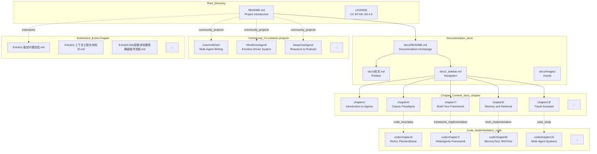
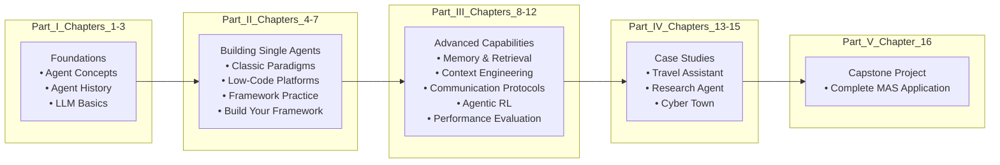
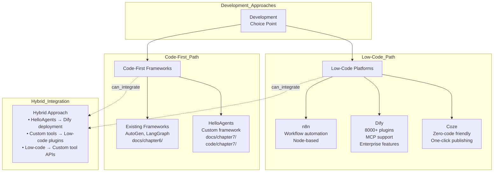
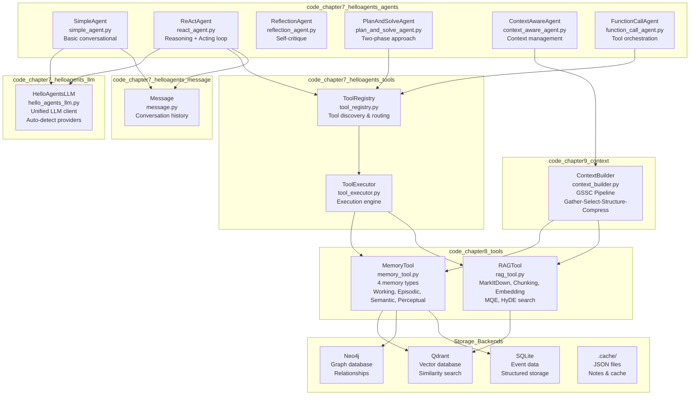

<!-- source: DeepWiki mcp.deepwiki.com · repo datawhalechina/hello-agents · page 1 Overview · fetched 2026-10-29 -->

# Overview

Relevant source files

The following files were used as context for generating this wiki page:

- [README.md](README.md)
- [README_EN.md](README_EN.md)
- [docs/Preface.md](docs/Preface.md)
- [docs/README.md](docs/README.md)
- [docs/README_EN.md](docs/README_EN.md)
- [docs/_sidebar.md](docs/_sidebar.md)
- [docs/_sidebar_en.md](docs/_sidebar_en.md)
- [docs/images/hello-agents.png](docs/images/hello-agents.png)
- [docs/images/star-history-2026324.png](docs/images/star-history-2026324.png)

## Purpose and Scope

This document provides a comprehensive introduction to the Hello-Agents repository, an open-source educational project by Datawhale for building AI agent systems from scratch. It covers the repository structure, learning curriculum, development approaches, and core frameworks. This overview is intended for developers, students, and AI practitioners who want to understand agent system architecture and implementation.

For detailed installation instructions, see [Getting Started](#2). For specific curriculum details, see [Learning Path and Curriculum](#3). For framework implementation, see [HelloAgents Framework](#7).

---

## What is Hello-Agents

Hello-Agents is a **systematic agent learning tutorial** that emphasizes hands-on practice and progressive learning [README.md:28](). The project distinguishes between two agent development paradigms:

1. **Software Engineering Agents** (e.g., Dify, Coze, n8n): Process-driven workflow systems where LLMs serve as data processing backends [README.md:28]().
2. **AI-Native Agents**: True AI-driven agents where the LLM is the core intelligence [README.md:28]().

This tutorial focuses on building **AI-Native Agents** by teaching both "using wheels" (existing frameworks and platforms) and "building wheels" (custom framework implementation) [README.md:28]().

**Key Repository Statistics** (from [README.md:15-19]()):
- Open source under Creative Commons BY-NC-SA 4.0 [README.md:116]()
- 16 chapters organized into 5 parts [README.md:51-74]()
- Bilingual documentation (Chinese and English) [README.md:1-3]()
- Online reading: `https://datawhalechina.github.io/hello-agents/` [README.md:19]()

Sources: [README.md:24-28](), [README_EN.md:24-28]()

---

## Repository Structure

**Directory Mapping to Code Entities**

| Directory | Purpose | Key Files/Classes |
|-----------|---------|-------------------|
| `docs/chapter1-16/` | Tutorial chapters (theory) | Markdown documentation [README.md:51-74]() |
| `code/chapter4/` | Classic paradigm implementations | `react_agent.py`, `plan_and_solve.py` [README.md:59]() |
| `code/chapter7/` | HelloAgents framework | `helloagents/`, `examples/` [README.md:62]() |
| `code/chapter8/` | Memory and RAG systems | `memory_tool.py`, `rag_tool.py` [README.md:64]() |
| `code/chapter13/` | Travel assistant case study | Multi-agent MCP integration [README.md:70]() |
| `Co-creation-projects/` | Community applications | `ColumnWriter/`, `MindEchoAgent/`, `DeepCastAgent/` [README.md:82-88]() |
| `Extra-Chapter/` | Community contributions | Interview questions, tutorials [README.md:83-91]() |

Sources: [README.md:51-91](), [docs/_sidebar.md:1-29]()

---

## Five-Part Curriculum Structure

**Curriculum Progression**

The curriculum follows a sequential progression from foundations to capstone [docs/Preface.md:27-37]():

| Part | Chapters | Focus | Code Directories |
|------|----------|-------|------------------|
| I: Foundations | 1-3 | Agent concepts, history, LLM architecture | None (theory) |
| II: Building Single Agents | 4-7 | ReAct, Plan-and-Solve, frameworks, HelloAgents | `code/chapter4/`, `code/chapter7/` |
| III: Advanced Capabilities | 8-12 | Memory, RAG, context, protocols, RL, evaluation | `code/chapter8/`, `code/chapter9/` |
| IV: Case Studies | 13-15 | Multi-agent collaboration, MCP integration | `code/chapter13/`, `code/chapter14/` |
| V: Capstone | 16 | Complete application development | `code/chapter16/` |

**Part I (Chapters 1-3)** establishes theoretical grounding [docs/Preface.md:29]():
- Chapter 1: Agent definition, types, paradigms, and applications [README.md:55]().
- Chapter 2: Historical evolution from symbolism to LLM-driven agents [README.md:56]().
- Chapter 3: Transformer architecture, prompt engineering, and LLM limitations [README.md:57]().

**Part II (Chapters 4-7)** focuses on implementation skills with four progressive approaches [docs/Preface.md:31]():
- Chapter 4: Hand-coded implementations of `ReAct`, `Plan-and-Solve`, and `Reflection` paradigms [README.md:59]().
- Chapter 5: Low-code platforms (Coze, Dify, n8n) for rapid prototyping [README.md:60]().
- Chapter 6: Existing frameworks (AutoGen, LangGraph, AgentScope) for leveraging mature tooling [README.md:61]().
- Chapter 7: Building the custom `HelloAgents` framework from scratch [README.md:62]().

**Part III (Chapters 8-12)** introduces orthogonal enhancements [docs/Preface.md:33]():
- Chapter 8: Memory systems, RAG, and storage [README.md:64]().
- Chapter 9: Context engineering for continuous interaction [README.md:65]().
- Chapter 10: Communication protocols (MCP, A2A, ANP) [README.md:66]().
- Chapter 11: Agentic RL training pipeline (SFT → GRPO) [README.md:67]().
- Chapter 12: Evaluation benchmarks (BFCL, GAIA) [README.md:68]().

**Part IV (Chapters 13-15)** synthesizes all previous knowledge [docs/Preface.md:35]():
- Chapter 13: Multi-agent travel assistant using MCP protocol [README.md:70]().
- Chapter 14: Autonomous research agent (DeepResearch replication) [README.md:71]().
- Chapter 15: Cyber Town social simulation with A2A communication [README.md:72]().

**Part V (Chapter 16)** challenges learners to apply all acquired skills independently in a capstone project [README.md:74]().

Sources: [README.md:51-74](), [docs/Preface.md:27-37](), [docs/_sidebar.md:1-29]()

---

## Dual Development Philosophy

**Low-Code Path Characteristics**:
- **Rapid prototyping**: Visual configuration without code [README.md:28]().
- **Platform examples**:
  - **Coze**: Zero-code friendly, one-click multi-channel publishing [README.md:60]().
  - **Dify**: 8000+ plugins, MCP protocol support, enterprise-grade [README.md:86]().
  - **n8n**: Workflow automation with visual nodes [README.md:60]().
- **Philosophy**: "Knowing how but not knowing why" - fast results, less control [docs/Preface.md:9]().

**Code-First Path Characteristics**:
- **Deep understanding**: Full control over agent architecture [README.md:28]().
- **Framework options**:
  - **HelloAgents**: Custom implementation from scratch (Chapter 7) [README.md:62]().
  - **AutoGen, LangGraph, AgentScope**: Mature ecosystem tools (Chapter 6) [README.md:61]().
- **Philosophy**: "Building from scratch" - steep learning curve, maximum flexibility [README.md:28]().

Sources: [README.md:28](), [README.md:60-64](), [docs/Preface.md:9]()

---

## HelloAgents Framework Core Architecture

This diagram bridges natural language concepts to actual code entities in the HelloAgents framework:

**Core Framework Components**

| Component | Purpose |
|-----------|---------|
| `SimpleAgent` | Basic conversational agent with message history [README.md:43]() |
| `ReActAgent` | Implements Reasoning-Acting loop with tool calls [README.md:59]() |
| `ReflectionAgent` | Self-critique and iterative improvement [README.md:59]() |
| `PlanAndSolveAgent` | Strategic planning then execution [README.md:59]() |
| `HelloAgentsLLM` | Unified client with auto-detection (OpenAI, ModelScope, Ollama) [README.md:43]() |
| `ToolRegistry` | Service locator for tool discovery [README.md:44]() |
| `MemoryTool` | 4 memory types with consolidation mechanisms [README.md:64]() |
| `RAGTool` | Document processing with advanced search (MQE, HyDE) [README.md:64]() |
| `ContextBuilder` | GSSC pipeline for context optimization [README.md:65]() |

Sources: [README.md:43-74](), [docs/_sidebar.md:1-29]()

---

## Target Audience and Prerequisites

**Intended Audience** [docs/Preface.md:17]():
- AI developers and software engineers with programming experience.
- University students studying AI/CS.
- Self-learners with strong interest in cutting-edge AI technology.

**Prerequisites** [docs/Preface.md:19-25]():
- **Required**: Basic Python programming skills.
- **Required**: Basic conceptual understanding of LLMs (e.g., obtaining LLM APIs).
- **Not Required**: Deep background in algorithms or model training.

**Project Focus**: Application and construction rather than algorithm development or model training [docs/Preface.md:25]().

Sources: [docs/Preface.md:15-26]()

---

## Practice Philosophy and Community

**Practice Philosophy** [docs/Preface.md:39]():
The repository emphasizes hands-on practice with complete working code. All supporting code is provided in the `code/` folder. Learners are encouraged to personally run, debug, and modify every piece of code provided.

**Community Engagement** [README.md:76-78]():
The project is a co-created effort. Community contributions include:
- **Co-creation Projects**: Featured multi-agent applications like `ColumnWriter`, `MindEchoAgent`, and `DeepCastAgent` [README.md:82-88]().
- **Extra Chapters**: Supplementary content covering interview questions, context engineering, and platform tutorials [README.md:83-91]().

Sources: [README.md:76-91](), [docs/Preface.md:39-43]()

---

