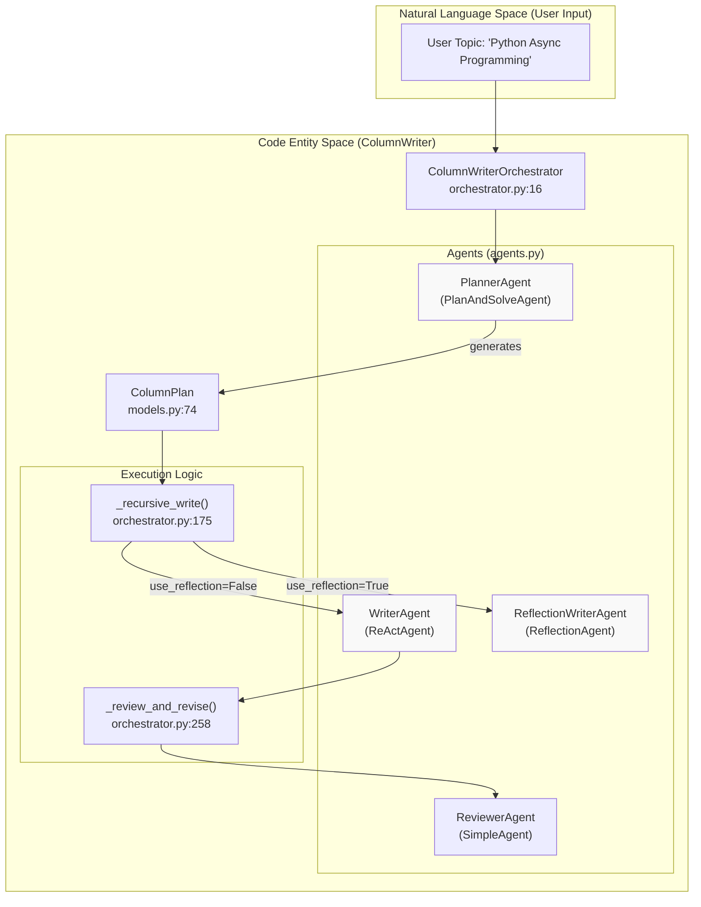
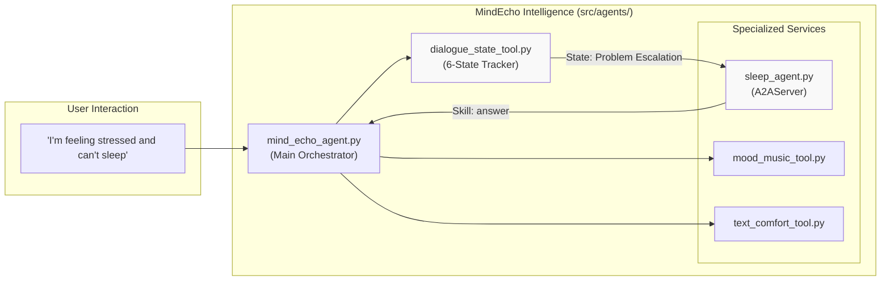

<!-- source: DeepWiki mcp.deepwiki.com · repo datawhalechina/hello-agents · page 10 Community Co-Creation Projects · fetched 2026-10-29 -->

# Community Co-Creation Projects

<details>
<summary>Relevant source files</summary>

The following files were used as context for generating this wiki page:

- [Co-creation-projects/EXAMPLE-ProjectTemplate/.env.example](Co-creation-projects/EXAMPLE-ProjectTemplate/.env.example)
- [Co-creation-projects/EXAMPLE-ProjectTemplate/README.md](Co-creation-projects/EXAMPLE-ProjectTemplate/README.md)
- [Co-creation-projects/EXAMPLE-ProjectTemplate/main.ipynb](Co-creation-projects/EXAMPLE-ProjectTemplate/main.ipynb)
- [Co-creation-projects/EXAMPLE-ProjectTemplate/requirements.txt](Co-creation-projects/EXAMPLE-ProjectTemplate/requirements.txt)
- [Co-creation-projects/jjyaoao-CodeReviewAgent/.env.example](Co-creation-projects/jjyaoao-CodeReviewAgent/.env.example)
- [Co-creation-projects/jjyaoao-CodeReviewAgent/README.md](Co-creation-projects/jjyaoao-CodeReviewAgent/README.md)
- [Co-creation-projects/jjyaoao-CodeReviewAgent/data/sample_code.py](Co-creation-projects/jjyaoao-CodeReviewAgent/data/sample_code.py)
- [Co-creation-projects/jjyaoao-CodeReviewAgent/main.ipynb](Co-creation-projects/jjyaoao-CodeReviewAgent/main.ipynb)
- [Co-creation-projects/jjyaoao-CodeReviewAgent/outputs/review_report.md](Co-creation-projects/jjyaoao-CodeReviewAgent/outputs/review_report.md)
- [Co-creation-projects/jjyaoao-CodeReviewAgent/requirements.txt](Co-creation-projects/jjyaoao-CodeReviewAgent/requirements.txt)
- [Co-creation-projects/melxy1997-ColumnWriter/README.md](Co-creation-projects/melxy1997-ColumnWriter/README.md)
- [Co-creation-projects/melxy1997-ColumnWriter/agents.py](Co-creation-projects/melxy1997-ColumnWriter/agents.py)
- [Co-creation-projects/melxy1997-ColumnWriter/config.py](Co-creation-projects/melxy1997-ColumnWriter/config.py)
- [Co-creation-projects/melxy1997-ColumnWriter/exporter.py](Co-creation-projects/melxy1997-ColumnWriter/exporter.py)
- [Co-creation-projects/melxy1997-ColumnWriter/main.py](Co-creation-projects/melxy1997-ColumnWriter/main.py)
- [Co-creation-projects/melxy1997-ColumnWriter/models.py](Co-creation-projects/melxy1997-ColumnWriter/models.py)
- [Co-creation-projects/melxy1997-ColumnWriter/orchestrator.py](Co-creation-projects/melxy1997-ColumnWriter/orchestrator.py)
- [Co-creation-projects/melxy1997-ColumnWriter/prompts.py](Co-creation-projects/melxy1997-ColumnWriter/prompts.py)
- [Co-creation-projects/melxy1997-ColumnWriter/search_mcp_server.py](Co-creation-projects/melxy1997-ColumnWriter/search_mcp_server.py)
- [Co-creation-projects/melxy1997-ColumnWriter/utils.py](Co-creation-projects/melxy1997-ColumnWriter/utils.py)
- [Co-creation-projects/pamdla-MindEchoAgent/Dockerfile](Co-creation-projects/pamdla-MindEchoAgent/Dockerfile)
- [Co-creation-projects/pamdla-MindEchoAgent/README.md](Co-creation-projects/pamdla-MindEchoAgent/README.md)
- [Co-creation-projects/pamdla-MindEchoAgent/docker-compose.yaml](Co-creation-projects/pamdla-MindEchoAgent/docker-compose.yaml)
- [Co-creation-projects/pamdla-MindEchoAgent/main.ipynb](Co-creation-projects/pamdla-MindEchoAgent/main.ipynb)
- [Co-creation-projects/pamdla-MindEchoAgent/main.py](Co-creation-projects/pamdla-MindEchoAgent/main.py)
- [Co-creation-projects/pamdla-MindEchoAgent/requirements.txt](Co-creation-projects/pamdla-MindEchoAgent/requirements.txt)
- [Co-creation-projects/pamdla-MindEchoAgent/src/agents/mind_echo_agent.py](Co-creation-projects/pamdla-MindEchoAgent/src/agents/mind_echo_agent.py)
- [Co-creation-projects/pamdla-MindEchoAgent/src/agents/sleep_agent.py](Co-creation-projects/pamdla-MindEchoAgent/src/agents/sleep_agent.py)

</details>


## Purpose and Scope

This section documents community-contributed agent applications built using the Hello-Agents framework. These projects demonstrate production-quality implementations of multi-agent systems across diverse domains including technical writing, emotional health, and research automation. Each project serves as both a learning resource and a blueprint for building real-world agent applications.

For framework architecture details, see [HelloAgents Framework](#7). For underlying agent design patterns, see [Agent Paradigms and Design Patterns](#5).

---

## Featured Community Projects

The following featured projects demonstrate advanced implementations of the HelloAgents framework. Detailed implementation guides for these are available in their respective child pages.

### [ColumnWriter: Multi-Agent Article Generation](#10.1)
A sophisticated content system mimicking a professional editorial team. It uses a `PlannerAgent` (Plan-and-Solve) to structure outlines and a `WriterAgent` (ReAct/Reflection) for content generation.
- **Key Features**: Recursive tree-based generation, multi-mode writing (ReAct vs Reflection), and independent quality review cycles.
- **Source Code**: [Co-creation-projects/melxy1997-ColumnWriter/orchestrator.py:16-131]()

### [MindEchoAgent: Emotion-Driven Music Recommendation](#10.2)
An emotion-aware assistant that uses deep sentiment analysis to provide musical comfort and sleep advice.
- **Key Features**: Six-state dialogue tracking, Agent-to-Agent (A2A) communication with a specialized `SleepAgent`, and multi-tool integration (Memory, Music, Comfort).
- **Source Code**: [Co-creation-projects/pamdla-MindEchoAgent/src/agents/mind_echo_agent.py:1-50](), [Co-creation-projects/pamdla-MindEchoAgent/src/agents/sleep_agent.py:6-20]()

### [DeepCastAgent: Research-to-Podcast Pipeline](#10.3)
A research automation system that transforms complex topics into structured reports and two-person audio podcasts.
- **Key Features**: Plan-and-Solve multi-agent architecture, SSE streaming for real-time feedback, and TTS synthesis for audio generation.

### [Additional Featured Projects](#10.4)
A survey of other notable community works including:
- **InnocoreAI**: Academic research assistant with a 4-agent collaboration pipeline.
- **HelloCodeAgentCli**: CLI-based coding assistant using ReAct and GSSC context engineering.
- **HelloClaw**: Personalized assistant featuring persistent memory systems.

---

## ColumnWriter: System Architecture Deep Dive

ColumnWriter serves as a primary example of complex multi-agent orchestration. It supports two distinct operational modes: **ReAct Mode** (with independent review) and **Reflection Mode** (built-in self-optimization).

### Orchestration Logic



### Component Breakdown

1.  **PlannerAgent**: Implements the `PlanAndSolveAgent` pattern. It breaks down a broad topic into a `ColumnPlan` [models.py:74-89](). It utilizes a `CachedExecutor` to prevent redundant LLM calls for the same topic [agents.py:121-203]().
2.  **WriterAgent**: A `ReActAgent` wrapper [agents.py:52-53]() that uses tools like `web_search` and `search_code_examples` [search_mcp_server.py:15-133]() to gather factual data.
3.  **Quality Control**: The `ReviewerAgent` evaluates content against a configurable `approval_threshold` (default 75) [config.py:32](). If the score is insufficient, the `RevisionAgent` performs targeted edits [agents.py:58-60]().

**Sources**: [Co-creation-projects/melxy1997-ColumnWriter/orchestrator.py:16-131](), [Co-creation-projects/melxy1997-ColumnWriter/agents.py:38-203](), [Co-creation-projects/melxy1997-ColumnWriter/config.py:32-37]()

---

## MindEchoAgent: Emotion and Service Architecture

MindEchoAgent demonstrates how to bridge emotional detection with specialized agent services using the Agent-to-Agent (A2A) protocol.

### Emotion-to-Service Mapping



### Technical Implementation
- **A2A Protocol**: The `SleepAgent` is implemented as an `A2AServer` [src/agents/sleep_agent.py:6-9](), exposing the `answer` skill [src/agents/sleep_agent.py:11-12]() to the main agent.
- **State Management**: Uses a custom `dialogue_state_tool.py` to transition between 6 states: Initial, Emotion Recognition, Emotional Support, Music Recommendation, Reflection, and Escalation [README.md:69-72]().

**Sources**: [Co-creation-projects/pamdla-MindEchoAgent/README.md:1-104](), [Co-creation-projects/pamdla-MindEchoAgent/src/agents/sleep_agent.py:1-21]()

---

## Project Structure and Best Practices

All co-creation projects follow a standardized structure to ensure framework compatibility and community discoverability. For a complete guide on these standards, see [Project Structure and Best Practices](#10.5).

### Standard Directory Layout
```text
Co-creation-projects/
├── {username}-{projectname}/
│   ├── README.md              # Project overview and author info
│   ├── requirements.txt       # Dependencies
│   ├── main.py/main.ipynb     # Entry point
│   ├── agents.py              # Agent definitions (recommended)
│   ├── tools.py               # Custom tool definitions (recommended)
│   └── .env.example           # Configuration template
```

### Key Contribution Rules
- **Modular Design**: Separate prompts, agents, and tools into distinct files (e.g., `prompts.py`, `agents.py`) [melxy1997-ColumnWriter/README.md:51-59]().
- **Robust Parsing**: Use the `JSONExtractor` pattern to handle non-standard LLM outputs [melxy1997-ColumnWriter/utils.py:9-18]().
- **Error Handling**: Implement fallbacks (e.g., falling back from `ReActAgent` to `SimpleAgent` on failure) [melxy1997-ColumnWriter/orchestrator.py:34-35]().

**Sources**: [Co-creation-projects/melxy1997-ColumnWriter/README.md:51-59](), [Co-creation-projects/melxy1997-ColumnWriter/utils.py:9-88](), [Co-creation-projects/pamdla-MindEchoAgent/README.md:34-62]()

---

