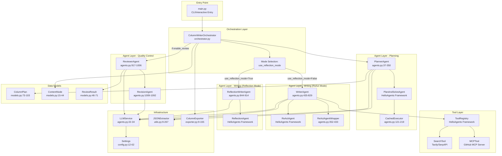
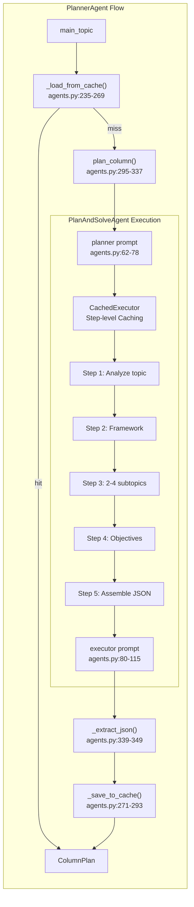
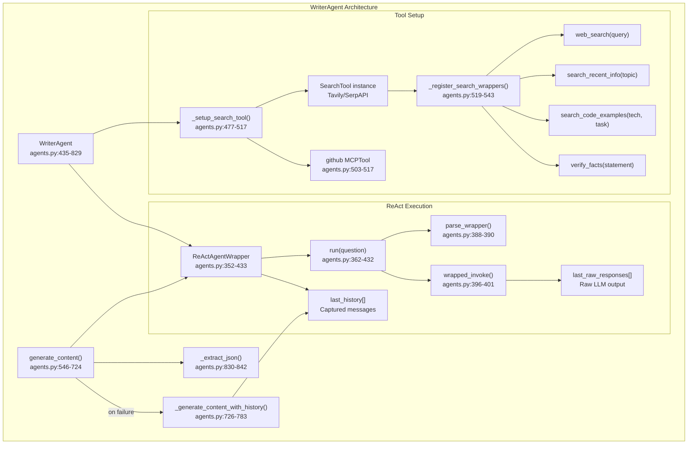
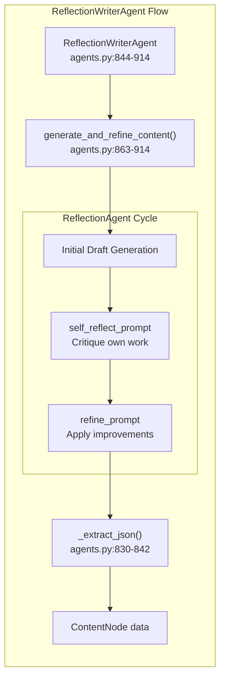
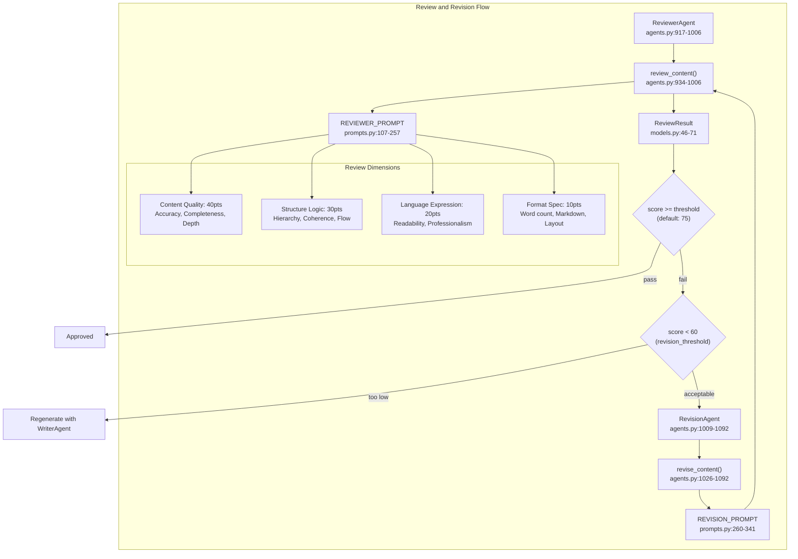
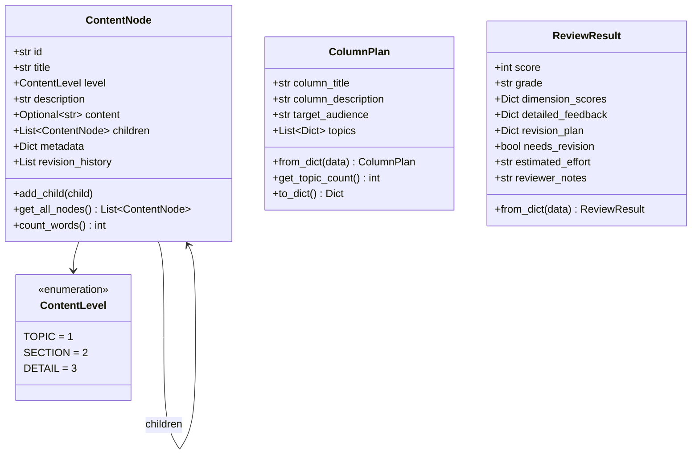
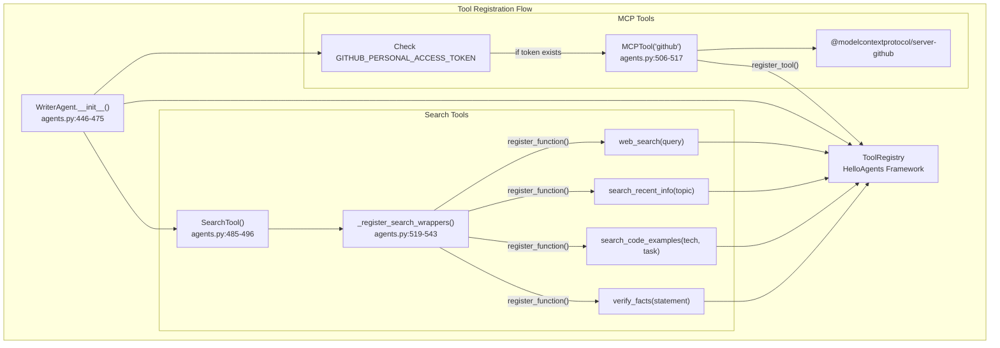
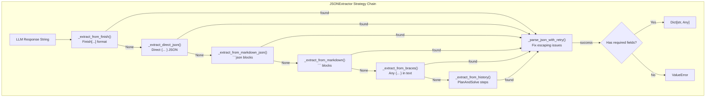

<!-- source: DeepWiki mcp.deepwiki.com · repo datawhalechina/hello-agents · page 10.1 ColumnWriter: Multi-Agent Article Generation · fetched 2026-10-29 -->

# ColumnWriter: Multi-Agent Article Generation

Relevant source files

The following files were used as context for generating this wiki page:

- [Co-creation-projects/melxy1997-ColumnWriter/.env example](Co-creation-projects/melxy1997-ColumnWriter/.env example)
- [Co-creation-projects/melxy1997-ColumnWriter/.gitignore](Co-creation-projects/melxy1997-ColumnWriter/.gitignore)
- [Co-creation-projects/melxy1997-ColumnWriter/README.md](Co-creation-projects/melxy1997-ColumnWriter/README.md)
- [Co-creation-projects/melxy1997-ColumnWriter/agents.py](Co-creation-projects/melxy1997-ColumnWriter/agents.py)
- [Co-creation-projects/melxy1997-ColumnWriter/config.py](Co-creation-projects/melxy1997-ColumnWriter/config.py)
- [Co-creation-projects/melxy1997-ColumnWriter/exporter.py](Co-creation-projects/melxy1997-ColumnWriter/exporter.py)
- [Co-creation-projects/melxy1997-ColumnWriter/main.py](Co-creation-projects/melxy1997-ColumnWriter/main.py)
- [Co-creation-projects/melxy1997-ColumnWriter/models.py](Co-creation-projects/melxy1997-ColumnWriter/models.py)
- [Co-creation-projects/melxy1997-ColumnWriter/orchestrator.py](Co-creation-projects/melxy1997-ColumnWriter/orchestrator.py)
- [Co-creation-projects/melxy1997-ColumnWriter/output_20251121_190555/REPORT.md](Co-creation-projects/melxy1997-ColumnWriter/output_20251121_190555/REPORT.md)
- [Co-creation-projects/melxy1997-ColumnWriter/output_20251121_190555/column_data.json](Co-creation-projects/melxy1997-ColumnWriter/output_20251121_190555/column_data.json)
- [Co-creation-projects/melxy1997-ColumnWriter/prompts.py](Co-creation-projects/melxy1997-ColumnWriter/prompts.py)
- [Co-creation-projects/melxy1997-ColumnWriter/search_mcp_server.py](Co-creation-projects/melxy1997-ColumnWriter/search_mcp_server.py)
- [Co-creation-projects/melxy1997-ColumnWriter/utils.py](Co-creation-projects/melxy1997-ColumnWriter/utils.py)

## Purpose and Scope

ColumnWriter is a community co-creation project that demonstrates how to build a production-ready technical writing system using the HelloAgents framework. It implements a multi-agent architecture where specialized agents collaborate to plan, write, review, and refine long-form technical articles with hierarchical structure. The system supports two operational modes: ReAct-based writing with independent review, and Reflection-based self-optimizing generation.

This document covers the implementation details of ColumnWriter's agent coordination, content generation workflows, and quality control mechanisms.

**Sources:** [Co-creation-projects/melxy1997-ColumnWriter/README.md:1-15](), [Co-creation-projects/melxy1997-ColumnWriter/README.md:94-119]()

## System Architecture Overview

ColumnWriter implements a three-layer architecture: orchestration layer, agent layer, and infrastructure layer. The orchestrator coordinates specialized agents, each implementing a different HelloAgents pattern optimized for its specific responsibility.

### High-Level Component Architecture

**Sources:** [Co-creation-projects/melxy1997-ColumnWriter/orchestrator.py:16-77](), [Co-creation-projects/melxy1997-ColumnWriter/agents.py:1-34](), [Co-creation-projects/melxy1997-ColumnWriter/README.md:47-60]()

## Agent Implementations

### PlannerAgent: Task Decomposition with Caching

`PlannerAgent` wraps the `PlanAndSolveAgent` pattern with a custom caching mechanism. It decomposes a high-level topic into a structured column plan with 2-4 subtopics, each with metadata about target word count, key points, and prerequisites.

The `CachedExecutor` class [Co-creation-projects/melxy1997-ColumnWriter/agents.py:121-219]() extends the base `Executor` to cache each step's result using MD5 hashes of `topic + step_index + step_content`. This prevents redundant LLM calls when re-running the same topic.

**Key Implementation Details:**
- Cache key generation: `hashlib.md5(f"{self.main_topic}_{step_index}_{step_content}".encode('utf-8')).hexdigest()` [Co-creation-projects/melxy1997-ColumnWriter/agents.py:133-136]()
- Cache directory: `.cache/steps_cache/` for per-step caching [Co-creation-projects/melxy1997-ColumnWriter/agents.py:127-128](), `.cache/` for final plan caching [Co-creation-projects/melxy1997-ColumnWriter/agents.py:57-58]()
- Custom prompts enforce JSON output only on final step [Co-creation-projects/melxy1997-ColumnWriter/agents.py:88-115]()

**Sources:** [Co-creation-projects/melxy1997-ColumnWriter/agents.py:37-350](), [Co-creation-projects/melxy1997-ColumnWriter/prompts.py:3-63]()

### WriterAgent: ReAct with Tool Integration

`WriterAgent` uses `ReActAgent` for iterative reasoning and action execution. It can invoke search tools and MCP tools during content generation, enabling real-time fact-checking and code example retrieval.

**ReActAgentWrapper** [Co-creation-projects/melxy1997-ColumnWriter/agents.py:352-433]() captures execution history by:
1. Replacing `_parse_output` with `parse_react_output()` from `utils.py` [Co-creation-projects/melxy1997-ColumnWriter/agents.py:388-390]()
2. Intercepting LLM `invoke()` calls to save raw responses [Co-creation-projects/melxy1997-ColumnWriter/agents.py:396-401]()
3. Preserving history even when agent execution fails [Co-creation-projects/melxy1997-ColumnWriter/agents.py:417-432]()

This enables fallback content generation using a simplified prompt with accumulated context when `ReActAgent` exceeds max steps or encounters errors [Co-creation-projects/melxy1997-ColumnWriter/agents.py:726-783]().

**Sources:** [Co-creation-projects/melxy1997-ColumnWriter/agents.py:435-829](), [Co-creation-projects/melxy1997-ColumnWriter/prompts.py:66-104](), [Co-creation-projects/melxy1997-ColumnWriter/utils.py:270-444]()

### ReflectionWriterAgent: Self-Optimizing Generation

`ReflectionWriterAgent` uses the `ReflectionAgent` pattern for single-shot generation with built-in self-critique and refinement, eliminating the need for separate review agents.

The reflection prompts guide the agent to:
1. Evaluate its own draft against objectives, quality, structure, and language [Co-creation-projects/melxy1997-ColumnWriter/prompts.py:390-422]()
2. Identify specific weaknesses with examples [Co-creation-projects/melxy1997-ColumnWriter/prompts.py:423-428]()
3. Generate actionable improvements while preserving strengths [Co-creation-projects/melxy1997-ColumnWriter/prompts.py:429-442]()

**Sources:** [Co-creation-projects/melxy1997-ColumnWriter/agents.py:844-914](), [Co-creation-projects/melxy1997-ColumnWriter/prompts.py:390-447]()

### ReviewerAgent and RevisionAgent: Quality Control Loop

When `use_reflection_mode=False`, the system employs independent review and revision agents implementing a multi-round optimization loop.

**Review Scoring Breakdown:**
| Dimension | Weight | Sub-criteria |
|-----------|--------|-------------|
| Content Quality | 40 points | Accuracy, Completeness, Depth, Originality [Co-creation-projects/melxy1997-ColumnWriter/prompts.py:112-133]() |
| Structure Logic | 30 points | Hierarchy, Coherence, Transitions [Co-creation-projects/melxy1997-ColumnWriter/prompts.py:134-150]() |
| Language Expression | 20 points | Readability, Professionalism, Precision [Co-creation-projects/melxy1997-ColumnWriter/prompts.py:151-167]() |
| Format Specification | 10 points | Word Count, Format, Layout [Co-creation-projects/melxy1997-ColumnWriter/prompts.py:168-182]() |

The revision loop [Co-creation-projects/melxy1997-ColumnWriter/orchestrator.py:258-356]() continues for up to `max_revisions` (default: 2) or until score exceeds `approval_threshold` (default: 75) [Co-creation-projects/melxy1997-ColumnWriter/config.py:32-37]().

**Sources:** [Co-creation-projects/melxy1997-ColumnWriter/agents.py:917-1092](), [Co-creation-projects/melxy1997-ColumnWriter/prompts.py:107-341](), [Co-creation-projects/melxy1997-ColumnWriter/orchestrator.py:258-356]()

## Orchestration and Workflow

### ColumnWriterOrchestrator: Central Coordinator

The `ColumnWriterOrchestrator` class manages the end-to-end column creation workflow with recursive content tree generation.

```mermaid
graph TD
    subgraph "Orchestrator Workflow"
        init["__init__(use_reflection_mode)<br/>orchestrator.py:26-77"]
        create_column["create_column(main_topic)<br/>orchestrator.py:79-131"]
        
        subgraph "Phase 1: Planning"
            plan["planner.plan_column()<br/>orchestrator.py:96-101"]
            column_plan["ColumnPlan object"]
        end
        
        subgraph "Phase 2: Writing"
            write_sequential["_write_topics_sequential()<br/>orchestrator.py:133-150"]
            write_tree["_write_topic_tree()<br/>orchestrator.py:152-173"]
            recursive_write["_recursive_write()<br/>orchestrator.py:175-197"]
            
            mode_branch{"use_reflection_mode?"}
            write_reflection["_write_with_reflection()<br/>orchestrator.py:199-223"]
            write_react["_write_with_react()<br/>orchestrator.py:225-256"]
            
            review_loop["_review_and_revise()<br/>orchestrator.py:258-356"]
        end
        
        subgraph "Phase 3: Assembly"
            assemble["_assemble_column()<br/>orchestrator.py:384-412"]
            tree_to_md["_tree_to_markdown()<br/>orchestrator.py:414-429"]
            calc_stats["_calculate_statistics()<br/>orchestrator.py:431-452"]
        end
        
        result["Dict with column_info,<br/>articles, statistics"]
    end
    
    init --> create_column
    create_column --> plan
    plan --> column_plan
    
    column_plan --> write_sequential
    write_sequential --> write_tree
    write_tree --> recursive_write
    
    recursive_write --> mode_branch
    mode_branch -->|"True"| write_reflection
    mode_branch -->|"False"| write_react
    
    write_react -->|"if enable_review"| review_loop
    
    write_reflection --> assemble
    review_loop --> assemble
    write_react -->|"review disabled"| assemble
    
    assemble --> tree_to_md
    assemble --> calc_stats
    
    tree_to_md --> result
    calc_stats --> result
```

**Recursive Content Generation Logic:**

The system generates content hierarchically using `ContentNode` trees [Co-creation-projects/melxy1997-ColumnWriter/models.py:15-44](). Each node represents a topic/section/detail level and can have child nodes.

Each level has different structural requirements defined in `prompts.py` [Co-creation-projects/melxy1997-ColumnWriter/prompts.py:344-365]():
- **Level 1 (Topic):** ~600 words - Introduction, Main body, Summary [Co-creation-projects/melxy1997-ColumnWriter/prompts.py:347-352]()
- **Level 2 (Section):** ~400 words - Section intro, Core content, Section summary [Co-creation-projects/melxy1997-ColumnWriter/prompts.py:353-358]()
- **Level 3 (Detail):** ~200 words - Specific explanation, Example/supplement [Co-creation-projects/melxy1997-ColumnWriter/prompts.py:359-363]()

**Sources:** [Co-creation-projects/melxy1997-ColumnWriter/orchestrator.py:16-453](), [Co-creation-projects/melxy1997-ColumnWriter/models.py:15-44](), [Co-creation-projects/melxy1997-ColumnWriter/prompts.py:344-365]()

### Two-Mode Operation Comparison

| Aspect | ReAct + Review Mode | Reflection Mode |
|--------|---------------------|-----------------|
| Writer Agent | `ReActAgent` via `WriterAgent` [Co-creation-projects/melxy1997-ColumnWriter/orchestrator.py:52]() | `ReflectionAgent` via `ReflectionWriterAgent` [Co-creation-projects/melxy1997-ColumnWriter/orchestrator.py:47]() |
| Tool Access | Yes (Search, MCP) [Co-creation-projects/melxy1997-ColumnWriter/agents.py:446-543]() | No (standard single-shot) |
| Quality Control | Separate `ReviewerAgent` + `RevisionAgent` [Co-creation-projects/melxy1997-ColumnWriter/orchestrator.py:57-58]() | Built-in self-reflection [Co-creation-projects/melxy1997-ColumnWriter/agents.py:863-914]() |
| Iterations | Multi-round review loop [Co-creation-projects/melxy1997-ColumnWriter/orchestrator.py:258-356]() | Single reflection cycle |

**Sources:** [Co-creation-projects/melxy1997-ColumnWriter/orchestrator.py:26-256](), [Co-creation-projects/melxy1997-ColumnWriter/README.md:94-119]()

## Data Models and Structures

### Core Data Models

Each `ContentNode.metadata` tracks properties like `review_score`, `review_grade`, and `revision_count` [Co-creation-projects/melxy1997-ColumnWriter/exporter.py:49-54]().

**Sources:** [Co-creation-projects/melxy1997-ColumnWriter/models.py:1-103]()

## Configuration and Tool Integration

### Settings Configuration

The `Settings` class [Co-creation-projects/melxy1997-ColumnWriter/config.py:12-62]() uses pydantic-settings for environment-based configuration:

**Key Configuration Parameters:**
| Parameter | Default | Purpose |
|-----------|---------|---------|
| `max_depth` | 3 | Maximum content tree recursion depth [Co-creation-projects/melxy1997-ColumnWriter/config.py:31]() |
| `approval_threshold` | 75 | Minimum score to pass review [Co-creation-projects/melxy1997-ColumnWriter/config.py:32]() |
| `enable_search` | True | Enable/disable search tool integration [Co-creation-projects/melxy1997-ColumnWriter/config.py:35]() |
| `max_revisions` | 2 | Maximum number of revision attempts [Co-creation-projects/melxy1997-ColumnWriter/config.py:37]() |

**Sources:** [Co-creation-projects/melxy1997-ColumnWriter/config.py:1-93]()

### Tool Integration Architecture

The search tool wrappers [Co-creation-projects/melxy1997-ColumnWriter/agents.py:519-543]() adapt the `SearchTool.run()` interface to match the prompt's expected function signatures.

**Sources:** [Co-creation-projects/melxy1997-ColumnWriter/agents.py:477-543](), [Co-creation-projects/melxy1997-ColumnWriter/search_mcp_server.py:1-155]()

## Utility Components

### JSONExtractor: Robust Parsing

The `JSONExtractor` class [Co-creation-projects/melxy1997-ColumnWriter/utils.py:9-267]() implements multiple extraction strategies:

**Sources:** [Co-creation-projects/melxy1997-ColumnWriter/utils.py:9-267]()

## Export and Output

### ColumnExporter: File Generation

The `ColumnExporter` class [Co-creation-projects/melxy1997-ColumnWriter/exporter.py:9-155]() generates article files and a comprehensive `REPORT.md` [Co-creation-projects/melxy1997-ColumnWriter/exporter.py:72-154]().

**REPORT.md Contents:**
- Column metadata (title, description, target audience) [Co-creation-projects/melxy1997-ColumnWriter/exporter.py:75-79]()
- Content statistics (total words, nodes, articles) [Co-creation-projects/melxy1997-ColumnWriter/exporter.py:81-86]()
- Agent modes used [Co-creation-projects/melxy1997-ColumnWriter/exporter.py:107-112]()
- Creation timeline and call statistics [Co-creation-projects/melxy1997-ColumnWriter/exporter.py:114-141]()

**Sources:** [Co-creation-projects/melxy1997-ColumnWriter/exporter.py:1-155](), [Co-creation-projects/melxy1997-ColumnWriter/orchestrator.py:414-429]()

## Running the System

### Entry Point Flow

```mermaid
graph TD
    subgraph "main.py Execution Flow"
        start["python main.py [topic]"]
        
        get_topic["Get topic from args<br/>or interactive input"]
        
        mode_choice["Choose mode:<br/>1. ReAct + Review<br/>2. Reflection"]
        
        review_choice{"ReAct mode selected?"}
        enable_review["Choose enable_review:<br/>1. Enable (default)<br/>2. Disable"]
        
        create_orchestrator["ColumnWriterOrchestrator(<br/>use_reflection_mode)"]
        
        create_column["orchestrator.create_column(<br/>main_topic)"]
        
        export["ColumnExporter.export_to_files(<br/>result, output_dir)"]
        
        stats["Print statistics:<br/>- Articles, words<br/>- Generations, reviews<br/>- Agent modes used"]
        
        done["Files in output_YYYYMMDD_HHMMSS/"]
    end
    
    start --> get_topic
    get_topic --> mode_choice
    mode_choice --> review_choice
    
    review_choice -->|"Yes"| enable_review
    review_choice -->|"No"| create_orchestrator
    enable_review --> create_orchestrator
    
    create_orchestrator --> create_column
    create_column --> export
    export --> stats
    stats --> done
```

**Sources:** [Co-creation-projects/melxy1997-ColumnWriter/main.py:1-107]()

---

