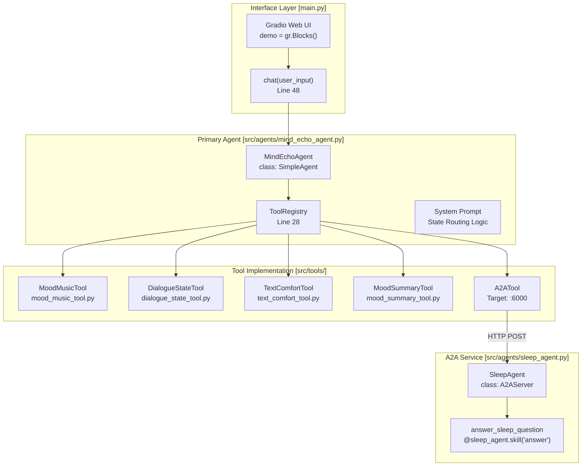
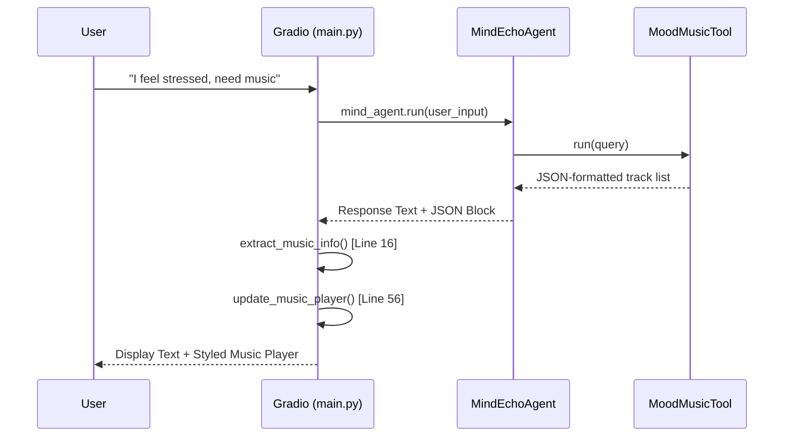
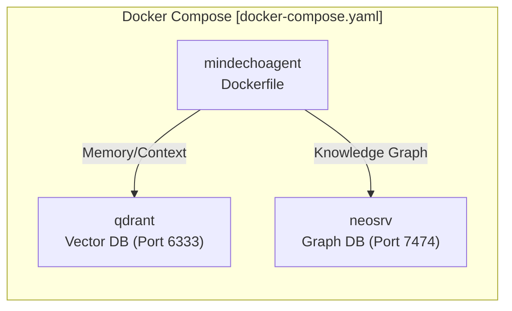

<!-- source: DeepWiki mcp.deepwiki.com · repo datawhalechina/hello-agents · page 10.2 MindEchoAgent: Emotion-Driven Music Recommendation · fetched 2026-10-29 -->

# MindEchoAgent: Emotion-Driven Music Recommendation

Relevant source files

The following files were used as context for generating this wiki page:

- [Co-creation-projects/pamdla-MindEchoAgent/Dockerfile](Co-creation-projects/pamdla-MindEchoAgent/Dockerfile)
- [Co-creation-projects/pamdla-MindEchoAgent/README.md](Co-creation-projects/pamdla-MindEchoAgent/README.md)
- [Co-creation-projects/pamdla-MindEchoAgent/docker-compose.yaml](Co-creation-projects/pamdla-MindEchoAgent/docker-compose.yaml)
- [Co-creation-projects/pamdla-MindEchoAgent/main.ipynb](Co-creation-projects/pamdla-MindEchoAgent/main.ipynb)
- [Co-creation-projects/pamdla-MindEchoAgent/main.py](Co-creation-projects/pamdla-MindEchoAgent/main.py)
- [Co-creation-projects/pamdla-MindEchoAgent/requirements.txt](Co-creation-projects/pamdla-MindEchoAgent/requirements.txt)
- [Co-creation-projects/pamdla-MindEchoAgent/src/agents/mind_echo_agent.py](Co-creation-projects/pamdla-MindEchoAgent/src/agents/mind_echo_agent.py)
- [Co-creation-projects/pamdla-MindEchoAgent/src/agents/sleep_agent.py](Co-creation-projects/pamdla-MindEchoAgent/src/agents/sleep_agent.py)
- [Co-creation-projects/pamdla-MindEchoAgent/src/tools/mood_music_tool.py](Co-creation-projects/pamdla-MindEchoAgent/src/tools/mood_music_tool.py)
- [Co-creation-projects/pamdla-MindEchoAgent/src/tools/text_comfort_tool.py](Co-creation-projects/pamdla-MindEchoAgent/src/tools/text_comfort_tool.py)

## Purpose and Scope

This document describes **MindEchoAgent**, a community co-creation project that demonstrates emotion-driven music recommendation using the Hello-Agents framework. MindEchoAgent detects user emotions through natural language conversation, provides personalized music recommendations, offers emotional support, and escalates to a specialized sleep agent when detecting sleep-related anxiety through A2A (Agent-to-Agent) protocol communication.

The system emphasizes a modular "Agent + Tool" architecture, integrating memory systems, state management, and specialized support services to provide a holistic emotional wellness experience.

**Sources**: [Co-creation-projects/pamdla-MindEchoAgent/README.md:1-11](), [Co-creation-projects/pamdla-MindEchoAgent/README.md:65-91]()

---

## System Overview

MindEchoAgent is a multi-component system consisting of a primary agent and a specialized sub-agent service:

| Component | Code Entity | Purpose |
|-----------|-------------|---------|
| **MindEchoAgent** | `SimpleAgent` | Primary orchestrator for emotion detection and tool routing. |
| **SleepAgent** | `A2AServer` | Specialized A2A service for sleep strategies and anxiety. |
| **DialogueStateTool** | `DialogueStateTool` | Manages transitions between 6 defined conversation states. |
| **MoodMusicTool** | `MoodMusicTool` | Rule-based engine for mapping emotions to music tracks. |
| **TextComfortTool** | `TextComfortTool` | Provides empathy anchors for LLM-generated support. |
| **MemoryTool** | `MemoryTool` | Records and retrieves historical mood patterns. |
| **A2ATool** | `A2ATool` | Facilitates the bridge to the `SleepAgent` service. |

The architecture is designed to be "Simulation-First," allowing for high-quality interaction using built-in mock data even without external music API keys.

**Sources**: [Co-creation-projects/pamdla-MindEchoAgent/src/agents/mind_echo_agent.py:11-46](), [Co-creation-projects/pamdla-MindEchoAgent/src/agents/sleep_agent.py:6-9](), [Co-creation-projects/pamdla-MindEchoAgent/README.md:9-11]()

---

## Architecture and Code Entity Mapping

The following diagram maps the logical functional blocks to the specific classes and files in the codebase.

### System Component Map

**Architecture Analysis**: The system follows a distributed agent pattern. The `MindEchoAgent` is the central brain that uses a `ToolRegistry` to access local tools and the remote `SleepAgent` [src/agents/mind_echo_agent.py:28-43](). The `SleepAgent` runs as a standalone `A2AServer` [src/agents/sleep_agent.py:6-9](), typically hosted on port 6000 [main.py:11]().

**Sources**: [Co-creation-projects/pamdla-MindEchoAgent/main.py:11-54](), [Co-creation-projects/pamdla-MindEchoAgent/src/agents/mind_echo_agent.py:11-46](), [Co-creation-projects/pamdla-MindEchoAgent/src/agents/sleep_agent.py:1-21]()

---

## Core Implementation Details

### MindEchoAgent Factory
The `create_mind_echo_agent` function encapsulates the setup of the primary agent, including its specialized system prompt and toolset.

| Configuration | Implementation |
|---------------|----------------|
| **LLM Client** | `HelloAgentsLLM()` [src/agents/mind_echo_agent.py:12]() |
| **System Prompt** | Defines states: `MOOD`, `COMFORT`, `MUSIC`, `ESCALATE` [src/agents/mind_echo_agent.py:17]() |
| **A2A Tooling** | `A2ATool(agent_url="http://localhost:6000", ...)` [src/agents/mind_echo_agent.py:36-40]() |
| **Initial State** | `DialogueState.INIT.value` [src/agents/mind_echo_agent.py:44]() |

The system prompt specifically instructs the agent to escalate to the `SleepAgent` if keywords like "持续焦虑" (persistent anxiety) or "睡不着" (can't sleep) are detected [src/agents/mind_echo_agent.py:19]().

**Sources**: [Co-creation-projects/pamdla-MindEchoAgent/src/agents/mind_echo_agent.py:11-46]()

### SleepAgent A2A Service
The `SleepAgent` is a specialized micro-agent that provides sleep strategies.

- **Definition**: Uses `A2AServer` from `hello_agents.protocols` [src/agents/sleep_agent.py:3-9]().
- **Skill Registration**: The `@sleep_agent.skill("answer")` decorator exposes the `answer_sleep_question` function [src/agents/sleep_agent.py:11-12]().
- **Response Logic**: Currently provides a 3-step structured advice: device shutdown/breathing, soft music, and gratitude journaling [src/agents/sleep_agent.py:14-20]().

**Sources**: [Co-creation-projects/pamdla-MindEchoAgent/src/agents/sleep_agent.py:1-21]()

---

## Tool Functionality

### MoodMusicTool
The `MoodMusicTool` acts as the recommendation engine. It maps user descriptions to specific tracks using a rule-based lookup in `mood_map` [src/tools/mood_music_tool.py:18-36]().

- **Input**: `query` (string) representing the user's mood [src/tools/mood_music_tool.py:24]().
- **Fallback**: If no mood is matched, it defaults to ambient tracks like "Tycho - Awake" [src/tools/mood_music_tool.py:39-42]().

### TextComfortTool
The `TextComfortTool` provides "comfort anchors." Instead of generating the full response, it provides structural points (Empathy, Permission to Pause, Small Actions) that the LLM then weaves into a natural response [src/tools/text_comfort_tool.py:24-31]().

**Sources**: [Co-creation-projects/pamdla-MindEchoAgent/src/tools/mood_music_tool.py:6-49](), [Co-creation-projects/pamdla-MindEchoAgent/src/tools/text_comfort_tool.py:5-32]()

---

## UI and Interaction Flow

The project uses **Gradio** to provide a web-based dashboard [main.py:73]().

### Data Flow: User Input to UI Update

**Key UI Features**:
- **Music Extraction**: The `extract_music_info` function parses JSON from the LLM's raw string response to isolate track titles and artists [main.py:16-38]().
- **Dynamic Player**: `update_music_player` updates a styled HTML panel with track metadata and simulated playback controls [main.py:56-71]().
- **A2A Backgrounding**: The `SleepAgent` is started in a separate daemon thread at launch [main.py:11]().

**Sources**: [Co-creation-projects/pamdla-MindEchoAgent/main.py:11-180]()

---

## Deployment and Environment

The system is containerized using Docker and Docker Compose, managing both the application and its vector/graph backends.

### Infrastructure Diagram

- **Python Environment**: Built on `python:3.12-slim` [Dockerfile:1]().
- **Vector Store**: Uses Qdrant for the `MemoryTool` [docker-compose.yaml:14-24]().
- **Graph Store**: Uses Neo4j (community edition) for structured relationship mapping [docker-compose.yaml:26-40]().

**Sources**: [Co-creation-projects/pamdla-MindEchoAgent/Dockerfile:1-34](), [Co-creation-projects/pamdla-MindEchoAgent/docker-compose.yaml:1-42](), [Co-creation-projects/pamdla-MindEchoAgent/requirements.txt:1-9]()

---

