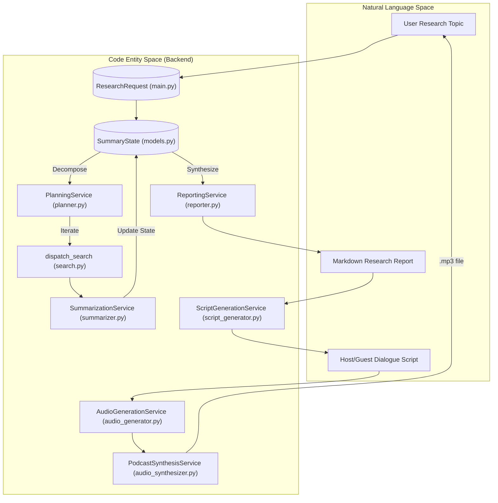
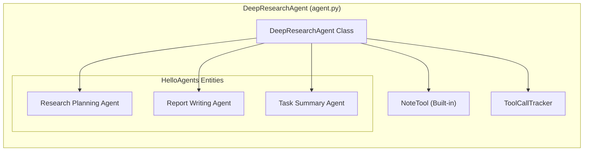

<!-- source: DeepWiki mcp.deepwiki.com · repo datawhalechina/hello-agents · page 10.3 DeepCastAgent: Research-to-Podcast Pipeline · fetched 2026-10-29 -->

# DeepCastAgent: Research-to-Podcast Pipeline

Relevant source files

The following files were used as context for generating this wiki page:

- [Co-creation-projects/JJason-DeepCastAgent/README.md](Co-creation-projects/JJason-DeepCastAgent/README.md)
- [Co-creation-projects/JJason-DeepCastAgent/backend/env.example](Co-creation-projects/JJason-DeepCastAgent/backend/env.example)
- [Co-creation-projects/JJason-DeepCastAgent/backend/pyproject.toml](Co-creation-projects/JJason-DeepCastAgent/backend/pyproject.toml)
- [Co-creation-projects/JJason-DeepCastAgent/backend/src/agent.py](Co-creation-projects/JJason-DeepCastAgent/backend/src/agent.py)
- [Co-creation-projects/JJason-DeepCastAgent/backend/src/config.py](Co-creation-projects/JJason-DeepCastAgent/backend/src/config.py)
- [Co-creation-projects/JJason-DeepCastAgent/backend/src/main.py](Co-creation-projects/JJason-DeepCastAgent/backend/src/main.py)
- [Co-creation-projects/JJason-DeepCastAgent/backend/src/models.py](Co-creation-projects/JJason-DeepCastAgent/backend/src/models.py)
- [Co-creation-projects/JJason-DeepCastAgent/backend/src/prompts.py](Co-creation-projects/JJason-DeepCastAgent/backend/src/prompts.py)
- [Co-creation-projects/JJason-DeepCastAgent/backend/src/services/audio_generator.py](Co-creation-projects/JJason-DeepCastAgent/backend/src/services/audio_generator.py)
- [Co-creation-projects/JJason-DeepCastAgent/backend/src/services/audio_synthesizer.py](Co-creation-projects/JJason-DeepCastAgent/backend/src/services/audio_synthesizer.py)
- [Co-creation-projects/JJason-DeepCastAgent/backend/src/services/notes.py](Co-creation-projects/JJason-DeepCastAgent/backend/src/services/notes.py)
- [Co-creation-projects/JJason-DeepCastAgent/backend/src/services/planner.py](Co-creation-projects/JJason-DeepCastAgent/backend/src/services/planner.py)
- [Co-creation-projects/JJason-DeepCastAgent/backend/src/services/reporter.py](Co-creation-projects/JJason-DeepCastAgent/backend/src/services/reporter.py)
- [Co-creation-projects/JJason-DeepCastAgent/backend/src/services/script_generator.py](Co-creation-projects/JJason-DeepCastAgent/backend/src/services/script_generator.py)
- [Co-creation-projects/JJason-DeepCastAgent/backend/src/services/search.py](Co-creation-projects/JJason-DeepCastAgent/backend/src/services/search.py)
- [Co-creation-projects/JJason-DeepCastAgent/backend/src/services/summarizer.py](Co-creation-projects/JJason-DeepCastAgent/backend/src/services/summarizer.py)
- [Co-creation-projects/JJason-DeepCastAgent/backend/src/services/text_processing.py](Co-creation-projects/JJason-DeepCastAgent/backend/src/services/text_processing.py)
- [Co-creation-projects/JJason-DeepCastAgent/backend/src/services/tool_events.py](Co-creation-projects/JJason-DeepCastAgent/backend/src/services/tool_events.py)
- [Co-creation-projects/JJason-DeepCastAgent/frontend/src/App.vue](Co-creation-projects/JJason-DeepCastAgent/frontend/src/App.vue)
- [Co-creation-projects/JJason-DeepCastAgent/frontend/src/components/PlayerView.vue](Co-creation-projects/JJason-DeepCastAgent/frontend/src/components/PlayerView.vue)
- [Co-creation-projects/JJason-DeepCastAgent/frontend/src/components/ProductionView.vue](Co-creation-projects/JJason-DeepCastAgent/frontend/src/components/ProductionView.vue)
- [Co-creation-projects/JJason-DeepCastAgent/frontend/src/components/SetupView.vue](Co-creation-projects/JJason-DeepCastAgent/frontend/src/components/SetupView.vue)
- [Co-creation-projects/JJason-DeepCastAgent/frontend/src/components/TerminalLog.vue](Co-creation-projects/JJason-DeepCastAgent/frontend/src/components/TerminalLog.vue)

DeepCastAgent is an automated podcast production system built on the HelloAgents framework. It transforms a user-provided research topic into a structured Markdown report and a two-person audio podcast featuring a curious host (Xiayu) and a knowledgeable guest (Liwa). The system employs a **Plan-and-Solve** multi-agent architecture to decompose complex queries, perform deep web research via hybrid search APIs, and synthesize the findings into both text and audio formats.

Sources: `[Co-creation-projects/JJason-DeepCastAgent/README.md:1-16]()`, `[Co-creation-projects/JJason-DeepCastAgent/backend/src/agent.py:35-36]()`

## System Architecture

The system is divided into a FastAPI backend and a Vue 3 frontend. The backend orchestrates a pipeline of specialized services and agents that handle discrete stages of the production process, from initial planning to final audio synthesis.

### High-Level Data Flow

The following diagram illustrates the transition from natural language input to code-managed entities across the pipeline.

**Pipeline Entity Mapping**

Sources: `[Co-creation-projects/JJason-DeepCastAgent/README.md:86-95]()`, `[Co-creation-projects/JJason-DeepCastAgent/backend/src/main.py:36-60]()`, `[Co-creation-projects/JJason-DeepCastAgent/backend/src/models.py:24-40]()`

## Core Orchestration: DeepResearchAgent

The `DeepResearchAgent` class in `agent.py` acts as the central orchestrator. It manages the lifecycle of the research task, including thread safety via a `Lock`, cancellation signals via an `Event`, and the coordination of multiple LLM instances (Smart, Fast, and Default).

### Agent Configuration and Initialization
The agent initializes several sub-agents and services using different LLM profiles:
- **Smart LLM (`ecnu-reasoner`)**: Used for `PlanningService` and `ReportingService` to handle complex logic.
- **Fast LLM (`ecnu-max`)**: Used for `SummarizationService` and `ScriptGenerationService` for rapid processing and structured JSON output.

**Agent Internal Components**

Sources: `[Co-creation-projects/JJason-DeepCastAgent/backend/src/agent.py:35-87]()`, `[Co-creation-projects/JJason-DeepCastAgent/backend/src/config.py:84-93]()`

## Implementation Details

### 1. Research Planning and Execution
The `PlanningService` utilizes the `todo_planner_system_prompt` to break the topic into 3-5 `TodoItem` objects. Each item contains a specific search `query` and an `intent`.
- **Parallel Execution**: In `run_stream`, the agent spawns worker threads to execute these tasks concurrently.
- **Tool Integration**: Each worker uses `dispatch_search` to gather data and the `NoteTool` to persist intermediate findings.

Sources: `[Co-creation-projects/JJason-DeepCastAgent/backend/src/agent.py:182-195]()`, `[Co-creation-projects/JJason-DeepCastAgent/backend/src/prompts.py:12-27]()`, `[Co-creation-projects/JJason-DeepCastAgent/backend/src/models.py:7-21]()`

### 2. Script Generation
The `ScriptGenerationService` transforms the Markdown report into a JSON array of dialogue turns.
- **Structured Output**: It enforces a `SCRIPT_JSON_SCHEMA` using OpenAI-compatible structured output calls to ensure the response contains a valid list of "Host" and "Guest" roles.
- **Parsing Logic**: `_parse_script_json` handles fallback scenarios, such as extracting JSON from Markdown blocks or fixing common character encoding issues in LLM responses.

Sources: `[Co-creation-projects/JJason-DeepCastAgent/backend/src/services/script_generator.py:18-37]()`, `[Co-creation-projects/JJason-DeepCastAgent/backend/src/services/script_generator.py:135-194]()`

### 3. Audio Production Pipeline
Audio generation is a two-stage process:
1.  **`AudioGenerationService`**: Iterates through the script and calls the `ecnu-tts` API for each line. It maps "Host" to the `xiayu` voice and "Guest" to the `liwa` voice.
2.  **`PodcastSynthesisService`**: Uses `pydub` (backed by `FFmpeg`) to concatenate the individual `.mp3` files with a 500ms silence gap between segments.

Sources: `[Co-creation-projects/JJason-DeepCastAgent/backend/src/services/audio_generator.py:44-117]()`, `[Co-creation-projects/JJason-DeepCastAgent/backend/src/services/audio_synthesizer.py:37-91]()`

## Communication and Streaming

The system uses Server-Sent Events (SSE) to provide real-time progress to the frontend.

| Event Type | Source | Description |
| :--- | :--- | :--- |
| `stage_change` | `agent.py` | Transitions between research, report, script, and audio stages. |
| `task_status` | `agent.py` | Updates on individual research `TodoItem` completion. |
| `tool_call` | `agent.py` | Real-time notification of agent tool usage (e.g., Search, Note). |
| `audio_progress` | `App.vue` | Tracks the TTS generation count (e.g., "3/12 segments completed"). |

Sources: `[Co-creation-projects/JJason-DeepCastAgent/backend/src/agent.py:213-250]()`, `[Co-creation-projects/JJason-DeepCastAgent/frontend/src/App.vue:146-236]()`

## Configuration and Environment

The `Configuration` class manages all external integrations. Key parameters include:
- `SEARCH_API`: Supports `tavily`, `serpapi`, or `hybrid` (recommended).
- `FFMPEG_PATH`: Required for audio concatenation.
- `SMART_LLM_MODEL` / `FAST_LLM_MODEL`: Defines the reasoning vs. speed balance for different pipeline stages.

Sources: `[Co-creation-projects/JJason-DeepCastAgent/backend/src/config.py:26-159]()`, `[Co-creation-projects/JJason-DeepCastAgent/backend/env.example:1-38]()`

---

