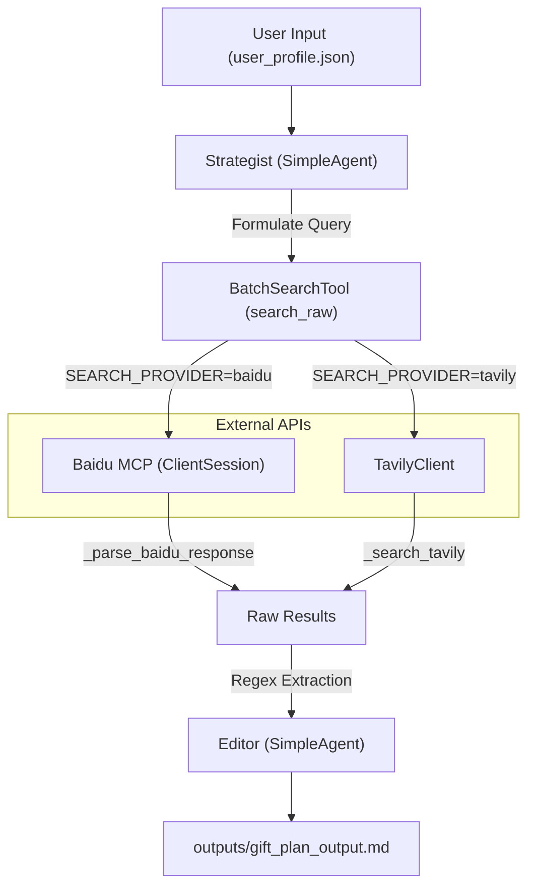
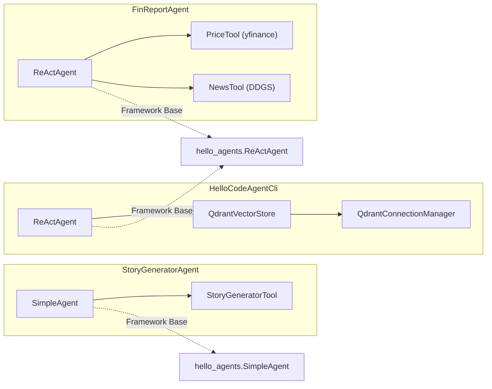

<!-- source: DeepWiki mcp.deepwiki.com · repo datawhalechina/hello-agents · page 10.4 Additional Featured Projects · fetched 2026-10-29 -->

# Additional Featured Projects

Relevant source files

The following files were used as context for generating this wiki page:

- [Co-creation-projects/1zrj-DataAnalysisAgent/README.md](Co-creation-projects/1zrj-DataAnalysisAgent/README.md)
- [Co-creation-projects/1zrj-DataAnalysisAgent/data/simple_data.xls](Co-creation-projects/1zrj-DataAnalysisAgent/data/simple_data.xls)
- [Co-creation-projects/1zrj-DataAnalysisAgent/main.ipynb](Co-creation-projects/1zrj-DataAnalysisAgent/main.ipynb)
- [Co-creation-projects/1zrj-DataAnalysisAgent/output/echarts.html](Co-creation-projects/1zrj-DataAnalysisAgent/output/echarts.html)
- [Co-creation-projects/1zrj-DataAnalysisAgent/output/report.md](Co-creation-projects/1zrj-DataAnalysisAgent/output/report.md)
- [Co-creation-projects/1zrj-DataAnalysisAgent/requirements.txt](Co-creation-projects/1zrj-DataAnalysisAgent/requirements.txt)
- [Co-creation-projects/Shawnxyxy-HealthRecordAgent/README.md](Co-creation-projects/Shawnxyxy-HealthRecordAgent/README.md)
- [Co-creation-projects/Shawnxyxy-HealthRecordAgent/backend/agents/__init__.py](Co-creation-projects/Shawnxyxy-HealthRecordAgent/backend/agents/__init__.py)
- [Co-creation-projects/Shawnxyxy-HealthRecordAgent/backend/agents/advice.py](Co-creation-projects/Shawnxyxy-HealthRecordAgent/backend/agents/advice.py)
- [Co-creation-projects/Shawnxyxy-HealthRecordAgent/backend/agents/base.py](Co-creation-projects/Shawnxyxy-HealthRecordAgent/backend/agents/base.py)
- [Co-creation-projects/Shawnxyxy-HealthRecordAgent/backend/agents/health_indicator.py](Co-creation-projects/Shawnxyxy-HealthRecordAgent/backend/agents/health_indicator.py)
- [Co-creation-projects/Shawnxyxy-HealthRecordAgent/backend/agents/planner.py](Co-creation-projects/Shawnxyxy-HealthRecordAgent/backend/agents/planner.py)
- [Co-creation-projects/Shawnxyxy-HealthRecordAgent/backend/agents/report.py](Co-creation-projects/Shawnxyxy-HealthRecordAgent/backend/agents/report.py)
- [Co-creation-projects/Shawnxyxy-HealthRecordAgent/backend/agents/risk_assess.py](Co-creation-projects/Shawnxyxy-HealthRecordAgent/backend/agents/risk_assess.py)
- [Co-creation-projects/Shawnxyxy-HealthRecordAgent/backend/api/main.py](Co-creation-projects/Shawnxyxy-HealthRecordAgent/backend/api/main.py)
- [Co-creation-projects/Shawnxyxy-HealthRecordAgent/backend/api/routes/health.py](Co-creation-projects/Shawnxyxy-HealthRecordAgent/backend/api/routes/health.py)
- [Co-creation-projects/Shawnxyxy-HealthRecordAgent/backend/core/__init__.py](Co-creation-projects/Shawnxyxy-HealthRecordAgent/backend/core/__init__.py)
- [Co-creation-projects/YYHDBL-HelloCodeAgentCli/memory/storage/qdrant_store.py](Co-creation-projects/YYHDBL-HelloCodeAgentCli/memory/storage/qdrant_store.py)
- [Co-creation-projects/alexrunner-DataAnalysisAgent/.env.example](Co-creation-projects/alexrunner-DataAnalysisAgent/.env.example)
- [Co-creation-projects/alexrunner-DataAnalysisAgent/.gitignore](Co-creation-projects/alexrunner-DataAnalysisAgent/.gitignore)
- [Co-creation-projects/alexrunner-DataAnalysisAgent/README.md](Co-creation-projects/alexrunner-DataAnalysisAgent/README.md)
- [Co-creation-projects/alexrunner-DataAnalysisAgent/agents/__init__.py](Co-creation-projects/alexrunner-DataAnalysisAgent/agents/__init__.py)
- [Co-creation-projects/alexrunner-DataAnalysisAgent/agents/agent_prompts.py](Co-creation-projects/alexrunner-DataAnalysisAgent/agents/agent_prompts.py)
- [Co-creation-projects/alexrunner-DataAnalysisAgent/agents/react_agent.py](Co-creation-projects/alexrunner-DataAnalysisAgent/agents/react_agent.py)
- [Co-creation-projects/alexrunner-DataAnalysisAgent/agents/test_analysis_agent.py](Co-creation-projects/alexrunner-DataAnalysisAgent/agents/test_analysis_agent.py)
- [Co-creation-projects/alexrunner-DataAnalysisAgent/agents/test_planning_agent.py](Co-creation-projects/alexrunner-DataAnalysisAgent/agents/test_planning_agent.py)
- [Co-creation-projects/alexrunner-DataAnalysisAgent/agents/test_report_agent.py](Co-creation-projects/alexrunner-DataAnalysisAgent/agents/test_report_agent.py)
- [Co-creation-projects/alexrunner-DataAnalysisAgent/data/shopping_behavior_updated.csv](Co-creation-projects/alexrunner-DataAnalysisAgent/data/shopping_behavior_updated.csv)
- [Co-creation-projects/alexrunner-DataAnalysisAgent/main.py](Co-creation-projects/alexrunner-DataAnalysisAgent/main.py)
- [Co-creation-projects/allen2000-FashionDailyDress/.env.example](Co-creation-projects/allen2000-FashionDailyDress/.env.example)
- [Co-creation-projects/allen2000-FashionDailyDress/README.md](Co-creation-projects/allen2000-FashionDailyDress/README.md)
- [Co-creation-projects/allen2000-FashionDailyDress/fashion_agent.py](Co-creation-projects/allen2000-FashionDailyDress/fashion_agent.py)
- [Co-creation-projects/allen2000-FashionDailyDress/gradio_app.py](Co-creation-projects/allen2000-FashionDailyDress/gradio_app.py)
- [Co-creation-projects/allen2000-FashionDailyDress/multi_agent_coordinator.py](Co-creation-projects/allen2000-FashionDailyDress/multi_agent_coordinator.py)
- [Co-creation-projects/allen2000-FashionDailyDress/requirements.txt](Co-creation-projects/allen2000-FashionDailyDress/requirements.txt)
- [Co-creation-projects/allen2000-FashionDailyDress/simple_multi_agent.py](Co-creation-projects/allen2000-FashionDailyDress/simple_multi_agent.py)
- [Co-creation-projects/allen2000-FashionDailyDress/weather.py](Co-creation-projects/allen2000-FashionDailyDress/weather.py)
- [Co-creation-projects/allen2000-FashionDailyDress/weather_mcp.py](Co-creation-projects/allen2000-FashionDailyDress/weather_mcp.py)
- [Co-creation-projects/bichchibui5-hub-EmailSmartAssistant/EmailSmartAssistant.ipynb](Co-creation-projects/bichchibui5-hub-EmailSmartAssistant/EmailSmartAssistant.ipynb)
- [Co-creation-projects/bichchibui5-hub-EmailSmartAssistant/EmailSmartAssistant_HelloAgents.ipynb](Co-creation-projects/bichchibui5-hub-EmailSmartAssistant/EmailSmartAssistant_HelloAgents.ipynb)
- [Co-creation-projects/bichchibui5-hub-EmailSmartAssistant/README.md](Co-creation-projects/bichchibui5-hub-EmailSmartAssistant/README.md)
- [Co-creation-projects/bichchibui5-hub-EmailSmartAssistant/config/email_config.json](Co-creation-projects/bichchibui5-hub-EmailSmartAssistant/config/email_config.json)
- [Co-creation-projects/bichchibui5-hub-EmailSmartAssistant/demo.py](Co-creation-projects/bichchibui5-hub-EmailSmartAssistant/demo.py)
- [Co-creation-projects/bichchibui5-hub-EmailSmartAssistant/email_assistant.py](Co-creation-projects/bichchibui5-hub-EmailSmartAssistant/email_assistant.py)
- [Co-creation-projects/bichchibui5-hub-EmailSmartAssistant/main.ipynb](Co-creation-projects/bichchibui5-hub-EmailSmartAssistant/main.ipynb)
- [Co-creation-projects/bichchibui5-hub-EmailSmartAssistant/output/drafts/.gitkeep](Co-creation-projects/bichchibui5-hub-EmailSmartAssistant/output/drafts/.gitkeep)
- [Co-creation-projects/bichchibui5-hub-EmailSmartAssistant/output/reports/.gitkeep](Co-creation-projects/bichchibui5-hub-EmailSmartAssistant/output/reports/.gitkeep)
- [Co-creation-projects/bichchibui5-hub-EmailSmartAssistant/requirements.txt](Co-creation-projects/bichchibui5-hub-EmailSmartAssistant/requirements.txt)
- [Co-creation-projects/bichchibui5-hub-EmailSmartAssistant/templates/reply_templates.json](Co-creation-projects/bichchibui5-hub-EmailSmartAssistant/templates/reply_templates.json)
- [Co-creation-projects/chen070808-ProgrammingTutor/.env.example](Co-creation-projects/chen070808-ProgrammingTutor/.env.example)
- [Co-creation-projects/chen070808-ProgrammingTutor/README.md](Co-creation-projects/chen070808-ProgrammingTutor/README.md)
- [Co-creation-projects/chen070808-ProgrammingTutor/main.ipynb](Co-creation-projects/chen070808-ProgrammingTutor/main.ipynb)
- [Co-creation-projects/chen070808-ProgrammingTutor/requirements.txt](Co-creation-projects/chen070808-ProgrammingTutor/requirements.txt)
- [Co-creation-projects/chen070808-ProgrammingTutor/src/agents/exercise.py](Co-creation-projects/chen070808-ProgrammingTutor/src/agents/exercise.py)
- [Co-creation-projects/chen070808-ProgrammingTutor/src/agents/planner.py](Co-creation-projects/chen070808-ProgrammingTutor/src/agents/planner.py)
- [Co-creation-projects/chen070808-ProgrammingTutor/src/agents/reviewer.py](Co-creation-projects/chen070808-ProgrammingTutor/src/agents/reviewer.py)
- [Co-creation-projects/chen070808-ProgrammingTutor/src/agents/tutor.py](Co-creation-projects/chen070808-ProgrammingTutor/src/agents/tutor.py)
- [Co-creation-projects/chen070808-ProgrammingTutor/src/tools/agent_tool.py](Co-creation-projects/chen070808-ProgrammingTutor/src/tools/agent_tool.py)
- [Co-creation-projects/chen070808-ProgrammingTutor/src/tools/code_runner.py](Co-creation-projects/chen070808-ProgrammingTutor/src/tools/code_runner.py)
- [Co-creation-projects/haoye2-UnivesalAgent/.env.example](Co-creation-projects/haoye2-UnivesalAgent/.env.example)
- [Co-creation-projects/haoye2-UnivesalAgent/.gitignore](Co-creation-projects/haoye2-UnivesalAgent/.gitignore)
- [Co-creation-projects/haoye2-UnivesalAgent/README.md](Co-creation-projects/haoye2-UnivesalAgent/README.md)
- [Co-creation-projects/haoye2-UnivesalAgent/data/sample_queries.txt](Co-creation-projects/haoye2-UnivesalAgent/data/sample_queries.txt)
- [Co-creation-projects/haoye2-UnivesalAgent/main.ipynb](Co-creation-projects/haoye2-UnivesalAgent/main.ipynb)
- [Co-creation-projects/haoye2-UnivesalAgent/main.py](Co-creation-projects/haoye2-UnivesalAgent/main.py)
- [Co-creation-projects/haoye2-UnivesalAgent/outputs/demo_results.md](Co-creation-projects/haoye2-UnivesalAgent/outputs/demo_results.md)
- [Co-creation-projects/haoye2-UnivesalAgent/outputs/docs/CONTRIBUTING.md](Co-creation-projects/haoye2-UnivesalAgent/outputs/docs/CONTRIBUTING.md)
- [Co-creation-projects/haoye2-UnivesalAgent/outputs/docs/IMPROVEMENTS_SUMMARY.md](Co-creation-projects/haoye2-UnivesalAgent/outputs/docs/IMPROVEMENTS_SUMMARY.md)
- [Co-creation-projects/haoye2-UnivesalAgent/outputs/tests/test_agent_improvements.py](Co-creation-projects/haoye2-UnivesalAgent/outputs/tests/test_agent_improvements.py)
- [Co-creation-projects/haoye2-UnivesalAgent/outputs/tests/test_tools.py](Co-creation-projects/haoye2-UnivesalAgent/outputs/tests/test_tools.py)
- [Co-creation-projects/healer-666-Academic-Data-Agent/.env.example](Co-creation-projects/healer-666-Academic-Data-Agent/.env.example)
- [Co-creation-projects/healer-666-Academic-Data-Agent/.gitignore](Co-creation-projects/healer-666-Academic-Data-Agent/.gitignore)
- [Co-creation-projects/healer-666-Academic-Data-Agent/README.md](Co-creation-projects/healer-666-Academic-Data-Agent/README.md)
- [Co-creation-projects/healer-666-Academic-Data-Agent/data/sample_paper.pdf](Co-creation-projects/healer-666-Academic-Data-Agent/data/sample_paper.pdf)
- [Co-creation-projects/healer-666-Academic-Data-Agent/data/sample_table.xlsx](Co-creation-projects/healer-666-Academic-Data-Agent/data/sample_table.xlsx)
- [Co-creation-projects/healer-666-Academic-Data-Agent/images/image1.png](Co-creation-projects/healer-666-Academic-Data-Agent/images/image1.png)
- [Co-creation-projects/healer-666-Academic-Data-Agent/images/image2.png](Co-creation-projects/healer-666-Academic-Data-Agent/images/image2.png)
- [Co-creation-projects/healer-666-Academic-Data-Agent/images/image3.png](Co-creation-projects/healer-666-Academic-Data-Agent/images/image3.png)
- [Co-creation-projects/healer-666-Academic-Data-Agent/main.ipynb](Co-creation-projects/healer-666-Academic-Data-Agent/main.ipynb)
- [Co-creation-projects/healer-666-Academic-Data-Agent/requirements.txt](Co-creation-projects/healer-666-Academic-Data-Agent/requirements.txt)
- [Co-creation-projects/healer-666-Academic-Data-Agent/src/data_analysis_agent/__init__.py](Co-creation-projects/healer-666-Academic-Data-Agent/src/data_analysis_agent/__init__.py)
- [Co-creation-projects/jack6249-GiftGeniusAgent/.env example](Co-creation-projects/jack6249-GiftGeniusAgent/.env example)
- [Co-creation-projects/jack6249-GiftGeniusAgent/README.md](Co-creation-projects/jack6249-GiftGeniusAgent/README.md)
- [Co-creation-projects/jack6249-GiftGeniusAgent/data/test_cases.json](Co-creation-projects/jack6249-GiftGeniusAgent/data/test_cases.json)
- [Co-creation-projects/jack6249-GiftGeniusAgent/example.png](Co-creation-projects/jack6249-GiftGeniusAgent/example.png)
- [Co-creation-projects/jack6249-GiftGeniusAgent/main.ipynb](Co-creation-projects/jack6249-GiftGeniusAgent/main.ipynb)
- [Co-creation-projects/jack6249-GiftGeniusAgent/outputs/gift_plan_output.md](Co-creation-projects/jack6249-GiftGeniusAgent/outputs/gift_plan_output.md)
- [Co-creation-projects/jack6249-GiftGeniusAgent/requirements.txt](Co-creation-projects/jack6249-GiftGeniusAgent/requirements.txt)
- [Co-creation-projects/kkkano-FinReportAgent/.env.example](Co-creation-projects/kkkano-FinReportAgent/.env.example)
- [Co-creation-projects/kkkano-FinReportAgent/README.md](Co-creation-projects/kkkano-FinReportAgent/README.md)
- [Co-creation-projects/kkkano-FinReportAgent/main.ipynb](Co-creation-projects/kkkano-FinReportAgent/main.ipynb)
- [Co-creation-projects/kkkano-FinReportAgent/requirements.txt](Co-creation-projects/kkkano-FinReportAgent/requirements.txt)
- [Co-creation-projects/laoyouf-aistory/.env.example](Co-creation-projects/laoyouf-aistory/.env.example)
- [Co-creation-projects/laoyouf-aistory/README.md](Co-creation-projects/laoyouf-aistory/README.md)
- [Co-creation-projects/laoyouf-aistory/main.ipynb](Co-creation-projects/laoyouf-aistory/main.ipynb)
- [Co-creation-projects/laoyouf-aistory/requirements.txt](Co-creation-projects/laoyouf-aistory/requirements.txt)
- [Co-creation-projects/lgs-only-NovelGenerator/.env.example](Co-creation-projects/lgs-only-NovelGenerator/.env.example)
- [Co-creation-projects/lgs-only-NovelGenerator/README.md](Co-creation-projects/lgs-only-NovelGenerator/README.md)
- [Co-creation-projects/lgs-only-NovelGenerator/agents/chapter_generate_agent.py](Co-creation-projects/lgs-only-NovelGenerator/agents/chapter_generate_agent.py)
- [Co-creation-projects/lgs-only-NovelGenerator/agents/outline_agent.py](Co-creation-projects/lgs-only-NovelGenerator/agents/outline_agent.py)
- [Co-creation-projects/lgs-only-NovelGenerator/agents/prompt.py](Co-creation-projects/lgs-only-NovelGenerator/agents/prompt.py)
- [Co-creation-projects/lgs-only-NovelGenerator/data/image.png](Co-creation-projects/lgs-only-NovelGenerator/data/image.png)
- [Co-creation-projects/lgs-only-NovelGenerator/frontend/index.html](Co-creation-projects/lgs-only-NovelGenerator/frontend/index.html)
- [Co-creation-projects/lgs-only-NovelGenerator/main.py](Co-creation-projects/lgs-only-NovelGenerator/main.py)
- [Co-creation-projects/megg-ops-roleplay_agent/.env.example](Co-creation-projects/megg-ops-roleplay_agent/.env.example)
- [Co-creation-projects/megg-ops-roleplay_agent/README.md](Co-creation-projects/megg-ops-roleplay_agent/README.md)
- [Co-creation-projects/megg-ops-roleplay_agent/requirements.txt](Co-creation-projects/megg-ops-roleplay_agent/requirements.txt)
- [Co-creation-projects/megg-ops-roleplay_agent/roleplay_agent.py](Co-creation-projects/megg-ops-roleplay_agent/roleplay_agent.py)
- [Co-creation-projects/tino-chen-HelloClaw/.env.example](Co-creation-projects/tino-chen-HelloClaw/.env.example)
- [Co-creation-projects/tino-chen-HelloClaw/.gitignore](Co-creation-projects/tino-chen-HelloClaw/.gitignore)
- [Co-creation-projects/tino-chen-HelloClaw/README.md](Co-creation-projects/tino-chen-HelloClaw/README.md)
- [Co-creation-projects/tino-chen-HelloClaw/frontend/.env.example](Co-creation-projects/tino-chen-HelloClaw/frontend/.env.example)
- [Co-creation-projects/tino-chen-HelloClaw/frontend/index.html](Co-creation-projects/tino-chen-HelloClaw/frontend/index.html)
- [Co-creation-projects/tino-chen-HelloClaw/frontend/package-lock.json](Co-creation-projects/tino-chen-HelloClaw/frontend/package-lock.json)
- [Co-creation-projects/tino-chen-HelloClaw/frontend/package.json](Co-creation-projects/tino-chen-HelloClaw/frontend/package.json)
- [Co-creation-projects/tino-chen-HelloClaw/frontend/public/favicon.ico](Co-creation-projects/tino-chen-HelloClaw/frontend/public/favicon.ico)
- [Co-creation-projects/tino-chen-HelloClaw/frontend/public/favicon.svg](Co-creation-projects/tino-chen-HelloClaw/frontend/public/favicon.svg)
- [Co-creation-projects/tino-chen-HelloClaw/frontend/src/App.vue](Co-creation-projects/tino-chen-HelloClaw/frontend/src/App.vue)
- [Co-creation-projects/tino-chen-HelloClaw/frontend/src/api/chat.ts](Co-creation-projects/tino-chen-HelloClaw/frontend/src/api/chat.ts)
- [Co-creation-projects/usernamedadad-AutoFlow/.gitignore](Co-creation-projects/usernamedadad-AutoFlow/.gitignore)
- [Co-creation-projects/usernamedadad-AutoFlow/README.md](Co-creation-projects/usernamedadad-AutoFlow/README.md)
- [Co-creation-projects/usernamedadad-AutoFlow/backend/.env.example](Co-creation-projects/usernamedadad-AutoFlow/backend/.env.example)
- [Co-creation-projects/usernamedadad-AutoFlow/backend/app/__init__.py](Co-creation-projects/usernamedadad-AutoFlow/backend/app/__init__.py)
- [Co-creation-projects/usernamedadad-AutoFlow/backend/app/agents/__init__.py](Co-creation-projects/usernamedadad-AutoFlow/backend/app/agents/__init__.py)
- [Co-creation-projects/usernamedadad-AutoFlow/backend/app/agents/mermaid/__init__.py](Co-creation-projects/usernamedadad-AutoFlow/backend/app/agents/mermaid/__init__.py)
- [Co-creation-projects/usernamedadad-AutoFlow/backend/app/agents/mermaid/agent_factory.py](Co-creation-projects/usernamedadad-AutoFlow/backend/app/agents/mermaid/agent_factory.py)
- [Co-creation-projects/usernamedadad-AutoFlow/backend/app/agents/mermaid/code_utils.py](Co-creation-projects/usernamedadad-AutoFlow/backend/app/agents/mermaid/code_utils.py)
- [Co-creation-projects/usernamedadad-AutoFlow/backend/app/agents/mermaid/pipeline.py](Co-creation-projects/usernamedadad-AutoFlow/backend/app/agents/mermaid/pipeline.py)
- [Co-creation-projects/usernamedadad-AutoFlow/backend/app/agents/mermaid_agent_service.py](Co-creation-projects/usernamedadad-AutoFlow/backend/app/agents/mermaid_agent_service.py)
- [Co-creation-projects/usernamedadad-AutoFlow/backend/app/config.py](Co-creation-projects/usernamedadad-AutoFlow/backend/app/config.py)

This section surveys notable community co-creation projects built using the HelloAgents framework. These projects demonstrate the versatility of the framework across diverse domains such as e-commerce, finance, data science, and creative writing, utilizing various agentic paradigms including ReAct and Simple multi-agent pipelines.

## 1. GiftGenius: Intelligent Gifting Assistant
**Author:** [@jack6249](https://github.com/jack6249)

GiftGenius is a multi-agent pipeline designed to solve the "what to give" problem by simulating human decision-making. It combines personality analysis (MBTI/Zodiac) with real-time web searching to generate personalized gift guides.

### Implementation Details
The project utilizes a `SimpleAgent` [Co-creation-projects/jack6249-GiftGeniusAgent/main.ipynb:36-36]() architecture configured as a pipeline:
1.  **Strategist (军师):** Analyzes user profiles (MBTI, budget, occasion) to formulate search strategies.
2.  **Hunter (猎人):** Executes searches using a unified `BatchSearchTool` [Co-creation-projects/jack6249-GiftGeniusAgent/main.ipynb:89-89]().
3.  **Editor (编辑):** Performs data cleaning and creates the final Markdown report.

### Key Components
*   **BatchSearchTool:** A custom `Tool` [Co-creation-projects/jack6249-GiftGeniusAgent/main.ipynb:89-94]() that dynamically switches between **Tavily Search API** (for general/global queries) and **Baidu Youxuan MCP** (for Chinese e-commerce data) [Co-creation-projects/jack6249-GiftGeniusAgent/main.ipynb:95-104]().
*   **Code-based Guardrails:** Instead of relying on the LLM to format JSON, the system uses Python regular expressions to extract prices and image URLs directly from search results to prevent hallucinations [Co-creation-projects/jack6249-GiftGeniusAgent/README.md:114-114]().
*   **Feedback Loop:** Implements a "Price Gatekeeper" mechanism. If items are over budget, it triggers a "downgrade search" strategy to find affordable alternatives [Co-creation-projects/jack6249-GiftGeniusAgent/README.md:116-116]().

### Data Flow Diagram: GiftGenius Pipeline
The following diagram bridges the natural language intent to the code entities performing the task.

**Sources:** [Co-creation-projects/jack6249-GiftGeniusAgent/README.md:9-31](), [Co-creation-projects/jack6249-GiftGeniusAgent/main.ipynb:89-183]()

---

## 2. FinReportAgent: Financial Research Intelligence
**Author:** [@kkkano](https://github.com/kkkano)

FinReportAgent is a specialized investment analysis tool that automates the collection of market data and news to generate structured financial reports.

### Technical Architecture
The project is built on the `ReActAgent` [Co-creation-projects/kkkano-FinReportAgent/main.ipynb:20-20]() paradigm, allowing the agent to perform multi-step reasoning before reaching a conclusion.

### Core Tools
The agent is equipped with three specialized tools via the `ToolRegistry` [Co-creation-projects/kkkano-FinReportAgent/main.ipynb:180-183]():
*   **PriceTool:** Uses `yfinance` to fetch real-time stock prices, market caps, and P/E ratios [Co-creation-projects/kkkano-FinReportAgent/main.ipynb:100-140]().
*   **NewsTool:** Utilizes `duckduckgo_search` to pull the latest 5 news items for a specific ticker [Co-creation-projects/kkkano-FinReportAgent/main.ipynb:74-98]().
*   **SearchTool:** Provides general web search capabilities for broader market context [Co-creation-projects/kkkano-FinReportAgent/main.ipynb:48-72]().

### Features
*   **Sentiment Analysis:** Automatically identifies Bullish/Bearish/Neutral sentiment based on gathered data [Co-creation-projects/kkkano-FinReportAgent/README.md:19-19]().
*   **Automated Formatting:** Generates reports in Markdown format including price change calculations [Co-creation-projects/kkkano-FinReportAgent/main.ipynb:119-137]().

**Sources:** [Co-creation-projects/kkkano-FinReportAgent/README.md:13-29](), [Co-creation-projects/kkkano-FinReportAgent/main.ipynb:48-146]()

---

## 3. DataAnalysisAgent: Intelligent Data Assistant
**Author:** [@1zrj](https://github.com/1zrj)

This project focuses on the automation of the data science lifecycle, from cleaning to visualization.

### Implementation
The agent uses `SimpleAgent` [Co-creation-projects/1zrj-DataAnalysisAgent/main.ipynb:32-32]() combined with a custom toolset for tabular data manipulation:
*   **DataCleaningTool:** Performs row/column filtering and null value handling using `pandas` [Co-creation-projects/1zrj-DataAnalysisAgent/main.ipynb:72-132]().
*   **DataStatisticsTool:** Provides descriptive statistics (mean, median, std, etc.) for numerical columns and frequency counts for categorical data [Co-creation-projects/1zrj-DataAnalysisAgent/main.ipynb:172-212]().

### System Flow
1.  **Input:** User provides a CSV/Excel file in the `data/` directory [Co-creation-projects/1zrj-DataAnalysisAgent/README.md:68-68]().
2.  **Processing:** The agent invokes `data_cleaner` followed by `data_statistics` [Co-creation-projects/1zrj-DataAnalysisAgent/main.ipynb:77-178]().
3.  **Output:** Generates a Markdown report (`report.md`) and an interactive ECharts HTML file (`echarts.html`) [Co-creation-projects/1zrj-DataAnalysisAgent/README.md:70-71]().

**Sources:** [Co-creation-projects/1zrj-DataAnalysisAgent/README.md:7-14](), [Co-creation-projects/1zrj-DataAnalysisAgent/main.ipynb:72-212]()

---

## 4. Other Notable Implementations

### StoryGeneratorAgent
Developed by [@laoyouf](https://github.com/laoyouf), this project uses a `StoryGeneratorTool` [Co-creation-projects/laoyouf-aistory/main.ipynb:91-91]() to produce creative content across three formats: **Novels**, **Scripts**, and **Poetry**. It dynamically modifies its internal prompts based on the `story_type` parameter to ensure the LLM adheres to specific formatting rules (e.g., scene descriptions for scripts or rhyming for poetry) [Co-creation-projects/laoyouf-aistory/main.ipynb:231-236]().

### HelloCodeAgentCli
A CLI-based coding assistant that integrates the **GSSC** (Gather-Select-Structure-Compress) context engineering pipeline. A key technical feature is its memory implementation using **Qdrant** via the `QdrantVectorStore` [Co-creation-projects/YYHDBL-HelloCodeAgentCli/memory/storage/qdrant_store.py:70-70](). It uses a `QdrantConnectionManager` [Co-creation-projects/YYHDBL-HelloCodeAgentCli/memory/storage/qdrant_store.py:29-29]() to handle singleton connections to local or cloud Qdrant instances, utilizing HNSW indexes for efficient vector retrieval [Co-creation-projects/YYHDBL-HelloCodeAgentCli/memory/storage/qdrant_store.py:183-195]().

### System Entity Mapping: Creative and Technical Agents
This diagram maps high-level project goals to the specific code classes and external dependencies used across these featured projects.

**Sources:** [Co-creation-projects/laoyouf-aistory/main.ipynb:135-140](), [Co-creation-projects/YYHDBL-HelloCodeAgentCli/memory/storage/qdrant_store.py:29-70](), [Co-creation-projects/kkkano-FinReportAgent/main.ipynb:177-183]()

---

## Summary of Use Cases

| Project | Core Paradigm | Key Technology | Primary Output |
| :--- | :--- | :--- | :--- |
| **GiftGenius** | Pipeline | Baidu Youxuan MCP / Tavily | Markdown Gift Guide |
| **FinReportAgent** | ReAct | yfinance / DuckDuckGo | Investment Analysis |
| **DataAnalysisAgent** | Simple | Pandas / ECharts | Statistical Report |
| **StoryGenerator** | Simple | Context-aware Prompts | Multi-format Creative Text |
| **HelloCodeAgentCli** | ReAct | Qdrant Vector DB | CLI Code Assistance |

**Sources:** [Co-creation-projects/jack6249-GiftGeniusAgent/README.md:33-43](), [Co-creation-projects/kkkano-FinReportAgent/README.md:21-29](), [Co-creation-projects/1zrj-DataAnalysisAgent/README.md:15-19](), [Co-creation-projects/laoyouf-aistory/main.ipynb:135-140]()

---

