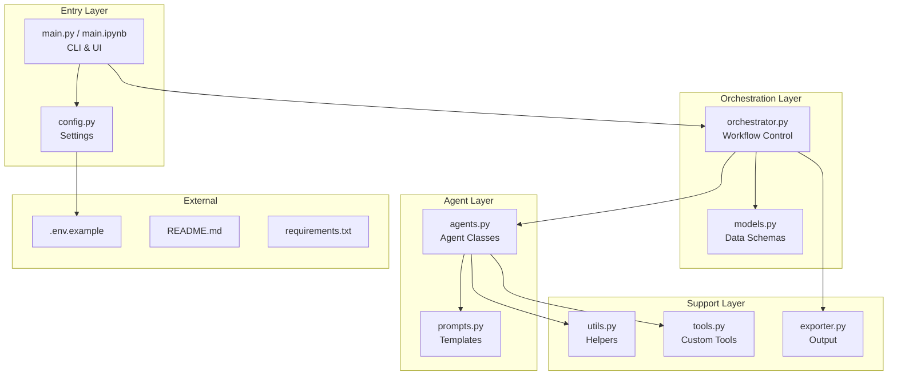
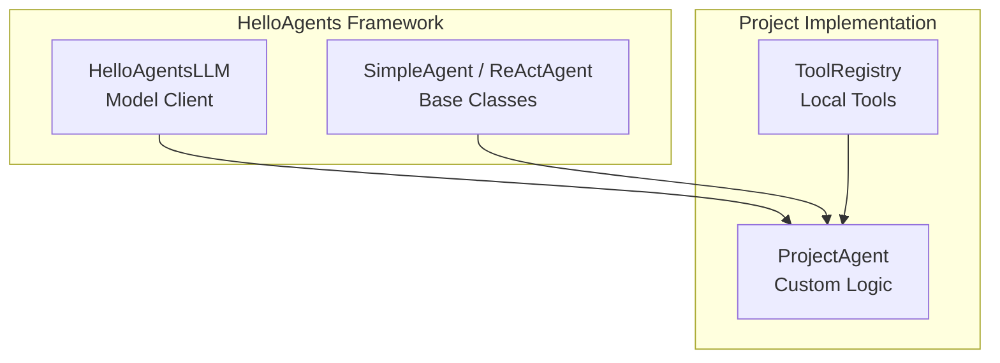
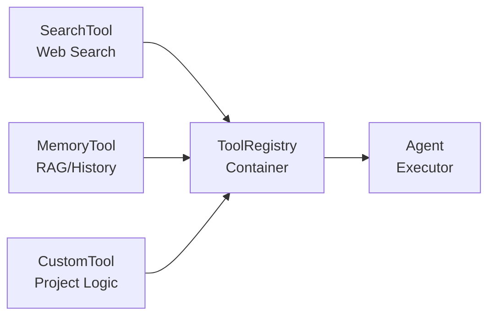

<!-- source: DeepWiki mcp.deepwiki.com · repo datawhalechina/hello-agents · page 10.5 Project Structure and Best Practices · fetched 2026-10-29 -->

# Project Structure and Best Practices

<details>
<summary>Relevant source files</summary>

The following files were used as context for generating this wiki page:

- [Co-creation-projects/EXAMPLE-ProjectTemplate/.env.example](Co-creation-projects/EXAMPLE-ProjectTemplate/.env.example)
- [Co-creation-projects/EXAMPLE-ProjectTemplate/README.md](Co-creation-projects/EXAMPLE-ProjectTemplate/README.md)
- [Co-creation-projects/EXAMPLE-ProjectTemplate/main.ipynb](Co-creation-projects/EXAMPLE-ProjectTemplate/main.ipynb)
- [Co-creation-projects/EXAMPLE-ProjectTemplate/requirements.txt](Co-creation-projects/EXAMPLE-ProjectTemplate/requirements.txt)
- [Co-creation-projects/jjyaoao-CodeReviewAgent/.env.example](Co-creation-projects/jjyaoao-CodeReviewAgent/.env.example)
- [Co-creation-projects/jjyaoao-CodeReviewAgent/README.md](Co-creation-projects/jjyaoao-CodeReviewAgent/README.md)
- [Co-creation-projects/jjyaoao-CodeReviewAgent/data/sample_code.py](Co-creation-projects/jjyaoao-CodeReviewAgent/data/sample_code.py)
- [Co-creation-projects/jjyaoao-CodeReviewAgent/main.ipynb](Co-creation-projects/jjyaoao-CodeReviewAgent/main.ipynb)
- [Co-creation-projects/jjyaoao-CodeReviewAgent/outputs/review_report.md](Co-creation-projects/jjyaoao-CodeReviewAgent/outputs/review_report.md)
- [Co-creation-projects/jjyaoao-CodeReviewAgent/requirements.txt](Co-creation-projects/jjyaoao-CodeReviewAgent/requirements.txt)
- [README.md](README.md)
- [README_EN.md](README_EN.md)
- [docs/Preface.md](docs/Preface.md)
- [docs/README.md](docs/README.md)
- [docs/README_EN.md](docs/README_EN.md)
- [docs/_sidebar.md](docs/_sidebar.md)
- [docs/_sidebar_en.md](docs/_sidebar_en.md)
- [docs/images/star-history-2026324.png](docs/images/star-history-2026324.png)

</details>


This document provides guidelines for structuring community co-creation projects built on the HelloAgents framework. It establishes standardized patterns for code organization, configuration management, documentation, and development workflows to ensure consistency, maintainability, and ease of contribution across the Hello-Agents ecosystem.

**Scope**: This guide covers project structure, module organization, and development practices for standalone agent applications. For information about integrating individual agents into the core framework, see [Extension Patterns](#7.6). For multi-agent system architectures, see [Multi-Agent System Architectures](#9).

---

## Recommended Project Structure

Community co-creation projects should follow a consistent directory layout that separates concerns and makes the codebase navigable. This structure is exemplified by featured projects like `ColumnWriter` and the standard `EXAMPLE-ProjectTemplate`.

### Standard Directory Layout

```text
project-name/
├── README.md                    # Project overview and usage guide
├── requirements.txt             # Python dependencies
├── .env.example                # Environment variable template
├── main.py                     # Application entry point (or main.ipynb)
├── config.py                   # Configuration management
├── models.py                   # Data models and schemas
├── agents.py                   # Agent implementations
├── orchestrator.py             # Multi-agent coordination logic
├── prompts.py                  # LLM prompt templates
├── tools.py                    # Custom tool implementations
├── utils.py                    # Utility functions
├── exporter.py                 # Output formatting and export
├── assets/                     # Static assets (images, diagrams)
├── data/                       # Input data samples
├── output_*/                   # Generated outputs (gitignored)
└── .cache/                     # Cached data (gitignored)
```

**Project Layout Diagram**



Sources: [Co-creation-projects/EXAMPLE-ProjectTemplate/README.md:1-106](), [Co-creation-projects/jjyaoao-CodeReviewAgent/main.ipynb:1-261]()

---

## Core Module Organization

### Configuration Management (`config.py`)

The configuration module centralizes all settings and environment variable management. In many community projects, `python-dotenv` is used to load variables from a `.env` file into the environment.

**Key Components**:

| Component | Purpose | Implementation Detail |
|-----------|---------|-----------------------|
| Environment loading | `.env` file integration | `dotenv.load_dotenv()` |
| LLM Config | API connectivity | `LLM_MODEL_ID`, `LLM_API_KEY`, `LLM_BASE_URL` |
| Feature flags | Logic toggles | `ENABLE_SEARCH`, `ENABLE_REVIEW` |
| Parameters | Domain-specific logic | `MAX_STEPS`, `TIMEOUT` |

**Implementation Pattern (from CodeReviewAgent)**:

```python
# Configuration setup in Jupyter or main.py
import os
from dotenv import load_dotenv

load_dotenv()

# Configure LLM parameters for HelloAgentsLLM
os.environ["LLM_MODEL_ID"] = "Qwen/Qwen2.5-72B-Instruct"
os.environ["LLM_API_KEY"] = "your_api_key_here"
os.environ["LLM_BASE_URL"] = "https://api-inference.modelscope.cn/v1/"
os.environ["LLM_TIMEOUT"] = "60"
```

Sources: [Co-creation-projects/jjyaoao-CodeReviewAgent/main.ipynb:49-53](), [Co-creation-projects/jjyaoao-CodeReviewAgent/requirements.txt:8-9]()

### Agent Implementation (`agents.py`)

The agents module contains all agent class implementations, typically inheriting from `hello_agents` base classes. Featured projects often utilize the `SimpleAgent` for basic tasks and `ReActAgent` for tool-using reasoning loops.

**Agent Organization Pattern**:



**Key Patterns**:

1. **LLM Client Integration**: Use `HelloAgentsLLM` which automatically reads from environment variables.
2. **Tool Registration**: Agents should be initialized with a `ToolRegistry` containing the specific tools they need.

```python
# Pattern from CodeReviewAgent
from hello_agents import SimpleAgent, HelloAgentsLLM, ToolRegistry

# Create agent with specific registry and prompt
agent = SimpleAgent(
    name="CodeReviewer",
    llm=HelloAgentsLLM(),
    system_prompt="You are a code review assistant...",
    tool_registry=registry
)
```

Sources: [Co-creation-projects/jjyaoao-CodeReviewAgent/main.ipynb:123-135](), [Co-creation-projects/EXAMPLE-ProjectTemplate/README.md:61-68]()

### Custom Tool Development (`tools.py`)

Custom tools must inherit from the `Tool` base class and implement the `run` and `get_parameters` methods. This ensures compatibility with the framework's internal tool-calling logic.

**Implementation Pattern**:

```python
# Pattern from CodeReviewAgent
from hello_agents.tools import Tool, ToolParameter
import ast

class CodeAnalysisTool(Tool):
    def __init__(self):
        super().__init__(
            name="code_analysis",
            description="Analyzes Python code structure"
        )
    
    def run(self, parameters: Dict[str, Any]) -> str:
        code = parameters.get("code", "")
        # ... implementation logic ...
        return f"Found {len(functions)} functions"
    
    def get_parameters(self) -> List[ToolParameter]:
        return [
            ToolParameter(
                name="code",
                type="string",
                description="Python code to analyze",
                required=True
            )
        ]
```

Sources: [Co-creation-projects/jjyaoao-CodeReviewAgent/main.ipynb:73-101]()

---

## Tool Integration Patterns

### Built-in Tool Usage

HelloAgents provides several built-in tools. Register them with `ToolRegistry` and pass to agents to extend their capabilities without writing new code.

**Tool Registration Flow**:



### Dependency Management

Use `requirements.txt` to manage project-specific dependencies. Every project should at least include the `hello-agents` framework.

**Standard requirements.txt**:
```text
# Core framework
hello-agents[all]>=0.2.7

# LLM and Environment
openai>=1.0.0
python-dotenv>=1.0.0

# Project specific (e.g., Data Science)
pandas>=2.0.0
numpy>=1.24.0
```

Sources: [Co-creation-projects/EXAMPLE-ProjectTemplate/requirements.txt:1-15](), [Co-creation-projects/jjyaoao-CodeReviewAgent/requirements.txt:1-12]()

---

## Documentation Requirements

### README Structure

Every co-creation project must include a comprehensive README with standardized sections to ensure users can understand and run the project.

**Required Sections**:

| Section | Purpose |
|---------|---------|
| Project Intro | One-sentence summary and detailed problem statement |
| Core Features | Bulleted list of what the agent can do |
| Tech Stack | List of frameworks and APIs used |
| Quick Start | Step-by-step installation and run guide |
| Usage Example | Code snippet or screenshot of the agent in action |
| Project Highlights | What makes this implementation unique |

Sources: [Co-creation-projects/EXAMPLE-ProjectTemplate/README.md:1-106]()

### Environment Configuration Template

Provide a `.env.example` file. This is critical for security, ensuring developers do not commit their actual API keys to the repository.

**Template Format**:
```bash
# LLM Configuration
LLM_MODEL_ID=your_model_id
LLM_API_KEY=your_key_here
LLM_BASE_URL=https://api.example.com/v1

# Optional Tools
TAVILY_API_KEY=tvly-...
```

Sources: [Co-creation-projects/EXAMPLE-ProjectTemplate/README.md:38-46]()

---

## Best Practices for Agent Development

### 1. Robust Output Parsing
Agents often return structured data (like JSON) within natural language. Use utility functions or specific prompts to ensure the LLM outputs valid formats.

### 2. Sandbox Execution
When building agents that execute code (like a `TerminalTool` or `CodeReviewAgent`), ensure the execution happens in a controlled environment to prevent system damage.

### 3. Iterative Prompting
Use a "Quick Demo" approach in notebooks to test system prompts before implementing the full multi-agent orchestrator.

### 4. Modular Prompts
Keep prompts separate from logic (in `prompts.py`) to allow for easy tuning without modifying the core Python code.

Sources: [Co-creation-projects/jjyaoao-CodeReviewAgent/main.ipynb:13-25](), [Co-creation-projects/jjyaoao-CodeReviewAgent/main.ipynb:133-134]()

---

