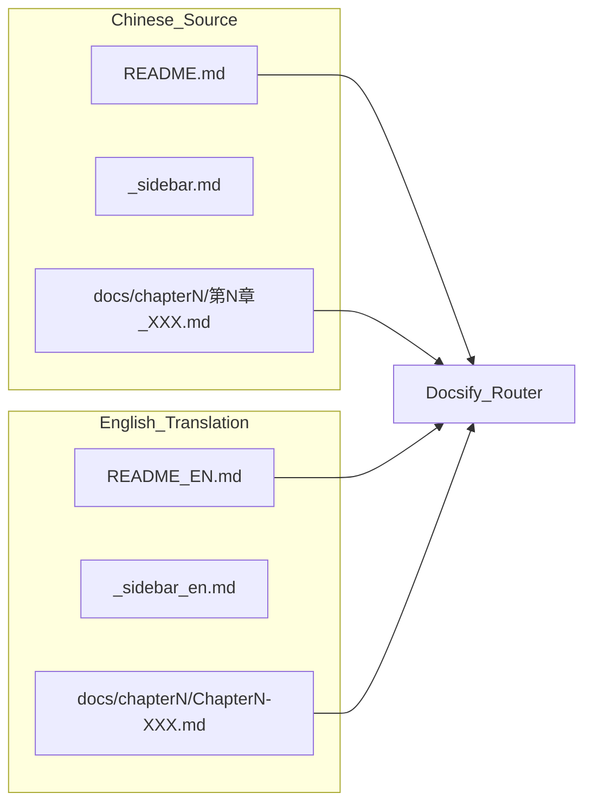
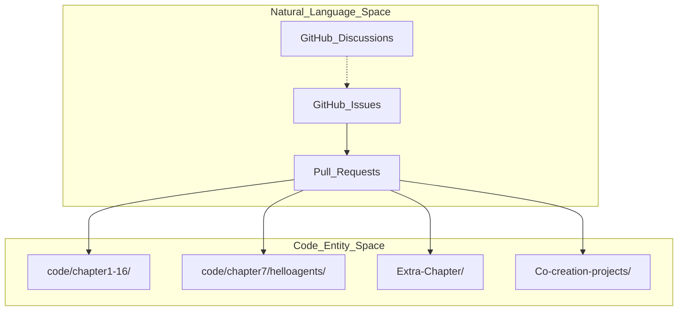

<!-- source: DeepWiki mcp.deepwiki.com · repo datawhalechina/hello-agents · page 11 Documentation and Community · fetched 2026-10-29 -->

# Documentation and Community

<details>
<summary>Relevant source files</summary>

The following files were used as context for generating this wiki page:

- [README.md](README.md)
- [README_EN.md](README_EN.md)
- [code/chapter13/helloagents-trip-planner/backend/requirements.txt](code/chapter13/helloagents-trip-planner/backend/requirements.txt)
- [docs/Preface.md](docs/Preface.md)
- [docs/README.md](docs/README.md)
- [docs/README_EN.md](docs/README_EN.md)
- [docs/_sidebar.md](docs/_sidebar.md)
- [docs/_sidebar_en.md](docs/_sidebar_en.md)
- [docs/chapter5/Chapter5-Building-Agents-with-Low-Code-Platforms.md](docs/chapter5/Chapter5-Building-Agents-with-Low-Code-Platforms.md)
- [docs/chapter6/Chapter6-Framework-Development-Practice.md](docs/chapter6/Chapter6-Framework-Development-Practice.md)
- [docs/images/13-figures/13-1.png](docs/images/13-figures/13-1.png)
- [docs/images/star-history-2026324.png](docs/images/star-history-2026324.png)
- [docs/index.html](docs/index.html)

</details>


This document describes the Hello-Agents documentation infrastructure, contribution workflows, and community engagement channels. The project uses a Docsify-based documentation website with bilingual support, integrated discussion system, and multiple pathways for community participation.

For information about the learning curriculum structure, see [Learning Path and Curriculum](#3). For details on specific technical frameworks, see [HelloAgents Framework](#7) and [Development Approaches](#6).

---

## Documentation Website Architecture

The Hello-Agents documentation is delivered through a static website powered by Docsify, a lightweight documentation generator that renders Markdown files on-the-fly in the browser. The architecture emphasizes accessibility, internationalization, and community interaction.

### Core Technology Stack

The documentation site is implemented as a single-page application with no build step required. The entry point is [docs/index.html:1-204](), which configures all features through JavaScript and CDN-loaded plugins.

| Component | Technology | Purpose |
|-----------|-----------|---------|
| Static Site Generator | Docsify 4.x | Renders Markdown to HTML client-side |
| Syntax Highlighting | Prism.js | Python, Bash code highlighting |
| Comment System | Giscus | GitHub Discussions-powered comments |
| Navigation | docsify-pagination | Previous/Next chapter links |
| Diagrams | Mermaid.js | Renders flowcharts and diagrams |

**Sources:** [docs/index.html:1-204](), [docs/index.html:205-232]()

### Bilingual Support System

The site implements a client-side language switching mechanism. Content is organized with language-specific file naming conventions and path mapping in the configuration [docs/index.html:214-222]().

#### Documentation File Structure



The language switching logic is triggered by a button in the UI [docs/index.html:201-203]() which executes the `switchLanguage()` function. Path aliases handle the mapping between English and Chinese content [docs/index.html:214-222]().

**Sources:** [docs/index.html:201-222](), [docs/_sidebar.md:1-29](), [docs/_sidebar_en.md:1-30]()

### Dark Mode and UI Customization

The site features a dark mode system implemented via CSS variables and a custom toggle plugin.

#### Theme Variables

CSS custom properties define the dark color scheme [docs/index.html:101-108]():

```css
:root {
    --dark-bg: #1a1a1a;
    --dark-text: #c4c4c4;
    --dark-sidebar: #141414;
    --dark-code-bg: #2b2b2b;
    --dark-border: #333;
    --theme-color: #42b983;
}
```

The system also includes a custom sidebar toggle button [docs/index.html:173-196]() and adapts Mermaid diagrams for readability in dark mode [docs/index.html:163-165]().

**Sources:** [docs/index.html:101-108](), [docs/index.html:163-196]()

### Giscus Comment System

Giscus provides a GitHub Discussions-backed comment system. It is integrated into the Docsify lifecycle, appearing at the bottom of content pages [docs/index.html:36-98](). The system supports a collapsible interface with a toggle icon [docs/index.html:71-79]().

**Sources:** [docs/index.html:36-98]()

---

## Contribution Guidelines

The Hello-Agents project is an open-source community initiative that welcomes contributions across multiple dimensions: code, documentation, supplementary chapters, and co-creation projects.

### Contribution Pathways

Community members can contribute through several channels:

1.  **Main Curriculum**: Improving the core 16 chapters or fixing bugs in the `code/` directory [README.md:51-74]().
2.  **Extra Chapters**: Contributing supplementary technical guides or interview prep to the `Extra-Chapter/` directory [README.md:78-92]().
3.  **Co-creation Projects**: Submitting complete multi-agent applications to the `Co-creation-projects/` directory [README.md:82]().

**Sources:** [README.md:51-92]()

### Technical Contribution Structure



**Sources:** [README.md:18](), [README.md:78-92]()

---

## Extra Chapters and Supplementary Content

The `Extra-Chapter/` directory serves as a repository for community-contributed content that extends beyond the primary curriculum.

### Featured Supplementary Content

Current community contributions include [README.md:78-92]():

| ID | Title | Content Overview |
|:---|:---|:---|
| 01 | Agent Interview Questions | Summary of job interview questions and reference answers |
| 02 | Context Engineering Supplement | Extended knowledge on context window management |
| 03 | Dify Tutorial | Step-by-step guide for creating agents in Dify |
| 05 | Agent Skills vs MCP | Comparison between Agent Skills and Model Context Protocol |
| 06 | GUI Agent Guide | Introduction and practical scenarios for GUI-based agents |
| 07 | Environment Setup | Detailed configuration guide for local development |
| 09 | Practical Pitfalls | Experience sharing and common traps in Code Agent development |

For details, see [Extra Chapters and Supplementary Content](#11.3).

**Sources:** [README.md:78-92]()

### Community Recognition

The project acknowledges all contributors through the README and provides links to their specific contributions [README.md:76-92](). This collaborative model has resulted in a diverse ecosystem of tools and guides that complement the core `HelloAgents` framework.

**Sources:** [README.md:76-92]()

---

