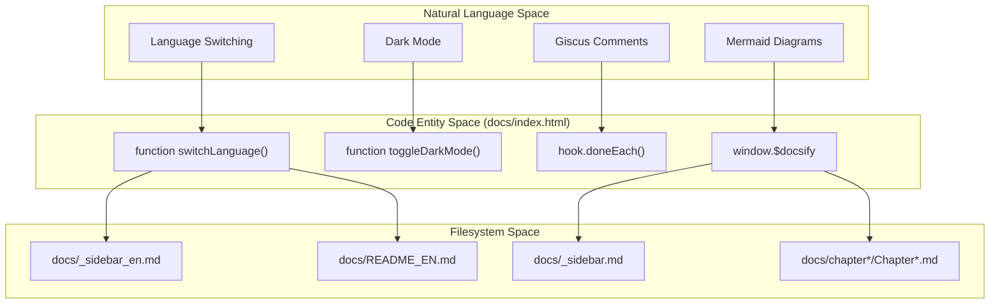
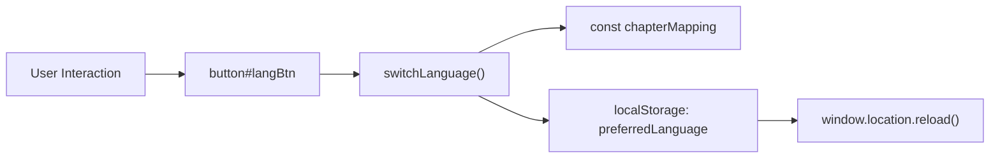

<!-- source: DeepWiki mcp.deepwiki.com · repo datawhalechina/hello-agents · page 11.1 Documentation Website Architecture · fetched 2026-10-29 -->

# Documentation Website Architecture

<details>
<summary>Relevant source files</summary>

The following files were used as context for generating this wiki page:

- [code/chapter13/helloagents-trip-planner/backend/requirements.txt](code/chapter13/helloagents-trip-planner/backend/requirements.txt)
- [docs/chapter5/Chapter5-Building-Agents-with-Low-Code-Platforms.md](docs/chapter5/Chapter5-Building-Agents-with-Low-Code-Platforms.md)
- [docs/chapter6/Chapter6-Framework-Development-Practice.md](docs/chapter6/Chapter6-Framework-Development-Practice.md)
- [docs/images/13-figures/13-1.png](docs/images/13-figures/13-1.png)
- [docs/index.html](docs/index.html)

</details>


## Purpose and Scope

This document describes the technical architecture of the Hello-Agents documentation website, which serves tutorial content at `datawhalechina.github.io/hello-agents`. The system is built on Docsify, a lightweight documentation framework that generates a single-page application from Markdown files without requiring a static build process. This page covers the website's core framework configuration, multi-language support mechanism, dark mode implementation, comment system integration, and dynamic content injection patterns.

---

## System Architecture Overview

The documentation website follows a client-side rendering architecture where all content processing happens in the browser. The system loads Markdown files dynamically based on URL routing and transforms them into HTML using Docsify plugins.

**System Logic and Code Entity Mapping**

The following diagram bridges the high-level website features to the specific code entities and files that implement them.

Title: Website Logic to Code Entity Mapping

Sources: [docs/index.html:15-108](), [docs/index.html:207-264]()

---

## Core Framework: Docsify Configuration

The website uses Docsify as its documentation engine, configured through the `window.$docsify` object. The framework handles Markdown parsing, syntax highlighting, and plugin orchestration.

### Docsify Initialization and Routing

The configuration object is defined at [docs/index.html:207-264]() and includes core settings for navigation and repo integration.

| Configuration Key | Purpose | Value |
|------------------|---------|-------|
| `name` | Site title displayed in header | `'Hello-Agents'` |
| `repo` | GitHub repository link | `'https://github.com/datawhalechina/Hello-Agents'` |
| `loadSidebar` | Enable custom sidebar navigation | `true` |
| `subMaxLevel` | Maximum heading depth in sidebar | `3` |
| `alias` | Route mappings for multi-language | Object mapping `/en/` paths |

Sources: [docs/index.html:207-222]()

### Route Alias System
The `alias` configuration maps virtual paths to physical Markdown files, enabling clean URLs for multi-language support:
[docs/index.html:214-222]()
```javascript
alias: {
    '/en/README.md': '/README_EN.md',
    '/en/_sidebar.md': '/_sidebar_en.md',
    '/en/chapter(\\d+)/Chapter(.*)': '/chapter$1/Chapter$2',
    '/_sidebar.md': '/_sidebar.md'
}
```

---

## Visual Presentation and Dark Mode

The site features a custom CSS implementation for a Dark Mode toggle and responsive styling.

### Dark Mode Implementation
Dark mode is implemented using a CSS class `dark-mode` applied to the `body` element. Specific styles are defined for the sidebar, code blocks, and Mermaid diagrams to ensure readability in dark environments.

**Dark Mode Style Entities**
- **Variables**: Root variables define colors like `--dark-bg: #1a1a1a` and `--dark-sidebar: #141414` [docs/index.html:101-108]().
- **Sidebar Adaption**: Sidebar background and active link colors are adjusted [docs/index.html:117-128]().
- **Code Blocks**: Backgrounds are set to `var(--dark-code-bg)` [docs/index.html:131-141]().
- **Mermaid Inversion**: Diagrams use a CSS filter `invert(1) hue-rotate(180deg)` to adapt to dark backgrounds [docs/index.html:163-165]().

Sources: [docs/index.html:100-171]()

---

## Multi-Language Support System

The documentation provides bilingual content through a language switching mechanism that involves file mapping and route rewriting.

### Language Architecture and Flow

Title: Multi-Language Routing and Persistence Flow


### Chapter Filename Mapping
The `chapterMapping` object defines bidirectional mappings between Chinese and English filenames to ensure that switching languages preserves the user's current chapter context.
[docs/index.html:285-328]()

### Language Switch Implementation
The `switchLanguage()` function implements the core logic:
1. Detects current language from the URL hash.
2. Extracts the current filename.
3. Performs a lookup in `chapterMapping`.
4. Updates `localStorage.preferredLanguage`.
5. Triggers a page reload with the new path.

Sources: [docs/index.html:330-387]()

---

## Comment System: Giscus Integration

The documentation integrates Giscus, a GitHub Discussions-powered comment system. The integration uses a collapsible UI pattern implemented via Docsify's `hook.doneEach` lifecycle method.

### Implementation Details
The comment system is injected dynamically after each page render. It targets only chapter pages to avoid cluttering the landing page.

**Giscus Configuration Attributes:**
[docs/index.html:221-235]()
- `data-repo`: `'datawhalechina/hello-agents'`
- `data-category`: `'💬 Exercises & Q&A'`
- `data-mapping`: `'pathname'`
- `data-theme`: `'preferred_color_scheme'`

### Collapsible UI Logic
The comment section is wrapped in a container with a toggle button. CSS transitions handle the expansion from `max-height: 0` to `max-height: 2000px`.
[docs/index.html:81-92]()

Sources: [docs/index.html:36-98](), [docs/index.html:163-261]()

---

## Content Organization and Plugins

The site leverages a variety of plugins to handle complex content types like math and code.

### Plugin Ecosystem
- **Prism.js**: Provides syntax highlighting for Python and Bash [docs/index.html:267-270]().
- **Docsify-Pagination**: Adds "Previous" and "Next" buttons at the bottom of pages, with text dynamically updated via `hook.beforeEach` [docs/index.html:146-160](), [docs/index.html:271]().
- **Docsify-KaTeX**: Renders LaTeX mathematical formulas [docs/index.html:274-278]().
- **Docsify-Count**: Displays word counts for chapters [docs/index.html:280]().

### Mermaid Diagram Support
Mermaid is initialized via a CDN script [docs/index.html:205](). Diagrams are rendered within Markdown sections and are specifically styled to invert colors when the site is in Dark Mode [docs/index.html:163-165]().

Sources: [docs/index.html:107](), [docs/index.html:205](), [docs/index.html:267-280]()

---

