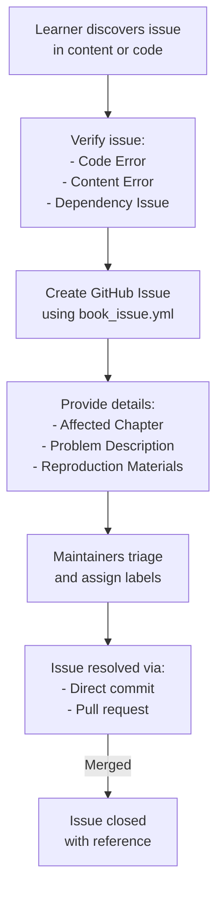
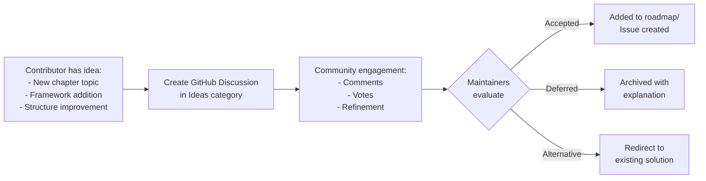
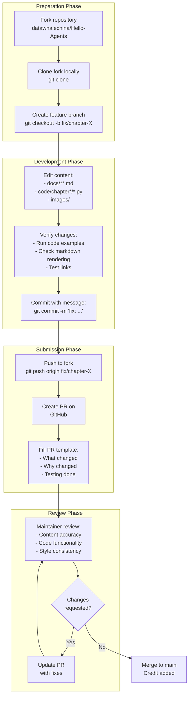
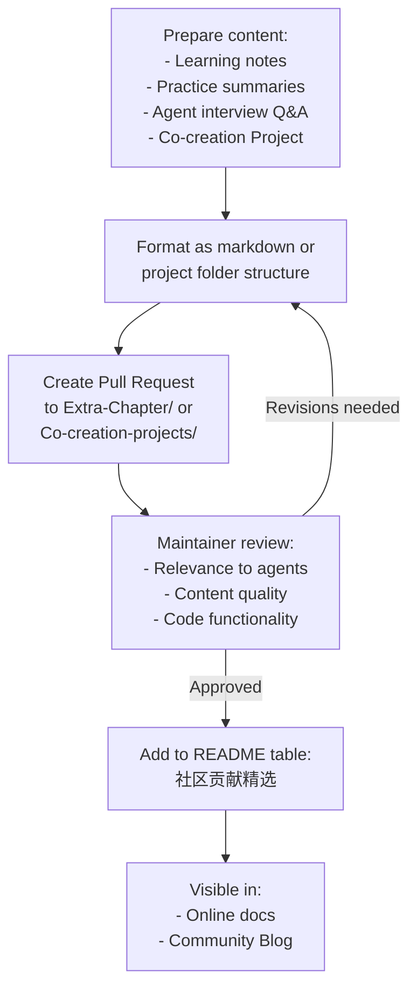

<!-- source: DeepWiki mcp.deepwiki.com · repo datawhalechina/hello-agents · page 11.2 Contribution Guidelines · fetched 2026-10-29 -->

# Contribution Guidelines

Relevant source files

The following files were used as context for generating this wiki page:

- [.github/ISSUE_TEMPLATE/book_issue.yml](.github/ISSUE_TEMPLATE/book_issue.yml)
- [.github/ISSUE_TEMPLATE/config.yml](.github/ISSUE_TEMPLATE/config.yml)
- [README.md](README.md)
- [README_EN.md](README_EN.md)
- [docs/Preface.md](docs/Preface.md)
- [docs/README.md](docs/README.md)
- [docs/README_EN.md](docs/README_EN.md)
- [docs/_sidebar.md](docs/_sidebar.md)
- [docs/_sidebar_en.md](docs/_sidebar_en.md)
- [docs/images/star-history-2026324.png](docs/images/star-history-2026324.png)

This document describes the contribution processes for the Hello-Agents repository. It covers bug reporting, feature suggestions, content improvement pull requests, and community practice sharing through the Extra-Chapter and Co-creation project systems.

## Overview

The Hello-Agents project implements a bidirectional community engagement model where learners consume educational content and contribute back through multiple channels. All contributions are managed through the GitHub repository at `datawhalechina/Hello-Agents` and follow open-source collaboration practices under the CC BY-NC-SA 4.0 license. [README.md:157-159]().

The project structure is divided into five main parts, ranging from fundamentals to a capstone project [README.md:51-74](). Contributors can assist by refining existing chapters or adding supplementary content to the `Extra-Chapter` or `Co-creation-projects` directories [README.md:78-106]().

**Sources:** [README.md:108-116](), [docs/README.md:104-112](), [README.md:157-159]()

## Contribution Types

The project accepts five primary contribution types, each serving distinct purposes in the ecosystem:

| Contribution Type | Symbol | Purpose | Submission Method |
|------------------|--------|---------|-------------------|
| Bug Reports | 🐛 | Report content or code errors | GitHub Issues (book_issue.yml) |
| Suggestions | 💡 | Propose project improvements | GitHub Discussions |
| Content PRs | 📝 | Submit tutorial corrections/enhancements | Pull Requests |
| Practice Sharing | ✍️ | Share learning notes and insights | Extra-Chapter submissions |
| Co-creation | 🚀 | Build complete multi-agent applications | Co-creation-projects |

**Sources:** [README.md:112-115](), [docs/README.md:108-111](), [.github/ISSUE_TEMPLATE/book_issue.yml:1-5]()

### Bug Report Workflow

The project uses a structured issue template `book_issue.yml` to ensure high-quality reports.

**Diagram: Bug Report Submission and Resolution Process**

Bug reports must specify the `Affected Chapter` (e.g., `Chapter3.2`) and provide `Reproduction Materials` such as code snippets or error logs [.github/ISSUE_TEMPLATE/book_issue.yml:12-71]().

**Sources:** [README.md:112](), [docs/README.md:108](), [.github/ISSUE_TEMPLATE/book_issue.yml:1-106]()

### Suggestion and Discussion Workflow

**Diagram: Suggestion Discussion and Evaluation Flow**

Suggestions leverage GitHub Discussions to gather community feedback before potential implementation. This prevents duplicate work and ensures alignment with project goals. [README.md:113]().

**Sources:** [README.md:113](), [docs/README.md:109]()

## Pull Request Process

### Content Improvement PRs

Content improvements follow a structured review process that maintains documentation quality while encouraging contributions:

**Diagram: Pull Request Workflow for Content Contributions**

Contributors modifying content in `docs/` directory or code in `code/` directory must ensure their changes align with the tutorial's pedagogical structure across five parts and sixteen chapters as documented in the navigation guide [README.md:51-74]().

**Sources:** [README.md:114](), [docs/README.md:110](), [docs/_sidebar.md:1-28]()

## Extra-Chapter and Co-creation Submissions

Beyond core curriculum updates, the project emphasizes community co-creation through two specific channels:

### Extra-Chapter System
Designed for supplementary content like interview questions, environment guides, and specific technology deep-dives [README.md:83-93]().

- **Directory:** `Extra-Chapter/`
- **Naming:** `Extra##-Topic.md`
- **Examples:** `Extra01-面试问题总结.md`, `Extra07-环境配置.md` [README.md:83-90]().

### Co-creation Projects
Designed for complete multi-agent applications built by the community [README.md:82]().

- **Directory:** `Co-creation-projects/`
- **Current Examples:** `ColumnWriter`, `MindEchoAgent`, `DeepCastAgent` [README.md:95-106]().

**Diagram: Supplementary Content Integration Pipeline**

**Sources:** [README.md:78-106](), [docs/README.md:74-88]()

## Contributor Recognition

The project maintains multiple levels of contributor recognition:

### Core Contributors
Core leads and contributors are explicitly recognized in the `README.md` for their specific roles in content creation and project management [README.md:117-136]().

### Community Contributors
Individuals who contribute via `Extra-Chapter` or `Co-creation-projects` are listed in the `社区贡献精选` tables [README.md:80-106]().

### Automated Attribution
The repository uses the `contrib.rocks` service to generate an automated contributor gallery in the acknowledgments section [README.md:134]().

**Sources:** [README.md:117-136](), [docs/README.md:113-132]()

## Content Standards

### Documentation Standards
- **Language:** Primary content is in Chinese, with English versions in `README_EN.md` and `docs/README_EN.md`.
- **Encoding:** UTF-8.
- **Assets:** Images must be stored in `docs/images/` [README.md:6]().

### Code Standards
Code should follow the patterns established in the `HelloAgents` framework, emphasizing modularity and clear interaction loops.
- **Base Classes:** Use `SimpleAgent`, `ReActAgent`, or `ReflectionAgent` where appropriate.
- **Tooling:** Use the `ToolRegistry` pattern for tool management.

**Sources:** [README.md:43](), [README_EN.md:43](), [docs/README.md:39]()

## Submission Checklist

### For Bug Reports
- [ ] Used `book_issue.yml` template [.github/ISSUE_TEMPLATE/book_issue.yml:1]()
- [ ] Specified chapter number (e.g., Chapter 7.2) [.github/ISSUE_TEMPLATE/book_issue.yml:15]()
- [ ] Provided error logs and environment info [.github/ISSUE_TEMPLATE/book_issue.yml:70-76]()

### For Pull Requests
- [ ] Branch created from latest `main`
- [ ] Changes tested locally
- [ ] Code examples verified with `helloagents` framework requirements
- [ ] PR description explains the value of the contribution

### For Extra/Co-creation Submissions
- [ ] Followed naming convention for `Extra-Chapter`
- [ ] Included necessary assets in `docs/images/`
- [ ] For co-creation, included a `README.md` within the project sub-folder

**Sources:** [.github/ISSUE_TEMPLATE/book_issue.yml:1-106](), [README.md:78-106]()

---

