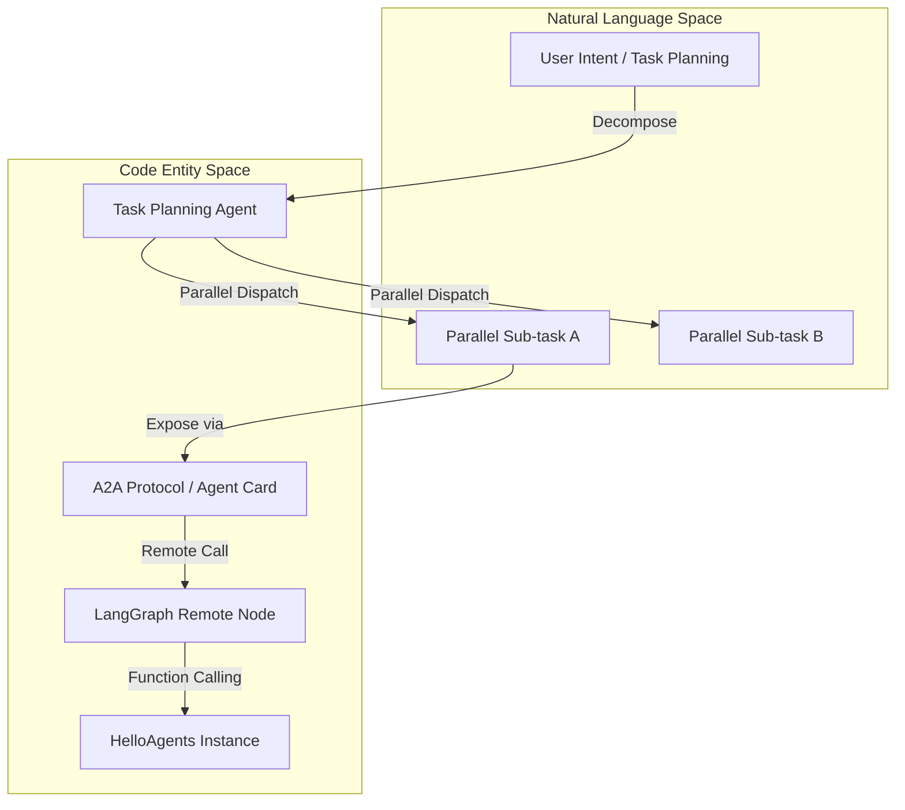
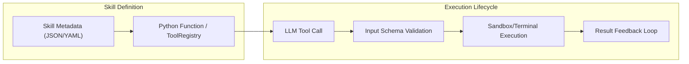

<!-- source: DeepWiki mcp.deepwiki.com · repo datawhalechina/hello-agents · page 11.3 Extra Chapters and Supplementary Content · fetched 2026-10-29 -->

# Extra Chapters and Supplementary Content

Relevant source files

The following files were used as context for generating this wiki page:

- [Extra-Chapter/Extra04-DatawhaleFAQ.md](Extra-Chapter/Extra04-DatawhaleFAQ.md)
- [Extra-Chapter/images/Extra02-figures/image-1.png](Extra-Chapter/images/Extra02-figures/image-1.png)
- [Extra-Chapter/images/Extra02-figures/image-10.png](Extra-Chapter/images/Extra02-figures/image-10.png)
- [Extra-Chapter/images/Extra02-figures/image-11.png](Extra-Chapter/images/Extra02-figures/image-11.png)
- [Extra-Chapter/images/Extra02-figures/image-12.png](Extra-Chapter/images/Extra02-figures/image-12.png)
- [Extra-Chapter/images/Extra02-figures/image-2.png](Extra-Chapter/images/Extra02-figures/image-2.png)
- [Extra-Chapter/images/Extra02-figures/image-3.png](Extra-Chapter/images/Extra02-figures/image-3.png)
- [Extra-Chapter/images/Extra02-figures/image-4.png](Extra-Chapter/images/Extra02-figures/image-4.png)
- [Extra-Chapter/images/Extra02-figures/image-5.png](Extra-Chapter/images/Extra02-figures/image-5.png)
- [Extra-Chapter/images/Extra02-figures/image-6.png](Extra-Chapter/images/Extra02-figures/image-6.png)
- [Extra-Chapter/images/Extra02-figures/image-7.png](Extra-Chapter/images/Extra02-figures/image-7.png)
- [Extra-Chapter/images/Extra03-figures/image1.jpg](Extra-Chapter/images/Extra03-figures/image1.jpg)
- [Extra-Chapter/images/Extra03-figures/image10.jpg](Extra-Chapter/images/Extra03-figures/image10.jpg)
- [Extra-Chapter/images/Extra03-figures/image11.jpg](Extra-Chapter/images/Extra03-figures/image11.jpg)
- [Extra-Chapter/images/Extra03-figures/image12.jpg](Extra-Chapter/images/Extra03-figures/image12.jpg)
- [Extra-Chapter/images/Extra03-figures/image13.png](Extra-Chapter/images/Extra03-figures/image13.png)
- [Extra-Chapter/images/Extra03-figures/image14.png](Extra-Chapter/images/Extra03-figures/image14.png)
- [Extra-Chapter/images/Extra04-figures/3f1b68eedc9d9e556fbb51358bf49f9d.png](Extra-Chapter/images/Extra04-figures/3f1b68eedc9d9e556fbb51358bf49f9d.png)
- [Extra-Chapter/images/Extra04-figures/e7dd177f-4867-4af0-bd0e-03771a3a040e.png](Extra-Chapter/images/Extra04-figures/e7dd177f-4867-4af0-bd0e-03771a3a040e.png)
- [Extra-Chapter/images/Extra05-figures/image1.png](Extra-Chapter/images/Extra05-figures/image1.png)
- [Extra-Chapter/images/Extra05-figures/image2.png](Extra-Chapter/images/Extra05-figures/image2.png)
- [Extra-Chapter/images/Extra05-figures/image3.png](Extra-Chapter/images/Extra05-figures/image3.png)
- [Extra-Chapter/images/Extra05-figures/image4.png](Extra-Chapter/images/Extra05-figures/image4.png)
- [Extra-Chapter/images/Extra05-figures/image5.png](Extra-Chapter/images/Extra05-figures/image5.png)
- [Extra-Chapter/images/Extra05-figures/image6.png](Extra-Chapter/images/Extra05-figures/image6.png)
- [Extra-Chapter/images/Extra06-figures/image1.png](Extra-Chapter/images/Extra06-figures/image1.png)
- [Extra-Chapter/images/Extra06-figures/image2.png](Extra-Chapter/images/Extra06-figures/image2.png)
- [Extra-Chapter/images/Extra06-figures/image3.png](Extra-Chapter/images/Extra06-figures/image3.png)
- [Extra-Chapter/images/Extra06-figures/image4.png](Extra-Chapter/images/Extra06-figures/image4.png)
- [Extra-Chapter/images/Extra08-figures/creation-flow.png](Extra-Chapter/images/Extra08-figures/creation-flow.png)
- [Extra-Chapter/images/Extra08-figures/file-interaction.png](Extra-Chapter/images/Extra08-figures/file-interaction.png)
- [Extra-Chapter/images/Extra08-figures/freedom-spectrum.png](Extra-Chapter/images/Extra08-figures/freedom-spectrum.png)
- [Extra-Chapter/images/Extra08-figures/skill-structure.png](Extra-Chapter/images/Extra08-figures/skill-structure.png)
- [Extra-Chapter/images/Extra08-figures/toc.png](Extra-Chapter/images/Extra08-figures/toc.png)

This page serves as a technical index and deep-dive into the community-contributed supplementary materials found in the `Extra-Chapter/` directory. These chapters extend the core curriculum with practical guides, platform-specific tutorials, and career-oriented resources.

---

## Technical Content Map

The supplementary content bridges the gap between the core framework concepts and real-world deployment, platform usage, and career readiness.

| Chapter ID | Technical Focus | Primary File | Key Concepts |
| :--- | :--- | :--- | :--- |
| **Extra01** | Career & Theory | [Extra-Chapter/Extra01-面试问题总结.md]() | Agent architectures, LLM limitations, evaluation metrics |
| **Extra02** | Context Engineering | [Extra-Chapter/Extra02-上下文工程补充知识.md]() | GSSC Pipeline, Token management, long-context optimization |
| **Extra03** | Low-Code Platforms | [Extra-Chapter/Extra03-Dify智能体创建保姆级操作流程.md]() | Dify workflows, Knowledge Base integration, API publishing |
| **Extra04** | Community FAQ | [Extra-Chapter/Extra04-DatawhaleFAQ.md]() | Multi-agent parallel scheduling, A2A/ANP protocols, API config |
| **Extra05** | Agent Protocols | [Extra-Chapter/Extra05-AgentSkills解读.md]() | Agent Skills vs. MCP, Tool abstraction, interoperability |
| **Extra06** | GUI Automation | [Extra-Chapter/Extra06-GUIAgent科普与实战.md]() | Computer Use, visual grounding, action space mapping |
| **Extra07** | Infrastructure | [Extra-Chapter/Extra07-环境配置.md]() | Conda environments, API Key management, dependency resolution |
| **Extra08** | Advanced Skills | [Extra-Chapter/Extra08-智能体技能插件实战指南.md]() | Plugin architecture, Skill-structure, tool-calling lifecycle |

**Sources:** [Extra-Chapter/Extra04-DatawhaleFAQ.md:1-225](), [Extra-Chapter/Extra08-智能体技能插件实战指南.md:1-40]()

---

## Core Technical Deep-Dives

### Multi-Agent Parallel Scheduling & A2A
A significant portion of the supplementary content addresses how the `HelloAgents` framework interacts with other ecosystems.

**Parallel Execution and Interoperability Architecture**

*   **Multi-threading:** Implementation involves a "Task Planning Agent" that performs dependency analysis to form a DAG of sub-tasks. Execution is handled via specialized agents monitoring queues or API polling [Extra-Chapter/Extra04-DatawhaleFAQ.md:11-19]().
*   **A2A Interoperability:** The **A2A Protocol** and **Agent Card** allow a `HelloAgents` instance to be exposed as a "remote function" callable by other frameworks like `LangGraph` [Extra-Chapter/Extra04-DatawhaleFAQ.md:44-53]().

**Sources:** [Extra-Chapter/Extra04-DatawhaleFAQ.md:11-53]()

### Context Engineering & GSSC Pipeline
Supplementary content for Chapter 9 details the **GSSC (Gather-Select-Structure-Compress)** pipeline for managing long-context window constraints.

| Phase | Code/Logic Entity | Description |
| :--- | :--- | :--- |
| **Gather** | `ContextBuilder` | Collecting raw data from Memory, RAG, and Tools. |
| **Select** | `Reranker` / `Filter` | Identifying high-relevance tokens using semantic similarity. |
| **Structure** | `TemplateEngine` | Formatting selected data into structured JSON or Markdown. |
| **Compress** | `Summarizer` | Iterative summarization to fit within `max_tokens` limits. |

**Sources:** [Extra-Chapter/Extra04-DatawhaleFAQ.md:184-191]()

---

### Agent Skills & Plugin Architecture
Extra Chapter 08 defines the "Skill" as the unit of capability for an agent.

**Agent Skill Execution Lifecycle**

*   **Skill Structure:** Skills are managed via the `ToolRegistry` pattern, where each skill is a combination of metadata (for LLM reasoning) and executable code (for action) [Extra-Chapter/images/Extra08-figures/skill-structure.png]().
*   **Creation Flow:** The process involves defining the tool logic, registering it within the framework's `Agent` instance, and verifying the `Thought-Action-Observation` loop [Extra-Chapter/images/Extra08-figures/creation-flow.png]().

**Sources:** [Extra-Chapter/images/Extra08-figures/skill-structure.png](), [Extra-Chapter/images/Extra08-figures/creation-flow.png]()

---

## Practical Implementation Guides

### Environment and API Setup
Chapter 07 provides the baseline for running all experiments in the repository.

1.  **API Configuration:** Supports `SiliconFlow`, `DeepSeek`, and `OpenAI`. Configuration is managed via an `.env` file containing `API_KEY`, `MODEL_ID`, and `BASE_URL` [Extra-Chapter/Extra04-DatawhaleFAQ.md:210-218]().
2.  **ModelScope Integration:** Instructions for obtaining API tokens from the ModelScope community for Qwen-series models [Extra-Chapter/Extra04-DatawhaleFAQ.md:219-222]().

### GUI Agent & Computer Use
Extra Chapter 06 introduces agents capable of operating software via visual interfaces.
*   **Mechanism:** The agent receives a screenshot, uses a Vision-Language Model (VLM) to ground UI elements to coordinates, and executes mouse/keyboard events.
*   **Data Flow:** `Screenshot` -> `VLM Grounding` -> `Coordinate Mapping` -> `PyAutoGUI/System Call` [Extra-Chapter/images/Extra06-figures/image4.png]().

**Sources:** [Extra-Chapter/Extra04-DatawhaleFAQ.md:210-222](), [Extra-Chapter/images/Extra06-figures/image4.png]()

---

## Community FAQ and Pitfalls

The `Extra04-DatawhaleFAQ.md` file tracks common technical hurdles encountered by the community.

*   **Token Management:** Strategies for balancing long system prompts with response latency, emphasizing "Summary + Memory Module + Retrieval Context" [Extra-Chapter/Extra04-DatawhaleFAQ.md:184-191]().
*   **RAG Necessity:** Clarifies that RAG is a tool, not a requirement, for agent construction [Extra-Chapter/Extra04-DatawhaleFAQ.md:159-165]().
*   **Hardware Requirements:** Standard chapters require only API access; `Agentic RL` chapters suggest a GPU with $\ge$ 4G VRAM for local fine-tuning [Extra-Chapter/Extra04-DatawhaleFAQ.md:140-145]().

**Sources:** [Extra-Chapter/Extra04-DatawhaleFAQ.md:140-191]()

---

