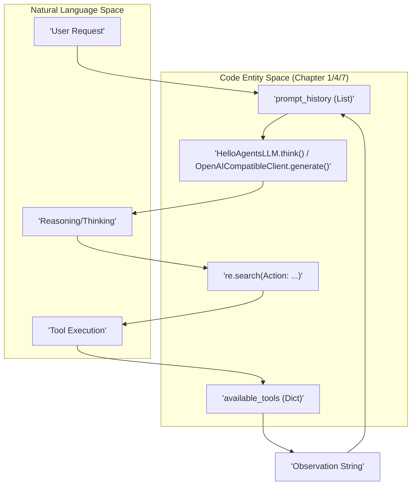
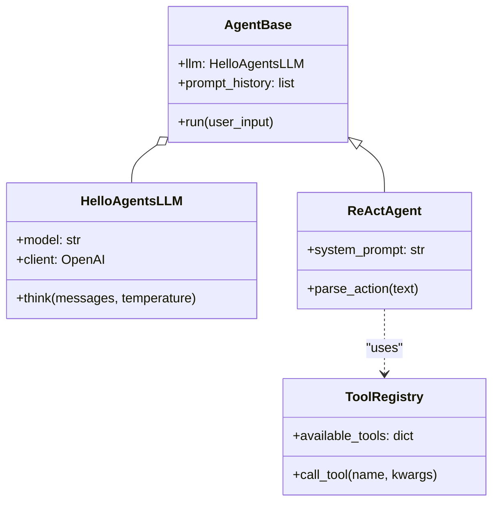

<!-- source: DeepWiki mcp.deepwiki.com · repo datawhalechina/hello-agents · page 12 Glossary · fetched 2026-10-29 -->

# Glossary

Relevant source files

The following files were used as context for generating this wiki page:

- [Co-creation-projects/README.md](Co-creation-projects/README.md)
- [README.md](README.md)
- [README_EN.md](README_EN.md)
- [code/chapter1/FirstAgentTest.ipynb](code/chapter1/FirstAgentTest.ipynb)
- [code/chapter1/FirstAgentTest.py](code/chapter1/FirstAgentTest.py)
- [code/chapter4/ReAct.py](code/chapter4/ReAct.py)
- [code/chapter7/my_main.py](code/chapter7/my_main.py)
- [code/chapter7/my_react_agent.py](code/chapter7/my_react_agent.py)
- [code/chapter7/test_react_agent.py](code/chapter7/test_react_agent.py)
- [docs/Preface.md](docs/Preface.md)
- [docs/README.md](docs/README.md)
- [docs/README_EN.md](docs/README_EN.md)
- [docs/_sidebar.md](docs/_sidebar.md)
- [docs/_sidebar_en.md](docs/_sidebar_en.md)
- [docs/chapter1/Chapter1-Introduction-to-Agents.md](docs/chapter1/Chapter1-Introduction-to-Agents.md)
- [docs/chapter10/Chapter10-Agent-Communication-Protocols.md](docs/chapter10/Chapter10-Agent-Communication-Protocols.md)
- [docs/chapter11/Chapter11-Agentic-RL.md](docs/chapter11/Chapter11-Agentic-RL.md)
- [docs/chapter12/Chapter12-Agent-Performance-Evaluation.md](docs/chapter12/Chapter12-Agent-Performance-Evaluation.md)
- [docs/chapter13/Chapter13-Intelligent-Travel-Assistant.md](docs/chapter13/Chapter13-Intelligent-Travel-Assistant.md)
- [docs/chapter14/Chapter14-Automated-Deep-Research-Agent.md](docs/chapter14/Chapter14-Automated-Deep-Research-Agent.md)
- [docs/chapter16/Chapter16-Graduation-Project.md](docs/chapter16/Chapter16-Graduation-Project.md)
- [docs/chapter3/Chapter3-Fundamentals-of-Large-Language-Models.md](docs/chapter3/Chapter3-Fundamentals-of-Large-Language-Models.md)
- [docs/chapter4/Chapter4-Building-Classic-Agent-Paradigms.md](docs/chapter4/Chapter4-Building-Classic-Agent-Paradigms.md)
- [docs/chapter7/Chapter7-Building-Your-Agent-Framework.md](docs/chapter7/Chapter7-Building-Your-Agent-Framework.md)
- [docs/chapter9/Chapter9-Context-Engineering.md](docs/chapter9/Chapter9-Context-Engineering.md)
- [docs/images/16-figures/16-1.png](docs/images/16-figures/16-1.png)
- [docs/images/16-figures/16-2.png](docs/images/16-figures/16-2.png)
- [docs/images/16-figures/16-4.png](docs/images/16-figures/16-4.png)
- [docs/images/2-figures/1757246501849-00.png](docs/images/2-figures/1757246501849-00.png)
- [docs/images/star-history-2026324.png](docs/images/star-history-2026324.png)
- [fix_bold_format.py](fix_bold_format.py)

This page provides a comprehensive reference for terms, jargon, and domain-specific concepts used throughout the **Hello-Agents** codebase and curriculum. It is designed to help onboarding engineers map theoretical AI concepts to specific code implementations.

## Core Agent Concepts

### Agent
An autonomous entity that perceives its **Environment** through **Sensors** and takes **Actions** via **Actuators** to achieve specific goals [docs/chapter1/Chapter1-Introduction-to-Agents.md:14-15](). In the Hello-Agents framework, this is typically implemented as a class that maintains a state and an interaction loop with an LLM [code/chapter1/FirstAgentTest.py:202-212]().

### AI-Native Agent
A system where the Large Language Model (LLM) serves as the primary reasoning engine and "brain," rather than just a backend data processor [README.md:28-28](). This contrasts with "Software Engineering Agents" (like those built in n8n or Dify) which are primarily workflow-driven [README_EN.md:28-28]().

### Thought-Action-Observation Loop
The fundamental execution cycle of an agent.
1.  **Thought**: The LLM's internal reasoning about the current state and next steps.
2.  **Action**: The specific tool call or final response generated by the agent.
3.  **Observation**: The feedback or data returned from the environment (e.g., tool output) [code/chapter1/FirstAgentTest.py:163-208]().

### Agent Interaction Flow (Natural Language to Code)

The following diagram bridges the conceptual "Agent Loop" with the specific Python entities found in the early implementation chapters.

**Diagram: Agent Loop Implementation Mapping**

**Sources:** [code/chapter1/FirstAgentTest.py:158-208](), [docs/chapter4/Chapter4-Building-Classic-Agent-Paradigms.md:59-103](), [docs/chapter7/Chapter7-Building-Your-Agent-Framework.md:56-58]()

---

## Agent Paradigms

### ReAct (Reasoning and Acting)
A paradigm where the agent interleaves reasoning traces and task-specific actions. This allows the model to induce, track, and update action plans while handling exceptions [docs/chapter4/Chapter4-Building-Classic-Agent-Paradigms.md:9-9]().
*   **Implementation:** See `ReActAgent` (Chapter 7) or the manual loop in `FirstAgentTest.py` [code/chapter1/FirstAgentTest.py:163-180]().

### Plan-and-Solve
A two-stage approach where the agent first generates a comprehensive plan consisting of multiple steps and then executes them sequentially [docs/chapter4/Chapter4-Building-Classic-Agent-Paradigms.md:10-10](). This reduces the overhead of constant re-reasoning for straightforward multi-step tasks.

### Reflection
A self-correction pattern where an agent generates an initial output, then "reflects" on it to find errors or improvements before finalizing the response [docs/chapter4/Chapter4-Building-Classic-Agent-Paradigms.md:11-11]().

---

## HelloAgents Framework Architecture

The `HelloAgents` framework is the custom, lightweight library developed throughout the project to demonstrate core principles without the "black-box" complexity of LangChain [docs/chapter7/Chapter7-Building-Your-Agent-Framework.md:17-19]().

### HelloAgentsLLM
The standardized client for interacting with LLM providers. It is designed to be compatible with the OpenAI API format and supports streaming responses by default [docs/chapter4/Chapter4-Building-Classic-Agent-Paradigms.md:59-63]().
*   **Key Function:** `think(messages, temperature)` [docs/chapter4/Chapter4-Building-Classic-Agent-Paradigms.md:78-82]().

### Tool Registry
A system for managing external functions that the agent can invoke. Tools are typically defined as standard Python functions and stored in a dictionary or registry class for the agent to look up during the "Action" phase [code/chapter1/FirstAgentTest.py:147-150]().

### Framework Entity Relationship

This diagram maps the structural components of the `HelloAgents` framework to their code responsibilities.

**Diagram: HelloAgents Framework Architecture**

**Sources:** [docs/chapter4/Chapter4-Building-Classic-Agent-Paradigms.md:59-99](), [code/chapter1/FirstAgentTest.py:202-220](), [docs/chapter7/Chapter7-Building-Your-Agent-Framework.md:56-58]()

---

## Domain Concepts & Jargon

| Term | Definition | Code/Doc Pointer |
| :--- | :--- | :--- |
| **Agentic RL** | Using Reinforcement Learning (specifically GRPO or SFT) to train LLMs to be better at agent-specific tasks like tool use. | [docs/chapter11/Chapter11-Agentic-RL.md:1-10]() |
| **MCP** | **Model Context Protocol**: A standardized protocol for agents to access external data sources and tools. | [docs/chapter10/Chapter10-Agent-Communication-Protocols.md:1-5]() |
| **A2A** | **Agent-to-Agent**: Protocols or patterns for direct communication between autonomous agents. | [README.md:66-66]() |
| **GSSC** | **Gather-Select-Structure-Compress**: A pipeline for context engineering to optimize the information provided to the LLM. | [README.md:85-85]() |
| **Hallucination** | When an LLM generates factually incorrect or nonsensical information, a primary challenge in agent reliability. | [docs/chapter4/Chapter4-Building-Classic-Agent-Paradigms.md:5-5]() |
| **N-gram** | A classical statistical language model that predicts the next word based on the previous $N-1$ words. | [docs/chapter3/Chapter3-Fundamentals-of-Large-Language-Models.md:24-26]() |
| **Transformer** | The underlying neural network architecture (Attention-based) that powers modern LLMs. | [docs/chapter3/Chapter3-Fundamentals-of-Large-Language-Models.md:5-6]() |

**Sources:** [docs/chapter3/Chapter3-Fundamentals-of-Large-Language-Models.md](), [docs/chapter10/Chapter10-Agent-Communication-Protocols.md](), [README.md]()