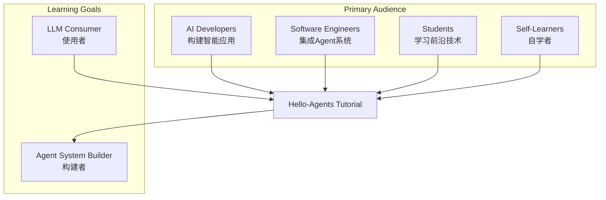
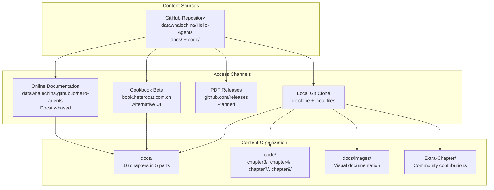
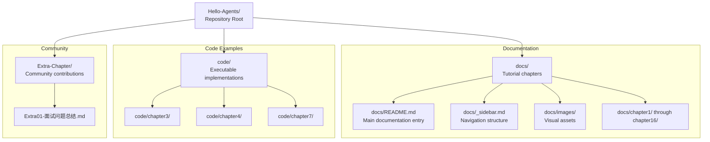
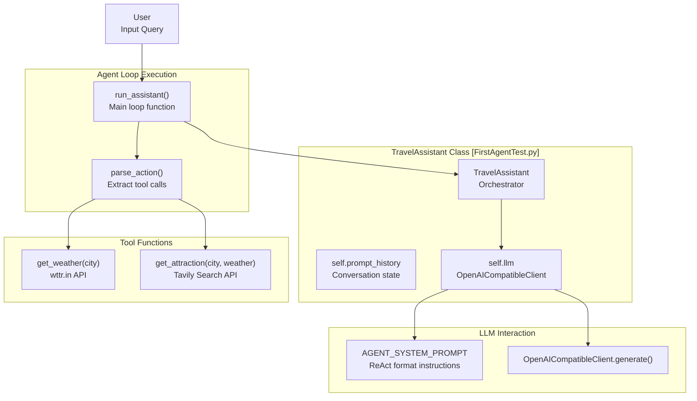

<!-- source: DeepWiki mcp.deepwiki.com · repo datawhalechina/hello-agents · page 2 Getting Started · fetched 2026-10-29 -->

# Getting Started

<details>
<summary>Relevant source files</summary>

The following files were used as context for generating this wiki page:

- [Extra-Chapter/images/Extra07-figures/image1.png](Extra-Chapter/images/Extra07-figures/image1.png)
- [Extra-Chapter/images/Extra07-figures/image2.png](Extra-Chapter/images/Extra07-figures/image2.png)
- [Extra-Chapter/images/Extra07-figures/image3.png](Extra-Chapter/images/Extra07-figures/image3.png)
- [Extra-Chapter/images/Extra07-figures/image4.png](Extra-Chapter/images/Extra07-figures/image4.png)
- [Extra-Chapter/images/Extra07-figures/image5.png](Extra-Chapter/images/Extra07-figures/image5.png)
- [Extra-Chapter/images/Extra07-figures/image6.png](Extra-Chapter/images/Extra07-figures/image6.png)
- [Extra-Chapter/images/Extra07-figures/image7.png](Extra-Chapter/images/Extra07-figures/image7.png)
- [Extra-Chapter/images/Extra07-figures/image8.png](Extra-Chapter/images/Extra07-figures/image8.png)
- [README.md](README.md)
- [README_EN.md](README_EN.md)
- [docs/Preface.md](docs/Preface.md)
- [docs/README.md](docs/README.md)
- [docs/README_EN.md](docs/README_EN.md)
- [docs/_sidebar.md](docs/_sidebar.md)
- [docs/_sidebar_en.md](docs/_sidebar_en.md)
- [docs/images/star-history-2026324.png](docs/images/star-history-2026324.png)

</details>


This document provides instructions for accessing the Hello-Agents tutorial content and explains the prerequisites and target audience. It covers multiple access methods including online documentation, local installation, and PDF downloads. For an overview of the repository's mission and structure, see [Overview](#1). For detailed information about the curriculum structure, see [Learning Path and Curriculum](#3).

---

## Purpose and Target Audience

The Hello-Agents tutorial is designed to transform learners from LLM consumers (使用者) to agent system builders (构建者). The content balances theoretical foundations with hands-on implementation, progressively building skills from basic concepts to production-ready multi-agent systems. For a deep dive into these requirements, see [Prerequisites and Target Audience](#2.1).

### Required Prerequisites

| Prerequisite | Description | Level Required |
|-------------|-------------|----------------|
| **Python Programming** | Basic Python syntax, functions, classes, and package management | Intermediate |
| **LLM Concepts** | Understanding of API-based LLM interactions (e.g., calling OpenAI API) | Basic |
| **Algorithm/ML Background** | Deep learning theory, model training | NOT required |

The tutorial focuses on application and construction rather than algorithm development. Learners do not need expertise in deep learning or model training to benefit from the content.

**Sources:** [README.md:85-89](), [docs/README.md:85-89](), [docs/Preface.md:19-25]()

### Target Learners



**Target Learner Profiles:**

- **AI Developers:** Building intelligent applications, integrating agent systems into products.
- **Software Engineers:** Adding AI-native agent capabilities to existing systems.
- **Students:** Learning cutting-edge AI agent architectures and paradigms.
- **Self-Learners:** Exploring frontier AI technologies with strong motivation.

**Sources:** [README.md:28](), [docs/README.md:28](), [docs/Preface.md:13-15]()

---

## Access Methods Overview

The Hello-Agents tutorial provides multiple access channels to accommodate different learning preferences and environments. For detailed setup steps, see [Installation and Quick Start](#2.2).



**Sources:** [README.md:32-36](), [docs/README.md:30-33]()

---

## Local Installation and Setup

### Repository Cloning

To access the full tutorial content and code examples locally:

```bash
# Clone the repository
git clone https://github.com/datawhalechina/Hello-Agents.git

# Navigate to the directory
cd Hello-Agents
```

### Local Repository Structure



**Sources:** [docs/_sidebar.md:1-29](), [README.md:80-92]()

---

## Running Your First Agent: Travel Assistant

The tutorial includes a complete working agent example in Chapter 1: the **Intelligent Travel Assistant**. This demonstrates the core agent loop pattern.

**File Location:** [code/chapter1/FirstAgentTest.py:1-199](), [code/chapter1/FirstAgentTest.ipynb:1-624]()

### System Architecture



**Sources:** [code/chapter1/FirstAgentTest.py:29-199]()

### Environment Configuration

Before running the example, configure API credentials in your environment or a `.env` file:

| API | Purpose | Configuration Variable |
|-----|---------|------------------------|
| **LLM Provider** | Agent reasoning | `API_KEY`, `BASE_URL`, `MODEL_ID` |
| **Tavily Search** | Web search | `TAVILY_API_KEY` |

**Sources:** [code/chapter1/FirstAgentTest.py:15-28]()

---

## Next Steps

After completing the setup and running your first agent:

1. **Detailed Prerequisites:** See [Prerequisites and Target Audience](#2.1).
2. **Installation Guides:** See [Installation and Quick Start](#2.2) for detailed Python, Docker (n8n), and Node.js setup.
3. **Curriculum Overview:** Review [Learning Path and Curriculum](#3) to understand the five-part progression.

**Sources:** [README.md:51-74](), [docs/README.md:47-70]()

---

