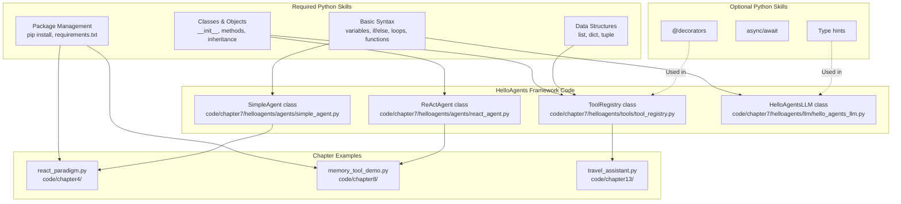
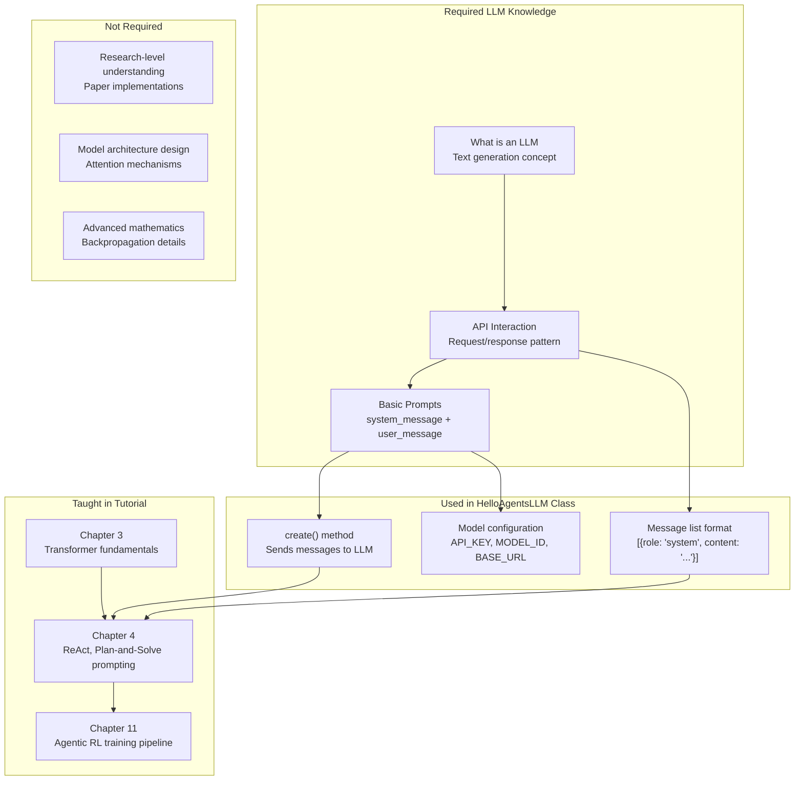
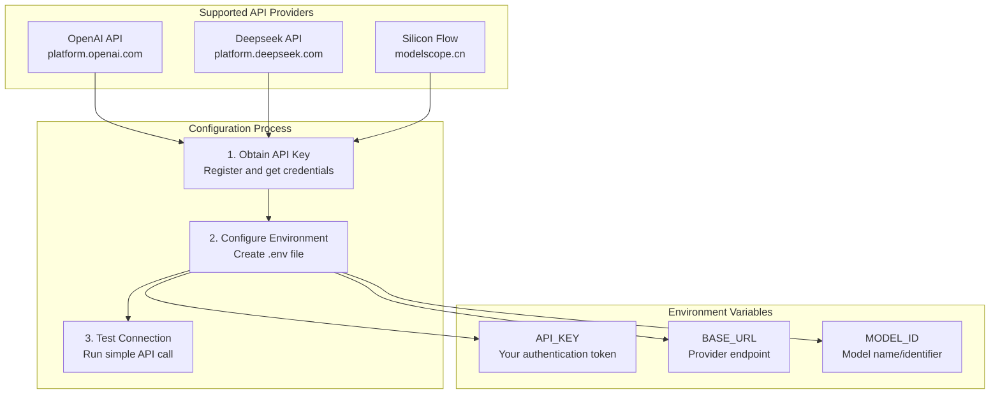
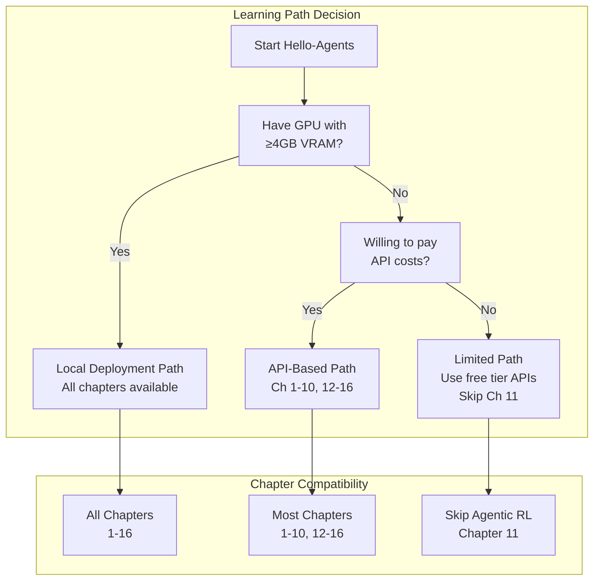
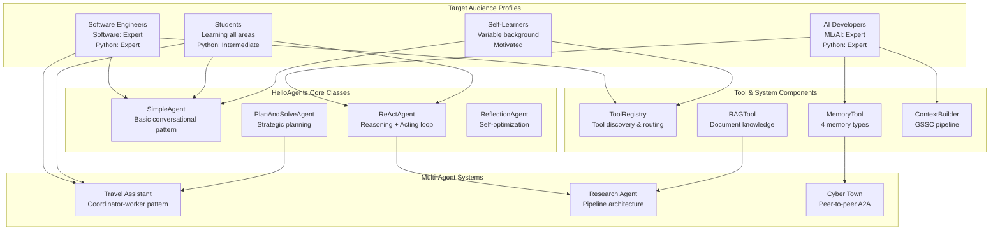
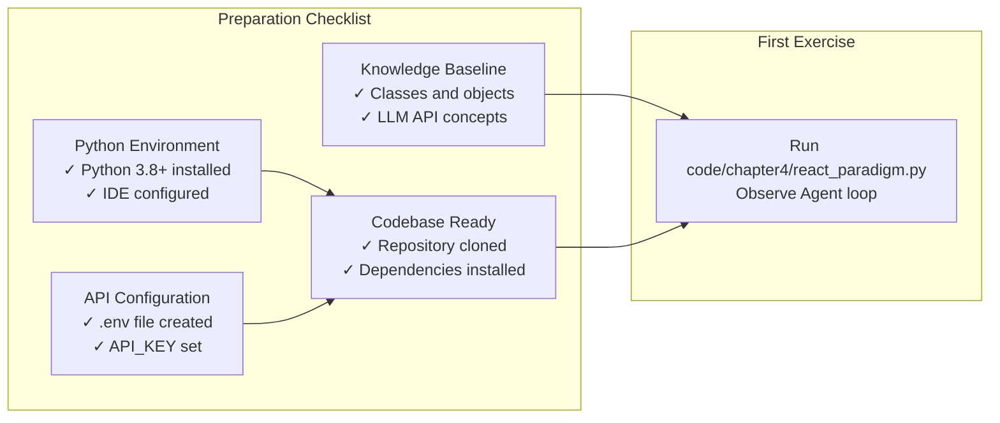

<!-- source: DeepWiki mcp.deepwiki.com · repo datawhalechina/hello-agents · page 2.1 Prerequisites and Target Audience · fetched 2026-10-29 -->

# Prerequisites and Target Audience

<details>
<summary>Relevant source files</summary>

The following files were used as context for generating this wiki page:

- [README.md](README.md)
- [README_EN.md](README_EN.md)
- [docs/Preface.md](docs/Preface.md)
- [docs/README.md](docs/README.md)
- [docs/README_EN.md](docs/README_EN.md)
- [docs/_sidebar.md](docs/_sidebar.md)
- [docs/_sidebar_en.md](docs/_sidebar_en.md)
- [docs/images/star-history-2026324.png](docs/images/star-history-2026324.png)

</details>


This document specifies the required technical knowledge, hardware resources, and learner profiles for successfully completing the Hello-Agents tutorial. The material focuses on practical application and system construction rather than theoretical research or model training.

---

## 1. Technical Prerequisites

### 1.1 Python Programming Fundamentals

The tutorial requires **basic Python programming ability**. You should be comfortable with:

- Core syntax: variables, control flow (if/else, loops), functions, classes
- Data structures: lists, dictionaries, tuples
- Package management: using `pip`, installing from `requirements.txt`
- Working with external libraries: importing modules, reading documentation
- Basic file I/O and environment variable management

**No advanced Python expertise is required**. You do not need to know decorators, metaclasses, or async programming in depth, though familiarity with these concepts will be helpful.

**Recommended preparation**: If you lack Python fundamentals, the Datawhale community offers a preparatory course at [聪明办法学Python](https://datawhalechina.github.io/learn-python-the-smart-way-v2/).



**Sources**: [README.md:96-98](), [docs/README.md:92-94](), [Extra-Chapter/Extra04-DatawhaleFAQ.md:105-116]()

### 1.2 Large Language Model Familiarity

You should have **basic conceptual understanding of LLMs**, specifically:

- What an LLM is and how it generates text
- How to interact with an LLM via API (sending prompts, receiving responses)
- Basic prompt engineering concepts (system messages, user messages, temperature)
- Familiarity with at least one LLM provider (OpenAI, Deepseek, or similar)

**You do NOT need**:
- Deep understanding of Transformer architecture (this is covered in [Large Language Model Architecture](#4.1))
- Knowledge of model training procedures
- Experience with model fine-tuning
- Mathematical background in neural networks

The tutorial teaches LLM fundamentals in Part 1 (Chapters 1-3), but assumes you have already experimented with calling an LLM through a simple API request.



**Sources**: [README.md:96-98](), [docs/README.md:92-94]()

### 1.3 Development Environment Setup

Before beginning the tutorial, you should have:

| Component | Requirement | Notes |
|-----------|-------------|-------|
| **Operating System** | Windows, macOS, or Linux | Any modern OS |
| **Python Version** | Python 3.8 or higher | Verify with `python --version` |
| **Package Manager** | pip or conda | For installing dependencies |
| **Code Editor** | VSCode, PyCharm, or Jupyter | With Python extension/kernel |
| **API Access** | At least one LLM provider | See [API Provider Setup](#1.4) |
| **Internet Connection** | Stable connection | For API calls and package downloads |

**Git is recommended** but not strictly required. The repository can be downloaded as a ZIP file if needed.

**Sources**: [README.md:25-33](), [Extra-Chapter/Extra07-环境配置.md:1-50]()

### 1.4 API Provider Setup

The tutorial supports multiple LLM API providers. You must configure at least one before starting.



**Configuration steps**:

1. **Choose a provider**:
   - [OpenAI API](https://platform.openai.com/docs/quickstart) - Industry standard, requires credit card.
   - [Deepseek API](https://platform.deepseek.com/usage) - Cost-effective, competitive performance.
   - [Silicon Flow Inference API](https://modelscope.cn/models) - Domestic China alternative.

2. **Obtain API credentials**: Register an account and generate an API key from the provider's dashboard.

3. **Create `.env` file** in project root:
   ```
   API_KEY=your_api_key_here
   MODEL_ID=your_model_id
   BASE_URL=provider_base_url
   ```

4. **Verify setup**: Run a simple test script to ensure API connectivity before starting tutorial exercises.

**Common issues**:
- **401 Error**: API key invalid or account balance insufficient ([Extra-Chapter/Extra04-DatawhaleFAQ.md:243-245]()).
- **403 Error**: Network restrictions or rate limiting.
- **Timeout**: Check internet connection and BASE_URL configuration.

**Sources**: [Extra-Chapter/Extra04-DatawhaleFAQ.md:210-218](), [Extra-Chapter/Extra04-DatawhaleFAQ.md:243-245]()

---

## 2. Hardware Requirements

### 2.1 API-Based Learning Path (Recommended)

**For most learners, using API providers requires minimal hardware**:

| Component | Minimum | Recommended |
|-----------|---------|-------------|
| **CPU** | Any modern processor | Multi-core for Jupyter |
| **RAM** | 4GB | 8GB or more |
| **GPU** | None | None |
| **Storage** | 2GB free space | 10GB for all code + data |
| **Network** | Stable internet | Unlimited data preferred |

**Chapters compatible with API-only approach**: All chapters except Chapter 11 (Agentic RL) can be completed entirely using API calls with no local model deployment.

**Cost considerations**:
- Most API providers offer free tier or trial credits.
- Budget approximately $5-20 USD for completing all tutorial exercises.
- Deepseek is noted as cost-effective option for experimentation.

**Sources**: [Extra-Chapter/Extra04-DatawhaleFAQ.md:140-145](), [README.md:96]()

### 2.2 Local Deployment Path (Optional)

**For learners who want to deploy models locally** or complete Chapter 11 (Agentic RL training):

| Component | Minimum | Recommended |
|-----------|---------|-------------|
| **CPU** | Multi-core processor | 8-core or higher |
| **RAM** | 16GB | 32GB or more |
| **GPU** | 4GB VRAM | 8GB+ VRAM (RTX 3060 or better) |
| **Storage** | 50GB free | 100GB+ for models |
| **Network** | For downloading models | - |

**GPU-intensive chapters**:
- **Chapter 11 (Agentic RL)**: Requires GPU with ≥4GB VRAM for model training experiments ([Extra-Chapter/Extra04-DatawhaleFAQ.md:140-145]()).
- All other chapters: Can use API instead of local deployment.

**Local deployment advantages**:
- No API costs after initial setup.
- Full control over model parameters.
- Offline capability.
- Better for iterative experimentation.

**Sources**: [Extra-Chapter/Extra04-DatawhaleFAQ.md:78-84](), [Extra-Chapter/Extra04-DatawhaleFAQ.md:140-145]()



**Sources**: [Extra-Chapter/Extra04-DatawhaleFAQ.md:78-84](), [Extra-Chapter/Extra04-DatawhaleFAQ.md:140-145]()

---

## 3. Target Audience Profiles

The Hello-Agents tutorial is designed for multiple learner profiles, each with different starting points and learning goals.

### 3.1 AI Developers

**Typical background**:
- Professional experience with machine learning or NLP.
- Familiar with Python ML libraries (PyTorch, TensorFlow, scikit-learn).
- Has worked with LLM APIs or prompt engineering.
- Wants to build production-ready agent systems.

**Learning focus**:
- Agent system architecture: `SimpleAgent`, `ReActAgent`, `PlanAndSolveAgent` classes.
- Multi-agent coordination protocols: MCP, A2A, ANP implementations.
- Performance evaluation: BFCL and GAIA benchmarks.
- Tool integration patterns: `ToolRegistry` and `ToolExecutor` architecture.

**Recommended chapters**:
- **Chapters 1-3**: Foundational concepts and LLM architecture.
- **Chapters 4-7**: Agent paradigms (ReAct, Reflection, Plan-and-Solve) and framework construction.
- **Chapters 8-12**: `MemoryTool`, `RAGTool`, `ContextBuilder`, communication protocols, RL training.
- **Chapters 13-15**: Production case studies with multi-agent coordination.

**Sources**: [README.md:96-109](), [docs/README.md:92-105]()

### 3.2 Software Engineers

**Typical background**:
- Strong programming fundamentals in Python or other languages.
- Experience with backend development, APIs, microservices.
- May have limited ML/AI background.
- Wants to integrate AI capabilities into software applications.

**Learning focus**:
- Agent loop architecture: Thought-Action-Observation pattern.
- Tool integration: Creating custom tools via `@tool` decorator.
- External API orchestration: Tavily, SerpAPI, GitHub MCP integration.
- State management: `Message` class and conversation history.
- Configuration: Environment variables via `.env` and `Config` class.

**Recommended chapters**:
- **Chapters 1-3**: AI/LLM fundamentals and conceptual framework.
- **Chapters 4-7**: Agent construction patterns, tool registration, and framework architecture.
- **Chapter 10**: MCP (Model Context Protocol) for standardized tool interfaces.
- **Chapters 13-15**: Travel Assistant (MCP integration), Research Agent (pipeline pattern), Cyber Town (A2A communication).

**Sources**: [README.md:96-109](), [docs/README.md:92-105]()

### 3.3 Students (Undergraduate and Graduate)

**Typical background**:
- Academic coursework in computer science or related field.
- Learning AI/ML concepts in formal education.
- Interested in research projects or capstone work.

**Learning focus**:
- Comprehensive understanding from theory to practice.
- Building portfolio projects for internships or job applications.
- Combining agent systems with coursework or thesis topics.

**Note**: Students can submit capstone projects to [Co-creation-projects]() directory ([Extra-Chapter/Extra04-DatawhaleFAQ.md:148-153]()).

**Sources**: [README.md:96](), [docs/README.md:92](), [Extra-Chapter/Extra04-DatawhaleFAQ.md:148-153]()



**Sources**: [README.md:96-109](), [docs/README.md:92-105]()

---

## 4. What You Do NOT Need

The tutorial explicitly **does not require**:

| Area | Not Required | Why |
|------|--------------|-----|
| **Deep Learning Theory** | Research-level understanding of neural networks | Tutorial teaches LLM fundamentals in Chapter 3 |
| **Model Training** | Experience training models from scratch | Chapter 11 provides guided RL training |
| **Advanced Mathematics** | Linear algebra, calculus, probability theory | Focus is on system construction, not algorithm development |
| **GPU Infrastructure** | High-end GPU hardware | API-based path works for 15 out of 16 chapters |
| **Research Background** | Published papers | Tutorial is practice-oriented |

**Sources**: [README.md:96](), [docs/README.md:92](), [Preface.md:25]()

---

## 5. Recommended Preparation Steps

### 5.1 Knowledge Preparation

1. **Verify Python skills**: Ensure you understand classes, list/dict operations, and basic file I/O.
2. **Test LLM API access**: Make a basic API call using a provider of your choice.
3. **Understand basic concepts**: Know how to pass functions as arguments and handle exceptions.

**Sources**: [README.md:96-109](), [Extra-Chapter/Extra04-DatawhaleFAQ.md:105-116]()

### 5.2 Environment Preparation

1. **Install Python 3.8+**.
2. **Clone repository**: `git clone https://github.com/datawhalechina/hello-agents.git`.
3. **Set up API access**: Create a `.env` file with your credentials.
4. **Install dependencies**: Run `pip install -r requirements.txt` in the framework directory.

**Sources**: [README.md:30-38](), [Extra-Chapter/Extra04-DatawhaleFAQ.md:210-218]()

### 5.3 Learning Strategy

1. **Budget 2-4 hours per chapter**.
2. **Always run the code**: Execute and modify examples in the `code/` folder.
3. **Join the community**: Engage with the Datawhale community for support.

**Sources**: [README.md:92-113](), [docs/README.md:88-109](), [Extra-Chapter/Extra04-DatawhaleFAQ.md:1-8]()



**Sources**: [README.md:92-113](), [docs/README.md:88-109]()

---

