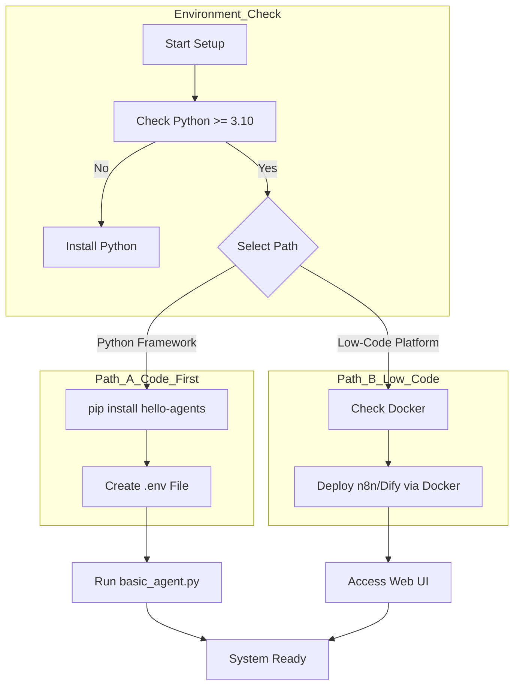
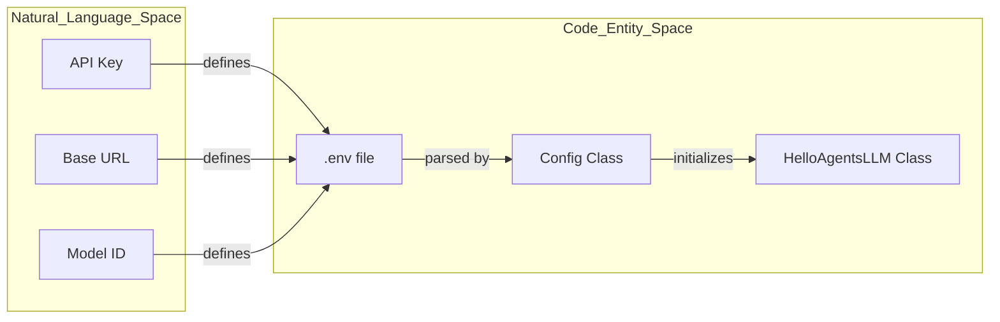
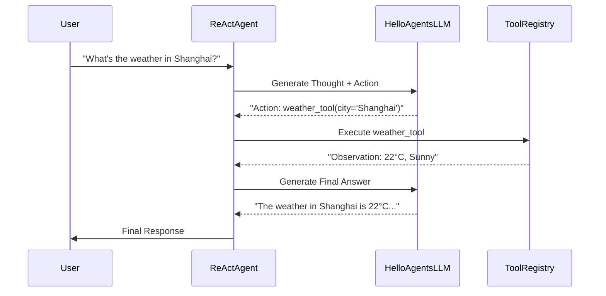

<!-- source: DeepWiki mcp.deepwiki.com · repo datawhalechina/hello-agents · page 2.2 Installation and Quick Start · fetched 2026-10-29 -->

# Installation and Quick Start

<details>
<summary>Relevant source files</summary>

The following files were used as context for generating this wiki page:

- [Extra-Chapter/images/Extra07-figures/image1.png](Extra-Chapter/images/Extra07-figures/image1.png)
- [Extra-Chapter/images/Extra07-figures/image2.png](Extra-Chapter/images/Extra07-figures/image2.png)
- [Extra-Chapter/images/Extra07-figures/image3.png](Extra-Chapter/images/Extra07-figures/image3.png)
- [Extra-Chapter/images/Extra07-figures/image4.png](Extra-Chapter/images/Extra07-figures/image4.png)
- [Extra-Chapter/images/Extra07-figures/image5.png](Extra-Chapter/images/Extra07-figures/image5.png)
- [Extra-Chapter/images/Extra07-figures/image6.png](Extra-Chapter/images/Extra07-figures/image6.png)
- [Extra-Chapter/images/Extra07-figures/image7.png](Extra-Chapter/images/Extra07-figures/image7.png)
- [Extra-Chapter/images/Extra07-figures/image8.png](Extra-Chapter/images/Extra07-figures/image8.png)
- [README.md](README.md)
- [README_EN.md](README_EN.md)
- [docs/Preface.md](docs/Preface.md)
- [docs/README.md](docs/README.md)
- [docs/README_EN.md](docs/README_EN.md)
- [docs/_sidebar.md](docs/_sidebar.md)
- [docs/_sidebar_en.md](docs/_sidebar_en.md)
- [docs/images/star-history-2026324.png](docs/images/star-history-2026324.png)

</details>


## Purpose and Scope

This page provides step-by-step instructions for installing the Hello-Agents framework, configuring your development environment, and running your first agent. By the end of this guide, you will have a working installation and understand the basic configuration workflow for both code-first (Python) and low-code (Docker-based) environments.

For information about learning prerequisites and target audience, see [Prerequisites and Target Audience](). For detailed framework architecture, see [HelloAgents Framework]().

---

## System Requirements

**Minimum Requirements:**
- **Python Version**: 3.10 or higher [docs/Preface.md:21]()
- **Operating System**: Windows, macOS, or Linux
- **Memory**: 4GB RAM minimum (8GB+ recommended for local models)
- **Internet Connection**: Required for API-based LLM providers

**Optional Requirements:**
- **Docker**: Required for self-hosting low-code platforms like n8n or Dify [README.md:60-90]()
- **Node.js**: Required for specific community tools and frontend components [README.md:30-38]()
- **Git**: For cloning the repository and accessing example code [README.md:37-38]()

Sources: [README.md:30-90](), [docs/Preface.md:19-25]()

---

## Installation Methods

### Installation Flow Overview

The following diagram illustrates the setup process from environment check to running an agent.

**Installation Logic Flow**


Sources: [README.md:30-62](), [docs/Preface.md:19-45]()

### Method 1: Python Framework Installation (Code-First)

For users building "AI Native" agents using the custom framework:

```bash
# Option A: Quick Install
pip install "hello-agents==0.1.1"

# Option B: Development Install (Clone Source)
git clone https://github.com/datawhalechina/hello-agents.git
cd hello-agents
pip install -e .
```

**Key Framework Components:**
- `HelloAgentsLLM`: Unified client for OpenAI, ModelScope, Ollama, etc. [README.md:43]()
- `SimpleAgent`: Base conversational agent. [README_EN.md:43]()
- `ReActAgent`: Reasoning-action loop implementation. [README.md:59]()

Sources: [README.md:30-62](), [README_EN.md:40-45]()

### Method 2: Low-Code Platform Setup (Docker-based)

Hello-Agents covers "Software Engineering Agents" like n8n and Dify, which typically require Docker for local deployment.

**n8n Installation (via Docker):**
```bash
docker run -it --rm --name n8n -p 5678:5678 -v ~/.n8n:/home/node/.n8n n8nio/n8n
```

**Dify Installation:**
Refer to the "Dify creation guide" in the community chapters for step-by-step UI configuration. [README.md:86-90]()

Sources: [README.md:60-90](), [docs/README.md:82-86]()

---

## Environment Configuration

### API Key Configuration

The framework uses a `.env` file to manage credentials. The `HelloAgentsLLM` class automatically detects the provider based on the environment variables provided. [README.md:43]()

**Config Mapping to Code Entities**


**Example `.env` Content:**
```bash
# OpenAI
OPENAI_API_KEY=sk-xxx
LLM_MODEL_ID=gpt-4o

# ModelScope (Domestic Alternative)
MODELSCOPE_API_KEY=ms-xxx
LLM_BASE_URL=https://api-inference.modelscope.cn/v1/
LLM_MODEL_ID=Qwen/Qwen2.5-72B-Instruct
```

Sources: [README.md:43-45](), [docs/chapter7/第七章%20构建你的Agent框架.md:1-50]() (referenced by chapter title in navigation)

---

## Quick Start: Running Your First Agent

### 1. Basic Conversational Agent
This example uses the `SimpleAgent` class to initiate a basic LLM interaction.

```python
from hello_agents import SimpleAgent, HelloAgentsLLM
from dotenv import load_dotenv

load_dotenv()

# Initialize LLM with auto-detection
llm = HelloAgentsLLM()

# Create Agent
agent = SimpleAgent(
    name="Assistant",
    llm=llm,
    system_prompt="You are a helpful assistant."
)

# Run
print(agent.run("What is an AI Agent?"))
```

### 2. Reasoning Agent (ReAct)
To run an agent that can use tools, use the `ReActAgent` which implements the "Thought-Action-Observation" loop. [README.md:59]()

**Agent Interaction Flow**


Sources: [README.md:55-62](), [README_EN.md:55-62]()

---

## Verification and Troubleshooting

### Common Setup Issues

| Component | Issue | Resolution |
| :--- | :--- | :--- |
| **Python** | `ModuleNotFoundError` | Ensure you ran `pip install` in the correct virtual environment. |
| **LLM API** | `AuthenticationError` | Check if `LLM_API_KEY` in `.env` matches your provider. |
| **n8n/Docker** | Port 5678 occupied | Change the host port in docker run: `-p 8080:5678`. |
| **Local Models** | High Latency | Ensure Ollama/VLLM is running and `LLM_BASE_URL` points to `localhost`. |

### Installation Checklist
1. [ ] Python >= 3.10 installed [docs/Preface.md:21]()
2. [ ] API Key obtained from provider (OpenAI, DeepSeek, or ModelScope) [docs/Preface.md:23]()
3. [ ] `.env` file created in project root [README.md:90]()
4. [ ] `pip install hello-agents` completed [README.md:30-38]()

Sources: [README.md:30-90](), [docs/Preface.md:15-25]()

---

