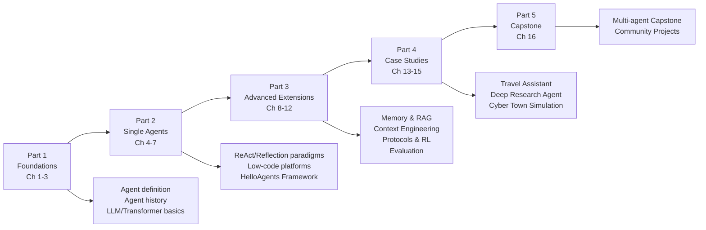
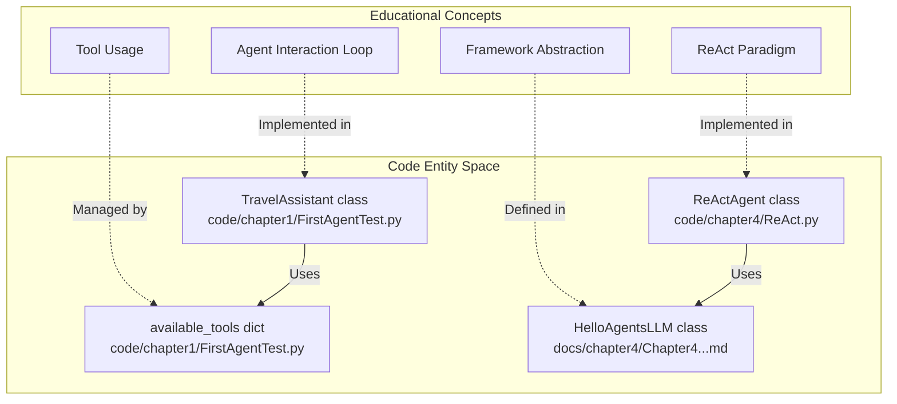
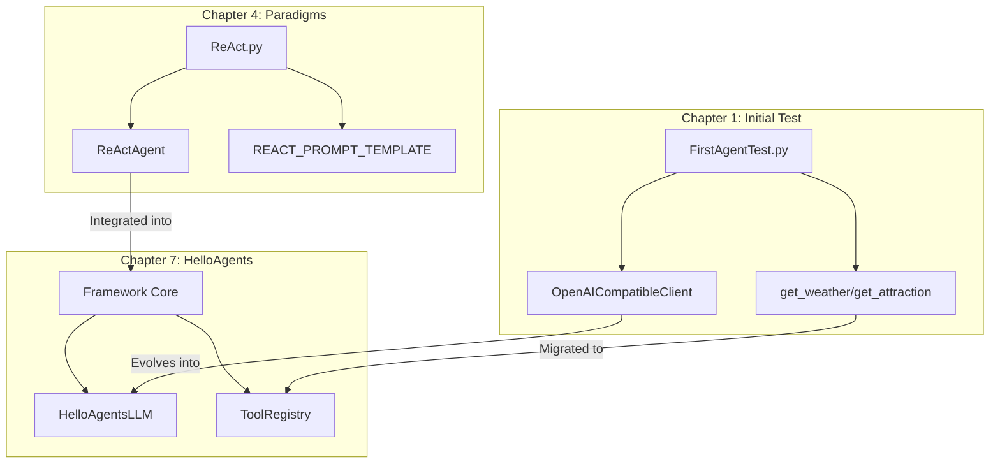

<!-- source: DeepWiki mcp.deepwiki.com · repo datawhalechina/hello-agents · page 3 Learning Path and Curriculum · fetched 2026-10-29 -->

# Learning Path and Curriculum

Relevant source files

The following files were used as context for generating this wiki page:

- [README.md](README.md)
- [README_EN.md](README_EN.md)
- [code/chapter1/FirstAgentTest.ipynb](code/chapter1/FirstAgentTest.ipynb)
- [code/chapter1/FirstAgentTest.py](code/chapter1/FirstAgentTest.py)
- [code/chapter4/ReAct.py](code/chapter4/ReAct.py)
- [docs/Preface.md](docs/Preface.md)
- [docs/README.md](docs/README.md)
- [docs/README_EN.md](docs/README_EN.md)
- [docs/_sidebar.md](docs/_sidebar.md)
- [docs/_sidebar_en.md](docs/_sidebar_en.md)
- [docs/chapter1/Chapter1-Introduction-to-Agents.md](docs/chapter1/Chapter1-Introduction-to-Agents.md)
- [docs/chapter16/Chapter16-Graduation-Project.md](docs/chapter16/Chapter16-Graduation-Project.md)
- [docs/chapter4/Chapter4-Building-Classic-Agent-Paradigms.md](docs/chapter4/Chapter4-Building-Classic-Agent-Paradigms.md)
- [docs/images/2-figures/1757246501849-00.png](docs/images/2-figures/1757246501849-00.png)
- [docs/images/star-history-2026324.png](docs/images/star-history-2026324.png)

The Hello-Agents curriculum comprises 16 chapters organized into 5 sequential parts, designed to transform learners from large language model "users" into agent system "builders" [README.md:28-29](). The structure follows a deliberate progression from foundational concepts to multi-agent system construction, with Chapter 7's framework implementation serving as a critical inflection point for advanced topics.

## Curriculum Structure Overview

The curriculum is divided into five logical parts that balance theory with hands-on implementation.

**Five-Part Curriculum Progression**

| Part | Focus | Key Learning Objective |
| :--- | :--- | :--- |
| **Part 1** | Foundations | Understand agent definitions, history, and Transformer architecture [README.md:54-57](). |
| **Part 2** | Building Single Agents | Implement classic paradigms (ReAct, Reflection) and build a custom framework [README.md:58-62](). |
| **Part 3** | Advanced Capabilities | Master memory systems, context engineering, and communication protocols [README.md:63-68](). |
| **Part 4** | Case Studies | Apply multi-agent collaboration to real-world scenarios [README.md:69-72](). |
| **Part 5** | Capstone | Design and build a complete autonomous multi-agent application [README.md:73-74](). |

**Sources:** [README.md:51-74](), [docs/README.md:47-70](), [Preface.md:27-37]()

## Chapter Dependencies and Code Mapping

The curriculum enforces a learning path where foundational chapters provide the "mental model" for code implementations. Chapters 4 and 7 are the primary coding milestones for single agents.

**Natural Language Space to Code Entity Space Mapping**

**Sources:** [code/chapter1/FirstAgentTest.py:202-206](), [code/chapter4/ReAct.py:26-31](), [docs/chapter4/Chapter4-Building-Classic-Agent-Paradigms.md:59-64]()

## 3.1 Part 1: Foundations (Chapters 1-3)
This section introduces the PEAS (Perception, Environment, Actuators, Sensors) model and the evolution of agents from simple reflex systems to goal-based and learning agents [docs/chapter1/Chapter1-Introduction-to-Agents.md:14-20](). It covers the technical underpinnings of LLMs, including the Transformer architecture and prompt engineering [README.md:57]().

For details, see [Part 1: Foundations (Chapters 1-3)](#3.1).

**Sources:** [docs/chapter1/Chapter1-Introduction-to-Agents.md:12-47](), [README.md:54-57]()

## 3.2 Part 2: Building Single Agents (Chapters 4-7)
Part 2 transitions to hands-on construction. Learners implement the **ReAct** (Reasoning and Acting) paradigm, which combines thought traces with action execution [code/chapter4/ReAct.py:6-24](). This part culminates in building the custom `HelloAgents` framework, abstracting LLM interactions via the `HelloAgentsLLM` client [docs/chapter4/Chapter4-Building-Classic-Agent-Paradigms.md:59-76]().

For details, see [Part 2: Building Single Agents (Chapters 4-7)](#3.2).

**Sources:** [code/chapter4/ReAct.py:26-73](), [docs/chapter4/Chapter4-Building-Classic-Agent-Paradigms.md:7-13](), [README.md:58-62]()

## 3.3 Part 3: Advanced Capabilities (Chapters 8-12)
This part extends agents with "systemic" technologies. Key topics include memory systems (RAG), context engineering (maintaining "situational understanding"), and communication protocols like MCP and A2A [README.md:63-68](). It also introduces Agentic RL, moving from SFT to GRPO for training LLMs specifically for agent tasks [README.md:67]().

For details, see [Part 3: Advanced Capabilities (Chapters 8-12)](#3.3).

**Sources:** [README.md:63-68](), [docs/README.md:59-64]()

## 3.4 Part 4: Real-World Case Studies (Chapters 13-15)
Learners explore comprehensive applications:
*   **Intelligent Travel Assistant**: Demonstrates MCP and multi-agent collaboration [README.md:70]().
*   **Automated Deep Research Agent**: Explores autonomous information synthesis [README.md:71]().
*   **Cyber Town**: Simulates social dynamics using agents in a game-like environment [README.md:72]().

For details, see [Part 4: Real-World Case Studies (Chapters 13-15)](#3.4).

**Sources:** [README.md:69-72](), [docs/README.md:65-68]()

## 3.5 Part 5: Capstone Project (Chapter 16)
The final stage involves building a complete multi-agent application. Learners are encouraged to contribute to the `Co-creation-projects` directory, showcasing unique implementations like the `DeepCastAgent` (research-to-podcast pipeline) or `MindEchoAgent` (emotion-driven music recommendation) [README.md:74, 82]().

For details, see [Part 5: Capstone Project (Chapter 16)](#3.5).

**Sources:** [README.md:73-74](), [docs/README.md:69-70](), [README_EN.md:82]()

## Summary of Code Implementation Progression

The following diagram bridges the conceptual curriculum to the specific code entities developed during the course.

**Framework Evolution Diagram**

**Sources:** [code/chapter1/FirstAgentTest.py:174-182](), [code/chapter4/ReAct.py:6-24](), [docs/chapter4/Chapter4-Building-Classic-Agent-Paradigms.md:59-64]()

---

