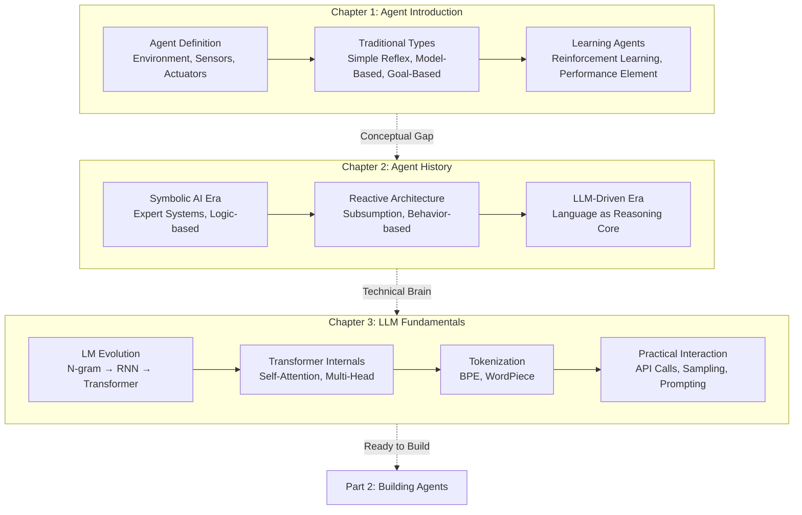
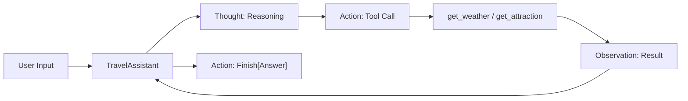
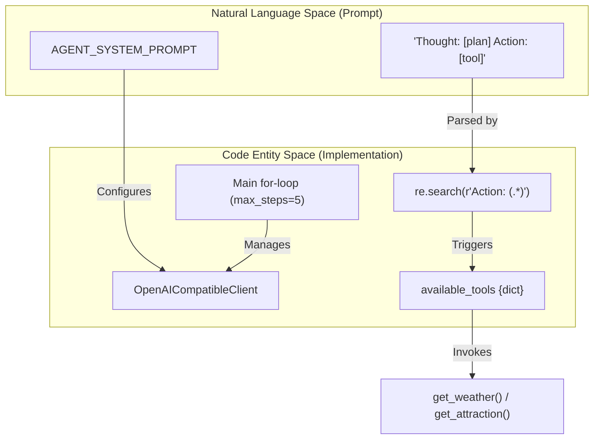
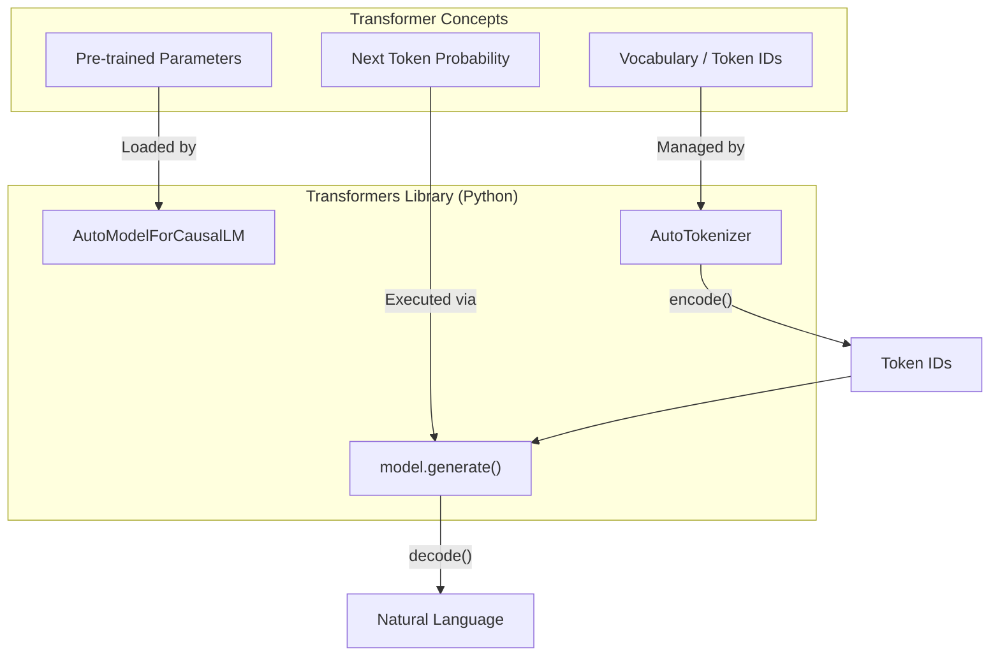

<!-- source: DeepWiki mcp.deepwiki.com · repo datawhalechina/hello-agents · page 3.1 Part 1: Foundations (Chapters 1-3) · fetched 2026-10-29 -->

# Part 1: Foundations (Chapters 1-3)

Relevant source files

The following files were used as context for generating this wiki page:

- [code/chapter1/FirstAgentTest.ipynb](code/chapter1/FirstAgentTest.ipynb)
- [code/chapter1/FirstAgentTest.py](code/chapter1/FirstAgentTest.py)
- [code/chapter2/ELIZA.py](code/chapter2/ELIZA.py)
- [code/chapter3/BPE.py](code/chapter3/BPE.py)
- [code/chapter3/N_gram.py](code/chapter3/N_gram.py)
- [code/chapter3/Qwen.py](code/chapter3/Qwen.py)
- [code/chapter3/Transformer.py](code/chapter3/Transformer.py)
- [code/chapter3/Word_Embedding.py](code/chapter3/Word_Embedding.py)
- [code/chapter4/Plan_and_solve.py](code/chapter4/Plan_and_solve.py)
- [code/chapter4/ReAct.py](code/chapter4/ReAct.py)
- [code/chapter4/tools.py](code/chapter4/tools.py)
- [code/chapter6/AutoGenDemo/autogen_software_team.py](code/chapter6/AutoGenDemo/autogen_software_team.py)
- [docs/chapter1/Chapter1-Introduction-to-Agents.md](docs/chapter1/Chapter1-Introduction-to-Agents.md)
- [docs/chapter16/Chapter16-Graduation-Project.md](docs/chapter16/Chapter16-Graduation-Project.md)
- [docs/chapter3/Chapter3-Fundamentals-of-Large-Language-Models.md](docs/chapter3/Chapter3-Fundamentals-of-Large-Language-Models.md)
- [docs/chapter4/Chapter4-Building-Classic-Agent-Paradigms.md](docs/chapter4/Chapter4-Building-Classic-Agent-Paradigms.md)
- [docs/images/2-figures/1757246501849-00.png](docs/images/2-figures/1757246501849-00.png)

## Purpose and Scope

Part 1 provides the theoretical and technical foundations required for understanding and building AI agent systems. This section covers three foundational chapters:

- **Chapter 1**: Agent concepts, definitions, types, and the transition from traditional to LLM-based systems.
- **Chapter 2**: Historical evolution from symbolic AI to modern LLM-driven agents.
- **Chapter 3**: Large language model (LLM) fundamentals, including the evolution of language modeling, the Transformer architecture, and practical model interaction.

This material establishes the conceptual vocabulary and technical knowledge necessary before proceeding to practical agent implementation in Part 2.

**Sources:** [docs/chapter1/Chapter1-Introduction-to-Agents.md:1-21](), [docs/chapter3/Chapter3-Fundamentals-of-Large-Language-Models.md:1-5]()

## Learning Progression Through Part 1

The three chapters follow a deliberate pedagogical sequence that builds from abstract definitions to concrete technical implementations of the "brain" behind the agent.

**Sources:** [docs/chapter1/Chapter1-Introduction-to-Agents.md:12-46](), [docs/chapter3/Chapter3-Fundamentals-of-Large-Language-Models.md:7-9]()

## Chapter 1: Agent Concepts and Definitions

Chapter 1 defines an **agent** as an entity that perceives its **Environment** through **Sensors** and autonomously takes **Actions** through **Actuators** to achieve goals [docs/chapter1/Chapter1-Introduction-to-Agents.md:14-18]().

### Traditional Agent Taxonomy
Before LLMs, agents evolved through several stages of complexity:
*   **Simple Reflex Agents**: Use condition-action rules (e.g., a thermostat) [docs/chapter1/Chapter1-Introduction-to-Agents.md:26-28]().
*   **Model-Based Reflex Agents**: Maintain an internal **World Model** to track unperceived environmental states [docs/chapter1/Chapter1-Introduction-to-Agents.md:35-36]().
*   **Goal-Based Agents**: Use search and planning to achieve specific future states [docs/chapter1/Chapter1-Introduction-to-Agents.md:37-38]().
*   **Utility-Based Agents**: Assign "satisfaction" values to states to balance conflicting goals [docs/chapter1/Chapter1-Introduction-to-Agents.md:39-40]().
*   **Learning Agents**: Use **Reinforcement Learning (RL)** to improve decision-making strategies through environment interaction [docs/chapter1/Chapter1-Introduction-to-Agents.md:41-45]().

### The Modern Agent Loop
In the modern context, the LLM acts as the reasoning core. The first hands-on example provided is a **TravelAssistant** that follows a Thought-Action-Observation loop [code/chapter1/FirstAgentTest.py:1-24]().

**Sources:** [docs/chapter1/Chapter1-Introduction-to-Agents.md:14-47](), [code/chapter1/FirstAgentTest.py:157-208]()

## Chapter 3: Large Language Model Fundamentals

This chapter details how the LLM functions as the agent's "brain," moving from statistical probabilities to the Transformer architecture.

### 3.1 Language Model Evolution
*   **N-gram Models**: Predict the next word based on the previous $n-1$ words using **Maximum Likelihood Estimation (MLE)** [docs/chapter3/Chapter3-Fundamentals-of-Large-Language-Models.md:24-36]().
*   **Bigram Example**: $P(w_i | w_{i-1}) = \frac{Count(w_{i-1}, w_i)}{Count(w_{i-1})}$ [docs/chapter3/Chapter3-Fundamentals-of-Large-Language-Models.md:36-43]().
*   **Neural Models**: Transitioned from RNNs (sequential processing) to Transformers (parallel processing via Attention) [docs/chapter3/Chapter3-Fundamentals-of-Large-Language-Models.md:7-9]().

### 3.2 Transformer Architecture
The core of modern agents is the Transformer, specifically the **Decoder-Only** architecture used in GPT-style models [docs/chapter3/Chapter3-Fundamentals-of-Large-Language-Models.md:189-200]().

#### Key Components:
1.  **Self-Attention**: Allows tokens to attend to all other positions in a sequence.
2.  **Multi-Head Attention**: Executes multiple attention mechanisms in parallel to capture different semantic relationships [docs/chapter3/Chapter3-Fundamentals-of-Large-Language-Models.md:286-310]().
3.  **Positional Encoding**: Adds sequence order information since Transformers process tokens in parallel [docs/chapter3/Chapter3-Fundamentals-of-Large-Language-Models.md:201-210]().

### 3.3 Tokenization
Text is converted into numerical IDs using subword algorithms like **Byte-Pair Encoding (BPE)**. This handles the Out-of-Vocabulary (OOV) problem by breaking unknown words into known sub-fragments [docs/chapter3/Chapter3-Fundamentals-of-Large-Language-Models.md:659-680]().

**Sources:** [docs/chapter3/Chapter3-Fundamentals-of-Large-Language-Models.md:13-62](), [docs/chapter3/Chapter3-Fundamentals-of-Large-Language-Models.md:189-310](), [docs/chapter3/Chapter3-Fundamentals-of-Large-Language-Models.md:659-758]()

## Bridging Language to Code

To implement an agent, the "Natural Language Space" (instructions) must be mapped to "Code Entity Space" (API calls and logic).

### System Mapping: Agent Logic to Code
The following diagram illustrates how the abstract concept of a ReAct agent is realized in the `FirstAgentTest.py` script.

**Sources:** [code/chapter1/FirstAgentTest.py:1-24](), [code/chapter1/FirstAgentTest.py:113-140](), [code/chapter1/FirstAgentTest.py:163-208]()

### Model Interaction Mapping
How the foundational `Transformer` concepts translate into using the `transformers` library for local deployment.

**Sources:** [code/chapter3/Qwen.py:9-19](), [code/chapter3/Qwen.py:30-56](), [docs/chapter3/Chapter3-Fundamentals-of-Large-Language-Models.md:759-774]()

## Summary Table: Foundations to Implementation

| Concept | Foundation Detail | Code Implementation |
| :--- | :--- | :--- |
| **Agent Loop** | Perception -> Action | `for i in range(5)` loop in `FirstAgentTest.py` [code/chapter1/FirstAgentTest.py:163]() |
| **Tool Use** | Actuators / External APIs | `available_tools` dictionary and `requests.get` [code/chapter1/FirstAgentTest.py:106-110]() |
| **LLM Client** | Transformer-based inference | `OpenAICompatibleClient` class [code/chapter1/FirstAgentTest.py:113-140]() |
| **Prompting** | Instruction tuning / Templates | `AGENT_SYSTEM_PROMPT` with format requirements [code/chapter1/FirstAgentTest.py:1-24]() |
| **Observation** | Feedback from environment | `Observation: {observation}` string appended to history [code/chapter1/FirstAgentTest.py:206-208]() |

**Sources:** [code/chapter1/FirstAgentTest.py:1-208](), [docs/chapter4/Chapter4-Building-Classic-Agent-Paradigms.md:59-103]()

---

