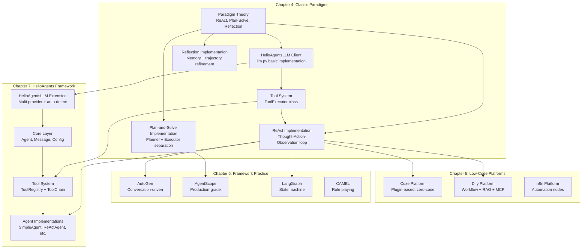
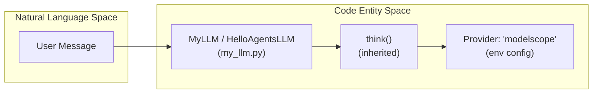
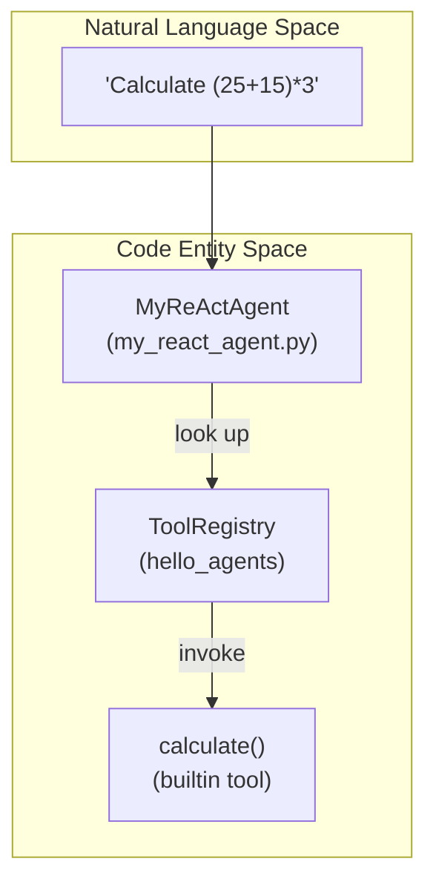

<!-- source: DeepWiki mcp.deepwiki.com · repo datawhalechina/hello-agents · page 3.2 Part 2: Building Single Agents (Chapters 4-7) · fetched 2026-10-29 -->

# Part 2: Building Single Agents (Chapters 4-7)

Relevant source files

The following files were used as context for generating this wiki page:

- [code/chapter13/helloagents-trip-planner/backend/requirements.txt](code/chapter13/helloagents-trip-planner/backend/requirements.txt)
- [code/chapter7/my_main.py](code/chapter7/my_main.py)
- [code/chapter7/my_react_agent.py](code/chapter7/my_react_agent.py)
- [code/chapter7/test_react_agent.py](code/chapter7/test_react_agent.py)
- [docs/chapter5/Chapter5-Building-Agents-with-Low-Code-Platforms.md](docs/chapter5/Chapter5-Building-Agents-with-Low-Code-Platforms.md)
- [docs/chapter6/Chapter6-Framework-Development-Practice.md](docs/chapter6/Chapter6-Framework-Development-Practice.md)
- [docs/chapter7/Chapter7-Building-Your-Agent-Framework.md](docs/chapter7/Chapter7-Building-Your-Agent-Framework.md)
- [docs/images/13-figures/13-1.png](docs/images/13-figures/13-1.png)
- [docs/index.html](docs/index.html)

## Purpose and Scope

Part 2 (Chapters 4-7) constitutes the **construction phase** of the Hello-Agents tutorial, where learners transition from theoretical foundations to hands-on agent building. This section covers four progressive learning modules:

1.  **Chapter 4**: Implementing classic agent paradigms (ReAct, Plan-and-Solve, Reflection) from scratch.
2.  **Chapter 5**: Building agents using low-code platforms (Coze, Dify, n8n) [docs/chapter5/Chapter5-Building-Agents-with-Low-Code-Platforms.md:24-46]().
3.  **Chapter 6**: Practicing with mainstream agent frameworks (AutoGen, AgentScope, LangGraph, CAMEL) [docs/chapter6/Chapter6-Framework-Development-Practice.md:31-42]().
4.  **Chapter 7**: Constructing the **HelloAgents** framework from zero [docs/chapter7/Chapter7-Building-Your-Agent-Framework.md:3-7]().

This part emphasizes the philosophy of "learning by building" — progressing from implementing fundamental patterns with minimal abstractions to using sophisticated platforms, and finally to architecting a custom framework. By the end of Part 2, readers will possess both the ability to "use wheels" (leverage existing tools) and "build wheels" (create custom frameworks) [docs/chapter7/Chapter7-Building-Your-Agent-Framework.md:22-29]().

**Sources**: [docs/chapter7/Chapter7-Building-Your-Agent-Framework.md:1-46](), [docs/chapter5/Chapter5-Building-Agents-with-Low-Code-Platforms.md:1-22](), [docs/chapter6/Chapter6-Framework-Development-Practice.md:1-12]()

---

## Learning Progression Architecture

**Diagram**: Learning progression through Part 2 showing how foundational implementations in Chapter 4 inform platform usage (Ch 5), framework practice (Ch 6), and custom framework architecture (Ch 7).

**Sources**: [docs/chapter7/Chapter7-Building-Your-Agent-Framework.md:52-55](), [docs/chapter6/Chapter6-Framework-Development-Practice.md:3-7](), [docs/chapter5/Chapter5-Building-Agents-with-Low-Code-Platforms.md:3-7]()

---

## Chapter 4: Classic Agent Paradigms

### Overview
Chapter 4 implements foundational agent paradigms from first principles. This establishes the conceptual and practical foundation for all subsequent work.

**Key Learning Objectives**:
*   Implement ReAct's dynamic think-act-observe loop.
*   Build Plan-and-Solve's two-stage planner-executor architecture.
*   Create Reflection's self-improvement mechanism.

**Sources**: [docs/chapter6/Chapter6-Framework-Development-Practice.md:3-7]()

---

## Chapter 5: Low-Code Platform Development

### Platform Selection
Chapter 5 focuses on using graphical, modular platforms to build, debug, and deploy agent applications [docs/chapter5/Chapter5-Building-Agents-with-Low-Code-Platforms.md:5-7]().

*   **Coze**: Zero-code/low-code building by ByteDance. Focuses on visual interfaces, plugins, and multi-channel publishing (WeChat, Feishu) [docs/chapter5/Chapter5-Building-Agents-with-Low-Code-Platforms.md:27-31]().
*   **Dify**: Open-source LLMOps platform. Supports RAG pipelines, workflow orchestration, and Model Context Protocol (MCP) [docs/chapter5/Chapter5-Building-Agents-with-Low-Code-Platforms.md:33-37]().
*   **n8n**: Workflow automation tool with integrated AI capabilities. Excels at connecting hundreds of SaaS services and APIs [docs/chapter5/Chapter5-Building-Agents-with-Low-Code-Platforms.md:39-44]().

**Sources**: [docs/chapter5/Chapter5-Building-Agents-with-Low-Code-Platforms.md:22-46]()

---

## Chapter 6: Mainstream Framework Practice

### Framework Comparison
This chapter explores industry-standard frameworks to provide "specifications" for repetitive tasks like state management and tool invocation [docs/chapter6/Chapter6-Framework-Development-Practice.md:10-12]().

| Framework | Core Philosophy | Key Abstraction |
| :--- | :--- | :--- |
| **AutoGen** | Collaboration through conversation | GroupChat, Coder/Tester roles [docs/chapter6/Chapter6-Framework-Development-Practice.md:39-39]() |
| **AgentScope** | Engineering and ease of use | Message passing, distributed deployment [docs/chapter6/Chapter6-Framework-Development-Practice.md:40-40]() |
| **CAMEL** | Role-Playing autonomy | Inception Prompting [docs/chapter6/Chapter6-Framework-Development-Practice.md:41-41]() |
| **LangGraph** | Execution as a Graph | Nodes and Edges (supports Cycles) [docs/chapter6/Chapter6-Framework-Development-Practice.md:42-42]() |

**Sources**: [docs/chapter6/Chapter6-Framework-Development-Practice.md:33-42]()

---

## Chapter 7: Building HelloAgents Framework

### Framework Architecture
HelloAgents is designed to balance functional completeness with learning friendliness [docs/chapter7/Chapter7-Building-Your-Agent-Framework.md:42-43]().

*   **Core Components**:
    *   `HelloAgentsLLM`: Abstraction for LLM providers (OpenAI, ModelScope, Ollama) [code/chapter7/my_main.py:3-9]().
    *   `ToolRegistry`: Manages tool discovery and execution [code/chapter7/test_react_agent.py:16-17]().
    *   `Agent Base Classes`: `SimpleAgent`, `ReActAgent`, `ReflectionAgent`, and `PlanAndSolveAgent` [docs/chapter7/Chapter7-Building-Your-Agent-Framework.md:71-73]().

**Sources**: [docs/chapter7/Chapter7-Building-Your-Agent-Framework.md:38-60]()

### HelloAgentsLLM Integration
The `HelloAgentsLLM` class handles interaction with multiple providers. It inherits core logic like `think()` for streaming responses [code/chapter7/my_main.py:12-15]().

**Diagram**: Association between user prompts and the `HelloAgentsLLM` entity in code [code/chapter7/my_main.py:1-22]().

**Sources**: [code/chapter7/my_main.py:1-22]()

### Tool Registry System
The `ToolRegistry` allows dynamic registration of functions or class-based tools [code/chapter7/test_react_agent.py:22-35]().

**Diagram**: Mapping of natural language tasks to the `ToolRegistry` and specific tool functions [code/chapter7/test_react_agent.py:15-55]().

**Sources**: [code/chapter7/test_react_agent.py:15-55](), [code/chapter7/my_react_agent.py:89-94]()

### MyReActAgent Implementation
The `MyReActAgent` extends the base `ReActAgent` to implement the Thought-Action-Observation loop [code/chapter7/my_react_agent.py:33-36]().

*   **Key Logic**:
    *   `run()`: Manages the `while` loop up to `max_steps` [code/chapter7/my_react_agent.py:55-62]().
    *   `_parse_output()`: Splits LLM response into thought and action strings [code/chapter7/my_react_agent.py:79-80]().
    *   `tool_registry.execute_tool()`: Invokes the tool and returns an `Observation` [code/chapter7/my_react_agent.py:91-94]().
    *   `Finish[answer]`: Termination condition to return the final result [code/chapter7/my_react_agent.py:83-87]().

**Sources**: [code/chapter7/my_react_agent.py:33-100]()

---

