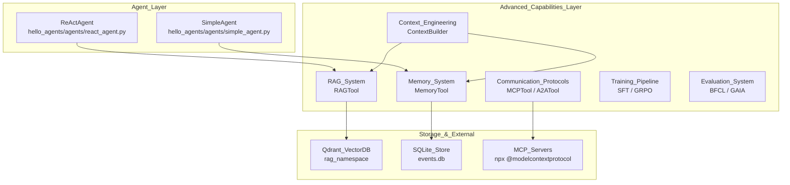
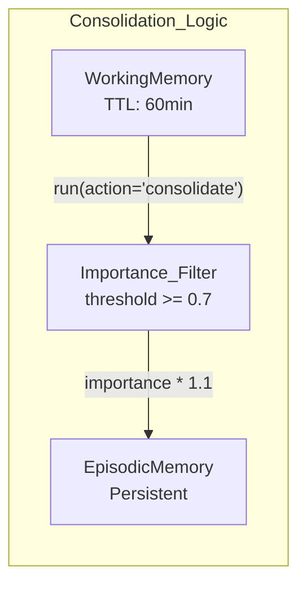
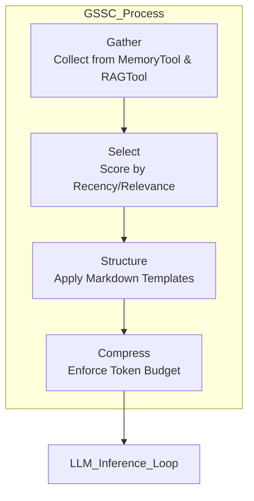
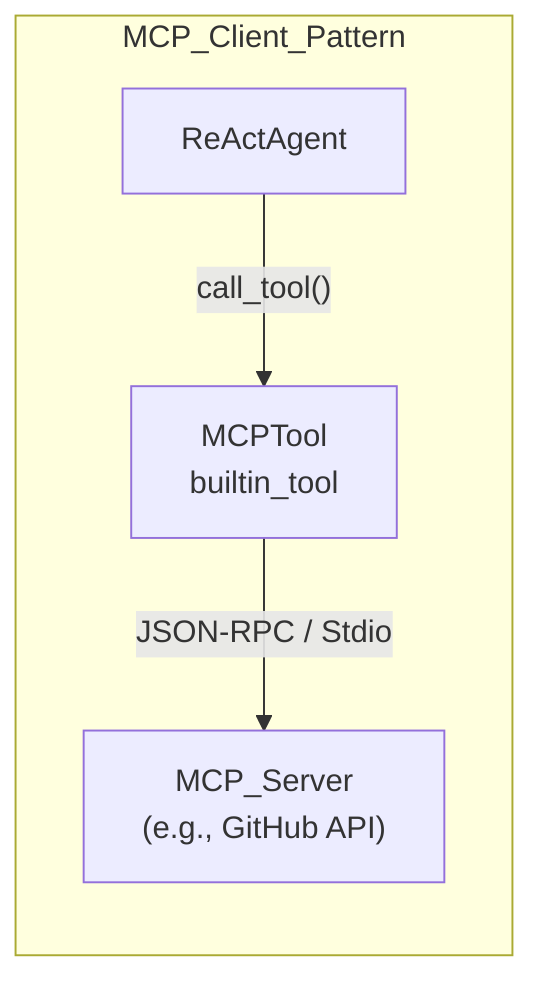
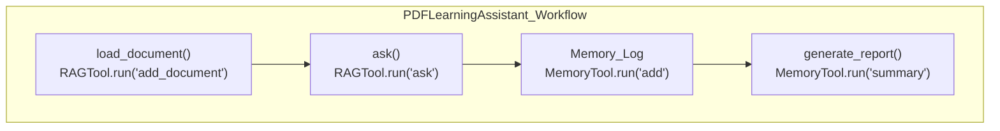

<!-- source: DeepWiki mcp.deepwiki.com · repo datawhalechina/hello-agents · page 3.3 Part 3: Advanced Capabilities (Chapters 8-12) · fetched 2026-10-29 -->

# Part 3: Advanced Capabilities (Chapters 8-12)

Relevant source files

The following files were used as context for generating this wiki page:

- [Co-creation-projects/README.md](Co-creation-projects/README.md)
- [code/chapter8/01_MemoryTool_Basic_Operations.py](code/chapter8/01_MemoryTool_Basic_Operations.py)
- [code/chapter8/02_MemoryTool_Architecture.py](code/chapter8/02_MemoryTool_Architecture.py)
- [code/chapter8/03_WorkingMemory_Implementation.py](code/chapter8/03_WorkingMemory_Implementation.py)
- [code/chapter8/04_RAGTool_MarkItDown_Pipeline.py](code/chapter8/04_RAGTool_MarkItDown_Pipeline.py)
- [code/chapter8/05_RAGTool_Advanced_Search.py](code/chapter8/05_RAGTool_Advanced_Search.py)
- [code/chapter8/06_Memory_Consolidation_Demo.py](code/chapter8/06_Memory_Consolidation_Demo.py)
- [code/chapter8/07_RAGTool_Intelligent_QA.py](code/chapter8/07_RAGTool_Intelligent_QA.py)
- [code/chapter8/08_Agent_Tool_Integration.py](code/chapter8/08_Agent_Tool_Integration.py)
- [code/chapter8/09_Memory_Types_Deep_Dive.py](code/chapter8/09_Memory_Types_Deep_Dive.py)
- [code/chapter8/10_RAG_Pipeline_Complete.py](code/chapter8/10_RAG_Pipeline_Complete.py)
- [code/chapter8/11_Q&A_Assistant.py](code/chapter8/11_Q&A_Assistant.py)
- [docs/chapter10/Chapter10-Agent-Communication-Protocols.md](docs/chapter10/Chapter10-Agent-Communication-Protocols.md)
- [docs/chapter11/Chapter11-Agentic-RL.md](docs/chapter11/Chapter11-Agentic-RL.md)
- [docs/chapter12/Chapter12-Agent-Performance-Evaluation.md](docs/chapter12/Chapter12-Agent-Performance-Evaluation.md)
- [docs/chapter13/Chapter13-Intelligent-Travel-Assistant.md](docs/chapter13/Chapter13-Intelligent-Travel-Assistant.md)
- [docs/chapter14/Chapter14-Automated-Deep-Research-Agent.md](docs/chapter14/Chapter14-Automated-Deep-Research-Agent.md)
- [docs/chapter9/Chapter9-Context-Engineering.md](docs/chapter9/Chapter9-Context-Engineering.md)
- [docs/images/16-figures/16-1.png](docs/images/16-figures/16-1.png)
- [docs/images/16-figures/16-2.png](docs/images/16-figures/16-2.png)
- [docs/images/16-figures/16-4.png](docs/images/16-figures/16-4.png)
- [fix_bold_format.py](fix_bold_format.py)

## Purpose and Scope

This section covers the advanced capabilities that extend basic agent functionality in the HelloAgents framework. Chapters 8-12 introduce orthogonal enhancements that can be applied to any agent paradigm. These capabilities include persistent memory systems, document knowledge retrieval (RAG), context optimization, inter-agent communication protocols (MCP, A2A, ANP), reinforcement learning training pipelines (Agentic RL), and standardized performance evaluation methods (BFCL, GAIA).

For foundational agent concepts, see [Part 1: Foundations (Chapters 1-3)](3.1). For basic implementation patterns, see [Part 2: Building Single Agents (Chapters 4-7)](3.2).

---

## Advanced Capabilities Architecture

The advanced capabilities layer provides modular extensions implemented as `BaseTool` subclasses or specialized utility classes like `ContextBuilder`.

### System Component Association

The following diagram bridges the Natural Language concepts to the specific Code Entities used in the framework.

**Sources:** [code/chapter8/08_Agent_Tool_Integration.py:11-55](), [docs/chapter10/Chapter10-Agent-Communication-Protocols.md:65-78](), [docs/chapter9/Chapter9-Context-Engineering.md:11-17]()

---

## Memory and Retrieval Systems (Chapter 8)

### Memory Architecture

The `MemoryTool` class manages four cognitive memory types. It uses a `MemoryManager` to route actions like `add`, `search`, and `consolidate` to specific memory components.

| Memory Type | Class / Logic | Characteristics | Storage Backend |
| :--- | :--- | :--- | :--- |
| **Working** | `WorkingMemory` | TTL-based, volatile, fast access | In-memory Dict |
| **Episodic** | `EpisodicMemory` | Event sequences, temporal context | SQLite + Qdrant |
| **Semantic** | `SemanticMemory` | Facts, concepts, entity relations | Neo4j + Qdrant |
| **Perceptual** | `PerceptualMemory` | Multimodal data (images/docs) | Vector Store |

**Sources:** [code/chapter8/02_MemoryTool_Architecture.py:75-100](), [code/chapter8/09_Memory_Types_Deep_Dive.py:53-143]()

### Memory Consolidation

`MemoryTool` implements a `consolidate` action that migrates important information from short-term (Working) to long-term (Episodic) memory based on an `importance_threshold`.

**Sources:** [code/chapter8/06_Memory_Consolidation_Demo.py:100-130](), [code/chapter8/01_MemoryTool_Basic_Operations.py:145-153]()

### RAG Pipeline

The `RAGTool` processes documents using a multi-stage pipeline:
1. **Conversion**: Uses `MarkItDown` to transform PDFs/DOCX to Markdown.
2. **Chunking**: Semantic segmentation (default 1000 tokens, 200 overlap).
3. **Retrieval**: Supports `BasicSearch`, `MQE` (Multi-Query Expansion), and `HyDE` (Hypothetical Document Embedding).

**Sources:** [code/chapter8/11_Q&A_Assistant.py:65-75](), [code/chapter8/11_Q&A_Assistant.py:123-130]()

---

## Context Engineering (Chapter 9)

### GSSC Pipeline

`ContextBuilder` implements the **GSSC** (Gather-Select-Structure-Compress) pipeline to optimize the LLM's attention budget.

**Supporting Tools:**
- `NoteTool`: For persistent, structured note-taking during long-horizon tasks.
- `TerminalTool`: For sandboxed shell execution and just-in-time context retrieval.

**Sources:** [docs/chapter9/Chapter9-Context-Engineering.md:11-17](), [docs/chapter9/Chapter9-Context-Engineering.md:36-43]()

---

## Communication Protocols (Chapter 10)

### Protocol Suite

The framework addresses the "tool integration dilemma" using standardized protocols:

1. **MCP (Model Context Protocol)**: Standardizes communication between agents and external services (GitHub, Google Drive) via `MCPTool`.
2. **A2A (Agent-to-Agent)**: Enables peer-to-peer collaboration where agents act as both consumers and providers.
3. **ANP (Agent Network Protocol)**: Infrastructure for large-scale agent discovery and networking.

**Sources:** [docs/chapter10/Chapter10-Agent-Communication-Protocols.md:62-81](), [docs/chapter10/Chapter10-Agent-Communication-Protocols.md:86-105]()

---

## Agentic RL Training (Chapter 11)

### Training Pipeline

Agentic RL focuses on improving reasoning and tool-use through "trial and error" in a controlled environment.

- **SFT (Supervised Fine-Tuning)**: Baseline for instruction following.
- **RM (Reward Modeling)**: Learning human preferences from (chosen, rejected) pairs.
- **GRPO (Group Relative Policy Optimization)**: A reinforcement learning algorithm that samples multiple responses for a single prompt and optimizes based on relative rewards within the group.

**Sources:** [docs/chapter11/Chapter11-Agentic-RL.md:34-73](), [docs/chapter11/Chapter11-Agentic-RL.md:73-80]()

---

## Performance Evaluation (Chapter 12)

### Benchmarks

The framework integrates three primary evaluation methods:

| Benchmark | Target Capability | Evaluation Method |
| :--- | :--- | :--- |
| **BFCL** | Tool Invocation | **AST Matching**: Structural comparison of function calls. |
| **GAIA** | General Reasoning | **Quasi Exact Match**: Fuzzy matching for multi-step tasks. |
| **Data Quality** | Synthetic Data | **LLM Judge**: Using a stronger model (e.g., GPT-4) to score outputs. |

**Sources:** [docs/chapter12/Chapter12-Agent-Performance-Evaluation.md:58-81](), [docs/chapter12/Chapter12-Agent-Performance-Evaluation.md:93-107]()

---

## Practical Implementation: Q&A Assistant

The `PDFLearningAssistant` class demonstrates the integration of `MemoryTool` and `RAGTool` for a real-world application.

**Key Methods:**
- `load_document(pdf_path)`: Uses `RAGTool` to build a knowledge base [code/chapter8/11_Q&A_Assistant.py:50-93]().
- `ask(question)`: Combines `RAGTool` for retrieval and `MemoryTool` to track the conversation session [code/chapter8/11_Q&A_Assistant.py:100-144]().
- `generate_report()`: Aggregates learning metrics and memory summaries into a JSON report [code/chapter8/11_Q&A_Assistant.py:197-240]().

**Sources:** [code/chapter8/11_Q&A_Assistant.py:23-49](), [code/chapter8/11_Q&A_Assistant.py:110-144]()

---

