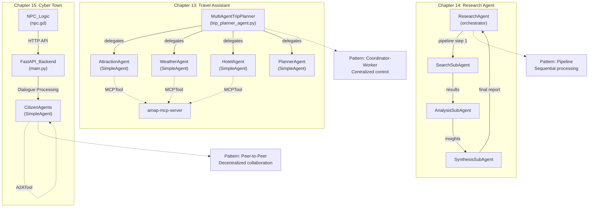
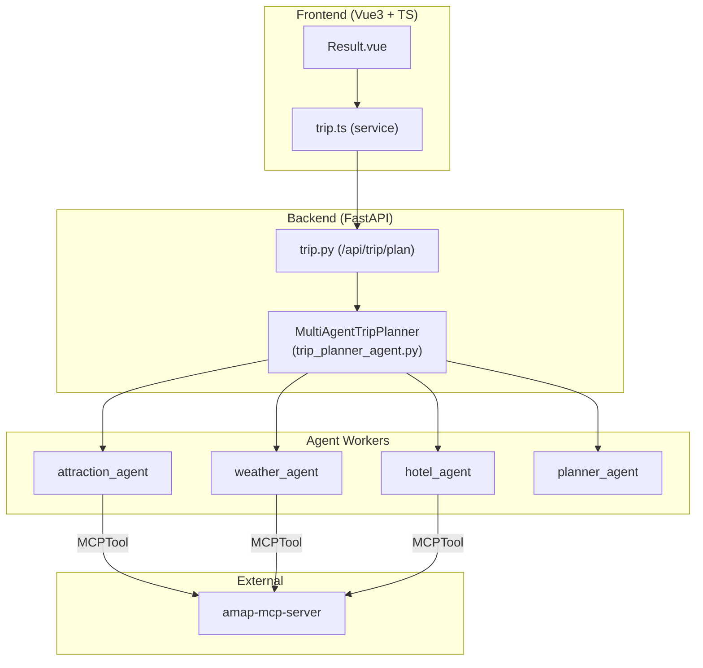
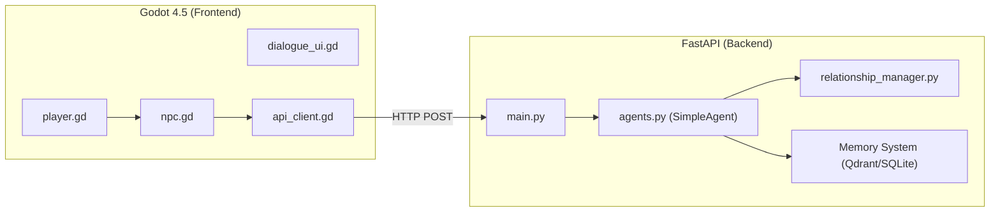

<!-- source: DeepWiki mcp.deepwiki.com · repo datawhalechina/hello-agents · page 3.4 Part 4: Real-World Case Studies (Chapters 13-15) · fetched 2026-10-29 -->

# Part 4: Real-World Case Studies (Chapters 13-15)

Relevant source files

The following files were used as context for generating this wiki page:

- [Co-creation-projects/README.md](Co-creation-projects/README.md)
- [code/chapter13/helloagents-trip-planner/README.md](code/chapter13/helloagents-trip-planner/README.md)
- [code/chapter13/helloagents-trip-planner/backend/.env.example](code/chapter13/helloagents-trip-planner/backend/.env.example)
- [code/chapter13/helloagents-trip-planner/backend/.gitignore](code/chapter13/helloagents-trip-planner/backend/.gitignore)
- [code/chapter13/helloagents-trip-planner/backend/app/__init__.py](code/chapter13/helloagents-trip-planner/backend/app/__init__.py)
- [code/chapter13/helloagents-trip-planner/backend/app/agents/__init__.py](code/chapter13/helloagents-trip-planner/backend/app/agents/__init__.py)
- [code/chapter13/helloagents-trip-planner/backend/app/agents/trip_planner_agent.py](code/chapter13/helloagents-trip-planner/backend/app/agents/trip_planner_agent.py)
- [code/chapter13/helloagents-trip-planner/backend/app/api/__init__.py](code/chapter13/helloagents-trip-planner/backend/app/api/__init__.py)
- [code/chapter13/helloagents-trip-planner/backend/app/api/main.py](code/chapter13/helloagents-trip-planner/backend/app/api/main.py)
- [code/chapter13/helloagents-trip-planner/backend/app/api/routes/__init__.py](code/chapter13/helloagents-trip-planner/backend/app/api/routes/__init__.py)
- [code/chapter13/helloagents-trip-planner/backend/app/api/routes/map.py](code/chapter13/helloagents-trip-planner/backend/app/api/routes/map.py)
- [code/chapter13/helloagents-trip-planner/frontend/.env.example](code/chapter13/helloagents-trip-planner/frontend/.env.example)
- [code/chapter13/helloagents-trip-planner/frontend/src/views/Result.vue](code/chapter13/helloagents-trip-planner/frontend/src/views/Result.vue)
- [code/chapter15/Helloagents-AI-Town/SETUP_GUIDE.md](code/chapter15/Helloagents-AI-Town/SETUP_GUIDE.md)
- [docs/chapter10/Chapter10-Agent-Communication-Protocols.md](docs/chapter10/Chapter10-Agent-Communication-Protocols.md)
- [docs/chapter11/Chapter11-Agentic-RL.md](docs/chapter11/Chapter11-Agentic-RL.md)
- [docs/chapter12/Chapter12-Agent-Performance-Evaluation.md](docs/chapter12/Chapter12-Agent-Performance-Evaluation.md)
- [docs/chapter13/Chapter13-Intelligent-Travel-Assistant.md](docs/chapter13/Chapter13-Intelligent-Travel-Assistant.md)
- [docs/chapter14/Chapter14-Automated-Deep-Research-Agent.md](docs/chapter14/Chapter14-Automated-Deep-Research-Agent.md)
- [docs/chapter15/Chapter15-Building-Cyber-Town.md](docs/chapter15/Chapter15-Building-Cyber-Town.md)
- [docs/images/16-figures/16-1.png](docs/images/16-figures/16-1.png)
- [docs/images/16-figures/16-2.png](docs/images/16-figures/16-2.png)
- [docs/images/16-figures/16-4.png](docs/images/16-figures/16-4.png)
- [fix_bold_format.py](fix_bold_format.py)

## Purpose and Scope

Part 4 represents the culmination of the Hello-Agents curriculum, demonstrating how to integrate all previously learned concepts into complete, production-ready multi-agent applications. This section covers three comprehensive case studies that synthesize agent paradigms, tool integration, memory systems, communication protocols, and evaluation methods into functional systems.

**Scope**: This document covers Chapters 13-15, which present three distinct multi-agent architectures:
- **Chapter 13**: Intelligent Travel Assistant demonstrating coordinator-worker patterns with MCP protocol integration.
- **Chapter 14**: Automated Deep Research Agent showcasing pipeline architectures for autonomous investigation.
- **Chapter 15**: Cyber Town illustrating peer-to-peer agent networks for social simulation.

For foundational agent concepts, see Part 1. For single-agent implementation details, see Part 2. For advanced capabilities like memory and protocols, see Part 3. For capstone project guidance, see Part 5.

---

## Overview: Three Multi-Agent Architectures

Part 4 demonstrates three fundamentally different approaches to multi-agent system design, each optimized for different problem domains. The architectures differ in communication patterns, task decomposition strategies, and coordination mechanisms.

### Architecture Comparison

**Sources**: [code/chapter13/helloagents-trip-planner/backend/app/agents/trip_planner_agent.py:155-211](), [docs/chapter15/Chapter15-Building-Cyber-Town.md:27-36]()

### Key Architectural Differences

| Aspect | Chapter 13 (Travel) | Chapter 14 (Research) | Chapter 15 (Cyber Town) |
|--------|-----------|-----------|-----------|
| **Coordination** | Centralized `MultiAgentTripPlanner` | Linear pipeline | Decentralized `A2A` network |
| **Communication** | Synchronous delegation | Sequential handoff | Asynchronous messaging |
| **Primary Protocol** | `MCPTool` (Amap) | Mixed (Search + RAG) | `A2A` + `ANP` |
| **State Management** | Shared request state | Accumulated output | Distributed across agents |
| **Primary Goal** | Itinerary generation | Information synthesis | Social simulation |

**Sources**: [code/chapter13/helloagents-trip-planner/backend/app/agents/trip_planner_agent.py:223-260](), [docs/chapter15/Chapter15-Building-Cyber-Town.md:49-81]()

---

## Chapter 13: Intelligent Travel Assistant

### System Architecture

The Travel Assistant implements a **coordinator-worker pattern** where a central `MultiAgentTripPlanner` orchestrates four specialized `SimpleAgent` instances.

**Sources**: [code/chapter13/helloagents-trip-planner/backend/app/agents/trip_planner_agent.py:158-211](), [code/chapter13/helloagents-trip-planner/README.md:31-59]()

### Implementation Details

The system uses a shared `MCPTool` instance for map services [code/chapter13/helloagents-trip-planner/backend/app/agents/trip_planner_agent.py:168-175]().

**Core Agents**:
1. **Attraction Agent**: Uses `maps_text_search` to find POIs [code/chapter13/helloagents-trip-planner/backend/app/agents/trip_planner_agent.py:13-33]().
2. **Weather Agent**: Uses `maps_weather` for forecasts [code/chapter13/helloagents-trip-planner/backend/app/agents/trip_planner_agent.py:35-54]().
3. **Hotel Agent**: Searches for accommodation [code/chapter13/helloagents-trip-planner/backend/app/agents/trip_planner_agent.py:56-73]().
4. **Planner Agent**: Synthesizes all data into a JSON itinerary [code/chapter13/helloagents-trip-planner/backend/app/agents/trip_planner_agent.py:75-152]().

**Sources**: [code/chapter13/helloagents-trip-planner/backend/app/agents/trip_planner_agent.py:178-211]()

---

## Chapter 14: Automated Deep Research Agent

### Pipeline Workflow

The Research Agent follows a sequential pipeline to transform a broad query into a structured report.

**Workflow Stages**:
1. **Search**: Decomposes queries and uses `SearchTool` to gather raw web data.
2. **Analysis**: Uses `RAGTool` and `MarkItDown` to parse and index documents into a vector database like Qdrant [docs/chapter12/Chapter12-Agent-Performance-Evaluation.md:103-107]().
3. **Synthesis**: Applies the **GSSC pipeline** (Gather-Select-Structure-Compress) to generate the final report [docs/chapter11/Chapter11-Agentic-RL.md:1-7]().

**Sources**: [docs/chapter14/Chapter14-Automated-Deep-Research-Agent.md](), [docs/chapter12/Chapter12-Agent-Performance-Evaluation.md:99-102]()

---

## Chapter 15: Cyber Town Social Simulation

### Technical Architecture

Cyber Town separates the simulation into a **Godot game engine** frontend and a **FastAPI + HelloAgents** backend.

**Sources**: [docs/chapter15/Chapter15-Building-Cyber-Town.md:29-46](), [code/chapter15/Helloagents-AI-Town/SETUP_GUIDE.md:85-90]()

### Core NPC Features
- **Intelligent Dialogue**: NPCs use `SimpleAgent` to process natural language [docs/chapter15/Chapter15-Building-Cyber-Town.md:7-15]().
- **Memory & Affection**: NPCs track interaction history and "affection levels" which influence their responses [docs/chapter15/Chapter15-Building-Cyber-Town.md:9-12]().
- **Relationship Management**: Handled by `relationship_manager.py` in the backend [docs/chapter15/Chapter15-Building-Cyber-Town.md:74]().

**Sources**: [docs/chapter15/Chapter15-Building-Cyber-Town.md:5-15]()

---

## Performance Evaluation & RL Training

Real-world cases are validated using the frameworks established in Chapters 11 and 12.

### Evaluation Benchmarks
- **BFCL (Berkeley Function Calling Leaderboard)**: Used to evaluate tool invocation accuracy for the Travel Assistant [docs/chapter12/Chapter12-Agent-Performance-Evaluation.md:62]().
- **GAIA (General AI Assistants)**: Evaluates multi-step reasoning and tool use in complex tasks like the Research Agent [docs/chapter12/Chapter12-Agent-Performance-Evaluation.md:70]().

### Agentic RL Pipeline
For cases requiring higher reasoning (e.g., Research Agent), a training pipeline is utilized:
1. **SFT (Supervised Fine-Tuning)**: Teaches basic instruction following [docs/chapter11/Chapter11-Agentic-RL.md:57-63]().
2. **GRPO (Group Relative Policy Optimization)**: Optimizes multi-step reasoning paths through reinforcement learning [docs/chapter11/Chapter11-Agentic-RL.md:7-8]().

**Sources**: [docs/chapter12/Chapter12-Agent-Performance-Evaluation.md:58-73](), [docs/chapter11/Chapter11-Agentic-RL.md:55-76]()

---

## Transitioning to Part 5

The concepts from Part 4 serve as templates for the Capstone Project in Chapter 16. Learners are expected to:
1. Select a coordination pattern (Coordinator, Pipeline, or Peer-to-Peer).
2. Implement communication via `MCP`, `A2A`, or `ANP` [docs/chapter10/Chapter10-Agent-Communication-Protocols.md:5-7]().
3. Integrate advanced memory and context engineering [docs/chapter11/Chapter11-Agentic-RL.md:1-7]().

**Sources**: [docs/chapter13/Chapter13-Intelligent-Travel-Assistant.md:3-5](), [docs/chapter10/Chapter10-Agent-Communication-Protocols.md:1-7]()

---

