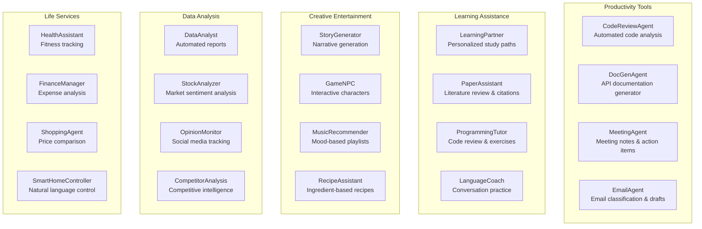
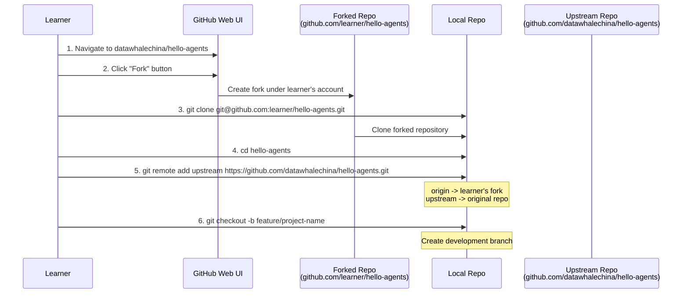
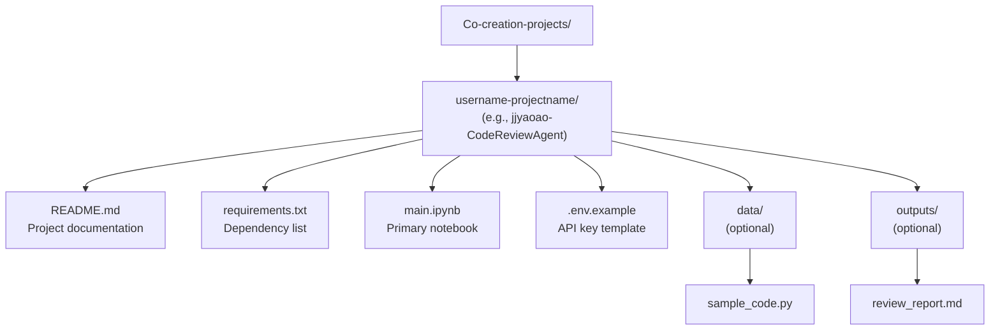
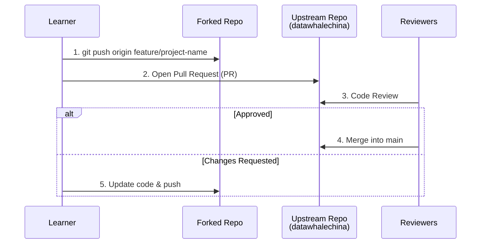
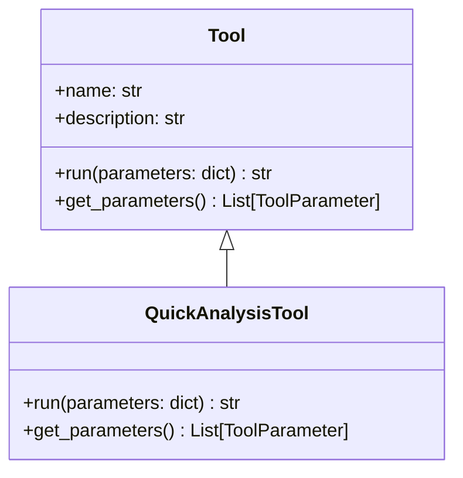
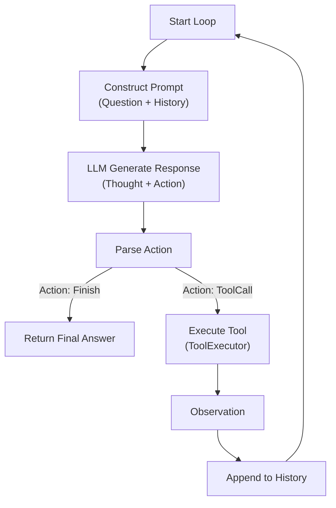

<!-- source: DeepWiki mcp.deepwiki.com · repo datawhalechina/hello-agents · page 3.5 Part 5: Capstone Project (Chapter 16) · fetched 2026-10-29 -->

# Part 5: Capstone Project (Chapter 16)

<details>
<summary>Relevant source files</summary>

The following files were used as context for generating this wiki page:

- [Co-creation-projects/EXAMPLE-ProjectTemplate/.env.example](Co-creation-projects/EXAMPLE-ProjectTemplate/.env.example)
- [Co-creation-projects/EXAMPLE-ProjectTemplate/README.md](Co-creation-projects/EXAMPLE-ProjectTemplate/README.md)
- [Co-creation-projects/EXAMPLE-ProjectTemplate/main.ipynb](Co-creation-projects/EXAMPLE-ProjectTemplate/main.ipynb)
- [Co-creation-projects/EXAMPLE-ProjectTemplate/requirements.txt](Co-creation-projects/EXAMPLE-ProjectTemplate/requirements.txt)
- [Co-creation-projects/jjyaoao-CodeReviewAgent/.env.example](Co-creation-projects/jjyaoao-CodeReviewAgent/.env.example)
- [Co-creation-projects/jjyaoao-CodeReviewAgent/README.md](Co-creation-projects/jjyaoao-CodeReviewAgent/README.md)
- [Co-creation-projects/jjyaoao-CodeReviewAgent/data/sample_code.py](Co-creation-projects/jjyaoao-CodeReviewAgent/data/sample_code.py)
- [Co-creation-projects/jjyaoao-CodeReviewAgent/main.ipynb](Co-creation-projects/jjyaoao-CodeReviewAgent/main.ipynb)
- [Co-creation-projects/jjyaoao-CodeReviewAgent/outputs/review_report.md](Co-creation-projects/jjyaoao-CodeReviewAgent/outputs/review_report.md)
- [Co-creation-projects/jjyaoao-CodeReviewAgent/requirements.txt](Co-creation-projects/jjyaoao-CodeReviewAgent/requirements.txt)
- [code/chapter1/FirstAgentTest.ipynb](code/chapter1/FirstAgentTest.ipynb)
- [code/chapter1/FirstAgentTest.py](code/chapter1/FirstAgentTest.py)
- [code/chapter4/ReAct.py](code/chapter4/ReAct.py)
- [docs/chapter1/Chapter1-Introduction-to-Agents.md](docs/chapter1/Chapter1-Introduction-to-Agents.md)
- [docs/chapter16/Chapter16-Graduation-Project.md](docs/chapter16/Chapter16-Graduation-Project.md)
- [docs/chapter4/Chapter4-Building-Classic-Agent-Paradigms.md](docs/chapter4/Chapter4-Building-Classic-Agent-Paradigms.md)
- [docs/images/2-figures/1757246501849-00.png](docs/images/2-figures/1757246501849-00.png)

</details>


## Purpose and Scope

This section documents the capstone project requirements and submission process for learners completing the Hello-Agents curriculum. The graduation project represents the culmination of all learned concepts—from agent paradigms and tool systems to memory mechanisms and communication protocols—integrated into a complete, functional multi-agent application.

This documentation covers the technical requirements, project structure, development workflow, and GitHub-based submission process. For the case study examples that precede this capstone (Intelligent Travel Assistant, Deep Research Agent, Cyber Town), see [Part 4: Real-World Case Studies (Chapters 13-15)](#3.4). For information on the HelloAgents framework architecture used in projects, see [HelloAgents Framework](#7).

**Sources:** [docs/chapter16/Chapter16-Graduation-Project.md:1-30]()

---

## 16.1 Project Objectives and Requirements

### 16.1.1 Educational Goals

The capstone project serves three primary objectives:

1. **Comprehensive Integration** - Synthesize knowledge from all previous chapters into a cohesive application [docs/chapter16/Chapter16-Graduation-Project.md:12-14]().
2. **Independent Problem-Solving** - Design and implement a complete system addressing a real-world problem [docs/chapter16/Chapter16-Graduation-Project.md:11-12]().
3. **Open-Source Contribution** - Participate in community collaborative development through GitHub [docs/chapter16/Chapter16-Graduation-Project.md:15-16]().

Expected competencies upon completion:
- Design and implement complete agent applications independently [docs/chapter16/Chapter16-Graduation-Project.md:15-15]().
- Utilize HelloAgents framework components (`SimpleAgent`, `ReActAgent`, `ToolRegistry`, `ToolExecutor`) [docs/chapter16/Chapter16-Graduation-Project.md:15-15]().
- Master Git/GitHub workflow (fork, branch, commit, pull request) [docs/chapter16/Chapter16-Graduation-Project.md:15-15]().
- Write clear project documentation (`README.md`, inline comments, docstrings) [docs/chapter16/Chapter16-Graduation-Project.md:15-16]().

**Sources:** [docs/chapter16/Chapter16-Graduation-Project.md:9-23]()

### 16.1.2 Submission Format

Projects are submitted to the `Co-creation-projects/` directory as open-source contributions [docs/chapter16/Chapter16-Graduation-Project.md:19-19]():

| Requirement | Specification |
|------------|---------------|
| **Project Naming** | Format: `{github-username}-{project-name}` (e.g., `jjyaoao-CodeReviewAgent`) [docs/chapter16/Chapter16-Graduation-Project.md:21-21]() |
| **Core Deliverable** | Runnable Jupyter Notebook (`.ipynb`) or Python script [docs/chapter16/Chapter16-Graduation-Project.md:24-24]() |
| **Dependencies** | Complete `requirements.txt` with pinned versions [docs/chapter16/Chapter16-Graduation-Project.md:25-25]() |
| **Documentation** | Comprehensive `README.md` following community template [docs/chapter16/Chapter16-Graduation-Project.md:26-26]() |
| **Submission Method** | GitHub Pull Request to main repository [docs/chapter16/Chapter16-Graduation-Project.md:29-29]() |

**Sources:** [docs/chapter16/Chapter16-Graduation-Project.md:17-29]()

---

## 16.2 Topic Selection and Design

### 16.2.1 Topic Selection Principles

Effective capstone projects balance three criteria:

1. **Practical Value** - Solves a real problem, not just technology demonstration [docs/chapter16/Chapter16-Graduation-Project.md:37-37]().
2. **Scoped Complexity** - Achievable within time constraints while demonstrating technical proficiency [docs/chapter16/Chapter16-Graduation-Project.md:37-37]().
3. **Technical Depth** - Clearly showcases learned capabilities (agent paradigms, tool integration, memory systems) [docs/chapter16/Chapter16-Graduation-Project.md:13-14]().

**Sources:** [docs/chapter16/Chapter16-Graduation-Project.md:33-37]()

### 16.2.2 Recommended Domains

The curriculum suggests four primary domains with concrete examples [docs/chapter16/Chapter16-Graduation-Project.md:41-76]():



**Sources:** [docs/chapter16/Chapter16-Graduation-Project.md:39-76]()

### 16.2.3 Design Example: CodeReviewAgent

The documentation provides a detailed design example demonstrating the analysis-to-implementation workflow [docs/chapter16/Chapter16-Graduation-Project.md:82-89]():

**Problem Statement:** Manual code review is time-consuming and inconsistent. Static analysis tools detect syntax errors but lack semantic understanding [docs/chapter16/Chapter16-Graduation-Project.md:84-84]().

**Core Functions:**
- Code quality analysis (PEP 8 compliance, naming conventions, documentation completeness) [docs/chapter16/Chapter16-Graduation-Project.md:86-86]().
- Bug detection (logic errors, boundary conditions, resource leaks) [docs/chapter16/Chapter16-Graduation-Project.md:86-86]().
- Performance optimization (bottleneck identification, algorithmic improvements) [docs/chapter16/Chapter16-Graduation-Project.md:86-86]().
- Security scanning (SQL injection, XSS vulnerabilities) [docs/chapter16/Chapter16-Graduation-Project.md:86-86]().

**Technical Architecture (Code Implementation):**
The community project `jjyaoao-CodeReviewAgent` implements this using a `SimpleAgent` [Co-creation-projects/jjyaoao-CodeReviewAgent/main.ipynb:130-135]() and a custom `QuickAnalysisTool` [Co-creation-projects/jjyaoao-CodeReviewAgent/main.ipynb:73-102]().

**Sources:** [docs/chapter16/Chapter16-Graduation-Project.md:78-88](), [Co-creation-projects/jjyaoao-CodeReviewAgent/main.ipynb:73-135]()

---

## 16.3 Development Environment Setup

### 16.3.1 Required Software Stack

```bash
# Python environment (3.10+)
pip install "hello-agents[all]"

# Git version control
git --version
git config --global user.name "Your Name"
git config --global user.email "your.email@example.com"

# Jupyter environment
pip install jupyterlab
jupyter lab
```

**Sources:** [docs/chapter16/Chapter16-Graduation-Project.md:92-136]()

### 16.3.2 Repository Fork and Clone Workflow



**Sources:** [docs/chapter16/Chapter16-Graduation-Project.md:138-180]()

### 16.3.3 Project Directory Structure

Projects must follow this standardized structure within `Co-creation-projects/` [docs/chapter16/Chapter16-Graduation-Project.md:182-218]():



**Sources:** [docs/chapter16/Chapter16-Graduation-Project.md:182-218]()

---

## 16.4 Documentation Standards

### 16.4.1 README.md Template

The repository provides a comprehensive template that projects must follow [Co-creation-projects/EXAMPLE-ProjectTemplate/README.md:1-105]():

```markdown
# Project Name

> One-sentence description

## 📝 Project Introduction
- Problem statement
- Unique features
- Target scenarios

## ✨ Core Features
- [ ] Feature 1: Description

## 🛠️ Technology Stack
- HelloAgents framework
- Agent paradigms (ReAct, etc.)
- Tools and APIs

## 🚀 Quick Start
### Installation
pip install -r requirements.txt

### Configuration
cp .env.example .env
```

**Sources:** [Co-creation-projects/EXAMPLE-ProjectTemplate/README.md:1-105]()

### 16.4.2 Requirements.txt Best Practices

Dependency management follows strict versioning conventions [Co-creation-projects/EXAMPLE-ProjectTemplate/requirements.txt:1-15]():

```python
# Core framework
hello-agents[all]>=0.2.7

# LLM related
openai>=1.0.0

# Data processing
pandas>=2.0.0
numpy>=1.24.0

# Environment
python-dotenv>=1.0.0
```

**Sources:** [Co-creation-projects/EXAMPLE-ProjectTemplate/requirements.txt:1-15]()

---

## 16.5 Code Structure and Implementation

### 16.5.1 Notebook Organization

Jupyter notebooks (like `main.ipynb`) typically follow this logical flow:

1.  **Environment Setup**: Import libraries and configure environment variables [Co-creation-projects/jjyaoao-CodeReviewAgent/main.ipynb:42-56]().
2.  **Tool Definition**: Implement custom tools inheriting from `Tool` [Co-creation-projects/jjyaoao-CodeReviewAgent/main.ipynb:73-102]().
3.  **Agent Initialization**: Create `ToolRegistry` and instantiate an agent (e.g., `SimpleAgent`) [Co-creation-projects/jjyaoao-CodeReviewAgent/main.ipynb:123-138]().
4.  **Execution**: Run the agent against test inputs [Co-creation-projects/jjyaoao-CodeReviewAgent/main.ipynb:206-225]().

**Sources:** [Co-creation-projects/jjyaoao-CodeReviewAgent/main.ipynb:42-225]()

### 16.5.2 HelloAgents Framework Integration

Projects integrate core framework components:

```python
from hello_agents import SimpleAgent, HelloAgentsLLM, ToolRegistry
from hello_agents.tools import Tool, ToolParameter

# Tool registration
registry = ToolRegistry()
registry.register_tool(MyCustomTool())

# Agent creation
agent = SimpleAgent(
    name="MyAgent",
    llm=HelloAgentsLLM(),
    tool_registry=registry
)
```

**Sources:** [Co-creation-projects/jjyaoao-CodeReviewAgent/main.ipynb:43-135]()

---

## 16.6 Submission Workflow

### 16.6.1 Git Commit and Branch Management

Commit messages should be clear and descriptive [docs/chapter16/Chapter16-Graduation-Project.md:109-111](). Branch names should reflect the project [docs/chapter16/Chapter16-Graduation-Project.md:178-178]().

**Sources:** [docs/chapter16/Chapter16-Graduation-Project.md:109-178]()

### 16.6.2 Pull Request Submission Process



**Sources:** [docs/chapter16/Chapter16-Graduation-Project.md:29-31]()

---

## 16.7 Technical Reference Patterns

### 16.7.1 Tool Definition Pattern

Tools are defined by overriding the `run` and `get_parameters` methods of the `Tool` class [Co-creation-projects/jjyaoao-CodeReviewAgent/main.ipynb:73-102]().



**Sources:** [Co-creation-projects/jjyaoao-CodeReviewAgent/main.ipynb:73-102]()

### 16.7.2 Agent Loop (ReAct)

For projects using the `ReAct` paradigm, the internal loop follows a Thought-Action-Observation pattern [code/chapter4/ReAct.py:37-70]().



**Sources:** [code/chapter4/ReAct.py:37-70]()

---

## 16.8 Best Practices Summary

### 16.8.1 Security and Environment

- **No Hardcoded Keys**: Use `.env` files and `python-dotenv` [docs/chapter4/Chapter4-Building-Classic-Agent-Paradigms.md:31-42]().
- **Example Env**: Provide a `.env.example` with placeholders [Co-creation-projects/jjyaoao-CodeReviewAgent/.env.example:1-15]().

### 16.8.2 Robustness

- **Error Handling**: Wrap tool execution and LLM calls in `try-except` blocks [code/chapter1/FirstAgentTest.py:36-57]().
- **Validation**: Validate tool inputs before processing [Co-creation-projects/jjyaoao-CodeReviewAgent/main.ipynb:81-83]().

**Sources:** [docs/chapter4/Chapter4-Building-Classic-Agent-Paradigms.md:31-42](), [Co-creation-projects/jjyaoao-CodeReviewAgent/.env.example:1-15](), [code/chapter1/FirstAgentTest.py:36-57](), [Co-creation-projects/jjyaoao-CodeReviewAgent/main.ipynb:81-83]()

---

