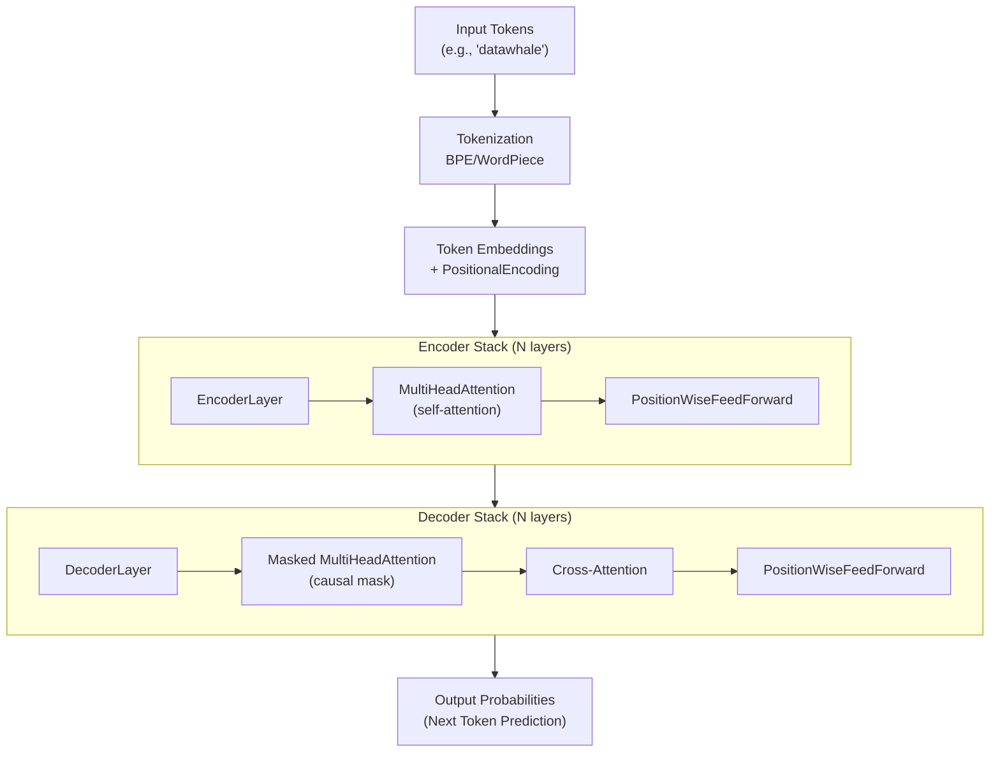
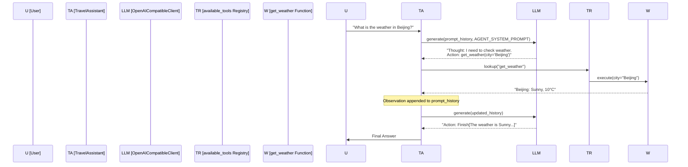

<!-- source: DeepWiki mcp.deepwiki.com · repo datawhalechina/hello-agents · page 4 LLM and Agent Fundamentals · fetched 2026-10-29 -->

# LLM and Agent Fundamentals

Relevant source files

The following files were used as context for generating this wiki page:

- [code/chapter1/FirstAgentTest.ipynb](code/chapter1/FirstAgentTest.ipynb)
- [code/chapter1/FirstAgentTest.py](code/chapter1/FirstAgentTest.py)
- [code/chapter4/ReAct.py](code/chapter4/ReAct.py)
- [docs/chapter1/Chapter1-Introduction-to-Agents.md](docs/chapter1/Chapter1-Introduction-to-Agents.md)
- [docs/chapter16/Chapter16-Graduation-Project.md](docs/chapter16/Chapter16-Graduation-Project.md)
- [docs/chapter3/Chapter3-Fundamentals-of-Large-Language-Models.md](docs/chapter3/Chapter3-Fundamentals-of-Large-Language-Models.md)
- [docs/chapter4/Chapter4-Building-Classic-Agent-Paradigms.md](docs/chapter4/Chapter4-Building-Classic-Agent-Paradigms.md)
- [docs/images/2-figures/1757246501849-00.png](docs/images/2-figures/1757246501849-00.png)

## Purpose and Scope

This document covers the foundational technical concepts underlying AI agents in the Hello-Agents system: (1) the **Large Language Model architecture** (Transformer, attention mechanisms, tokenization, decoder-only design) that serves as the "brain" of modern agents, and (2) **agent architecture fundamentals** (PEAS model, agent types, the Thought-Action-Observation loop, and tool calling mechanisms).

For detailed technical dives into these topics, see the following child pages:
- **[Large Language Model Architecture](#4.1)**: Deep dive into Transformer architecture, tokenization, scaling laws, and prompt engineering.
- **[Agent Concepts and Classification](#4.2)**: Definition of agents, taxonomy of agent types, and the distinction between software engineering and AI-native approaches.
- **[Agent Loop and Tool Usage](#4.3)**: Explanation of the Thought-Action-Observation loop and how agents interact with tools and environments.

---

## Large Language Model Architecture

Modern LLM agents are powered by the **Transformer architecture**, which abandons recurrent structures in favor of parallel computation via attention mechanisms. The original Transformer follows an **Encoder-Decoder** structure, while modern agents primarily utilize **Decoder-Only** architectures for autoregressive reasoning.

### Key Components

| Component | Role | Location in Code |
|-----------|------|------------------|
| `EncoderLayer` | Processes input sequence with self-attention + feedforward | [docs/chapter3/Chapter3-Fundamentals-of-Large-Language-Models.md:236-256]() |
| `DecoderLayer` | Generates output with masked self-attention + cross-attention + feedforward | [docs/chapter3/Chapter3-Fundamentals-of-Large-Language-Models.md:259-283]() |
| `MultiHeadAttention` | Splits attention into multiple heads for parallel processing | [docs/chapter3/Chapter3-Fundamentals-of-Large-Language-Models.md:321-378]() |
| `PositionalEncoding` | Injects position information via sine/cosine functions | [docs/chapter3/Chapter3-Fundamentals-of-Large-Language-Models.md:443-469]() |

#### Transformer Data Flow

For details, see [Large Language Model Architecture](#4.1).

**Sources:** [docs/chapter3/Chapter3-Fundamentals-of-Large-Language-Models.md:186-284]()

---

## Agent Concepts and Classification

An agent is defined as an entity that perceives its **Environment** through **Sensors** and autonomously takes **Actions** through **Actuators** to achieve goals [docs/chapter1/Chapter1-Introduction-to-Agents.md:14-18]().

### Agent Taxonomy

Agents evolve from simple reactive rules to complex learning systems:
- **Simple Reflex Agents**: Use "condition-action" rules (e.g., a thermostat) [docs/chapter1/Chapter1-Introduction-to-Agents.md:26-28]().
- **Model-Based Agents**: Maintain an internal **World Model** to track unobservable states [docs/chapter1/Chapter1-Introduction-to-Agents.md:35-36]().
- **Goal-Based/Utility-Based Agents**: Plan actions to reach specific states or maximize a satisfaction utility [docs/chapter1/Chapter1-Introduction-to-Agents.md:37-39]().
- **Learning Agents**: Improve performance through **Reinforcement Learning (RL)** [docs/chapter1/Chapter1-Introduction-to-Agents.md:43-46]().

### Neuro-Symbolic Hybrid
Modern agents represent a hybrid paradigm where the **Neural** component (LLM) handles perception and reasoning, while the **Symbolic** component handles structured tool execution and logic [docs/chapter1/Chapter1-Introduction-to-Agents.md:110-141]().

For details, see [Agent Concepts and Classification](#4.2).

**Sources:** [docs/chapter1/Chapter1-Introduction-to-Agents.md:14-47](), [docs/chapter1/Chapter1-Introduction-to-Agents.md:110-141]()

---

## Agent Loop and Tool Usage

The **Agent Loop** is the core operational cycle where an LLM acts as the "brain" to orchestrate actions based on environmental feedback.

### The Thought-Action-Observation Cycle

This loop allows the agent to decompose tasks and interact with external systems:
1.  **Thought**: The LLM analyzes the current state and plans the next step.
2.  **Action**: The agent selects a tool to call (e.g., `get_weather`) or provides a final answer.
3.  **Observation**: The environment returns data (e.g., API results), which is appended to the conversation history.

#### Code Entity Interaction Diagram

### Implementation Highlights
- **System Prompting**: The `AGENT_SYSTEM_PROMPT` defines the available tools and the strict `Thought/Action` format [code/chapter1/FirstAgentTest.py:1-24]().
- **Tool Registry**: Tools are mapped in a dictionary like `available_tools` for dynamic lookup during the loop [code/chapter1/FirstAgentTest.py:106-109]().
- **ReAct Paradigm**: A formalized implementation of this loop where reasoning and acting are tightly interleaved [code/chapter4/ReAct.py:26-31]().

For details, see [Agent Loop and Tool Usage](#4.3).

**Sources:** [code/chapter1/FirstAgentTest.py:1-109](), [code/chapter4/ReAct.py:26-31](), [docs/chapter1/Chapter1-Introduction-to-Agents.md:162-213]()

---

