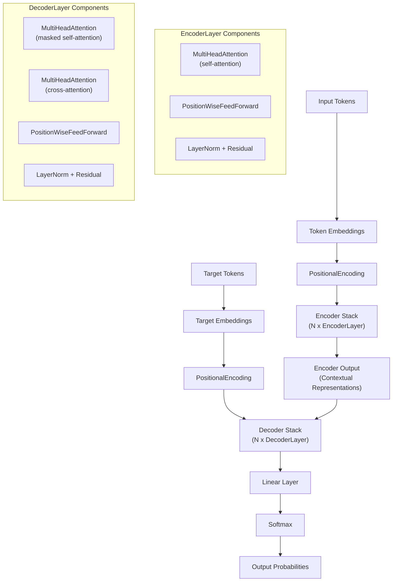
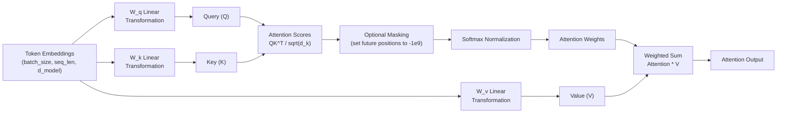
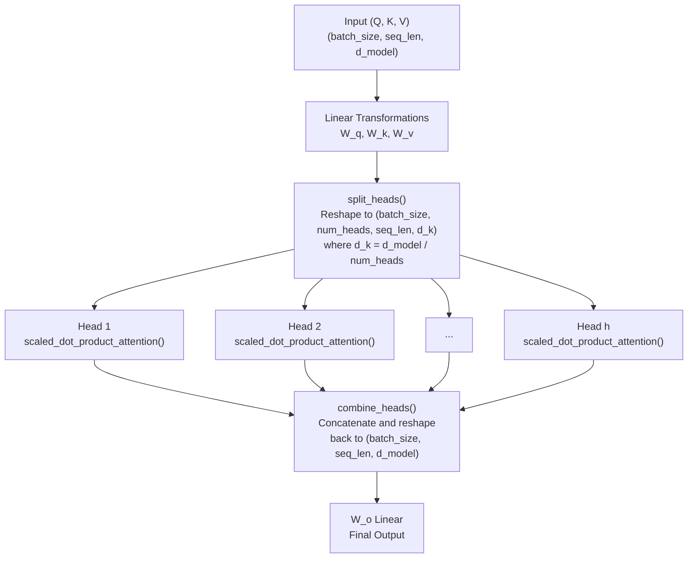
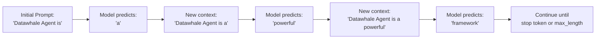
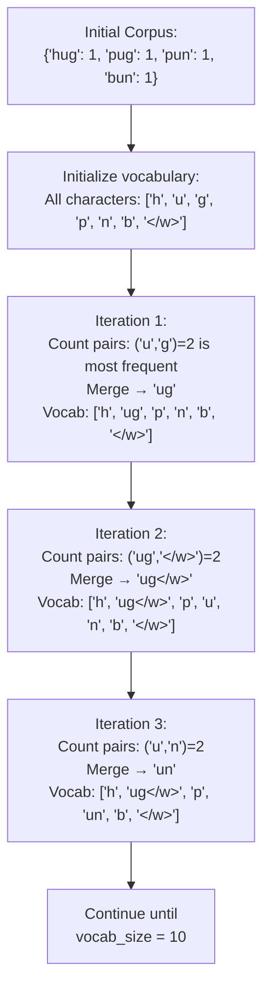
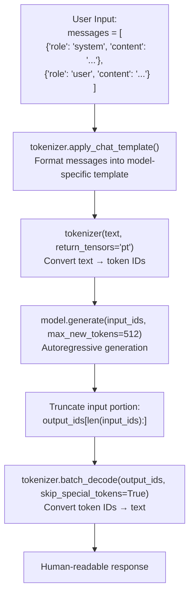

<!-- source: DeepWiki mcp.deepwiki.com · repo datawhalechina/hello-agents · page 4.1 Large Language Model Architecture · fetched 2026-10-29 -->

# Large Language Model Architecture

<details>
<summary>Relevant source files</summary>

The following files were used as context for generating this wiki page:

- [code/chapter2/ELIZA.py](code/chapter2/ELIZA.py)
- [code/chapter3/BPE.py](code/chapter3/BPE.py)
- [code/chapter3/N_gram.py](code/chapter3/N_gram.py)
- [code/chapter3/Qwen.py](code/chapter3/Qwen.py)
- [code/chapter3/Transformer.py](code/chapter3/Transformer.py)
- [code/chapter3/Word_Embedding.py](code/chapter3/Word_Embedding.py)
- [code/chapter4/Plan_and_solve.py](code/chapter4/Plan_and_solve.py)
- [code/chapter4/tools.py](code/chapter4/tools.py)
- [code/chapter6/AutoGenDemo/autogen_software_team.py](code/chapter6/AutoGenDemo/autogen_software_team.py)
- [docs/chapter3/Chapter3-Fundamentals-of-Large-Language-Models.md](docs/chapter3/Chapter3-Fundamentals-of-Large-Language-Models.md)

</details>


## Purpose and Scope

This page provides a technical deep dive into Large Language Model (LLM) architecture, focusing on the foundational components that enable modern AI agents. It covers the evolution from classical statistical models to neural architectures, detailed analysis of the Transformer architecture and its Decoder-Only variant, tokenization algorithms, scaling laws, and inherent limitations of current LLMs.

This page focuses on the **architectural and algorithmic foundations** of LLMs themselves. For information about how agents use these models in reasoning loops, see 4.3 Agent Loop and Tool Usage. For practical integration patterns with the HelloAgents framework, see 7.3 LLM Client Integration.

**Sources:** [docs/chapter3/Chapter3-Fundamentals-of-Large-Language-Models.md:1-10]()

---

## Evolution of Language Model Architectures

### Statistical Language Models: N-gram

The foundational task of language modeling is calculating the probability of a word sequence. N-gram models use the **Markov Assumption**: a word's probability depends only on the previous `n-1` words, not the entire history.

For a sentence with words $w_1, w_2, \ldots, w_m$:

$$P(S) = P(w_1) \cdot P(w_2|w_1) \cdot P(w_3|w_1,w_2) \cdots P(w_m|w_1,\ldots,w_{m-1})$$

Under the Bigram assumption (N=2):

$$P(w_i|w_1,\ldots,w_{i-1}) \approx P(w_i|w_{i-1}) = \frac{Count(w_{i-1}, w_i)}{Count(w_{i-1})}$$

**Key Limitations:**
- **Data Sparsity**: Unseen word sequences have zero probability.
- **No Semantic Generalization**: Cannot understand that "agent" and "robot" are semantically similar.

**Sources:** [docs/chapter3/Chapter3-Fundamentals-of-Large-Language-Models.md:11-106](), [code/chapter3/N_gram.py:1-31]()

---

### Neural Network Language Models

Neural networks introduced **word embeddings** - continuous vector representations where semantically similar words have nearby vectors. This enabled:

1. **Semantic Space**: Words mapped to high-dimensional vectors where similarity is measurable via cosine similarity.
2. **Generalization**: The model can understand `robot learns` even if it only saw `agent learns` during training.

**RNN and LSTM Architectures:**

Recurrent Neural Networks (RNNs) introduced a **hidden state** that carries information across time steps, enabling variable-length sequence processing. However, standard RNNs suffer from the **vanishing gradient problem** for long sequences.

Long Short-Term Memory (LSTM) networks addressed this through:
- **Cell State**: Information highway across time steps.
- **Gating Mechanisms**:
  - Forget Gate: Controls information removal.
  - Input Gate: Controls new information addition.
  - Output Gate: Controls hidden state output.

**Fundamental Limitation**: Sequential processing prevents parallelization, limiting training efficiency and scalability.

**Sources:** [docs/chapter3/Chapter3-Fundamentals-of-Large-Language-Models.md:107-186](), [code/chapter3/Word_Embedding.py:1-23]()

---

## Transformer Architecture

The Transformer architecture eliminated recurrence, achieving full parallelization through the **attention mechanism**. It follows an Encoder-Decoder structure where the encoder understands input and the decoder generates output.

### Overall Architecture and Code Structure



**Core Module Implementation Structure:**

The implementation defines modules that represent the structural hierarchy of the Transformer:

```python
class EncoderLayer(nn.Module):
    def __init__(self, d_model, num_heads, d_ff, dropout):
        self.self_attn = MultiHeadAttention(d_model, num_heads)
        self.feed_forward = PositionWiseFeedForward(d_model, d_ff, dropout)
        self.norm1 = nn.LayerNorm(d_model)
        self.norm2 = nn.LayerNorm(d_model)
        
class DecoderLayer(nn.Module):
    def __init__(self, d_model, num_heads, d_ff, dropout):
        self.self_attn = MultiHeadAttention(d_model, num_heads)
        self.cross_attn = MultiHeadAttention(d_model, num_heads)
        self.feed_forward = PositionWiseFeedForward(d_model, d_ff, dropout)
        self.norm1 = nn.LayerNorm(d_model)
        self.norm2 = nn.LayerNorm(d_model)
        self.norm3 = nn.LayerNorm(d_model)
```

**Sources:** [docs/chapter3/Chapter3-Fundamentals-of-Large-Language-Models.md:187-284](), [code/chapter3/Transformer.py:113-163]()

---

### Self-Attention and Multi-Head Attention

The self-attention mechanism allows each token to attend to all other tokens in the sequence, computing relevance dynamically.

#### Attention Mechanism



**Three Roles:**
- **Query (Q)**: The token seeking information.
- **Key (K)**: Index/label for retrievable information.  
- **Value (V)**: Actual content to retrieve.

**Scaled Dot-Product Attention Formula:**

$$\text{Attention}(Q,K,V) = \text{softmax}\left(\frac{QK^T}{\sqrt{d_k}}\right)V$$

The scaling factor $\sqrt{d_k}$ prevents gradients from becoming too small during the softmax operation.

#### Multi-Head Attention Implementation

Multi-head attention splits Q, K, V into `h` heads, performs parallel attention, then concatenates results:



**Key Methods in MultiHeadAttention:**
- `split_heads()`: Reshapes `(batch_size, seq_len, d_model)` → `(batch_size, num_heads, seq_len, d_k)`. [code/chapter3/Transformer.py:40-44]()
- `scaled_dot_product_attention()`: Computes attention for one head using dot product and softmax. [code/chapter3/Transformer.py:24-38]()
- `combine_heads()`: Reshapes `(batch_size, num_heads, seq_len, d_k)` → `(batch_size, seq_len, d_model)`. [code/chapter3/Transformer.py:46-50]()

**Sources:** [docs/chapter3/Chapter3-Fundamentals-of-Large-Language-Models.md:285-379](), [code/chapter3/Transformer.py:6-64]()

---

### Position-wise Feed-Forward Network

The `PositionWiseFeedForward` module applies the same two-layer network independently to each position:

$$\text{FFN}(x) = \max(0, xW_1 + b_1)W_2 + b_2$$

**Architecture:**
1. First linear layer expands dimension: `d_model` → `d_ff` (typically `d_ff = 4 * d_model`).
2. ReLU activation.
3. Dropout for regularization.
4. Second linear layer projects back: `d_ff` → `d_model`.

```python
class PositionWiseFeedForward(nn.Module):
    def __init__(self, d_model, d_ff, dropout=0.1):
        self.linear1 = nn.Linear(d_model, d_ff)
        self.dropout = nn.Dropout(dropout)
        self.linear2 = nn.Linear(d_ff, d_model)
        self.relu = nn.ReLU()
```

**Sources:** [docs/chapter3/Chapter3-Fundamentals-of-Large-Language-Models.md:380-413](), [code/chapter3/Transformer.py:65-84]()

---

### Residual Connections and Layer Normalization

Every sub-module (attention, feed-forward) is wrapped with `Add & Norm`:

**Residual Connection:**
$$\text{Output} = x + \text{Sublayer}(x)$$

Enables gradient flow through deep networks, preventing vanishing gradients.

**Layer Normalization:**
Normalizes features across the embedding dimension for each sample, stabilizing training.

```python
# In EncoderLayer.forward():
attn_output = self.self_attn(x, x, x, mask)
x = self.norm1(x + self.dropout(attn_output))  # Add & Norm

ff_output = self.feed_forward(x)
x = self.norm2(x + self.dropout(ff_output))    # Add & Norm
```

**Sources:** [docs/chapter3/Chapter3-Fundamentals-of-Large-Language-Models.md:414-423](), [code/chapter3/Transformer.py:125-134]()

---

### Positional Encoding

Self-attention has no inherent notion of token order. `PositionalEncoding` injects position information via fixed sinusoidal functions:

$$PE_{(pos, 2i)} = \sin\left(\frac{pos}{10000^{2i/d_{model}}}\right)$$

$$PE_{(pos, 2i+1)} = \cos\left(\frac{pos}{10000^{2i/d_{model}}}\right)$$

Where:
- `pos`: Position in sequence (0, 1, 2, ...).
- `i`: Dimension index (0 to `d_model/2`).
- Even dimensions use sine, odd dimensions use cosine.

```python
class PositionalEncoding(nn.Module):
    def __init__(self, d_model: int, dropout: float = 0.1, max_len: int = 5000):
        super().__init__()
        # ... calculation of pe matrix ...
        self.register_buffer('pe', pe.unsqueeze(0))
    
    def forward(self, x: torch.Tensor) -> torch.Tensor:
        x = x + self.pe[:, :x.size(1)]
        return self.dropout(x)
```

**Sources:** [docs/chapter3/Chapter3-Fundamentals-of-Large-Language-Models.md:424-470](), [code/chapter3/Transformer.py:85-111]()

---

## Decoder-Only Architecture

Modern LLMs like GPT, Llama, and Qwen use **Decoder-Only** architecture, discarding the encoder entirely. The core insight: language modeling reduces to **predicting the next token**.

### Autoregressive Generation



**Process:**
1. Feed initial prompt to model.
2. Model predicts next token.
3. Append predicted token to input.
4. Repeat from step 2 until termination.

**Sources:** [docs/chapter3/Chapter3-Fundamentals-of-Large-Language-Models.md:471-506](), [code/chapter3/Qwen.py:44-56]()

---

### Masked Self-Attention

To prevent the model from "peeking" at future tokens during training:

```python
# In MultiHeadAttention.scaled_dot_product_attention():
if mask is not None:
    # Set future positions to -1e9 so they become ~0 after softmax
    attn_scores = attn_scores.masked_fill(mask == 0, -1e9)
```

**Mask Structure for sequence length 4:**

|       | Token 0 | Token 1 | Token 2 | Token 3 |
|-------|---------|---------|---------|---------|
| **Pos 0** | ✓ | ✗ | ✗ | ✗ |
| **Pos 1** | ✓ | ✓ | ✗ | ✗ |
| **Pos 2** | ✓ | ✓ | ✓ | ✗ |
| **Pos 3** | ✓ | ✓ | ✓ | ✓ |

**Advantages:**
- **Unified objective**: Single task (next-token prediction) for pre-training.
- **Scalability**: Simpler architecture scales to hundreds of billions of parameters.
- **Generation-optimized**: Naturally suited for text generation tasks.

**Sources:** [docs/chapter3/Chapter3-Fundamentals-of-Large-Language-Models.md:492-506](), [code/chapter3/Transformer.py:29-31]()

---

## Tokenization

### Why Subword Tokenization

**Word-level tokenization issues:**
- Vocabulary explosion (millions of unique words).
- Out-Of-Vocabulary (OOV) problem for unseen words.
- No morphological relationships captured.

**Subword tokenization** balances vocabulary size and semantic expression:
- Common words: Single token (e.g., `"agent"`).
- Rare words: Decomposed into subwords (e.g., `"Tokenization"` → `["Token", "ization"]`).

**Sources:** [docs/chapter3/Chapter3-Fundamentals-of-Large-Language-Models.md:658-673]()

---

### Byte-Pair Encoding (BPE)

BPE iteratively merges the most frequent adjacent token pairs until reaching target vocabulary size.

#### BPE Algorithm Flow



#### BPE Implementation Core Functions

```python
def get_stats(vocab):
    """Count frequencies of adjacent token pairs"""
    pairs = collections.defaultdict(int)
    for word, freq in vocab.items():
        symbols = word.split()
        for i in range(len(symbols)-1):
            pairs[symbols[i], symbols[i+1]] += freq
    return pairs

def merge_vocab(pair, v_in):
    """Merge specified token pair throughout vocabulary"""
    v_out = {}
    bigram = re.escape(' '.join(pair))
    p = re.compile(r'(?<!\S)' + bigram + r'(?!\S)')
    for word in v_in:
        w_out = p.sub(''.join(pair), word)
        v_out[w_out] = v_in[word]
    return v_out
```

**Sources:** [docs/chapter3/Chapter3-Fundamentals-of-Large-Language-Models.md:674-750](), [code/chapter3/BPE.py:3-20]()

---

## Interacting with LLMs via Code

### Loading and Running Open-Source Models

The HelloAgents project demonstrates LLM interaction using the `transformers` library:

```python
from transformers import AutoModelForCausalLM, AutoTokenizer

model_id = "Qwen/Qwen1.5-0.5B-Chat"
device = "cuda" if torch.cuda.is_available() else "cpu"

# Load tokenizer and model
tokenizer = AutoTokenizer.from_pretrained(model_id)
model = AutoModelForCausalLM.from_pretrained(model_id).to(device)
```

**Key Integration Points:**
- `AutoTokenizer.from_pretrained()`: Loads tokenizer matching model architecture. [code/chapter3/Qwen.py:16]()
- `AutoModelForCausalLM.from_pretrained()`: Loads decoder-only models for text generation. [code/chapter3/Qwen.py:19]()

**Sources:** [docs/chapter3/Chapter3-Fundamentals-of-Large-Language-Models.md:759-793](), [code/chapter3/Qwen.py:1-21]()

---

### Tokenization and Generation Pipeline



**Sources:** [docs/chapter3/Chapter3-Fundamentals-of-Large-Language-Models.md:794-848](), [code/chapter3/Qwen.py:24-59]()

---

## Prompt Engineering Fundamentals

### Sampling Parameters

Sampling parameters control the model's output distribution during generation:

#### Temperature

Modifies the softmax probability distribution:

$$p_i^{(T)} = \frac{e^{z_i / T}}{\sum_{j=1}^k e^{z_j / T}}$$

| Temperature Range | Behavior | Use Cases |
|-------------------|----------|-----------|
| **0 ≤ T < 0.3** | Deterministic, focused | Factual Q&A, code generation |
| **0.3 ≤ T < 0.7** | Balanced, natural | Daily conversation, email writing |
| **0.7 ≤ T ≤ 2** | Creative, diverse | Poetry, brainstorming |

#### Top-p (Nucleus) Sampling

Dynamically selects tokens until cumulative probability ≥ `p`.

**Sources:** [docs/chapter3/Chapter3-Fundamentals-of-Large-Language-Models.md:507-540]()

---

## Scaling Laws and Emergence

### Power-Law Relationships

Scaling laws describe predictable relationships between model performance (loss) and factors like parameters (`N`), data (`D`), and compute (`C`):

$$\text{Loss} \propto N^{-\alpha}, \quad \text{Loss} \propto D^{-\beta}, \quad \text{Loss} \propto C^{-\gamma}$$

**Chinchilla Finding:** Smaller models trained on more data often outperform larger models trained on less data (e.g., Llama-3 70B trained on 15T tokens).

### Emergent Capabilities

Capabilities like **Chain-of-Thought (CoT)** reasoning and complex **Instruction Following** often appear suddenly when a model crosses a certain scale (parameter count and training data).

**Sources:** [docs/chapter3/Chapter3-Fundamentals-of-Large-Language-Models.md:892-905]()

---

## Model Limitations

### Hallucination

**Definition:** Content generated by LLMs that contradicts facts or context.

| Type | Description |
|------|-------------|
| **Factual Hallucination** | Inconsistent with real-world facts. |
| **Faithfulness Hallucination** | Fails to reflect provided source text. |

**Mitigation:**
- **RAG (Retrieval-Augmented Generation)**: Grounding generation in external knowledge.
- **Chain-of-Thought**: Breaking down reasoning to reduce accumulation of errors.
- **Tool Usage**: Using search or code execution to verify facts.

**Sources:** [docs/chapter3/Chapter3-Fundamentals-of-Large-Language-Models.md:906-927](), [code/chapter4/tools.py:9-49]()

---

## Summary and Agent Development Implications

1. **Architecture Matters**: Agents rely on the emergent reasoning of large-scale Decoder-Only Transformers.
2. **Prompting is Programming**: Techniques like CoT and few-shot examples are necessary to guide the model's probabilistic output.
3. **Context Management**: Tokenization and context windows are hard constraints in agent design.
4. **Hybrid Systems**: Combining LLM "brains" with external tools (Search, Code Interpreter) is essential to overcome factual hallucinations.

**Sources:** [docs/chapter3/Chapter3-Fundamentals-of-Large-Language-Models.md:929-942]()

---

