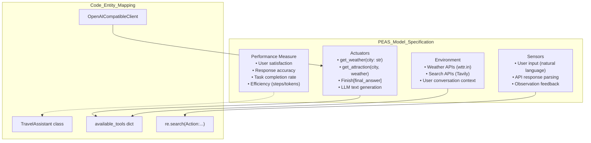
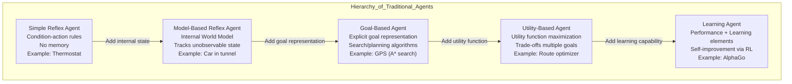
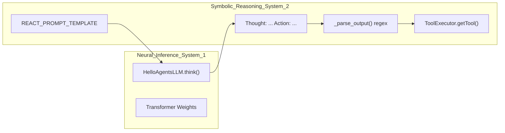

<!-- source: DeepWiki mcp.deepwiki.com · repo datawhalechina/hello-agents · page 4.2 Agent Concepts and Classification · fetched 2026-10-29 -->

# Agent Concepts and Classification

Relevant source files

The following files were used as context for generating this wiki page:

- [README.md](README.md)
- [README_EN.md](README_EN.md)
- [code/chapter1/FirstAgentTest.ipynb](code/chapter1/FirstAgentTest.ipynb)
- [code/chapter1/FirstAgentTest.py](code/chapter1/FirstAgentTest.py)
- [code/chapter4/ReAct.py](code/chapter4/ReAct.py)
- [docs/Preface.md](docs/Preface.md)
- [docs/README.md](docs/README.md)
- [docs/README_EN.md](docs/README_EN.md)
- [docs/_sidebar.md](docs/_sidebar.md)
- [docs/_sidebar_en.md](docs/_sidebar_en.md)
- [docs/chapter1/Chapter1-Introduction-to-Agents.md](docs/chapter1/Chapter1-Introduction-to-Agents.md)
- [docs/chapter16/Chapter16-Graduation-Project.md](docs/chapter16/Chapter16-Graduation-Project.md)
- [docs/chapter4/Chapter4-Building-Classic-Agent-Paradigms.md](docs/chapter4/Chapter4-Building-Classic-Agent-Paradigms.md)
- [docs/images/2-figures/1757246501849-00.png](docs/images/2-figures/1757246501849-00.png)
- [docs/images/star-history-2026324.png](docs/images/star-history-2026324.png)

This page defines agents and their classification systems as implemented in Hello-Agents. An **agent** is an entity that perceives its environment through sensors and autonomously takes actions through actuators to achieve goals. The key distinguishing property is **autonomy** — independent decision-making capability rather than passive instruction execution [docs/chapter1/Chapter1-Introduction-to-Agents.md:14-20]().

## Two Schools of Agent Development

Modern agent development follows two distinct paradigms, as articulated in the Hello-Agents philosophy:

*   **Software Engineering Agents** (workflow-driven): Platforms like Dify, Coze, and n8n where LLMs serve as data processing backends in predefined workflows. The core logic is process-driven software engineering with explicit control flow [README.md:28]().
*   **AI-Native Agents** (intelligence-driven): Systems where the LLM is the central intelligence making autonomous decisions. The Hello-Agents framework focuses on building true AI-native agents that reason, plan, and act dynamically [README.md:28]().

This page covers agent definitions, the PEAS model for task environment specification, traditional agent type hierarchies, the LLM-driven agent paradigm, and classification dimensions including internal architecture, temporal reactivity, and knowledge representation.

**Sources:** [README.md:26-28](), [docs/README.md:26-28](), [docs/chapter1/Chapter1-Introduction-to-Agents.md:14-20]()

---

## 1. Agent Definition and PEAS Model

An **agent** is formally defined as any entity that perceives its **Environment** through **Sensors** and **autonomously** takes **Actions** through **Actuators** to achieve specific goals [docs/chapter1/Chapter1-Introduction-to-Agents.md:14-15]().

### 1.1 PEAS Task Environment Specification

The **PEAS model** (Performance measure, Environment, Actuators, Sensors) provides a structured framework for specifying agent task environments. The following diagram illustrates the PEAS decomposition for the `TravelAssistant` implementation:

**Title: PEAS Model for TravelAssistant Implementation**

**Sources:** [docs/chapter1/Chapter1-Introduction-to-Agents.md:14-20](), [code/chapter1/FirstAgentTest.py:29-109](), [code/chapter1/FirstAgentTest.py:182-198]()

### 1.2 Environment Characteristics

Agent task environments exhibit critical characteristics that dictate design requirements:

| Characteristic | Definition | Example (TravelAssistant) |
| :--- | :--- | :--- |
| **Observability** | Extent of environment visibility | Partially observable (cannot see all web data) |
| **Determinism** | Predictability of action outcomes | Stochastic (API responses vary by time/location) |
| **Multi-Agent** | Presence of other decision-makers | Yes (other users, web services) |
| **Sequential** | Actions affect future states | Yes (querying weather affects next search query) |
| **Dynamic** | Environment changes during deliberation | Yes (real-time weather updates) |

**Sources:** [docs/chapter1/Chapter1-Introduction-to-Agents.md:16-18]()

---

## 2. Traditional Agent Type Hierarchy

Classical AI research established an evolutionary progression of agent architectures based on internal decision complexity [docs/chapter1/Chapter1-Introduction-to-Agents.md:22-25]().

**Title: Traditional Agent Evolutionary Path**

**Sources:** [docs/chapter1/Chapter1-Introduction-to-Agents.md:26-48]()

---

## 3. LLM-Driven Agents: AI-Native Paradigm

Large Language Models (LLMs) enable **AI-native agents** where the model is the central intelligence, providing implicit world models and emergent reasoning capabilities [README.md:28](), [docs/chapter4/Chapter4-Building-Classic-Agent-Paradigms.md:5]().

### 3.1 Comparative Analysis

| Dimension | Software Engineering Agents | AI-Native LLM Agents |
| :--- | :--- | :--- |
| **Core Engine** | Explicit algorithms (FSM, logic rules) | Neural network (Transformer) |
| **Knowledge** | Manual knowledge engineering | Pre-training on massive corpora |
| **Decision Making** | Deterministic rule execution | Probabilistic reasoning |
| **LLM Role** | Backend data processor in workflow | Central autonomous decision maker |

**Sources:** [README.md:28](), [docs/chapter4/Chapter4-Building-Classic-Agent-Paradigms.md:13]()

### 3.2 AI-Native Core Capabilities

The `ReActAgent` and `TravelAssistant` implementations demonstrate three core capabilities:

1.  **Planning and Reasoning**: Decomposing high-level goals into logical subtasks. Implemented via the `Thought:` field in the `AGENT_SYSTEM_PROMPT` [code/chapter1/FirstAgentTest.py:34-45]().
2.  **Tool Use**: Identifying information gaps and proactively invoking external tools. Managed via the `available_tools` registry [code/chapter1/FirstAgentTest.py:106-109]() and `ToolExecutor` [code/chapter4/ReAct.py:29]().
3.  **Dynamic Adjustment**: Updating understanding based on `Observation` feedback in an iterative loop [code/chapter4/ReAct.py:68-70]().

**Sources:** [code/chapter1/FirstAgentTest.py:1-57](), [code/chapter4/ReAct.py:6-24](), [code/chapter4/ReAct.py:60-70]()

---

## 4. Classification by Temporal Reactivity

Classification based on the trade-off between reaction speed and decision quality [docs/chapter1/Chapter1-Introduction-to-Agents.md:78-85]().

*   **Reactive Agents**: Immediate stimulus-response with minimal planning. High speed, low latency [docs/chapter1/Chapter1-Introduction-to-Agents.md:86-92]().
*   **Deliberative Agents**: Engage in explicit planning before execution. High latency, global optima. Example: `Plan-and-Solve` paradigm [docs/chapter1/Chapter1-Introduction-to-Agents.md:93-98](), [docs/chapter4/Chapter4-Building-Classic-Agent-Paradigms.md:10]().
*   **Hybrid Agents**: Combine fast reactions with long-term planning. Modern LLM agents use a "think-act-observe" loop to integrate both [docs/chapter1/Chapter1-Introduction-to-Agents.md:99-109]().

**Sources:** [docs/chapter1/Chapter1-Introduction-to-Agents.md:78-109](), [docs/chapter4/Chapter4-Building-Classic-Agent-Paradigms.md:9-11]()

---

## 5. Classification by Knowledge Representation

This captures how agents encode and process information [docs/chapter1/Chapter1-Introduction-to-Agents.md:110-112]().

### 5.1 Symbolic vs. Sub-Symbolic vs. Neuro-Symbolic

*   **Symbolic AI**: Explicit, human-readable rules and logic. High transparency but brittle [docs/chapter1/Chapter1-Introduction-to-Agents.md:113-119]().
*   **Sub-Symbolic AI**: Distributed patterns in neural weights (LLMs). Noise robust but black-box [docs/chapter1/Chapter1-Introduction-to-Agents.md:120-128]().
*   **Neuro-Symbolic Hybrid**: Modern LLM agents that use neural pattern recognition (System 1) to generate structured symbolic reasoning (System 2) [docs/chapter1/Chapter1-Introduction-to-Agents.md:129-141]().

**Title: Neuro-Symbolic Implementation in Hello-Agents**

**Sources:** [docs/chapter1/Chapter1-Introduction-to-Agents.md:129-141](), [code/chapter4/llm_client.py:28-53](), [code/chapter4/ReAct.py:6-24](), [code/chapter4/ReAct.py:75-82]()

---

## 6. Code-to-Concept Mapping

The following table maps classification concepts to specific code entities in the Hello-Agents repository.

| Classification | Code Entity | File Location |
| :--- | :--- | :--- |
| **AI-Native Agent** | `TravelAssistant` | [code/chapter1/FirstAgentTest.py:202-229]() |
| **ReAct Paradigm** | `ReActAgent` | [code/chapter4/ReAct.py:26-90]() |
| **Reflection Paradigm** | `ReflectionAgent` | [code/chapter4/Reflection.py:97-148]() |
| **Neural Foundation** | `HelloAgentsLLM` | [code/chapter4/llm_client.py:9-53]() |
| **Symbolic Tools** | `available_tools` | [code/chapter1/FirstAgentTest.py:106-109]() |
| **Hybrid Loop** | `for i in range(max_steps)` | [code/chapter1/FirstAgentTest.py:163-208]() |

**Sources:** [code/chapter1/FirstAgentTest.py:1-209](), [code/chapter4/ReAct.py:1-100](), [code/chapter4/Reflection.py:1-163](), [code/chapter4/llm_client.py:1-72]()

---

