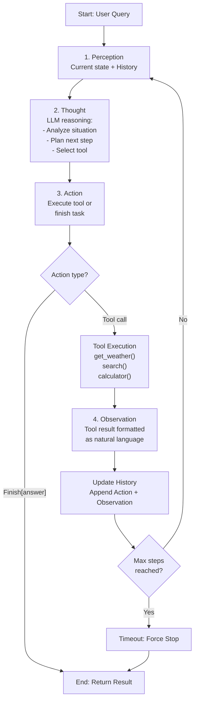
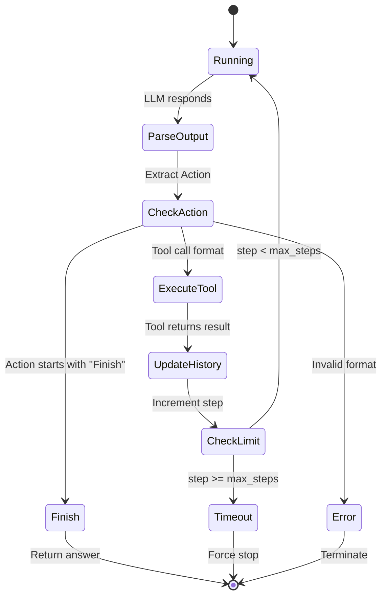
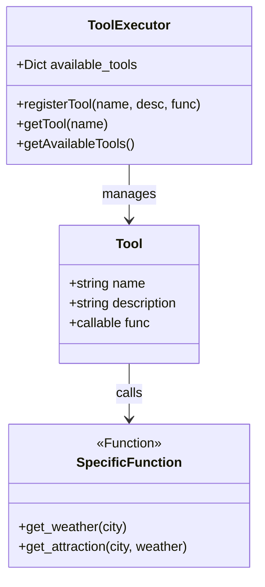
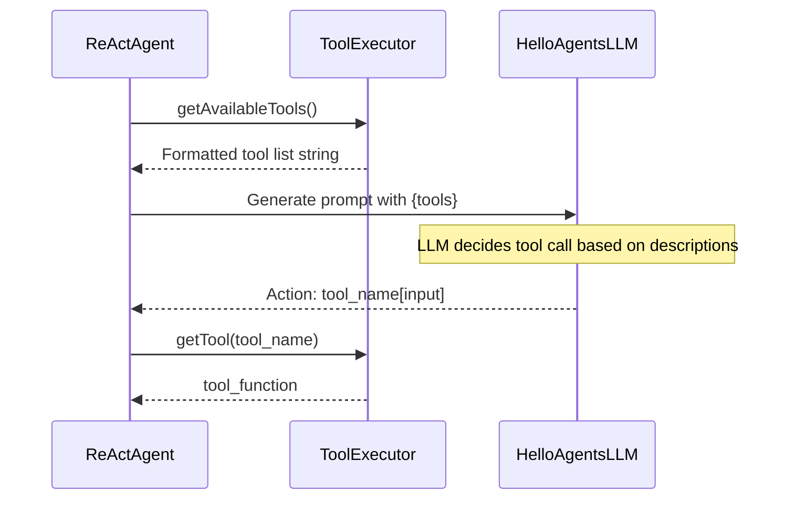
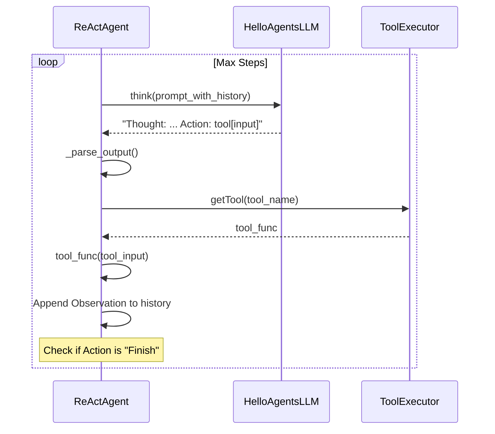

<!-- source: DeepWiki mcp.deepwiki.com · repo datawhalechina/hello-agents · page 4.3 Agent Loop and Tool Usage · fetched 2026-10-29 -->

# Agent Loop and Tool Usage

<details>
<summary>Relevant source files</summary>

The following files were used as context for generating this wiki page:

- [code/chapter1/FirstAgentTest.ipynb](code/chapter1/FirstAgentTest.ipynb)
- [code/chapter1/FirstAgentTest.py](code/chapter1/FirstAgentTest.py)
- [code/chapter4/.env copy](code/chapter4/.env copy)
- [code/chapter4/ReAct.py](code/chapter4/ReAct.py)
- [code/chapter4/Reflection.py](code/chapter4/Reflection.py)
- [code/chapter4/llm_client.py](code/chapter4/llm_client.py)
- [docs/chapter1/Chapter1-Introduction-to-Agents.md](docs/chapter1/Chapter1-Introduction-to-Agents.md)
- [docs/chapter16/Chapter16-Graduation-Project.md](docs/chapter16/Chapter16-Graduation-Project.md)
- [docs/chapter4/Chapter4-Building-Classic-Agent-Paradigms.md](docs/chapter4/Chapter4-Building-Classic-Agent-Paradigms.md)
- [docs/images/2-figures/1757246501849-00.png](docs/images/2-figures/1757246501849-00.png)

</details>


This page explains the fundamental interaction pattern between agents and their environment: the **Thought-Action-Observation loop**. It covers how agents make decisions, select and execute tools, and process feedback in an iterative cycle. This document focuses on the core loop mechanism independent of specific agent paradigms.

Related pages:
- For LLM fundamentals powering agent decision-making, see [4.1]()
- For specific agent paradigm implementations, see [5]()
- For tool system design and custom tool creation, see [7.4]()

## The Agent Loop Fundamentals

### Core Cycle: Thought-Action-Observation

The agent loop is the heartbeat of any autonomous agent system. It represents a continuous cycle where the agent perceives the environment through sensors and takes actions through actuators to achieve goals. In the context of LLM-based agents, this is realized as a closed loop from perception to action.

1.  **Perceives**: The agent receives the current state through observations and previous conversation history.
2.  **Thinks**: The agent analyzes the situation and plans the next step using its LLM reasoning capability.
3.  **Acts**: The agent executes a selected tool or operation.
4.  **Observes**: The agent receives the result of its action as feedback from the environment.



**Diagram: Core Agent Loop Flow**

Sources: [docs/chapter1/Chapter1-Introduction-to-Agents.md:12-21](), [docs/chapter1/Chapter1-Introduction-to-Agents.md:162-213](), [code/chapter1/FirstAgentTest.py:162-208]()

### Loop State Management

The agent maintains an evolving context through history tracking. Each loop iteration appends new information to this history, which becomes part of the LLM's context for the next decision.

| Component | Purpose | Example Content |
| :--- | :--- | :--- |
| `prompt_history` | Accumulates all interactions | `["User request: ...", "Thought: ...", "Action: ...", "Observation: ..."]` |
| `current_step` | Iteration counter | `1, 2, 3, ...` |
| `max_steps` | Safety limit | `5` (typical default) |

The history structure is initialized with the user prompt and updated iteratively:

[code/chapter1/FirstAgentTest.py:157-158]()
```python
user_prompt = "你好，请帮我查询一下今天北京的天气，然后根据天气推荐一个合适的旅游景点。"
prompt_history = [f"用户请求: {user_prompt}"]
```

[code/chapter1/FirstAgentTest.py:165-167]()
```python
# 3.1. 构建Prompt
full_prompt = "\n".join(prompt_history)
```

Sources: [code/chapter1/FirstAgentTest.py:156-208](), [code/chapter4/ReAct.py:33-43]()

### Loop Termination Conditions

The loop terminates under three primary conditions:

1.  **Success Termination**: The agent outputs an action starting with `Finish[final answer]`.
2.  **Timeout Termination**: The loop reaches the `max_steps` limit without a final answer.
3.  **Error Termination**: The agent fails to produce a valid response or a parsing error occurs.



**Diagram: Loop Termination State Machine**

Sources: [code/chapter1/FirstAgentTest.py:163-208](), [code/chapter4/ReAct.py:37-73]()

## Tool System Architecture

### Tool Definition Structure

A tool in the framework consists of the execution logic (function) and metadata (name and description). The description is vital as it serves as the instruction for the LLM.



**Diagram: Tool System Code Entities**

The `description` field informs the LLM when and how to use the tool:

[code/chapter4/ReAct.py:95]()
```python
search_desc = "一个网页搜索引擎。当你需要回答关于时事、事实以及在你的知识库中找不到的信息时，应使用此工具。"
```

Sources: [code/chapter4/ReAct.py:94-96](), [code/chapter1/FirstAgentTest.py:106-109]()

### Tool Registration and Discovery

Tools are registered in a central registry (often a dictionary or a `ToolExecutor` class) so the agent can discover them and include their descriptions in the prompt.

[code/chapter1/FirstAgentTest.py:106-109]()
```python
# 将所有工具函数放入一个字典，方便后续调用
available_tools = {
    "get_weather": get_weather,
    "get_attraction": get_attraction,
}
```



**Diagram: Tool Discovery and Retrieval Flow**

Sources: [code/chapter1/FirstAgentTest.py:105-109](), [code/chapter4/ReAct.py:41-43](), [code/chapter4/ReAct.py:65-66]()

### Tool Execution Lifecycle

When the LLM outputs a tool call, the agent parses the string, looks up the function, executes it, and formats the result as an "Observation".

[code/chapter1/FirstAgentTest.py:196-201]()
```python
    tool_name = re.search(r"(\w+)\(", action_str).group(1)
    args_str = re.search(r"\((.*)\)", action_str).group(1)
    kwargs = dict(re.findall(r'(\w+)="([^"]*)"', args_str))

    if tool_name in available_tools:
        observation = available_tools[tool_name](**kwargs)
```

Sources: [code/chapter1/FirstAgentTest.py:182-203](), [code/chapter4/ReAct.py:60-70]()

## Prompt Engineering for Loop Control

### System Prompt Template

The `AGENT_SYSTEM_PROMPT` defines the agent's identity, the available tools, and the strict output format requirements. It ensures the LLM provides a "Thought" and an "Action" in each step.

[code/chapter1/FirstAgentTest.py:1-24]()
```text
# 可用工具:
- `get_weather(city: str)`: 查询指定城市的实时天气。
- `get_attraction(city: str, weather: str)`: 根据城市和天气搜索推荐的旅游景点。

# 输出格式要求:
你的每次回复必须严格遵循以下格式，包含一对Thought和Action：

Thought: [你的思考过程和下一步计划]
Action: [你要执行的具体行动]
```

Sources: [code/chapter1/FirstAgentTest.py:1-24](), [code/chapter4/ReAct.py:6-24]()

### Dynamic Context Assembly

In each iteration, the agent constructs a `full_prompt` by combining the system instructions, the tool descriptions, the original user question, and the accumulated `history`.

[code/chapter4/ReAct.py:41-43]()
```python
            tools_desc = self.tool_executor.getAvailableTools()
            history_str = "\n".join(self.history)
            prompt = REACT_PROMPT_TEMPLATE.format(tools=tools_desc, question=question, history=history_str)
```

Sources: [code/chapter4/ReAct.py:41-43](), [code/chapter1/FirstAgentTest.py:167-170]()

## Parsing and Execution Flow

### Output Parsing Strategy

The agent uses regular expressions to extract the reasoning trace (`Thought`) and the command (`Action`) from the LLM's raw text response.

[code/chapter4/ReAct.py:75-82]()
```python
    def _parse_output(self, text: str):
        # Thought: 匹配到 Action: 或文本末尾
        thought_match = re.search(r"Thought:\s*(.*?)(?=\nAction:|$)", text, re.DOTALL)
        # Action: 匹配到文本末尾
        action_match = re.search(r"Action:\s*(.*?)$", text, re.DOTALL)
        thought = thought_match.group(1).strip() if thought_match else None
        action = action_match.group(1).strip() if action_match else None
        return thought, action
```

Sources: [code/chapter4/ReAct.py:75-90](), [code/chapter1/FirstAgentTest.py:172-182]()

### Complete Loop Implementation

The following sequence illustrates the interaction between the `ReActAgent`, `HelloAgentsLLM`, and the tool system.



**Diagram: ReAct Agent Loop Execution**

Sources: [code/chapter4/ReAct.py:33-73](), [code/chapter1/FirstAgentTest.py:162-208]()

## Error Handling and Robustness

### Common Failure Modes and Recovery

1.  **Format Hallucination**: If the LLM does not follow the `Thought: Action:` format, the agent records an error observation to prompt the LLM to correct itself in the next step.
2.  **Invalid Tool Call**: If the agent attempts to call a non-existent tool, the observation informs the LLM of the error.
3.  **Infinite Loops**: Controlled by `max_steps` to prevent resource exhaustion.

[code/chapter1/FirstAgentTest.py:183-188]()
```python
    action_match = re.search(r"Action: (.*)", llm_output, re.DOTALL)
    if not action_match:
        observation = "错误: 未能解析到 Action 字段。请确保你的回复严格遵循 'Thought: ... Action: ...' 的格式。"
        observation_str = f"Observation: {observation}"
        print(f"{observation_str}\n" + "="*40)
        prompt_history.append(observation_str)
        continue
```

Sources: [code/chapter1/FirstAgentTest.py:182-188](), [code/chapter4/ReAct.py:52-62]()

### Response Truncation

To prevent the LLM from "simulating" future steps (hallucinating observations), the agent truncates the output to the first Thought-Action pair.

[code/chapter1/FirstAgentTest.py:172-176]()
```python
    match = re.search(r'(Thought:.*?Action:.*?)(?=\n\s*(?:Thought:|Action:|Observation:)|\Z)', llm_output, re.DOTALL)
    if match:
        truncated = match.group(1).strip()
        if truncated != llm_output.strip():
            llm_output = truncated
```

Sources: [code/chapter1/FirstAgentTest.py:171-178]()

---

