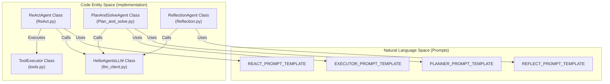
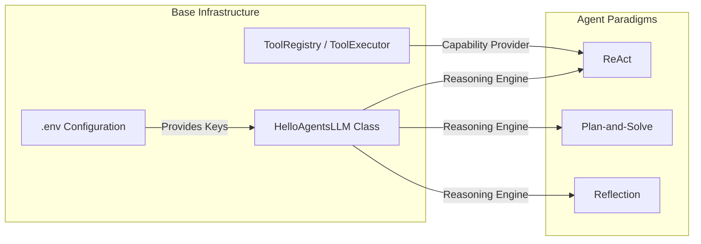

<!-- source: DeepWiki mcp.deepwiki.com · repo datawhalechina/hello-agents · page 5 Agent Paradigms and Design Patterns · fetched 2026-10-29 -->

# Agent Paradigms and Design Patterns

Relevant source files

The following files were used as context for generating this wiki page:

- [code/chapter1/FirstAgentTest.ipynb](code/chapter1/FirstAgentTest.ipynb)
- [code/chapter1/FirstAgentTest.py](code/chapter1/FirstAgentTest.py)
- [code/chapter2/ELIZA.py](code/chapter2/ELIZA.py)
- [code/chapter3/BPE.py](code/chapter3/BPE.py)
- [code/chapter3/N_gram.py](code/chapter3/N_gram.py)
- [code/chapter3/Qwen.py](code/chapter3/Qwen.py)
- [code/chapter3/Transformer.py](code/chapter3/Transformer.py)
- [code/chapter3/Word_Embedding.py](code/chapter3/Word_Embedding.py)
- [code/chapter4/Plan_and_solve.py](code/chapter4/Plan_and_solve.py)
- [code/chapter4/ReAct.py](code/chapter4/ReAct.py)
- [code/chapter4/tools.py](code/chapter4/tools.py)
- [code/chapter6/AutoGenDemo/autogen_software_team.py](code/chapter6/AutoGenDemo/autogen_software_team.py)
- [docs/chapter1/Chapter1-Introduction-to-Agents.md](docs/chapter1/Chapter1-Introduction-to-Agents.md)
- [docs/chapter16/Chapter16-Graduation-Project.md](docs/chapter16/Chapter16-Graduation-Project.md)
- [docs/chapter4/Chapter4-Building-Classic-Agent-Paradigms.md](docs/chapter4/Chapter4-Building-Classic-Agent-Paradigms.md)
- [docs/images/2-figures/1757246501849-00.png](docs/images/2-figures/1757246501849-00.png)

## Purpose and Scope

This document explains the core agent reasoning patterns implemented in the Hello-Agents codebase. These paradigms represent universal design patterns for organizing agent "thinking" and "acting" processes, independent of specific high-level frameworks. By implementing these from scratch, the project demonstrates how to structure Large Language Model (LLM) interactions to achieve complex goal-directed behavior.

This page provides a high-level overview of three primary paradigms: **ReAct** (Reasoning and Acting), **Plan-and-Solve**, and **Reflection**. For detailed implementation guides, refer to the respective child pages.

**Sources:** [docs/chapter4/Chapter4-Building-Classic-Agent-Paradigms.md:1-13]()

---

## Paradigm Overview and Selection

Modern agents connect the reasoning power of LLMs with the external world by decomposing tasks and calling "tools" like search engines or APIs [docs/chapter4/Chapter4-Building-Classic-Agent-Paradigms.md:5-6](). To organize these processes, Hello-Agents implements three classic architectural paradigms:

| Paradigm | Strategy | Key Characteristic |
| :--- | :--- | :--- |
| **ReAct** | Reason-Act Loop | Tightly combines thinking and acting for dynamic adjustments [docs/chapter4/Chapter4-Building-Classic-Agent-Paradigms.md:9]() |
| **Plan-and-Solve** | Think-then-Act | Generates a complete plan first, then executes it strictly [docs/chapter4/Chapter4-Building-Classic-Agent-Paradigms.md:10]() |
| **Reflection** | Self-Correction | Optimizes results through iterative self-criticism and refinement [docs/chapter4/Chapter4-Building-Classic-Agent-Paradigms.md:11]() |

### Implementation Architecture

The codebase bridges "Natural Language Space" (prompts) to "Code Entity Space" (classes and functions) using a consistent structure.

**Agent to Code Mapping**

**Sources:** [code/chapter4/ReAct.py:26-31](), [code/chapter4/Plan_and_solve.py:102-107](), [docs/chapter4/Chapter4-Building-Classic-Agent-Paradigms.md:59-64]()

---

## 5.1 ReAct Paradigm

The **ReAct** (Reasoning and Acting) paradigm implements a dynamic loop where the agent alternates between generating a "Thought" and an "Action". The "Action" results in an "Observation" from the environment, which is fed back into the next reasoning step [code/chapter4/ReAct.py:6-24]().

- **Mechanism**: Iterative Thought-Action-Observation loop.
- **Core Component**: `ReActAgent` class which manages a `history` list to maintain the execution trajectory [code/chapter4/ReAct.py:31-34]().
- **Tool Integration**: Uses a `ToolExecutor` to map string-based action names to Python functions like `search` [code/chapter4/ReAct.py:65-66]().

For details, see [ReAct Paradigm](#5.1).

**Sources:** [code/chapter4/ReAct.py:33-73](), [docs/chapter4/Chapter4-Building-Classic-Agent-Paradigms.md:9]()

---

## 5.2 Plan-and-Solve Paradigm

The **Plan-and-Solve** paradigm adopts a "think before you act" approach. It decouples the process into two distinct phases to handle complex tasks that require long-term consistency [docs/chapter4/Chapter4-Building-Classic-Agent-Paradigms.md:10]().

- **Planning Phase**: A `Planner` class uses a prompt to generate a structured list of sub-tasks [code/chapter4/Plan_and_solve.py:32-36]().
- **Execution Phase**: An `Executor` class iterates through the plan, solving each step sequentially while maintaining a `history` of previous results [code/chapter4/Plan_and_solve.py:77-83]().
- **Implementation**: Orchestrated by the `PlanAndSolveAgent` class [code/chapter4/Plan_and_solve.py:102-108]().

For details, see [Plan-and-Solve Paradigm](#5.2).

**Sources:** [code/chapter4/Plan_and_solve.py:19-30](), [code/chapter4/Plan_and_solve.py:57-75]()

---

## 5.3 Reflection Mechanism

The **Reflection** mechanism endows agents with the ability to self-critique. It is an iterative refinement pattern used to improve the quality of outputs (like code or creative writing) by looking back at previous attempts [docs/chapter4/Chapter4-Building-Classic-Agent-Paradigms.md:11]().

- **Logic**: The agent generates an initial response, then "reflects" on it to identify errors or areas for improvement, and finally "refines" the response.
- **Components**: Usually involves separate prompts for generation and critique to avoid self-bias.
- **Memory**: Relies on a trajectory of past attempts to ensure the refinement process converges on a better solution.

For details, see [Reflection Mechanism](#5.3).

**Sources:** [docs/chapter4/Chapter4-Building-Classic-Agent-Paradigms.md:856-879]()

---

## Shared Infrastructure

All paradigms in the Hello-Agents codebase rely on a common foundation for interacting with LLMs and managing tools.

**Infrastructure Component Relationship**

### Core Classes
- **`HelloAgentsLLM`**: A customized client for calling OpenAI-compatible APIs, supporting streaming responses [docs/chapter4/Chapter4-Building-Classic-Agent-Paradigms.md:59-64]().
- **`ToolExecutor`**: A registry that manages tool descriptions and their corresponding Python functions, allowing agents to "discover" capabilities [code/chapter4/tools.py:53-60]().

**Sources:** [docs/chapter4/Chapter4-Building-Classic-Agent-Paradigms.md:59-103](), [code/chapter4/tools.py:53-83]()

---

