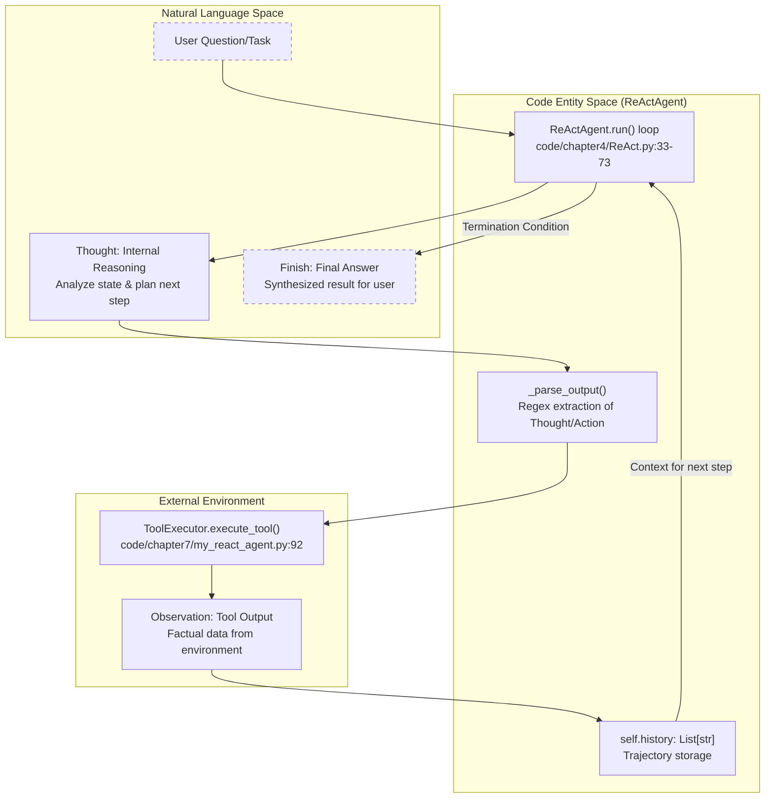
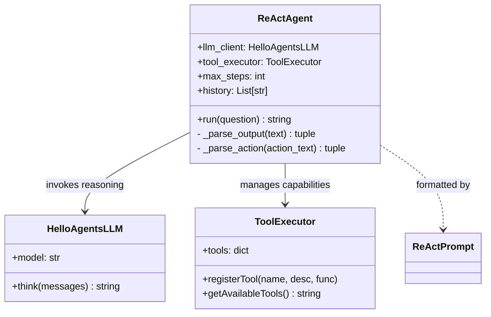
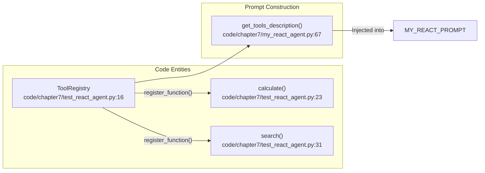

<!-- source: DeepWiki mcp.deepwiki.com · repo datawhalechina/hello-agents · page 5.1 ReAct Paradigm · fetched 2026-10-29 -->

# ReAct Paradigm

Relevant source files

The following files were used as context for generating this wiki page:

- [code/chapter1/FirstAgentTest.ipynb](code/chapter1/FirstAgentTest.ipynb)
- [code/chapter1/FirstAgentTest.py](code/chapter1/FirstAgentTest.py)
- [code/chapter4/ReAct.py](code/chapter4/ReAct.py)
- [code/chapter7/my_main.py](code/chapter7/my_main.py)
- [code/chapter7/my_react_agent.py](code/chapter7/my_react_agent.py)
- [code/chapter7/test_react_agent.py](code/chapter7/test_react_agent.py)
- [docs/chapter1/Chapter1-Introduction-to-Agents.md](docs/chapter1/Chapter1-Introduction-to-Agents.md)
- [docs/chapter16/Chapter16-Graduation-Project.md](docs/chapter16/Chapter16-Graduation-Project.md)
- [docs/chapter4/Chapter4-Building-Classic-Agent-Paradigms.md](docs/chapter4/Chapter4-Building-Classic-Agent-Paradigms.md)
- [docs/chapter7/Chapter7-Building-Your-Agent-Framework.md](docs/chapter7/Chapter7-Building-Your-Agent-Framework.md)
- [docs/images/2-figures/1757246501849-00.png](docs/images/2-figures/1757246501849-00.png)

The ReAct (Reasoning and Acting) paradigm is a foundational agent design pattern that combines explicit reasoning traces with action execution in an iterative loop. This pattern allows agents to "think" about a problem, "act" by invoking tools, and "observe" the results to refine their subsequent reasoning.

## Purpose and Scope

ReAct addresses the limitations of pure reasoning models (which lack environmental grounding) and pure acting models (which lack strategic planning). By interleaving these processes, the agent can:
- **Ground reasoning** in real-world facts obtained through tools.
- **Adjust plans** dynamically based on intermediate observations.
- **Explain its logic** through explicit "Thought" traces before taking actions.

In the Hello-Agents framework, ReAct is implemented as a core architectural pattern that bridges the gap between the LLM's internal knowledge and external APIs.

Sources: [docs/chapter4/Chapter4-Building-Classic-Agent-Paradigms.md:1-14](), [docs/chapter1/Chapter1-Introduction-to-Agents.md:134-213]()

## Operational Workflow

The ReAct cycle follows a continuous **Thought-Action-Observation** loop until a final answer is reached or a maximum step limit is hit.

### The ReAct Loop Diagram

**ReAct Operational Loop bridging Reasoning and Execution**

Sources: [code/chapter4/ReAct.py:33-73](), [code/chapter7/my_react_agent.py:55-100](), [docs/chapter4/Chapter4-Building-Classic-Agent-Paradigms.md:148-162]()

## Implementation Architecture

The Hello-Agents framework provides both a standalone implementation for educational purposes and a framework-integrated version for scalability.

### Core Class Structure

The `ReActAgent` class manages the state and logic of the loop. It relies on an LLM client for generation and a tool registry for execution.

**ReActAgent Class Relationships**

Sources: [code/chapter4/ReAct.py:26-91](), [code/chapter4/llm_client.py:9-53](), [code/chapter7/my_react_agent.py:33-53]()

### Key Functions and Methods

| Method | File | Description |
| :--- | :--- | :--- |
| `run(input_text)` | [code/chapter7/my_react_agent.py:55-100]() | Orchestrates the while-loop, managing steps and history accumulation. |
| `_parse_output(text)` | [code/chapter4/ReAct.py:75-82]() | Uses `re.search` to extract the `Thought:` and `Action:` blocks from LLM raw text. |
| `_parse_action(text)` | [code/chapter4/ReAct.py:84-86]() | Extracts the tool name and arguments from the `Action:` string (e.g., `Tool[Args]`). |
| `think(messages)` | [docs/chapter4/Chapter4-Building-Classic-Agent-Paradigms.md:78-103]() | Communicates with the LLM API (OpenAI compatible) to generate the next step. |

Sources: [code/chapter4/ReAct.py:75-90](), [code/chapter7/my_react_agent.py:55-100](), [docs/chapter4/Chapter4-Building-Classic-Agent-Paradigms.md:78-103]()

## Prompt Engineering and Data Flow

The "Intelligence" of the ReAct agent is driven by a structured prompt template that enforces the Thought-Action-Observation format.

### The ReAct Prompt Template
The `MY_REACT_PROMPT` (or `REACT_PROMPT_TEMPLATE`) defines the interaction protocol:
1. **Available Tools**: Injected via `{tools}`.
2. **Formatting Rules**: Strict requirement for `Thought:` and `Action:`.
3. **History**: Context of previous steps injected via `{history}`.

Sources: [code/chapter7/my_react_agent.py:1-27](), [code/chapter4/ReAct.py:6-24]()

### Execution Trace Example
A typical data flow for a query like "What is the weather in Beijing?" looks as follows:

1. **Step 1 (Thought)**: "I need to find the current weather for Beijing."
2. **Step 1 (Action)**: `get_weather(city="Beijing")`
3. **Step 1 (Observation)**: "Beijing: Sunny, 25°C" [code/chapter1/FirstAgentTest.py:50]()
4. **Step 2 (Thought)**: "I have the weather info. Now I can answer the user."
5. **Step 2 (Action)**: `Finish[The weather in Beijing is sunny at 25°C.]`

Sources: [code/chapter1/FirstAgentTest.py:163-209](), [code/chapter4/ReAct.py:37-73]()

## Tool Integration System

ReAct agents interact with the world through a `ToolRegistry` or `ToolExecutor`. This system decouples the agent's reasoning from the specific implementation of external functions.

### Tool Registry Data Flow

**Tool Registration and Prompt Injection Flow**

Sources: [code/chapter7/test_react_agent.py:16-43](), [code/chapter7/my_react_agent.py:67-74]()

## Performance and Safety

The implementation includes several safeguards to ensure robust operation:
- **Max Steps**: The `max_steps` parameter (defaulting to 5) prevents infinite loops if the LLM fails to converge on a solution. [code/chapter7/my_react_agent.py:50]()
- **Regex Robustness**: Parsers handle variations in LLM output using `re.DOTALL` to capture multi-line thoughts. [code/chapter4/ReAct.py:77-79]()
- **Error Observations**: If an invalid action is generated, the agent receives an "Observation" describing the error, allowing it to self-correct in the next step. [code/chapter4/ReAct.py:62]()

Sources: [code/chapter4/ReAct.py:37-73](), [code/chapter7/my_react_agent.py:62-95]()

---

