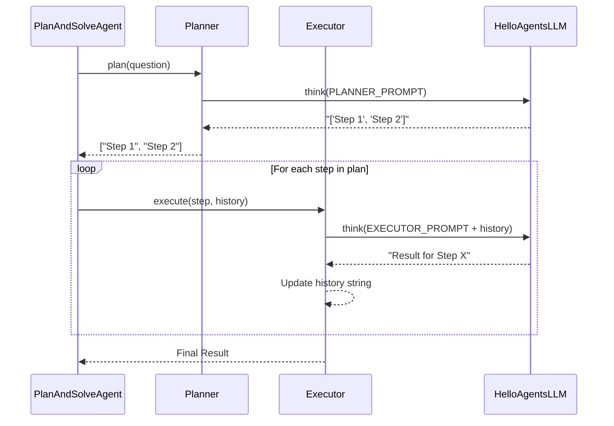

<!-- source: DeepWiki mcp.deepwiki.com · repo datawhalechina/hello-agents · page 5.2 Plan-and-Solve Paradigm · fetched 2026-10-29 -->

# Plan-and-Solve Paradigm

<details>
<summary>Relevant source files</summary>

The following files were used as context for generating this wiki page:

- [code/chapter1/FirstAgentTest.ipynb](code/chapter1/FirstAgentTest.ipynb)
- [code/chapter1/FirstAgentTest.py](code/chapter1/FirstAgentTest.py)
- [code/chapter2/ELIZA.py](code/chapter2/ELIZA.py)
- [code/chapter3/BPE.py](code/chapter3/BPE.py)
- [code/chapter3/N_gram.py](code/chapter3/N_gram.py)
- [code/chapter3/Qwen.py](code/chapter3/Qwen.py)
- [code/chapter3/Transformer.py](code/chapter3/Transformer.py)
- [code/chapter3/Word_Embedding.py](code/chapter3/Word_Embedding.py)
- [code/chapter4/Plan_and_solve.py](code/chapter4/Plan_and_solve.py)
- [code/chapter4/ReAct.py](code/chapter4/ReAct.py)
- [code/chapter4/tools.py](code/chapter4/tools.py)
- [code/chapter6/AutoGenDemo/autogen_software_team.py](code/chapter6/AutoGenDemo/autogen_software_team.py)
- [docs/chapter1/Chapter1-Introduction-to-Agents.md](docs/chapter1/Chapter1-Introduction-to-Agents.md)
- [docs/chapter16/Chapter16-Graduation-Project.md](docs/chapter16/Chapter16-Graduation-Project.md)
- [docs/chapter4/Chapter4-Building-Classic-Agent-Paradigms.md](docs/chapter4/Chapter4-Building-Classic-Agent-Paradigms.md)
- [docs/images/2-figures/1757246501849-00.png](docs/images/2-figures/1757246501849-00.png)

</details>


## Purpose and Scope

This document describes the Plan-and-Solve agent paradigm, a two-phase approach to agent task execution that separates strategic planning from execution. The paradigm first decomposes a complex problem into a structured action plan and then executes each step sequentially. This page covers the architectural components (`Planner`, `Executor`, `PlanAndSolveAgent`), data flow, and implementation details.

For the dynamic, reactive paradigm that interleaves thinking and acting, see [ReAct Paradigm](). For the self-improvement paradigm using iterative refinement, see [Reflection Mechanism]().

**Sources:** [docs/chapter4/Chapter4-Building-Classic-Agent-Paradigms.md:7-11](), [code/chapter4/Plan_and_solve.py:101-115]()

---

## Overview and Motivation

The Plan-and-Solve paradigm addresses the limitations of LLMs when handling multi-step, complex reasoning tasks where models might "lose the thread" or hallucinate intermediate steps. Unlike the **ReAct** pattern which decides each action based on the immediate prior observation, Plan-and-Solve **decouples planning from execution** to maintain long-term goal consistency.

The paradigm follows a "think before you act" philosophy:
1.  **Planning Model ($\pi_{\text{plan}}$)**: Generates a complete blueprint of steps.
2.  **Execution Model ($\pi_{\text{solve}}$)**: Strictly follows the blueprint, using the cumulative history of previous steps to inform the current subtask.

**Sources:** [docs/chapter4/Chapter4-Building-Classic-Agent-Paradigms.md:9-10](), [code/chapter4/Plan_and_solve.py:19-30]()

---

## Two-Phase Workflow

The process is divided into two distinct stages:

### Stage 1: Planning Phase
The `Planner` receives the user's question and uses the `PLANNER_PROMPT_TEMPLATE` to generate a Python-parsable list of subtasks. No tools are called or actions taken during this phase; the goal is pure decomposition.

### Stage 2: Solving Phase
The `Executor` iterates through the generated list. For each step, it constructs a prompt containing the original question, the full plan, and the results of all previously completed steps (`history`).

```mermaid
graph TB
    subgraph "Natural Language Space"
        UserQuestion["'How many apples in total?'"]
        StepDescription["'Calculate Tuesday's sales'"]
    end

    subgraph "Code Entity Space (code/chapter4/Plan_and_solve.py)"
        PSAgent["PlanAndSolveAgent.run()"]
        PlannerObj["Planner.plan()"]
        ExecutorObj["Executor.execute()"]
        LLMClient["HelloAgentsLLM.think()"]
    end

    UserQuestion --> PSAgent
    PSAgent --> PlannerObj
    PlannerObj -->|Prompting| LLMClient
    LLMClient -->|Returns List| PlannerObj
    PlannerObj -->|plan: list[str]| PSAgent
    PSAgent --> ExecutorObj
    ExecutorObj --> StepDescription
    StepDescription -->|Contextual Prompt| LLMClient
    LLMClient -->|Step Result| ExecutorObj
    ExecutorObj -->|Final Answer| PSAgent
```

**Sources:** [code/chapter4/Plan_and_solve.py:32-55](), [code/chapter4/Plan_and_solve.py:77-99](), [code/chapter4/Plan_and_solve.py:108-115]()

---

## Implementation Details

### The Planner Component
The `Planner` class encapsulates the logic for task decomposition. It relies on `ast.literal_eval` for safe parsing of the LLM's output into a Python list.

**Key Logic:**
- **Prompting**: Uses `PLANNER_PROMPT_TEMPLATE` to request a specific `["step1", "step2"]` format [code/chapter4/Plan_and_solve.py:19-30]().
- **Parsing**: Extracts content between ` ```python ` and ` ``` ` markers and converts it to a list [code/chapter4/Plan_and_solve.py:44-51]().

### The Executor Component
The `Executor` class manages the state of the task through a `history` string. 

**State Management:**
As the agent progresses, the `history` variable is updated in a loop:
`history += f"步骤 {i}: {step}\n结果: {response_text}\n\n"` [code/chapter4/Plan_and_solve.py:95-95]().
This ensures that when the LLM solves "Step 3", it knows exactly what happened in "Step 1" and "Step 2".



**Sources:** [code/chapter4/Plan_and_solve.py:32-55](), [code/chapter4/Plan_and_solve.py:77-99]()

---

## Component Reference

| Class | File | Responsibility |
| :--- | :--- | :--- |
| `HelloAgentsLLM` | [code/chapter4/llm_client.py]() | Unified interface for LLM calls (OpenAI-compatible) |
| `Planner` | [code/chapter4/Plan_and_solve.py:32-33]() | Transforms a complex string into a structured list of tasks |
| `Executor` | [code/chapter4/Plan_and_solve.py:77-78]() | Executes subtasks while maintaining a cumulative `history` |
| `PlanAndSolveAgent` | [code/chapter4/Plan_and_solve.py:102-103]() | Orchestrates the `Planner` and `Executor` components |

**Sources:** [code/chapter4/Plan_and_solve.py:32-115](), [docs/chapter4/Chapter4-Building-Classic-Agent-Paradigms.md:59-76]()

---

## Comparison: Plan-and-Solve vs. ReAct

| Feature | Plan-and-Solve | ReAct |
| :--- | :--- | :--- |
| **Reasoning Style** | Upfront planning (Architect) | Iterative reasoning (Detective) |
| **State Management** | Cumulative history of results | Thought-Action-Observation loop |
| **Adaptability** | Low (follows a fixed plan) | High (adjusts based on observations) |
| **Efficiency** | High for predictable tasks | High for exploratory tasks |
| **Implementation** | `Planner` + `Executor` classes | `while` loop with regex parsing |

**Sources:** [docs/chapter4/Chapter4-Building-Classic-Agent-Paradigms.md:7-11](), [code/chapter4/ReAct.py:37-73](), [code/chapter4/Plan_and_solve.py:108-115]()

---

