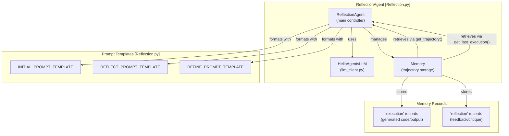
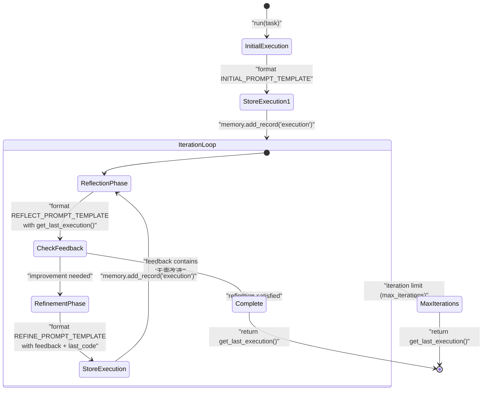
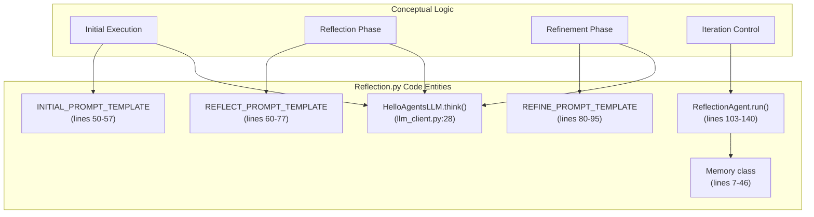

<!-- source: DeepWiki mcp.deepwiki.com · repo datawhalechina/hello-agents · page 5.3 Reflection Mechanism · fetched 2026-10-29 -->

# Reflection Mechanism

<details>
<summary>Relevant source files</summary>

The following files were used as context for generating this wiki page:

- [code/chapter1/FirstAgentTest.ipynb](code/chapter1/FirstAgentTest.ipynb)
- [code/chapter1/FirstAgentTest.py](code/chapter1/FirstAgentTest.py)
- [code/chapter4/.env copy](code/chapter4/.env copy)
- [code/chapter4/ReAct.py](code/chapter4/ReAct.py)
- [code/chapter4/Reflection.py](code/chapter4/Reflection.py)
- [code/chapter4/llm_client.py](code/chapter4/llm_client.py)
- [docs/chapter1/Chapter1-Introduction-to-Agents.md](docs/chapter1/Chapter1-Introduction-to-Agents.md)
- [docs/chapter16/Chapter16-Graduation-Project.md](docs/chapter16/Chapter16-Graduation-Project.md)
- [docs/chapter4/Chapter4-Building-Classic-Agent-Paradigms.md](docs/chapter4/Chapter4-Building-Classic-Agent-Paradigms.md)
- [docs/images/2-figures/1757246501849-00.png](docs/images/2-figures/1757246501849-00.png)

</details>


This document describes the Reflection paradigm, a self-optimization pattern where agents iteratively improve their outputs through self-critique and refinement. This is the third major agent design pattern in the Hello-Agents framework, complementing the ReAct paradigm (see [5.1]()) and Plan-and-Solve paradigm (see [5.2]()).

The Reflection mechanism enables agents to evaluate their own work, identify deficiencies, and generate improved versions through multiple iterations. This approach mimics human problem-solving where initial attempts are reviewed and refined based on feedback.

## Core Concept

The Reflection paradigm is built on a simple yet powerful principle: **agents can improve their performance by critically evaluating their own outputs**. Unlike ReAct, which interleaves reasoning and action with external tools, or Plan-and-Solve, which separates planning from execution, Reflection focuses on **iterative self-improvement** without necessarily requiring external tools.

The paradigm consists of three fundamental phases:

1.  **Initial Execution**: The agent attempts to solve the task based on the original requirements.
2.  **Reflection**: The agent (often prompted into a different role) critically evaluates the initial output, identifying weaknesses and areas for improvement.
3.  **Refinement**: The agent generates an improved version based on the reflection feedback.

This cycle repeats until either the reflection phase determines no further improvement is needed, or a maximum iteration limit is reached.

**Key Characteristics:**

| Characteristic | Description |
| :--- | :--- |
| **Self-Critique** | Agent evaluates its own outputs without external validation. |
| **Role Separation** | LLM plays different roles (generator vs. critic) through prompt engineering. |
| **Iterative Convergence** | Quality improves through successive refinement cycles. |
| **Memory-Dependent** | Maintains history of all attempts and feedback. |
| **Stateful Process** | Each iteration builds upon previous work. |

Sources: [docs/chapter4/Chapter4-Building-Classic-Agent-Paradigms.md:7-11](), [code/chapter4/Reflection.py:106-137]()

## Architecture Components

The Reflection mechanism is implemented through three core components that work together to enable iterative self-improvement.



**Diagram: Reflection Architecture Components and Their Relationships**
Sources: [code/chapter4/Reflection.py:7-148]()

### ReflectionAgent Class

The `ReflectionAgent` class in `code/chapter4/Reflection.py` serves as the orchestrator, managing the entire reflection loop. It coordinates between the LLM, memory system, and prompt templates.

**Key Attributes:**
- `llm_client`: Instance of `HelloAgentsLLM` (defined in `code/chapter4/llm_client.py`) for making model calls.
- `memory`: Instance of `Memory` for storing execution and reflection history.
- `max_iterations`: Safety limit to prevent infinite refinement loops.

**Key Methods:**
- `run(task: str)`: Main entry point that executes the complete reflection cycle [code/chapter4/Reflection.py:103-140]().
- `_get_llm_response(prompt: str)`: Helper method to call LLM and retrieve response [code/chapter4/Reflection.py:142-147]().

Sources: [code/chapter4/Reflection.py:97-101](), [code/chapter4/llm_client.py:9-54]()

### Memory Class

The `Memory` class maintains the complete trajectory of agent behavior, storing both execution attempts and reflection feedback in chronological order.

**Data Structure:**
The `records` list stores dictionaries with `type` ('execution' or 'reflection') and `content` [code/chapter4/Reflection.py:13-23]().

**Key Methods:**
| Method | Purpose | Return Type |
| :--- | :--- | :--- |
| `add_record(record_type, content)` | Append new execution or reflection to history [code/chapter4/Reflection.py:15-24](). | `None` |
| `get_trajectory()` | Format all records as coherent string for prompts [code/chapter4/Reflection.py:26-36](). | `str` |
| `get_last_execution()` | Retrieve most recent execution result [code/chapter4/Reflection.py:38-45](). | `str` |

Sources: [code/chapter4/Reflection.py:7-46]()

### Prompt Template System

The reflection paradigm relies on three distinct prompt templates that shape the LLM's behavior at different stages:

1.  **INITIAL_PROMPT_TEMPLATE**: Instructs the LLM to act as a senior Python programmer generating initial code based on task requirements [code/chapter4/Reflection.py:50-57]().
2.  **REFLECT_PROMPT_TEMPLATE**: Recasts the LLM as a "strict code reviewer and senior algorithm engineer" focused on identifying algorithmic inefficiencies [code/chapter4/Reflection.py:60-77]().
3.  **REFINE_PROMPT_TEMPLATE**: Returns the LLM to the programmer role, providing both the previous attempt and the reviewer's feedback to guide optimization [code/chapter4/Reflection.py:80-95]().

Sources: [code/chapter4/Reflection.py:49-95]()

## Reflection Workflow

The reflection process follows a structured sequence with three distinct phases. Each phase involves specific interactions between the agent, LLM, and memory system.



**Diagram: Reflection Agent State Transitions and Decision Points**
Sources: [code/chapter4/Reflection.py:103-140]()

### Phase 1: Initial Execution

The agent begins by generating an initial attempt without any prior context or feedback.

**Process:**
1.  Format `INITIAL_PROMPT_TEMPLATE` with the user's task description.
2.  Call LLM via `_get_llm_response()` to generate initial output.
3.  Store result in memory as `execution` record.

```python
initial_prompt = INITIAL_PROMPT_TEMPLATE.format(task=task)
initial_code = self._get_llm_response(initial_prompt)
self.memory.add_record("execution", initial_code)
```

Sources: [code/chapter4/Reflection.py:106-110]()

### Phase 2: Reflection

The agent switches to a critical evaluator role, analyzing the most recent execution for deficiencies.

**Process:**
1.  Retrieve the last execution attempt via `memory.get_last_execution()`.
2.  Format `REFLECT_PROMPT_TEMPLATE` with both task and the code to review.
3.  Call LLM (acting as code reviewer) to generate critique.
4.  Store feedback in memory as `reflection` record.
5.  Parse feedback to determine if further improvement is needed.

**Termination Condition:**
If feedback contains keywords like "无需改进" (no need for improvement), the loop terminates [code/chapter4/Reflection.py:124-126]().

Sources: [code/chapter4/Reflection.py:116-126]()

### Phase 3: Refinement

If reflection identifies areas for improvement, the agent generates an optimized version incorporating the feedback.

**Process:**
1.  Format `REFINE_PROMPT_TEMPLATE` with:
    - Original task requirements.
    - Last code attempt (`last_code_attempt`).
    - Reviewer feedback.
2.  Call LLM to generate refined output.
3.  Store new version in memory as `execution` record.
4.  Return to Phase 2 (Reflection) for next iteration.

Sources: [code/chapter4/Reflection.py:129-136]()

## Prompt Engineering Strategy

The effectiveness of the Reflection mechanism depends on role-based prompting and constrained review focus.

### Role-Based Prompting

| Template | Role | Persona Characteristics |
| :--- | :--- | :--- |
| `INITIAL_PROMPT_TEMPLATE` | Senior Python Programmer | Follows PEP 8, writes documentation, produces working code. |
| `REFLECT_PROMPT_TEMPLATE` | Strict Code Reviewer & Algorithm Engineer | Focuses on performance bottlenecks, demands algorithmic improvements. |
| `REFINE_PROMPT_TEMPLATE` | Senior Python Programmer | Incorporates critique, maintains code quality standards. |

Sources: [code/chapter4/Reflection.py:50-57](), [code/chapter4/Reflection.py:60-77](), [code/chapter4/Reflection.py:80-95]()

### Constraining Review Focus

The `REFLECT_PROMPT_TEMPLATE` deliberately narrows the critique scope to **algorithmic efficiency** [code/chapter4/Reflection.py:61-62](). It explicitly asks to analyze time complexity and propose a "better algorithm" (e.g., using a sieve instead of trial division) [code/chapter4/Reflection.py:72-73]().

Sources: [code/chapter4/Reflection.py:60-77]()

## Implementation Details

### Memory Trajectory Management

The `Memory` class provides `get_trajectory()` to format the entire history for context [code/chapter4/Reflection.py:26-36](). However, the `ReflectionAgent` primarily uses `get_last_execution()` to feed the most recent attempt into the next reflection or refinement stage [code/chapter4/Reflection.py:118-132]().

### LLM Response Handling

The `_get_llm_response()` helper method standardizes LLM interaction:
```python
def _get_llm_response(self, prompt: str) -> str:
    messages = [{"role": "user", "content": prompt}]
    response_text = self.llm_client.think(messages=messages) or ""
    return response_text
```
It uses the `HelloAgentsLLM.think()` method, which handles streaming responses and provides visual feedback in the terminal [code/chapter4/llm_client.py:28-49]().

Sources: [code/chapter4/Reflection.py:142-147](), [code/chapter4/llm_client.py:28-49]()

## Code Entity Mapping

The following diagram maps reflection concepts to specific code implementation in `Reflection.py`.



**Diagram: Mapping Reflection Concepts to Code Entities**
Sources: [code/chapter4/Reflection.py:1-148](), [code/chapter4/llm_client.py:28-49]()

## Comparison with Other Paradigms

The Reflection mechanism differs from ReAct and Plan-and-Solve in its approach to task completion:

| Aspect | ReAct | Plan-and-Solve | Reflection |
| :--- | :--- | :--- | :--- |
| **Primary Focus** | Tool interaction [code/chapter4/ReAct.py:29-66]() | Strategic planning | Output quality [code/chapter4/Reflection.py:61-73]() |
| **External Tools** | Required (e.g., Search) [code/chapter4/ReAct.py:94-96]() | Optional | None (self-contained) |
| **Iteration Driver** | Environment feedback | Plan steps | Self-critique [code/chapter4/Reflection.py:120]() |
| **Role Switching** | None | None | Yes (generator ↔ critic) |

Sources: [docs/chapter4/Chapter4-Building-Classic-Agent-Paradigms.md:7-11](), [code/chapter4/Reflection.py:50-95](), [code/chapter4/ReAct.py:6-24]()

---

