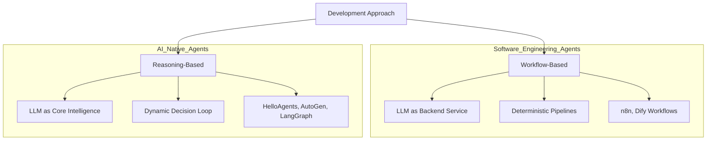
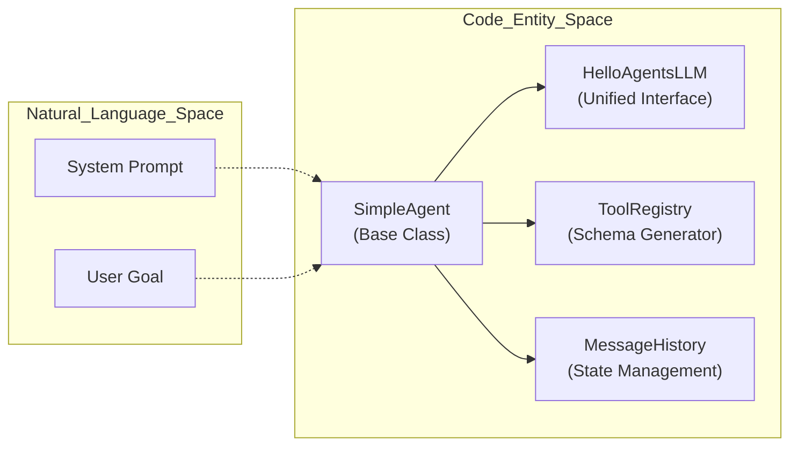

<!-- source: DeepWiki mcp.deepwiki.com · repo datawhalechina/hello-agents · page 6 Development Approaches · fetched 2026-10-29 -->

# Development Approaches

Relevant source files

The following files were used as context for generating this wiki page:

- [code/chapter13/helloagents-trip-planner/backend/requirements.txt](code/chapter13/helloagents-trip-planner/backend/requirements.txt)
- [docs/chapter5/Chapter5-Building-Agents-with-Low-Code-Platforms.md](docs/chapter5/Chapter5-Building-Agents-with-Low-Code-Platforms.md)
- [docs/chapter6/Chapter6-Framework-Development-Practice.md](docs/chapter6/Chapter6-Framework-Development-Practice.md)
- [docs/images/13-figures/13-1.png](docs/images/13-figures/13-1.png)
- [docs/index.html](docs/index.html)

## Purpose and Scope

This page provides a comprehensive overview of the different agent development paths covered in the Hello-Agents tutorial. Building an agent is not a one-size-fits-all process; the curriculum addresses three distinct pathways: **low-code platforms** for rapid prototyping (Chapter 5), **mainstream code frameworks** for production-grade applications (Chapter 6), and a **custom framework** built from scratch to understand internal mechanisms (Chapter 7).

For deep dives into each path, see the following child pages:
- [AI-Native vs Software Engineering Agents](#6.1) — Fundamental architectural distinctions.
- [Low-Code Platforms](#6.2) — Overview of Coze, Dify, and n8n.
- [Mainstream Agent Frameworks](#6.3) — Survey of AutoGen, LangGraph, and AgentScope.
- [Choosing a Development Approach](#6.4) — Decision framework for project selection.

**Sources:** [docs/chapter5/Chapter5-Building-Agents-with-Low-Code-Platforms.md:1-11](), [docs/chapter6/Chapter6-Framework-Development-Practice.md:1-12]()

## Agent Type Classification

A critical distinction in the Hello-Agents curriculum is the difference between "Software Engineering" (workflow-based) and "AI-Native" (reasoning-based) approaches.

### Software Engineering vs. AI-Native Agents

**Software Engineering Agents** treat Large Language Models (LLMs) as backend services that return strings. These systems rely on deterministic workflow orchestration where the LLM is a component in a pre-defined pipeline [docs/chapter5/Chapter5-Building-Agents-with-Low-Code-Platforms.md:15-20]().

**AI-Native Agents** use the LLM as the "core intelligence" or "brain." The model actively decides which tools to call, how to decompose tasks, and when to iterate. This is the primary focus of the Hello-Agents framework [docs/chapter6/Chapter6-Framework-Development-Practice.md:15-23]().

**Diagram: Agent Classification Logic**

**Sources:** [docs/chapter5/Chapter5-Building-Agents-with-Low-Code-Platforms.md:9-20](), [docs/chapter6/Chapter6-Framework-Development-Practice.md:13-25]()

## Low-Code Platforms (Chapter 5)

Low-code platforms lower technical barriers by encapsulating complex details like API calls and state management into visual "nodes" [docs/chapter5/Chapter5-Building-Agents-with-Low-Code-Platforms.md:15-18]().

| Platform | Core Positioning | Target Audience |
| :--- | :--- | :--- |
| **Coze** | Zero-code/low-code building with rich plugin ecosystem [docs/chapter5/Chapter5-Building-Agents-with-Low-Code-Platforms.md:28-30](). | Individual creators, PMs. |
| **Dify** | Open-source LLM application development and operations [docs/chapter5/Chapter5-Building-Agents-with-Low-Code-Platforms.md:34-37](). | Enterprise developers. |
| **n8n** | Workflow automation tool with integrated AI capabilities [docs/chapter5/Chapter5-Building-Agents-with-Low-Code-Platforms.md:40-44](). | Automation engineers. |

For details, see [Low-Code Platforms](#6.2).

**Sources:** [docs/chapter5/Chapter5-Building-Agents-with-Low-Code-Platforms.md:24-46]()

## Mainstream Agent Frameworks (Chapter 6)

Moving from manual scripts to frameworks allows for code reuse and standardized state management [docs/chapter6/Chapter6-Framework-Development-Practice.md:17-23](). The tutorial covers four major frameworks:

- **AutoGen**: Collaboration through conversation between "conversable" agents [docs/chapter6/Chapter6-Framework-Development-Practice.md:39]().
- **AgentScope**: An engineering-focused platform for large-scale multi-agent systems [docs/chapter6/Chapter6-Framework-Development-Practice.md:40]().
- **CAMEL**: Autonomous cooperation through "Role-Playing" and inception prompting [docs/chapter6/Chapter6-Framework-Development-Practice.md:41]().
- **LangGraph**: Modeling agent execution as a cyclic graph for complex iterative workflows [docs/chapter6/Chapter6-Framework-Development-Practice.md:42]().

For details, see [Mainstream Agent Frameworks](#6.3).

**Sources:** [docs/chapter6/Chapter6-Framework-Development-Practice.md:31-42]()

## HelloAgents Custom Framework (Chapter 7)

The `HelloAgents` framework is the educational core of the project. It provides a clean-room implementation of agentic patterns using native APIs.

**Diagram: HelloAgents Architecture Bridge**

Key components include the `HelloAgentsLLM` unified interface and the `ToolRegistry` which automatically converts Python functions into tool schemas [code/chapter13/helloagents-trip-planner/backend/requirements.txt:2]().

For details, see [HelloAgents Framework](#7).

**Sources:** [code/chapter13/helloagents-trip-planner/backend/requirements.txt:1-2](), [docs/chapter6/Chapter6-Framework-Development-Practice.md:11-23]()

## Summary of Approaches

| Feature | Low-Code | Frameworks | Custom (HelloAgents) |
| :--- | :--- | :--- | :--- |
| **Effort** | Low | Medium | High |
| **Flexibility** | Limited by UI | High (Code) | Absolute |
| **Observability** | Visual Traces | Callbacks/Logs | Manual/Direct |
| **Best For** | MVPs, Non-Coders | Production Systems | Learning, Research |

For a decision matrix on which to use, see [Choosing a Development Approach](#6.4).

**Sources:** [docs/chapter5/Chapter5-Building-Agents-with-Low-Code-Platforms.md:15-20](), [docs/chapter6/Chapter6-Framework-Development-Practice.md:17-25]()

---

