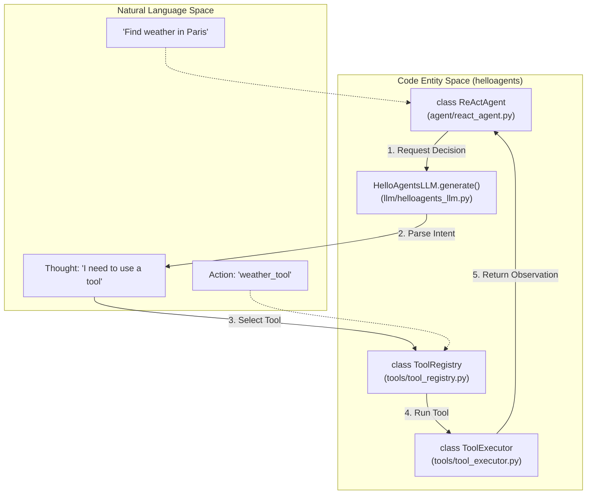
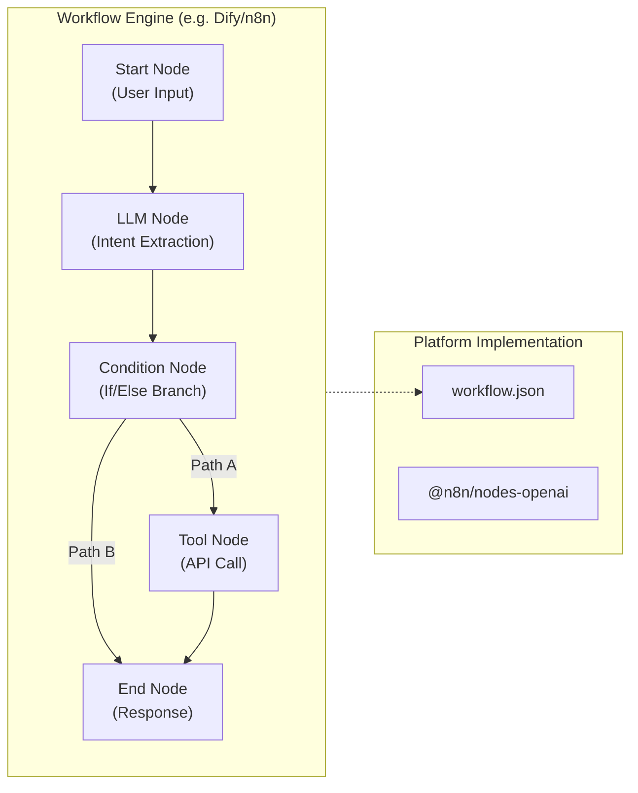

<!-- source: DeepWiki mcp.deepwiki.com · repo datawhalechina/hello-agents · page 6.1 AI-Native vs Software Engineering Agents · fetched 2026-10-29 -->

# AI-Native vs Software Engineering Agents

Relevant source files

The following files were used as context for generating this wiki page:

- [README.md](README.md)
- [README_EN.md](README_EN.md)
- [code/chapter13/helloagents-trip-planner/backend/requirements.txt](code/chapter13/helloagents-trip-planner/backend/requirements.txt)
- [docs/Preface.md](docs/Preface.md)
- [docs/README.md](docs/README.md)
- [docs/README_EN.md](docs/README_EN.md)
- [docs/_sidebar.md](docs/_sidebar.md)
- [docs/_sidebar_en.md](docs/_sidebar_en.md)
- [docs/chapter5/Chapter5-Building-Agents-with-Low-Code-Platforms.md](docs/chapter5/Chapter5-Building-Agents-with-Low-Code-Platforms.md)
- [docs/chapter6/Chapter6-Framework-Development-Practice.md](docs/chapter6/Chapter6-Framework-Development-Practice.md)
- [docs/images/13-figures/13-1.png](docs/images/13-figures/13-1.png)
- [docs/images/star-history-2026324.png](docs/images/star-history-2026324.png)
- [docs/index.html](docs/index.html)

## Purpose and Scope

This page distinguishes between two fundamentally different approaches to building agent systems: **AI-Native agents**, where the Large Language Model (LLM) autonomously makes decisions and controls the execution flow, and **Software Engineering agents**, where LLMs serve as functional components within predetermined, developer-defined workflows. This distinction is critical for selecting the right architecture and framework for specific application requirements.

**Sources:** [README.md:21-29](), [docs/README.md:21-29]()

---

## Core Distinction

The Hello-Agents project emphasizes the development of **AI-Native agents**. As stated in the project introduction, agent construction is currently divided into two schools:

1.  **Software Engineering Agents**: Platforms like **Dify**, **Coze**, and **n8n**. These are essentially process-driven software development environments where the LLM acts as a data processing backend.
2.  **AI-Native Agents**: Truly AI-driven systems where the LLM functions as the "brain" or core intelligence, orchestrating tasks dynamically.

| Characteristic | AI-Native Agents | Software Engineering Agents |
| :--- | :--- | :--- |
| **Decision Authority** | LLM decides next action dynamically | Workflow engine executes predefined steps |
| **Control Flow** | Emergent and context-dependent | Predetermined branching logic (DAG) |
| **Tool Selection** | LLM chooses tools via reasoning | Developer hardcodes tool sequences |
| **Primary Metaphor** | Autonomous Agent | Workflow Orchestration |
| **Implementation** | Code-first (e.g., `ReActAgent`) | Low-code/Graphical (e.g., Nodes/Edges) |

**Sources:** [README.md:21-29](), [docs/README.md:21-29](), [docs/chapter5/Chapter5-Building-Agents-with-Low-Code-Platforms.md:5-20]()

---

## Architectural Comparison

### AI-Native Agent Architecture (LLM-as-Core)

In an AI-Native architecture, the system operates in a loop where the LLM evaluates the current state and decides the next step. The `HelloAgents` framework implements this using classes like `ReActAgent`.

**Diagram: AI-Native Control Flow (Natural Language to Code Entity)**

**Sources:** [README.md:56-62](), [docs/README.md:52-58](), [code/chapter13/helloagents-trip-planner/backend/requirements.txt:1-2]()

### Software Engineering Agent Architecture (LLM-as-Backend)

Software engineering agents use a **Workflow Engine** to traverse a Directed Acyclic Graph (DAG). The LLM is merely a node in this graph, processing input and providing output to the next hardcoded node.

**Diagram: Workflow-Driven Control Flow (Dify/n8n Pattern)**

**Sources:** [docs/chapter5/Chapter5-Building-Agents-with-Low-Code-Platforms.md:296-360](), [docs/chapter5/Chapter5-Building-Agents-with-Low-Code-Platforms.md:693-896]()

---

## Decision-Making and Execution

### AI-Native: The ReAct Pattern
AI-Native agents often follow the **ReAct** (Reason + Act) paradigm. The control logic is encapsulated in the agent's main loop, which repeatedly calls the LLM until a "Finish" signal is generated.

**Key Implementation Details:**
- **`ReActAgent`**: Manages the loop and message history.
- **`HelloAgentsLLM`**: Interfaces with providers like OpenAI or ModelScope to generate the next reasoning step.
- **Dynamic Tooling**: The LLM determines which tool to call from the `ToolRegistry` based on the prompt description.

**Sources:** [README.md:59](), [docs/README.md:55](), [docs/chapter6/Chapter6-Framework-Development-Practice.md:39-42]()

### Software Engineering: The Pipeline Pattern
In software engineering agents, the "intelligence" is in the **graph design**. If a scenario isn't mapped in the DAG, the agent cannot handle it.

**Key Implementation Details:**
- **Nodes**: Standardized blocks for LLM, HTTP requests, or database queries.
- **Edges**: Hardcoded logic (e.g., "if intent == 'weather' go to Node 5").
- **Observability**: Graphical interfaces show the exact path taken through the nodes.

**Sources:** [docs/chapter5/Chapter5-Building-Agents-with-Low-Code-Platforms.md:15-20](), [docs/chapter6/Chapter6-Framework-Development-Practice.md:42-43]()

---

## Comparison of Mainstream Frameworks

The choice of framework often dictates whether the resulting agent is AI-Native or Software Engineering oriented.

| Framework | Category | Philosophy | Key Feature |
| :--- | :--- | :--- | :--- |
| **HelloAgents** | AI-Native | From-scratch education | Direct implementation of ReAct/Reflection |
| **AutoGen** | AI-Native | Conversation-based | Multi-agent group chats (`ConversableAgent`) |
| **AgentScope** | AI-Native | Engineering-focused | Distributed message passing mechanism |
| **LangGraph** | Hybrid | Graph-based state | Supports cycles for iterative reasoning |
| **Dify / Coze** | Software Eng. | Low-code platform | Visual DAG orchestration and RAG pipelines |

**Sources:** [README.md:61-62](), [docs/README.md:57-58](), [docs/chapter6/Chapter6-Framework-Development-Practice.md:31-43]()

---

## Choosing an Approach

| Use AI-Native (Code-First) When: | Use Software Engineering (Low-Code) When: |
| :--- | :--- |
| Tasks are exploratory or unpredictable | Workflows are well-defined and repetitive |
| Dynamic tool selection is required | Deterministic behavior is a priority |
| Building complex multi-agent simulations | Rapid prototyping for non-developers |
| Deep integration with custom Python logic | Standardizing enterprise API orchestrations |

**Sources:** [docs/chapter5/Chapter5-Building-Agents-with-Low-Code-Platforms.md:9-21](), [docs/chapter6/Chapter6-Framework-Development-Practice.md:13-25]()

---

