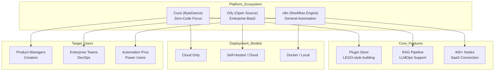
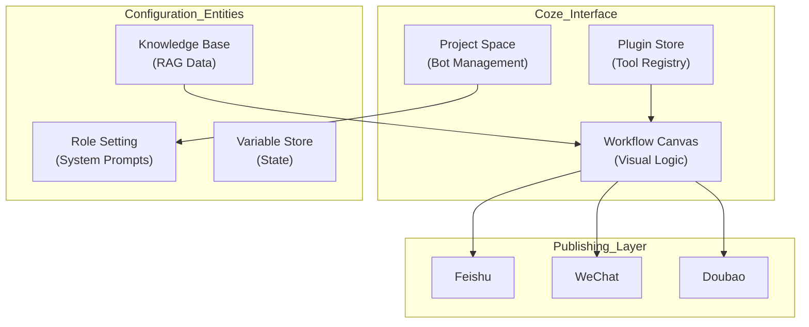
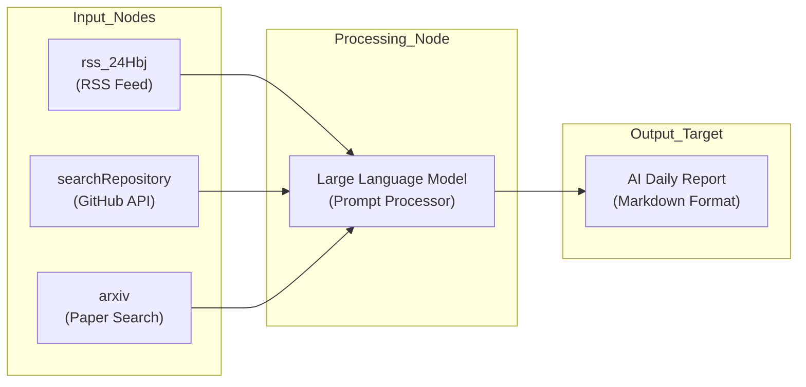
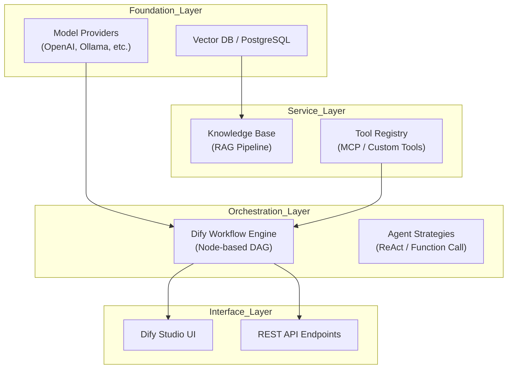
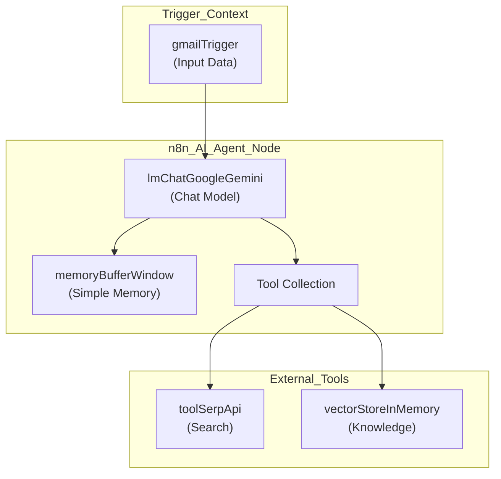

<!-- source: DeepWiki mcp.deepwiki.com · repo datawhalechina/hello-agents · page 6.2 Low-Code Platforms · fetched 2026-10-29 -->

# Low-Code Platforms

<details>
<summary>Relevant source files</summary>

The following files were used as context for generating this wiki page:

- [code/chapter13/helloagents-trip-planner/backend/requirements.txt](code/chapter13/helloagents-trip-planner/backend/requirements.txt)
- [code/chapter5/Chatflow-AI_news-draft-9211.zip](code/chapter5/Chatflow-AI_news-draft-9211.zip)
- [code/chapter5/HelloAgent_n8nCase.json](code/chapter5/HelloAgent_n8nCase.json)
- [docs/chapter5/Chapter5-Building-Agents-with-Low-Code-Platforms.md](docs/chapter5/Chapter5-Building-Agents-with-Low-Code-Platforms.md)
- [docs/chapter6/Chapter6-Framework-Development-Practice.md](docs/chapter6/Chapter6-Framework-Development-Practice.md)
- [docs/images/13-figures/13-1.png](docs/images/13-figures/13-1.png)
- [docs/images/5-figures/coze-01.png](docs/images/5-figures/coze-01.png)
- [docs/images/5-figures/coze-02.png](docs/images/5-figures/coze-02.png)
- [docs/images/5-figures/coze-03.png](docs/images/5-figures/coze-03.png)
- [docs/images/5-figures/coze-04.png](docs/images/5-figures/coze-04.png)
- [docs/images/5-figures/coze-05.png](docs/images/5-figures/coze-05.png)
- [docs/index.html](docs/index.html)

</details>


## Purpose and Scope

This document describes the low-code platform approach to building AI agent applications within the Hello-Agents learning curriculum. Low-code platforms provide graphical, modular interfaces for constructing agent workflows without writing extensive code. This page covers three representative platforms: Coze, Dify, and n8n, including their architectures, capabilities, integration patterns, and trade-offs.

For conceptual differences between AI-native and software engineering approaches to agents, see [AI-Native vs Software Engineering Agents](). For code-first frameworks like AutoGen and LangGraph, see [Mainstream Agent Frameworks](). For guidance on selecting between approaches, see [Choosing a Development Approach]().

Sources: [docs/chapter5/Chapter5-Building-Agents-with-Low-Code-Platforms.md:1-46]()

---

## Platform Positioning

Low-code platforms occupy a distinct position in the agent development landscape. While the HelloAgents framework ([HelloAgents Framework]()) provides fine-grained control through code, low-code platforms abstract common patterns into visual components, enabling rapid prototyping and deployment [docs/chapter5/Chapter5-Building-Agents-with-Low-Code-Platforms.md:3-12]().

### Core Value Proposition

Low-code platforms address specific pain points in agent development:

| Capability | Technical Benefit |
|------------|-------------------|
| **Visual Orchestration** | Drag-and-drop workflow construction eliminates boilerplate code for agent loops and state management [docs/chapter5/Chapter5-Building-Agents-with-Low-Code-Platforms.md:14-15](). |
| **Plugin Ecosystems** | Pre-built integrations with external services (search APIs, databases, LLMs) reduce integration overhead [docs/chapter5/Chapter5-Building-Agents-with-Low-Code-Platforms.md:28-30](). |
| **Prompt Management** | Centralized storage and versioning of prompts separate business logic from implementation [docs/chapter5/Chapter5-Building-Agents-with-Low-Code-Platforms.md:16-17](). |
| **Multi-Channel Publishing** | One-click deployment to platforms (WeChat, Feishu, web) without custom API development [docs/chapter5/Chapter5-Building-Agents-with-Low-Code-Platforms.md:48-52](). |
| **Observability** | Built-in visualization of agent execution traces, tool invocations, and intermediate states [docs/chapter5/Chapter5-Building-Agents-with-Low-Code-Platforms.md:17-17](). |

Sources: [docs/chapter5/Chapter5-Building-Agents-with-Low-Code-Platforms.md:9-21](), [docs/chapter5/Chapter5-Building-Agents-with-Low-Code-Platforms.md:48-52]()

### Platform Comparison Matrix

The three platforms target different use cases and user profiles:

Title: Platform Ecosystem and Target Profiles


Sources: [docs/chapter5/Chapter5-Building-Agents-with-Low-Code-Platforms.md:22-46]()

---

## Coze Platform Architecture

Coze focuses on a zero-code building experience, abstracting complex technical details like API calls and state management into "nodes" [docs/chapter5/Chapter5-Building-Agents-with-Low-Code-Platforms.md:14-15]().

### Component Structure

Coze organizes development around several primary modules visible in the interface:

Title: Coze Component Architecture


Sources: [docs/chapter5/Chapter5-Building-Agents-with-Low-Code-Platforms.md:48-55](), [docs/chapter5/Chapter5-Building-Agents-with-Low-Code-Platforms.md:28-30]()

### Workflow Orchestration Pattern

Coze implements a plugin-based orchestration model where data flows between discrete nodes [docs/chapter5/Chapter5-Building-Agents-with-Low-Code-Platforms.md:14-15]().

Title: Coze Data Flow (Daily AI Brief Example)


Sources: [docs/chapter5/Chapter5-Building-Agents-with-Low-Code-Platforms.md:100-150]() (approximate based on case study)

---

## Dify Platform Architecture

Dify is an open-source platform that integrates backend services and model operations (LLMOps) [docs/chapter5/Chapter5-Building-Agents-with-Low-Code-Platforms.md:32-37]().

### Layered Architecture

Dify adopts a four-layer architecture to support enterprise-level applications:

Title: Dify BaaS Architecture


Sources: [docs/chapter5/Chapter5-Building-Agents-with-Low-Code-Platforms.md:32-37](), [docs/chapter5/Chapter5-Building-Agents-with-Low-Code-Platforms.md:296-308]()

---

## n8n Platform Architecture

n8n is an open-source workflow automation tool that treats AI capabilities as specialized nodes within a larger automation chain [docs/chapter5/Chapter5-Building-Agents-with-Low-Code-Platforms.md:38-46]().

### AI Agent Node Implementation

The `AI Agent` node in n8n (defined in [code/chapter5/HelloAgent_n8nCase.json]()) acts as a container for LLM logic, memory, and tools.

Title: n8n AI Agent Node Internals


Sources: [code/chapter5/HelloAgent_n8nCase.json:31-82](), [code/chapter5/HelloAgent_n8nCase.json:170-188]()

### Docker Installation (Additional-Chapter)

n8n is typically deployed via Docker for persistent self-hosting [docs/chapter5/Chapter5-Building-Agents-with-Low-Code-Platforms.md:959-960]().

**Basic Docker Run**:
```bash
docker run -it --rm --name n8n -p 5678:5678 -v ~/.n8n:/home/node/.n8n n8nio/n8n
```

**Persistence Configuration**:
n8n uses a local folder (mapped via `-v`) to store workflow definitions and credentials. For production, a database like PostgreSQL is recommended for the backend [docs/chapter5/Chapter5-Building-Agents-with-Low-Code-Platforms.md:960-968]().

Sources: [docs/chapter5/Chapter5-Building-Agents-with-Low-Code-Platforms.md:959-968]()

---

## Workflow Export and Portability

Low-code platforms allow exporting workflows for sharing or version control.

### Export Formats
- **Coze**: Exports as a ZIP package containing `MANIFEST.yml` and workflow YAML [code/chapter5/Chatflow-AI_news-draft-9211.zip:1-1]()
- **Dify**: Exports as DSL (Domain Specific Language) in YAML format.
- **n8n**: Exports as a single JSON file containing node configurations and connection metadata [code/chapter5/HelloAgent_n8nCase.json:1-5]()

### JSON Structure Example (n8n)
The n8n export defines nodes with `type`, `position`, and `parameters` [code/chapter5/HelloAgent_n8nCase.json:3-21](). Connections are implied by the structure or explicitly defined in the `connections` object (not shown in snippet but present in full JSON).

Sources: [code/chapter5/HelloAgent_n8nCase.json:1-21](), [code/chapter5/Chatflow-AI_news-draft-9211.zip:1-1]()

---

## Comparative Decision Framework

| Feature | Coze | Dify | n8n |
|---------|------|------|-----|
| **Ease of Use** | High (Zero-code) | Medium (Developer-centric) | Low (Steep curve) |
| **Customization** | Low (Plugin-based) | High (Code/Workflow) | Very High (Custom Code Nodes) |
| **Self-Hosting** | No | Yes (Docker) | Yes (Docker/npm) |
| **Best For** | Rapid Prototyping | Enterprise AI Apps | Business Automation |

Sources: [docs/chapter5/Chapter5-Building-Agents-with-Low-Code-Platforms.md:22-46]()

---

