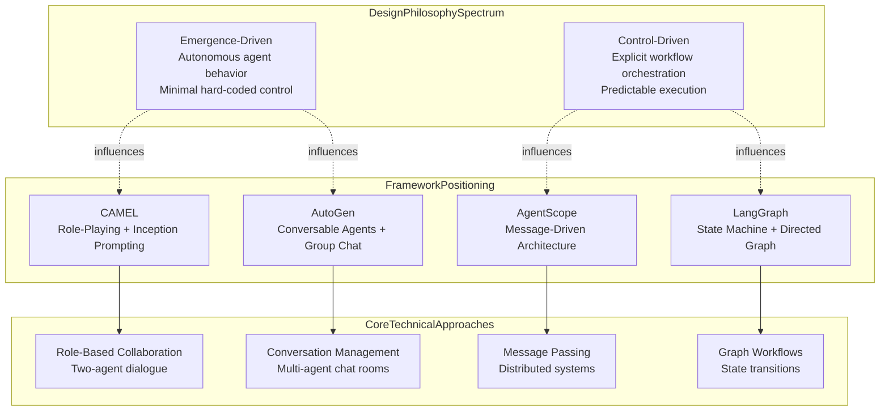
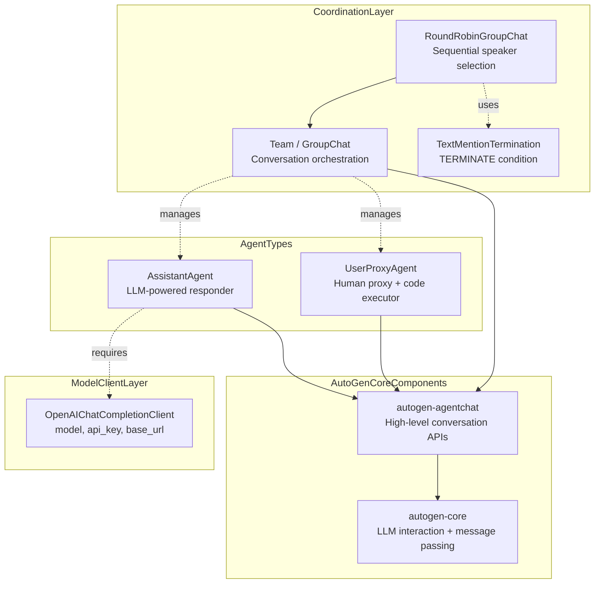
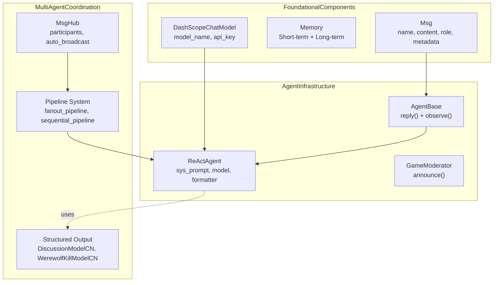
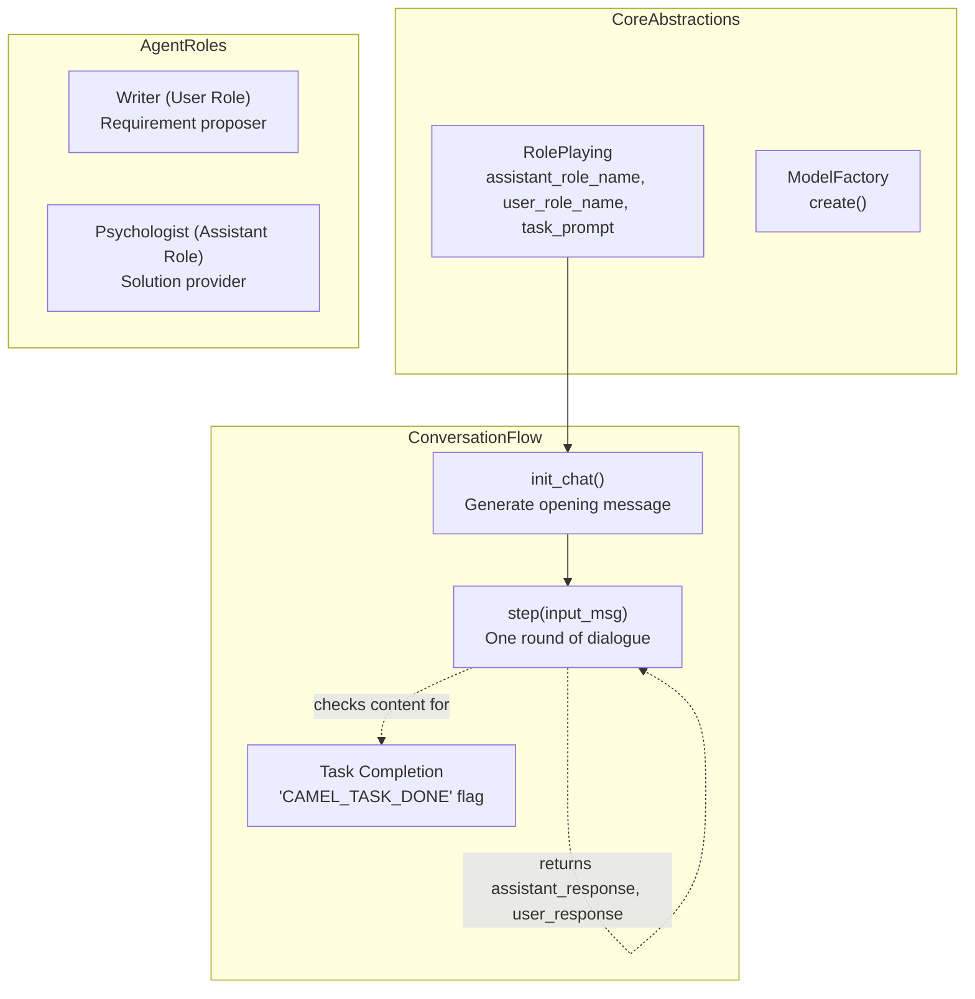
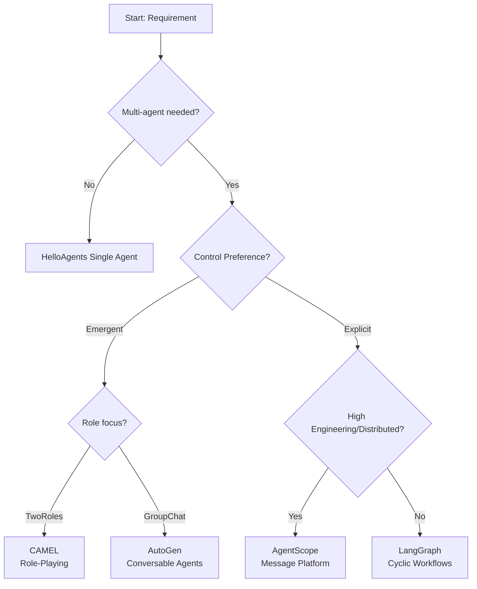

<!-- source: DeepWiki mcp.deepwiki.com · repo datawhalechina/hello-agents · page 6.3 Mainstream Agent Frameworks · fetched 2026-10-29 -->

# Mainstream Agent Frameworks

Relevant source files

The following files were used as context for generating this wiki page:

- [code/chapter13/helloagents-trip-planner/backend/requirements.txt](code/chapter13/helloagents-trip-planner/backend/requirements.txt)
- [code/chapter6/AgentScopeDemo/README.md](code/chapter6/AgentScopeDemo/README.md)
- [code/chapter6/AgentScopeDemo/game_roles.py](code/chapter6/AgentScopeDemo/game_roles.py)
- [code/chapter6/AgentScopeDemo/main_cn.py](code/chapter6/AgentScopeDemo/main_cn.py)
- [code/chapter6/AgentScopeDemo/prompt_cn.py](code/chapter6/AgentScopeDemo/prompt_cn.py)
- [code/chapter6/AgentScopeDemo/requirements.txt](code/chapter6/AgentScopeDemo/requirements.txt)
- [code/chapter6/AgentScopeDemo/structured_output_cn.py](code/chapter6/AgentScopeDemo/structured_output_cn.py)
- [code/chapter6/AgentScopeDemo/utils_cn.py](code/chapter6/AgentScopeDemo/utils_cn.py)
- [code/chapter6/AutoGenDemo/.env copy](code/chapter6/AutoGenDemo/.env copy)
- [code/chapter6/AutoGenDemo/README.md](code/chapter6/AutoGenDemo/README.md)
- [code/chapter6/AutoGenDemo/requirements.txt](code/chapter6/AutoGenDemo/requirements.txt)
- [code/chapter6/CAMEL/DigitalBookWriting.py](code/chapter6/CAMEL/DigitalBookWriting.py)
- [docs/chapter5/Chapter5-Building-Agents-with-Low-Code-Platforms.md](docs/chapter5/Chapter5-Building-Agents-with-Low-Code-Platforms.md)
- [docs/chapter6/Chapter6-Framework-Development-Practice.md](docs/chapter6/Chapter6-Framework-Development-Practice.md)
- [docs/images/13-figures/13-1.png](docs/images/13-figures/13-1.png)
- [docs/index.html](docs/index.html)

This page provides a comparative overview of the four mainstream agent frameworks covered in the Hello-Agents tutorial: **AutoGen**, **AgentScope**, **CAMEL**, and **LangGraph**. Each framework represents a distinct architectural approach to building multi-agent systems, ranging from conversation-driven collaboration to explicit state machine control.

---

## Framework Landscape Overview

The agent framework ecosystem has evolved beyond general-purpose LLM application frameworks (like LangChain and LlamaIndex) to address specific challenges in **multi-agent collaboration** and **complex workflow control**. The four frameworks examined here represent different technical paths toward solving these challenges.

Title: Design Philosophy and Framework Positioning

Sources: [docs/chapter6/Chapter6-Framework-Development-Practice.md:27-43](), [docs/chapter6/Chapter6-Framework-Development-Practice.md:33-43]()

---

## Comparative Framework Analysis

### Design Philosophy Matrix

| Framework | Core Concept | Collaboration Mode | Control Method | Primary Use Case |
|-----------|--------------|-------------------|----------------|------------------|
| **AutoGen** | Conversable agents in group chats | Multi-agent conversation | Emergent behavior from roles | Rapid prototyping, exploratory tasks |
| **AgentScope** | Message-driven agent platform | Message passing via `MsgHub` | Explicit routing + persistence | Production systems, high-concurrency |
| **CAMEL** | Role-playing autonomous agents | Two-agent dialogue loops | Inception prompting constraints | Creative tasks, cross-domain collaboration |
| **LangGraph** | State machine as directed graph | Node-to-node state transitions | Conditional edges + loops | Complex workflows, iterative processes |

Sources: [docs/chapter6/Chapter6-Framework-Development-Practice.md:33-43]()

---

## Framework Architecture Comparison

### AutoGen: Conversation-Driven Architecture

AutoGen abstracts multi-agent systems as a group chat composed of multiple "conversable" agents. It adopts a compositional architecture centered on `autogen-core` and `autogen-agentchat` modules.

Title: AutoGen Technical Architecture

**Key Code Entities:**
- `OpenAIChatCompletionClient` - Model interface [code/chapter6/AutoGenDemo/requirements.txt:3-4]()
- `AssistantAgent` - LLM-powered agent [docs/chapter6/Chapter6-Framework-Development-Practice.md:39]()
- `UserProxyAgent` - Execution agent [docs/chapter6/Chapter6-Framework-Development-Practice.md:39]()
- `RoundRobinGroupChat` - Sequential coordination logic.
- `TextMentionTermination` - Termination logic based on specific strings.

Sources: [docs/chapter6/Chapter6-Framework-Development-Practice.md:39-40](), [code/chapter6/AutoGenDemo/requirements.txt:1-10]()

---

### AgentScope: Production-Grade Message Platform

AgentScope is a message-driven platform designed for ease of use and engineering stability. It utilizes a `MsgHub` for communication and supports structured output via Pydantic models.

Title: AgentScope Message-Driven Architecture

**Key Code Entities:**
- `ReActAgent` - Core agent implementation [code/chapter6/AgentScopeDemo/main_cn.py:11]()
- `DashScopeChatModel` - LLM interface for Qwen models [code/chapter6/AgentScopeDemo/main_cn.py:12]()
- `MsgHub` - Context manager for multi-agent communication [code/chapter6/AgentScopeDemo/main_cn.py:13]()
- `fanout_pipeline` - Utility for concurrent agent execution [code/chapter6/AgentScopeDemo/main_cn.py:13]()
- `DiscussionModelCN` - Pydantic model for structured reasoning [code/chapter6/AgentScopeDemo/structured_output_cn.py:8]()

Sources: [code/chapter6/AgentScopeDemo/main_cn.py:6-145](), [code/chapter6/AgentScopeDemo/structured_output_cn.py:1-21](), [docs/chapter6/Chapter6-Framework-Development-Practice.md:40-40]()

---

### CAMEL: Role-Playing Framework

CAMEL provides a "Role-Playing" collaboration method where two agents (Assistant and User) cooperate under the guidance of "Inception Prompting".

Title: CAMEL Role-Playing Flow

**Key Code Entities:**
- `RolePlaying` - Session orchestrator [code/chapter6/CAMEL/DigitalBookWriting.py:2]()
- `ModelFactory` - Factory for creating model instances [code/chapter6/CAMEL/DigitalBookWriting.py:4]()
- `init_chat()` - Starts the collaboration session [code/chapter6/CAMEL/DigitalBookWriting.py:47]()
- `step()` - Executes one round of interaction [code/chapter6/CAMEL/DigitalBookWriting.py:51]()

Sources: [code/chapter6/CAMEL/DigitalBookWriting.py:1-63](), [docs/chapter6/Chapter6-Framework-Development-Practice.md:41-41]()

---

### LangGraph: State Machine Framework

LangGraph models agent execution as a directed graph where nodes represent computation (LLM calls, tool usage) and edges represent state transitions.

**Key Code Entities:**
- `StateGraph` - Container for the workflow definition [docs/chapter6/Chapter6-Framework-Development-Practice.md:42]().
- `Nodes` - Python functions that process state [docs/chapter6/Chapter6-Framework-Development-Practice.md:42]().
- `Edges` - Define transitions, supporting cycles and conditional logic [docs/chapter6/Chapter6-Framework-Development-Practice.md:42]().

Sources: [docs/chapter6/Chapter6-Framework-Development-Practice.md:42-42]()

---

## Framework Selection and Comparison

### Summary Comparison Table

| Feature | AutoGen | AgentScope | CAMEL | LangGraph |
| :--- | :--- | :--- | :--- | :--- |
| **Philosophy** | Conversation-centric | Message-driven platform | Role-playing | Graph-based state machine |
| **Collaboration** | Group Chat | Pipelines & MsgHub | Two-agent Dialogue | Node Transitions |
| **Best For** | Multi-agent prototyping | Production & Engineering | Complementary roles | Complex workflows & Loops |
| **Control** | Emergent | Explicit/Structured | Prompt-guided | Explicit/Cyclic |

Sources: [docs/chapter6/Chapter6-Framework-Development-Practice.md:33-42]()

### Selection Decision Tree

Title: Choosing an Agent Framework

Sources: [docs/chapter6/Chapter6-Framework-Development-Practice.md:33-42](), [docs/chapter5/Chapter5-Building-Agents-with-Low-Code-Platforms.md:24-46]()

---

