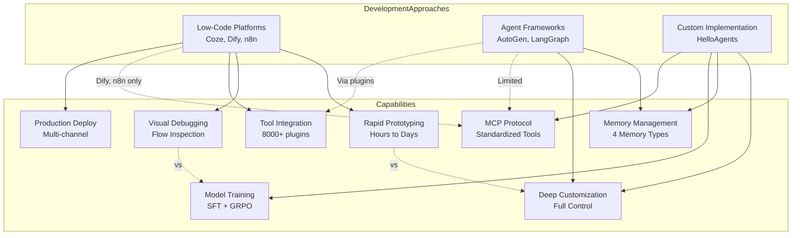
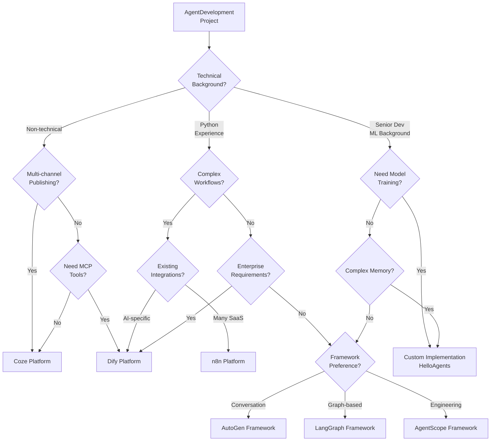
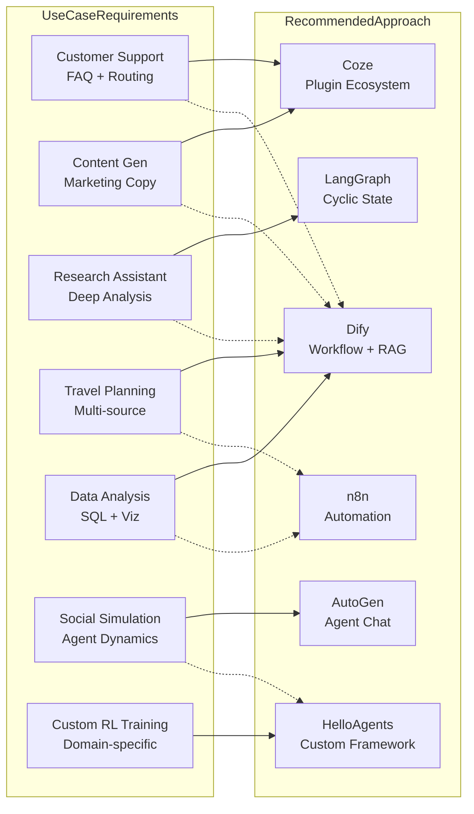
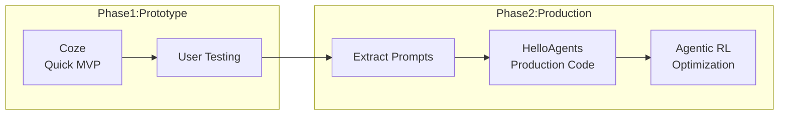

<!-- source: DeepWiki mcp.deepwiki.com · repo datawhalechina/hello-agents · page 6.4 Choosing a Development Approach · fetched 2026-10-29 -->

# Choosing a Development Approach

Relevant source files

The following files were used as context for generating this wiki page:

- [README.md](README.md)
- [README_EN.md](README_EN.md)
- [code/chapter13/helloagents-trip-planner/backend/requirements.txt](code/chapter13/helloagents-trip-planner/backend/requirements.txt)
- [docs/Preface.md](docs/Preface.md)
- [docs/README.md](docs/README.md)
- [docs/README_EN.md](docs/README_EN.md)
- [docs/_sidebar.md](docs/_sidebar.md)
- [docs/_sidebar_en.md](docs/_sidebar_en.md)
- [docs/chapter5/Chapter5-Building-Agents-with-Low-Code-Platforms.md](docs/chapter5/Chapter5-Building-Agents-with-Low-Code-Platforms.md)
- [docs/chapter6/Chapter6-Framework-Development-Practice.md](docs/chapter6/Chapter6-Framework-Development-Practice.md)
- [docs/images/13-figures/13-1.png](docs/images/13-figures/13-1.png)
- [docs/images/star-history-2026324.png](docs/images/star-history-2026324.png)
- [docs/index.html](docs/index.html)

## Purpose and Scope

This page provides a systematic decision framework for selecting the appropriate development approach when building agent systems. It synthesizes the material from previous sections to help developers choose between low-code platforms ([6.2]()), mainstream agent frameworks ([6.3]()), and custom implementation patterns. The framework considers technical requirements, team capabilities, project constraints, and long-term maintainability.

For foundational understanding of the philosophical differences between approaches, see [6.1 AI-Native vs Software Engineering Agents](). For implementation details of specific platforms or frameworks, refer to their respective sections.

---

## Decision Criteria

Selecting a development approach requires evaluating multiple dimensions. The following criteria form the foundation of the decision framework:

### Technical Requirements

| Criterion | Description | Impact on Approach Selection |
|-----------|-------------|------------------------------|
| **Customization Depth** | Level of control needed over agent behavior, prompt engineering, and internal logic | High need → Code-first; Low need → Low-code |
| **Tool Integration Complexity** | Number and type of external tools/APIs to integrate | MCP support critical → Dify/n8n; Plugin ecosystem → Coze |
| **Performance Requirements** | Latency, throughput, and resource efficiency needs | Real-time critical → Custom implementation |
| **State Management** | Complexity of conversation history, memory, and context handling | Complex state → Framework with built-in memory (`MemoryTool`) |
| **Multi-Agent Coordination** | Need for agent-to-agent communication and orchestration | A2A/ANP protocols → Custom or framework-based |
| **Data Privacy** | Sensitivity of data and deployment environment constraints | High sensitivity → Self-hosted (Dify/n8n local) or custom |

### Team Capabilities

| Factor | Low-Code Platforms | Agent Frameworks | Custom Implementation |
|--------|-------------------|------------------|----------------------|
| **Python Proficiency** | Not required | Intermediate | Advanced required |
| **LLM Knowledge** | Basic understanding | Intermediate | Deep understanding |
| **DevOps Skills** | Minimal | Moderate | Extensive |
| **Team Size** | 1-2 people | 2-5 people | 3+ developers |
| **Learning Curve** | Days | Weeks | Months |

### Project Constraints

**Development Timeline**: Low-code platforms enable prototypes in hours to days [docs/chapter5/Chapter5-Building-Agents-with-Low-Code-Platforms.md:15-17](), while custom implementations require weeks to months to reach production readiness [docs/chapter5/Chapter5-Building-Agents-with-Low-Code-Platforms.md:11-12]().

**Budget Considerations**: 
- Low-code SaaS: Subscription fees (Coze free tier, Dify Cloud pricing, n8n Cloud) [docs/chapter5/Chapter5-Building-Agents-with-Low-Code-Platforms.md:28-44]()
- Frameworks: Free but higher development/maintenance costs [docs/chapter6/Chapter6-Framework-Development-Practice.md:15-17]()
- Custom: No licensing but highest engineering investment [docs/chapter6/Chapter6-Framework-Development-Practice.md:9-12]()

**Deployment Model**:
- Cloud-only: Coze (ByteDance infrastructure) [docs/chapter5/Chapter5-Building-Agents-with-Low-Code-Platforms.md:28-29]()
- Hybrid: Dify (self-hosted or cloud) [docs/chapter5/Chapter5-Building-Agents-with-Low-Code-Platforms.md:34-35](), n8n (self-hosted or cloud) [docs/chapter5/Chapter5-Building-Agents-with-Low-Code-Platforms.md:38-40]()
- Full control: Custom implementation with `HelloAgentsLLM` client.

---

## Approach Comparison Matrix

### Capability Comparison

**Figure 1: Capability Distribution Across Development Approaches**

Sources: [README.md:24-28](), [docs/chapter5/Chapter5-Building-Agents-with-Low-Code-Platforms.md:9-21]()

### Technical Feature Matrix

| Feature | Coze | Dify | n8n | AutoGen | LangGraph | HelloAgents |
|---------|------|------|-----|---------|-----------|-------------|
| **ReAct Pattern** | ✓ Built-in | ✓ Built-in | Via nodes | ✓ Native | ✓ Native | ✓ `ReActAgent` |
| **Plan-and-Solve** | ✓ Workflow | ✓ Workflow | Via nodes | Manual | Manual | ✓ `PlanAndSolveAgent` |
| **Reflection** | Limited | Via loops | Via nodes | Manual | ✓ Native | ✓ `ReflectionAgent` |
| **MCP Protocol** | ✗ | ✓ SSE mode | ✓ HTTP/SSE | Limited | Extension | ✓ `MCPTool` |
| **A2A Communication** | ✗ | Limited | Via nodes | ✓ Native | Extension | ✓ `A2ATool` |
| **RAG Pipeline** | ✓ Knowledge | ✓ Native | Via nodes | Manual | Manual | ✓ `RAGTool` |
| **Memory System** | ✓ Built-in | ✓ Conversation | Variables | Manual | Checkpoints | ✓ `MemoryTool` |
| **Context Eng.** | Manual | Manual | Manual | Manual | Manual | ✓ `ContextBuilder` |
| **Model Training** | ✗ | ✗ | ✗ | ✗ | ✗ | ✓ `AgenticRL` |
| **Code Access** | ✗ (Closed) | ✓ Open-source | ✓ Open-source | ✓ Open-source | ✓ Open-source | ✓ Open-source |
| **Local Deploy** | ✗ Cloud | ✓ Docker | ✓ Docker | ✓ pip | ✓ pip | ✓ pip |

Sources: [docs/chapter5/Chapter5-Building-Agents-with-Low-Code-Platforms.md:28-46](), [docs/chapter6/Chapter6-Framework-Development-Practice.md:31-42](), [README.md:40-47]()

---

## Decision Framework

### Decision Tree

**Figure 2: Decision Tree for Approach Selection**

Sources: [README.md:24-28](), [docs/chapter5/Chapter5-Building-Agents-with-Low-Code-Platforms.md:22-45](), [docs/chapter6/Chapter6-Framework-Development-Practice.md:31-42]()

### Requirements-to-Approach Mapping

**Figure 3: Use Case to Approach Mapping**

Sources: [docs/chapter5/Chapter5-Building-Agents-with-Low-Code-Platforms.md:28-46](), [docs/chapter6/Chapter6-Framework-Development-Practice.md:39-42](), [README.md:40-47]()

---

## Use Case Analysis

### Scenario 1: Daily AI News Aggregator

**Requirements**: Aggregate news from RSS, GitHub, and arXiv; format into brief; publish to Feishu/WeChat.

**Recommended Approach**: **Coze Platform**

**Rationale**:
- Built-in RSS and GitHub plugins [docs/chapter5/Chapter5-Building-Agents-with-Low-Code-Platforms.md:29]().
- One-click multi-channel publishing to Feishu/WeChat [docs/chapter5/Chapter5-Building-Agents-with-Low-Code-Platforms.md:29]().
- Visual interface allows non-technical operators to iterate on prompts [docs/chapter5/Chapter5-Building-Agents-with-Low-Code-Platforms.md:28]().

Sources: [docs/chapter5/Chapter5-Building-Agents-with-Low-Code-Platforms.md:28-31]()

---

### Scenario 2: Super Personal Assistant

**Requirements**: Multi-functional assistant covering Q&A, copywriting, and data query with MCP tool integration.

**Recommended Approach**: **Dify Platform**

**Rationale**:
- Native support for RAG Pipeline and data annotation [docs/chapter5/Chapter5-Building-Agents-with-Low-Code-Platforms.md:35]().
- Enterprise-grade stability and scalability [docs/chapter5/Chapter5-Building-Agents-with-Low-Code-Platforms.md:35]().
- Stronger backend service integration than pure chatbot platforms [docs/chapter5/Chapter5-Building-Agents-with-Low-Code-Platforms.md:35]().

Sources: [docs/chapter5/Chapter5-Building-Agents-with-Low-Code-Platforms.md:34-37]()

---

### Scenario 3: Email Automation with AI Decision-Making

**Requirements**: Monitor Gmail, analyze intent, search web, query private DB, and auto-reply.

**Recommended Approach**: **n8n Platform**

**Rationale**:
- Hundreds of preset nodes for SaaS services like Gmail [docs/chapter5/Chapter5-Building-Agents-with-Low-Code-Platforms.md:42]().
- Excellent at connecting disparate APIs into complex automated processes [docs/chapter5/Chapter5-Building-Agents-with-Low-Code-Platforms.md:42]().
- Embed LLM nodes directly into the automation chain [docs/chapter5/Chapter5-Building-Agents-with-Low-Code-Platforms.md:42]().

Sources: [docs/chapter5/Chapter5-Building-Agents-with-Low-Code-Platforms.md:39-45]()

---

### Scenario 4: Multi-Agent Research System

**Requirements**: Coordinator agent delegates to specialized search and analysis agents; requires complex state cycles.

**Recommended Approach**: **LangGraph Framework**

**Rationale**:
- Models execution as a **Graph** with **Nodes** and **Edges** [docs/chapter6/Chapter6-Framework-Development-Practice.md:42]().
- Naturally supports **Cycles** (Reflection/Iteration) which are hard in linear chains [docs/chapter6/Chapter6-Framework-Development-Practice.md:42]().
- Part of the LangChain ecosystem, allowing reuse of existing tools [docs/chapter6/Chapter6-Framework-Development-Practice.md:42]().

Sources: [docs/chapter6/Chapter6-Framework-Development-Practice.md:42]()

---

### Scenario 5: Custom Agent with Domain-Specific Training

**Requirements**: Train agent on proprietary data using SFT → GRPO pipeline; integrate 4-type memory system.

**Recommended Approach**: **HelloAgents Custom Implementation**

**Rationale**:
- Only approach supporting the full **Agentic RL** training pipeline [README.md:45]().
- Provides fine-grained control over the `MemoryTool` (working, episodic, semantic, perceptual) [README.md:44]().
- Build from scratch based on OpenAI native API for maximum transparency [README.md:43]().

Sources: [README.md:43-47](), [README.md:28]()

---

## Migration and Hybrid Considerations

### Migration Path Portability

| Asset Type | Coze | Dify | n8n | Framework | Custom |
|------------|------|------|-----|-----------|--------|
| **Prompts** | ✓ Copyable | ✓ Exportable | ✓ Exportable | ✓ Code-based | ✓ Versioned |
| **Workflows** | ✗ Proprietary | ✓ DSL Export | ✓ JSON Export | ✗ Code Logic | ✓ Modular |
| **Tools** | ✗ Plugin-locked | ✓ MCP Support | ✓ Node-based | ✓ Python pkgs | ✓ Full control |
| **Data** | ✗ Hosted | ✓ Self-hosted | ✓ Self-hosted | ✓ Local DB | ✓ Full Access |

Sources: [docs/chapter5/Chapter5-Building-Agents-with-Low-Code-Platforms.md:24-46](), [docs/chapter6/Chapter6-Framework-Development-Practice.md:18-23]()

### Hybrid Pattern: Low-Code Prototype → Custom Production

Sources: [README.md:28](), [docs/chapter5/Chapter5-Building-Agents-with-Low-Code-Platforms.md:16]()

---

## Summary Recommendations

### Strategic Decision Framework

**Start with Low-Code if**:
- Timeline is less than 1 week.
- Team has minimal Python experience.
- The goal is a quick MVP for non-technical users [docs/chapter5/Chapter5-Building-Agents-with-Low-Code-Platforms.md:15-16]().

**Use a Framework if**:
- You need complex multi-agent collaboration (e.g., `AutoGen`, `AgentScope`) [docs/chapter6/Chapter6-Framework-Development-Practice.md:39-40]().
- You require graph-based state management (`LangGraph`) [docs/chapter6/Chapter6-Framework-Development-Practice.md:42]().
- You want standardized state management and observability [docs/chapter6/Chapter6-Framework-Development-Practice.md:22-23]().

**Build Custom (HelloAgents) if**:
- You are in a learning/educational context and need to "reinvent the wheel" [docs/chapter5/Chapter5-Building-Agents-with-Low-Code-Platforms.md:11]().
- You require deep integration with **Agentic RL** training [README.md:45]().
- You need full control over the `Memory` and `Context` engineering layers [README.md:44]().

Sources: [README.md:28](), [docs/chapter5/Chapter5-Building-Agents-with-Low-Code-Platforms.md:9-21](), [docs/chapter6/Chapter6-Framework-Development-Practice.md:14-25]()

---

