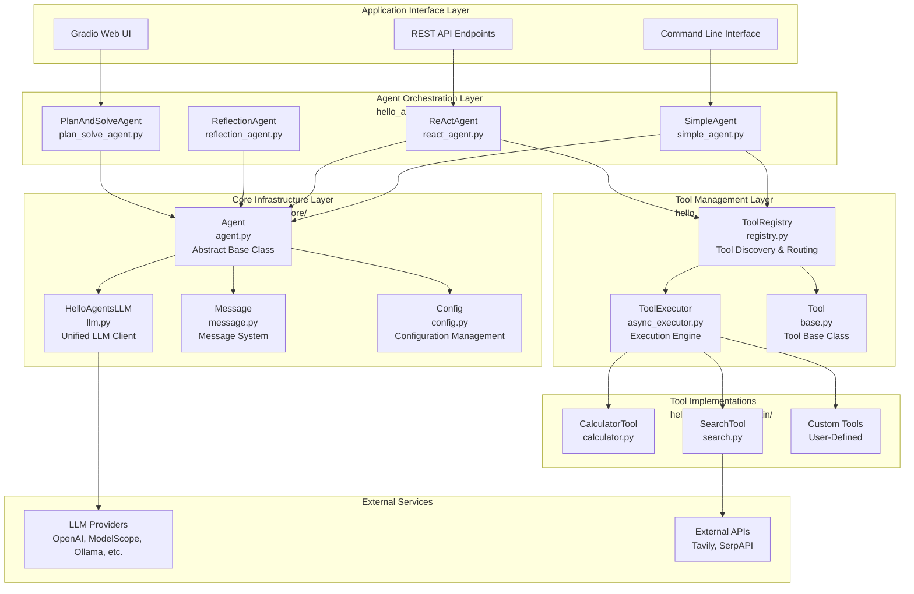
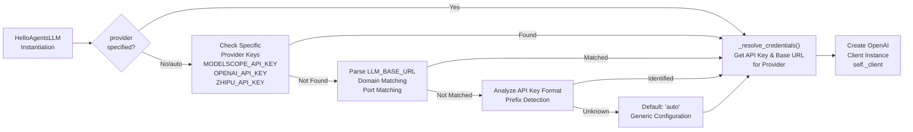
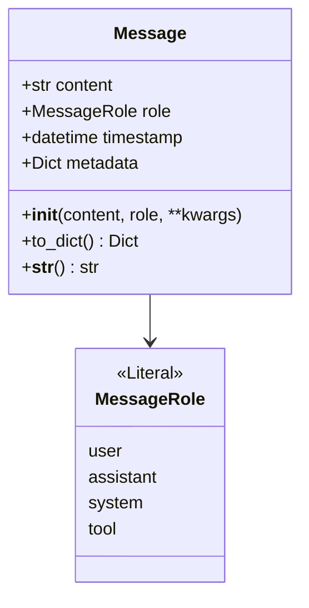
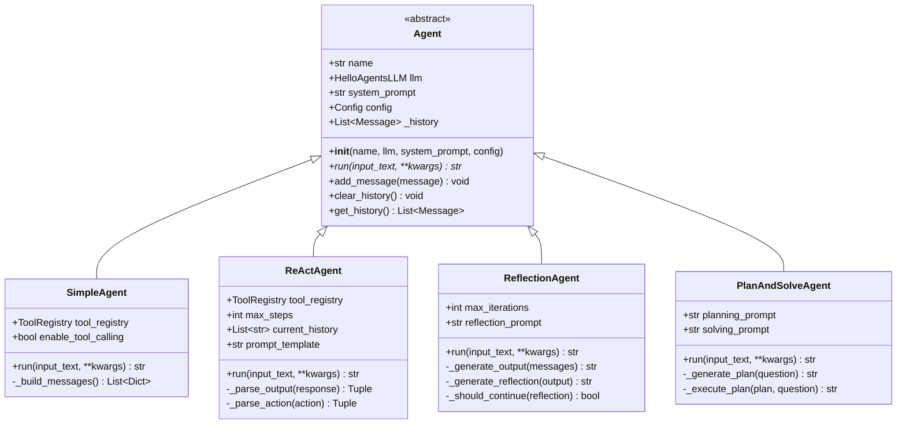
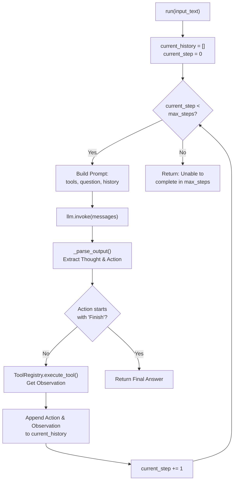
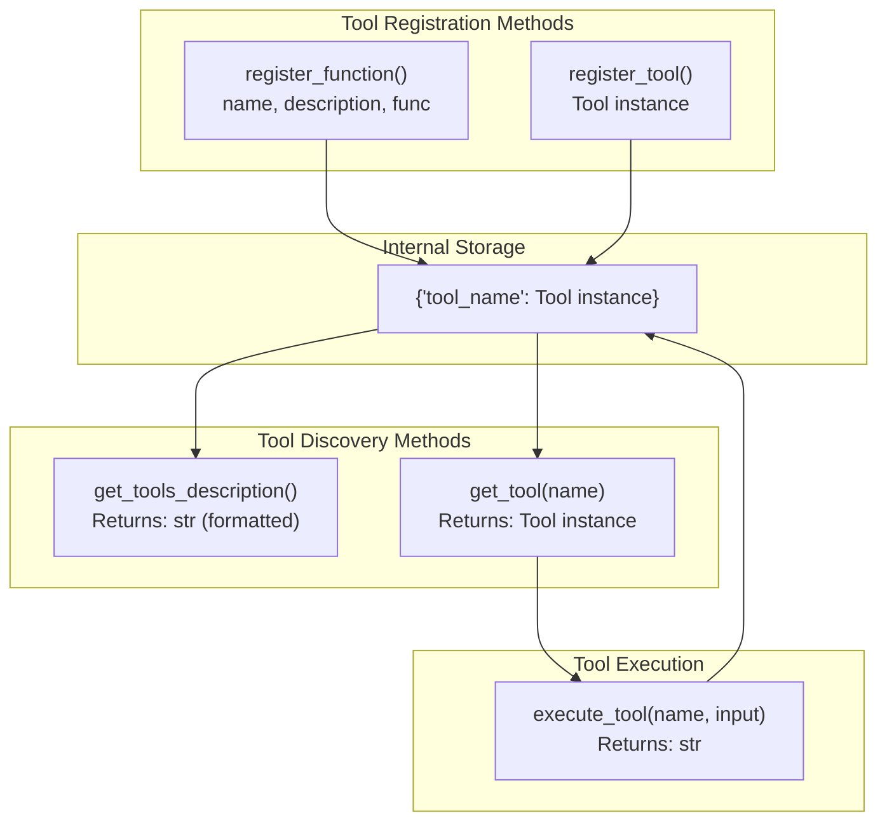

<!-- source: DeepWiki mcp.deepwiki.com · repo datawhalechina/hello-agents · page 7 HelloAgents Framework · fetched 2026-10-29 -->

# HelloAgents Framework

<details>
<summary>Relevant source files</summary>

The following files were used as context for generating this wiki page:

- [code/chapter7/.env.example](code/chapter7/.env.example)
- [code/chapter7/my_advanced_search.py](code/chapter7/my_advanced_search.py)
- [code/chapter7/my_calculator_tool.py](code/chapter7/my_calculator_tool.py)
- [code/chapter7/my_llm.py](code/chapter7/my_llm.py)
- [code/chapter7/my_main.py](code/chapter7/my_main.py)
- [code/chapter7/my_react_agent.py](code/chapter7/my_react_agent.py)
- [code/chapter7/my_simple_agent.py](code/chapter7/my_simple_agent.py)
- [code/chapter7/test_advanced_search.py](code/chapter7/test_advanced_search.py)
- [code/chapter7/test_my_calculator.py](code/chapter7/test_my_calculator.py)
- [code/chapter7/test_plan_solve_agent.py](code/chapter7/test_plan_solve_agent.py)
- [code/chapter7/test_react_agent.py](code/chapter7/test_react_agent.py)
- [code/chapter7/test_simple_agent.py](code/chapter7/test_simple_agent.py)
- [docs/chapter7/Chapter7-Building-Your-Agent-Framework.md](docs/chapter7/Chapter7-Building-Your-Agent-Framework.md)

</details>


## Purpose and Scope

This document provides comprehensive technical reference for the HelloAgents framework, a custom agent framework designed for educational purposes. HelloAgents implements a lightweight, teaching-friendly architecture where agents interact with large language models and tools through a unified interface. The framework prioritizes code transparency, minimal dependencies, and progressive learning paths.

**Related Pages:**
- For foundational agent concepts and terminology, see [Agent Concepts and Classification](#4.2)
- For specific agent reasoning patterns implemented in the framework, see [Agent Paradigms and Design Patterns](#5)
- For tool-specific documentation (Memory, RAG, etc.), see [Advanced Agent Capabilities](#8)
- For low-code alternatives to code-first development, see [Low-Code Platforms](#6.2)

**Scope:** This page covers the HelloAgents framework architecture, core components, agent base classes, tool system, LLM client integration, and extension patterns. It does not cover advanced capabilities like memory systems, RAG pipelines, or communication protocols, which are documented in [Advanced Agent Capabilities](#8).

---

## Framework Architecture Overview

### Design Philosophy

HelloAgents follows four core design principles:

| Principle | Implementation |
|-----------|----------------|
| **Lightweight & Teaching-Friendly** | Minimal dependencies, chapter-based versioning, fully readable codebase |
| **Standard API-Based** | Built on OpenAI-compatible interfaces for portability |
| **Progressive Learning Path** | Each chapter adds functionality incrementally with historical versions |
| **Unified Tool Abstraction** | Memory, RAG, RL, and MCP all abstracted as "tools" |

Sources: [docs/chapter7/Chapter7-Building-Your-Agent-Framework.md:38-58]()

### Layer Structure



**HelloAgents Framework Architecture**: The framework consists of five layers. The Application Interface Layer provides multiple interaction modalities. The Agent Orchestration Layer implements four agent patterns inheriting from a common base. The Core Infrastructure Layer provides shared services for LLM access, message handling, and configuration. The Tool Management Layer implements a plugin architecture for tool registration and execution. Tool Implementations include built-in tools and user-defined extensions.

Sources: [docs/chapter7/Chapter7-Building-Your-Agent-Framework.md:64-90](), [docs/chapter7/Chapter7-Building-Your-Agent-Framework.md:605-648]()

---

## Core Infrastructure Components

### HelloAgentsLLM: Unified LLM Client

`HelloAgentsLLM` is the framework's abstraction for interacting with large language models. It provides a unified interface across multiple providers through automatic detection and credential resolution.

#### Multi-Provider Support

The client supports the following providers:

| Provider | Detection Method | Default Base URL | Environment Variable |
|----------|-----------------|------------------|---------------------|
| `openai` | `OPENAI_API_KEY` | `https://api.openai.com/v1` | `OPENAI_API_KEY` |
| `modelscope` | `MODELSCOPE_API_KEY` or URL pattern | `https://api-inference.modelscope.cn/v1/` | `MODELSCOPE_API_KEY` |
| `zhipu` | `ZHIPU_API_KEY` | `https://open.bigmodel.cn/api/paas/v4` | `ZHIPU_API_KEY` |
| `ollama` | Port `:11434` in URL | `http://localhost:11434/v1` | `LLM_API_KEY` (any value) |
| `vllm` | Port `:8000` in URL | `http://localhost:8000/v1` | `LLM_API_KEY` (any value) |

Sources: [docs/chapter7/Chapter7-Building-Your-Agent-Framework.md:162-268](), [code/chapter7/my_llm.py:8-41]()

#### Automatic Provider Detection



**LLM Provider Auto-Detection Flow**: The `_auto_detect_provider()` method implements a three-tier priority system. First priority checks for specific provider environment variables. Second priority analyzes the `base_url` for domain or port patterns. Third priority examines API key format. If all fail, defaults to generic configuration.

Sources: [docs/chapter7/Chapter7-Building-Your-Agent-Framework.md:350-445]()

#### Key Methods

| Method | Purpose | Return Type |
|--------|---------|-------------|
| `invoke(messages, **kwargs)` | Synchronous single completion | `str` |
| `think(messages, **kwargs)` | Streaming completion with live output | `Iterator[str]` |
| `_auto_detect_provider(api_key, base_url)` | Infer provider from environment | `str` |
| `_resolve_credentials(api_key, base_url)` | Get provider-specific credentials | `tuple[str, str]` |

Sources: [docs/chapter7/Chapter7-Building-Your-Agent-Framework.md:153-160](), [code/chapter7/my_main.py:15-22]()

### Message System

The `Message` class provides structured message handling compatible with OpenAI API format.



**Message Class Structure**: The `Message` class uses Pydantic for validation. The `role` field is strictly typed using `Literal` to ensure compliance with OpenAI API specifications. The `to_dict()` method converts internal representation to API-compatible format.

Sources: [docs/chapter7/Chapter7-Building-Your-Agent-Framework.md:467-506](), [code/chapter7/my_simple_agent.py:49-50]()

Key features:
- **Role Validation**: Enforces four role types via `typing.Literal["user", "assistant", "system", "tool"]`
- **Timestamp Tracking**: Automatic timestamp assignment at creation via `datetime.now()`
- **Metadata Support**: Optional `metadata` field for extensibility
- **OpenAI Compatibility**: `to_dict()` method returns `{"role": str, "content": str}` format

Sources: [docs/chapter7/Chapter7-Building-Your-Agent-Framework.md:470-504]()

### Configuration Management

The `Config` class centralizes framework configuration with environment variable override support.

| Configuration Category | Key Parameters | Default Values |
|----------------------|----------------|----------------|
| **LLM Configuration** | `default_model`, `default_provider`, `temperature`, `max_tokens` | `"gpt-3.5-turbo"`, `"openai"`, `0.7`, `None` |
| **System Configuration** | `debug`, `log_level` | `False`, `"INFO"` |
| **Agent Configuration** | `max_history_length` | `100` |

The `from_env()` classmethod enables environment-driven configuration:

```python
# Environment variables override defaults
# LLM_MODEL_ID=your-model, LLM_TIMEOUT=60
config = Config.from_env()
```

Sources: [docs/chapter7/Chapter7-Building-Your-Agent-Framework.md:508-547](), [code/chapter7/.env.example:12-22]()

---

## Agent Base Class and Implementation Patterns

### Agent Abstract Base Class

The `Agent` abstract base class defines the interface contract that all agent implementations must follow.



**Agent Class Hierarchy**: All concrete agent implementations inherit from the abstract `Agent` base class. The base class enforces the `run()` method contract while providing common history management methods. Each concrete agent adds paradigm-specific attributes and private helper methods.

Sources: [docs/chapter7/Chapter7-Building-Your-Agent-Framework.md:552-598](), [docs/chapter7/Chapter7-Building-Your-Agent-Framework.md:605-648](), [code/chapter7/my_simple_agent.py:6-24](), [code/chapter7/my_react_agent.py:33-53]()

### Agent Implementation Patterns

#### SimpleAgent

`SimpleAgent` provides basic conversational capability without complex reasoning loops. It supports optional tool calling when integrated with `ToolRegistry`.

**Core Characteristics:**
- Direct LLM invocation with conversation history
- Optional tool integration via `tool_registry` parameter
- Configurable `enable_tool_calling` flag
- Streaming response support via `stream_run()`

**Usage Pattern:**
```python
# With tool support
registry = ToolRegistry()
agent = MySimpleAgent(name="Assistant", llm=llm, tool_registry=registry)
response = agent.run("Calculate 15 * 8 + 32")
```

Sources: [code/chapter7/my_simple_agent.py:6-55](), [code/chapter7/test_simple_agent.py:24-39]()

#### ReActAgent

`ReActAgent` implements the Reason-Act paradigm with iterative thought-action-observation loops.

**Core Characteristics:**
- Maximum step limit via `max_steps` parameter
- Prompt template with placeholders: `{tools}`, `{question}`, `{history}`
- Response parsing for `Thought:` and `Action:` segments
- Action execution via `ToolRegistry.execute_tool()`
- Loop termination on `Finish[answer]` action

**Execution Flow:**


Sources: [code/chapter7/my_react_agent.py:55-100](), [code/chapter7/test_react_agent.py:38-58]()

#### ReflectionAgent

`ReflectionAgent` implements self-critique and iterative refinement through reflection loops.

**Core Characteristics:**
- Maximum iteration limit via `max_iterations` parameter
- Two-phase generation: output generation + reflection
- Configurable reflection prompt template

Sources: [docs/chapter7/Chapter7-Building-Your-Agent-Framework.md:605-648]()

#### PlanAndSolveAgent

`PlanAndSolveAgent` implements two-phase strategic planning followed by step-by-step execution.

**Core Characteristics:**
- Separate planning and solving prompt templates
- Two-stage invocation: `_generate_plan()` then `_execute_plan()`

Sources: [docs/chapter7/Chapter7-Building-Your-Agent-Framework.md:605-648](), [code/chapter7/test_plan_solve_agent.py:1-25]()

---

## Tool System Architecture

### ToolRegistry: Tool Management

`ToolRegistry` provides centralized tool registration, discovery, and execution routing.



Sources: [code/chapter7/my_simple_agent.py:145-167](), [code/chapter7/test_react_agent.py:15-36]()

### Tool Registration Patterns

#### Function Registration

Register standalone functions directly using `register_function()`:

```python
registry = ToolRegistry()
registry.register_function("calculate", "Perform math", my_calculate)
```

Sources: [code/chapter7/my_calculator_tool.py:51-62](), [code/chapter7/test_react_agent.py:24]()

#### Class-Based Tools

Create tool classes and register instances using `register_tool()`:

```python
search_tool = MyAdvancedSearchTool()
registry.register_tool(search_tool)
```

Sources: [code/chapter7/my_advanced_search.py:6-130](), [code/chapter7/test_simple_agent.py:26-28]()

---

## Extension Patterns

### Custom LLM Providers

Extend `HelloAgentsLLM` to support new model providers:

```python
class MyLLM(HelloAgentsLLM):
    def __init__(self, provider="auto", **kwargs):
        if provider == "modelscope":
            self.api_key = os.getenv("MODELSCOPE_API_KEY")
            self.base_url = "https://api-inference.modelscope.cn/v1/"
            self._client = OpenAI(api_key=self.api_key, base_url=self.base_url)
        else:
            super().__init__(provider=provider, **kwargs)
```

Sources: [code/chapter7/my_llm.py:7-41](), [code/chapter7/my_main.py:8-22]()

### Custom Agent Reasoning

Override `run()` or prompt templates in base classes:

```python
class MyReActAgent(ReActAgent):
    def __init__(self, name, llm, tool_registry, custom_prompt=None):
        super().__init__(name, llm, system_prompt=None)
        self.prompt_template = custom_prompt or MY_REACT_PROMPT
```

Sources: [code/chapter7/my_react_agent.py:33-53](), [code/chapter7/test_react_agent.py:108-139]()

---

## Configuration and Environment Management

### Environment Variables

| Variable | Purpose |
|----------|---------|
| `LLM_MODEL_ID` | Default model identifier |
| `LLM_API_KEY` | Primary API key |
| `LLM_BASE_URL` | Service endpoint URL |
| `TAVILY_API_KEY` | Key for Tavily search tool |
| `SERPAPI_API_KEY` | Key for SerpApi search tool |

Sources: [code/chapter7/.env.example:1-32](), [code/chapter7/my_advanced_search.py:21-32]()

---

## File Structure Reference

| File Path | Purpose |
|-----------|---------|
| `code/chapter7/my_llm.py` | Custom LLM client implementation |
| `code/chapter7/my_simple_agent.py` | Base conversation agent with tool support |
| `code/chapter7/my_react_agent.py` | Reasoning and acting agent implementation |
| `code/chapter7/my_calculator_tool.py` | Mathematical tool implementation |
| `code/chapter7/my_advanced_search.py` | Multi-source search tool implementation |
| `code/chapter7/test_react_agent.py` | ReAct agent validation suite |
| `code/chapter7/test_simple_agent.py` | Simple agent validation suite |

Sources: File list provided

---

